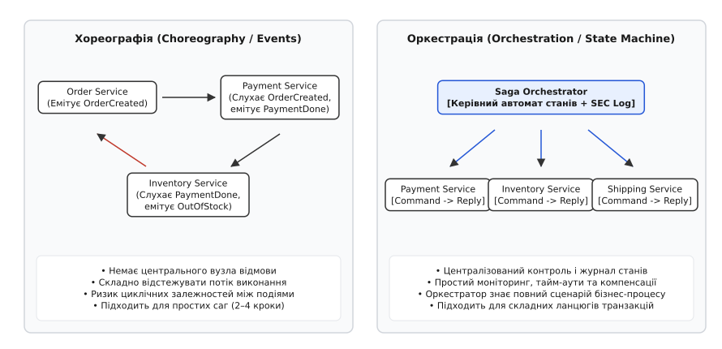

# ⚙️ Реалізація стійкого оркестратора Саги: журнал станів, ідемпотентні кроки та каскад компенсацій

Головна небезпека при побудові розподілених бізнес-процесів — перетворення коду на некерований набір розрізнених обробників подій або беззахисних RPC-викликів. Якщо під час виконання чергового кроку падає мережа або перезавантажується сам сервер-координатор, система без збереженого журналу назавжди втрачає інформацію про те, які дії вже зафіксовані в базах даних, а які потребують компенсації.

Розглянемо повноцінну реалізацію рушія оркестрації Саги (*Saga Execution Coordinator*, SEC). Архітектура спирається на три непорушні принципи:
1. **Незмінний журнал станів (SEC Log):** кожна зміна фази саги та кожен результат кроку скидається у стійке сховище до надсилання мережевої команди.
2. **Ідемпотентність операцій:** кожен виклик несе унікальний ідентифікатор саги та номер кроку, захищаючи сервіси від подвійного списання при повторах.
3. **Класифікація кроків:** розділення дій на компенсовні (*compensable*), точку неповернення (*pivot*) та повторювані (*retryable*).

*Архітектура координатора: центральний автомат станів відправляє команди кроків, записує переходи у журнал та розгортає зворотний стек компенсацій при збоях.*

## Задача: Оформлення розподіленого замовлення

Бізнес-сценарій складається з трьох послідовних етапів:
* **Крок 1 (Payment):** списання 1500 грн з рахунку користувача. Компенсовна дія: повернення коштів.
* **Крок 2 (Inventory):** резервування товару на складі. Поворотна дія (*Pivot*): після успіху склад зафіксовано. При відмові: повертаємо гроші кроку 1.
* **Крок 3 (Notification):** відправка електронного листа з чеком. Повторювана дія (*Retryable*): гарантована відправка з повторами при таймаутах.

## Анатомія журналу виконання саги (SEC Log)

Журнал координатора — це журнал випереджального запису (*Write-Ahead Log*), адаптований для розподілених середовищ. До того як надіслати мережевий виклик до віддаленого сервісу платежів чи складу, координатор зобов'язаний зберегти запис `EXECUTING` у локальній базі даних.

Схема типового рядка в таблиці журналу саги:
* `saga_id` (UUIDv4) — глобальний ідентифікатор екземпляра саги.
* `step_index` (int) — порядковий номер кроку (0, 1, 2...).
* `step_name` (varchar) — назва кроку для трасування (`Payment`, `Inventory`).
* `state` (enum) — поточний стан (`EXECUTING`, `COMPLETED`, `FAILED`, `COMPENSATING`, `COMPENSATED`).
* `payload` (JSON/Protobuf) — параметри вхідних даних та контекст виконання.
* `updated_at` (timestamp) — позначка часу останньої мутації для детекції завислих процесів.

Якщо сервер-координатор зазнає апаратного перезапуску, під час старту фоновий воркер виконує процедуру відновлення (*Recovery Scan*):
1. Вибирає всі саги, які перебувають у проміжних станах (`EXECUTING` або `COMPENSATING`).
2. Для саг у стані `EXECUTING` перевіряє час останнього оновлення. Якщо таймаут минув, координатор повторює запит до сервісу (використовуючи ключ ідемпотентності) або ініціює компенсаційний відкат.
3. Для саг у стані `COMPENSATING` координатор продовжує розгортання стека компенсацій у зворотному порядку, починаючи з останнього незавершеного кроку.

## Робочий код: Двигун оркестрації з журналом відновлення

:::tabs
:::code proj-saga-orchestrator/cpp/main.cpp
:::code proj-saga-orchestrator/go/main.go
:::

## Інженерні пастки реалізації

### 1. Падіння самого координатора під час компенсації
Якщо процес оркестратора гине посеред виконання кроку `C[2]`, під час рестарту сервіс зчитує `SEC-LOG` з диска або бази даних. Знайшовши сагу у стані `COMPENSATING`, координатор відновлює виконання строго з незавершеного кроку компенсації `C[2]`, а не з початку.

Для кластерних середовищ, де запущено кілька екземплярів оркестратора, відновлення координується через механізм розподіленого лізингу або лічильників епохи (*fencing tokens*): лише один вузол бере на себе обробку завислої саги, унеможливлюючи подвійне виконання паралельними воркерами.

### 2. Отруйна пігулка (*Poison Pill*) та ручне втручання
Якщо компенсаційна транзакція повертає фатальну помилку (наприклад, сторонній платіжний шлюз змінив формат підпису запиту або рахунок користувача заблоковано регулятором), нескінченні автоматичні повтори заблокують обробку.

У таких ситуаціях застосовується покрокова ескалація:
* Після 5 невдалих спроб з експоненційною затримкою (*exponential backoff with jitter*) сага переводиться у стан `MANUAL_RECONCILIATION_REQUIRED`.
* Повний контекст саги, включаючи історію спроб та тіла відповідей, відправляється у чергу мертвих повідомлень (*Dead Letter Queue*, DLQ).
* Оператор технічної підтримки через адмін-панель може вручну перевірити стан рахунку, виконати банківську проводку в ручному режимі та позначити крок як `COMPENSATED`, дозволивши оркестратору завершити решту компенсацій.

### 3. Гарантія обов'язкової ідемпотентності та Transactional Outbox
Компенсаційна транзакція `C[i]` може викликатися кілька разів через розриви мережевих з'єднань або таймаути. Якщо платіжний сервіс не підтримує таблицю ідемпотентності за ключем `saga_id + "_step_" + step_index + "_comp"`, повтор повернення коштів призведе до подвійного зарахування грошей клієнту.

Для відправки повідомлень між оркестратором та сервісами використовується патерн [Transactional outbox](root:sf-distributed/outbox-pattern): запис про намір відправити команду вставляється в ту саму локальну транзакцію бази даних, що й зміна стану в `SEC-LOG`. Фоновий процес вичитує outbox-таблицю й гарантовано публікує повідомлення в брокер, усуваючи дуальний запис (*dual-write hazard*). На боці сервісу-отримувача працює [Inbox-патерн](root:sf-distributed/inbox-pattern), який фільтрує дублікати перед виконанням бізнес-логіки.

### 4. Простеження виконання за журналом (Трасування)

Розглянемо трасу подій у консолі для другого сценарію (збій складу):
1. `Saga=ORD-1002 Step[0]=Payment -> State=EXECUTING` — оркестратор записує намір.
2. `[Billing] Списано 1500 грн для ORD-1002` — платіж зафіксовано в банку.
3. `Saga=ORD-1002 Step[0]=Payment -> State=COMPLETED` — підтвердження отримано.
4. `Saga=ORD-1002 Step[1]=Inventory -> State=EXECUTING` — спроба зарезервувати товар.
5. `[Warehouse] ПОМИЛКА: Товару немає на залишку!` — виявлено бізнес-відмову (поворотний крок не виконано).
6. `Saga=ORD-1002 Step[1]=Inventory -> State=FAILED` — фіксація збою.
7. `Saga=ORD-1002 Step[0]=Payment -> State=COMPENSATING` — запуск зворотної компенсації платежу.
8. `[Billing-Comp] Повернуто 1500 грн для ORD-1002` — кошти зараховано назад.
9. `Saga=ORD-1002 Step[0]=Payment -> State=COMPENSATED` — компенсація зафіксована.
10. `=== Сага ORD-1002 компенсована (стан узгоджено) ===` — фінальне сходження системи.

Усі гроші на місці, товари на складі не заблоковані, а клієнт отримує зрозумілу відповідь про відсутність товару без завислих ресурсів.
