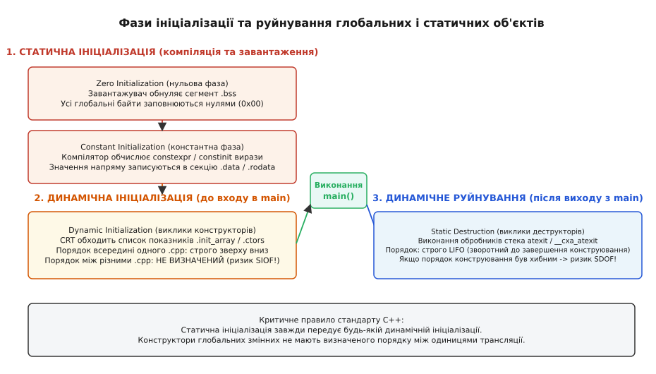
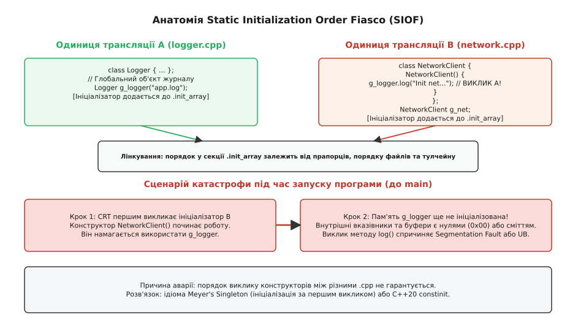
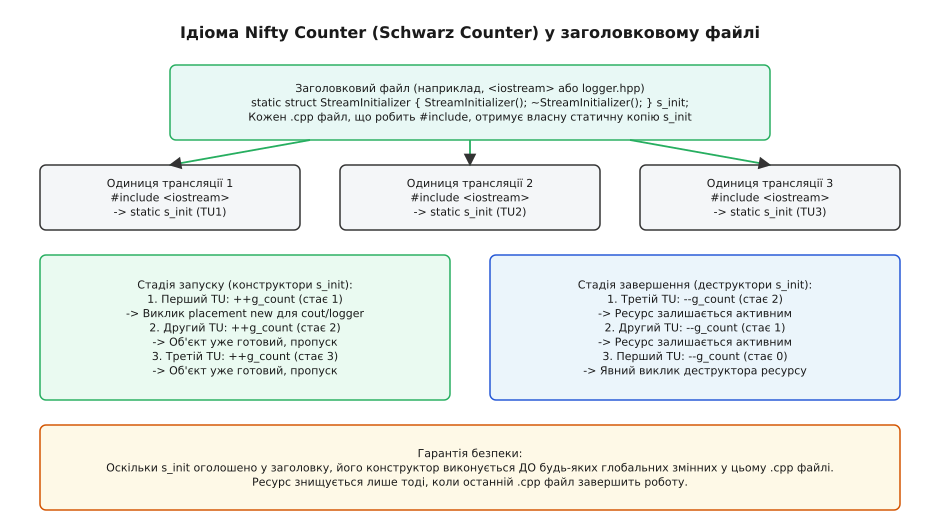

# Катастрофа порядку статичної ініціалізації

<preknowlist>
- [Одиниця трансляції та зв'язування: static, extern, inline](root:sf-lang/translation-unit) — межі компіляції окремого `.cpp` файлу, внутрішнє та зовнішнє зв'язування символів.
- [Лінкування](root:sf-lang/linking) — збирання об'єктних файлів в єдиний виконуваний образ, сегменти `.data`, `.bss` та секції ініціалізаторів.
- [Конструктор і деструктор](root:sf-lang/constructors-destructors) — життєвий цикл об'єктів, автоматичне створення та звільнення ресурсів.
- [C-рантайм](root:sf-lang/c-runtime) — точка входу `_start`, підготовка пам'яті процесу та передача керування в `main()`.
- [constexpr](root:sf-lang/constexpr) — обчислення виразів на етапі компіляції та створення константних структур даних.
</preknowlist>

Під час завантаження виконуваного образу програми операційна система та стартовий код C++ рантайму повинні підготувати пам'ять для всіх глобальних змінних, статичних полів класів та об'єктів у просторах імен до того, як перший потік виконання передасть керування у функцію `main()`. Життєвий цикл цієї пам'яті фундаментально поділяється на дві послідовні фази: **статичну ініціалізацію** (лат. *initialis* — початковий, від *initium* — початок) та **динамічну ініціалізацію**. Статична фаза гарантовано передує динамічній: спочатку завантажувач або стартовий код зануляє сегмент неініціалізованих даних (`.bss`), заповнюючи всі байти нулями `0x00` (нульова ініціалізація, англ. *zero initialization*), після чого фіксує значення, розраховані компілятором на етапі збирання (константна ініціалізація, англ. *constant initialization*).

У динамічній фазі виконуються нетривіальні конструктори об'єктів та обчислюються вирази, які не вдалося розрахувати під час компіляції. Всередині однієї **одиниці трансляції** (лат. *translatio* — перенесення, передача, англ. *translation unit*) порядок виконання таких конструкторів строго визначений і відповідає черговості їхньої появи у вихідному коді (*sequenced-before*). Проте між різними одиницями трансляції — окремими `.cpp` файлами — стандарт мови C++ свідомо залишає порядок динамічної ініціалізації невизначеним (*unspecified*).

Коли конструктор глобального об'єкта в одному файлі намагається звернутися до глобального об'єкта з іншого файлу, результат залежить від того, чий конструктор рантайм викличе першим. Якщо залежний об'єкт ініціалізується раніше за свого постачальника, він звертається до сирої зануленої пам'яті, де ще не виконано конструктор. Це призводить до розіменування нульових вказівників, пошкодження пам'яті або аварійного завершення процесу. Цей системний дефект називають **катастрофою порядку статичної ініціалізації** (англ. *Static Initialization Order Fiasco*, SIOF; італ. *fiasco* — пляшка, ковба, від виразу *far fiasco* — зазнати повної невдачі, розбитися; грец. *στατικός* — нерухомий, стійкий).

## Фази життя глобальних об'єктів: від двійкового образу до main()

Щоб зрозуміти, чому виникає колізія, необхідно простежити шлях, який долає пам'ять глобальних об'єктів від моменту збирання компілятором до початку виконання користувацького алгоритму.

У двійковому файлі формату ELF (на Linux) або PE/COFF (на Windows) глобальні та статичні змінні розміщуються у різних секціях залежно від типу їхньої ініціалізації:

1. **Секція `.rodata` (Read-Only Data)**: містить константи часу компіляції, рядкові літерали та таблиці віртуальних методів (`vtable`). Ця пам'ять захищена операційною системою від запису на рівні сторінок віртуальної пам'яті.
2. **Секція `.data`**: містить змінні з явно вказаними сталими значеннями (наприклад, `int g_val = 42;`), які компілятор записує безпосередньо в тіло двійкового файлу.
3. **Секція `.bss` (Block Started by Symbol)**: резервує простір для змінних без явної ініціалізації або з нульовими початковими значеннями. Самі нулі не зберігаються на диску для економії розміру файлу; ядро ОС виділяє під них занулені сторінки під час завантаження образу.
4. **Секція `.init_array` (або `.ctors`)**: масив покажчиків на службові функції-ініціалізатори, згенеровані компілятором для кожної одиниці трансляції.


*Послідовність переходу пам'яті від нульової та константної фаз до динамічного виклику конструкторів і стека завершення atexit.*

Процес ініціалізації відбувається у суворій послідовності кроків:

```
[1. Завантаження образу] → [2. Zero Init (.bss)] → [3. Constant Init (.data)]
                                                              ↓
[6. Вихід: стек atexit] ← [5. Виконання main()] ← [4. Dynamic Init (.init_array)]
```

Під час статичної фази будь-яка глобальна змінна гарантовано отримує нульове представлення або значення часу компіляції. Жоден виконуваний код на цьому етапі не викликається: робота зводиться до відображення сторінок пам'яті в адресному просторі процесу.

Динамічна фаза починається, коли системний завантажувач передає керування функції точки входу C-рантайму (`_start`). До того, як передати керування у функцію `main()`, рантайм обходить секцію `.init_array` і послідовно викликає кожну функцію за знайденими адресами.

Компілятор групує всі глобальні конструктори одного `.cpp` файлу в єдину синтетичну функцію (у компіляторі GCC вона має внутрішнє ім'я на зразок `_GLOBAL__sub_I_filename.cpp` або `__static_initialization_and_destruction_0`). Якщо в межах одного файлу оголошено три змінні:

```cpp
// file.cpp
Widget g_first;
Gadget g_second;
Device g_third;
```

Компілятор згенерує функцію ініціалізації, яка гарантовано викличе конструктори строго по черзі: `Widget()` → `Gadget()` → `Device()`.

Проте коли компонувальник (linker) збирає сотні об'єктних файлів у єдиний бінарний образ, він просто склеює їхні секції `.init_array` в один суцільний список. Порядок, у якому ці покажчики потрапляють до фінального масиву, залежить виключно від порядку передачі файлів у командному рядку компонувальника, черговості розпакування статичних бібліотек (`.a` / `.lib`) та оптимізацій компонування на рівні всієї програми (LTO, Link-Time Optimization). Стандарт C++ забороняє розробникові покладатися на будь-який конкретний порядок виклику цих функцій між різними одиницями трансляції.

## Анатомія колізії: невидима пастка між різними .cpp

Розглянемо класичну архітектурну ситуацію: підсистему журналювання подій (`Logger`) та підсистему мережевого підключення (`NetworkClient`).

Обидва модулі рознесено по окремих вихідних файлах для модульності:

:::tabs
:::code cpp-static-init-order-d/cpp/logger.hpp
:::code cpp-static-init-order-d/c/logger_c.h
:::

Реалізація журналу міститься у файлі `logger.cpp`:

```cpp
// logger.cpp
#include "logger.hpp"

// Глобальний об'єкт журналу
Logger g_logger("application.log");
```

Тим часом мережевий модуль оголошує власного глобального клієнта, який прагне зафіксувати старт своєї роботи у журналі безпосередньо під час конструювання:

:::code cpp-static-init-order-d/cpp/network.cpp

Точка входу програми міститься у третьому файлі `main.cpp`:

```cpp
// main.cpp
#include "logger.hpp"

int main() {
    g_logger.log("main(): програму успішно запущено.");
    return 0;
}
```


*Зіткнення двох одиниць трансляції: звернення до неініціалізованого об'єкта через довільний порядок виклику ініціалізаторів лінкером.*

Тепер поведінка програми повністю залежить від конфігурації системи збирання:

- **Сценарій A (вдалий збіг):** компонувальник розмістив ініціалізатор `logger.cpp` перед `network.cpp`. Спочатку викликається `Logger("application.log")`, створюється внутрішній рядок `m_filename`, поле `m_is_open` стає `true`. Далі викликається `NetworkClient()`, метод `g_logger.log()` бачить готовий об'єкт і друкує повідомлення. Програма працює без збоїв.
- **Сценарій B (катастрофа SIOF):** компонувальник розмістив ініціалізатор `network.cpp` першим. Рантайм починає з виклику `NetworkClient()`. Всередині конструктора викликається `g_logger.log()`. Але пам'ять `g_logger` на цей момент пройшла **лише** статичну нульову фазу!

Що реально містить `g_logger` у момент виклику в Сценарії B?
Поле `m_is_open` дорівнює `false` (байт `0x00`). Поле `m_filename` типу `std::string` містить нулі у внутрішніх покажчиках на буфер символів та розмір рядка. Спроба викликати метод або прочитати неініціалізований `std::string` призводить до розіменування нульового покажчика (Null Pointer Dereference), звернення до невалідних сторінок пам'яті та миттєвого завершення програми з сигналом `SIGSEGV` ще **до того, як виконається хоча б один рядок у `main()`**.

Найнебезпечніша властивість SIOF — його плаваючий і прихований характер:
1. Програма може роками стабільно працювати на комп'ютері розробника, де файли компонуються за алфавітом.
2. Зміна системи збирання (наприклад, перехід з Make на Ninja або CMake), зміна прапорців оптимізації (`-O0` на `-O3`) або додавання нового файлу у проект змінює порядок передачі об'єктних модулів компонувальнику.
3. Програма раптово падає під час запуску на сервері або у релізній версії без будь-яких змін у коді самих залежних підсистем.

Детальний приклад відтворення та автоматичного виявлення цієї аварії наведено у проектній вставці: `[Практичне відтворення та діагностика SIOF через AddressSanitizer](root:sf-lang/cpp-static-init-order/proj-safe-logger-registry.md)`.

## Катастрофа зворотного порядку: деструкція при завершенні (SDOF)

Проблема не обмежується етапом запуску. Дзеркальна аварія виникає на етапі зупинки програми та називається **катастрофою порядку статичної деструкції** (англ. *Static Destruction Order Fiasco*, SDOF; лат. *destructor* — руйнівник, від *destruere* — руйнувати).

Коли функція `main()` повертає значення або викликається функція `std::exit()`, рантайм C++ зобов'язаний коректно знищити всі глобальні та статичні об'єкти, викликавши їхні деструктори.

Стандарт C++ чітко визначає порядок деструкції: об'єкти зі статичною тривалістю зберігання руйнуються у порядку, строго **зворотному** до фактичного завершення їхнього конструювання (принцип LIFO — Last-In, First-Out; англ. *last-in, first-out* — останнім прийшов, першим пішов).

Механізм базується на системному виклику реєстрації деструкторів `atexit` або стандартній ABI-функції `__cxa_atexit`:
1. Щойно конструктор конкретного глобального об'єкта успішно завершує виконання, компілятор викликає `__cxa_atexit`, передаючи адресу деструктора та покажчик на створений об'єкт.
2. Ці записи складаються у динамічний стек завершення.
3. Під час виходу рантайм виштовхує деструктори зі стека у зворотному напрямку.

Розглянемо, як це створює пастку:

:::code cpp-static-init-order-d/cpp/database.cpp

Якщо під час запуску програми об'єкти конструювалися у послідовності:
```
1. g_db_conn (успішно сконструйовано)
2. g_logger  (успішно сконструйовано)
```

То під час завершення програми порядок виклику деструкторів буде строго зворотним:
```
1. ~Logger()               [g_logger повністю зруйновано: файли закрито, буфери звільнено]
2. ~DatabaseConnection()   [Викликає g_logger.log() над уже МЕРТВИМ об'єктом!]
```

Деструктор `DatabaseConnection` намагається скористатися ресурсом, чий життєвий цикл уже завершено (use-after-free). Це призводить до пошкодження пам'яті під час виходу з процесу, зависання м'ютексів або втрати нескинутих на диск даних.

## Патерн «Ініціалізація за першим викликом» (Meyer's Singleton)

Першим та найпоширенішим інженерним шаблоном розв'язання проблеми SIOF є патерн **ініціалізації за першим викликом** (англ. *Construct on First Use*), сформульований Скоттом Мейєрсом (англ. *Scott Meyers*) і відомий як **синглтон Мейєрса** (лат. *singulus* — поодинокий, єдиний).

Ідея полягає в тому, щоб перетворити небезпечну глобальну змінну на локальну статичну змінну всередині функції-обгортки, яка повертає посилання на готовий екземпляр:

:::tabs
:::code cpp-static-init-order-d/cpp/safe_logger.hpp
:::code cpp-static-init-order-d/c/safe_logger_c.c
:::

Тепер залежний клієнт викликає функцію замість прямого звернення до глобальної змінної:

:::code cpp-static-init-order-d/cpp/network-2.cpp

Чому це повністю усуває SIOF:
1. Якщо `NetworkClient` конструюється першим, виклик `Logger::instance()` змушує компілятор виконати конструктор `Logger` безпосередньо в цій точці.
2. Посилання повертається на вже сконструйований і валідний об'єкт.
3. Усі наступні виклики `Logger::instance()` повертають той самий екземпляр без повторного конструювання.

### Потокобезпека та магічна статика (Magic Statics у C++11)

До стандарту C++11 локальні статичні змінні не були потокобезпечними: якщо два потоки одночасно викликали `instance()`, виникав стан гонитви (data race), і конструктор міг виконатися двічі або повернути посилання на напівсконструйований об'єкт.

Починаючи з C++11, стандарт мови (розділ [stmt.dcl]) надав сувору гарантію: якщо потік намагається ініціалізувати статичну змінну в той час, як інший потік уже виконує її конструктор, решта потоків блокуються і чекають завершення ініціалізації.

Компілятори реалізують це через внутрішній атомарний захист (у рантаймі Itanium ABI — через функції `__cxa_guard_acquire` та `__cxa_guard_release`):

:::code cpp-static-init-order-d/cpp/potokobezpeka-ta-mahichna.cpp

*Ціна рішення:* на гарячих шляхах виконання кожен виклик `instance()` супроводжується перевіркою атомарного прапорця. Завдяки апаратному передбаченню переходів процесора (branch prediction) ця перевірка коштує частки наносекунди, проте в критичних до затримок циклах виклик методу краще винести за межі циклу, зберігши посилання локально.

## Ідіома Nifty Counter (Schwarz Counter): техніка для стандартних бібліотек

Хоча синглтон Мейєрса ідеально підходить для прикладного коду, для системних бібліотек (таких як `<iostream>`) він має суттєву ваду: необхідність змінювати синтаксис виклику з прямого `std::cout << x` на функціональний `std::cout().write(x)`.

Щоб зберегти чистий синтаксис глобального об'єкта і водночас унеможливити SIOF та SDOF, Джеррі Шварц розробив ідіому **Nifty Counter** (або **Schwarz Counter**).

Історія виникнення цього рішення в лабораторіях Bell Labs під час розробки Cfront 2.0 детально викладена в історичній вставці: `[Історія створення Schwarz Counter у Cfront 2.0](root:sf-lang/cpp-static-init-order/hist-schwarz-counter.md)`.


*Підрахунок посилань між одиницями трансляції для гарантованої ініціалізації до першого звернення та руйнування після останнього.*

Механізм реалізується у чотири кроки:

1. Пам'ять під глобальний об'єкт виділяється як сирий вирівняний байтовий масив, щоб запобігти автоматичному виклику статичного конструктора:

:::code cpp-static-init-order-d/cpp/stream.hpp

2. У файлі реалізації `stream.cpp` оголошується сам буфер та лічильник посилань:

:::code cpp-static-init-order-d/cpp/stream.cpp

3. **Гарантія на старті:** Коли будь-який користувацький `.cpp` підключає `#include "stream.hpp"`, компілятор розміщує копію `s_stream_init` перед будь-якими глобальними змінними цього `.cpp`. Конструктор `s_stream_init` виконується першим, збільшує лічильник і створює `StreamBuffer` у сирій пам'яті за допомогою `placement new`.
4. **Гарантія на виході:** Об'єкт `StreamBuffer` залишається живим доти, доки не виконається деструктор останнього `s_stream_init`. Це усуває проблему передчасного знищення ресурсу під час виходу з програми.

## Гарантія компілятора: constexpr та constinit у C++20

Найкращий спосіб уникнути проблем динамічної ініціалізації — це повністю перенести ініціалізацію у фазу компіляції (статичну фазу). Якщо значення змінної обчислене компілятором і записане в секцію `.data` або `.rodata`, катастрофа SIOF фізично неможлива, оскільки дані готові ще до виконання першої машинної інструкції процесора.

У C++11 для цього ввели ключове слово `constexpr`. Проте `constexpr` має обмеження: воно обов'язково робить змінну константною (`const`).

Що робити, якщо змінна повинна мати глобальний доступ і змінюватися під час виконання програми, але її початковий стан зобов'язаний бути безпечно сформований на етапі компіляції?

Для розв'язання цієї дилеми стандарт **C++20** ввів специфікатор `constinit`:

:::code cpp-static-init-order-d/cpp/harantiia-kompiliatora.cpp

Відмінність специфікаторів:

```
constinit = Static Constant Initialization + Мутабельний стан (non-const)
constexpr = Static Constant Initialization + Незмінний стан (const)
```

Якщо програміст випадково передасть у конструктор змінної з `constinit` вираз, який не можна обчислити під час компіляції:

```cpp
int get_dynamic_port() { return rand() % 1000; }

// ПОМИЛКА КОМПІЛЯЦІЇ у C++20:
constinit DeviceDescriptor g_bad_device(get_dynamic_port(), 9600);
```

Компілятор миттєво відхилить збирання помилкою:
```text
error: 'constinit' variable 'g_bad_device' must be initialized by a constant expression
note: non-constexpr function 'get_dynamic_port' cannot be used in a constant expression
```

`constinit` діє як строгий статичний бар'єр: він гарантує, що змінна ніколи не скотиться у небезпечну динамічну фазу ініціалізації через випадкову зміну коду.

Повний довідник компіляторних атрибутів, прапорців пріоритетів та системних контрактів наведено у довідковій вставці: `[Довідник атрибутів та компіляторних розширень ініціалізації](root:sf-lang/cpp-static-init-order/api-init-attributes.md)`.

## Потокова статична тривалість зберігання: thread_local

Окремим різновидом проблеми є **потокова катастрофа ініціалізації** (англ. *Thread-Local Static Initialization Order Fiasco*), що виникає при роботі зі специфікатором `thread_local`.

Змінні з тривалістю зберігання `thread_local` створюються окремо для кожного операційного потоку. За стандартом C++ їхня динамічна ініціалізація відбувається або під час старту нового потоку, або безпосередньо перед першим зверненням до будь-якої функції чи змінної з відповідної одиниці трансляції у цьому потоці.

Якщо потік `T1` звертається до `thread_local` змінної `g_worker_ctx` з файлу `worker.cpp`, яка у своєму конструкторі залежить від іншої `thread_local` змінної `g_security_token` з `auth.cpp`, порядок їхньої ініціалізації знову стає недетермінованим між цими двома файлами.

Для захисту потокових ресурсів застосовують ту саму ідіому Мейєрса, комбінуючи її зі специфікатором `thread_local`:

```cpp
class WorkerContext {
public:
    static WorkerContext& current_thread_instance() {
        // Ініціалізується строго один раз для кожного потоку під час першого виклику
        thread_local WorkerContext s_tls_instance;
        return s_tls_instance;
    }
};
```

Такий підхід ізолює стан кожного потоку, гарантує безпечне створення за вимогою та запобігає міжпотоковим станам гонитви на стадії старту сервісів.

## Порівняння інженерних стратегій захисту

Кожен з розглянутих патернів має власну область ефективності та ціну:

| Стратегія | Механізм захисту | Переваги | Обмеження та недоліки |
|---|---|---|---|
| **Meyer's Singleton** | Локальна `static` змінна у функції доступу | Потокобезпечно з C++11, проста реалізація, створення строго за вимогою. | Необхідність викликати метод `instance()`, невеликий накладний оверхед перевірки прапорця. |
| **Nifty Counter (Schwarz)** | Статичний лічильник у заголовку + `placement new` | Зберігає синтаксис прямого звернення до глобальної змінної, симетричний життєвий цикл. | Складніша кодова база, розміщення службового об'єкта в кожному включенні заголовка. |
| **C++20 constinit** | Примусова константна ініціалізація під час компіляції | Нульова вартість у рантаймі, 100% захист від SIOF на етапі збирання, мутабельність. | Вимагає `constexpr`-сумісного конструктора, не дозволяє динамічне виділення пам'яті на старті. |
| **Двоетапна ініціалізація** | Статичне створення + явний виклик `init()` у `main()` | Повний детермінований контроль черговості запуску підсистем людиною. | Людський фактор: ризик забути викликати `init()` або викликати у неправильному порядку. |

В архітектурі надійних систем найвищим пріоритетом є повне усунення динамічної ініціалізації глобальних змінних за допомогою `constexpr` та `constinit`. Для складних ресурсів із динамічним станом канонічним вибором є синглтон Мейєрса або явні менеджери життєвого циклу підсистем, керовані безпосередньо з `main()`.
