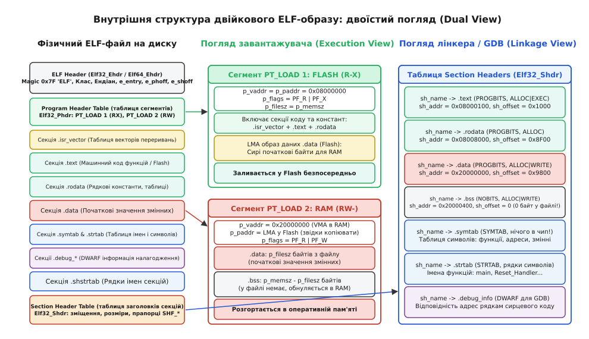
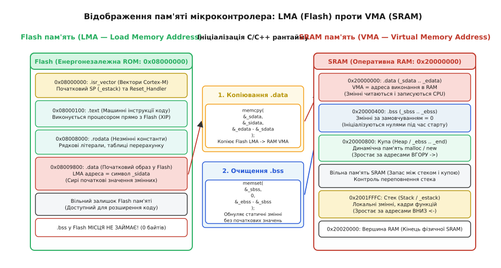

# ELF-образ

<preknowlist>
- [Лінкування](root:sf-lang/linking) — об'єднання об'єктних файлів, роздільна трансляція, розв'язання зовнішніх посилань та таблиці релокацій.
- [Лінкер-скрипт](root:sf-lang/linker-script) — директиви MEMORY та SECTIONS, розподіл адрес VMA/LMA, вирівнювання та межі пам'яті.
- [Одиниця трансляції та зв'язування: static, extern, inline](root:sf-lang/translation-unit) — видимість символів, глобальні змінні та область видимості.
- [C-рантайм](root:sf-lang/c-runtime) — фази ініціалізації середовища виконання, виклик конструкторів та точки входу.
- [Мікроконтролер](root:hw-arch/microcontroller) — фізична організація Flash та SRAM, карта адрес периферії та векторів переривань.
</preknowlist>

Коли складальний ланцюг компілятора GCC або Clang завершує збирання прошивки для 32-бітного мікроконтролера на базі архітектури ARM Cortex-M чи RISC-V, на виході утворюється файл з розширенням `.elf` розміром, наприклад, 1.4 мегабайта. Якщо цей файл без попередньої обробки напряму записати в мікроконтролер, обсяг Flash-пам'яті якого складає лише 128 кілобайтів, а оперативної пам'яті SRAM — 32 кілобайти, апаратний завантажувач мікроконтролера зазнає повної відмови, а процесорне ядро після скидання зависне в нескінченному циклі апаратного винятку HardFault.

Цей крах зумовлений тим, що файл формату **ELF** (*Executable and Linkable Format* — виконуваний та придатний до зв'язування формат) є структурним мета-контейнером, а не суцільним потоком виконуваних процесорних інструкцій. Понад 90 відсотків його початкового обсягу становлять службові структури: таблиці заголовків сегментів і секцій, таблиця імен та адрес глобальних символів, зміщення для динамічного зв'язування, а також розгалужене дерево налагоджувальних метаданих стандарту DWARF. Процесорне ядро під час старту не володіє апаратними засобами для розбору складних файлових структур — воно очікує знайти за адресою початкового вектора скидання чітко впорядковані машинні інструкції та початкові дані змінних. Щоб перетворити складний контейнер на працездатний образ прошивки, розробник вбудованих систем повинен досконало розуміти внутрішню анатомію двійкового ELF-образу, механізм дуальної адресації LMA/VMA та правила вилучення корисного навантаження.


*Двійковий макет ELF-образу: фізичний файл на диску розбивається на дрібні секції для лінкера та об'єднується у монолітні завантажувані сегменти для виконання у Flash та SRAM.*

## Анатомія двійкового заголовка ELF

Кожен двійковий ELF-файл починається з фіксованої структури даних — **головного заголовка ELF** (*ELF Header*). Для 32-бітних архітектур ця структура має назву `Elf32_Ehdr` розміром рівно 52 байти, а для 64-бітних систем — `Elf64_Ehdr` розміром 64 байти. Головний заголовок відіграє роль «паспорта» та кореневого каталогу всього двійкового файлу: він містить сигнатуру ідентифікації формату, архітектурні прапорці цільового процесора, адресу точки входу програми, а також точні файлові зміщення таблиць програмних заголовків та заголовків секцій.

Перші 16 байтів заголовка утворюють масив ідентифікації `e_ident[16]`. Цей масив має суворо стандартизовану структуру, яка розпізнається будь-яким системним завантажувачем або утилітою аналізу двійкового коду:

1. `e_ident[0..3]` — **магічне число** (*Magic Number*): байти `0x7F`, `'E'` (`0x45`), `'L'` (`0x4C`), `'F'` (`0x46`). Ця чотирибайтна послідовність однозначно визначає приналежність файлу до стандарту ELF і дозволяє операційній системі миттєво відрізнити його від скриптів, архівів або сирих бінарних файлів.
2. `e_ident[4]` (`EI_CLASS`) — **архітектурний клас розрядності**: значення `1` (`ELFCLASS32`) вказує на 32-бітний адресний простір, значення `2` (`ELFCLASS64`) — на 64-бітний адресний простір. У 64-бітному класі всі поля адрес та розмірів розширюються з 32 до 64 бітів, що збільшує структури заголовків.
3. `e_ident[5]` (`EI_DATA`) — **порядок розташування байтів** (*Endianness*): значення `1` (`ELFDATA2LSB`) позначає прямий порядок молодшим байтом уперед (Little-Endian, стандартний для ARM Cortex-M та більшості RISC-V ядер), значення `2` (`ELFDATA2MSB`) позначає зворотний порядок старшим байтом уперед (Big-Endian, характерний для деяких мережевих процесорів або спеціалізованих конфігурацій Cortex-R).
4. `e_ident[6]` (`EI_VERSION`) — **версія формату**: завжди дорівнює `1` (`EV_CURRENT`).
5. `e_ident[7]` (`EI_OSABI`) — **цільовий двійковий інтерфейс операційної системи**: для мікроконтролерів без операційної системи (Bare-Metal) тут зазвичай встановлюється значення `0` (`ELFOSABI_NONE` або `ELFOSABI_SYSV`), `64` (`ELFOSABI_ARM_AEABI`) або `255` (`ELFOSABI_STANDALONE`).
6. `e_ident[8]` (`EI_ABIVERSION`) — **версія ABI**: визначає версію цільового двійкового інтерфейсу мікроконтролерного тулчейна.
7. `e_ident[9..15]` — **байти вирівнювання**: зарезервовані нульові байти для майбутніх розширень специфікації.

За масивом `e_ident` розташовані фундаментальні скалярні поля, що визначають геометрію образу та умови його виконання:

```
+-----------------------------------------------------------------------+
| Специфікація Elf32_Ehdr (Розмір: 52 байти)                            |
+-------------------+---------+-----------------------------------------+
| Поле              | Розмір  | Призначення                             |
+-------------------+---------+-----------------------------------------+
| e_ident[16]       | 16 B    | Сигнатура 0x7F'ELF', розрядність, ендіан |
| e_type            | 2 B     | Тип файлу: ET_EXEC (виконуваний), ET_REL|
| e_machine         | 2 B     | Архітектура: EM_ARM (0x28), EM_RISCV    |
| e_version         | 4 B     | Версія формату (EV_CURRENT = 1)         |
| e_entry           | 4 B     | Точка входу: адреса Reset_Handler       |
| e_phoff           | 4 B     | Зміщення таблиці Program Headers        |
| e_shoff           | 4 B     | Зміщення таблиці Section Headers        |
| e_flags           | 4 B     | Архітектурні прапорці EABI (VFP, Thumb) |
| e_ehsize          | 2 B     | Розмір заголовка (52 байти)             |
| e_phentsize       | 2 B     | Розмір одного Program Header (32 байти) |
| e_phnum           | 2 B     | Кількість записів у Program Headers     |
| e_shentsize       | 2 B     | Розмір одного Section Header (40 байтів)|
| e_shnum           | 2 B     | Кількість записів у Section Headers     |
| e_shstrndx        | 2 B     | Індекс секції таблиці рядків (.shstrtab)|
+-------------------+---------+-----------------------------------------+
```

Порівняння 32-бітного та 64-бітного представлення заголовка демонструє, як формат масштабується під різну розрядність без зміни фундаментальної семантики полів:

```
+-----------------------------------------------------------------------+
| Порівняння Elf32_Ehdr (52 байти) та Elf64_Ehdr (64 байти)             |
+-------------------+-----------------+---------------------------------+
| Поле              | Розмір у Elf32  | Розмір у Elf64                  |
+-------------------+-----------------+---------------------------------+
| e_ident[16]       | 16 байтів       | 16 байтів                       |
| e_type, e_machine | 2 + 2 байти     | 2 + 2 байти                     |
| e_version         | 4 байти         | 4 байти                         |
| e_entry           | 4 байти (uint32)| 8 байтів (uint64)               |
| e_phoff           | 4 байти (uint32)| 8 байтів (uint64)               |
| e_shoff           | 4 байти (uint32)| 8 байтів (uint64)               |
| e_flags           | 4 байти         | 4 байти                         |
| e_ehsize          | 2 байти         | 2 байти                         |
| e_phentsize/phnum | 2 + 2 байти     | 2 + 2 байти                     |
| e_shentsize/shnum | 2 + 2 байти     | 2 + 2 байти                     |
| e_shstrndx        | 2 байти         | 2 байти                         |
+-------------------+-----------------+---------------------------------+
```

Розглянемо оголошення базових структур заголовка мовами C99 та C++20 для розбору та валідації двійкових образів:

:::tabs
:::code elf-image-d/c/anatomiia-dviikovoho.c
:::code elf-image-d/cpp/anatomiia-dviikovoho.cpp
:::

Особливу увагу слід звернути на поле `e_entry`. Для архітектури ARM Cortex-M точка входу вказує на адресу функції обробника скидання `Reset_Handler`. Проте, оскільки процесори Cortex-M підтримують виключно набір інструкцій Thumb-2, молодший біт адреси точки входу обов'язково встановлюється в `1` (наприклад, `0x08000101` для інструкції, розміщеної за фізичною адресою `0x08000100`). Цей біт сигналізує процесорному ядру про необхідність роботи в режимі Thumb (встановлення прапорця T в регістрі стану програми xPSR). Якщо завантажувач спробує передати керування на парну адресу з молодшим нульовим бітом, ядро негайно згенерує виняток `UsageFault` (спроба переходу в непідтримуваний режим ARM State).

> 🔧 **Навіщо це.** Поле `e_flags` містить інформацію про апаратну сумісність двійкового коду. Наприклад, прапорець `EF_ARM_ABI_FLOAT_HARD` вказує, що скомпільований код передає аргументи функцій з рухомою комою через спеціалізовані регістри апаратного блоку FPU (`s0`-`s15`, `d0`-`d7`), тоді як `EF_ARM_ABI_FLOAT_SOFT` вимагає передачі через звичайні цілочисельні регістри `r0`-`r3`. Спроба об'єднати на етапі лінкування модулі з несумісними прапорцями призводить до фатальної помилки лінкера.

---

## Таблиця програмних заголовків (Program Headers) та погляд завантажувача

У специфікації ELF двійковий файл розглядається крізь призму двох різних моделей: **погляду зв'язування** (*Linkage View*) та **погляду виконання** (*Execution View*).

Погляд зв'язування призначений для компіляторів, лінкерів та інструментів аналізу — він оперує безліччю дрібних іменованих **секцій** (`.text`, `.rodata`, `.data`, `.bss`, `.symtab`). На противагу цьому, погляд виконання призначений для системних завантажувачів операційних систем або утиліт прошивання мікроконтролерів. Завантажувачу байдужі сотні окремих функцій чи констант — йому потрібні великі суцільні блоки пам'яті з однаковими атрибутами доступу. Такі блоки називаються **сегментами** (*Segments*), а їхній опис міститься в **таблиці програмних заголовків** (*Program Header Table*).

Таблиця програмних заголовків розташовується у файлі за зміщенням `e_phoff` і складається з `e_phnum` елементів структури `Elf32_Phdr` (розміром 32 байти кожен).

```
+-----------------------------------------------------------------------+
| Специфікація Elf32_Phdr (Розмір: 32 байти)                            |
+-------------------+---------+-----------------------------------------+
| Поле              | Розмір  | Призначення                             |
+-------------------+---------+-----------------------------------------+
| p_type            | 4 B     | Тип сегмента: PT_LOAD (1), PT_NULL (0)  |
| p_offset          | 4 B     | Зміщення тіла сегмента у файлі на диску |
| p_vaddr           | 4 B     | Віртуальна адреса виконання (VMA в RAM) |
| p_paddr           | 4 B     | Фізична адреса зберігання (LMA у Flash) |
| p_filesz          | 4 B     | Розмір даних сегмента у двійковому файлі|
| p_memsz           | 4 B     | Розмір сегмента в адресній пам'яті      |
| p_flags           | 4 B     | Права доступу: PF_X (1), PF_W (2), PF_R |
| p_align           | 4 B     | Вимоги до апаратного вирівнювання       |
+-------------------+---------+-----------------------------------------+
```

Для 64-бітних архітектур структура `Elf64_Phdr` має розмір 56 байтів, а порядок її полів оптимізовано для природного 8-байтового вирівнювання:

```
+-----------------------------------------------------------------------+
| Специфікація Elf64_Phdr (Розмір: 56 байтів)                           |
+-------------------+---------+-----------------------------------------+
| Поле              | Розмір  | Призначення                             |
+-------------------+---------+-----------------------------------------+
| p_type            | 4 B     | Тип сегмента (PT_LOAD = 1)              |
| p_flags           | 4 B     | Права доступу: PF_X, PF_W, PF_R         |
| p_offset          | 8 B     | Зміщення тіла сегмента у файлі          |
| p_vaddr           | 8 B     | Віртуальна адреса виконання (VMA)       |
| p_paddr           | 8 B     | Фізична адреса зберігання (LMA)         |
| p_filesz          | 8 B     | Розмір даних сегмента у файлі           |
| p_memsz           | 8 B     | Розмір сегмента в адресній пам'яті      |
| p_align           | 8 B     | Вирівнювання адреси                     |
+-------------------+---------+-----------------------------------------+
```

Для вбудованих систем ключове значення має тип сегмента `PT_LOAD` (`0x00000001`). Цей тип повідомляє завантажувачу, що зазначену порцію байтів необхідно завантажити в пам'ять пристрою. У типовій мікроконтролерній прошивці лінкер формує рівно два сегменти `PT_LOAD`:

### 1. Сегмент Flash-пам'яті (Сегмент коду та констант)
* **Прапорці:** `PF_R | PF_X` (`0x5` — читання та виконання, запис заборонено).
* **Склад:** Об'єднує секції вектора переривань `.isr_vector`, машинного коду `.text`, константних даних `.rodata`, а також образ початкових значень змінних для секції `.data`.
* **Адресація:** Поля `p_vaddr` та `p_paddr` зазвичай збігаються і дорівнюють базовій адресі Flash-пам'яті мікроконтролера (наприклад, `0x08000000` для чіпів STM32 або `0x00000000` для інших мікроконтролерів).
* **Геометрія:** Поле `p_filesz` суворо дорівнює полю `p_memsz`, оскільки весь вміст сегмента повністю присутній у файлі на диску і постійно зберігається у Flash.

### 2. Сегмент SRAM-пам'яті (Сегмент змінних та стану)
* **Прапорці:** `PF_R | PF_W` (`0x6` — читання та запис, виконання інструкцій за замовчуванням заборонено).
* **Склад:** Об'єднує змінювані глобальні та статичні змінні з ненульовою ініціалізацією (`.data`) та змінні, що мають бути обнулені перед запуском (`.bss`).
* **Адресація:** Поле `p_vaddr` вказує на адресу в оперативній пам'яті SRAM (наприклад, `0x20000000`), де ці змінні розміщуватимуться під час виконання. Поле `p_paddr` вказує на фізичну адресу у Flash-пам'яті (LMA), куди лінкер зберіг початкові значення для `.data`.

### Механізм розгортання BSS через нерівність p_memsz > p_filesz

Ключова архітектурна оптимізація формату ELF полягає в тому, як саме кодується неініціалізована або обнулена пам'ять. Якби під кожен буфер умовного розміру 64 кілобайти `uint8_t network_buffer[65536] = {0};` у файл прошивки записувалося 64 КБ нулів, розміри образів на диску були б катастрофічно роздутими, а час передачі файлів через мережу та час прошивання зріс би в десятки разів.

ELF вирішує це завдання за допомогою співвідношення між полями `p_filesz` та `p_memsz`:

```
Файл на диску:        [ Сегмент PT_LOAD 2 (RAM) ] -> Займає p_filesz байтів (.data)
                             |
                   Завантаження та запуск
                             v
Пам'ять SRAM:        [ .data: p_filesz байтів ] [ .bss: (p_memsz - p_filesz) байтів ]
                     |<------------------------- p_memsz -------------------------->|
```

Математичне правило завантаження та виділення пам'яті для сегмента:
1. Завантажувач зчитує з двійкового файлу `p_filesz` байтів зі зміщення `p_offset` і записує їх в пам'ять за адресою `p_paddr` (або `p_vaddr`).
2. Якщо `p_memsz > p_filesz`, завантажувач зобов'язаний заповнити нульовими байтами `0x00` область пам'яті від адреси `(p_vaddr + p_filesz)` до адреси `(p_vaddr + p_memsz)`.
3. Розмір області, яку необхідно обнулити, обчислюється як різниця:

```
BSS_Size = p_memsz - p_filesz
```

Таким чином, для секції `.bss` у двійковому файлі на диску не виділяється жодного фізичного байта даних — передаються виключно її розмірні характеристики в заголовках.

---

## Таблиця заголовків секцій (Section Headers) та погляд лінкера

Якщо завантажувач оперує великими агрегованими сегментами, то для компілятора, лінкера, генератора карти пам'яті (`.map`-файлів) та зневаджувача GDB необхідна атомарна деталізація. Цю інформацію забезпечує **таблиця заголовків секцій** (*Section Header Table*), розташована за файловим зміщенням `e_shoff`. Вона складається з `e_shnum` записів структури `Elf32_Shdr` розміром 40 байтів кожен.

```
+-----------------------------------------------------------------------+
| Специфікація Elf32_Shdr (Розмір: 40 байтів)                           |
+-------------------+---------+-----------------------------------------+
| Поле              | Розмір  | Призначення                             |
+-------------------+---------+-----------------------------------------+
| sh_name           | 4 B     | Зміщення назви секції у таблиці .shstrtab|
| sh_type           | 4 B     | Тип: SHT_PROGBITS, SHT_NOBITS, SHT_SYMTAB|
| sh_flags          | 4 B     | Прапорці: SHF_WRITE, SHF_ALLOC, SHF_EXEC|
| sh_addr           | 4 B     | Адреса VMA секції в пам'яті             |
| sh_offset         | 4 B     | Зміщення тіла секції у файлі на диску   |
| sh_size           | 4 B     | Фізичний розмір секції у байтах         |
| sh_link           | 4 B     | Індекс пов'язаної секції                |
| sh_info           | 4 B     | Додаткова службова інформація           |
| sh_addralign      | 4 B     | Вирівнювання секції в пам'яті (ступінь 2)|
| sh_entsize        | 4 B     | Розмір запису, якщо секція є таблицею   |
+-------------------+---------+-----------------------------------------+
```

### Типи секцій (`sh_type`)
* **`SHT_PROGBITS` (`0x1`):** Секція містить реальні дані програми: машинні інструкції коду, константи, таблиці переходів або початкові значення змінних. Займає фізичне місце у файлі на диску (`sh_size` байтів за зміщенням `sh_offset`).
* **`SHT_NOBITS` (`0x8`):** Секція не займає місця у файлі (`sh_offset` вказує на концептуальну позицію, але фізичні байти відсутні). Класичний приклад — секція `.bss`. Вона має ненульовий розмір `sh_size` в пам'яті, але нульовий розмір на диску.
* **`SHT_SYMTAB` (`0x2`) та `SHT_DYNSYM` (`0xB`):** Таблиці двійкових символів (імена функцій, змінних, міток).
* **`SHT_STRTAB` (`0x3`):** Таблиця рядків. Являє собою неперервний масив нуль-термінованих ASCII-рядків. Усі поля `sh_name` та `st_name` насправді є цілочисельними байтовими зміщеннями всередині відповідної секції `SHT_STRTAB`.
* **`SHT_RELA` (`0x4`) та `SHT_REL` (`0x9`):** Записи релокацій для зв'язування адрес на етапі компонування.
* **`SHT_ARM_EXIDX` (`0x70000001`):** Спеціалізована секція архітектури ARM для індексації таблиць розгортання стека винятків C++.

### Прапорці атрибутів секцій (`sh_flags`)
* **`SHF_WRITE` (`0x1`):** Секція містить дані, доступні для запису під час виконання процесу (змінні в RAM).
* **`SHF_ALLOC` (`0x2`):** Секція займає реальний адресний простір у пам'яті пристрою під час роботи. Якщо цей прапорець скинуто (як у налагоджувальних секціях `.debug_*` чи таблиці символів `.symtab`), секція потрібна лише утилітам розробника і не повинна завантажуватися в мікроконтролер.
* **`SHF_EXECINSTR` (`0x4`):** Секція містить виконувані процесорні машинні інструкції (код).

### Розподіл стандартних секцій вбудованої програми

| Секція | Тип `sh_type` | Прапорці `sh_flags` | Фізичне середовище | Призначення |
| :--- | :--- | :--- | :--- | :--- |
| **`.isr_vector`** | `SHT_PROGBITS` | `SHF_ALLOC` | Flash | Таблиця векторів переривань мікроконтролера |
| **`.text`** | `SHT_PROGBITS` | `SHF_ALLOC \| SHF_EXECINSTR` | Flash | Виконуваний машинний код функцій |
| **`.rodata`** | `SHT_PROGBITS` | `SHF_ALLOC` | Flash | Константи, рядкові літерали, таблиці `vtable` C++ |
| **`.init_array`** | `SHT_PROGBITS` | `SHF_ALLOC` | Flash | Масив покажчиків на глобальні конструктори C++ |
| **`.fini_array`** | `SHT_PROGBITS` | `SHF_ALLOC` | Flash | Масив покажчиків на деструктори C++ |
| **`.data`** | `SHT_PROGBITS` | `SHF_ALLOC \| SHF_WRITE` | RAM (з Flash LMA) | Змінні з початковими ненульовими значеннями |
| **`.bss`** | `SHT_NOBITS` | `SHF_ALLOC \| SHF_WRITE` | RAM | Неініціалізовані/нульові статичні змінні |
| **`.stack`** | `SHT_NOBITS` | `SHF_ALLOC \| SHF_WRITE` | RAM | Зарезервована область під стек викликів |
| **`.heap`** | `SHT_NOBITS` | `SHF_ALLOC \| SHF_WRITE` | RAM | Область під динамічну пам'ять (`malloc`/`new`) |
| **`.symtab`** | `SHT_SYMTAB` | `0` (Не завантажується) | Диск хоста | Повна таблиця символів для зневадження |
| **`.strtab`** | `SHT_STRTAB` | `0` (Не завантажується) | Диск хоста | Рядки імен функцій та змінних |
| **`.shstrtab`** | `SHT_STRTAB` | `0` (Не завантажується) | Диск хоста | Рядки імен самих секцій |
| **`.debug_*`** | `SHT_PROGBITS` | `0` (Не завантажується) | Диск хоста | Налагоджувальна інформація формату DWARF |

---

## Фізичні та віртуальні адреси: дуальність LMA та VMA

У системах загального призначення з віртуальною пам'яттю (комп'ютери під керуванням Linux, Windows чи macOS) завантажувач операційної системи налаштовує сторінкові таблиці блоку MMU так, що віртуальна адреса процесу транслюється у випадковий фізичний фрейм оперативної пам'яті. У мікроконтролерах без MMU (ARM Cortex-M0/M3/M4/M7, більшість мікроконтролерів RISC-V) пам'ять є плоскою і фізично фіксованою, проте поняття **LMA** та **VMA** набувають критично важливого змісту через різницю між Flash-пам'яттю та оперативною пам'яттю SRAM.

* **VMA** (*Virtual Memory Address* або *Execution Address*): Адреса, за якою код або змінна повинні знаходитися **під час виконання** програми. Усі внутрішні абсолютні та відносні посилання, сформовані компілятором і лінкером під час генерації машинного коду (адреси змінних у командах `ldr`, покажчики на структури, адреси переходу функцій), жорстко розраховані на адреси простору VMA.
* **LMA** (*Load Memory Address* або *Storage Address*): Фізична адреса в енергонезалежній пам'яті (Flash або ROM), куди завантажувач або програматор записує двійкові байти образу під час прошивання чіпа.


*Відображення пам'яті: код виконується прямо з Flash (LMA=VMA), тоді як початкові дані .data копіюються стартовим кодом з Flash LMA в SRAM VMA, а область .bss обнуляється.*

Для секцій коду `.text` та констант `.rodata` мікроконтролер застосовує концепцію виконання за місцем — **XIP** (*eXecute In Place*): інструкції зчитуються процесором безпосередньо з енергонезалежної Flash-пам'яті через шину інструкцій ICode. Для цих секцій адреси LMA та VMA збігаються:

```
LMA(.text) = VMA(.text) = 0x08000100
```

Проте для секції ініціалізованих змінних `.data` виникає фізична суперечність:
1. **Змінні повинні зберігатися при вимкненому живленні.** Отже, їхні початкові числові значення (наприклад, конфігураційні байти `int baudrate = 115200;`) зобов'язані фізично знаходитися в енергонезалежній Flash-пам'яті (простір LMA).
2. **Змінні повинні змінюватися під час роботи програми.** Оскільки Flash-пам'ять не підтримує побайтовий довільний запис під час виконання інструкцій CPU (запис у Flash вимагає повільного стирання цілих сторінок високою напругою), змінні під час роботи зобов'язані розташовуватися в енергозалежній статичній пам'яті SRAM (простір VMA, наприклад, `0x20000000`).

Лінкер вирішує цю проблему за допомогою спеціальної директиви лінкер-скрипта:

```ld
.data : AT(_sidata)
{
    _sdata = .;        /* Початок секції .data у VMA (RAM) */
    *(.data*)
    _edata = .;        /* Кінець секції .data у VMA (RAM) */
} > RAM
```

Тут символ `_sidata` представляє фізичну адресу завантаження **LMA у Flash-пам'яті**, тоді як `_sdata` та `_edata` представляють адреси виконання **VMA в оперативній пам'яті SRAM**.

### Робота стартового коду Reset_Handler

Під час подачі живлення або апаратного скидання мікроконтролера пам'ять SRAM містить випадкове "сміття". Якщо одразу передати керування функції `main()`, будь-яке звернення до глобальної ініціалізованої змінної прочитає хаотичні байти замість очікуваних початкових значень, а неініціалізовані змінні секції `.bss` міститимуть ненульовий шум.

З цієї причини функція `Reset_Handler`, що виконується найпершою, зобов'язана здійснити дві процедури ініціалізації:

1. **Копіювання образу `.data` з Flash у RAM:** Байти копіюються з джерела `_sidata` (LMA) у призначення `_sdata`..`_edata` (VMA).
2. **Обнулення області `.bss` у RAM:** Пам'ять від `_sbss` до `_ebss` заповнюється нулями.

Нижче наведено реалізацію цієї процедури мовами C99 та C++20 з використанням символів лінкера:

:::tabs
:::code elf-image-d/c/robota-startovoho-kodu.c
:::code elf-image-d/cpp/robota-startovoho-kodu.cpp
:::

> 🔧 **Навіщо це.** Якщо лінкер-скрипт некоректно вирівнює межі `_sdata` чи `_sbss` по 4-байтовій межі (наприклад, секція закінчується на непарному байті через наявність масиву `uint8_t`), 32-бітний цикл копіювання `*p_dst++ = *p_src++` здійснить непарний запис за межі виділеної області пам'яті, що може пошкодити сусідні змінні або викликати виняток `Alignment Fault` на ядрах ARM Cortex-M0/M0+. Завжди використовуйте вирівнювання `. = ALIGN(4);` у лінкер-скриптах перед оголошенням символів меж.

---

## Гетерогенна пам'ять: CCMRAM, ITCM, DTCM та накладання областей

Сучасні високопродуктивні мікроконтролери (наприклад, серії STM32F4/F7/H7, NXP i.MX RT чи Microchip SAM E70) мають складну неоднорідну ієрархію оперативної пам'яті. Крім стандартної системної SRAM, доступної всім майстрам через матрицю шин (Bus Matrix), кристал містить спеціалізовані надшвидкісні блоки пам'яті:

1. **CCMRAM** (*Core Coupled Memory RAM*): Пам'ять, підключена безпосередньо до шини даних ядра D-Bus. Вона працює на повній тактовій частоті процесора без затримок (Zero Wait-States), але недоступна для контролерів прямого доступу до пам'яті (DMA).
2. **ITCM** (*Instruction Tightly Coupled Memory*): Пам'ять інструкцій із прямим підключенням до шини інструкцій I-TCM. Забезпечує виконання критичних функцій обробки переривань чи цифрової фільтрації DSP з максимальною детермінованою швидкістю.
3. **DTCM** (*Data Tightly Coupled Memory*): Пам'ять даних з нульовою затримкою для критичних стек-кадрів та буферів швидкого перетворення Фур'є.

Для використання цих областей лінкер-скрипт створює додаткові секції зі специфічними парами LMA/VMA:

```ld
MEMORY
{
    FLASH (rx)      : ORIGIN = 0x08000000, LENGTH = 1024K
    RAM (xrw)       : ORIGIN = 0x20000000, LENGTH = 128K
    CCMRAM (rw)     : ORIGIN = 0x10000000, LENGTH = 64K
}

SECTIONS
{
    /* ... секції .text, .rodata ... */

    /* Секція критичного коду, що копіюється у надшвидку пам'ять CCM */
    .ccmram : AT(_siccmram)
    {
        . = ALIGN(4);
        _sccmram = .;       /* VMA: 0x10000000 */
        *(.ccmram*)
        . = ALIGN(4);
        _eccmram = .;       /* Кінець VMA */
    } > CCMRAM

    /* ... секції .data, .bss ... */
}
```

У результаті в двійковому файлі ELF утворюється додатковий завантажуваний сегмент `PT_LOAD` з фізичною адресою завантаження `p_paddr` у Flash-пам'яті (`_siccmram`) та адресою виконання `p_vaddr` у просторі CCMRAM (`0x10000000`).

Стартовий код повинен розширити процедуру ініціалізації, виконавши копіювання коду та даних у всі цільові регіони пам'яті:

:::tabs
:::code elf-image-d/c/heterohenna-pamiat-ccmram.c
:::code elf-image-d/cpp/heterohenna-pamiat-ccmram.cpp
:::

Якщо функція розмічена атрибутом `__attribute__((section(".ccmram")))`, компілятор розмістить її код у цій секції, лінкер розрахує всі виклики за VMA-адресами з діапазону `0x10000000`, а стартовий код завантажить інструкції з Flash у CCMRAM до входу в `main()`.

---

## Налаштування блоку захисту пам'яті (MPU) за даними ELF

Більшість сучасних промислових мікроконтролерів містять апаратний блок захисту пам'яті — **MPU** (*Memory Protection Unit*). Цей блок дозволяє апаратно ізолювати різні регіони пам'яті, запобігаючи несанкціонованому запису в код або виконанню коду зі стека.

Сегменти та секції ELF напряму транслюються в регістри MPU:

1. **Регіон Flash-коду (`.text` + `.rodata`):**
   * **Атрибути MPU:** Доступ лише для читання та виконання (Read-Only, Execute-Never = 0).
   * **Призначення:** Блокує будь-яку спробу випадкового або зловмисного запису у Flash-пам'ять.
2. **Регіон оперативних даних (`.data` + `.bss` + `Heap`):**
   * **Атрибути MPU:** Читання та запис, але виконання суворо заборонено (Read-Write, Execute-Never = 1).
   * **Призначення:** Реалізує концепцію захисту W^X (*Write XOR Execute*), блокуючи атаки типу Buffer Overflow з виконанням шеллкоду з оперативної пам'яті.
3. **Охоронна зона стека (Stack Guard Region):**
   * **Атрибути MPU:** Спеціальний 32-байтовий регіон за адресою найнижчої допустимої межі стека налаштовується з правами «Повна заборона доступу» (No Access).
   * **Призначення:** При переповненні стека будь-яка інструкція `push` негайно викликає апаратний виняток `MemManageFault`, рятуючи сусідні глобальні змінні від руйнування.

Розглянемо налаштування MPU мовами C99 та C++20 на основі символів меж, згенерованих лінкером:

:::tabs
:::code elf-image-d/c/nalashtuvannia-bloku.c
:::code elf-image-d/cpp/nalashtuvannia-bloku.hpp
:::

---

## Позиційно-незалежний код (PIC/PIE) та таблиця GOT

У спеціалізованих вбудованих сценаріях (наприклад, динамічно завантажувані модулі операційних систем Zephyr чи FreeRTOS, плагіни в оперативній пам'яті або A/B оновлення прошивки у два незалежні банки Flash) код не може бути прив'язаний до фіксованої VMA-адреси.

У таких випадках застосовується компіляція з прапорцем `-fPIC` (*Position Independent Code*) або `-fPIE` (*Position Independent Executable*).

### Механізм таблиці GOT (Global Offset Table)
1. **Відносні переходи:** Усі виклики функцій у межах коду транслюються у відносні інструкції лічильника команд `PC-relative` (`b`, `bl`).
2. **Звернення до глобальних змінних:** Оскільки змінні розміщуються в RAM за невідомою на етапі компіляції адресою, лінкер створює спеціальну секцію **`.got`** (*Global Offset Table*).
3. **Регістр бази PIC:** В архітектурі ARM регістр `r9` закріплюється як покажчик на початок таблиці GOT. Будь-який доступ до змінної здійснюється через непряму адресацію відносно `r9`:

```
LDR r0, [r9, #offset_to_var_in_got]
LDR r1, [r0]  ; Читання значення самої змінної
```

Під час завантаження позиційно-незалежного ELF-модуля системний завантажувач налаштовує значення `r9` на виділений блок RAM, після чого код може безпечно виконуватися за будь-якою базовою адресою.

---

## Криптографічний підпис та безпечне завантаження (Secure Boot)

У промислових та критичних пристроях пряме заливання сирого двійкового файлу без перевірки автентичності є неприпустимим ризиком безпеки. Системи захищеного завантаження (**Secure Boot**, наприклад ARM Trusted Firmware, MCUboot чи STM32 SBSFU) використовують метадані ELF для генерації підписаних маніфестів.

### Чому не можна підписувати повний ELF-файл
Повний `.elf` файл містить секції DWARF та таблицю імен `.symtab`. Якщо розробник змінить коментар у сирцевому коді чи перекомпілює файл на іншій машині з іншим абсолютним шляхом до проекту, DWARF-метадані зміняться, хоча машинний код залишиться ідентичним. Підпис усього ELF-файлу став би нестабільним.

### Архітектура підписання на основі сегментів PT_LOAD
1. Пост-лінкерний скрипт зчитує виключно завантажувані сегменти `PT_LOAD` з ELF-файлу.
2. Обчислюється криптографічний хеш (SHA-256 або SHA-512) від корисних байтів `p_filesz` кожного сегмента.
3. Хеш підписується асиметричним закритим ключем розробника (ECDSA P-256 або RSA-3072).
4. Згенерований цифровий підпис та дескриптор версії упаковуються у спеціальну секцію `.manifest` або додаються на початку образу прошивки.

Завантажувач Secure Boot у ПЗП перед передачею керування перераховує хеш записаних у Flash сегментів і звіряє його з відкритим ключем, вшитим у захищені одноразово програмовані регістри чіпа (OTP Fuse).

---

## Оптимізація на етапі лінкування (LTO) та девіртуалізація

При використанні прапорця `-flto` (*Link-Time Optimization*) компілятор зберігає в проміжних об'єктних файлах не сирий машинний код, а високорівневе проміжне представлення GIMPLE/LLVM IR у спеціальних секціях `.gnu.lto_*`.

Це дозволяє лінкеру під час створення фінального ELF виконати глобальний аналіз усієї програми:

1. **Міжмодульне вбудовування (Cross-Module Inlining):** Функції з різних одиниць трансляції вбудовуються одна в одну без накладних витрат на виклик `call`/`ret`.
2. **Цілісна девіртуалізація (Whole-Program Devirtualization):** Якщо лінкер бачить, що поліморфний інтерфейс реалізується рівно одним класом у всій прошивці, він повністю знищує таблицю `vtable` із секції `.rodata` і замінює непрямий виклик через покажчик на пряму інструкцію `bl`.
3. **Злиття константних рядків:** Однокові рядкові літерали у різних файлах об'єднуються в єдиний екземпляр у `.rodata` завдяки прапорцям `SHF_MERGE | SHF_STRINGS`.

---

## Релокації та динамічне зв'язування у вбудованому середовищі

У процесі трансляції окремого файлу вихідного коду (одиниці трансляції) компілятор формує об'єктний файл `file.o`, який має тип `ET_REL` (*Relocatable*). У такому файлі адреси зовнішніх функцій або глобальних змінних з інших модулів ще не відомі. Компілятор записує тимчасові нульові зміщення у машинний код і створює спеціалізовані секції релокацій:

* **`.rel.text`** або **`.rela.text`**: Таблиці релокацій для машинного коду.
* **`.rel.data`** або **`.rela.data`**: Таблиці релокацій для покажчиків у структурах даних.

Структури записів релокацій мають вигляд:

:::tabs
:::code elf-image-d/c/relokatsii-ta-dynamichne.c
:::code elf-image-d/cpp/relokatsii-ta-dynamichne.hpp
:::

Для архітектури ARM застосовується специфікація AAELF (ARM Architecture ELF), яка визначає десятки типів релокацій:

1. **`R_ARM_ABS32` (`0x02`):** Пряма абсолютна 32-бітна адреса. Застосовується для покажчиків у таблицях `vtable`, масивах покажчиків на функції та глобальних покажчиках. Лінкер обчислює:
   ```
   Фінальне_значення = S + A
   ```
   де `S` — абсолютна VMA-адреса символу, а `A` — значення додатку (*Addend*).
2. **`R_ARM_THM_CALL` (`0x0A`):** Відносний перехід Thumb-2 для інструкцій `bl` або `blx`. Лінкер кодує 24-бітне зміщення між поточною адресою виконання лічильника команд PC та цільовою функцією:
   ```
   Зміщення_переходу = (S + A) - P
   ```
   де `P` — адреса поточної інструкції переходу.
3. **`R_ARM_GOT_PREL` (`0x60`):** Зміщення відносно глобальної таблиці зміщень GOT. Використовується в позиційно-незалежному коді (PIC/PIE).

Під час формування фінального виконуваного файлу `ET_EXEC` лінкер повністю обчислює всі релокації, підставляє розраховані значення безпосередньо в тіло машинного коду секцій і повністю видаляє секції `.rel.*` та `.rela.*`. Саме тому у фінальному файлі прошивки машинний код стає статично зв'язаним і не потребує динамічного завантажувача під час виконання на мікроконтролері.

---

## C++ рантайм, таблиці vtable та секції винятків в ELF

Використання мови C++ у вбудованих системах вимагає від двійкового формату підтримки специфічних механізмів: поліморфізму через віртуальні функції, виклику статичних конструкторів до входу в `main()` та обробки винятків (якщо вони увімкнені).

### Масив конструкторів .init_array

У мові C++ глобальні та статичні об'єкти класів повинні бути ініціалізовані до початку роботи основної логіки програми:

```cpp
class UartDriver {
public:
    UartDriver(uint32_t baud) { init_hardware(baud); }
};

UartDriver g_uart(115200); // Повинен сконструюватися до main()!
```

Компілятор не може викликати цей конструктор у момент компіляції — код повинен виконатися на цільовому процесорі. Для цього компілятор генерує анонімну статичну функцію-обгортку і записує її покажчик у спеціалізовану секцію **`.init_array`**.

У лінкер-скрипті секція описується наступним чином:

```ld
.init_array :
{
    . = ALIGN(4);
    PROVIDE_HIDDEN (__init_array_start = .);
    KEEP (*(SORT(.init_array.*)))
    KEEP (*(.init_array*))
    PROVIDE_HIDDEN (__init_array_end = .);
    . = ALIGN(4);
} > FLASH
```

Функція стандартної бібліотеки `__libc_init_array()` або користувацький стартовий код ітерується по масиву покажчиків між `__init_array_start` та `__init_array_end`, послідовно викликаючи кожен конструктор:

:::tabs
:::code elf-image-d/c/masyv-konstruktoriv-init.c
:::code elf-image-d/cpp/masyv-konstruktoriv-init.cpp
:::

### Таблиці віртуальних функцій (vtable) у .rodata

Для класів з віртуальними методами компілятор створює таблиці віртуальних функцій `vtable`. У двійковому файлі ELF кожна така таблиця є масивом покажчиків на функції і розміщується в секції **`.rodata`** (Flash-пам'ять).

Якщо клас містить суто віртуальні методи (*pure virtual*), невизначені слоти таблиці заповнюються адресою спеціальної системної заглушки `__cxa_pure_virtual`. Ця заглушка запобігає неконтрольованому переходу за нульовою адресою у випадку помилкового виклику віртуального методу з конструктора базового класу.

### Розгортання винятків: секції .ARM.exidx та .ARM.extab

Якщо прошивка скомпільована з підтримкою винятків C++ (без прапорця `-fno-exceptions`), компілятор додає в ELF дві секції:
1. **`.ARM.exidx`:** Індексна таблиця, впорядкована за адресами функцій у `.text`. Дозволяє механізму розгортання за лінійний час `O(log N)` знайти дескриптор обробки винятку для поточної адреси лічильника інструкцій PC.
2. **`.ARM.extab`:** Таблиця байткод-інструкцій для відновлення збережених регістрів зі стека та виклику деструкторів локальних об'єктів у блоках `try/catch`.

> 🔧 **Навіщо це.** У критичних за розміром Flash мікроконтролерних системах секції винятків C++ можуть займати до 30 відсотків загального обсягу коду. Складання з прапорцями `-fno-exceptions -fno-rtti` повністю видаляє секції `.ARM.exidx`, `.ARM.extab` та структури RTTI, заощаджуючи десятки кілобайтів Flash.

---

## Символьна інформація та налагодження через DWARF

У процесі компіляції вихідних файлів компілятор перетворює людино-зрозумілі ідентифікатори (імена функцій `calculate_crc32()`, імена глобальних змінних `system_state`) у двійкові машинні адреси. Проте для роботи налагоджувачів (GDB, OpenOCD, Segger J-Link Ozone) необхідно зберегти зворотну відповідність між числовими адресами та сирцевими назвами. Ця інформація зберігається в двох спеціалізованих секціях ELF:

1. **`.symtab` (`SHT_SYMTAB`):** Таблиця символів, що складається з масиву структур `Elf32_Sym` (розміром 16 байтів кожна).
2. **`.strtab` (`SHT_STRTAB`):** Таблиця рядків символів, що містить текстові ASCII-імена.

```
+-----------------------------------------------------------------------+
| Специфікація Elf32_Sym (Розмір: 16 байтів)                            |
+-------------------+---------+-----------------------------------------+
| Поле              | Розмір  | Призначення                             |
+-------------------+---------+-----------------------------------------+
| st_name           | 4 B     | Зміщення назви символу в таблиці .strtab|
| st_value          | 4 B     | Адреса символу (VMA адреса функції/даних|
| st_size           | 4 B     | Розмір об'єкта чи коду функції у байтах |
| st_info           | 1 B     | Зв'язування (Binding) та тип (Type)     |
| st_other          | 1 B     | Видимість символу (Visibility)          |
| st_shndx          | 2 B     | Індекс секції, де розташований символ   |
+-------------------+---------+-----------------------------------------+
```

Байт `st_info` кодує два параметри одночасно:
* **Тип символу (`ELF32_ST_TYPE`):** `STT_NOTYPE` (не визначено), `STT_OBJECT` (змінна або масив даних), `STT_FUNC` (виконувана функція), `STT_SECTION` (посилання на секцію), `STT_FILE` (ім'я вихідного файлу).
* **Зв'язування символу (`ELF32_ST_BIND`):** `STB_LOCAL` (локальний символ, видимий лише в одиниці трансляції — змінні та функції з ключовим словом `static`), `STB_GLOBAL` (глобальний символ, експортований для інших модулів), `STB_WEAK` (слабкий символ, який може бути перевизначений іншим однойменним символом без помилки лінкування).

### Метадані DWARF та стиснення LEB128

Крім простої таблиці імен, компілятор при збиранні з прапорцем `-g` (наприклад, `-g3 -gdwarf-4`) вбудовує в ELF-файл комплексний набір секцій зневадження стандарту **DWARF** (*Debugging With Attributed Record Formats*):

* **`.debug_info`:** Основне деревоподібне представлення сутностей програми (DIE — *Debugging Information Entry*). Описує всі типи даних, структури, класи, перелічення, аргументи функцій та локальні змінні стек-кадру.
* **`.debug_line`:** Складна скінченна таблиця-автомат, що зіставляє діапазони адрес інструкцій у Flash-пам'яті з точними номерами рядків і стовпчиків у сирцевих файлах C/C++. Саме завдяки цій секції GDB зупиняє виконання на рядку `main.cpp:42` при спрацьовуванні апаратного брейкпоінта на адресі `0x08000450`.
* **`.debug_frame` / `.eh_frame`:** Таблиці опису кадрів викликів (CFI — *Call Frame Information*). Дозволяють налагоджувачу виконувати розгортання стека (Backtrace) навіть у глибоко оптимізованому коді, відновлюючи значення регістрів процесора для кожного вкладеного виклику функції.

Усі числові значення у DWARF-секціях кодуються за допомогою алгоритму змінного стиснення **LEB128** (*Little Endian Base 128*). Цей алгоритм розбиває довільне ціле число на 7-бітні групи, де 8-й біт кожного байта слугує індикатором продовження послідовності. Це дозволяє компактно упаковувати малі зміщення та номери рядків в 1 або 2 байти замість фіксованих 4 або 8 байтів.

**Чому DWARF не переповнює мікроконтролер:** Секції `.debug_*`, `.symtab` та `.strtab` мають прапорець `sh_flags = 0` (без атрибута `SHF_ALLOC`). Це означає, що вони ніколи не потрапляють у завантажувані сегменти `PT_LOAD`, не записуються у Flash-пам'ять мікроконтролера і залишаються виключно на робочій станції розробника. Налагоджувач GDB зчитує DWARF з локального файлу `firmware.elf` на комп'ютері, а через налагоджувальний зонд (SWD / JTAG) відправляє в мікроконтролер лише команди встановлення адресних апаратних точок зупинки.

---

## Конвертація ELF у сирі образи прошивки (.bin та .hex)

Оскільки апаратний завантажувач у ПЗП мікроконтролера не містить логіки парсингу ELF-заголовків, фінальним етапом складального конвеєра є конвертація ELF-образу у плоскі формати зберігання. Для цього застосовується утиліта `objcopy` (наприклад, `arm-none-eabi-objcopy` або `llvm-objcopy`).

### Формат плоского бінарного образу (.bin)
Плоский бінарний файл (`.bin`) є точним побайтовим зліпком Flash-пам'яті мікроконтролера, починаючи від базової адреси. У ньому повністю відсутні будь-які заголовки, метадані чи контрольні суми.

Команда створення плоского образу:
```bash
arm-none-eabi-objcopy -O binary firmware.elf firmware.bin
```

Утиліта `objcopy` аналізує таблицю програмних заголовків `firmware.elf`, знаходить сегменти з прапорцем `PT_LOAD`, вилучає байти з відповідних файлових зміщень і послідовно записує їх у вихідний файл.

```
Вхідний файл firmware.elf (1.4 МБ на диску хоста):
  ├── ELF Header + Program Headers           [Службові дані - ВІДКИДАЮТЬСЯ]
  ├── .isr_vector + .text + .rodata          [Корисний код  - ЗАЛИШАЄТЬСЯ]
  ├── Початкові значення для .data           [Корисні дані - ЗАЛИШАЄТЬСЯ]
  ├── .symtab + .strtab + .shstrtab          [Символи      - ВІДКИДАЮТЬСЯ]
  └── .debug_info + .debug_line (DWARF)      [Зневадження  - ВІДКИДАЮТЬСЯ]
                                      |
                                      v arm-none-eabi-objcopy -O binary
Вихідний файл firmware.bin (18.4 КБ - чистий машинний код для Flash):
  [Вектори][Код .text][Константи .rodata][LMA-образ .data]
```

### Небезпека розрідженої карти пам'яті (Sparse Memory Pitfall)
У багатьох сучасних мікроконтролерах Flash-пам'ять розбита на фізично розділені банки, або програма використовує окремий сектор Flash для конфігурації. Припустимо, у лінкер-скрипті основний код розміщено за адресою `0x08000000` (розмір 16 КБ), а спеціальну конфігураційну структуру записано в останній сектор Flash за адресою `0x08080000` (розмір 1 КБ).

Якщо виконати стандартну команду `objcopy -O binary`, утиліта спробує створити **єдиний неперервний двійковий масив** від найменшої адреси до найбільшої. У результаті файл `.bin` міститиме 16 КБ коду, потім **512 кілобайтів порожніх нулів**, і лише наприкінці — 1 КБ конфігурації. Такий файл штучно роздується до понад 524 кілобайтів і спроба його прошити затре проміжні сектори пам'яті.

Для запобігання цьому дефекту застосовують вибіркове вилучення секцій:
```bash
# Створення образу виключно для основного банку Flash:
arm-none-eabi-objcopy -O binary -j .isr_vector -j .text -j .rodata -j .data firmware.elf firmware_main.bin

# Створення окремого образу для секції конфігурації:
arm-none-eabi-objcopy -O binary -j .config_sector firmware.elf config.bin
```

### Формат Intel HEX (.hex)
Для усунення обмежень плоского бінарного формату широко використовується текстовий формат **Intel HEX**. Він розбиває двійковий образ на окремі текстові рядки (записи), кожен з яких містить явну фізичну адресу завантаження, довжину даних та контрольну суму.

Команда створення HEX-образу:
```bash
arm-none-eabi-objcopy -O ihex firmware.elf firmware.hex
```

Структура типового рядка Intel HEX:
```
: 10 0100 00 21460020010100081502000817020008 55
^  ^   ^   ^  ^                                ^
|  |   |   |  |                                +-- Контрольна сума рядка (Checksum)
|  |   |   |  +-- Корисні шістнадцяткові байти даних (16 байтів)
|  |   |   +----- Тип запису: 00 = Дані, 01 = Кінець файлу (EOF), 04 = Розширена адреса
|  |   +--------- 16-бітна адреса зміщення (Offset Address)
|  +------------- Кількість байтів даних у рядку (0x10 = 16 байтів)
+---------------- Стартовий маркер рядка (двокрапка)
```

Завдяки явному кодуванню адрес запис типу `04` (*Extended Linear Address Record*) задає старші 16 бітів 32-бітної адреси, дозволяючи вільно описувати розріджені ділянки пам'яті в одному файлі без потреби заповнювати проміжки гігантськими масивами фіктивних нулів.

---

## Бюджетування пам'яті мікроконтролера на основі ELF

Під час кожної компіляції розробнику вбудованих систем необхідно контролювати баланс використання фізичних ресурсів чіпа. Утиліта `size` з пакету binutils аналізує ELF-файл і виводить підсумок:

```bash
arm-none-eabi-size -B firmware.elf
```

```
   text    data     bss     dec     hex filename
  24580    1240    4096   29916    74dc firmware.elf
```

Для правильного розуміння цього звіту необхідно знати, які саме секції формують ці три базові колонки:

1. **`text` (Flash):** Сума розмірів усіх незмінних завантажуваних секцій, що постійно проживають у Flash-пам'яті:
   ```
   Text_Total = sizeof(.isr_vector) + sizeof(.text) + sizeof(.rodata) + sizeof(.init_array)
   ```
2. **`data` (Flash + RAM):** Розмір секцій ініціалізованих змінних. Цей обсяг витрачає **одночасно і Flash, і RAM**:
   ```
   Data_Total = sizeof(.data)
   ```
3. **`bss` (Тільки RAM):** Сума розмірів неініціалізованих змінних, буферів, стека та купи:
   ```
   BSS_Total = sizeof(.bss) + sizeof(.stack) + sizeof(.heap)
   ```

### Підсумкові формули бюджету пам'яті

```
Flash_Occupied = text + data
SRAM_Occupied  = data + bss
```

Якщо `Flash_Occupied` перевищує фізичний обсяг Flash-пам'яті мікроконтролера, лінкер поверне помилку `region 'FLASH' overflowed by X bytes`. Якщо ж `SRAM_Occupied` перевищує обсяг RAM, виникає переповнення оперативної пам'яті, що загрожує руйнуванням стека під час першого ж виклику вкладеної функції.

---

## Взаємодія з налагоджувачем GDB та сервером OpenOCD

Розуміння будови ELF дозволяє точно уявити, що відбувається під час налагоджувальної сесії. Коли розробник виконує в GDB команду `target remote :3333` і потім `load firmware.elf`:

1. **GDB зчитує локальний ELF-файл:** На комп'ютері хоста GDB аналізує таблицю Program Headers, знаходить усі сегменти `PT_LOAD`.
2. **Передача команд на OpenOCD:** Для кожного сегмента `PT_LOAD` GDB надсилає через протокол RSP (*Remote Serial Protocol*) блоки бінарних даних із зазначенням фізичної адреси `p_paddr` (Flash-пам'ять).
3. **Прошивання чіпа:** OpenOCD отримує пакети та через інтерфейс SWD записує їх у Flash-пам'ять мікроконтролера за допомогою алгоритмів запису Flash.
4. **Контрольна верифікація:** OpenOCD ініціює обчислення апаратної контрольної суми CRC32 записаних блоків Flash і звіряє їх із сумою сегментів ELF.
5. **Встановлення точки входу:** GDB зчитує поле `e_entry` з головного заголовка ELF і встановлює регістр лічильника команд PC мікроконтролера на адресу `Reset_Handler`.
6. **Відображення коду:** Завдяки секціям DWARF `.debug_line` GDB миттєво показує файл та рядок коду на мові C або C++, що відповідає поточній точці зупинки.

---

## Діагностичний інструментарій розробника: readelf, objdump та nm

Для глибокого аналізу двійкових образів інструментальний набір GNU Binutils та LLVM надає спеціалізовані утиліти командного рядка:

### Корисні рецепти аналізу ELF-образу

:::code elf-image-d/sh/main.sh

---

## Апаратне переміщення векторів (SCB->VTOR) та двобанкова архітектура A/B

У промислових пристроях з підтримкою оновлення прошивки «по повітрю» (FOTA — *Firmware Over The Air*) або через польові шини (CAN, Modbus) Flash-пам'ять мікроконтролера фізично розбивається на дві незалежні зони: Банк A (активна робоча прошивка) та Банк B (резервна або оновлена прошивка).

Коли нова прошивка завантажується у Банк B (наприклад, за адресою `0x08040000`), виникає фундаментальна проблема: процесорне ядро після апаратного скидання завжди починає зчитування векторів з адреси `0x08000000` (Банк A).

### Регістр зміщення таблиці векторів (SCB->VTOR)
Для перенаправлення переривань на нову прошивку архітектура ARM Cortex-M3/M4/M7/M33 надає спеціальний апаратний регістр — **VTOR** (*Vector Table Offset Register*) у системному контролері ядра `SCB` за адресою `0xE000ED08`.

```
Регістр SCB->VTOR (32 біти):
[31 ............................... 7] [6 ...... 0]
      TBLOFF (Базова адреса таблиці)    Зарезервовано (0)
```

Вимоги до налаштування VTOR:
1. **Апаратне вирівнювання:** Значення, що записується у `SCB->VTOR`, зобов'язане бути вирівняним за межею, яка дорівнює найближчому ступеню двійки від загального розміру таблиці векторів. Для Cortex-M4 з 64 перериваннями розмір таблиці становить `(16 системних + 64 периферійних) * 4 = 320 байтів`, що округлюється до вирівнювання `512 байтів` (`0x200`). Молодші 7–9 бітів регістра апаратно зафіксовані нулями — якщо записати невирівняну адресу, молодші біти будуть відкинуті, і таблиця векторів зміститься на хибну адресу.
2. **Перемикання у стартовому коді:** Стартовий код нової прошивки повинен оновити `VTOR` до дозволу будь-яких глобальних переривань:

:::tabs
:::code elf-image-d/c/rehistr-zmishchennia.c
:::code elf-image-d/cpp/rehistr-zmishchennia.hpp
:::

---

## Порядок байтів у двійкових образах: Little-Endian проти BE-8

Поле `e_ident[EI_DATA]` у заголовку ELF регламентує ендіан двійкового файлу. Проте в мікроконтролерах ARM (наприклад, Cortex-R4/R5 для автомобільних систем керування гальмами ABS або промислових контролерів) застосовується спеціалізований режим **BE-8** (*Byte-Invariant Big-Endian*):

1. **Машинні інструкції коду (`.text`):** Завжди зберігаються у порядку Little-Endian для оптимізації роботи 32-бітного декодера інструкцій Thumb-2.
2. **Дані змінних (`.data`, `.rodata`):** Зберігаються у порядку Big-Endian (старший байт за меншою адресою).

При компіляції під архітектуру BE-8 лінкер встановлює в заголовку ELF прапорець `e_flags |= EF_ARM_BE8`. Утиліти прошивання (OpenOCD, J-Link) та утиліта `objcopy` зчитують цей прапорець і здійснюють автоматичне побайтове перетворення даних при вилученні у бінарний файл, гарантуючи, що апаратний завантажувач процесора коректно розпізнає константи та інструкції.

---

## Типові архітектурні пастки при роботі з ELF-образами

Практика розробки вбудованих систем налічує кілька типових дефектів, пов'язаних з неправильним трактуванням двійкового образу:

### 1. Випадкове видалення таблиці векторів через опцію --gc-sections
Опція лінкера `-Wl,--gc-sections` (*Garbage Collection of Sections*) видаляє всі невикористовувані функції та змінні для оптимізації розміру. Оскільки жодна функція у C-коді явно не викликає переривання з таблиці векторів, лінкер вважає секцію `.isr_vector` мертвою і повністю вирізає її з фінального ELF. Прошивка після цього не стартує взагалі. Рішення: обов'язкове використання ключового слова `KEEP(*(.isr_vector))` у лінкер-скрипті.

### 2. Порушення парності Thumb-біта при переході на Bootloader
Коли користувацька програма передає керування сторонньому завантажувачу через покажчик на функцію, необхідно переконатися, що молодший біт адреси переходу дорівнює `1`:
:::tabs
```c
typedef void (*app_entry_t)(void);
uint32_t app_vector_table = 0x08008000;
uint32_t reset_handler_addr = *(volatile uint32_t*)(app_vector_table + 4);

/* Адреса в таблиці векторів вже містить встановлений Thumb-біт! */
app_entry_t app_entry = (app_entry_t)reset_handler_addr;
app_entry();
```
:::code elf-image-d/cpp/2-porushennia-parnosti.hpp
:::
Якщо розробник помилково очистить молодший біт виразом `reset_handler_addr & ~1`, перехід викличе фатальний збій процесора.

### 3. Неврахований розрив вирівнювання структур у секції .data
Якщо структури даних містять 64-бітні поля (`uint64_t`, `double`), процесор Cortex-M вимагає їх вирівнювання за 8-байтовою межею. Якщо лінкер розміщує секцію `.data` за адресою, кратною лише 4, перше ж звернення до 64-бітної змінної через інструкції `ldrd`/`strd` спричинить апаратний виняток `UsageFault` на деяких ревізіях процесорних ядер.

### 4. Пропуск виклику __libc_init_array у C++ прошивках
Якщо розробник переходить із чистого C на C++, але використовує старий асемблерний або C-шний `startup.s`/`startup.c`, де відсутній виклик функції `__libc_init_array()`, усі статичні об'єкти C++ та глобальні змінні класів залишаться неініціалізованими. Їхні конструктори не виконаються, внутрішні покажчики міститимуть нулі, а таблиці віртуальних методів не будуть прив'язані до об'єктів.

Розгорнутий практичний інструмент для автоматизованого розбору двійкових структур ELF, вилучення таблиць завантаження та контролю цілісності адрес пам'яті мікроконтролера представлено у практичній роботі [розробка вбудованого парсера ELF](root:sf-lang/elf-image/proj-elf-embedded-parser.md).
