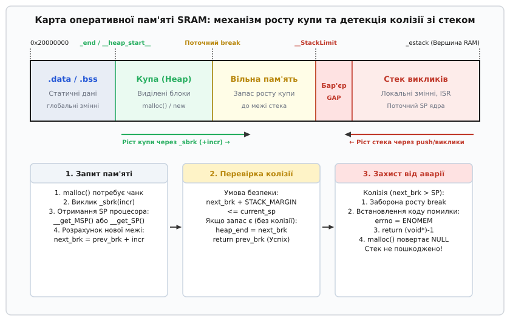
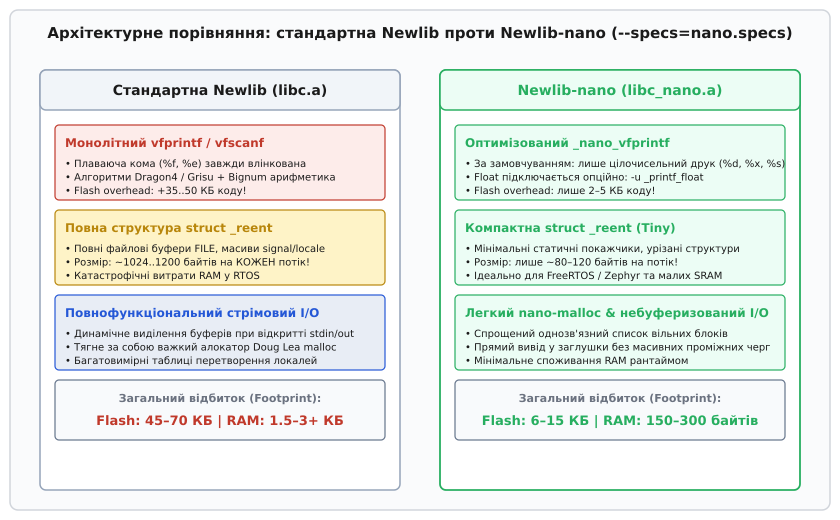

# newlib: libc для вбудованих систем

<preknowlist>
- [C-рантайм](root:sf-lang/c-runtime) — фази crt0, копіювання секцій пам'яті та ініціалізація до виклику main().
- [Лінкер-скрипт](root:sf-lang/linker-script) — розміщення секцій у Flash і RAM, системні мітки пам'яті.
- [Динамічна пам'ять і купа](root:sf-lang/heap-dynamic-memory) — структура пулів, заголовки блоків і фрагментація.
- [Переповнення стека](root:sf-lang/stack-overflow) — межі стекових фреймів і детекція перекриття.
- [Слабкі символи](root:sf-lang/weak-symbols) — механізм перевизначення функцій на етапі лінкування.
</preknowlist>

Перша спроба викликати `printf("Voltage: %f\n", 3.3)` або `malloc(128)` у прошивці мікроконтролера ARM Cortex-M чи RISC-V без додаткової конфігурації зазвичай завершується катастрофою. Прошивка або зависає в нескінченному циклі обробника апаратних помилок `HardFault_Handler`, або мовчки нічого не виводить у послідовний порт, або роздуває двійковий образ у Flash на сорок кілобайтів за один рядок коду. На комп'ютері під керуванням повноцінної операційної системи розробник навіть не замислюється над тим, звідки береться пам'ять чи куди зникають символи з консолі: стандартна бібліотека glibc транслює виклики мови C у системні виклики ядра Linux (`brk`, `mmap`, `write`, `read`), а ядро виділяє сторінки через блок трансляції адрес MMU (*Memory Management Unit*) та керує дескрипторами процесів.

На голому залізі (*bare-metal*, англ. «чистий метал» — виконання без операційної системи) ані ядра Linux, ані віртуальної пам'яті, ані файлових дескрипторів немає. Водночас переписувати власні версії `memcpy`, `snprintf`, математичних функцій `sin`/`cos` та алокатора динамічної пам'яті для кожного нового проекту — марна й небезпечна праця. Для вбудованих систем потрібна спеціалізована стандартна бібліотека C, яка надає повний мовний стандарт, але не прив'язана до конкретної операційної системи й залишає точні точки входу для апаратної адаптації.

Такою стандартною бібліотекою є **Newlib** (від англ. *new standard C library* — «нова стандартна бібліотека C») та її оптимізована модифікація **Newlib-nano**. Вона входить до складу всіх сучасних промислових крос-компіляторів (`arm-none-eabi-gcc`, `riscv-none-embed-gcc`, `xtensa-esp32-elf-gcc`). Розуміння внутрішньої архітектури Newlib — від механізму системних заглушок і захисту від перекриття купи зі стеком до реентрабельних структур багатопотоковості `struct _reent` — перетворює непередбачувану поведінку мікроконтролера на прозорий інженерний розрахунок.

---

### 1. Hosted проти Freestanding: межа між мовою та кремнієм

Стандарт мови C (ISO/IEC 9899) чітко розрізняє два середовища виконання:

1. **Hosted-середовище** (*hosted*, англ. «з господарем»): програма запускається під керуванням операційної системи. Стандарт гарантує наявність повної бібліотеки C, точки входу `main(int argc, char *argv[])`, керування сигналами, файлової системи та автоматичного повернення керування середовищу після виходу з програми.
2. **Freestanding-середовище** (*freestanding*, англ. «автономне, самостійне»): програма працює без операційної системи безпосередньо на мікроконтролері. Стандарт гарантує лише наявність самої мови (типи даних, оператори, конструкції керування) та мінімального набору заголовкових файлів: `<stddef.h>`, `<stdint.h>`, `<stdbool.h>`, `<float.h>`, `<limits.h>`, `<stdarg.h>`, `<stdalign.h>`, `<iso646.h>`. Будь-які функції введення-виведення (`<stdio.h>`), динамічної пам'яті (`<stdlib.h>`), рядкових операцій (`<string.h>`) чи багатопотоковості не гарантуються мовним стандартом автоматично.

Стандартні бібліотеки операційних систем загального призначення — такі як **glibc** у дистрибутивах Linux або **MSVCRT** у Windows — спроектовані виключно для hosted-середовища. Вони покладаються на архітектурні інваріанти, яких немає в мікроконтролерах:

* **Віртуальна пам'ять і MMU:** алокатор пам'яті glibc (ptmalloc на базі dlmalloc) очікує, що може запросити у ядра віртуальні сторінки довільного розміру через виклик `mmap(MAP_ANONYMOUS)` або зсунути границю віртуального сегмента через `brk()`. На мікроконтролері Cortex-M0/M3/M4/M7 блоку трансляції MMU немає: фізична адреса є адресою на шині, а розмір RAM жорстко обмежений кількома десятками чи сотнями кілобайтів.
* **Багатозадачність на рівні ядра:** синхронізація потоків у glibc опирається на системні виклики `futex` (*fast userspace mutex*), а створення потоків — на `clone()`.
* **Файлова система та дескриптори:** виклик `write(1, buf, len)` у glibc здійснює перехід у простір ядра через інструкцію `syscall` / `sysenter`, передаючи номер дескриптора таблиці відкритого процесу.
* **Обсяг бінарного коду:** повний набір glibc займає кілька мегабайтів Flash-пам'яті, що перевищує всю доступну пам'ять типового мікроконтролера в десятки або сотні разів.

```text
Типова hosted libc (glibc):
  Код програми → glibc (stdio / malloc) → системний виклик syscall → Ядро Linux (VFS / MMU / Драйвери) → Залізо

Вбудована freestanding libc (Newlib):
  Код програми → Newlib (stdio / malloc) → Системні заглушки (_write / _sbrk) → BSP / Регістри апаратури → Залізо
```

Newlib вирішує цю суперечність: вона реалізує практично всю функціональність стандартної бібліотеки C (включно зі складним форматуванням рядків, тригонометрією та алокатором купи), але замість системних викликів ядра операційної системи Newlib звертається до вузького переліку низькорівневих C-функцій, які називаються **системними заглушками** (*syscall stubs*).

> 🔧 **Навіщо це.** Якщо ви переносите алгоритмічний C++ код математичної фільтрації або парсингу протоколів із ПК на мікроконтролер, Newlib дозволяє зберегти знайомі стандартні виклики (`memcpy`, `memmove`, `snprintf`, `qsort`, `abs`) без жодних змін у математичній логіці. Але щоб вивід пішов у UART, а виділення пам'яті не зруйнувало стек, ви маєте особисто надати фундамент — реалізувати системні заглушки.

---

### 2. Дворівнева архітектура Newlib та Libgloss

Бібліотека Newlib розроблялася компанією Cygnus Support (згодом поглиненою Red Hat) як єдиний переносний шар стандартної бібліотеки C для вбудованих систем реального часу та симуляторів. Вона розділена на два чітко розмежовані шари:

1. **Машинно-незалежне ядро (libc та libm):** реалізує весь прикладний API стандартів ANSI C / C99 / C11 та підмножини POSIX. Сюди входять:
   * `libc/string`: швидкі версії `memcpy`, `memset`, `strcmp`, часто оптимізовані на асемблері під конкретну архітектуру (побайтові, пословомні або SIMD-інструкції).
   * `libc/stdio`: машинерія форматування `vfprintf`, `vfscanf`, буферизація потоків, робота з рядками `sprintf`, `snprintf`.
   * `libc/stdlib`: алокатори динамічної пам'яті (`malloc`, `free`, `realloc`, `calloc`), конвертація чисел `strtol`, `strtod`, генератори псевдовипадкових чисел.
   * `libc/time`: обчислення календарного часу, високоточні перетворення епохи UNIX `gmtime_r`, `mktime`.
   * `libm/math`: математичні обчислення з рухомою комою одинарної (`float`) та подвійної (`double`) точності (синуси, експоненти, квадратні корені, логарифми).
2. **Апаратно-залежний адаптер (Libgloss):** назва утворена від слів *Glossary* та *Library*. Це мінімальний шар, який відповідає за прив'язку Newlib до конкретного процесорного ядра, налагоджувального симулятора або плати. Саме тут зосереджені функції низькорівневого введення-виведення, керування пам'яттю та завершення виконання.

```
+--------------------------------------------------------------------------+
|                       ПРИКЛАДНИЙ КОД (C / C++)                           |
|         printf(), malloc(), free(), sin(), memcpy(), std::string         |
+--------------------------------------------------------------------------+
                                    |
                                    v
+--------------------------------------------------------------------------+
|                       NEWLIB CORE (libc.a / libm.a)                      |
|  - stdio: парсинг специфікаторів, буферизація FILE, конвертація чисел    |
|  - stdlib: організація вільних блоків купи (free-list), заголовок чанка  |
|  - reent: керування контекстом потоку struct _reent, errno               |
+--------------------------------------------------------------------------+
                                    |
                        (Системні заглушки: stubs)
                                    v
+--------------------------------------------------------------------------+
|                         LIBGLOSS / СИСТЕМНИЙ ШАР                         |
|     _sbrk(), _write(), _read(), _close(), _fstat(), _isatty(), _exit()   |
+--------------------------------------------------------------------------+
              |                                            |
              v                                            v
+-----------------------------+              +-----------------------------+
|    Реалізація BSP / Проект  |              |    За замовчуванням (nosys) |
|   - UART драйвер            |              |   - libnosys.a              |
|   - Ліміти пам'яті SRAM     |              |   - Повернення помилки      |
|   - RTOS мутекси            |              |     errno = ENOSYS          |
+-----------------------------+              +-----------------------------+
```

Для того щоб скомпільована бібліотека `libc.a` могла скомпонуватися навіть тоді, коли розробник ще не встиг написати власні драйвери вводу-виводу, у складі тулчейну постачається бібліотека заглушок за замовчуванням — **`libnosys.a`** (підключається прапорцем лінкера `--specs=nosys.specs`).

Усі системні функції в `libnosys.a` оголошені як **слабкі символи** (*weak symbols*, директива компилятора `__attribute__((weak))`). Слабкий символ вказує компонувальнику (лінкеру GNU LD): якщо в об'єктних файлах проекту або бібліотеках користувача знайдено функцію з такою самою назвою (сильний символ), лінкер зобов'язаний використати функцію користувача, проігнорувавши заглушку з `libnosys.a` без генерації помилки `multiple definition of...`. Детально поведінку таких символів розкрито в статті [Слабкі символи](root:sf-lang/weak-symbols).

Якщо проект зібрано з `--specs=nosys.specs`, але розробник не надав власної реалізації, наприклад, `_write()`, лінкер візьме стандартну заглушку:

```c
/* Типова реалізація з libnosys */
#include <errno.h>
#undef errno
extern int errno;

__attribute__((weak))
int _write(int fd, const char *buf, int nbytes) {
    (void)fd;
    (void)buf;
    (void)nbytes;
    errno = ENOSYS; /* Функцію не реалізовано */
    return -1;
}
```

Виклик `printf()` успішно скомпонується, виконає все внутрішнє форматування рядка у буфер, викличе `_write(1, "Hello", 5)`, отримає `-1` та помилку `ENOSYS`, після чого тихо поверне код помилки, не вивівши назовні жодного байта.

---

### 3. Ландшафт стандартних бібліотек: Newlib, Picolibc, Musl та LLVM-libc

Щоб зрозуміти інженерні компроміси Newlib, порівняємо провідні реалізації libc, що застосовуються у вбудованій розробці:

```
+---------------+-------------------+--------------------+---------------------+---------------------+
| Бібліотека    | Цільове середовище| Розмір коду stdio  | Модель malloc       | Реентрабельність    |
+---------------+-------------------+--------------------+---------------------+---------------------+
| Newlib (full) | RTOS, симулятори  | 45–70 КБ Flash     | Doug Lea (dlmalloc) | struct _reent       |
| Newlib-nano   | Bare-metal, MCUs  | 6–15 КБ Flash      | nano-malloc (1-link)| struct _reent (tiny)|
| Picolibc      | Bare-metal 32/64b | 4–10 КБ Flash      | avr-libc / TLSf     | TLS (__thread / tp) |
| Musl libc     | Linux (Embedded)  | 60–120 КБ Flash    | dlmalloc / ng       | POSIX pthreads      |
| avr-libc      | 8-бітні AVR MCUs  | 1–3 КБ Flash       | Custom static pool  | Глобальний стан     |
+---------------+-------------------+--------------------+---------------------+---------------------+
```

* **Newlib (класична):** універсальна бібліотека для 32- та 64-бітних вбудованих процесорів. Містить високоточну математику, повну підтримку багатобайтових кодувань (UTF-8, wchar_t), складні локалі та розвинену підсистему файлового буферизованого введення-виведення.
* **Newlib-nano:** оптимізований форк Newlib, розроблений інженерами ARM для Cortex-M. Використовує алокатор `nano-mallocr.c` з мінімальним заголовком блоку, цілочисельний друк без примусового затягування float та компактні структури потоків.
* **Picolibc:** сучасна розробка Кейта Пакарда (Keith Packard), яка взяла математичне ядро Newlib, але повністю замінила підсистему `stdio` на надзвичайно компактний рушій із `avr-libc`. Picolibc відмовилася від `struct _reent` на користь апаратного потоково-локального збереження (*Thread Local Storage*, TLS через регістр `tp` або компиляторний `__thread`).
* **Musl libc:** надзвичайно чиста та сувора реалізація стандартів POSIX/C99 для вбудованого Linux. Не призначена для bare-metal без операційної системи, оскільки жорстко вимагає наявності системних викликів ядра Linux.

---

### 4. Контракт системних заглушок: детальний розбір викликів

Щоб перетворити Newlib на робочий рантайм, розробник повинен реалізувати мінімальний набір із приблизно восьми функцій. Розглянемо призначення, механіку та вимоги до кожної з них.

```
+-----------+-----------------------------------+-----------------------------------------+
| Заглушка  | Головний виклик Newlib            | Призначення у вбудованій системі        |
+-----------+-----------------------------------+-----------------------------------------+
| _sbrk     | malloc(), free(), new, std::vector| Збільшення розміру динамічної купи      |
| _write    | printf(), puts(), fwrite(), cout  | Передача байтів у послідовний порт      |
| _read     | scanf(), getchar(), cin           | Отримання байтів із приймача порту      |
| _close    | fclose(), закриття дескриптора    | Закриття потоку (фіктивне або реальне)  |
| _fstat    | fstat(), перевірка буферизації    | Отримання типу файлу (символьний пристрій) |
| _isatty   | isatty(), конфігурація stdout     | Перевірка, чи дескриптор є терміналом   |
| _lseek    | fseek(), позиціонування           | Переміщення курсору (заборонено для TTY)|
| _exit     | exit(), abort(), аварія           | Зупинка мікроконтролера, точка скидання |
| _kill     | raise(), сигнальні механізми      | Емуляція доставки сигналів              |
| _getpid   | getpid()                          | Повернення ідентифікатора процесу (1)   |
+-----------+-----------------------------------+-----------------------------------------+
```

#### 4.1. `_sbrk`: фундамент динамічної пам'яті

Функція `_sbrk` (від англ. *set break*, історичний виклик UNIX для зміни адреси межі сегмента даних `brk`) — це міст між алокатором `malloc()` та фізичною оперативною пам'яттю SRAM.

```c
void *_sbrk(ptrdiff_t incr);
```

Внутрішній алгоритм Newlib `malloc` не знає фізичної адреси мікроконтролера. Коли користувач викликає `malloc(64)`, алокатор шукає вільний блок у своєму внутрішньому зв'язному списку (*free list*). Якщо доступних блоків немає або наявні занадто малі через фрагментацію, `malloc` звертається до операційної системи: `_sbrk(incr)`, де `incr` — розмір запитуваного приросту пам'яті (зазвичай вирівняний до сторінки або кратності 4/8/16 байтів).

Функція `_sbrk` зобов'язана:
1. Зберегти поточне значення покажчика межі купи (*current break pointer*).
2. Обчислити нову межу: `new_break = current_break + incr`.
3. Перевірити, чи нова межа не перетинає верхній ліміт доступної пам'яті або поточний покажчик стека процесора.
4. Якщо пам'яті достатньо — оновити `current_break = new_break` і повернути **старе** значення покажчика (початок щойно виділеного безперервного сегмента).
5. Якщо пам'ять вичерпана або виявлено ризик накладання на стек — встановити змінну помилки `errno = ENOMEM` (*Out of memory*) та повернути сигнальне значення `(void *)-1`.

#### 4.2. `_write`: маршрутизація вихідних потоків

```c
int _write(int fd, const char *buf, int len);
```

Коли викликається `printf("Temperature: %d C\r\n", t)`, Newlib форматує вихідний рядок у внутрішній буфер потоку `stdout` (дескриптор `fd = 1`) або `stderr` (`fd = 2`) і передає отриманий масив байтів у `_write`.

Вимоги до реалізації:
* **Маршрутизація дескрипторів:** перевірити значення `fd`. Якщо `fd == 1` або `fd == 2`, дані спрямовуються у налагоджувальний інтерфейс: апаратний передавач UART, віртуальний COM-порт USB CDC, буфер Segger RTT (*Real Time Transfer*) або інтерфейс ARM CoreSight ITM (*Instrumentation Trace Macrocell*).
* **Синхронність проти асинхронного DMA:** у найпростішому випадку байти по черзі записуються в регістр даних передавача UART із очікуванням прапорця завершення передачі TXE (*Transmit Data Register Empty*). Однак при високій інтенсивності логування блокуючий вивід може сповільнити критичні контури керування на мілісекунди. У промислових BSP байти копіюються в циклічний кільцевий буфер FIFO у пам'яті SRAM. Якщо апаратний передавач вільний, функція `_write` автоматично ініціює передачу першого безперервного сегмента буфера через контролер прямого доступу до пам'яті DMA (*Direct Memory Access*). Коли DMA завершує вичитування блоку, обробник переривання DMA Transfer Complete оновлює покажчик читання кільцевого буфера та за наявності нових даних запускає наступний DMA-транш. Це знижує навантаження на процесорне ядро до кількох відсотків навіть при потоці виводу в сотні кілобайтів на секунду.
* **Перетворення переводу рядка:** за стандартом мови C керівний символ `\n` (Line Feed, ASCII 10) означає перехід на новий рядок. Однак більшість послідовних терміналів (PuTTY, minicom) для коректного позиціонування курсора на початок лівого краю вимагають пари `\r\n` (Carriage Return + Line Feed). Функція `_write` може автоматично підставляти `\r` перед кожним `\n`, позбавляючи розробника потреби вручну писати `\r\n` у кожному виклику `printf()`.
* **Повернене значення:** кількість фактично записаних байтів (`len`) у разі успіху або `-1` з відповідним `errno` у разі апаратної відмови.

#### 4.3. `_read`: читання вхідних потоків

```c
int _read(int fd, char *buf, int len);
```

Забезпечує функціонування `scanf()`, `getchar()`, `fgets()`. Для дескриптора `fd = 0` (`stdin`) функція очікує надходження символів від приймача UART або USB.

Вбудована специфіка:
* **Обробка переведення рядка:** термінальні програми (PuTTY, minicom, TeraTerm) при натисканні клавіші Enter можуть передавати символ повернення каретки `\r` (ASCII 13), переведення рядка `\n` (ASCII 10) або обидва `\r\n`. Для сумісності з `scanf` функція `_read` зазвичай замінює отриманий `\r` на `\n` та здійснює локальне ехо символу назад у передавач, якщо термінал працює в напівдуплексному режимі.
* Якщо символів немає, а порт працює в неблокуючому режимі, функція повертає 0 (кінець файлу EOF) або `-1` із `errno = EAGAIN`.

#### 4.4. `_fstat` та `_isatty`: управління буферизацією stdio

Ці дві функції часто вважають порожніми формальностями, але від них безпосередньо залежить поведінка підсистеми `stdio`:

:::tabs
```c
#include <sys/stat.h>
#include <errno.h>

int _isatty(int fd) {
    if (fd >= 0 && fd <= 2) {
        return 1; /* Дескриптори 0, 1, 2 прив'язані до терміналу TTY */
    }
    errno = EBADF;
    return 0;
}

int _fstat(int fd, struct stat *st) {
    if (fd >= 0 && fd <= 2) {
        st->st_mode = S_IFCHR; /* Символьний пристрій (Character Device) */
        return 0;
    }
    errno = EBADF;
    return -1;
}
```
```cpp
#include <sys/stat.h>
#include <cerrno>

extern "C" {

auto _isatty(int fd) noexcept -> int {
    if (fd >= 0 && fd <= 2) {
        return 1; // Дескриптори 0, 1, 2 є терміналом TTY
    }
    errno = EBADF;
    return 0;
}

auto _fstat(int fd, struct stat *st) noexcept -> int {
    if (fd >= 0 && fd <= 2) {
        st->st_mode = S_IFCHR; // Символьний пристрій (Character Device)
        return 0;
    }
    errno = EBADF;
    return -1;
}

} // extern "C"
```
:::

Чому це критично: Newlib обирає стратегію буферизації потоку `stdout` на основі повернених значень `_isatty` та `_fstat`. Якщо `_isatty()` повертає 1, Newlib вмикає **рядкову буферизацію** (*line buffering*): вивід передається в `_write` щоразу, коли зустрічається символ `\n`. Якщо ж `_isatty` повертає 0 (вважаючи, що вивід іде у звичайний файл на диску), Newlib вмикає **повну блокову буферизацію** (*full block buffering*): дані накопичуються у внутрішньому буфері розміром 1024 байти й не виводяться в UART взагалі, поки буфер повністю не заповниться або не буде явно викликано `fflush(stdout)`.

#### 4.5. `_close`, `_lseek`, `_getpid`, `_kill`, `_exit`

* **`_close(int fd)`:** якщо файлова система відсутня, для стандартних потоків повертає 0, для інших — помилку `EBADF`.
* **`_lseek(int fd, off_t offset, int whence)`:** послідовний термінал UART не підтримує довільного переміщення вказівника читання/запису. Повертає `errno = ESPIPE` (*Illegal seek*) або 0.
* **`_getpid(void)`:** повертає фіктивне значення `1`.
* **`_kill(pid_t pid, int sig)`:** у системі без процесів передача сигналу неможлива. Встановлює `errno = EINVAL` і повертає `-1`.
* **`_exit(int status)`:** викликається при поверненні з функції `main()` або аварійному виклику `abort()`. На мікроконтролері повертатися нікуди: функція зазвичай вимикає глобальні переривання (`__disable_irq()`), фіксує статус помилки у спеціальному регістрі збереження стану та входить у нескінченний цикл або ініціює програмне перезавантаження через регістр ядра AIRCR (*Application Interrupt and Reset Control Register*).

Повний робочий набір усіх системних заглушок із потоковою безпекою та драйверами розглянуто у вставці [Практична реалізація системних заглушок Newlib](root:sf-lang/newlib/proj-newlib-syscall-stubs.md).

---

### 5. Семихостинг проти апаратного UART та Segger RTT

Під час розробки та зневадження виникає питання: куди саме спрямовувати виклики `_write` та `_read`. Існує три основні підходи:

#### 5.1. Апаратний Semihosting (бібліотека `librdimon.a`)

Semihosting (від англ. *semi-hosting* — «напівгостювання») — це механізм, за якого код на мікроконтролері делегує виконання системних викликів комп'ютеру хоста через апаратний налагоджувач (J-Link, ST-Link, OpenOCD) по лініях SWD або JTAG.

Підключається прапорцем лінкера `--specs=rdimon.specs`.

Як працює `_write` у режимі Semihosting на ядрі ARM Cortex-M:
1. Функція формує у пам'яті масив аргументів: `[дескриптор, покажчик на буфер, довжина]`.
2. Завантажує номер команди Semihosting `SYS_WRITE` (`0x05`) у регістр процесора `r0`.
3. Завантажує адресу структури аргументів у регістр `r1`.
4. Виконує спеціальну інструкцію точки зупинки: `BKPT 0xAB`.
5. Процесор зупиняє виконання ядра. Апаратний налагоджувач перехоплює зупинку, читає стан регістрів `r0`, `r1`, вичитує байти з пам'яті мікроконтролера по шині SWD і друкує їх у консоль OpenOCD або GDB на комп'ютері.
6. Налагоджувач записує повернене значення у регістр `r0` і відновлює виконання процесора.

**Головні небезпеки Semihosting:**
* **Колосальні затримки:** кожна зупинка ядра та передача даних по SWD займає від 5 до 50 мілісекунд. Програма реального часу втрачає здатність обробляти переривання та датчики.
* **Аварія у польових умовах:** якщо прошивка з інструкцією `BKPT 0xAB` запускається автономно (без підключеного комп'ютера та налагоджувача), інструкція `BKPT` викликає неперехоплене апаратне виключення `HardFault`, і пристрій миттєво зависає.

#### 5.2. Апаратний UART

Найбільш надійний та класичний спосіб: `_write` безпосередньо пише байти у FIFO передавача UART (`USART1->TDR` або `UART0->THR`). Вивід працює повністю автономно, не залежить від комп'ютера та має фіксовану затримку передачі байта (на швидкості 115200 бод — близько 86 мікросекунд на символ).

#### 5.3. Segger RTT (Real Time Transfer)

Сучасний компроміс: у пам'яті SRAM мікроконтролера виділяється кільцевий буфер зі спеціальною сигнатурою `SEGGER RTT`. Функція `_write` записує байти у цей буфер у пам'яті за кілька тактів без зупинки ядра (`BKPT`). Налагоджувач J-Link періодично вичитує буфер у фоновому режимі через прямий доступ до шини пам'яті (H-AHB/D-AHB).

---

### 6. Анатомія структури потоку `FILE` та користувацькі канали I/O

Внутрішня буферизація Newlib реалізована навколо структури `__sFILE` (псевдонім `FILE`). Розуміння її будови дозволяє реалізувати кастомні канали виводу (наприклад, направлення `stdout` одночасно у Flash-пам'ять та дисплей):

```c
struct __sFILE {
    unsigned char *_p;   /* Поточний покажчик у буфері I/O */
    int            _r;   /* Кількість байтів, доступних для читання */
    int            _w;   /* Кількість вільного місця для запису */
    short          _flags;/* Прапорці стану: читання, запис, помилка, EOF */
    short          _file; /* Номер файлового дескриптора (fd) */
    struct __sbuf  _bf;  /* Опис буфера: адреса початку та загальний розмір */
    int            _lbfsize; /* Розмір буфера рядка */
    
    /* Функціональні покажчики (Cookie I/O) */
    void          *_cookie;
    _READ_WRITE_RETURN_TYPE (*_read) (struct _reent *, void *, char *, int);
    _READ_WRITE_RETURN_TYPE (*_write)(struct _reent *, void *, const char *, int);
    _fpos_t                 (*_seek) (struct _reent *, void *, _fpos_t, int);
    int                     (*_close)(struct _reent *, void *);
};
```

Коли розробник викликає `fopencookie()` або `funopen()`, Newlib дозволяє створити об'єкт `FILE*`, операції запису та читання якого будуть викликати не глобальні `_write`/`_read`, а персональні колбеки, закріплені за цим конкретним екземпляром потоку. Це усуває необхідність розгалуження в `_write` через оператори `switch (fd)` при роботі з багатьма периферійними інтерфейсами.

---

### 7. Внутрішній устрій динамічних алокаторів: dlmalloc проти nano-malloc

Розподіл динамічної пам'яті — одна з найскладніших частин libc. Newlib містить два принципово різних алокатори:

#### 7.1. Doug Lea Malloc (dlmalloc у класичній Newlib)

Повноцінна Newlib використовує промисловий алокатор dlmalloc. Його ключові інваріанти:
* **Граничні теги (Boundary Tags):** кожен виділений та вільний блок пам'яті (чанк) містить заголовок на початку та спеціальний маркер розміру в кінці. Це дозволяє за `O(1)` операцій знайти сусідні блоки у фізичній пам'яті.
* **Миттєве злиття (Coalescing):** коли викликається `free(ptr)`, алокатор миттєво перевіряє лівого та правого фізичного сусіда. Якщо сусідні блоки вільні, вони зливаються в один великий блок, що суттєво зменшує зовнішню фрагментацію пам'яті.
* **Бінні списки (Bins):** вільні блоки сортуються за розміром у масив зв'язних списків (дрібні блоки — точні розміри, великі блоки — логарифмічні кошики). Пошук підходящого блоку займає лічені такти процесора.
* **Ціна:** мінімальний розмір службового заголовка блоку складає 8–16 байтів. Сам код алокатора займає приблизно 10–14 КБ Flash-пам'яті.

#### 7.2. Nano-malloc (`nano-mallocr.c` у Newlib-nano)

Newlib-nano замінює dlmalloc надлегким алокатором, спроектованим спеціально під обмеження мікроконтролерів:
* **Однозв'язний адресний список:** усі вільні блоки організовані в єдиний однозв'язний список, впорядкований строго за зростанням фізичних адрес у пам'яті.
* **Компактний заголовок:** заголовок займає всього 4 байти (на 32-бітних процесорах), зберігаючи лише розмір блоку. Вказівник на наступний вільний блок зберігається безпосередньо в тілі не зайнятої пам'яті.
* **Алгоритм First-Fit:** при виклику `malloc(size)` алокатор проходить однозв'язний список від початку й обирає перший блок, розмір якого достатній для задоволення запиту.
* **Ціна та компроміси:** за рахунок спрощення код алокатора займає менше 1 КБ Flash. Проте операції `malloc` та `free` мають часову складність `O(N)`, де `N` — кількість вільних блоків. При інтенсивному динамічному виділенні та фрагментації час виконання `malloc` може коливатися, що є критичним для систем жорсткого реального часу.

---

### 8. Анатомія детекції колізії купи та стека в `_sbrk`

Найбільш критичною точкою відмови вбудованої системи з динамічною пам'яттю є фізичне перекриття динамічної купи та стека викликів (*Heap-Stack Collision*).


*Динамічна купа росте знизу вгору від кінця секцій .data/.bss, тоді як стек викликів росте згори вниз від вершини SRAM. Функція _sbrk повинна контролювати зазор безпеки між поточною межею купи та апаратним регістром SP.*

У класичній архітектурі мікроконтролера оперативна пам'ять SRAM розподіляється наступним чином:
1. На початку SRAM (найнижчі адреси, наприклад `0x20000000`) розміщуються глобальні змінні: спочатку секція `.data` (ініціалізовані змінні), за нею секція `.bss` (обнулені змінні).
2. Відразу за кінцем секції `.bss` скрипт компонувальника створює мітку `_end` (або `__heap_start__`). З цієї адреси починається динамічна купа, яка при кожному виклику `_sbrk(incr)` розширюється **вгору** (в бік зростання адрес).
3. Стек головної програми ініціалізується на самій вершині SRAM (мітка `_estack`, наприклад `0x20020000` для 128 КБ RAM). Під час роботи процесора при викликах функцій, розміщенні локальних масивів та збереженні контексту переривань апаратний вказівник стека `SP` (*Stack Pointer*) рухається **вниз** (в бік зменшення адрес).

Якщо програма активно виділяє пам'ять через `malloc()` або C++ оператор `new`, купа неминуче наближається до поточної позиції стека. Якщо `_sbrk` наївно збільшує адресу без порівняння з регістрами процесора, черговий блок купи перекриє активний фрейм стека. Результат катастрофічний:
* Запис даних у щойно виділений буфер затирає адресу повернення функції на стеку або локальні змінні.
* Вихід із поточної функції зчитує пошкоджену адресу повернення з регістра `LR`, спричиняючи перехід за випадковою адресою та миттєвий `HardFault`.

#### Реалізація `_sbrk` з динамічним захистом

Для запобігання колізії `_sbrk` зчитує поточний стан головного вказівника стека MSP (*Main Stack Pointer*) безпосередньо з регістра ядра процесора:

:::tabs
```c
#include <stdint.h>
#include <stddef.h>
#include <errno.h>

/* Символи, визначені компонувальником у linker script */
extern uint8_t _end;          /* Початок купи відразу за .bss */
extern uint8_t _estack;       /* Фізична вершина SRAM */
extern uint8_t __StackLimit;  /* Нижній ліміт виділеного простору стека */

/* Мінімальний резервний зазор між купою та стеком (наприклад, 1024 байти) */
#define STACK_SAFETY_MARGIN  1024U

/* Функція отримання поточного вказівника стека (ARM Cortex-M) */
static inline uintptr_t get_stack_pointer(void) {
    uintptr_t sp;
    __asm__ volatile ("mov %0, sp" : "=r" (sp));
    return sp;
}

void *_sbrk(ptrdiff_t incr) {
    static uint8_t *heap_end = NULL;
    uint8_t *prev_heap_end;

    /* Перша ініціалізація: встановлення початкової межі на символ _end */
    if (heap_end == NULL) {
        heap_end = &_end;
    }

    prev_heap_end = heap_end;

    /* Розрахунок потенційної нової межі купи */
    uint8_t *next_heap_end = heap_end + incr;
    uintptr_t current_sp = get_stack_pointer();

    /* Перевірка 1: Нова купа не повинна перетинати поточний SP із запасом безпеки */
    if ((uintptr_t)next_heap_end + STACK_SAFETY_MARGIN > current_sp) {
        errno = ENOMEM;
        return (void *)-1;
    }

    /* Перевірка 2: Нова купа не повинна виходити за статичну межу стека з linker script */
    if (next_heap_end > &__StackLimit) {
        errno = ENOMEM;
        return (void *)-1;
    }

    /* Виділення дозволено: фіксуємо нову межу */
    heap_end = next_heap_end;
    return (void *)prev_heap_end;
}
```
```cpp
#include <cstdint>
#include <cstddef>
#include <cerrno>

extern "C" {
    extern std::uint8_t _end;
    extern std::uint8_t _estack;
    extern std::uint8_t __StackLimit;
}

namespace sys {

constexpr std::size_t StackSafetyMargin = 1024;

[[nodiscard]] inline auto get_stack_pointer() noexcept -> std::uintptr_t {
    std::uintptr_t sp{};
    asm volatile ("mov %0, sp" : "=r" (sp));
    return sp;
}

} // namespace sys

extern "C" auto _sbrk(std::ptrdiff_t incr) noexcept -> void * {
    static std::uint8_t *heap_end{nullptr};

    if (heap_end == nullptr) {
        heap_end = &_end;
    }

    auto *prev_heap_end = heap_end;
    auto *next_heap_end = heap_end + incr;
    const auto current_sp = sys::get_stack_pointer();

    // Перевірка колізії з динамічним стеком процесора
    if (reinterpret_cast<std::uintptr_t>(next_heap_end) + sys::StackSafetyMargin > current_sp) {
        errno = ENOMEM;
        return reinterpret_cast<void *>(-1);
    }

    // Перевірка перевищення ліміту скрипта компонування
    if (next_heap_end > &__StackLimit) {
        errno = ENOMEM;
        return reinterpret_cast<void *>(-1);
    }

    heap_end = next_heap_end;
    return reinterpret_cast<void *>(prev_heap_end);
}
```
:::

Завдяки цьому механізму, коли пам'ять SRAM вичерпується, `malloc` не призводить до краху прошивки, а штатно повертає `NULL`, дозволяючи програмі коректно обробити позаштатну ситуацію.

---

### 9. Newlib-nano: оптимізація розміру Flash та оперативної пам'яті

Класична повнофункціональна Newlib створювалася для систем із десятками мегабайтів пам'яті. Якщо скомпілювати звичайну програму з підключенням стандартної `libc.a`, розмір двійкового коду у Flash зростає на 45–70 КБ, а статичне споживання RAM структурами бібліотеки сягає кількох кілобайтів.

Для вбудованих систем компанією ARM була розроблена спеціальна редакція — **Newlib-nano**. Вона активується передачею прапорця лінкеру:

```bash
arm-none-eabi-gcc main.o stubs.o -o firmware.elf --specs=nano.specs
```


*Newlib-nano кардинально скорочує споживання Flash та RAM завдяки модульному механізму vfprintf, компактній структурі struct _reent та спеціалізованому алокатору nano-malloc.*

#### Механізм роботи `--specs=nano.specs`

Файл специфікації `nano.specs` — це набір директив для компілятора та лінкера GCC, який змінює стандартні шляхи пошуку бібліотек:
1. Замінює стандартну бібліотеку `libc.a` на оптимізовану версію **`libc_nano.a`**.
2. Замінює математичну бібліотеку `libm.a` на **`libm_nano.a`**.
3. Замінює важкі заголовочні файли та структури потоків на компактні аналоги.

#### Чому плаваюча кома роздуває `printf`

У стандартній Newlib функція `vfprintf` містить монолітний рушій форматування. Специфікатори `%f`, `%e`, `%g` вимагають конвертації 64-бітного числа з рухомою комою IEEE-754 у точний десятковий рядок. Цей алгоритм (Dragon4 або Grisu3) вимагає:
* Роботи з цілими числами довільної розрядності (*BigNum arithmetic* — 128/256/512 біт).
* Динамічного виділення допоміжних буферів через `malloc()` безпосередньо всередині `printf()`.
* Величезних таблиць ступенів десятки у Flash.

Newlib-nano вирішує цю проблему радикально:
* За замовчуванням у `libc_nano.a` функція `_nano_vfprintf` підтримує лише цілочисельне форматування (`%d`, `%u`, `%x`, `%s`, `%c`). Це зменшує розмір коду функції з 40 КБ до приблизно 2.5–4 КБ.
* Якщо у виклику передано `%f`, nano-версія за замовчуванням просто проігнорує його або виведе порожній пробіл, не падаючи в аварію.

#### Прапорець явного підключення `-u _printf_float`

Якщо в системі дійсно необхідний вивід чисел із рухомою комою через `printf`, розробник явно вказує лінкеру створити штучне посилання на нерозв'язаний (*undefined*) символ `_printf_float`:

```bash
# Збірка Newlib-nano з підтримкою float у printf:
arm-none-eabi-gcc main.o stubs.o -o firmware.elf --specs=nano.specs -u _printf_float

# Збірка Newlib-nano з підтримкою float у printf та scanf:
arm-none-eabi-gcc main.o stubs.o -o firmware.elf --specs=nano.specs -u _printf_float -u _scanf_float
```

Символ `_printf_float` змушує компонувальник витягнути з `libc_nano.a` додатковий відокремлений модуль форматування дробових чисел. Таким чином, плаваюча кома підключається лише тоді, коли розробник свідомо за неї платить обсягом Flash-пам'яті.

#### Порівняння відбитку ресурсів (Footprint)

```
+------------------------------------+---------------+---------------+
| Конфігурація збірки                | Розмір Flash  | Розмір RAM    |
+------------------------------------+---------------+---------------+
| Базовий Newlib (libc.a)            | ~52 КБ        | ~1800 байтів  |
| Newlib-nano (--specs=nano.specs)   | ~8 КБ         | ~120 байтів   |
| Newlib-nano + -u _printf_float     | ~19 КБ        | ~260 байтів   |
| Newlib-nano + printf + scanf_float | ~27 КБ        | ~340 байтів   |
+------------------------------------+---------------+---------------+
```

---

### 10. Покрокове трасування виклику `printf` від асемблера до регістрів UART

Щоб остаточно усунути ілюзію магії в роботі стандартної бібліотеки, простежимо повний ланцюжок виконання одного виклику `printf("Sensor: %d\r\n", 42)` на асемблерному рівні ядра ARM Cortex-M:

1. **Генерація виклику компілятором:**
   Компілятор GCC згідно зі стандартом викликів AAPCS розміщує покажчик на форматний рядок у регістр `r0`, а число `42` — у регістр `r1`. Після цього виконується перехід із збереженням адреси повернення:
   ```asm
   ldr  r0, =.LC0      ; Адреса рядка "Sensor: %d\r\n" у секції .rodata
   movs r1, #42        ; Значення аргументу
   bl   printf         ; Перехід до точки входу бібліотеки
   ```
2. **Точка входу `printf`:**
   Функція `printf` пакує аргументи у список змінної довжини `va_list` (зберігаючи регістри на стеку) та викликає внутрішню функцію форматування:
   ```c
   _vfprintf_r(_impure_ptr, _impure_ptr->_stdout, fmt, ap);
   ```
3. **Обробка рядка у `_nano_vfprintf`:**
   Рушій сканує рядок побайтово. Символи `S`, `e`, `n`, `s`, `o`, `r`, `:`, ` ` передаються без змін у внутрішній накопичувач. Коли зустрічається символ `%d`, функція вичитує 42 через `va_arg(ap, int)`, ділить його на 10 у циклі, отримуючи ASCII-символи `'4'` та `'2'`, і записує їх у вихідний буфер.
4. **Скидання буфера у системний виклик:**
   Коли рядок сформовано (або зустрічається `\n`), Newlib викликає реентрабельну заглушку:
   ```c
   _write_r(_impure_ptr, 1, "Sensor: 42\r\n", 12);
   ```
   яка передає керування глобальній заглушці `_write(1, buf, 12)`.
5. **Запис у фізичні регістри апаратури:**
   Реалізована розробником функція `_write` отримує дескриптор `1`, перевіряє готовність UART і записує кожен байт у регістр передавача:
   ```c
   while (!(USART1->ISR & USART_ISR_TXE_TXFNF));
   USART1->TDR = (uint8_t)(*buf++);
   ```
   Звідси байт через зрушувальний регістр передавача UART перетворюється на послідовність електричних імпульсів на фізичній ніжці мікроконтролера TX.

---

### 11. Математична бібліотека `libm` та апаратне прискорення FPU

Математичні обчислення у вбудованих системах спираються на бібліотеку `libm.a` (або `libm_nano.a`). Під час крос-компіляції для процесорів із апаратним модулем рухомої коми FPU (*Floating Point Unit*, наприклад ARM Cortex-M4F / Cortex-M7) важливо правильно налаштувати ABI викликів:

1. **`-mfloat-abi=soft`:** апаратний FPU повністю ігнорується. Будь-які операції над `float` та `double` транслюються у виклики програмних бібліотечних функцій емуляції `__aeabi_fadd`, `__aeabi_fmul`, `__aeabi_fdiv`. Це збільшує розмір коду та сповільнює обчислення в 20–50 разів.
2. **`-mfloat-abi=softfp`:** апаратні інструкції FPU (`VADD.F32`, `VMUL.F32`, `VSQRT.F32`) використовуються всередині функцій, але аргументи передаються через стандартні цілочисельні регістри загального призначення `r0-r3`.
3. **`-mfloat-abi=hard`:** аргументи та повернені значення функцій передаються безпосередньо через апаратні 32-бітні регістри FPU `s0-s15` (або 64-бітні `d0-d7`). Це забезпечує максимальну швидкодію математичних алгоритмів.

Всі функції Newlib `libm` (зокрема `sqrtf`, `sinf`, `cosf`, `atan2f`) скомпільовані під відповідний ABI й використовують швидкі апаратні інструкції там, де це підтримується процесорним ядром.

---

### 12. Ініціалізація C та C++ рантайму: зв'язок crt0, `__libc_init_array` та Newlib

Перед тим як програма дійде до виклику `main()`, стандартне середовище виконання Newlib проходить сувору послідовність передстартової підготовки:

```text
Reset_Handler (Апаратний вектор скидання)
  │
  ├── 1. Встановлення покажчика стека SP = _estack
  ├── 2. Копіювання секції .data з Flash у RAM (від _sdata до _edata)
  ├── 3. Обнулення секції .bss у RAM (від _sbss до _ebss)
  ├── 4. Ініціалізація глобального контексту Newlib: _impure_ptr = &_global_impure_reent
  ├── 5. Виклик системної функції Newlib: __libc_init_array()
  │       ├── Виконання функцій із .preinit_array (ранні апаратні драйвери)
  │       └── Виклик конструкторів глобальних C++ об'єктів із .init_array
  │
  └── 6. Виклик функції main(0, NULL)
```

#### Механізм `__libc_init_array()`

Коли в коді C++ створюється глобальний або статичний об'єкт:

```cpp
HardwareTimer g_timer(TIM2); // Конструктор має виконатися до main()
```

Компілятор генерує функцію-обгортку конструктора та розміщує покажчик на неї в секції `.init_array`. Функція Newlib `__libc_init_array()` проходить масив покажчиків між системними мітками `__init_array_start` та `__init_array_end` і по черзі викликає кожну функцію. Без виклику `__libc_init_array()` усі глобальні об'єкти C++ залишаться неініціалізованими, а їхні поля міститимуть нулі із секції `.bss`.

#### Оптимізація деструкторів: `-fno-use-cxa-atexit`

За замовчуванням стандарт C++ вимагає, щоб для кожного глобального об'єкта під час виклику конструктора реєструвався його деструктор через функцію `__cxa_atexit()`. У Newlib це призводить до виділення динамічних вузлів у купі (`malloc`) під час кожного старту конструктора.

На мікроконтролерах програма зазвичай працює нескінченно й ніколи не завершує роботу. Реєстрація деструкторів лише даремно витрачає оперативну пам'ять SRAM та затягує в бінарний образ алокатор купи. Для усунення цих витрат компілятору C++ передають прапорець:

```bash
arm-none-eabi-g++ -fno-use-cxa-atexit -fno-exceptions -fno-rtti ...
```

Це повністю відключає генерацію викликів `__cxa_atexit`, заощаджуючи Flash та RAM.

---

### 13. Багатопотоковість і реентрабельність: `struct _reent` та інтеграція з RTOS

У класичній мові C стандартна бібліотека містить значну кількість прихованого глобального стану:
* Глобальна змінна `errno`, куди записуються коди помилок.
* Статичні буфери функцій конвертації часу `asctime()`, `ctime()`, `localtime()`.
* Внутрішній вказівник позиції в рядку для функції розбиття на лексеми `strtok()`.
* Зерно генератора псевдовипадкових чисел у функції `rand()`.
* Внутрішні структури файлових дескрипторів `stdin`, `stdout`, `stderr` (покажчики буферів, лічильники байтів).

Якщо в системі працює операційна система реального часу (RTOS, наприклад FreeRTOS або Zephyr), у якій виконання перемикається між незалежними завданнями (*tasks/threads*), виникає небезпека руйнування даних (*data race*): Завдання 1 викликає `strtok()`, процес переривається планувальником, Завдання 2 викликає `strtok()`, затираючи статичний покажчик, після чого керування повертається Завданню 1, яке зчитує невалідну адресу.

#### Структура `struct _reent` та вказівник `_impure_ptr`

Newlib забезпечує потокову безпеку через механізм **структури реентрабельності** `struct _reent` (від англ. *reentrant* — повторно вхідний, реентрабельний). Замість використання глобальних змінних, кожен елемент стану зберігається всередині спеціальної структури.

У глобальному просторі Newlib визначає один головний покажчик:

```c
extern struct _reent *_impure_ptr;
```

Будь-який стандартний виклик транслюється через макроси у звернення через `_impure_ptr`:

```c
/* Визначення errno в Newlib */
#define errno (_impure_ptr->_errno)

/* Визначення потоків */
#define stdin  (_impure_ptr->_stdin)
#define stdout (_impure_ptr->_stdout)
#define stderr (_impure_ptr->_stderr)
```

Також для всіх системних викликів Newlib надає явні реентрабельні версії із суфіксом `_r`, першим аргументом яких є покажчик на контекст `struct _reent`:
* `_sbrk_r(struct _reent *r, ptrdiff_t incr)`
* `_write_r(struct _reent *r, int fd, const void *buf, size_t count)`
* `_read_r(struct _reent *r, int fd, void *buf, size_t count)`
* `_close_r(struct _reent *r, int fd)`

Звичайна системна заглушка `_write` є просто обгорткою, яка передає поточний `_impure_ptr`:

```c
int _write(int fd, const char *buf, int len) {
    return _write_r(_impure_ptr, fd, buf, len);
}
```

#### Інтеграція з FreeRTOS

Щоб забезпечити повну ізоляцію стандартної бібліотеки між завданнями FreeRTOS, у файлі конфігурації `FreeRTOSConfig.h` активують макрос:

```c
#define configUSE_NEWLIB_REENTRANT 1
```

Коли цей прапорець увімкнено:
1. До структури блоку керування завданням TCB (*Task Control Block*) додається персональний екземпляр `struct _reent xNewLib_reent`.
2. Під час створення завдання (`xTaskCreate`) FreeRTOS ініціалізує цю структуру викликом `_reent_init(&pxTCB->xNewLib_reent)`.
3. Під час кожного перемикання контексту планувальник FreeRTOS автоматично оновлює глобальний вказівник:
   ```c
   _impure_ptr = &(pxCurrentTCB->xNewLib_reent);
   ```
4. Під час видалення завдання (`vTaskDelete`) FreeRTOS звільняє виділені структурою динамічні ресурси викликом `_reclaim_reent(&pxTCB->xNewLib_reent)`.

```
                ПЕРЕМИКАННЯ КОНТЕКСТУ У FREERTOS
                
    Task 1 (Sensor)                     Task 2 (Network)
+-----------------------+           +-----------------------+
| TCB: Task 1           |           | TCB: Task 2           |
|  - Стек Task 1        |           |  - Стек Task 2        |
|  - struct _reent t1   |           |  - struct _reent t2   |
|     • _errno = 0      |           |     • _errno = ETIMEDOUT
|     • stdout buffer 1 |           |     • stdout buffer 2 |
+-----------------------+           +-----------------------+
            |                                   |
            +-------------\       /-------------+
                           \     /
       Планувальник оновлює \   / при зміні задачі
                             v v
                +---------------------------+
                |  _impure_ptr (Глобальний) |
                +---------------------------+
                             |
                             v
                +---------------------------+
                |  Поточний struct _reent   |
                +---------------------------+
                             |
                             v
                 printf() / malloc() / errno
```

#### Блокування алокатора динамічної пам'яті: `__malloc_lock`

Навіть якщо кожен потік має власну структуру `_reent`, динамічна купа SRAM є **спільним ресурсом**. Якщо Завдання 1 почне модифікувати зв'язний список вільних блоків у `malloc()`, а переривання або планувальник перемкне виконання на Завдання 2, яке теж викличе `malloc()`, внутрішні метадані купи будуть незворотно пошкоджені.

Для захисту купи Newlib надає дві спеціальні функції блокування:
* `__malloc_lock(struct _reent *r)` — викликається перед початком будь-якої модифікації купи.
* `__malloc_unlock(struct _reent *r)` — викликається після завершення операції з купою.

В середовищі FreeRTOS ці функції реалізуються через м'ютекс або призупинення планувальника:

:::tabs
```c
#include <sys/reent.h>
#include "FreeRTOS.h"
#include "task.h"
#include "semphr.h"

static SemaphoreHandle_t g_malloc_mutex = NULL;
static StaticSemaphore_t g_malloc_mutex_buffer;

void init_malloc_lock(void) {
    if (g_malloc_mutex == NULL) {
        g_malloc_mutex = xSemaphoreCreateMutexStatic(&g_malloc_mutex_buffer);
    }
}

void __malloc_lock(struct _reent *r) {
    (void)r;
    /* Якщо планувальник вже запущено, захоплюємо м'ютекс */
    if (xTaskGetSchedulerState() != taskSCHEDULER_NOT_STARTED) {
        if (g_malloc_mutex != NULL) {
            xSemaphoreTake(g_malloc_mutex, portMAX_DELAY);
        }
    }
}

void __malloc_unlock(struct _reent *r) {
    (void)r;
    if (xTaskGetSchedulerState() != taskSCHEDULER_NOT_STARTED) {
        if (g_malloc_mutex != NULL) {
            xSemaphoreGive(g_malloc_mutex);
        }
    }
}
```
```cpp
#include <sys/reent.h>
#include <span>
#include "FreeRTOS.h"
#include "task.h"
#include "semphr.h"

namespace rtos {

class MallocLockGuard {
public:
    static void init() noexcept {
        if (mutex_handle_ == nullptr) {
            mutex_handle_ = xSemaphoreCreateMutexStatic(&mutex_buffer_);
        }
    }

    static void lock() noexcept {
        if (xTaskGetSchedulerState() != taskSCHEDULER_NOT_STARTED && mutex_handle_ != nullptr) {
            xSemaphoreTake(mutex_handle_, portMAX_DELAY);
        }
    }

    static void unlock() noexcept {
        if (xTaskGetSchedulerState() != taskSCHEDULER_NOT_STARTED && mutex_handle_ != nullptr) {
            xSemaphoreGive(mutex_handle_);
        }
    }

private:
    static inline SemaphoreHandle_t mutex_handle_{nullptr};
    static inline StaticSemaphore_t mutex_buffer_{};
};

} // namespace rtos

extern "C" {

void __malloc_lock(struct _reent * /*r*/) {
    rtos::MallocLockGuard::lock();
}

void __malloc_unlock(struct _reent * /*r*/) {
    rtos::MallocLockGuard::unlock();
}

} // extern "C"
```
:::

---

### 14. C++20 та Newlib: відмінності операторів `new`/`delete` та форматування

У проектах мовою C++ взаємодія з Newlib має кілька важливих особливостей.

#### Оператори `new` та `delete`

Стандартний C++ рантайм (`libsupc++`) реалізує глобальні оператори `new` та `delete` як прямі обгортки над `malloc()` та `free()`:

```cpp
void* operator new(std::size_t size) {
    if (size == 0) size = 1;
    void* p = malloc(size);
    if (!p) {
        #if __cpp_exceptions
        throw std::bad_alloc();
        #else
        std::abort(); // На вбудованих системах без винятків
        #endif
    }
    return p;
}

void operator delete(void* p) noexcept {
    if (p) free(p);
}
```

Оскільки `operator new` використовує `malloc`, він повністю залежить від системної заглушки `_sbrk` та блокувань `__malloc_lock`. Якщо `_sbrk` реалізований коректно, вичерпання пам'яті в середовищі з відключеними винятками (`-fno-exceptions`) призводить до виклику `std::abort()` -> `_exit()`, захищаючи пам'ять від неконтрольованого руйнування.

#### Сучасне форматування C++20: `std::format` проти `printf`

У стандарті C++20 з'явилася бібліотека форматування `std::format` (на базі бібліотеки `{fmt}`), а в C++23 — функції `std::print`.

Порівняння архітектурних властивостей у мікроконтролерах:
1. **Перевірка типів під час компіляції:** `printf` перевіряє відповідність специфікаторів типам аргументів лише через атрибути компілятора `__attribute__((format(printf, ...)))`. Помилка у форматі може спричинити читання невалідного стека через механізм `va_arg`. `std::format` виконує перевірку рядка форматування на етапі компіляції (`constexpr`).
2. **Розмір двійкового коду:** `std::format` є шаблонною бібліотекою. Якщо в проекті форматується багато різних користувацьких типів, генерація коду шаблонів може суттєво збільшити обсяг Flash порівняно з компактною `_nano_vfprintf`.
3. **Виділення пам'яті:** `std::format` повертає `std::string`, що викликає алокацію в купі. Для вбудованих систем рекомендується використовувати `std::format_to` або `std::format_to_n`, які здійснюють запис безпосередньо у статичний буфер `std::span<char>` без жодних динамічних алокацій:

:::tabs
```c
#include <stdio.h>
#include <stdint.h>

void log_telemetry_c(uint32_t timestamp, float current, float voltage) {
    char buffer[64];
    /* Безпечне форматування у фіксований стек-буфер */
    int len = snprintf(buffer, sizeof(buffer), "[%lu ms] I=%.2f A, U=%.2f V\r\n", 
                       (unsigned long)timestamp, (double)current, (double)voltage);
    if (len > 0) {
        /* Прямий вивід у дескриптор stdout */
        fwrite(buffer, 1, (size_t)len, stdout);
    }
}
```
```cpp
#include <array>
#include <string_view>
#include <span>
#include <cstdio>
#include <cstdint>

// Ідіоматичне форматування C++ без використання динамічної купи
namespace logger {

template <std::size_t N>
class StackBuffer {
public:
    constexpr auto data() noexcept -> char* { return buffer_.data(); }
    constexpr auto size() const noexcept -> std::size_t { return N; }
    constexpr auto span() noexcept -> std::span<char> { return {buffer_.data(), N}; }

private:
    std::array<char, N> buffer_{};
};

void log_telemetry_cpp(std::uint32_t timestamp, float current, float voltage) noexcept {
    StackBuffer<64> log_buf;
    
    // snprintf залишається найекономнішим за обсягом Flash у Newlib-nano
    const int len = std::snprintf(
        log_buf.data(), log_buf.size(),
        "[%lu ms] I=%.2f A, U=%.2f V\r\n",
        static_cast<unsigned long>(timestamp),
        static_cast<double>(current),
        static_cast<double>(voltage)
    );

    if (len > 0) {
        std::fwrite(log_buf.data(), 1, static_cast<std::size_t>(len), stdout);
    }
}

} // namespace logger
```
:::

---

### 15. Скрипт компонування Linker Script для Newlib: точне розміщення

Для коректної роботи Newlib скрипт компонувальника (GNU LD) повинен чітко експортувати системні символи меж пам'яті. Розглянемо еталонний фрагмент `linker.ld` для ARM Cortex-M:

```ld
MEMORY
{
  FLASH (rx)  : ORIGIN = 0x08000000, LENGTH = 512K
  RAM   (rwx) : ORIGIN = 0x20000000, LENGTH = 128K
}

/* Визначення розмірів купи та стека за замовчуванням */
_Min_Heap_Size  = 0x2000; /* 8 КБ мінімальної купи */
_Min_Stack_Size = 0x1000; /* 4 КБ мінімального стека */

SECTIONS
{
  /* Секція коду програми у Flash */
  .text :
  {
    . = ALIGN(4);
    KEEP(*(.isr_vector)) /* Таблиця векторів переривань */
    *(.text)
    *(.text*)
    *(.rodata)
    *(.rodata*)
    
    /* Масиви ініціалізації конструкторів C++ */
    . = ALIGN(4);
    PROVIDE_HIDDEN (__init_array_start = .);
    KEEP (*(SORT(.init_array.*)))
    KEEP (*(.init_array*))
    PROVIDE_HIDDEN (__init_array_end = .);
    
    . = ALIGN(4);
    _etext = .;
  } > FLASH

  /* Ініціалізовані дані у RAM з копією у Flash */
  .data : AT (_etext)
  {
    . = ALIGN(4);
    _sdata = .;
    *(.data)
    *(.data*)
    . = ALIGN(4);
    _edata = .;
  } > RAM

  /* Неініціалізовані обнулені дані у RAM */
  .bss :
  {
    . = ALIGN(4);
    _sbss = .;
    __bss_start__ = _sbss;
    *(.bss)
    *(.bss*)
    *(COMMON)
    . = ALIGN(4);
    _ebss = .;
    __bss_end__ = _ebss;
  } > RAM

  /* Секція купи: починається відразу за .bss */
  ._user_heap_stack :
  {
    . = ALIGN(8);
    PROVIDE ( end = . );
    PROVIDE ( _end = . );
    . = . + _Min_Heap_Size;
    . = . + _Min_Stack_Size;
    . = ALIGN(8);
  } > RAM

  /* Розрахунок вершини стека та нижнього ліміту */
  _estack = ORIGIN(RAM) + LENGTH(RAM);
  __StackLimit = _estack - _Min_Stack_Size;

  /* Перевірка лінкером переповнення фізичної пам'яті */
  ASSERT(_ebss + _Min_Heap_Size + _Min_Stack_Size <= _estack, 
         "Критична помилка: недостатньо RAM під мінімальну купу та стек!")
}
```

Зверніть увагу на директиву `ASSERT`: вона змушує лінкер зупинити збірку з помилкою, якщо сума розмірів статичних змінних (`.data` + `.bss`), мінімальної купи та мінімального стека перевищує розмір фізичного чіпа пам'яті SRAM. Це усуває цілий клас прихованих аварій на етапі запуску.

---

### 16. Коди помилок `errno` та безпека вбудованих систем за стандартом MISRA C

Змінна `errno` є стандартизованим механізмом передачі причини помилки між системними заглушками та користувацьким кодом:

```
+-----------+--------+-----------------------------------+------------------------------------------+
| Код errno | Число  | Назва в POSIX                     | Типове виникнення у вбудованій системі   |
+-----------+--------+-----------------------------------+------------------------------------------+
| ENOMEM    | 12     | Out of memory                     | _sbrk: досягнуто межі стека або ліміту   |
| EBADF     | 9      | Bad file descriptor               | Спроба читання з неіснуючого дескриптора |
| EINVAL    | 22     | Invalid argument                  | Некоректний whence у _lseek або сигнал   |
| ENOSYS    | 38     | Function not implemented          | Заглушка libnosys для непідтримуваної дії|
| EAGAIN    | 11     | Resource temporarily unavailable  | Неблокуюче читання UART без нових байтів |
| EIO       | 5      | Input/output error                | Апаратна помилка шини I2C/SPI або флеш-чипа |
| ESPIPE    | 29     | Illegal seek                      | Спроба fseek() на символьному UART       |
| EMFILE    | 24     | Too many open files               | Перевищено ліміт одночасно відкритих FILE|
+-----------+--------+-----------------------------------+------------------------------------------+
```

#### Правило перевірки `errno`

У стандарті C значення `errno` ніколи автоматично не скидається в 0 успішними викликами функцій. Перевіряти `errno` дозволяється **виключно** після того, як викликана функція повернула спеціальний індикатор помилки (наприклад, `malloc` повернув `NULL`, або `_write` повернув `-1`):

```c
void *ptr = malloc(1024);
if (ptr == NULL) {
    if (errno == ENOMEM) {
        /* Пам'ять дійсно вичерпано в _sbrk */
        handle_out_of_memory();
    }
}
```

#### Вимоги стандартів безпеки MISRA C та static-only системи

У критичних галузях (авіоніка DO-178C, автомобільна електроніка ISO 26262, медичні прилади IEC 62304) стандарт **MISRA C:2012 (Rule 21.3)** суворо забороняє будь-яке динамічне виділення пам'яті (`malloc`, `free`, `realloc`, `calloc`) після завершення фази ініціалізації приладу.

Причини заборони:
1. **Недетермінований час виконання:** час проходження зв'язного списку блоків у `malloc()` залежить від поточної історії виділень і може порушити дедлайни жорсткого реального часу.
2. **Непередбачувана фрагментація:** після тривалої роботи в пам'яті може бути достатньо сумарних вільних байтів, але відсутній жоден безперервний блок потрібного розміру.

У таких системах функцію `_sbrk` часто реалізують як жорстку пастку (*trap*):

```c
void *_sbrk(ptrdiff_t incr) {
    (void)incr;
    /* Усі динамічні виділення суворо заборонені */
    errno = ENOMEM;
    return (void *)-1;
}
```

Якщо хтось із розробників випадково використає бібліотеку, яка викликає `malloc()`, система миттєво поверне помилку ще на етапі первинного модульного тестування.

---

### 17. Типові інженерні пастки та діагностика

Під час роботи з Newlib у вбудованих проектах розробники стикаються з набором класичних помилок.

#### Пастка 1: Виклик `printf` або `malloc` всередині обробника переривання (ISR)

Обробники переривань ISR (*Interrupt Service Routine*) виконуються в особливому контексті процесора (Handler Mode в ARM Cortex-M).
* Якщо `__malloc_lock` використовує м'ютекс FreeRTOS, спроба захопити м'ютекс із переривання викличе апаратне виключення або паніку ядра (функції `xSemaphoreTake` не можна викликати з ISR — дозволені лише версії `FromISR`).
* Навіть без RTOS, переривання може застати `_sbrk` або `_vfprintf` посеред оновлення статичних вказівників, що призведе до руйнування внутрішнього стану.
* **Правило:** усередині ISR суворо заборонено викликати `malloc`, `free`, `printf`, `sprintf`. Для виводу діагностики в ISR слід використовувати прямий неблокуючий запис у регістри UART або lock-free кільцевий буфер.

#### Пастка 2: Мовчазний `printf` при відсутності `\n`

Розробник пише `printf("Starting init...")`, запускає програму, але в консолі нічого не з'являється. Програма зависає на ініціалізації периферії. Розробник робить хибний висновок, що виконання навіть не дійшло до рядка `printf`.
* **Причина:** Newlib за замовчуванням буферизує `stdout`. Рядок без символу `\n` залишається у внутрішньому масиві й не передається в `_write`.
* **Рішення:** або завжди додавати `\n` наприкінці рядка, або викликати `fflush(stdout)`, або відразу на старті `main()` повністю вимкнути буферизацію:
  ```c
  setvbuf(stdout, NULL, _IONBF, 0);
  setvbuf(stderr, NULL, _IONBF, 0);
  ```

#### Пастка 3: Витік пам'яті через незакриту структуру `_reent` при динамічних завданнях

Якщо в системі на FreeRTOS динамічно створюються та знищуються завдання (`xTaskCreate` / `vTaskDelete`), кожне завдання виділяє пам'ять під свій контекст `struct _reent`.
* Якщо завдання завершується простим виходом із функції без виклику `_reclaim_reent()`, пам'ять буферів потоків (файлові дескриптори `FILE`) залишається навічно втраченою в купі.
* **Рішення:** використовувати `vTaskDelete(NULL)` тільки після очищення або застосовувати статичне виділення завдань `xTaskCreateStatic`.

#### Пастка 4: Неузгодженість вирівнювання стека для 64-бітних операцій у printf

Стандарт ABI для архітектури ARM (AAPCS) вимагає, щоб покажчик стека `SP` був вирівняний по 8-байтній межі при вході у будь-яку функцію.
* Функція `printf` при обробці 64-бітних цілих чисел (`uint64_t`, `%llu`) або чисел подвійної точності (`double`, `%f`) використовує інструкції подвійного завантаження зі стека `LDRD` / `STRD`.
* Якщо вказівник стека в обробнику переривання або перед викликом `printf` вирівняний лише по 4-байтній межі, інструкція `LDRD` на ядрах ARM Cortex-M3/M4 генерує апаратне виключення `UsageFault` (UNALIGNED access).
* **Рішення:** переконатися, що в скрипті компонувальника та векторній таблиці адреса `_estack` кратна 8 (`ALIGN(8)`), а в конфігурації ядра увімкнено прапорець `SCB->CCR |= SCB_CCR_STKALIGN_Msk`.

#### Методика аналізу двійкового файлу (Діагностика)

Щоб перевірити, чи не потрапила до вашої прошивки зайва функціональність Newlib, використовуються утиліти GNU Toolchain:

1. **Перевірка розміру секцій:**
   ```bash
   arm-none-eabi-size -A -d firmware.elf
   ```
2. **Пошук найбільших символів у Flash (сортування за розміром):**
   ```bash
   arm-none-eabi-nm --size-sort -C -r firmware.elf | head -n 25
   ```
   Якщо у перших рядках з'являються `_vfprintf_r`, `__dtoa`, `__Bfree__` або `_malloc_r`, це свідчить про те, що або не увімкнено `--specs=nano.specs`, або в проекті випадково викликано важку версію форматування.

3. **Аналіз графа викликів через карту пам'яті лінкера (Map-файл):**
   Генерація карти компонування прапорцем `-Wl,-Map=firmware.map` дозволяє знайти, який саме модуль проекту підтягнув той чи інший символ стандартної бібліотеки.

---

### Підсумковий синтез

Standard C Library для мікроконтролерів — це не монолітний чорний ящик, а чітко розмежований дворівневий механізм. Верхній шар Newlib (`libc.a`, `libm.a`) надає математично вивірені алгоритми рядкових операцій, математики та форматування. Нижній шар заглушок Libgloss (`_sbrk`, `_write`, `_read`) є обов'язком розробника прошивки.

Правильне використання Newlib вбудованих систем базується на чотирьох правилах:
1. Використовувати прапорець **`--specs=nano.specs`** для зменшення обсягу коду Flash та RAM у кілька разів.
2. Підключати форматування чисел з рухомою комою лише за необхідності через **`-u _printf_float`**.
3. Забезпечувати надійний захист від перекриття купи та стека всередині **`_sbrk`**, порівнюючи межу купи з апаратним регістром `SP` ядра.
4. Налаштовувати потокову безпеку в RTOS через **`configUSE_NEWLIB_REENTRANT`** та хуки блокування **`__malloc_lock` / `__malloc_unlock`**.
