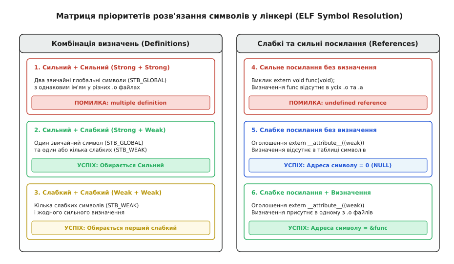
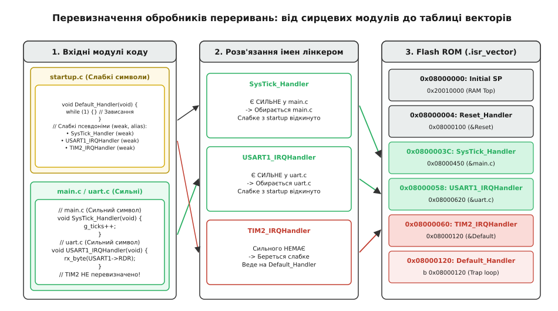

# Слабкий символ і перевизначення: механізм зв'язування за замовчуванням

<preknowlist>
- [Лінкування](root:sf-lang/linking) — таблиця символів, релокація та розв'язання зовнішніх посилань.
- [Одиниця трансляції та зв'язування: static, extern, inline](root:sf-lang/translation-unit) — ізольованість компіляції та рівні видимості імен.
- [ELF-формат прошивки](root:sf-lang/elf-format) — структура об'єктних файлів, секції та таблиці символів `Elf_Sym`.
- [ABI та calling convention](root:sf-lang/abi-calling-convention) — двійковий інтерфейс функцій і збереження регістрів.
</preknowlist>

Коли лінкер об'єднує кілька об'єктних файлів у виконуваний двійковий образ, він перевіряє таблиці символів кожної одиниці трансляції. Якщо два незалежні файли `driver.o` та `application.o` містять функцію з однаковим глобальним ім'ям `process_packet`, лінкер негайно зупиняє збирання з фатальною помилкою: `multiple definition of process_packet`. Правило мови C та стандарту C++ є категоричним — кожне глобальне ім'я у виконуваній програмі мусить мати рівно одне однозначне визначення.

Проте у системному програмуванні, розробці вбудованих прошивок та системних бібліотек (таких як `glibc` чи `newlib`) виникає протилежна інженерна вимога: надати базову реалізацію функції за замовчуванням або порожню заглушку в постачальницькому коді (наприклад, у стартовому файлі мікроконтролера чи в бібліотеці HAL), але дозволити розробнику кінцевого застосунку прозоро перекрити її власною оптимізованою реалізацією без редагування вихідних файлів бібліотеки та без помилок дублювання імен.

Для розв'язання цього протиріччя в двійковому форматі ELF і компіляторах сімейства GCC, Clang та ARM Compiler реалізовано концепцію **слабкого зв'язування** (*weak binding*). Позначення символу атрибутом `__attribute__((weak))` змінює статус ідентифікатора в таблиці символів: він перестає бути непохитною вимогою і стає поступливим варіантом за замовчуванням, який автоматично поступається звичайному визначенню.


*Матриця пріоритетів лінкера при вирішенні конфліктів символів. Сильний символ завжди витісняє будь-яку кількість слабких визначень без помилки збірки. Слабке посилання за відсутності визначення резольвиться в нульову адресу (NULL).*

---

### Сила зв'язування в двійковому форматі ELF

Щоб зрозуміти внутрішню механіку слабких символів, необхідно спуститися на рівень об'єктного файлу. Компілятор мови C або C++ транслює вихідний текст у двійковий формат ELF (*Executable and Linkable Format*). Усі функції, глобальні змінні та зовнішні залежності одиниці трансляції реєструються в спеціальній секції — таблиці символів `.symtab`.

Кожен символ у форматі ELF описується фіксованою структурою: `Elf32_Sym` для 32-бітних архітектур або `Elf64_Sym` для 64-бітних систем.

:::tabs
```c
// elf_sym.h — опис структури символу у форматі ELF (C99)
typedef struct {
    Elf64_Word    st_name;      // Зсув імені символу в таблиці рядків .strtab
    unsigned char st_info;      // Тип символу (STT_*) та атрибут зв'язування (STB_*)
    unsigned char st_other;     // Видимість символу (STV_DEFAULT тощо)
    Elf64_Section st_shndx;     // Індекс секції, де розташовано тіло символу (.text, .data, SHN_UNDEF)
    Elf64_Addr    st_value;     // Адреса або зміщення символу всередині секції
    Elf64_Xword   st_size;      // Розмір об'єкта чи функції в байтах
} Elf64_Sym;
```
```cpp
// elf_sym.hpp — опис структури символу у форматі ELF на C++20
#include <cstdint>

struct Elf64_Sym {
    std::uint32_t st_name;      // Зсув імені символу в таблиці рядків .strtab
    std::uint8_t  st_info;      // Тип символу (STT_*) та атрибут зв'язування (STB_*)
    std::uint8_t  st_other;     // Видимість символу (STV_DEFAULT тощо)
    std::uint16_t st_shndx;     // Індекс секції, де розташовано тіло символу
    std::uint64_t st_value;     // Адреса або зміщення символу всередині секції
    std::uint64_t st_size;      // Розмір об'єкта чи функції в байтах
};
```
:::

Ключову роль у процесі розв'язання імен відіграє байтове поле `st_info`. Воно кодує дві незалежні характеристики:
1. **Тип символу** (молодші 4 біти, макрос `ELF64_ST_TYPE`): `STT_NOTYPE` (не визначено), `STT_OBJECT` (змінна/буфер), `STT_FUNC` (виконуваний код функції), `STT_SECTION` (секція) або `STT_FILE` (ім'я сирцевого файлу).
2. **Зв'язування символу** (старші 4 біти, макрос `ELF64_ST_BIND`): визначає поведінку лінкера під час зіткнення імен.

Стандарт ELF визначає три фундаментальні класи зв'язування:

```
Значення поля зв'язування (ELF Symbol Binding):
  STB_LOCAL  (0) — локальний символ; видимий лише всередині поточного .o файлу (статичні функції/змінні)
  STB_GLOBAL (1) — сильний глобальний символ; видимий усій програмі, вимагає абсолютної унікальності
  STB_WEAK   (2) — слабкий символ; видимий усій програмі, але добровільно поступається сильному
```

За замовчуванням будь-яка нестатична функція чи глобальна змінна, оголошена у сирцевому файлі C або C++, потрапляє в таблицю символів зі значенням `STB_GLOBAL`. Це **сильний символ** (*strong symbol*). Якщо лінкер знаходить два об'єктні файли з однаковим символом `STB_GLOBAL`, він фіксує порушення контракту єдиного визначення і перериває трансляцію.

Коли перед функцією чи змінною вказано директиву `__attribute__((weak))`, компілятор записує у старші 4 біти поля `st_info` константу `STB_WEAK`. Для лінкера це пряма інструкція: цей символ є повноцінним визначенням, але має знижений пріоритет.

Розгляньмо, як це виглядає на практиці через утиліти інспекції двійкового коду `readelf` та `nm`. Якщо ми скомпілюємо дві функції — звичайну та слабку:

:::tabs
```c
// inspect_demo.c — звичайна та слабка функції
void strong_func(void) {}
__attribute__((weak)) void weak_func(void) {}
```
```cpp
// inspect_demo.cpp — звичайна та слабка функції на C++20
extern "C" {
    void strong_func() noexcept {}
    [[gnu::weak]] void weak_func() noexcept {}
}
```
:::

Виклик команди `readelf -s test.o` відобразить таблицю символів:

```
Num:    Value          Size Type    Bind   Vis      Ndx Name
  1: 0000000000000000    11 FUNC    GLOBAL DEFAULT    1 strong_func
  2: 000000000000000b    11 FUNC    WEAK   DEFAULT    1 weak_func
```

Утиліта `nm test.o` використовує лаконічні літерні прапорці:
- `T` (велика літера): глобальний сильний символ у секції коду (`.text`).
- `W` (велика літера): слабке визначення функції.
- `w` (маленька літера): слабке посилання на невизначений символ.

---

### Правила розв'язання конфліктів: Strong vs Weak

Під час фази компонування лінкер формує загальну глобальну таблицю імен, послідовно читаючи всі передані об'єктні файли (`.o`) та статичні бібліотеки (`.a`). Для кожного знайденого символу лінкер застосовує чітко детерміновану систему пріоритетів.

#### 1. Сильний символ проти сильного (Strong + Strong)
Якщо одне й те саме ім'я зустрічається як `STB_GLOBAL` у двох різних об'єктних файлах, виникає нерозв'язний конфлікт:
- **Результат**: Помилка компонування `multiple definition of 'symbol_name'`.
- **Причина**: Компілятор і лінкер не можуть самовільно вибрати між двома повноправними реалізаціями, оскільки це призвело б до непередбачуваної поведінки програми.

#### 2. Сильний символ проти слабких (Strong + Weak)
Якщо в наборі об'єктних файлів присутнє одне сильне визначення (`STB_GLOBAL`) і одне або кілька слабких визначень (`STB_WEAK`):
- **Результат**: Лінкер обирає сильне визначення. Усі слабкі визначення мовчки ігноруються й відкидаються.
- **Адресація**: Усі виклики функції та посилання на змінну в усіх одиницях трансляції перенаправляються на адресу сильного символу.
- **Помилка**: Жодних попереджень або помилок не генерується.

#### 3. Слабкий символ проти слабкого (Weak + Weak)
Якщо сильного визначення немає взагалі, але присутні кілька слабких символів (`STB_WEAK`):
- **Результат**: Лінкер не видає помилки, а вибирає одне зі слабких визначень.
- **Правило вибору**: Лінкер обирає перше слабке визначення, яке зустрів у списку аргументів командного рядка або в порядку обходу об'єктних файлів. Решта слабких символів відкидаються.
- **Застереження**: Така поведінка є потенційно небезпечною через недетермінізм — зміна порядку передачі файлів компілятору може змінити те, яка саме функція буде виконуватися в рантаймі.

#### 4. Слабке посилання без визначення (Weak Reference)
Якщо символ оголошений як зовнішній зі слабким атрибутом (`extern __attribute__((weak)) void func(void);`), але в жодному об'єктному файлі та в жодній бібліотеці немає його тіла:
- **Результат**: Помилка `undefined reference` **не виникає**.
- **Адресація**: Лінкер успішно завершує збирання, підставляючи замість адреси символу абсолютний нуль (`NULL` / `0x00000000`).

---

### Внутрішній алгоритм резольвінгу символів у лінкері

Щоб зрозуміти, чому лінкер поводиться саме так, простежимо його внутрішній стан під час обробки списку об'єктних файлів. Лінкер підтримує внутрішній асоціативний словник символів (глобальну хеш-таблицю). Кожен елемент словника зберігає поточний відомий стан символу: `UNDEFINED` (потрібен, але адреси немає), `WEAK_UNDEF` (слабка потреба), `WEAK_DEF` (є слабке тіло з конкретною адресою) або `STRONG_DEF` (є сильне тіло).

Коли лінкер читає черговий символ з об'єктного файлу, він виконує кінцевий автомат переходів:

```
Алгоритм розв'язання символу sym у лінкері:
1. Якщо sym ще немає в таблиці:
     - Записати sym з його поточним типом (UNDEFINED, WEAK_UNDEF, WEAK_DEF, STRONG_DEF).
2. Якщо sym вже присутній як UNDEFINED або WEAK_UNDEF:
     - Отримано WEAK_DEF або STRONG_DEF -> замінити статус на отриманий, зберегти адресу.
3. Якщо sym вже присутній як WEAK_DEF:
     - Отримано STRONG_DEF -> замінити адресу на STRONG_DEF, оновити статус до STRONG_DEF.
     - Отримано WEAK_DEF -> проігнорувати новий символ (залишити перший знайдений WEAK_DEF).
     - Отримано UNDEFINED / WEAK_UNDEF -> проігнорувати (визначення вже є).
4. Якщо sym вже присутній як STRONG_DEF:
     - Отримано STRONG_DEF -> ЗУПИНКА З ПОМИЛКОЮ "multiple definition"!
     - Отримано WEAK_DEF / UNDEFINED / WEAK_UNDEF -> мовчки проігнорувати.
```

Цей простий кінцевий автомат пояснює, чому слабкі символи додають нульові накладні витрати на етапі виконання: лінкер просто розставляє звичайні статичні релокації (`R_X86_64_PC32`, `R_ARM_THM_CALL` тощо), спрямовуючи машинні інструкції переходу `call` або `bl` безпосередньо на адресу обраної функції.

---

### Синтаксис оголошення: визначення, аліаси та посилання

У мовах C та C++ слабкі символи не входять до базового стандарту ISO, а реалізуються через розширення компіляторів. Основним механізмом у сучасних інструментальних ланцюгах (GCC, Clang, ARM GCC, Intel OneAPI) є атрибут `__attribute__((weak))`.

У старіших компіляторах або в спеціалізованих вбудованих середовищах (таких як IAR Embedded Workbench, Keil ARMCC версії 5 чи комерційні компілятори для DSP від Texas Instruments) використовується синтаксис директиви препроцесора `#pragma weak`:

:::tabs
```c
// pragma_weak.c — альтернативний синтаксис для компіляторів IAR та старого ARMCC
#pragma weak SysTick_Handler = Default_Handler
void SysTick_Handler(void);
```
```cpp
// pragma_weak.cpp — еквівалент для C++ у середовищах IAR та ARMCC
extern "C" {
    #pragma weak SysTick_Handler = Default_Handler
    void SysTick_Handler() noexcept;
}
```
:::

Директива `#pragma weak` виконує ту саму функцію на рівні об'єктного файлу, проте атрибутний синтаксис GNU `__attribute__((weak))` став де-факто промисловим стандартом завдяки своїй компактності, безпосередній прив'язці до оголошення функції та сумісності з сучасними системами статичного аналізу коду.

Розгляньмо три фундаментальні форми застосування слабких символів: слабке визначення, слабкий псевдонім і слабке посилання.

:::tabs
```c
// weak_forms.c — три форми використання слабких символів у C99
#include <stdio.h>
#include <stdint.h>

// 1. Слабке визначення (Weak Definition)
// Якщо застосунок не визначить власну функцію log_event,
// лінкер збереже це базове тіло.
__attribute__((weak)) void log_event(const char* msg)
{
    printf("[DEFAULT LOG]: %s\n", msg);
}

// 2. Спільна функція-заглушка для слабких псевдонімів
void Default_Handler(void)
{
    // Нескінченна пастка або безпечна заглушка
    while (1) {
        // Очікування переривання або скидання сторожового таймера
    }
}

// Слабкий псевдонім (Weak Alias)
// Оголошує символ SysTick_Handler слабким і спрямовує його
// на адресу функції Default_Handler, якщо користувач не надасть сильного тіла.
void SysTick_Handler(void) __attribute__((weak, alias("Default_Handler")));
void USART1_IRQHandler(void) __attribute__((weak, alias("Default_Handler")));

// 3. Слабке посилання (Weak Reference)
// Повідомляє лінкеру, що функція hardware_crypto_init може існувати,
// а може бути відсутньою у двійковому образі.
extern __attribute__((weak)) void hardware_crypto_init(void);

void system_startup(void)
{
    log_event("Ініціалізація підсистем...");

    // Обов'язкова перевірка адреси слабкого посилання перед викликом!
    if (hardware_crypto_init != NULL) {
        hardware_crypto_init();
    } else {
        printf("Апаратний криптомодуль не знайдено, використовуємо софтверний fallback.\n");
    }
}
```
```cpp
// weak_forms.cpp — еквівалентна ідіоматична реалізація для C++20
#include <iostream>
#include <string_view>
#include <cstdint>

// У C++ через спотворення імен (name mangling) для взаємодії з таблицями векторів
// та системним лінкером слабкі функції зазвичай експортують через extern "C".

extern "C" {

// 1. Слабке визначення (Weak Definition)
[[gnu::weak]] void log_event(const char* msg)
{
    std::cout << "[DEFAULT LOG]: " << (msg ? msg : "") << '\n';
}

// 2. Базовий обробник пастки
void Default_Handler() noexcept
{
    while (true) {
        #if defined(__x86_64__) || defined(_M_X64)
        __builtin_ia32_pause();
        #elif defined(__arm__) || defined(__aarch64__)
        __asm__ volatile("wfi");
        #endif
    }
}

// Слабкі псевдоніми через синтаксис атрибутів GNU
void SysTick_Handler() noexcept [[gnu::weak, gnu::alias("Default_Handler")]];
void USART1_IRQHandler() noexcept [[gnu::weak, gnu::alias("Default_Handler")]];

// 3. Слабке посилання
[[gnu::weak]] void hardware_crypto_init() noexcept;

} // extern "C"

namespace core::system {

void startup()
{
    log_event("Запуск підсистеми C++20...");

    // Перевірка наявності слабкого посилання в пам'яті
    if (hardware_crypto_init != nullptr) {
        hardware_crypto_init();
    } else {
        std::cout << "Криптомодуль відсутній, використовуємо софтверний fallback.\n";
    }
}

} // namespace core::system
```
:::

Зверніть увагу на конструкцію `__attribute__((weak, alias("Target")))`. Компілятор не генерує для слабкого псевдоніма окремого машинного коду. Замість цього він створює запис у таблиці символів з типом `STB_WEAK`, адреса якого (`st_value`) вказує точно на початок функції `Default_Handler`. Це дозволяє оголосити хоч 200 обробників переривань без жодного додаткового байта у Flash-пам'яті мікроконтролера.

---

### Практичне застосування: Таблиця векторів переривань мікроконтролера

Найпоширенішим і класичним прикладом використання слабких символів є організація векторних таблиць переривань в архітектурах ARM Cortex-M (STM32, NXP LPC, SAM, RP2040) та RISC-V.

Апаратна частина процесора Cortex-M очікує, що за фіксованою адресою у Flash-пам'яті (за замовчуванням `0x08000000` або `0x00000000`) розміщено масив 32-бітних покажчиків:
1. Початкове значення покажчика стека (`Main Stack Pointer`, MSP).
2. Адреса обробника скидання `Reset_Handler`.
3. Адреси системних винятків (`NMI`, `HardFault`, `MemManage`, `BusFault`, `UsageFault`, `SVCall`, `SysTick`).
4. Адреси переривань периферійних контролерів (`USART1_IRQHandler`, `TIM2_IRQHandler`, `DMA1_Channel1_IRQHandler` тощо).

Сучасний мікроконтролер може мати від 50 до 240 окремих каналів переривань. Якби виробник чипа оголосив усі ці функції звичайними сильними символами, розробник застосунку не зміг би написати функцію `void USART1_IRQHandler(void)` у власному файлі `uart.c`, оскільки лінкер миттєво повідомив би про подвійне визначення. Якби ж виробник залишив таблицю порожньою, лінкер вимагав би обов'язкового визначення кожного з 200 переривань, навіть якщо проєкт використовує лише один таймер.


*Архітектурний шаблон перекриття переривань. Усі невикористані вектори вказують на єдиний Default_Handler. Щойно користувач створює сильний обробник, лінкер спрямовує вектор на користувацьку функцію.*

Виробники мікроконтролерів реалізують стартовий файл (`startup_stm32.c` або асемблерний еквівалент), використовуючи слабкі псевдоніми.

:::tabs
```c
// startup_cortexm.c — типовий стартовий файл на C99 з таблицею векторів
#include <stdint.h>

// Оголошення типів покажчиків на обробники
typedef void (*isr_handler_t)(void);

// Зовнішні символи з лінкер-скрипта
extern uint32_t _estack;
extern void Reset_Handler(void);

// Єдина універсальна пастка для непередбачених переривань
void Default_Handler(void)
{
    // Якщо програма потрапила сюди, спрацювало апаратне переривання,
    // для якого розробник не написав власного обробника.
    while (1) {
        // Пастка
    }
}

// Оголошення слабких псевдонімів для системних та периферійних переривань
void NMI_Handler(void)        __attribute__((weak, alias("Default_Handler")));
void HardFault_Handler(void)  __attribute__((weak, alias("Default_Handler")));
void SysTick_Handler(void)    __attribute__((weak, alias("Default_Handler")));
void USART1_IRQHandler(void)  __attribute__((weak, alias("Default_Handler")));
void TIM2_IRQHandler(void)    __attribute__((weak, alias("Default_Handler")));

// Таблиця векторів розміщується у спеціальній секції .isr_vector
__attribute__((section(".isr_vector"), used))
const isr_handler_t g_vector_table[] = {
    (isr_handler_t)&_estack,      // Початкова вершина стека
    Reset_Handler,                // Точка входу процесора
    NMI_Handler,                  // Non-Maskable Interrupt
    HardFault_Handler,            // Апаратна аварія
    0, 0, 0, 0, 0, 0, 0,          // Зарезервовано архітектурою ARM
    SysTick_Handler,              // Системний таймер
    USART1_IRQHandler,            // Переривання UART1
    TIM2_IRQHandler               // Переривання таймера TIM2
};
```
```cpp
// startup_cortexm.cpp — типовий стартовий файл на C++20
#include <cstdint>
#include <array>

extern "C" {

using isr_handler_t = void (*)();

extern std::uint32_t _estack;
void Reset_Handler() noexcept;

// Спільна аварійна пастка
void Default_Handler() noexcept
{
    while (true) {
        #if defined(__arm__) || defined(__aarch64__)
        __asm__ volatile("wfi");
        #endif
    }
}

// Оголошення слабких псевдонімів
void NMI_Handler() noexcept [[gnu::weak, gnu::alias("Default_Handler")]];
void HardFault_Handler() noexcept [[gnu::weak, gnu::alias("Default_Handler")]];
void SysTick_Handler() noexcept [[gnu::weak, gnu::alias("Default_Handler")]];
void USART1_IRQHandler() noexcept [[gnu::weak, gnu::alias("Default_Handler")]];
void TIM2_IRQHandler() noexcept [[gnu::weak, gnu::alias("Default_Handler")]];

// Таблиця векторів
[[gnu::section(".isr_vector"), gnu::used]]
const std::array<isr_handler_t, 14> g_vector_table = {
    reinterpret_cast<isr_handler_t>(&_estack),
    Reset_Handler,
    NMI_Handler,
    HardFault_Handler,
    nullptr, nullptr, nullptr, nullptr, nullptr, nullptr, nullptr,
    SysTick_Handler,
    USART1_IRQHandler,
    TIM2_IRQHandler
};

} // extern "C"
```
:::

Якщо користувач у власному файлі `main.c` напише звичайну функцію:

:::tabs
```c
// main.c — користувацький сильний обробник переривання
#include <stdint.h>

volatile uint32_t g_system_ticks = 0;

// Звичайне (сильне) визначення: STB_GLOBAL
void SysTick_Handler(void)
{
    g_system_ticks++;
}
```
```cpp
// main.cpp — користувацький сильний обробник переривання на C++20
#include <cstdint>
#include <atomic>

namespace {
    std::atomic<std::uint32_t> g_system_ticks{0};
}

extern "C" {

// Сильне визначення SysTick_Handler (STB_GLOBAL)
void SysTick_Handler() noexcept
{
    g_system_ticks.fetch_add(1, std::memory_order_relaxed);
}

} // extern "C"
```
:::

Під час лінкування відбуваються такі події:
1. Лінкер аналізує `SysTick_Handler`: знаходить слабкий символ `STB_WEAK` у `startup_cortexm.o` і сильний `STB_GLOBAL` у `main.o`.
2. Сильний символ з `main.o` перемагає. Слабкий символ відкидається.
3. Елемент масиву `g_vector_table`, що відповідає `SysTick_Handler`, отримує реальну адресу функції з `main.o`.
4. Для `TIM2_IRQHandler` сильного визначення не знайдено. Лінкер залишає адресу слабкого символу, що вказує на `Default_Handler`.

Завдяки цьому механізму прошивка отримує 100% захист від необроблених викликів і одночасно нульові накладні витрати на таблиці віртуальних методів чи реєстрацію зворотних викликів у рантаймі.

---

### Слабкі посилання для плагінної архітектури та перевірки опцій

Другим потужним інструментом є **слабкі посилання** (*weak references*). Якщо звичайне посилання на функцію або змінну `extern void trace_hook(void);` вимагає обов'язкової наявності тіла під час компонування (інакше лінкер видає помилку `undefined reference to trace_hook`), то слабке посилання дозволяє коду скомпілюватися та запуститися навіть тоді, коли цільовий модуль повністю відсутній у збірці.

Це фундаментальний патерн для:
1. **Плагінної архітектури**: необов'язкові модулі телеметрії, трасування чи діагностики підключаються простим додаванням відповідного `.o` або `.c` файлу до списку збирання.
2. **Багатопотоковості в libc**: бібліотека `glibc` використовує слабкі посилання на функції `pthread_mutex_lock` та `pthread_create`. Якщо програма не лінкується з `libpthread.so`, `glibc` не виконує дорогих атомарних операцій блокування, перевіряючи `if (__pthread_mutex_lock != NULL)`.
3. **Опцій компілятора та санітайзерів**: AddressSanitizer шукає функцію `__asan_default_options` як слабке посилання. Якщо користувач визначив її у коді, ASan викликає її для зчитування налаштувань, а якщо ні — використовує вбудовані конфігурації.
4. **Хуків операційних систем реального часу (RTOS)**: ядро FreeRTOS оголошує такі функції як `vApplicationStackOverflowHook` та `vApplicationIdleHook` як слабкі символи. Якщо застосунок не визначає перехоплювач переповнення стека, спрацьовує стандартне аварійне зависання ядра.

Розгляньмо практичний приклад системи логування та аудиту пам'яті, де діагностичний модуль є абсолютно необов'язковим.

:::tabs
```c
// system_core.c — ядро системи зі слабким посиланням на діагностику
#include <stdio.h>
#include <stdlib.h>
#include <stdint.h>

// Оголошуємо зовнішню функцію слабким посиланням
extern __attribute__((weak)) void memory_audit_hook(const void* ptr, size_t size);

void* allocate_buffer(size_t size)
{
    void* ptr = malloc(size);
    if (!ptr) {
        return NULL;
    }

    // Перевірка наявності модуля в збірці
    if (memory_audit_hook != NULL) {
        memory_audit_hook(ptr, size);
    }

    return ptr;
}
```
```cpp
// system_core.cpp — ядро системи зі слабким посиланням на C++20
#include <iostream>
#include <memory>
#include <cstddef>

extern "C" {
    // Слабке посилання на необов'язковий C-інтерфейс аудиту
    [[gnu::weak]] void memory_audit_hook(const void* ptr, std::size_t size) noexcept;
}

namespace core::memory {

void* allocate_buffer(std::size_t size)
{
    void* ptr = std::malloc(size);
    if (!ptr) {
        return nullptr;
    }

    // Перевірка адреси слабкого посилання
    if (memory_audit_hook != nullptr) {
        memory_audit_hook(ptr, size);
    }

    return ptr;
}

} // namespace core::memory
```
:::

Якщо до збірки проєкту додати модуль `diagnostics.c`:

:::tabs
```c
// diagnostics.c — необов'язковий модуль
#include <stdio.h>

// Сильне визначення функції аудиту
void memory_audit_hook(const void* ptr, size_t size)
{
    printf("[AUDIT] Виділено %zu байтів за адресою %p\n", size, ptr);
}
```
```cpp
// diagnostics.cpp — необов'язковий модуль на C++20
#include <iostream>
#include <cstddef>

extern "C" {

void memory_audit_hook(const void* ptr, std::size_t size) noexcept
{
    std::cout << "[AUDIT] Виділено " << size << " байтів за адресою " << ptr << '\n';
}

} // extern "C"
```
:::

Якщо `diagnostics.c` скомпільовано й передано лінкеру, адреса `memory_audit_hook` стає ненульовою, і кожне виділення пам'яті супроводжується діагностичним повідомленням. Якщо цей файл видалити зі збірки, програма продовжить працювати без збоїв і без жодної зміни у вихідному тексті ядра `system_core.c`.

Для побудови комплексних драйверних систем на базі таких зворотних викликів створено окремий [практичний фреймворк драйверних зворотних викликів на базі слабких символів](root:sf-lang/weak-symbol/proj-weak-handler-framework.md).

---

### Слабкі символи на рівні лінкер-скрипта: директива PROVIDE

Окрім компілятора, слабкі символи можна створювати безпосередньо в скрипті компонувальника GNU `ld` за допомогою директиви `PROVIDE` або `PROVIDE_HIDDEN`.

Директива `PROVIDE(символ = вираз);` визначає символ у вихідному двійковому файлі **тільки в тому випадку**, якщо цей символ було використано у коді, але жодна з одиниць трансляції не надала для нього власного сильного визначення:

```text
/* linker_script.ld */
SECTIONS
{
    .text : {
        *(.text*)
    } > FLASH

    /* Створює символ SysTick_Handler, якщо користувач не визначив його в C */
    PROVIDE(SysTick_Handler = Default_Handler);

    /* Експортує межі секцій для ініціалізації рантайму */
    PROVIDE(_sdata = .);
}
```

Різниця між `PROVIDE` у лінкер-скрипті та `__attribute__((weak))` у C полягає в моменті створення запису:
- `__attribute__((weak))` створює повноцінний символ `STB_WEAK` в об'єктному файлі на етапі трансляції.
- `PROVIDE` генерує сильний або локальний символ безпосередньо під час фінального компонування, якщо в таблиці невирішених посилань залишився незакритий запис.

Це дозволяє організовувати системні константи пам'яті (такі як `__bss_start__`, `__heap_end__`) без необхідності створювати фіктивні сирцеві змінні в коді.

---

### Динамічне лінкування та інтерпозиція символів у Linux

У середовищі операційних систем загального призначення (Linux, FreeBSD) слабкі символи відіграють вирішальну роль у функціонуванні динамічного лінкера `ld.so` та механізму інтерпозиції (*symbol interposition*).

У стандартній бібліотеці C `libc.so` майже всі системні виклики та стандартні функції (`malloc`, `free`, `read`, `write`, `printf`) оголошені як слабкі псевдоніми до внутрішніх сильних реалізацій з префіксом `__libc_`:

:::tabs
```c
// libc_internals.c — спрощена схема експорту функцій у libc.so
#include <stddef.h>

void* __libc_malloc(size_t size)
{
    // Внутрішня реалізація системного алокатора
    return (void*)0;
}

// Експорт публічного слабкого символу malloc
void* malloc(size_t size) __attribute__((weak, alias("__libc_malloc")));
```
```cpp
// libc_internals.cpp — спрощена схема експорту функцій на C++20
#include <cstddef>

extern "C" {

void* __libc_malloc(std::size_t size) noexcept
{
    return nullptr;
}

void* malloc(std::size_t size) noexcept [[gnu::weak, gnu::alias("__libc_malloc")]];

} // extern "C"
```
:::

Це архітектурне рішення забезпечує дві критичні можливості:
1. **Чиста підміна алокатора**: Якщо розробник підключає альтернативний алокатор пам'яті (наприклад, `jemalloc` або `tcmalloc`), його сильне визначення `malloc` автоматично заміщує слабке визначення з `libc.so` для всієї програми без необхідності модифікувати або перекомпільовувати системну бібліотеку.
2. **Перехоплення через LD_PRELOAD**: Утиліти профілювання та санітайзери можуть перехоплювати виклики функцій за допомогою динамічної бібліотеки, завантаженої через змінну середовища `LD_PRELOAD`. Оскільки `malloc` є слабким, динамічний лінкер обирає версію з передзавантаженої бібліотеки, яка за необхідності викликає оригінальну `__libc_malloc` через `dlsym(RTLD_NEXT, "malloc")`.

У динамічній таблиці символів `.dynsym` такі функції отримують прапорець `STB_WEAK`, що дозволяє dynamic linker обробляти їх із найнижчим пріоритетом у ланцюжку пошуку `DT_NEEDED`.

---

### Порівняння моделей: Common Symbols проти Weak Symbols

У мові C існує історична концепція, яку часто плутають зі слабкими символами — це так звані **спільні символи** (*Common Symbols*, секція `SHN_COMMON` або `*COM*` у `readelf`).

В оригінальному стандарті C (традиційна модель компіляторів Unix) неініціалізована глобальна змінна, оголошена без ключового слова `extern`:

:::tabs
```c
// tentative_def.c (C99)
int global_counter; // Tentative definition: потрапляє у SHN_COMMON за прапорця -fcommon
```
```cpp
// tentative_def.cpp (C++20)
// У C++ конструкція без extern завжди є повноцінним сильним визначенням
int global_counter = 0; // Сильний символ у секції .bss
```
:::

потрапляла в секцію `COMMON` з типом зв'язування `STB_GLOBAL`. Якщо два різні файли оголошували `int global_counter;`, лінкер не видавав помилки `multiple definition`, а об'єднував їх в одну ділянку пам'яті в секції `.bss`, вибираючи найбільший оголошений розмір.

Проте між Common Symbols та Weak Symbols існують кардинальні відмінності:
1. **Область застосування**: Common Symbols застосовуються виключно до неініціалізованих змінних даних. Функції не можуть бути Common Symbols. Слабкі символи (`weak`) однаково діють як на функції (`.text`), так і на ініціалізовані (`.data`) та неініціалізовані (`.bss`) змінні.
2. **Контроль стандартів**: Поведінка Common Symbols регулюється прапорцем компілятора `-fcommon` / `-fno-common`. Починаючи з версії GCC 10 та Clang 11, прапорець `-fno-common` увімкнено за замовчуванням: дублювання змінних без `extern` тепер викликає стандартну помилку `multiple definition`.
3. **Семантика перевизначення**: Common Symbols зливаються докупи, тоді як слабке визначення повністю заміщується сильним визначенням.

```
Порівняння типів символів у форматі ELF:
  Характеристика             | Common Symbol (SHN_COMMON)  | Weak Symbol (STB_WEAK)
  ---------------------------+-----------------------------+---------------------------
  Може бути функцією         | Ні (лише змінні)            | Так (функції та змінні)
  Може мати ініціалізатор    | Ні                          | Так
  Реакція на сильне ім'я     | Об'єднується з сильним      | Повністю відкидається
  Поведінка за замовчуванням | Вимкнено в GCC 10+          | Увімкнено через атрибут
```

---

### Слабкі символи у стандартах C99/C11 та C++20

Хоча семантика слабкого зв'язування на рівні двійкового формату ELF є спільною, мови C та C++ взаємодіють з нею по-різному через відмінності в системі типів і правилах мови.

#### 1. Спотворення імен (Name Mangling) та extern "C"
У мові C ім'я функції в сирцевому тексті `SysTick_Handler` один в один відповідає назві символу в таблиці ELF: `SysTick_Handler`.

У C++ компілятор застосовує спотворення імен (*name mangling*), додаючи інформацію про простір імен, клас та типи аргументів. Функція `void SysTick_Handler(void)` у глобальному просторі імен перетворюється компілятором GCC на `_Z15SysTick_Handlerv`.

Якщо стартовий файл написаний мовою C (або на асемблері) й оголошує слабкий псевдонім `SysTick_Handler`, а програміст у C++ файлі визначить `void SysTick_Handler()`, компілятор згенерує сильний символ `_Z15SysTick_Handlerv`. Лінкер сприйме це як два абсолютно різних імені! Вектор переривання так і залишиться вказувати на `Default_Handler`, а користувацький код не буде викликано ніколи.

**Залізне правило для C++**: Будь-який слабкий символ або функція перекриття, призначена для взаємодії з системними таблицями чи C-інтерфейсами, **мусить** бути огорнута в блок `extern "C"`.

:::tabs
```c
// isr_c.c — визначення обробника мовою C
void SysTick_Handler(void)
{
    // C-символ без mangling
}
```
```cpp
// isr_cpp.cpp — коректне визначення обробника на C++20
extern "C" {
    // Гарантує створення символу з чистим ім'ям SysTick_Handler без mangling
    void SysTick_Handler() noexcept
    {
        // Тіло обробника
    }
}
```
:::

#### 2. Неявні слабкі символи компілятора C++ (COMDAT та інлайнінг)
У мові C++ компілятор щодня створює гігабайти слабких символів без відома програміста. Це відбувається через два механізми:
1. **Інлайн-функції у заголовках (`inline` або методи класів усередині оголошення)**: Якщо 50 файлів `.cpp` підключають `header.hpp` з реалізацією `inline int compute()`, компілятор зобов'язаний згенерувати машинний код у кожному з 50 об'єктних файлів.
2. **Шаблони функцій і класів**: Кожна інстанціація `std::vector<int>` у кожній одиниці трансляції породжує ідентичний набір методів.

Щоб запобігти помилці `multiple definition`, компілятор C++ поміщає код таких функцій у спеціальні секції `COMDAT` і позначає символи атрибутом `STB_WEAK` (або еквівалентним прапорцем зв'язування секційних груп). Лінкер знаходить 50 однакових слабких визначень `std::vector<int>::push_back` і дедуплікує їх, залишаючи в готовому двійковому файлі рівно одну копію.

У стандарті C++20 модулі (`import` / `export`) пропонують фундаментальну альтернативу: експортовані функції компілюються в один об'єктний файл і мають сильне унікальне зв'язування, що усуває необхідність масової генерації слабких COMDAT-секцій і прискорює лінкування великих систем у рази.

#### 3. Правило одного визначення (One Definition Rule, ODR)
Слабкі символи можуть приховувати небезпечні порушення ODR (*One Definition Rule*) у C++. Якщо дві різні одиниці трансляції створять дві різні реалізації слабкої функції з однаковим ім'ям, компілятор не видасть попередження, а лінкер свавільно обере одну з них. Частина програми буде виконувати не той код, на який розраховував розробник, що призводить до важковловимих помилок часу виконання (*undefined behavior*).

---

### Поведінка слабких символів при статичній та динамічній оптимізації

Під час взаємодії слабких символів з оптимізаторами компілятора та динамічним компонувальником операційної системи виникають тонкі системні ефекти.

#### 1. Оптимізація часу лінкування (Link-Time Optimization, LTO)
При збиранні з прапорцем `-flto` (GCC та Clang) компілятор зберігає в об'єктних файлах не готовий машинний код, а внутрішнє проміжне представлення GIMPLE або LLVM IR. Лінкер запускає глобальний оптимізатор над усіма файлами одночасно.

Якщо слабка функція визначена і викликається всередині однієї й тієї самої одиниці трансляції `hal.c`:

:::tabs
```c
// hal_hazard.c (C99)
__attribute__((weak)) void hal_tick_hook(void)
{
    // порожньо
}

void hal_process(void)
{
    hal_tick_hook(); // Компілятор може вбудувати (inline) це порожнє тіло!
}
```
```cpp
// hal_hazard.cpp (C++20)
extern "C" {

[[gnu::weak]] void hal_tick_hook() noexcept
{
    // порожньо
}

void hal_process() noexcept
{
    hal_tick_hook(); // Ризик внутрішнього інлайнінгу
}

} // extern "C"
```
:::

Без прапорця LTO компілятор генерував би звичайний зовнішній виклик через таблицю релокацій, дозволяючи користувацькому коду перекрити `hal_tick_hook`. Проте під час агресивного аналізу всередині одного файлу оптимізатор може вирішити, що функція `hal_tick_hook` є занадто простою, і підставити її тіло на місце виклику безпосередньо в момент компіляції `hal.c`. Якщо це станеться, сильне визначення користувача з `main.c` буде успішно злінковане, але `hal_process` продовжить виконувати старе заінлайнене тіло!

**Захист від передчасного інлайнінгу**:
Для запобігання внутрішньому інлайнінгу слабких точок розширення завжди додають атрибут `noinline`:

:::tabs
```c
// hal_hooks.c — захист слабкої точки розширення від inlining
__attribute__((weak, noinline)) void hal_tick_hook(void)
{
    // Захищено від передчасного розкриття компілятором
}
```
```cpp
// hal_hooks.cpp — захист слабкої точки розширення на C++20
extern "C" {
    [[gnu::weak, gnu::noinline]] void hal_tick_hook() noexcept
    {
        // Захищено від передчасного розкриття
    }
}
```
:::

#### 2. Статичні архіви (`.a`) та порядок лінкування
Архіви статичних бібліотек (`libsomething.a`) є простими колекціями об'єктних файлів, упакованих утилітою `ar`. Поведінка лінкера щодо статичних бібліотек принципово відрізняється від поведінки щодо окремих об'єктних файлів `.o`.

Лінкер витягує об'єктний файл з архіву `.a` **тільки тоді**, коли поточний список невирішених символів (*undefined symbols*) містить ім'я, яке цей файл експортує як сильне або слабке визначення.

Якщо слабке посилання `extern __attribute__((weak)) void plugin_init(void);` присутнє в ядрі програми, але реалізація `plugin_init` упакована в бібліотеку `libplugins.a`:
- Слабке посилання **не додається** до списку обов'язкових невирішених символів.
- Лінкер переглядає `libplugins.a`, бачить, що ніхто обов'язково не вимагає `plugin_init`, і **не завантажує** об'єктний файл з архіву взагалі!
- Результат: адреса `plugin_init` залишається рівною `NULL`, навіть якщо бібліотека була передана в командному рядку лінкера.

**Рішення проблеми**:
1. Передавати об'єктні файли плагінів як прямі аргументи `.o`, а не через архіви `.a`.
2. Використовувати прапорці компонувальника `--whole-archive`:
   ```bash
   gcc main.o -Wl,--whole-archive -lplugins -Wl,--no-whole-archive -o firmware.elf
   ```
3. Примусово оголосити символ невирішеним через прапорець `-u`:
   ```bash
   gcc main.o -Wl,-u,plugin_init -lplugins -o firmware.elf
   ```

---

### Порівняння між платформами: ELF, Mach-O та PE-COFF

Слабке зв'язування є стандартом де-факто для об'єктного формату ELF, проте на інших платформах реалізація принципово відрізняється:

1. **Linux / BSD / RTOS (Формат ELF)**: Повна нативна підтримка `STB_WEAK`. Підтримуються як слабкі визначення, так і слабкі посилання й слабкі аліаси через атрибути GCC/Clang.
2. **macOS / iOS (Формат Mach-O)**: Традиційний лінкер Mach-O використовує дворівневий простір імен (*two-level namespace*). Для слабких посилань використовується атрибут `__attribute__((weak_import))`. Слабкі визначення позначаються прапорцем `N_WEAK_DEF` у таблиці `nlist`, що забезпечує коректну дедуплікацію шаблонів C++.
3. **Windows (Формат PE-COFF / MSVC)**: Формат PE-COFF історично не має прямого еквівалента ELF `STB_WEAK` для довільних функцій. Компілятор Microsoft Visual C++ використовує спеціальні прагми лінкера для створення псевдонімів за замовчуванням:

:::tabs
```c
// msvc_weak.c — створення слабкого псевдоніма в MSVC C
#pragma comment(linker, "/alternatename:_SysTick_Handler=_Default_Handler")
void SysTick_Handler(void);
```
```cpp
// msvc_weak.cpp — створення слабкого псевдоніма в MSVC C++
extern "C" {
    #pragma comment(linker, "/alternatename:SysTick_Handler=Default_Handler")
    void SysTick_Handler() noexcept;
}
```
:::

Якщо лінкер MSVC не знаходить символу `_SysTick_Handler`, він автоматично підставляє `_Default_Handler`. Для слабких посилань Clang на Windows емулює поведінку ELF за допомогою спеціальних директив секцій `.drectve`.

---

### Діагностика та налагодження слабких символів у GDB

Коли прошивка зависає в нескінченному циклі або необов'язковий модуль не викликається, системний інженер повинен вміти швидко перевірити розподіл адрес у готовому ELF-образі.

Розгляньмо типову сесію діагностики за допомогою GNU Debugger (GDB) та утиліти `objdump`.

#### Крок 1. Перевірка таблиці векторів у дизасемблері
Виконуємо команду дампу секції векторів:

```bash
arm-none-eabi-objdump -D -j .isr_vector firmware.elf
```

Вивід:
```
08000000 <g_vector_table>:
 8000000:       20010000        .word   0x20010000  // SP
 8000004:       08000101        .word   0x08000101  // Reset_Handler
 8000008:       08000121        .word   0x08000121  // NMI -> Default_Handler
 800000c:       08000121        .word   0x08000121  // HardFault -> Default_Handler
 ...
 800003c:       08000451        .word   0x08000451  // SysTick -> main.c (ПЕРЕКРИТО!)
 8000058:       08000121        .word   0x08000121  // USART1 -> Default_Handler (НЕ ПЕРЕКРИТО)
```

*(Примітка: в архітектурі ARM Cortex-M молодший біт покажчика функції встановлено в `1` для позначення режиму Thumb-2).*

Тут ми чітко бачимо: `SysTick_Handler` отримав адресу `0x08000450` (користувацька функція), тоді як `USART1_IRQHandler` вказує на `0x08000120` (`Default_Handler`). Якщо розробник очікував, що UART вже обробляється користувацьким кодом, цей дамп миттєво вказує на проблему: сильне визначення не потрапило у збірку (наприклад, через помилку в назві чи відсутність `extern "C"`).

#### Крок 2. Інспекція символів під час сесії GDB
Під час налагодження підключіться до мікроконтролера через OpenOCD або J-Link:

```gdb
(gdb) target remote :3333
(gdb) info address SysTick_Handler
Symbol "SysTick_Handler" is at 0x8000450 in file main.c, line 12.

(gdb) info address USART1_IRQHandler
Symbol "USART1_IRQHandler" is at 0x8000120 in file startup_cortexm.c, line 15.

(gdb) print hardware_crypto_init
$1 = {void (void)} 0x0 <Default_Handler-0x120>
```

Команда `info address` у GDB прямо показує файл та рядок сирцевого коду, з якого лінкер взяв остаточну реалізацію символу, а `print hardware_crypto_init` підтверджує, що слабке посилання має значення `0x0` (NULL).

---

### Слабкі символи в системних бібліотеках: newlib, syscalls та масиви ініціалізації

У вбудованих системах стандартна бібліотека мови C (найчастіше `newlib` або `picolibc`) скомпільована без прив'язки до конкретного апаратного периферійного обладнання. Функції високого рівня `printf`, `malloc` та `fopen` зрештою звертаються до низькорівневих системних викликів: `_write`, `_read`, `_sbrk`, `_close`, `_fstat`.

Щоб програма могла зібратися навіть на мінімальній системі без операційної системи, бібліотека `newlib` містить файл `stubs.c`, у якому кожен системний виклик реалізовано як слабкий символ, що повертає код помилки `ENOSYS` («функцію не реалізовано») або `ENOMEM`:

:::tabs
```c
// newlib_stubs.c — слабкі заглушки системних викликів у newlib
#include <errno.h>
#include <stddef.h>

__attribute__((weak)) int _write(int file, const char* ptr, int len)
{
    // За замовчуванням вивід відсутній
    errno = ENOSYS;
    return -1;
}

__attribute__((weak)) void* _sbrk(ptrdiff_t incr)
{
    extern char _end; // Символ кінця секції BSS з лінкер-скрипта
    static char* heap_end = 0;
    char* prev_heap_end;

    if (heap_end == 0) {
        heap_end = &_end;
    }

    prev_heap_end = heap_end;
    heap_end += incr;
    return (void*)prev_heap_end;
}
```
```cpp
// newlib_stubs.cpp — слабкі заглушки системних викликів на C++20
#include <cerrno>
#include <cstddef>

extern "C" {

[[gnu::weak]] int _write(int file, const char* ptr, int len) noexcept
{
    errno = ENOSYS;
    return -1;
}

[[gnu::weak]] void* _sbrk(std::ptrdiff_t incr) noexcept
{
    extern char _end;
    static char* heap_end = nullptr;

    if (heap_end == nullptr) {
        heap_end = &_end;
    }

    char* prev_heap_end = heap_end;
    heap_end += incr;
    return static_cast<void*>(prev_heap_end);
}

} // extern "C"
```
:::

Коли розробник пише драйвер послідовного порту UART, він визначає звичайну сильну функцію `int _write(int file, const char* ptr, int len)`, яка відправляє байти у регістр передавача `USART1->TDR`. Сильний символ з файлу `uart_stdio.o` миттєво перекриває слабку заглушку з `libc.a`, і всі виклики `printf` у програмі починають надсилати текст у консоль UART без жодної правки сирців `newlib`.

Аналогічно працюють масиви конструкторів глобальних об'єктів C++: `__init_array_start` та `__init_array_end`. Якщо у програмі немає жодного глобального класу з конструктором, лінкер закриває слабкі посилання на ці символи нульовою довжиною, що дозволяє стартовому коду пропустити цикл виклику конструкторів без помилок часу виконання.

---

### Порівняльна таблиця поведінки лінкера

Нижче зведено всі можливі варіанти зв'язування символів у форматі ELF та їхні наслідки для компонувальника:

| Тип символу в файлі A | Тип символу в файлі B | Результат лінкування | Результуюча адреса | Помилка збірки |
| :--- | :--- | :--- | :--- | :--- |
| `STB_GLOBAL` (сильний) | `STB_GLOBAL` (сильний) | Конфлікт визначень | Не визначено | `multiple definition` |
| `STB_GLOBAL` (сильний) | `STB_WEAK` (слабкий) | Вибір сильного | Адреса символу з файлу A | Немає (успіх) |
| `STB_WEAK` (слабкий) | `STB_GLOBAL` (сильний) | Вибір сильного | Адреса символу з файлу B | Немає (успіх) |
| `STB_WEAK` (слабкий) | `STB_WEAK` (слабкий) | Перше визначення | Адреса з файлу A (за порядком) | Немає (успіх) |
| `STB_LOCAL` (static) | `STB_GLOBAL` (сильний) | Ізольовані символи | Різні адреси для файлів A та B | Немає (успіх) |
| `STB_WEAK` (посилання) | Немає визначення | Нульова адреса | `0x00000000` (NULL) | Немає (успіх) |
| `STB_GLOBAL` (посилання) | Немає визначення | Нерозв'язане посилання | Не визначено | `undefined reference` |

Слабкі символи залишаються фундаментальним наріжним каменем низькорівневого зв'язування системного коду, поєднуючи гнучкість абстракції за замовчуванням із нульовою ціною виконання в готовому машинному коді.
