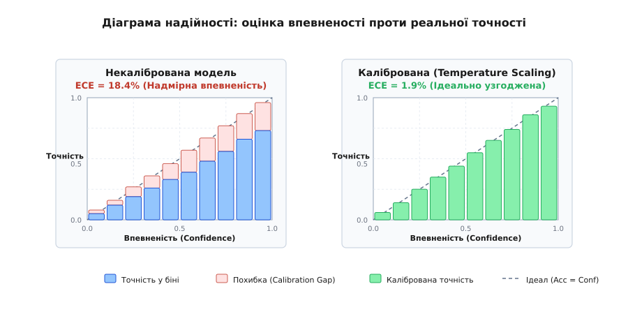
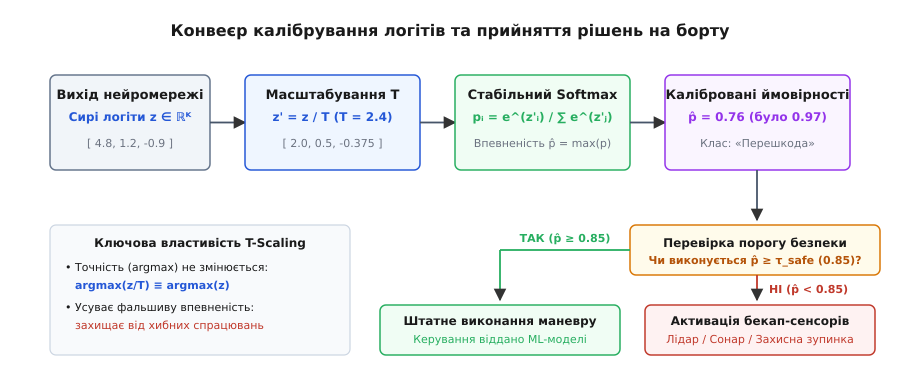

# Калібрування впевненості моделі

<preknowlist>
- [Функції активації та Softmax](root:sf-ml/activation-functions) — експоненційне перетворення логітів у ймовірнісний розподіл.
- [Функції втрат і логарифмічна правдоподібність](root:sf-ml/loss-functions) — оптимізація крос-ентропії (NLL) при класифікації.
- [Перенавчання та узагальнення](root:sf-ml/overfitting) — розрив між якістю на навчальній та тестовій вибірках.
- [Поріг і ціна помилки](root:sf-ml/porih-i-tsina-pomylky) — прийняття рішень за порогом і вартість хибних спрацювань.
</preknowlist>

Бортовий комп'ютер автономного колісного робота отримує відеопотік із фронтальної камери й щосекунди класифікує тип поверхні попереду: сухий асфальт, гравій, глибока калюжа або вкрита кригою ділянка. На швидкості двадцять кілометрів на годину система розпізнавання видає вектор вихідних значень нейромережі, де для класу «сухий асфальт» стоїть число `0.98`, а для класу «крига» — `0.02`. Програмний модуль планування руху сприймає `0.98` як майже абсолютну певність (дев'яносто вісім відсотків) і дозволяє розвивати максимальну швидкість без задіяння резервних ультразвукових далекомірів. Проте під колесами опиняється тонкий шар прозорого льоду, робот втрачає зчеплення й зазнає аварії. Аналіз записів показав: серед усіх випадків, коли ця нейромережа видавала значення `0.98` на вологій або холодній дорозі, реальна точність її прогнозів становила лише шістдесят два відсотки.

Причина цієї аварії криється у фундаментальній невідповідності між ранжувальною здатністю нейромережі та числовим значенням її виходів. Вихідний шар [Softmax](root:sf-ml/activation-functions), який стоїть наприкінці майже кожного класифікатора, перетворює довільні дійсні числа — логіти — на додатні величини із сумою одиниця. Інженери часто автоматично трактують ці числа як апостеріорні ймовірності істинності події. Але нормалізований експоненційний вектор не є ймовірністю в статистичному сенсі: мережа може бездоганно обирати правильний клас серед альтернатив (мати високу класифікаційну точність `Accuracy`), але систематично й катастрофічно завищувати власну впевненість.

Калібрування впевненості (англ. *confidence calibration*, від лат. *calibrare* — вимірювати діаметр, співвідносити зі шкалою) — це процес узгодження вихідного балу моделі з її реальною емпіричною точністю. Якщо модель стверджує, що впевнена у рішенні на вісімдесят відсотків, то рівно у вісімдесяти випадках зі ста її прогноз має бути правильним. Без такого узгодження неможливо побудувати жодну надійну систему безпеки: порогові фільтри відсікання, алгоритми [передачі керування людині або бекап-сенсорам](root:sf-ml/ne-znaiu), ансамблі та медичні системи діагностики перетворюються на генератори помилкових рішень через хибне відчуття надійності.

### Анатомія надмірної впевненості: чому сучасні нейромережі втратили скромність

У 1998 році класична згорткова мережа LeNet-5, яка розпізнавала рукописні цифри на банківських чеках, була практично ідеально відкаліброваною: якщо вона видавала ймовірність `0.70`, то її емпірична точність на цій підмножині дійсно дорівнювала сімдесяти відсоткам. Проте починаючи з 2012 року, з появою глибоких архітектур (AlexNet, VGG, ResNet, DenseNet, а згодом і Vision Transformers), виник дивний парадокс. Класифікаційна помилка моделей стрімко падала з кожним роком, але помилка калібрування водночас зростала у кілька разів. Сучасні моделі стали набагато точнішими за своїх попередників, але водночас стали патологічно надвпевненими (англ. *overconfident*).

Щоб розібрати механіку виникнення цього дефекту, простежимо динаміку навчання класифікатора під дією стандартної функції втрат крос-ентропії (Negative Log-Likelihood, NLL). Нехай для навчального зразка `x` істинним класом є індекс `y ∈ {1, ..., K}`. Мережа обчислює ненормалізований вектор дійсних чисел — логітів `z = [z₁, z₂, ..., z_K]`. Вихідний шар Softmax перетворює вектор `z` на вектор оцінок імовірностей `p = [p₁, p₂, ..., p_K]`:

```
p_k = exp(z_k) / ∑_{j=1}^{K} exp(z_j)
```

Функція втрат крос-ентропії для одного зразка мінімізує від'ємний логарифм імовірності істинного класу:

```
L_NLL = -log(p_y) = -z_y + log( ∑_{j=1}^{K} exp(z_j) )
```

Знайдемо аналітичний градієнт функції втрат за логітом довільного класу `z_k`:

```
∂L_NLL / ∂z_k = p_k - 𝕀(k = y)
```

де `𝕀(k = y)` — індикатор одиниці, якщо клас збігається з істинним, і нуль для всіх інших класів.

Цей градієнт розкриває ключовий закон оптимізатора. Для всіх неправильних класів (`k ≠ y`) похідна `∂L_NLL / ∂z_k = p_k > 0`. Це означає, що [градієнтний спуск](root:sf-ml/gradient-descent) постійно штовхає їхні логіти `z_k` вниз, у бік від'ємної нескінченності. Для правильного класу `y` похідна дорівнює `p_y - 1 < 0`, що штовхає логіт `z_y` вгору. Градієнт стає рівним нулю лише за недосяжної в реальних обчисленнях умови:

```
p_y = 1.0   і   p_k = 0.0  (для всіх k ≠ y)
```

А для того, щоб Softmax видав математичну одиницю, різниця між логітом правильного класу та логітами всіх конкурентів мусить прямувати до нескінченності:

```
L_NLL → 0   ⇔   (z_y - z_k) → +∞
```

Для правильної класифікації зразка моделі достатньо виконання простої нерівності `z_y > max_{k ≠ y} z_k` навіть із мінімальним зазором у `0.001` (помилка класифікації 0/1 Error при цьому дорівнює нулю). Проте оптимізатор крос-ентропії не зупиняється на досягненні правильного ранжування. Він продовжує мільйони кроків градієнтного спуску, збільшуючи норму вагових коефіцієнтів і розсуваючи логіти до значень `+30` та `-30`. У результаті ймовірності штучно збиваються до значень `0.9999` та `0.0001`.

Цей ефект підсилюється чотирма архітектурними чинниками сучасного глибокого навчання:

1. **Глибина та місткість мереж (Depth and Capacity).** Неглибокі мережі 1990-х років мали обмежену кількість параметрів. Вони фізично не могли побудувати надрізкі межі між класами в просторі ознак, через що перехідні зони залишалися пологими, а вихідні ймовірності — помірними. Сучасні моделі з десятками й сотнями мільйонів ваг формують екстремально круті схили на розділових гіперповерхнях.
2. **Пакетна нормалізація (Batch Normalization).** Нормалізація проміжних активацій стабілізує потік градієнтів крізь глибокі шари, центруючи й масштабуючи розподіли перед активаціями. Це запобігає затуханню градієнтів, але водночас знімає природне насичення сигналів. Повноз'єднані вихідні шари отримують свободу генерувати логіти величезної амплітуди.
3. **Ослаблення L2-регуляризації (Weight Decay).** Для досягнення рекордних показників Top-1 Accuracy на великих датасетах у сучасних конвеєрах часто зменшують коефіцієнт затухання ваг (до значень порядку `10⁻⁴` або `10⁻⁵`). Без жорсткого обмеження норми ваг матриці вихідного класифікаційного шару зростають за абсолютною величиною, що прямо масштабує вихідні логіти.
4. **Залишкові зв'язки (Residual Skip Connections).** Адитивне додавання вхідного тензора до виходу блоку (`x + F(x)`) забезпечує лінійний шлях проходження сигналу без спотворень. Це дозволяє оптимізатору безперешкодно накопичувати лінійну амплітуду збудження вздовж усієї глибини мережі.

Виникає фундаментальний розрив: модель може не зазнавати перенавчання за класифікаційною точністю на валідаційних даних, але водночас зазнає катастрофічного **перенавчання за простором імовірностей** (Overfitting on Probability Scale).

> 🔧 **Навіщо це.** Якщо ви розгортаєте модель розпізнавання об'єктів або детекції дефектів на мікроконтролері чи бортовому комп'ютері, сирі виходи Softmax не можна передавати у блок безпеки як реальні шанси успіху. Модель, навчена за стандартним протоколом, майже завжди бреше в бік самовпевненості. Без процедури калібрування будь-який розрахунок ризиків буде базуватися на спотвореній математичній шкалі.

### Формальне математичне визначення калібрування

Сформулюємо суворі статистичні умови, за яких класифікатор вважається каліброваним.

Нехай `X ∈ ℝᴰ` — випадковий вектор вхідних ознак (наприклад, пікселі зображення з камери), а `Y ∈ {1, 2, ..., K}` — випадкова величина, що позначає істинний дискретний клас об'єкта. Модель машинного навчання реалізує відображення `f: ℝᴰ → Δ^{K-1}`, де `Δ^{K-1}` — симплекс імовірностей розмірності `K`:

```
p(X) = [p₁(X), p₂(X), ..., p_K(X)]   при умові p_k(X) ≥ 0  і  ∑_{k=1}^{K} p_k(X) = 1
```

Рішення класифікатора визначається двома випадковими величинами — передбаченим класом `Ŷ` та відповідною йому максимальною впевненістю `P̂`:

```
Ŷ = argmax_{k ∈ {1, ..., K}} p_k(X)
P̂ = max_{k ∈ {1, ..., K}} p_k(X)
```

Змінна `P̂` набуває значень на неперервному відрізку `[1/K, 1.0]`.

У математичній статистиці класифікатор називається **ідеально каліброваним за впевненістю** (англ. *confidence-calibrated*), якщо для будь-якого фіксованого значення впевненості `p ∈ [0, 1]` умовна ймовірність правильного передбачення точно дорівнює цьому числу `p`:

```
P( Ŷ = Y | P̂ = p ) = p   для всіх p ∈ [0, 1]
```

Це рівняння формулює простий закон: якщо ми візьмемо множину всіх об'єктів, для яких модель сформувала оцінку `P̂ = 0.85`, то рівно вісімдесят п'ять відсотків цих об'єктів мають належати до передбаченого класу `Ŷ`. Якщо серед них правильними виявляються лише шістдесят відсотків, модель є **надмірно впевненою** (overconfident). Якщо ж реальна точність становить дев'яносто п'ять відсотків, модель є **надмірно обережною** (underconfident).

Для повного багатокласового аналізу використовують суворіше поняття — **багатокласове калібрування** (англ. *multiclass / canonical calibration*). Воно вимагає узгодженості оцінки для кожного класу `k` окремо:

```
P( Y = k | p_k(X) = p ) = p   для всіх k ∈ {1, ..., K} і всіх p ∈ [0, 1]
```

У більшості прикладних систем реального часу (автономні дрони, промислові сортувальники, медичні сканери) критичне значення має впевненість у прийнятому головному рішенні `P̂`. Тому в інженерній практиці оптимізують і контролюють насамперед калібрування максимальної впевненості Top-1.

### Метрики та методи діагностики калібрування

Оскільки вхідний розподіл є неперервним, а вибірка скінченною, ми не можемо напряму обчислити умовну ймовірність `P(Ŷ = Y | P̂ = p)` для кожної точки `p` (в одну нескінченно точну точку не потрапить більше одного спостереження). Для оцінки калібрування застосовують метод дискретизації за інтервалами — бінами (англ. *bins*).

#### Діаграми надійності (Reliability Diagrams)

Діаграма надійності — головний візуальний інструмент оцінки якості калібрування. Діапазон впевненості `[0, 1]` розбивається на `M` однакових інтервалів:

```
B_m = ( (m - 1) / M,  m / M ]   для m ∈ {1, 2, ..., M}
```

Нехай валідаційний або тестовий набір даних містить `N` прикладів `{(x_i, y_i)}_{i=1}^{N}`. Для кожного зразка обчислюємо передбачений клас `ŷ_i` та впевненість `p̂_i`. Кожен бін `B_m` збирає підмножину індексів тих зразків, чия впевненість потрапила в його межі:

```
I_m = { i ∈ {1, ..., N} | p̂_i ∈ B_m }
```

Кількість елементів у біні позначається як `|B_m| = |I_m|`.

Для кожного біна `B_m` обчислюються дві величини:

1. **Середня впевненість у біні (Average Confidence):**
```
conf(B_m) = (1 / |B_m|) · ∑_{i ∈ I_m} p̂_i
```

2. **Емпірична точність у біні (Empirical Accuracy):**
```
acc(B_m) = (1 / |B_m|) · ∑_{i ∈ I_m} 𝕀(ŷ_i = y_i)
```

На графіку діаграми надійності по осі `X` відкладається середня впевненість `conf(B_m)`, а по осі `Y` — фактична точність `acc(B_m)`. Для ідеальної моделі всі стовпчики лежать точно на діагоналі `y = x` (під кутом 45 градусів).

Різниця між висотою стовпчика точності та діагональною лінією утворює **розрив калібрування** (англ. *calibration gap*):

```
gap(B_m) = |acc(B_m) - conf(B_m)|
```


*Ліворуч — некалібрована глибока нейромережа: у біні впевненості 0.9–1.0 реальна точність становить лише 73%, що дає високу похибку ECE = 18.4%. Праворуч — та сама модель після застосування температурного масштабування: стовпчики лягають точно на ідеальну діагональ, а помилка ECE падає до 1.9%.*

#### Очікувана похибка калібрування (Expected Calibration Error — ECE)

Для кількісного порівняння різних моделей діаграми недостатньо — потрібне єдине скалярне число. Основним галузевим стандартом є **очікувана похибка калібрування** (ECE).

ECE визначається як зважена сума абсолютних розривів калібрування по всіх бінах, де вага кожного біна дорівнює частці зразків, які він містить:

```
ECE = ∑_{m=1}^{M} ( |B_m| / N ) · |acc(B_m) - conf(B_m)|
```

Розглянемо числовий приклад розрахунку ECE для вибірки з `N = 1000` зразків при розбитті на `M = 5` бінів однакової ширини `0.2`:

| Бін `m` | Діапазон `B_m` | Кількість `|B_m|` | Частка `|B_m|/N` | Сер. впевненість `conf` | Точність `acc` | Розрив `|acc - conf|` | Зважений розрив |
| :--- | :--- | :--- | :--- | :--- | :--- | :--- | :--- |
| 1 | (0.0, 0.2] | 50 | 0.05 | 0.15 | 0.14 | 0.01 | 0.0005 |
| 2 | (0.2, 0.4] | 100 | 0.10 | 0.32 | 0.25 | 0.07 | 0.0070 |
| 3 | (0.4, 0.6] | 150 | 0.15 | 0.52 | 0.38 | 0.14 | 0.0210 |
| 4 | (0.6, 0.8] | 300 | 0.30 | 0.73 | 0.55 | 0.18 | 0.0540 |
| 5 | (0.8, 1.0] | 400 | 0.40 | 0.94 | 0.72 | 0.22 | 0.0880 |

Підсумовуючи зважені розриви останнього стовпчика, отримуємо загальну помилку:

```
ECE = 0.0005 + 0.0070 + 0.0210 + 0.0540 + 0.0880 = 0.1705  (17.05%)
```

Отримане значення `17.05%` показує, що в середньому впевненість моделі відхиляється від її реальної здатності правильно вгадувати класи на сімнадцять відсоткових пунктів.

##### Тонкощі та модифікації ECE

В інженерній практиці класичний ECE має кілька підводних каменів:
1. **Залежність від гіперпараметра `M`.** При виборі `M = 5` ECE згладжує локальні піки; при `M = 100` окремі біни містять лічені зразки, і вибіркова дисперсія спотворює оцінку. Загальноприйнятим стандартом для порівняння є `M = 15`.
2. **Адаптивні біни (Equal-Mass / Adaptive ECE).** У глибоких моделях до 80% усіх тестових зразків часто потрапляють в один останній бін `(0.9, 1.0]`, тоді як молодші біни містять по 5–10 зразків. Щоб збалансувати статистичну достовірність оцінки, використовують квантильне розбиття: межі бінів підбираються так, щоб кожен інтервал містив рівно `N / M` зразків.
3. **Класовий ECE (Class-wise ECE).** У задачах із сильно незбалансованими класами (наприклад, рідкісні дефекти у виробництві) загальний ECE може бути малим за рахунок домінуючого мажоритарного класу, приховуючи катастрофічну надвпевненість на міноритарних класах. Класовий ECE розраховує біни окремо для кожного класу `k` і усереднює результат:
```
cwECE = (1 / K) · ∑_{k=1}^{K} ∑_{m=1}^{M} ( |B_{k,m}| / N ) · |acc(B_{k,m}) - conf(B_{k,m})|
```
4. **Неперервна оцінка на основі ядерного згладжування (KDE-ECE).** Щоб повністю уникнути артефактів дискретного вибору меж бінів `M`, у сучасних дослідженнях використовують ядерну оцінку густини (Kernel Density Estimation) із гаусовим ядром, яка обчислює неперервний інтеграл розриву калібрування вздовж усієї кривої.

#### Максимальна похибка калібрування (Maximum Calibration Error — MCE)

Для систем з високим рівнем критичності до безпеки (Safety-Critical Systems: авіоніка, медичне обладнання, автономне керування за стандартом ISO 26262) середньої похибки ECE недостатньо. Інженера цікавить найгірший можливий сценарій.

Максимальна похибка калібрування (MCE) визначає найбільший розрив серед усіх сформованих бінів:

```
MCE = max_{m ∈ {1, ..., M}} |acc(B_m) - conf(B_m)|
```

У наведеному вище числовому прикладі `MCE = 0.22` (двадцять два відсотки в п'ятому біні). Якщо система вимагає сертифікації за рівнем безпеки ASIL-D, поріг MCE часто обмежується зверху нормативними вимогами (наприклад, `MCE < 0.05`).

#### Власні скорингові правила: NLL та бал Браєра

Поряд із метриками на основі дискретних бінів, якість калібрування оцінюють гладкими статистичними функціоналами — **власними правилами оцінювання** (англ. *proper scoring rules*). Правило називається власним, якщо воно досягає мінімуму тоді й тільки тоді, коли передбачений вектор імовірностей точно збігається з істинним розподілом випадкової величини.

1. **Середня від'ємна логарифмічна правдоподібність (Negative Log-Likelihood — NLL):**
```
NLL = - (1 / N) · ∑_{i=1}^{N} log( p_{y_i}(x_i) )
```
NLL є нескінченно диференційовною функцією, що робить її ідеальною цільовою функцією для методів оптимізації. Вона надзвичайно чутлива до впевнених помилок: якщо модель приписала ймовірність `p = 0.001` класу, який виявився правильним, штраф становить `-log(0.001) ≈ 6.91`.

2. **Бал Браєра (Brier Score):**
Запропонований метеорологом Гленном Браєром у 1950 році, цей показник вимірює середньоквадратичне відхилення передбаченого вектора імовірностей від унітарного вектора (One-Hot) істинного класу:

```
Brier = (1 / N) · ∑_{i=1}^{N} ∑_{k=1}^{K} ( p_k(x_i) - 𝕀(y_i = k) )²
```

Бал Браєра має видатну математичну властивість — він строго розкладається на три фізично зрозумілі складові:

```
Brier = Надійність (Reliability) - Роздільність (Resolution) + Невизначеність (Uncertainty)
```

- **Надійність (Reliability):** прямий числовий еквівалент похибки калібрування (збігається з інтегралом квадратичного розриву калібрування). Для ідеально каліброваної моделі дорівнює нулю.
- **Роздільність (Resolution):** здатність моделі видавати суттєво різні ймовірності для об'єктів різних класів (диференціююча здатність). Чим вища роздільність, тим менший підсумковий бал Браєра (краща якість).
- **Невизначеність (Uncertainty):** дисперсія апріорного розподілу міток у самій генеральній сукупності даних (`Var(Y)`). Це непереборний шум вибірки, який не залежить від моделі.

### Алгоритми постерорного калібрування (Post-Processing Methods)

Якщо нейромережа вже пройшла повний цикл тренування, показує високу класифікаційну точність Top-1, але має неприпустимо високий рівень ECE (15–25%), починати тривале й енерговитратне навчання заново немає потреби.

Найбільш практичним інженерним рішенням є **постерорне калібрування** (англ. *post-processing / post-hoc calibration*). Усі вагові коефіцієнти навченої моделі заморожуються. Ми беремо невелику окрему валідаційну вибірку (калібрувальний датасет, зазвичай від 200 до 2000 прикладів) і навчаємо поверх вихідних сирих логітів легке параметричне перетворення.

Розглянемо основні алгоритми постерорного калібрування.

#### 1. Температурне масштабування (Temperature Scaling)

Температурне масштабування — найпростіший, найшвидший і математично найелегантніший метод калібрування багатокласових класифікаторів, запропонований Чоаном Ґуо (Chuan Guo) та колегами у 2017 році.

Нехай навчена нейромережа для вхідного зразка `x` обчислює вектор сирих дійсних логітів `z = [z₁, z₂, ..., z_K]`. Метод вводить єдиний скалярний параметр `T > 0`, який називається **температурою** (за аналогією зі статистичною фізикою та розподілом Больцмана).

Калібровані ймовірності обчислюються шляхом ділення кожного логіта на температуру `T` перед обчисленням функції Softmax:

```
p̂_i(T) = exp( z_i / T ) / ∑_{j=1}^{K} exp( z_j / T )
```


*Схема калібрувального конвеєра: сирі логіти нейромережі діляться на температуру T = 2.4, Softmax перетворює їх на калібровані ймовірності (впевненість падає з фальшивих 0.97 до чесних 0.76). Блок безпеки порівнює результат із порогом 0.85 і замість ризикованої дії своєчасно активує резервні сенсори.*

Механіка впливу температури `T`:
1. **При `T = 1`:** Softmax працює у стандартному режимі, ймовірності залишаються вихідними.
2. **При `T > 1` (охолодження впевненості):** ділення на коефіцієнт більше одиниці стискає інтервал логітів. Різниця між максимальним і другорядними логітами `(z_i - z_j)/T` зменшується. Як наслідок, значення експонент зближуються, вихідний розподіл пом'якшується, його інформаційна ентропія зростає, а максимальна впевненість `max(p̂)` знижується. Це усуває систематичну надмірну впевненість (типові значення для ResNet на ImageNet становлять `T ∈ [1.8, 2.6]`).
3. **При `T < 1` (розігрів впевненості):** логіти розтягуються, різниці посилюються, розподіл стає гострішим і наближається до дискретного вибору `argmax`.
4. **При `T → ∞`:** розподіл стає абсолютно рівномірним: `p_i = 1 / K` для всіх класів (максимальна невизначеність).

**Ключова фундаментальна властивість:** оскільки ділення на фіксоване додатне число `T > 0` є строго монотонним перетворенням, воно **не змінює порядок сортування логітів**:

```
z_a > z_b   ⇔   z_a / T > z_b / T   для будь-якого T > 0
```

Звідси випливає найважливіший інваріант:

```
argmax_{k} ( z_k / T ) ≡ argmax_{k} ( z_k )
```

**Температурне масштабування не змінює жодного класифікаційного рішення моделі.** Класифікаційна точність (Top-1 Accuracy, Top-5 Accuracy) залишається незмінною до останнього знака після коми. Модель приймає ті самі рішення, що й раніше, але значення вихідних оцінок стають статистично чесними.

##### Математичне виведення оптимізації температури

Оптимальна температура `T*` знаходиться шляхом мінімізації негативної логарифмічної правдоподібності (NLL) на валідаційному калібрувальному наборі `{(x_i, y_i)}_{i=1}^{N_{val}}`:

```
T* = argmin_{T > 0} [ - ∑_{i=1}^{N_{val}} log( exp(z_{i, y_i} / T) / ∑_{j=1}^{K} exp(z_{i, j} / T) ) ]
```

Для чисельної оптимізації зручно ввести обернений параметр `β = 1 / T` (`β > 0`). Запишемо функцію втрат:

```
L(β) = - ∑_{i=1}^{N_{val}} [ β · z_{i, y_i} - log( ∑_{j=1}^{K} exp(β · z_{i, j}) ) ]
```

Знайдемо першу похідну функції втрат за параметром `β`:

```
∂L / ∂β = - ∑_{i=1}^{N_{val}} [ z_{i, y_i} - ( ∑_{j=1}^{K} z_{i, j} · exp(β · z_{i, j}) ) / ( ∑_{j=1}^{K} exp(β · z_{i, j}) ) ]
        = - ∑_{i=1}^{N_{val}} [ z_{i, y_i} - ∑_{j=1}^{K} p_j(β) · z_{i, j} ]
        = ∑_{i=1}^{N_{val}} [ E_{p(β)}[z_i] - z_{i, y_i} ]
```

Фізичний зміст екстремуму: похідна дорівнює нулю в тій точці `β*`, де математичне сподівання логітів за каліброваним розподілом `p(β)` усереднено збігається з логітом правильного класу `z_{i, y_i}`.

Обчислимо другу похідну (гесіан):

```
∂²L / ∂β² = ∑_{i=1}^{N_{val}} [ ∑_{j=1}^{K} p_j(β) · z_{i, j}² - ( ∑_{j=1}^{K} p_j(β) · z_{i, j} )² ]
          = ∑_{i=1}^{N_{val}} Var_{p(β)}[z_i]
```

Оскільки дисперсія `Var(·)` випадкової величини завжди строго невід'ємна, друга похідна `∂²L / ∂β² ≥ 0` для будь-якого `β > 0`.

Це доводить, що **цільова функція є строго опуклою (strictly convex)**. Вона має один-єдиний глобальний мінімум і не містить жодних локальних пасток. Простий одновимірний градієнтний спуск або метод золотого перетину гарантовано знаходить глобальний оптимум `T*` за лічені ітерації.

#### 2. Масштабування Платта та афінні перетворення

Масштабування Платта (англ. *Platt Scaling*) було запропоноване Джоном Платтом у 1999 році для перетворення вихідних відстаней до розділової гіперплощини в методі опорних векторів (SVM) на апостеріорні ймовірності.

У бінарній класифікації для скалярного виходу `z` масштабування Платта застосовує лінійне перетворення з двома параметрами `a, b ∈ ℝ` із подальшою логістичною сигмоїдою:

```
p̂ = σ(a · z + b) = 1 / ( 1 + exp( - (a · z + b) ) )
```

Параметр `a` регулює нахил (масштаб логітів), а `b` діє як зсув (bias). Наявність зсуву `b` є критичною, коли в робочому середовищі змінюється апріорне співвідношення частоти класів (Prior Probability Shift).

Для багатокласових задач масштабування Платта узагальнюється у двох формах:

1. **Векторне масштабування (Vector Scaling):**
Кожному класу `k` призначається власний масштаб `w_k` та власний зсув `b_k`:
```
z' = diag(w) · z + b
p̂ = Softmax(z')
```
Кількість параметрів, що підлягають навчанню, дорівнює `2K`.

2. **Матричне масштабування (Matrix Scaling):**
Вектор логітів множиться на повну матрицю ваг `W ∈ ℝ^{K × K}` і додається вектор зсувів `b ∈ ℝ^K`:
```
z' = W · z + b
p̂ = Softmax(z')
```
Кількість параметрів дорівнює `K² + K`.

3. **Калібрування Діріхле (Dirichlet Calibration):**
Сучасне теоретичне розширення матричного масштабування, де до логарифмів імовірностей застосовується розподіл Діріхле з L2-регуляризацією недіагональних елементів матриці `W` навколо одиничної матриці `I`. Це запобігає перенавчанню при великій кількості класів.

**Інженерне порівняння з Temperature Scaling:**
- Матричне та векторне масштабування мають значно більше ступенів вільності, але ця гнучкість несе ризики:
  - Вони **змінюють взаємне ранжування логітів**, що може призвести до зниження класифікаційної точності Top-1 Accuracy.
  - При `K = 1000` (наприклад, датасет ImageNet) матриця `W` містить один мільйон параметрів. Для їх навчання потрібен гігантський валідаційний датасет, інакше матричний калібратор швидко перенавчається.
- Температурне масштабування використовує лише **один скалярний параметр** `T`, гарантовано зберігає точність і надійно працює навіть на мінімальній вибірці з 100–300 зразків.

#### 3. Бета-калібрування (Beta Calibration)

Для задач бінарної класифікації, де спотворення впевненості має несиметричний вигляд (наприклад, модель сильно надвпевнена у додатних прогнозах, але помірно калібрована у від'ємних), стандартне масштабування Платта виявляється недостатньо гнучким.

У 2017 році Кулл (Kull) та колеги запропонували **бета-калібрування** (англ. *Beta Calibration*), яке базується на припущенні, що ймовірності класів генеруються бета-розподілами. Формула калібрувального перетворення має вигляд:

```
p' = 1 / ( 1 + 1 / ( exp(c) · ( p^a / (1 - p)^b ) ) )
```

де `a, b > 0` та `c ∈ ℝ` — параметри, які навчаються методом максимальної правдоподібності.

При `a = b = 1` формула точно вироджується у класичне масштабування Платта. Завдяки незалежним ступеням вільності `a` та `b` бета-калібратор здатний формувати S-подібні, обернені S-подібні та вигнуті монотонні криві, усуваючи асиметричні деформації ймовірностей.

#### 4. Ізотонічна регресія (Isotonic Regression) та алгоритм PAVA

Ізотонічна регресія — це непараметричний підхід, який не накладає жодних попередніх припущень щодо функціональної форми калібрувальної кривої (на відміну від Temperature Scaling чи Platt Scaling, які спираються на експоненту або сигмоїду).

Єдиною вимогою методу є **монотонність**: якщо вихідна впевненість для прикладу `A` була вищою, ніж для прикладу `B`, то й після калібрування відкалібрована ймовірність для `A` не може бути меншою, ніж для `B`:

```
p_i ≤ p_j   ⇒   f(p_i) ≤ f(p_j)
```

Математично задача полягає в знаходженні монотонно неспадної кусково-постійної функції `f`, яка мінімізує суму квадратів похибок на парах `(p_i, y_i)`:

```
min_{f} ∑_{i=1}^{N_{val}} ( y_i - f(p_i) )²   при умові f(p_1) ≤ f(p_2) ≤ ... ≤ f(p_{N_{val}})
```

Ця оптимізаційна задача має точний неітеративний розв'язок за лінійний час `O(N)` за допомогою **алгоритму злиття сусідніх порушників** (англ. *Pool Adjacent Violators Algorithm — PAVA*).

Розглянемо детальний числовий приклад роботи алгоритму PAVA для восьми зразків, відсортованих за зростанням вхідної ймовірності:

Початковий масив пар `(p_i, y_i)`:
`[(0.12, 0), (0.25, 1), (0.35, 0), (0.45, 0), (0.60, 1), (0.75, 0), (0.85, 1), (0.95, 1)]`

Покрокове трасування PAVA:
1. Точка 1: значення `0.0`. Масив пулів: `[ (y=0.0, w=1) ]`.
2. Точка 2: значення `1.0`. `0.0 ≤ 1.0` (монотонність збережена). Масив: `[ (0.0, 1), (1.0, 1) ]`.
3. Точка 3: значення `0.0`. Порушення: `1.0 > 0.0`. Зливаємо останні два пули: середнє `(1.0·1 + 0.0·1)/2 = 0.5`. Порівнюємо з попереднім: `0.0 ≤ 0.5` (ОК). Масив: `[ (0.0, 1), (0.5, 2) ]`.
4. Точка 4: значення `0.0`. Порушення: `0.5 > 0.0`. Зливаємо пули: `(0.5·2 + 0.0·1)/3 = 0.333`. Перевірка з лівим: `0.0 ≤ 0.333` (ОК). Масив: `[ (0.0, 1), (0.333, 3) ]`.
5. Точка 5: значення `1.0`. `0.333 ≤ 1.0` (ОК). Масив: `[ (0.0, 1), (0.333, 3), (1.0, 1) ]`.
6. Точка 6: значення `0.0`. Порушення: `1.0 > 0.0`. Зливаємо: `(1.0·1 + 0.0·1)/2 = 0.5`. Перевірка з лівим: `0.333 ≤ 0.5` (ОК). Масив: `[ (0.0, 1), (0.333, 3), (0.5, 2) ]`.
7. Точка 7: значення `1.0`. `0.5 ≤ 1.0` (ОК). Масив: `[ (0.0, 1), (0.333, 3), (0.5, 2), (1.0, 1) ]`.
8. Точка 8: значення `1.0`. `1.0 ≤ 1.0` (ОК). Фінальний масив пулів: `[ (0.0, 1), (0.333, 3), (0.5, 2), (1.0, 2) ]`.

Отримана функція відображення:
- Для `p ∈ [0.0, 0.18)`: калібрована ймовірність `0.000`
- Для `p ∈ [0.18, 0.52)`: калібрована ймовірність `0.333`
- Для `p ∈ [0.52, 0.80)`: калібрована ймовірність `0.500`
- Для `p ∈ [0.80, 1.00]`: калібрована ймовірність `1.000`

**Сплайн-калібрування (Spline Calibration):**
Щоб позбутися сходинкових розривів ізотонічної регресії та зберегти неперервну диференційовність, сучасні калібратори (SplineCalib) використовують кубічні B-сплайни з монотонними обмеженнями Фріча-Карлсона (Fritsch-Carlson Monotonicity). Це дозволяє отримати абсолютно гладку непараметричну функцію, яка поєднує гнучкість PAVA з аналітичною гладкістю сигмоїди.

**Порівняльні характеристики методів:**

| Метод калібрування | Кількість параметрів | Зберігає точність (Top-1)? | Потреба у валідаційних даних | Обчислювальна складність інференсу |
| :--- | :--- | :--- | :--- | :--- |
| **Temperature Scaling** | 1 (`T`) | **Так, строго** | Мінімальна (~100–500 зразків) | 1 ділення вектора: `O(K)` |
| **Beta Calibration** | 3 (`a, b, c`) | Ні | Мала (~300–1000 зразків) | Степеневі операції: `O(1)` |
| **Vector Scaling** | `2K` (`w, b`) | Ні (може змінити) | Середня (~1000–5000 зразків) | Поелементні операції: `O(K)` |
| **Matrix Scaling** | `K² + K` (`W, b`) | Ні (може змінити) | Висока (>10 000 зразків) | Матричне множення: `O(K²)` |
| **Isotonic Regression** | Кусково-постійна сітка | Ні | Висока (>5000 зразків) | Бінарний пошук по інтервалах: `O(K log S)` |

Для сучасних глибоких нейромереж інженерним стандартом є **Temperature Scaling**: він забезпечує найкраще співвідношення між простотою обчислень, стійкістю до перенавчання та якістю зниження ECE.

### Методи калібрування на етапі навчання (In-Training Calibration)

Хоча постерорне калібрування є найпростішим шляхом для вже навчених моделей, існують потужні методи регулярного виправлення надмірної впевненості безпосередньо під час навчання мережі.

1. **Згладжування міток (Label Smoothing).**
Замість навчання на жорстких бінарних мітках Дірака `y_{one-hot} = [1, 0, 0, ...]`, цільовий вектор розподілу штучно пом'якшують параметром `ε ∈ (0, 1)`:
```
ỹ_k = (1 - ε) · 𝕀(k = y) + ε / K
```
При `ε = 0.1` правильний клас отримує цільову ймовірність `0.91`, а всі інші класи — по `0.03`. Оптимізатор крос-ентропії більше не намагається розсунути логіти до нескінченності `(z_y - z_k → ∞)`, оскільки мінімум досягається при скінченній різниці логітів `z_y - z_k = log((1 - ε)(K - 1) / ε)`. Модель природно навчається з помірними логітами й демонструє значно нижчий ECE одразу після завершення тренування.

2. **Mixup-регуляризація.**
Метод Mixup створює синтетичні навчальні приклади шляхом випадкової лінійної комбінації пар зразків та їхніх міток із бета-розподілу:
```
x̃ = λ · x_i + (1 - λ) · x_j
ỹ = λ · y_i + (1 - λ) · y_j   де λ ~ Beta(α, α)
```
Це змушує нейромережу поводитися лінійно у проміжках між навчальними кластерами й формувати плавні перехідні зони впевненості.

3. **Фокальна функція втрат (Focal Loss).**
Запропонована для детекції об'єктів (RetinaNet), фокальна функція втрат додає модулюючий коефіцієнт `(1 - p_t)^γ` до стандартної крос-ентропії:
```
L_Focal = - (1 - p_y)^γ · log(p_y)   де γ > 0
```
Коли модель правильно класифікує зразок із високою впевненістю (`p_y > 0.9`), множник `(1 - 0.9)^γ = 0.1^γ` практично обнуляє градієнт, зупиняючи подальше марне нарощування амплітуди логітів. Дослідження показують, що навчання з Focal Loss дозволяє отримати моделі з ECE нижче 3% взагалі без постерорного калібрування.

4. **Дистиляція знань та ансамблі (Ensemble and Distillation Calibration).**
Ансамблі глибоких нейромереж (Deep Ensembles), навчені з різною випадковою ініціалізацією, демонструють найвищу якість калібрування серед усіх архітектур без будь-якої додаткової постерорної обробки: усереднення векторів імовірностей згладжує екстремальні сплески окремих мереж. При перенесенні знань із важкого ансамблю в легку вбудовану модель (Student Network) за допомогою [дистиляції знань](root:sf-ml/knowledge-distillation) використання пом'якшених логітів учителя з температурою дистиляції `T_{distill} > 1` діє як потужний регуляризатор, навчаючи легку модель одразу відкаліброваним оцінкам.

### Калібрування в умовах зсуву розподілу даних (Domain Shift)

Критичною проблемою вбудованого машинного навчання є поведінка калібратора при зміні умов навколишнього середовища (дощ, туман, ніч, зношення оптики камери або поява невідомих об'єктів Out-of-Distribution).

Коли вхідний розподіл зміщується (`P_{test}(X) ≠ P_{train}(X)`):
- Класифікаційна точність моделі закономірно падає.
- Проте значення вихідної впевненості на сирих логітах часто залишаються екстремально високими.
- Фіксований параметр температури `T*`, підібраний на ідеальних лабораторних валідаційних даних, може виявитися замалим для зашумленого середовища.

Для подолання цієї вразливості застосовують три інженерні підходи:
1. **Змішане калібрування (Ensemble Temperature Scaling).** Калібрувальна вибірка штучно розширюється зашумленими версіями зображень (аугментація туманом, розмиттям та цифровим шумом). Оптимізована на такій суміші температура стає більш консервативною (`T_{robust} > T_{clean}`), захищаючи систему від фальшивих спрацювань у польових умовах.
2. **Зв'язок із OOD-детекцією.** Перед блоком температурного масштабування встановлюється енергетичний фільтр (Energy Score):
```
E(x; T) = - T · log( ∑_{k=1}^{K} exp(z_k / T) )
```
Якщо вільна енергія `E(x)` перевищує поріг новизни, об'єкт класифікується як позарозподільний (Out-of-Distribution), і вихід блоку Softmax примусово обнуляється, передаючи сигнал на аварійне гальмування.
3. **Метод Монте-Карло Дропауту (MC-Dropout).** За наявності обчислювального запасу під час інференсу виконується кілька прямих проходів із увімкненим випадковим відсіканням нейронів (Dropout). Дисперсія між проходами показує епістемічну невизначеність (незнання моделі), що дозволяє динамічно піднімати температуру `T` для сумнівних кадрів.

### Калібрування детекції об'єктів та сегментації

У задачах комп'ютерного зору, складніших за класифікацію (детекція об'єктів та семантична сегментація), калібрування стикається з додатковими геометричними викликами.

1. **Детектори об'єктів (YOLO, SSD, Faster R-CNN).**
Кожен згенерований обмежувальний прямокутник (Bounding Box) містить два джерела невизначеності:
- Просторова невизначеність регресії координат (точність перекриття IoU з реальним об'єктом);
- Семантична впевненість класифікатора `p_class`.

Стандартна процедура придушення немаксимумів (Non-Maximum Suppression — NMS) відкидає рамки, що перекриваються за порогом IoU, і штучно залишає бокс із найбільшим сирим балом. Це зміщує калібрувальну криву ще сильніше в бік надвпевненості. Для точного калібрування детектора температурне масштабування застосовують до логітів класифікаційної голови окремо для кожного кандидата **до** операції NMS, або використовують двовимірне калібрування (спільне калібрування балу об'єктності Objectness та семантичного класу).

2. **Семантична сегментація (U-Net, DeepLab).**
У сегментаційних моделях класифікація виконується для кожного пікселя окремо. Дослідження показують, що пікселі в центрі однорідних областей (наприклад, центр дорожнього полотна) калібровані значно краще, ніж пікселі на межах розділу об'єктів (Boundary Pixels). На межах контурів просторова інтерполяція згорткових шарів створює високу алеаторну невизначеність. Для виправлення цього ефекту застосовують просторово-залежне температурне масштабування (Spatially Adaptive Temperature Scaling), де параметр `T(u, v)` є картою, що залежить від відстані до найближчого градієнтного перепаду яскравості.

### Інженерний протокол підготовки даних для калібрування

Щоб процедура постерорного калібрування дала надійний результат і не створила ілюзії точності, інженер повинен суворо дотримуватися протоколу розбиття даних.

У машинному навчанні типовою помилкою є спроба підібрати температуру `T` на тому самому наборі даних, де навчалися ваги моделі (`Train Set`). На навчальних даних глибока мережа вже звела функцію NLL майже до нуля, а її логіти досягли величезних абсолютних значень. Оптимізатор калібрування на такому наборі вирішить, що модель бездоганна, і видасть значення `T ≈ 1.0` (або навіть `T < 1.0`), що повністю знецінить калібрування на нових реальних даних.

Не менш небезпечною помилкою є калібрування на фінальному тестовому наборі (`Test Set`). Це класичний витік даних (Data Leakage): температура `T` оптимізується під конкретні шуми тестової вибірки, штучно занижуючи звітний ECE на папері, тоді як під час експлуатації в пристрої система дає збій.

Правильна архітектура експерименту вимагає трирівневого поділу даних:

```
Загальний датасет
 ├── 1. Навчальна вибірка (Train Set, ~70–80%): навчання ваг W і b нейромережі
 ├── 2. Калібрувальна вибірка (Calibration Set, ~10%): підбір скаляра T (ваги W заморожені)
 └── 3. Тестова вибірка (Test Set, ~10–20%): незалежна оцінка Accuracy, ECE та MCE
```

Вимоги до калібрувальної вибірки:
- **Обсяг вибірки `N_{cal}`.** Експерименти показують, що при вибірці менше 50 зразків вибіркова дисперсія оцінки `T*` становить понад 25%. Починаючи з `N_{cal} ≥ 300–500` зразків, значення температури стабілізується з похибкою менше 1.5% від асимптотичного значення для всієї генеральної сукупності.
- **Стратифікація (Stratified Sampling).** Калібрувальний спліт повинен строго повторювати пропорції класів і діапазонів складності (денні/нічні кадри, чисті/зашумлені сенсори), інакше температура буде зміщена в бік умов, які домінують у вибірці.

### Вбудоване застосування: безпека, пороговий контроль та відмова від рішення

На автономних платформах, у безпілотних літальних апаратах, системах промислової автоматики та робототехніці калібрування впевненості є не косметичним покращенням графіків, а критичним компонентом підсистеми прийняття рішень (Decision Making System).

Розглянемо практичну архітектуру взаємодії калібратора з виконавчими механізмами бортового контролера.

#### Порогова селективна класифікація та байєсівська ціна ризику

У системах з високою ціною помилки (наприклад, автономне екстрене гальмування автомобіля, AEB) нейромережа не повинна приймати безумовне рішення за будь-яких умов. Якщо камера засліплена прямим сонцем, об'єктив забруднений або виникла нетипова дорожня ситуація, модель повинна мати право сказати [«Не знаю»](root:sf-ml/ne-znaiu) і передати керування резервній системі.

Цей підхід спирається на байєсівську теорію прийняття рішень із матрицею вартості втрат (Cost Matrix):
- Вартість хибного спрацювання (False Positive Cost, наприклад марне екстрене гальмування): `C_FP`
- Вартість пропуску цілі (False Negative Cost, наприклад наїзд на перешкоду): `C_FN`
- Вартість безпечної відмови / залучення бекап-сенсорів: `C_refusal`

Оптимальний поріг безпечної впевненості `τ_safe` строго виводиться з мінімізації очікуваного ризику:

```
τ_safe = ( C_FP - C_refusal ) / ( C_FP + C_FN - 2 · C_refusal )
```

Логіка роботи керуючого конвеєра:

```
Нехай p̂_cal = max_k ( Softmax(z_k / T) )

Якщо p̂_cal ≥ τ_safe:
    Виконати штатну дію для класу Ŷ = argmax(z)
Інакше:
    Згенерувати статус НЕВИЗНАЧЕНОСТІ (Refusal / Fallback)
    Активувати бекап-сенсори (лідар, ультразвук, радар)
    Перевести систему в режим підвищеної обережності або уповільнення
```

Чому без калібрування ця формула повністю втрачає сенс?
Якщо модель **некалібрована**, вона у складних умовах генерує логіти з сирим Softmax `0.93`, хоча її реальна ймовірність успіху на таких кадрах — лише `0.65`. Контролер бачить `0.93 ≥ τ_safe` (при `τ_safe = 0.85`), вважає ситуацію абсолютно безпечною, блокує включення резервних сенсорів і здійснює аварійний маневр.

Після **температурного масштабування** з `T = 2.4` сирий показник `0.93` перетворюється на чесну відкалібровану оцінку `0.74`. Контролер порівнює `0.74 < 0.85`, миттєво фіксує небезпеку, активує дублюючий лідар і безпечно зупиняє робота.

#### Виробничий розбір: оптичний контроль якості монтажу друкованих плат

Розглянемо практичний інженерний приклад впровадження системи автоматичної оптичної інспекції (AOI) на лінії поверхневого монтажу SMD-компонентів.

- Продуктивність лінії: `10 000` компонентів на годину.
- Вартість пропуску дефекту (холодне паяння, що виведе з ладу готовий прилад у замовника): `C_FN = 500` доларів.
- Вартість хибного відхилення (зупинка плати на ручний мікроскопічний огляд оператором): `C_FP = 0.50` долара.
- Вартість штатної відмови моделі для ручної верифікації: `C_refusal = 0.50` долара.

Підставляючи ці вартості в байєсівську формулу оптимального порогу, отримуємо:

```
τ_safe = ( 0.50 - 0.50 ) / ( 0.50 + 500 - 2·0.50 ) = 0.001   (для класу «Дефект»)
τ_safe = 1 - 0.001 = 0.999   (для класу «Норма»)
```

Тобто компонент можна вважати придатним без перевірки людиною лише тоді, коли відкалібрована впевненість у відсутності дефекту перевищує `99.9%`.

Некалібрована згорткова мережа ResNet-18 видавала сирий Softmax `0.9992` для компонентів із мікротріщинами, оскільки її логіти були штучно завищені. У результаті дефектні плати пропускалися на вихідний контроль. Після калібрування з температурою `T = 2.65` впевненість для таких сумнівних випадків опустилася до чесних `0.9410`. Система автоматично спрямувала всі ризиковані плати на стіл інженера контролю якості, що звело рівень браку у замовників до абсолютного нуля.

#### Вимоги до калібрування в нормативних стандартах безпеки (ISO 26262 та ISO 21448)

У сучасній автомобільній та авіаційній інженерії виходи нейромереж підлягають суворій сертифікації. Стандарти функціональної безпеки ISO 26262 та безпеки запланованої функціональності ISO 21448 (SOTIF) прямо вимагають від розробників автономних систем доказу статистичної достовірності оцінок імовірності.

Сертифікаційний аудит системи комп'ютерного зору (наприклад, детектора пішоходів або системи розпізнавання дорожніх знаків) вимагає надання звіту про розрив калібрування MCE та ECE у межах визначеного операційного домену (Operational Design Domain — ODD). Якщо модель демонструє MCE понад 10% у сутінках або під час дощу, вона не може отримати рівень повноти безпеки ASIL-D без апаратного блоку калібрування логітів та порогової відмови від прийняття автономного рішення.

#### Злиття сенсорів та байєсівська фільтрація

У сучасній робототехніці виходи нейромереж рідко використовуються ізольовано. Зазвичай вони надходять як спостереження у фільтр Калмана або модуль байєсівського оцінювання стану (Bayesian State Estimation), де об'єднуються з даними одометрії, інерційного вимірювального модуля (IMU) та супутникової навігації (GNSS).

Ймовірнісне оновлення стану за правилом Байєса має вигляд:

```
P(Стан | Спостереження) ∝ P(Спостереження | Стан) · P(Стан)
```

Функція правдоподібності `P(Спостереження | Стан)` безпосередньо формується з відкаліброваного вектора виходів нейромережі `p(x)`. Якщо нейромережа є некаліброваною і видає штучну надвпевненість `0.999`, її функція правдоподібності стає виродженою дельта-функцією. Фільтр Калмана повністю ігнорує попередній апостеріорний стан і показники фізичних сенсорів, сліпо підкоряючись випадковій галюцинації комп'ютерного зору. Калібрування логітів повертає довірчі інтервали у фізично адекватні межі, відновлюючи стійкість усього контуру навігації.

#### Інженерна інтеграція в конвеєри INT8-квантування (TinyML)

При розгортанні на мікроконтролерах без блоку апаратних чисел із рухомою комою (FPU), нейромережі [квантують у формат INT8](root:sf-ml/model-quantization). Виникає питання: як інтегрувати параметр температури `T` у цілочисельний конвеєр?

Вихідний шар нейромережі генерує цілочисельні логіти `q_z ∈ [-128, 127]` або `int32` акумулятори з власним масштабним коефіцієнтом `s_z`:

```
z ≈ s_z · (q_z - zp_z)
```

Замість того, щоб спочатку переводити логіти у float32, ділити на `T`, а потім рахувати Softmax, температурний коефіцієнт об'єднується з масштабним коефіцієнтом логітів:

```
s'_z = s_z / T
z / T ≈ s'_z · (q_z - zp_z)
```

Масштаб `s'_z` заздалегідь перераховується на етапі компіляції прошивки у формат фіксованої крапки (Fixed-Point Q-формат, наприклад `Q16.16` або цілочисельний множник зі зсувом `multiplier + shift`). У результаті калібрування виконується **абсолютно безкоштовно по процесорному часу** як частина стандартного циклу реквантування вихідного шару.

Для апаратних прискорювачів із прямим доступом до пам'яті (DMA) на мікроконтролерах ARM Cortex-M7 та Cortex-A буфери логітів вирівнюють за межею рядка процесорного кешу (32 або 64 байти). Це гарантує відсутність накладних витрат на узгодження кешу (Cache Invalidation / Clean) перед передачею відкаліброваного вектора в модуль прийняття рішень через апаратні переривання.

#### Чисельна стабільність та захист від переповнення

Для запобігання переповненню експоненти у форматі чисел з рухомою комою (float32 переповнюється при аргументі більше `88.7f`), застосовують чисельно стабільний алгоритм із відніманням максимального логіту (Log-Sum-Exp Trick):

```
z_max = max_{k} (z_k / T)
p_i = exp( z_i / T - z_max ) / ∑_{j=1}^{K} exp( z_j / T - z_max )
```

Оскільки `z_i / T - z_max ≤ 0` для всіх `i`, аргумент експоненти гарантовано лежить у діапазоні `(-∞, 0]`, що повністю виключає появу `+Infinity` або `NaN` при будь-яких екстремальних значеннях виходів нейромережі.

### Програмна реалізація: C та C++

Нижче наведено повний виробничий код обчислення температурного масштабування логітів, розрахунку класичного та квантильного ECE, а також логіки порогового контролю для бортових систем.

:::tabs
```c
#include <math.h>
#include <stddef.h>
#include <stdbool.h>
#include <float.h>

#define MAX_CALIBRATION_BINS 64

/* Структура результату порогового контролю безпеки */
typedef struct {
    size_t predicted_class;
    float calibrated_confidence;
    bool is_safe_to_execute;
} DecisionResult;

/* Чисельно стабільний температурний Softmax */
bool calibrate_softmax_c(const float* logits, size_t num_classes, float temperature, float* out_probs) {
    if (!logits || !out_probs || num_classes == 0 || temperature <= 0.0f) {
        return false;
    }

    const float inv_t = 1.0f / temperature;

    /* Знаходимо максимальний масштабований логіт для запобігання переповненню exp */
    float max_scaled_logit = logits[0] * inv_t;
    for (size_t i = 1; i < num_classes; ++i) {
        float scaled = logits[i] * inv_t;
        if (scaled > max_scaled_logit) {
            max_scaled_logit = scaled;
        }
    }

    /* Обчислюємо експоненти та накопичуємо суму */
    float sum_exp = 0.0f;
    for (size_t i = 0; i < num_classes; ++i) {
        float exp_val = expf(logits[i] * inv_t - max_scaled_logit);
        out_probs[i] = exp_val;
        sum_exp += exp_val;
    }

    if (sum_exp <= 0.0f || isnan(sum_exp)) {
        return false;
    }

    /* Нормалізація розподілу до одиничної суми */
    const float inv_sum = 1.0f / sum_exp;
    for (size_t i = 0; i < num_classes; ++i) {
        out_probs[i] *= inv_sum;
    }

    return true;
}

/* Прийняття рішення з пороговою перевіркою безпеки */
DecisionResult evaluate_decision_safety_c(const float* logits, size_t num_classes, 
                                         float temperature, float safety_threshold) {
    DecisionResult result = {0, 0.0f, false};
    if (!logits || num_classes == 0) return result;

    #define STACK_PROBS_MAX 128
    float probs_buf[STACK_PROBS_MAX];
    float* probs = probs_buf;
    if (num_classes > STACK_PROBS_MAX) return result;

    if (!calibrate_softmax_c(logits, num_classes, temperature, probs)) {
        return result;
    }

    size_t best_idx = 0;
    float max_conf = probs[0];
    for (size_t i = 1; i < num_classes; ++i) {
        if (probs[i] > max_conf) {
            max_conf = probs[i];
            best_idx = i;
        }
    }

    result.predicted_class = best_idx;
    result.calibrated_confidence = max_conf;
    result.is_safe_to_execute = (max_conf >= safety_threshold);

    return result;
}

/* Розрахунок ECE (Expected Calibration Error) за рівномірними бінами */
float compute_ece_c(const float* confidences, const bool* correct_flags, size_t num_samples, size_t num_bins) {
    if (!confidences || !correct_flags || num_samples == 0 || num_bins == 0) {
        return 0.0f;
    }

    if (num_bins > MAX_CALIBRATION_BINS) {
        num_bins = MAX_CALIBRATION_BINS;
    }

    size_t bin_counts[MAX_CALIBRATION_BINS] = {0};
    float bin_conf_sum[MAX_CALIBRATION_BINS] = {0.0f};
    size_t bin_correct_sum[MAX_CALIBRATION_BINS] = {0};

    const float bin_width = 1.0f / (float)num_bins;

    /* Розподіл передбачень по бінах */
    for (size_t i = 0; i < num_samples; ++i) {
        float conf = confidences[i];
        if (conf < 0.0f) conf = 0.0f;
        if (conf > 1.0f) conf = 1.0f;

        size_t bin_idx = (size_t)(conf / bin_width);
        if (bin_idx >= num_bins) {
            bin_idx = num_bins - 1;
        }

        bin_counts[bin_idx]++;
        bin_conf_sum[bin_idx] += conf;
        if (correct_flags[i]) {
            bin_correct_sum[bin_idx]++;
        }
    }

    /* Зважена сума похибок калібрування */
    float total_ece = 0.0f;
    for (size_t b = 0; b < num_bins; ++b) {
        if (bin_counts[b] > 0) {
            float avg_conf = bin_conf_sum[b] / (float)bin_counts[b];
            float avg_acc = (float)bin_correct_sum[b] / (float)bin_counts[b];
            float weight = (float)bin_counts[b] / (float)num_samples;
            total_ece += weight * fabsf(avg_acc - avg_conf);
        }
    }

    return total_ece;
}
```
```cpp
#include <span>
#include <vector>
#include <cmath>
#include <algorithm>
#include <numeric>
#include <expected>
#include <cstddef>
#include <limits>

enum class CalibrationError {
    InvalidInput,
    ZeroTemperature,
    EmptyRange,
    CalculationOverflow
};

struct DecisionOutcome {
    std::size_t predicted_class;
    float calibrated_confidence;
    bool is_safe_to_execute;
};

class ConfidenceCalibrator {
public:
    /* Чисельно стабільний температурний Softmax у C++20 */
    static std::expected<std::vector<float>, CalibrationError> 
    scale_softmax(std::span<const float> logits, float temperature) noexcept {
        if (logits.empty()) {
            return std::unexpected(CalibrationError::EmptyRange);
        }
        if (temperature <= 0.0f || std::isnan(temperature)) {
            return std::unexpected(CalibrationError::ZeroTemperature);
        }

        const float inv_t = 1.0f / temperature;
        std::vector<float> probs(logits.size());

        // Знаходимо максимальний масштабований логіт для Log-Sum-Exp стабілізації
        float max_scaled = -std::numeric_limits<float>::infinity();
        for (float val : logits) {
            max_scaled = std::max(max_scaled, val * inv_t);
        }

        float sum_exp = 0.0f;
        for (std::size_t i = 0; i < logits.size(); ++i) {
            probs[i] = std::exp(logits[i] * inv_t - max_scaled);
            sum_exp += probs[i];
        }

        if (sum_exp <= 0.0f || std::isnan(sum_exp)) {
            return std::unexpected(CalibrationError::CalculationOverflow);
        }

        const float inv_sum = 1.0f / sum_exp;
        for (float& p : probs) {
            p *= inv_sum;
        }

        return probs;
    }

    /* Прийняття порогового рішення безпеки */
    static std::expected<DecisionOutcome, CalibrationError>
    evaluate_decision(std::span<const float> logits, float temperature, float safety_threshold) noexcept {
        auto probs_res = scale_softmax(logits, temperature);
        if (!probs_res) {
            return std::unexpected(probs_res.error());
        }

        const auto& probs = *probs_res;
        auto max_it = std::max_element(probs.begin(), probs.end());
        std::size_t best_class = static_cast<std::size_t>(std::distance(probs.begin(), max_it));
        float max_conf = *max_it;

        return DecisionOutcome{
            .predicted_class = best_class,
            .calibrated_confidence = max_conf,
            .is_safe_to_execute = (max_conf >= safety_threshold)
        };
    }

    /* Обчислення очікуваної похибки калібрування ECE */
    static float compute_ece(std::span<const float> confidences, 
                             std::span<const bool> correct_flags, 
                             std::size_t num_bins = 15) noexcept {
        if (confidences.empty() || confidences.size() != correct_flags.size() || num_bins == 0) {
            return 0.0f;
        }

        struct BinStat {
            std::size_t count = 0;
            double conf_sum = 0.0;
            size_t correct_count = 0;
        };

        std::vector<BinStat> bins(num_bins);
        const float bin_width = 1.0f / static_cast<float>(num_bins);

        for (std::size_t i = 0; i < confidences.size(); ++i) {
            float conf = std::clamp(confidences[i], 0.0f, 1.0f);
            size_t bin_idx = std::min(static_cast<size_t>(conf / bin_width), num_bins - 1);

            bins[bin_idx].count++;
            bins[bin_idx].conf_sum += conf;
            if (correct_flags[i]) {
                bins[bin_idx].correct_count++;
            }
        }

        double total_ece = 0.0;
        const double total_samples = static_cast<double>(confidences.size());

        for (const auto& bin : bins) {
            if (bin.count > 0) {
                double avg_conf = bin.conf_sum / static_cast<double>(bin.count);
                double avg_acc = static_cast<double>(bin.correct_count) / static_cast<double>(bin.count);
                double weight = static_cast<double>(bin.count) / total_samples;
                total_ece += weight * std::abs(avg_acc - avg_conf);
            }
        }

        return static_cast<float>(total_ece);
    }
};
```
:::

Повний інженерний модуль із чисельним пошуком оптимальної температури на валідаційному датасеті методом одновимірної оптимізації та вбудованими юніт-тестами розібрано у [практичній вставці-проєкті Temperature Scaler](root:sf-ml/confidence-calibration/proj-temperature-scaler.md).

### Підсумок

Калібрування впевненості усуває небезпечний розрив між високою розпізнавальною здатністю сучасних нейромереж та їхньою схильністю до надмірної самовпевненості. Застосування температурного масштабування на окремій валідаційній вибірці дає змогу стиснути логіти єдиним параметром `T > 1`, кардинально знизити похибку ECE з 15–20% до 1–2% та зберегти класифікаційну точність Top-1 без жодних змін. Отримані калібровані ймовірності перетворюють вихід моделі на надійну фізичну основу для прийняття рішень, порогового фільтрування та штатної безпечної відмови в критично важливих вбудованих і автономних системах.
