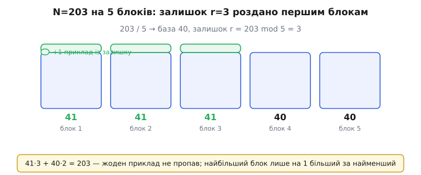
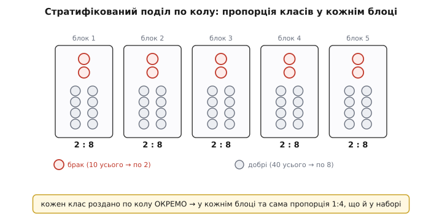

# ⚙️ Робочий C-модуль k-кратної крос-валідації

**Задача.** Треба один готовий до вживання шматок C, що бере набір із `N` розмічених прикладів і чесно міряє, наскільки добре на них працює **будь-який** твій алгоритм навчання. На вхід — лише кількість прикладів, число блоків `k` та дві твої функції: `train(idx, n)` (навчити модель на прикладах із переліку `idx`) і `accuracy(idx, n)` (частка правильних на цих прикладах). На вихід — не одне число, а **два**: середню точність по всіх проходах і **розкид** (стандартне відхилення) цих точностей, бо без розкиду середнє однобоке — не знаєш, наскільки йому вірити. Модуль має правильно поводитися, коли `N` **не ділиться** на `k` націло (майже завжди), уміти **стратифікувати** поділ за мітками класів (щоб рідкісний клас не зник із якогось блоку) і не наступати на жодну з чотирьох класичних грабель, що тихо завищують оцінку. Жодних бібліотек, лише стандартний C — щоб це лягло і на бортовий комп'ютер, і на ситий мікроконтролер, де кожен розмічений сигнал давача коштує зусиль і даних завжди обмаль.

**Ідея.** Уся крос-валідація складається з трьох незалежних рухів, і плутанина між ними — джерело всіх помилок. Перший рух: **перемішати** порядок прикладів раз наперед, бо якщо дані лежать упорядковано (спершу всі «добрі», тоді всі «браковані»), нарізані підряд блоки вийдуть однобокими й оцінка стане беззмістовною. Другий: **нарізати** перемішаний порядок на `k` блоків так, щоб вони були якомога рівніші навіть коли `N` не ділиться на `k`. Третій: прогнати **`k` проходів**, у кожному навчаючи модель **з нуля** на всіх блоках, крім одного, і міряючи її на тому одному відкладеному, а тоді звести `k` чисел у середнє й розкид. Розберемо кожен рух окремою функцією, зберемо їх в один виклик, додамо стратифікований варіант поділу — і наприкінці пройдемося по пастках, на яких така реалізація ламається найчастіше.

## Рух перший: перемішати індекси чесно

Перемішувати треба **індекси**, а не самі дані: копіювати масив прикладів туди-сюди дорого й ні до чого, коли досить переставити маленький масив цілих `0..N−1`, який потім скаже, у якому порядку брати приклади. Правильний спосіб зробити рівноймовірне перемішування — **Фішер–Єйтс** (за іменами британських статистиків Роналда Фішера й Френка Єйтса, що 1938 року описали ручний варіант; сучасну лінійну форму для комп'ютера дав Річард Дурстенфельд 1964-го, а популяризував Дональд Кнут як «Algorithm P» — усталено).

Суть його одним реченням: ідемо з кінця масиву до початку і для кожної позиції `i` міняємо елемент місцями з випадковим елементом **із діапазону `0..i` включно**. Останнє — критичне. Якби ми брали випадкову позицію з **усього** масиву `0..N−1` (а так пишуть наївно й дуже часто), перемішування вийшло б **зсунутим**: одні перестановки ставали б імовірнішими за інші, і блоки все одно тихо перекошувалися б. Діапазон, що звужується на кожному кроці, — саме те, що робить усі `N!` перестановок рівноймовірними.

:::tabs
:::code proj-kfold-c/cpp/rukh-pershyi-peremishaty.cpp
:::code proj-kfold-c/py/rukh-pershyi-peremishaty.py
:::

Тут дві тонкощі, повз які легко пройти. Перша — **`j` береться з `0..i` включно**, тобто `rng_below(i + 1)`, а не `rng_below(i)`: позиція має право лишитися на місці (обмінятися сама з собою), інакше знову дістанемо зсунутий розподіл, де жоден елемент не стоїть там, де почав. Друга — сам генератор випадкових. Я не беру `rand()` зі стандартної бібліотеки не через снобізм: його якість і період не гарантовані стандартом і різняться від платформи до платформи, а нам потрібне **відтворюване** число — той самий `seed` має давати той самий поділ, щоб можна було чесно порівняти дві моделі на **однакових** блоках і щоб баг у поділі можна було відтворити. `xorshift32` крихітний, швидкий і однаковий усюди.

> 🔧 **Навіщо це.** Seed — не дрібниця для звітності. Коли ти кажеш «модель A дала 87%, модель B — 85%, беру A», це чесно **тільки якщо обидві бачили ті самі блоки**. Зафіксований seed це гарантує: обидві крос-валідації нарізають дані однаково, і різниця в числах — про моделі, а не про те, кому пощастило з поділом. Без фіксованого seed ти порівнюєш два різні жереби, а не дві моделі.

## Рух другий: нарізати на k блоків, коли N не ділиться

Наївний `fold_size = N / k` мовчки викидає залишок. При `N = 203, k = 5` він дає `fold_size = 40`, і `40 × 5 = 200` — **три приклади просто не потраплять у жоден блок** і не візьмуть участі в оцінці. На маленькому наборі, де кожен приклад дорогий, це неприпустимо. Правильно — роздати залишок: перші `r = N mod k` блоків роблять **на один приклад більшими**. При `N = 203, k = 5` маємо `r = 3`, тож перші три блоки — по 41 прикладу, останні два — по 40, а `41 × 3 + 40 × 2 = 203` — усі приклади на місці.


*Розподіл залишку. `203 / 5` дає базовий розмір 40 і залишок `r = 3`. Замість викинути ці три приклади, віддаємо по одному першим трьом блокам: вони стають по 41, останні два лишаються по 40. Сума `41·3 + 40·2 = 203` — жоден приклад не пропав. Найбільший блок лише на один приклад більший за найменший, тож блоки майже рівні.*

Щоб не рахувати межі блоку щоразу заново, зручно один раз збудувати масив **початків** блоків. Початок блоку `f` — це сума розмірів усіх попередніх; знаючи його й розмір поточного, легко вирізати «іспитовий» діапазон, а решту віддати в навчання.

:::tabs
:::code proj-kfold-c/cpp/rukh-druhyi-narizaty-na-k.cpp
```python
# Розмір блоку f при поділі n на k з роздачею залишку першим блокам.
def fold_size(n: int, k: int, f: int) -> int:
    return n // k + (1 if f < n % k else 0)   # перші (n%k) блоків — на 1 більші

# Початок (offset у order[]) блоку f: сума розмірів блоків 0..f-1.
def fold_start(n: int, k: int, f: int) -> int:
    base, r = n // k, n % k
    return f * base + (f if f < r else r)     # +по одному за кожен «довгий» блок до f
```
:::

Перевіримо `fold_start` на очах: при `n = 203, k = 5, r = 3` початок блоку 0 — `0`, блоку 1 — `41`, блоку 2 — `82`, блоку 3 — `123` (далі залишок вичерпано, тож `+r`, а не `+f`), блоку 4 — `163`; а `163 + 40 = 203` — рівно кінець масиву. Формула `f*base + min(f, r)` якраз і каже: до блоку `f` встигло пройти `min(f, r)` «довгих» блоків, кожен додав по одному прикладу понад базу.

## Рух третій: k проходів, середнє і розкид

Тепер серце модуля. У кожному проході `f` вирізаємо блок `f` як «іспит», усе інше — навчання, вчимо **з нуля**, міряємо, запам'ятовуємо точність. Зібравши `k` чисел, рахуємо середнє **й розкид**. Розкид рахуємо чесним стандартним відхиленням: спершу середнє, тоді корінь із середнього квадрата відхилень від нього.

:::tabs
:::code proj-kfold-c/cpp/rukh-tretii-k-prokhodiv.cpp
:::code proj-kfold-c/py/rukh-tretii-k-prokhodiv.py
:::

Три речі тут вирішують усе, і кожна — це одна з майбутніх пасток, поставлена правильно. Перше: `train` викликається **всередині** циклу проходів, тобто модель щоразу народжується заново на своїй порції даних. Якщо винести навчання назовні або накопичувати ваги між проходами, блоки перемішаються — модель у проході `f` уже бачитиме приклади, на яких її потім перевірятимуть. Друге: перемішування — **один раз до циклу**, а не в кожному проході; блоки мають бути стабільними, інакше приклад може двічі попасти в «іспит» або жодного разу. Третє: ми зберігаємо **всі** `k` точностей, а не лише їхню суму, бо для розкиду потрібні самі числа — і саме розкид, а не тільки середнє, скаже, чи можна оцінці вірити.

**Worked-приклад: середнє однакове, а вірити можна по-різному.** Хай `k = 5` і два різні алгоритми дали такі точності проходів:

```
модель A:  0.86  0.87  0.85  0.88  0.84   → сума 4.30, mean = 0.860
модель B:  0.95  0.72  0.90  0.74  0.99   → сума 4.30, mean = 0.860

розкид A:  Σ(d²) = 0.0004+0.0001+0.0001+0.0004+0.0004 = 0.0014
           sd = √(0.0014/5) = √0.00028 ≈ 0.0167   (≈1.7%)
розкид B:  Σ(d²) = 0.0081+0.0196+0.0016+0.0144+0.0196 = 0.0633
           sd = √(0.0633/5) = √0.01266 ≈ 0.1125   (≈11.3%)
```

Середнє в обох **однакове** — 86%. Але модель A стабільна (розкид 1.7%): на всіх блоках вона тримає близько 86%, їй можна вірити. Модель B гуляє від 72% до 99% (розкид 11.3%): вона дуже чутлива до того, які приклади бачить, і те саме середнє 86% для неї — майже випадковість. Якби ти дивився **лише на середнє**, ти б вважав ці моделі рівноцінними й міг легко взяти хитку B. Ось навіщо розкид: він відрізняє надійні 86% від тремтливих.

## Стратифікований поділ: коли клас рідкісний

Наївне перемішування рівноймовірне, але **не гарантує** пропорцій класів у блоках. Якщо «браку» серед деталей лише 5% (скажімо, 10 бракованих на 200), випадковий поділ на 5 блоків цілком може лишити якийсь блок **без жодного** бракованого приклада. Оцінка на такому блоці нічого не скаже про те, як модель ловить брак, — а саме брак тут і важливий. Ліки — **стратифікований** (лат. *stratum* — шар) поділ: розкладаємо приклади **кожного класу окремо** по блоках так, щоб частка класів у кожному блоці збігалася з часткою в усьому наборі.

Механіка проста і красива. Замість перемішати все гамузом, ми: (1) розкладаємо індекси по «відрах» за міткою класу; (2) перемішуємо кожне відро окремо (щоб усередині класу порядок теж був випадковий); (3) роздаємо приклади кожного класу по блоках **по колу** (round-robin): перший приклад класу — у блок 0, другий — у блок 1, і так по колу. Оскільки кожен клас роздається по колу окремо, кожен блок дістає приблизно однакову частку кожного класу — рівно те, що треба.


*Стратифікований поділ по колу. Червоні — рідкісний клас (10 бракованих), сірі — 40 добрих. Кожен клас роздаємо по 5 блоках **окремо, по колу**: 10 бракованих лягають рівно по 2 в блок, 40 добрих — по 8. У кожному блоці виходить та сама пропорція 2:8, що й у повному наборі (1:4). Порівняй із наївним поділом угорі, де брак міг скупчитися й лишити блок без жодного бракованого приклада.*

:::tabs
:::code proj-kfold-c/cpp/stratyfikovanyi-podil-koly.cpp
:::code proj-kfold-c/py/stratyfikovanyi-podil-koly.py
:::

Один тонкий штрих у роздачі — зсув старту кола на номер класу: `(j + c) % k` замість простого `j % k`. Навіщо? Коли в класі не рівно `k·щось` прикладів, «хвіст» (останні кілька, що не добили повне коло) завжди сідав би в перші блоки — блок 0, потім 1 і так далі. Якщо всі класи починають коло з блоку 0, ці хвости **накопичуються** в перших блоках, і вони трохи розпухають. Зсунувши старт кожного класу на `c`, ми розкидаємо хвости різних класів по різних блоках, і розміри блоків лишаються рівнішими. Дрібниця, але саме з таких дрібниць складається різниця між «майже рівно» і «помітно перекошено».

Далі стратифікований поділ вживають замість `shuffle`+`fold_start`/`fold_size`: у кожному проході `f` «іспит» — це всі `i`, де `fold_of[i] == f`, а решта — навчання.

:::tabs
:::code proj-kfold-c/cpp/stratyfikovanyi-podil-koly-2.cpp
:::code proj-kfold-c/py/stratyfikovanyi-podil-koly-2.py
:::

Зверни увагу: структура проходів **та сама**, змінився лише спосіб вирішити, який приклад у якому блоці. Це не випадково — стратифікація чіпає **тільки поділ**, а рух «навчи з нуля, зміряй на відкладеному, збери середнє й розкид» лишається незмінним. Гарний модуль так і будують: один спосіб проходів, кілька взаємозамінних способів поділу під нього.

## Як це викликати

Заглушки `train`/`accuracy` ти пишеш під свій алгоритм — модуль їх лише кличе. Ось як виглядає кістяк під, скажімо, найпростіший класифікатор; тіло лишаю тобі, бо воно залежить від моделі, але сигнатури й контракт — саме такі, яких чекає модуль.

:::tabs
:::code proj-kfold-c/cpp/iak-tse-vyklykaty.cpp
:::code proj-kfold-c/py/iak-tse-vyklykaty.py
:::

Найважливіший рядок тут — `model_reset(&g_model)` **на вході** `train`. Модуль викликає `train` `k` разів поспіль над тим самим `g_model`; якщо не скинути ваги, кожен наступний прохід довчатиме модель поверх попереднього — і вона побачить майже весь набір, зокрема свої майбутні «іспитові» приклади. Це найпідступніша з грабель, бо код компілюється, працює й видає **красиві завищені** числа — просто вони брехливі. Скидання моделі — межа між чесною оцінкою і самообманом.

## Складність і пам'ять

Перемішування — `O(N)`. Кожен із `k` проходів робить один прохід по всіх `N` індексах, щоб розділити їх на «іспит» і «навчання», — це `O(N)` на прохід, `O(k·N)` на всі проходи, плюс `k` викликів твого `train`, кожен на ~`N·(k−1)/k` прикладах. Тобто **сам каркас** крос-валідації дешевий і лінійний; уся справжня вартість — у `k`-разовому навчанні моделі, і саме тому для дуже дорогих моделей `k` беруть невеликим (5 чи 10), а не женуть до `N`. Пам'ять — кілька масивів по `N` цілих (`order`, `test`, `train_idx`, `fold_of`) плюс `k` чисел на точності; для стратифікації — ще `N` цілих у відрах. Усе передбачуване й скромне, ніякого прихованого росту.

## Пастки

- **Витік через підготовку поза проходом.** Найпоширеніша й найтихіша помилка — **не** в цьому модулі, а в тому, що коло нього. Дані майже завжди готують: масштабують ознаки (щоб «температура 300» і «струм 0.2» жили в одному масштабі), відбирають найкорисніші стовпці, заповнюють пропуски. Спокуса — зробити цю підготовку **раз на всьому наборі**, а вже тоді пустити крос-валідацію. Це руйнує чесність: коли норму (середнє, розмах) ознаки рахують на **всіх** даних, у неї вже вкладено «іспитові» приклади, і модель через масштабування непомітно підглянула майбутню перевірку — покаже **завищену** точність, а на реальних нових даних провалиться. Правило залізне: **вся підготовка живе всередині `train`** — норму, відбір, заповнення рахуй **лише на переданих `idx`**, а до «іспитових» прикладів прикладай уже готовими числами. Тому контракт модуля й віддає в `train` **тільки навчальні** індекси: усе, що модель «вивчає» про дані, має міститися в них.

- **Накопичення ваг між проходами.** Модуль кличе `train` `k` разів над одним станом моделі. Якщо `train` не **скидає** модель на вході (`model_reset`), кожен прохід довчає її поверх попереднього — і до останнього проходу вона побачила майже весь набір, включно зі своїми ж «іспитовими» прикладами. Симптом підступний: числа не падають, а **ростуть**, бо модель дедалі «розумніша» на даних, які потім перевіряють. Правило: перший рядок `train` — обнулити модель; кожен прохід має бути окремою моделлю з чистого аркуша.

- **Однобокі блоки без перемішування.** Якщо пропустити `shuffle` (або перемішати зсунуто — наївним `rand() % (i+1)` з некоректним діапазоном), а дані лежать упорядковано за класом чи за часом, блоки вийдуть однобокими: один блок — самі «коти», інший — самі «собаки». Оцінка на такому блоці нічого не варта. Тому перемішування — **обов'язкове й рівноймовірне** (Фішер–Єйтс із діапазоном `0..i` включно), а не «на око». Окремий випадок — незбалансовані класи: тут навіть чесне перемішування може лишити блок без рідкісного класу, і рятує вже **стратифікований** поділ.

- **Зчеплені (не-IID) приклади.** Модуль припускає, що приклади **незалежні** — тоді випадкове перемішування чесне. Якщо ж вони зчеплені — часовий ряд, де сусідні точки майже однакові, або кілька знімків одного пацієнта, або кадри з одного відео, — наївне перемішування знову дає витік: у навчанні й «іспиті» опиняться «родичі», і модель відповідає на іспиті, бо бачила майже той самий приклад у навчанні. Тоді ділити треба **за групою**: усі приклади однієї групи (одного пацієнта, одного відео, одного відрізка часу) — цілком в один блок. Практично це той самий `stratified_split`, але «мітка» — не клас, а **ідентифікатор групи**, і роздаємо по блоках **цілі групи**, а не окремі приклади. Для часових рядів іще суворіше: навчання лише на **минулому**, «іспит» на **майбутньому** (блоки йдуть за часом, без перемішування), бо інакше модель «підглядає» майбутнє. Принцип усюди один — «іспит» має бути справді небаченим; що таке «небачене», задає природа даних, а не зручність перемішування.

- **Втрачений залишок при нарізці.** Наївний `fold_size = N / k` тихо викидає `N mod k` прикладів — на маленькому наборі це помітна втрата дорогих даних, і до того ж останні приклади (якщо не перемішано) можуть бути особливими. Роздавай залишок першим блокам (`fold_size`/`fold_start` вище), щоб **усі** приклади взяли участь рівно раз.

- **Зсунуте перемішування.** Наївне «візьми випадкову позицію з усього масиву» замість «з `0..i`» дає **нерівномірний** розподіл перестановок — тонкий баг, що не валить програму, але систематично перекошує блоки. Так само `rng_next() % m` без відкидання хвоста трохи частішає малі індекси. Обидва не помітні оком і псують саме те, заради чого крос-валідацію й беруть, — неупередженість оцінки. Перемішуй строго Фішер–Єйтсом і бери рівномірне ціле без модуло-зсуву.

Це повний робочий модуль: перемішування з фіксованим seed, коректна нарізка із залишком, `k` проходів із навчанням із нуля та оцінкою на відкладеному блоці, середнє **й** розкид, окрема функція стратифікованого поділу за класами. Заглушки `train`/`accuracy` ти пишеш під свій алгоритм — а сам каркас лишається тим самим, хоч би що ти навчав, і його головна цінність не в рядках коду, а в тому, що він **не дає збрехати**: тримає всю підготовку в проході, народжує модель заново щоразу й міряє її лише на тому, чого вона не бачила.
