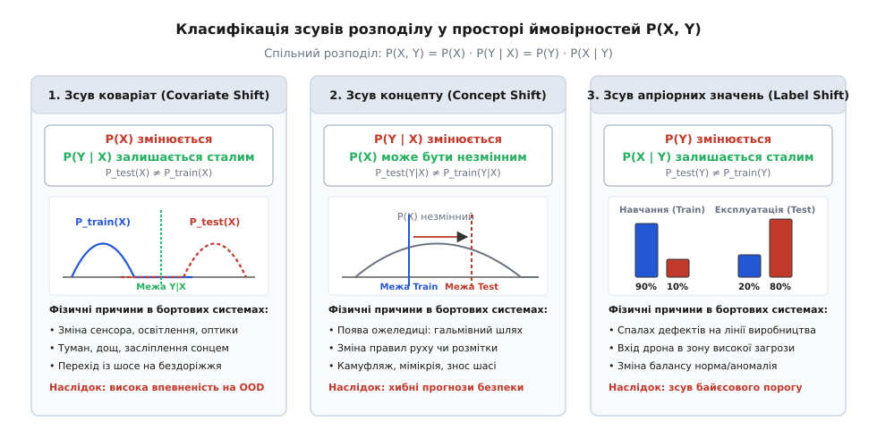
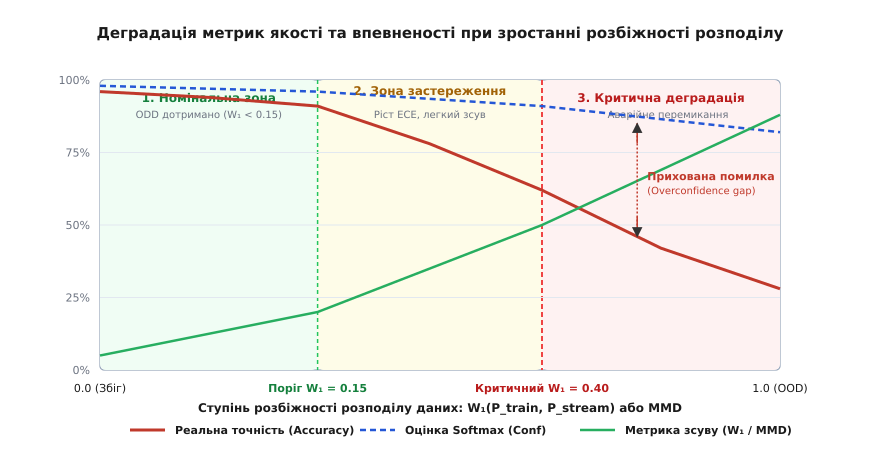

# Зсув розподілу даних

<preknowlist>
- [Калібрування впевненості моделі](root:sf-ml/confidence-calibration) — узгодження вихідних оцінок Softmax із реальною емпіричною точністю.
- [Функції втрат і мінімізація емпіричного ризику](root:sf-ml/loss-functions) — оптимізація параметрів за припущення однакової генеральної сукупності.
- [Поріг і ціна помилки](root:sf-ml/porih-i-tsina-pomylky) — вибір робочої точки класифікатора за асиметричних втрат.
- [Селективна класифікація та відмова від прогнозу](root:sf-ml/ne-znaiu) — механізми безпечної передачі керування аварійним евристикам.
- [Узгодження входу під час навчання та на борту](root:sf-ml/odnakovyi-vkhid-u-navchanni-i-na-bortu) — розбіжності дискретизації, шуму та калібрування сенсорів.
</preknowlist>

Бортовий комп'ютер автономного розвідувального дрона виконує сегментацію підстильної поверхні для вибору майданчика аварійної посадки. Нейромережеву модель навчили на пів мільйона високоякісних аерофотознімків, зібраних улітку за ясної сонячної погоди з висоти п'ятдесят метрів за допомогою нової матриці Sony IMX477 з каліброваною оптикою. На тестовій вибірці модель показала точність дев'яносто вісім відсотків, а середня похибка калібрування не перевищувала двох відсотків. Проте під час реального польоту пізньої осені дрон потрапляє в смугу густого туману при температурі мінус два градуси Цельсія; захисне скло об'єктива частково вкривається мікрокраплями конденсату, а спектральний склад розсіяного світла зміщується в синьо-сіру область. Вихідний шар моделі видає для ділянки глибокого вологого яру вектор ймовірностей із максимальним значенням `0.97` на користь класу «твердий сухий ґрунт». Система автопілота сприймає цю оцінку як абсолютно надійну, вимикає резервний сонар і розбиває апарат об кам'янисте дно затопленого яру.

Ця аварія ілюструє системну вразливість систем машинного навчання: статистичний колапс моделі при порушенні фундаментального припущення про незалежність та однакову розподіленість вибірки. Усі класичні алгоритми оптимізації ваг базуються на аксіомі, що навчальні, валідаційні та польові дані породжуються одним і тим самим стаціонарним генератором випадкових подій. У реальній експлуатації автономних комплексів це припущення порушується постійно: зношуються сенсори, змінюється пора року, деградує оптична прозорість атмосфери, а поведінка зовнішнього середовища зазнає непередбачуваних змін.

Зсув розподілу (англ. *distribution shift*, або *dataset shift*, від лат. *distribuere* — розділяти, наділяти) — це невідповідність між сумісним розподілом імовірностей вхідних ознак і цільових міток на етапі навчання `P_train(X, Y)` та відповідним розподілом у реальних польових умовах `P_test(X, Y)`. Коли ця невідповідність виникає, жодні математичні гарантії точності, отримані під час лабораторної валідації, більше не діють: модель починає систематично помилятися, зберігаючи при цьому оманливо високу впевненість у власних хибних рішеннях.

### Крах гіпотези стаціонарності та межі мінімізації емпіричного ризику

Щоб зрозуміти, чому зсув розподілу є фатальним для нейромереж, простежимо математичний фундамент, на якому будується процес підбору ваг. Стандартна парадигма керованого навчання базується на принципі мінімізації емпіричного ризику (Empirical Risk Minimization, ERM).

Нехай `X ∈ ℝᴰ` — вектор вхідних вимірювань (пікселі камери, масив далекостей лідара, амплітуди спектральних гармонік), а `Y ∈ {1, ..., K}` — дискретний клас об'єкта або неперервний вектор керування. Припускається, що кожна пара `(x, y)` є випадковою величиною, породженою невідомим, але фіксованим імовірнісним розподілом `P(X, Y)`.

Ідеальна мета навчання полягає в знаходженні параметрів моделі `θ`, які мінімізують математичне сподівання функції втрат — так званий істинний або генералізований ризик `R(θ)`:

```
R(θ) = E_{(x, y) ~ P(X, Y)} [ L(f(x; θ), y) ] = ∫ L(f(x; θ), y) dP(x, y)
```

Оскільки істинний розподіл `P(X, Y)` інженеру невідомий, інтеграл замінюють скінченною сумою за навчальною вибіркою `D_train = {(x₁, y₁), ..., (x_N, y_N)}`, обчислюючи емпіричний ризик `R_emp(θ)`:

```
R_emp(θ) = (1 / N) · ∑_{i=1}^{N} L(f(x_i; θ), y_i)
```

Закон великих чисел та теорія статистичного узагальнення гарантують, що при `N → ∞` емпіричний ризик рівномірно збігається до істинного ризику `R_emp(θ) → R(θ)` тоді й лише тоді, коли виконується умова **i.i.d.** (англ. *independent and identically distributed*): кожен польовий зразок вибирається незалежно з того самого розподілу `P(X, Y)`.

У польових умовах бортової автономії ця умова руйнується. Генератор польових даних `P_test(X, Y)` відрізняється від лабораторного генератора `P_train(X, Y)`. Мінімізація емпіричного ризику на вибірці `D_train` знаходить ваги `θ*`, оптимальні виключно для `P_train`. Якщо обчислити реальний польовий ризик моделі на нових даних, різниця між очікуваною та фактичною якістю стає критичною:

```
ΔR = R_test(θ*) - R_train(θ*) = E_{P_test} [ L(f(x; θ*), y) ] - E_{P_train} [ L(f(x; θ*), y) ]
```

Величина `ΔR` називається штрафом за зсув розподілу (англ. *distribution shift penalty*). Вона не зменшується від простого збільшення розміру навчальної вибірки `N`, якщо нові дані збираються за старих умов.

#### Теорема Бен-Давіда про межі помилки в новому домені

Математичну межу помилки моделі на зміщеному розподілі описує фундаментальна теорема адаптації домену Бен-Давіда (Ben-David et al., 2010). Нехай `ℋ` — простір гіпотез (множина всіх можливих класифікаторів даної архітектури). Позначимо через `ϵ_S(h)` помилку класифікатора `h ∈ ℋ` на джерельному навчальному розподілі `P_S(X, Y)`, а через `ϵ_T(h)` — його помилку на цільовому польовому розподілі `P_T(X, Y)`.

Для вимірювання розбіжності між двома просторами ознак вводиться поняття `ℋΔℋ`-розбіжності (англ. *H-divergence*):

```
d_{ℋΔℋ}(P_S, P_T) = 2 · sup_{h, h' ∈ ℋ} | P_{x ~ P_S}( h(x) ≠ h'(x) ) - P_{x ~ P_T}( h(x) ≠ h'(x) ) |
```

Ця величина вимірює здатність функціонального класу `ℋ` розрізнити два розподіли точок шляхом побудови двох класифікаторів, які погоджуються на одному розподілі та розходяться на іншому.

Теорема стверджує, що для будь-якої гіпотези `h ∈ ℋ` польова помилка обмежена зверху трьома невід'ємними доданками:

```
ϵ_T(h) ≤ ϵ_S(h) + (1 / 2) · d_{ℋΔℋ}(P_S(X), P_T(X)) + λ*
```

де `λ*` — помилка сумісно оптимального класифікатора `h*`, який мінімізує зважену суму помилок на обох доменах:

```
h* = argmin_{h' ∈ ℋ} ( ϵ_S(h') + ϵ_T(h') )
λ* = ϵ_S(h*) + ϵ_T(h*)
```

Розберемо кожен компонент цієї нерівності з інженерної точки зору:
1. **`ϵ_S(h)` — навчальна похибка:** якість налаштування ваг моделі під час лабораторної оптимізації. Вона зменшується завдяки збільшенню місткості мережі, регуляризації та якості оптимізатора.
2. **`(1 / 2) · d_{ℋΔℋ}(P_S, P_T)` — геометрична розбіжність просторів ознак:** безпосередня відстань між розподілами спостережень у просторі сенсорних входів. Якщо сенсори засліплені або оптичні умови змінилися, ця складова стрімко зростає, підіймаючи нижню теоретичну межу польової похибки навіть для моделі з нульовою помилкою на навчанні (`ϵ_S(h) = 0`).
3. **`λ*` — незвідна складність адаптації:** характеристика сумісності двох задач. Якщо фізична суть класів інвертувалася (зсув концепту), то `λ*` стає великим, оскільки жодна фіксована функція `h` не здатна одночасно правильно класифікувати зразки в обох середовищах.

Нерівність Бен-Давіда показує: яким би досконалим не було навчання в лабораторії, польова помилка `ϵ_T(h)` неминуче деградує пропорційно статистичній розбіжності розподілів `d_{ℋΔℋ}` та некорельованості концептів `λ*`.

### Декомпозиція спільного розподілу та три типи зсуву

Математична структура простору подій дозволяє розкласти спільну ймовірність `P(X, Y)` двома симетричними способами за формулою умовної ймовірності:

```
P(X, Y) = P(X) · P(Y | X)
P(X, Y) = P(Y) · P(X | Y)
```

Ці два розклади визначають фізичну природу взаємодії між сенсорами та зовнішнім світом. Перший розклад `P(X) · P(Y | X)` моделює процес прямих спостережень: природа генерує вхідний сигнал `x` із густиною `P(X)`, а фізична суть явища або класифікатор призначає мітку `y` відповідно до умовного розподілу `P(Y | X)`. Другий розклад `P(Y) · P(X | Y)` відповідає каузальній генеративній моделі: спочатку в середовищі виникає стан або клас `y` з апріорною ймовірністю `P(Y)`, який потім породжує сенсорні спостереження `x` із правдоподібністю `P(X | Y)`.

Будь-яка зміна сумісного розподілу `P_train(X, Y) ≠ P_test(X, Y)` зводиться до зміни одного або кількох компонентів цих розкладів.


*Три типи зсуву: зміна розподілу вхідних ознак при сталій умовній імовірності, зміна фізичної семантики класів та зсув апріорних частот подій.*

#### 1. Зсув коваріат (Covariate Shift)

Зсув коваріат виникає тоді, коли змінюється граничний розподіл вхідних ознак `P(X)`, але умовний розподіл цільової змінної `P(Y | X)` залишається суворо незмінним:

```
P_test(X) ≠ P_train(X)   при умові   P_test(Y | X) = P_train(Y | X)   для всіх x ∈ Supp(P_test)
```

Фізичний зміст цього явища полягає в тому, що правила класифікації або закони фізики, які пов'язують спостереження `x` із класом `y`, не змінилися, проте самі спостереження почали надходити з іншої просторової або енергетичної області.

Типові джерела зсуву коваріат у бортових системах:
- Зміна яскравості та кута падіння сонячних променів, засліплення фронтальної камери зустрічним світлом;
- Зміна типу підстильної поверхні (перехід колісного робота з сухого асфальту на щебінь або пісок);
- Підвищення рівня шумів у радіочастотному тракті через зміну фонової електромагнітної обстановки;
- Зміна просторового масштабу об'єктів через зміну висоти баражування безпілотника;
- Апаратні відмінності між екземплярами сенсорів на різних серійних виробах (розкид чутливості пікселів матриці, дрейф нуля гіроскопа, нелінійність АЦП).

Чому стандартна модель деградує при зсуві коваріат, якщо правило `P(Y | X)` не змінилося? Відповідь полягає в обмеженій місткості (capacity) реальних параметричних моделей. Під час оптимізації `R_emp(θ)` градієнтний спуск зосереджує параметри моделі на тих ділянках простору `ℝᴰ`, де густина навчальних точок `P_train(x)` є високою. У цих областях модель будує точну розділову межу. Натомість в областях, де `P_train(x) ≈ 0`, модель проводить розділову гіперповерхню випадковим чином (залежно від ініціалізації ваг та форми регуляризатора). Коли під час польової роботи розподіл `P_test(X)` переносить основну масу ймовірності саме в ці слабко навчені зони, модель видає хаотичні прогнози.

Математичним методом компенсації зсуву коваріат на етапі перенавчання є метод зважування за важливістю (англ. *Importance Weighting*). Якщо оцінити відношення густин `w(x)`:

```
w(x) = P_test(x) / P_train(x)
```

то польовий ризик можна точно оцінити за навчальною вибіркою, зважуючи втрату кожного зразка на коефіцієнт `w(x_i)`:

```
R_test(θ) = ∫ L(f(x; θ), y) P_test(x) P(Y | x) dx
= ∫ L(f(x; θ), y) · (P_test(x) / P_train(x)) · P_train(x) P(Y | x) dx  [домножили й поділили на P_train(x)]
= E_{(x, y) ~ P_train} [ w(x) · L(f(x; θ), y) ]
```

Проте на борту вбудованої системи в реальному часі ми не можемо перенавчити глибоку мережу. Наше завдання полягає у виявленні факту, що поточний вектор `x_t` потрапив у зону, де `P_train(x_t)` прямує до нуля, щоб своєчасно заблокувати небезпечну команду автопілота.

#### Частотний аналіз зсуву коваріат у сенсорних зображеннях

У комп'ютерному зорі автономних систем зсув коваріат найчастіше виникає у вигляді деградації просторово-частотного спектра зображення. Розглянемо 2D дискретне перетворення Фур'є вхідного кадру розмірності `H × W`:

```
F(u, v) = ∑_{y=0}^{H-1} ∑_{x=0}^{W-1} I(x, y) · exp( -j · 2π · ( (ux / W) + (vy / H) ) )
```

Спектральна густина потужності (Power Spectral Density, PSD) для радіальної просторової частоти `f = √(u² + v²)` у природних сценах підпорядковується степеневому закону `PSD(f) ∝ 1 / f^{2 - η}`.

Коли оптична система стикається з атмосферними явищами, передавальна функція середовища діє як низькочастотний або смуговий просторовий фільтр:
1. **Густий туман та аерозолі:** розсіювання світла на мікрокраплях моделюється гаусовим розмиттям із функцією розсіювання точки (Point Spread Function, PSF). У частотному просторі це призводить до експоненційного зрізання високих частот: `F_fog(u, v) = F_orig(u, v) · exp( -(u² + v²) / (2σ_blur²) )`. Дрібні контури об'єктів повністю зникають зі спектра.
2. **Цифровий високочастотний шум за слабкого освітлення (Low-Light Shot Noise):** при зниженні освітленості автоматична система посилення (AGC) камери збільшує коефіцієнт ISO. Це додає адитивний пуассонівсько-гаусовий шум, що підіймає шумову полицю на найвищих просторових частотах.
3. **Розмиття руху (Motion Blur):** лінійне переміщення камери зі швидкістю `v_cam` під час експозиції `T_exp` множить спектр на кардинальний синус `sinc(π · f · v_cam · T_exp)`, створюючи періодичні нульові смуги в просторі частот.

Чому класичні згорткові нейромережі (CNN) настільки чутливі до таких спотворень? Згорткові фільтри перших шарів (фільтри Габора та детектори перепадів) налаштовані на вилучення локальних високих частот (текстур). Експерименти з дослідження текстурного ухилу (Geirhos et al., 2019) довели, що стандартні моделі сімейства ResNet класифікують об'єкти за мікротекстурою поверхні, а не за глобальною геометрією форми. При зниженні контрасту високих частот туманом згорткові фільтри перестають генерувати активації, що призводить до обвалу класифікаційної точності.

Натомість архітектури Vision Transformers (ViT) з механізмами глобальної багатошарової уваги (Multi-Head Self-Attention) менше залежать від локальних текстур. Вони будують зв'язки між віддаленими патчами кадру, що робить їх значно стійкішими до зсуву коваріат у високочастотній області, хоча й вимагає суттєво більшої кількості операцій множення-додавання (MACs).

#### 2. Зсув концепту (Concept Shift / Concept Drift)

Зсув концепту виникає тоді, коли змінюється безпосередньо умовна ймовірність `P(Y | X)`, незалежно від того, змінився граничний розподіл ознак `P(X)` чи ні:

```
P_test(Y | X) ≠ P_train(Y | X)
```

Це найбільш підступний і небезпечний тип зсуву для автономних систем. Сенсорні входи `x` можуть виглядати абсолютно типовими для навчальної вибірки (наприклад, середні значення яскравості, текстура та гістограми пікселів збігаються з лабораторними), проте семантичне значення цих ознак у фізичному світі інвертується або зміщується.

Фізичні причини виникнення зсуву концепту:
1. **Зміна фізичного стану середовища:** те саме оптичне зображення гладкого темного асфальту влітку означає високий коефіцієнт тертя `μ = 0.85` (безпечно прискорюватися), а за температури біля нуля за наявності тонкої плівки льоду означає `μ = 0.10` (необхідне екстрене гальмування). Оптичні ознаки `x` майже не змінилися, але фізична реакція шасі `y` кардинально інша.
2. **Сезонні та біологічні трансформації:** вигляд лісової рослинності, яка влітку класифікувалася як м'яка непрохідна крона дерев, взимку перетворюється на оголені жорсткі стовбури, зіткнення з якими призводить до руйнування фюзеляжу дрона.
3. **Зміна правил і регламентів:** модифікація дорожньої розмітки, нові формати дорожніх знаків або зміна сигналів світлофорів в іншій юрисдикції.
4. **Протидія та маскування (Adversarial Camouflage):** у військових застосуваннях об'єкт змінює зовнішнє теплове та оптичне покриття (камуфляжні сітки, тепловідбивні екрани). Вхідний тепловий контраст зменшується, і колишня сигнатура цілі тепер відповідає фоновому ландшафту.
5. **Механічний знос виконавчих органів:** подача напруги `5.0 В` на сервопривід елерона раніше викликала відхилення на `15°`, але через люфт і деформацію тяги те саме значення напруги викликає відхилення лише на `9°`. Для модуля управління залежність `P(ΔAngle | Voltage)` зазнала зміщення.

Зсув концепту поділяють за часовою динамікою:
- **Раптовий (Sudden Drift):** миттєва зміна властивостей середовища (раптовий обрив тяги, виїзд на ділянку відкритого льоду).
- **Поступовий (Gradual Drift):** повільне накопичення зносу підшипників, вигорання лазерного діода лідара, сезонне пожовтіння листя.
- **Циклічний (Recurrent Drift):** регулярні зміни день/ніч, літо/зима, приплив/відплив, які повторюються з фіксованим періодом.

> 🔧 **Навіщо це.** Безконтрольний зсув концепту неможливо зафіксувати аналізом лише сирих сенсорних потоків `P(X)`: сенсор видає стандартні значення. Єдиний спосіб виявити зсув концепту на борту без отримання істинних міток `Y` — це моніторинг невідповідності між прогнозами нейромережі та фізичними наслідками дій (наприклад, через аналіз сигналів інерціальної системи IMU та розрахунку нев'язки розширеного фільтра Калмана).

#### 3. Зсув апріорних імовірностей (Prior Probability / Label Shift)

Зсув апріорних імовірностей спостерігається тоді, коли змінюється розподіл частот появи самих цільових класів `P(Y)`, тоді як умовна генеративна щільність спостережень для кожного окремого класу `P(X | Y)` залишається стабільною:

```
P_test(Y) ≠ P_train(Y)   при умові   P_test(X | Y) = P_train(X | Y)   для всіх y ∈ {1, ..., K}
```

Фізична сутність зсуву апріорних ймовірностей полягає в тому, що зовнішній вигляд або сигнатура конкретного об'єкта не змінюються, але частота зустрічей із цим об'єктом у робочому середовищі зазнає різких коливань.

Приклади з інженерної практики:
- Система автоматичного оптичного контролю на конвеєрі навчена на збалансованому датасеті, де частка дефектних деталей штучно доведена до п'ятдесяти відсотків. На реальній виробничій лінії частка браку становить `0.1%`.
- Детектор аномалій у мережевому трафіку бортової шини CAN навчений за умов лабораторних ін'єкцій атак (двадцять відсотків шкідливих пакетів). У штатній експлуатації частка атак становить `0.0001%`. Проте під час цілеспрямованого кібернападу частка атак може підскочити до вісімдесяти відсотків за секунду.

Для аналізу наслідків зсуву апріорних імовірностей скористаємося формулою Байєса:

```
P(Y = k | X = x) = ( P(X = x | Y = k) · P(Y = k) ) / P(X = x)
```

Якщо апріорна ймовірність класу `P(Y = k)` змінюється з навчального значення `P_train(Y = k)` на польове `P_test(Y = k)`, вихідні оцінки ймовірностей класифікатора `f_k(x) = P_train(Y = k | x)` стають некоректними. Модель починає генерувати надмірну кількість хибних тривог для класів, апріорна частка яких зменшилася, і пропускати критичні події для класів, частка яких зросла.

Якщо польові пропорції `P_test(Y)` відомі або оцінені за допомогою аналізу нерозміченого вхідного потоку, класифікатор можна скоригувати аналітично без перенавчання ваг. Для цього сирий вектор логітів `z = [z₁, ..., z_K]` модифікують шляхом додавання логарифма відношення апріорних імовірностей:

```
z_k^{corr} = z_k + log( P_test(Y = k) / P_train(Y = k) )
```

Після проходження модифікованого вектора `z^{corr}` через шар [Softmax](root:sf-ml/activation-functions) ми отримуємо строго калібровані апостеріорні ймовірності для нових польових умов `P_test(Y | X)`.

#### Оцінка зсуву міток через інверсію матриці плутанини (BBSE)

Коли польові частоти класів `P_test(Y)` наперед невідомі, їх можна оцінити аналітично за допомогою методу оцінки зсуву чорної скриньки (Black Box Shift Estimation, BBSE, Lipton et al., 2018).

Нехай `C_{ij} = P_train( Ŷ = i | Y = j )` — елемент матриці плутанини класифікатора на валідаційному датасеті розмірності `K × K`, де `Ŷ` — передбачений клас, а `Y` — істинний клас. Вектор середніх польових прогнозів класифікатора на новому нерозміченому потоці позначається як `μ_{Ŷ}^{test} ∈ ℝ^K`, де `(μ_{Ŷ}^{test})_i = (1 / M) ∑_{m=1}^{M} 𝕀(f(x_m) = i)`.

Оскільки за умови зсуву апріорних імовірностей генеративна ймовірність `P(X | Y)` не змінюється, розподіл передбачень моделі пов'язаний з істинними польовими мітками лінійним матричним рівнянням:

```
μ_{Ŷ}^{test} = C · μ_Y^{test}
```

Якщо матриця плутанини `C` є невиродженою (`det(C) ≠ 0`, що виконується для будь-якої моделі, яка працює краще за випадкове вгадування), невідомий вектор польових частот класів `μ_Y^{test} = [P_test(Y = 1), ..., P_test(Y = K)]^T` відновлюється шляхом простого множення на обернену матрицю:

```
μ_Y^{test} = C^{-1} · μ_{Ŷ}^{test}
```

Якщо внаслідок шумів або малого розміру вибірки вектор `μ_Y^{test}` містить від'ємні компоненти або відхиляється від одиничної суми, застосовують проектування на ймовірнісний симплекс через задачу квадратичного програмування з регуляризацією Тихонова:

```
min_{p ∈ Δ^{K-1}} || C · p - μ_{Ŷ}^{test} ||₂² + λ · ||p - p_{prior}||₂²
```

Отриманий вектор використовують для миттєвої байєсової корекції вихідних логітів бортової нейромережі без зупинки основного контуру керування.

---

### Математичні методи кількісної оцінки розбіжностей розподілів

Для запобігання катастрофічним відмовам автономна система повинна мати програмний блок моніторингу даних, який безперервно оцінює ступінь невідповідності між поточним ковзним вікном спостережень `D_stream` та еталонною валідаційною базою `D_ref`. Розглянемо чотири базові метрики статистичної розбіжності, придатні для вбудованих обчислювачів.

```
+-----------------------------------------------------------------------------+
|                          ПРОСТІР ВИМІРЮВАННЯ РОЗБІЖНОСТЕЙ                   |
+-----------------------------------------------------------------------------+
| 1. Дивергенція Кульбака-Лейблера (D_KL)  -> Інформаційна втрата ентропії    |
| 2. Дивергенція Єнсена-Шеннона (D_JS)     -> Симетрична обмежена метрика     |
| 3. Відстань Вассерштейна (W_1)           -> Геометричне перенесення маси    |
| 4. Maximum Mean Discrepancy (MMD)        -> Відстань у гільбертовому ядрі   |
| 5. Тест Колмогорова-Смірнова (KS-test)   -> Максимум різниці функцій CDF    |
+-----------------------------------------------------------------------------+
```

#### 1. Дивергенція Кульбака-Лейблера та Єнсена-Шеннона

Дивергенція Кульбака-Лейблера (англ. *Kullback-Leibler divergence*, або відносна ентропія) вимірює інформаційну втрату при наближенні істинного розподілу `P` за допомогою розподілу `Q`:

```
D_KL(P || Q) = ∫_{-∞}^{∞} P(x) · log( P(x) / Q(x) ) dx
```

Для дискретних гістограмних оцінок на `B` бінах формула набуває вигляду:

```
D_KL(P || Q) = ∑_{b=1}^{B} P_b · log( P_b / Q_b )
```

Дивергенція Кульбака-Лейблера має дві фундаментальні математичні властивості:
1. **Невід'ємність (нерівність Гіббса):** `D_KL(P || Q) ≥ 0`, причому `D_KL(P || Q) = 0` тоді й лише тоді, коли `P(x) = Q(x)` майже скрізь.
2. **Несиметричність:** `D_KL(P || Q) ≠ D_KL(Q || P)`.

Головним недоліком `D_KL` в інженерних задачах є вимога абсолютного перекриття носіїв розподілів: якщо існує інтервал, де `P(x) > 0`, але `Q(x) = 0`, значення `D_KL` прямує до `+∞` через ділення на нуль.

Для усунення цієї проблеми застосовують симетричну та обмежену метрику — **дивергенцію Єнсена-Шеннона (Jensen-Shannon Divergence, D_JS)**. Нехай `M = 0.5 · (P + Q)` — суміш розподілів. Тоді:

```
D_JS(P || Q) = 0.5 · D_KL(P || M) + 0.5 · D_KL(Q || M)
```

Дивергенція Єнсена-Шеннона строго обмежена в діапазоні `[0, ln 2]` (або `[0, 1]`, якщо логарифм береться за основою 2). Її квадратний корінь `d_JS(P, Q) = √D_JS(P || Q)` задовольняє нерівність трикутника і є повноцінною топологічною метрикою.

#### 2. Відстань Вассерштейна (Earth Mover's Distance)

Відстань Вассерштейна першого порядку `W₁(P, Q)` (відома як Earth Mover's Distance) базується на теорії оптимального транспортування маси. Вона вимірює мінімальну кількість роботи, необхідну для перетворення форми одного ймовірнісного розподілу на форму іншого, де робота визначається як добуток маси ймовірності на відстань її переміщення.

Пряме вариаційне формулювання Монжа-Канторовича:

```
W₁(P, Q) = inf_{γ ∈ Π(P, Q)} E_{(x, y) ~ γ} [ ||x - y|| ]
```

де `Π(P, Q)` — множина всіх можливих сумісних розподілів (планів транспортування) `γ(x, y)`, чиї маргінальні проєкції дорівнюють `P` та `Q` відповідно.

Обчислення прямого багатовимірного плану транспортування вимагає розв'язання задачі лінійного програмування розмірності `O(N³)`, що є нереалістичним для вбудованих мікроконтролерів. Проте за двоїстою теоремою Канторовича-Рубінштейна відстань Вассерштейна еквівалентна супремуму за простором ліпшицевих функцій:

```
W₁(P, Q) = sup_{||f||_L ≤ 1} ( E_{x ~ P} [ f(x) ] - E_{y ~ Q} [ f(y) ] )
```

де `||f||_L ≤ 1` позначає 1-ліпшицеві функції: `|f(x₁) - f(x₂)| ≤ ||x₁ - x₂||`.

Для одновимірного випадку (`x ∈ ℝ`) задача має замкнений аналітичний розв'язок через інтеграл абсолютної різниці між функціями кумулятивного розподілу (Cumulative Distribution Function, CDF) `F_P(t) = P(X ≤ t)` та `F_Q(t) = Q(X ≤ t)`:

```
W₁(P, Q) = ∫_{-∞}^{∞} | F_P(t) - F_Q(t) | dt
```

Еквівалентне представлення через зворотні квантильні функції `F_P^{-1}(u)` та `F_Q^{-1}(u)` на інтервалі `u ∈ [0, 1]`:

```
W₁(P, Q) = ∫_{0}^{1} | F_P^{-1}(u) - F_Q^{-1}(u) | du
```

Для двох емпіричних упорядкованих вибірок `X = {x₍₁₎ ≤ x₍₂₎ ≤ ... ≤ x₍ₙ₎}` та `Y = {y₍₁₎ ≤ y₍₂₎ ≤ ... ≤ y₍ₙ₎}` однакового розміру `n`, одновимірна відстань Вассерштейна обчислюється за час `O(n log n)` (час сортування):

```
W₁(X, Y) = (1 / n) · ∑_{i=1}^{n} | x₍ᵢ₎ - y₍ᵢ₎ |
```

Фундаментальна перевага відстані Вассерштейна над дивергенціями Кульбака-Лейблера та Єнсена-Шеннона полягає в тому, що `W₁` формує неперервну та інформативну оцінку навіть тоді, коли розподіли `P` та `Q` мають неперетинні носії (disjoint supports). Якщо розподіл спостережень зміщується вздовж числової осі на відстань `δ`, дивергенція `D_KL` миттєво стає нескінченною, `D_JS` насичується до максимальної константи `ln 2`, тоді як `W₁(P, Q) = δ` лінійно відображає реальну геометричну дистанцію деградації.

#### Зрізана відстань Вассерштейна (Sliced Wasserstein Distance, SWD)

Для застосування метрики Вассерштейна до багатовимірних векторів ознак `x ∈ ℝᴰ` без розв'язання важких задач лінійного програмування використовують зрізану відстань Вассерштейна (Sliced Wasserstein Distance, SWD).

Ідея полягає в проектуванні `D`-вимірного простору на одновимірні прямі, задані випадковими одиничними векторами напрямку `θ ∈ 𝕊^{D-1}` (де `𝕊^{D-1} = {θ ∈ ℝᴰ : ||θ||₂ = 1}` — одинична сфера):

```
SWD(P, Q) = ( ∫_{𝕊^{D-1}} W₁²(θ^T P, θ^T Q) dθ )^{1/2}
```

де `θ^T P` позначає одновимірний розподіл проекцій `⟨θ, x⟩` випадкових векторів `x ~ P`.

На практиці інтеграл за сферою наближають методом Монте-Карло за допомогою `L` випадкових напрямків `{θ₁, ..., θ_L}`:

```
SWD(X, Y) ≈ ( (1 / L) · ∑_{l=1}^{L} W₁²(θ_l^T X, θ_l^T Y) )^{1/2}
```

Кожен крок обчислення одновимірної проекції виконується за час `O(N · D)`, а її сортування — за `O(N log N)`. Сумарна складність обчислення становить `O(L · (N · D + N log N))`, що на порядки швидше за прямий розрахунок багатовимірного плану транспортування і дозволяє виконувати розрахунок у реальному часі на вбудованих цифрових сигнальних процесорах (DSP).

#### 3. Максимальна середня розбіжність (Maximum Mean Discrepancy, MMD)

Maximum Mean Discrepancy — це непараметричний метод оцінки різниці між двома багатовимірними розподілами шляхом їх відображення в нескінченновимірний відтворювальний ядровий гільбертів простір (Reproducing Kernel Hilbert Space, RKHS) `ℋ_k`.

Нехай `φ: ℝᴰ → ℋ_k` — функція нелінійного відображення, що породжується додатньовизначеним ядром `k(x, x') = ⟨φ(x), φ(x')⟩_ℋ`. Вектор середнього вбудовування розподілу `P` у просторі `ℋ_k` позначається як `μ_P = E_{x ~ P}[φ(x)]`.

MMD визначається як норма різниці між векторами середніх вбудовувань двох розподілів у гільбертовому просторі:

```
MMD(P, Q; ℋ_k) = || μ_P - μ_Q ||_ℋ = sup_{||f||_ℋ ≤ 1} ( E_{x ~ P}[f(x)] - E_{y ~ Q}[f(y)] )
```

Підносячи вираз до квадрата та застосовуючи ядровий трюк (Kernel Trick), отримуємо формулу через математичні сподівання значень ядра:

```
MMD²(P, Q) = || μ_P - μ_Q ||_ℋ²
= ⟨μ_P - μ_Q, μ_P - μ_Q⟩_ℋ
= ⟨μ_P, μ_P⟩_ℋ - 2⟨μ_P, μ_Q⟩_ℋ + ⟨μ_Q, μ_Q⟩_ℋ
= E_{x, x' ~ P}[k(x, x')] - 2 · E_{x ~ P, y ~ Q}[k(x, y)] + E_{y, y' ~ Q}[k(y, y')]
```

Як ядро найчастіше використовують радіально-базисну функцію Гауса (Gaussian RBF Kernel):

```
k(x, y) = exp( -γ · ||x - y||² )   де γ = 1 / (2σ²)
```

Для вибору параметра ширини ядра `σ` в інженерній практиці застосовують евристику медіани (Median Heuristic):

```
σ² = (1 / 2) · median( { ||x_i - x_j||² : 1 ≤ i < j ≤ N } )
```

Для двох скінченних вибірок `X = {x₁, ..., x_n}` (еталонні валідаційні вектори) та `Y = {y₁, ..., y_m}` (поточне польове вікно) незміщена емпірична оцінка `MMD²_u` розраховується за формулою:

```
MMD²_u(X, Y) = (1 / (n·(n - 1))) · ∑_{i=1}^{n} ∑_{j≠i}^{n} k(x_i, x_j)
             - (2 / (n·m)) · ∑_{i=1}^{n} ∑_{j=1}^{m} k(x_i, y_j)
             + (1 / (m·(m - 1))) · ∑_{i=1}^{m} ∑_{j≠i}^{m} k(y_i, y_j)
```

MMD є нульовим тоді й лише тоді, коли `P = Q` (за умови використання характеристичного ядра, такого як RBF). Часова складність обчислення становить `O((n² + m² + nm) · D)`. Для прискорення на вбудованих системах розмірності `D` часто попередньо стискають за допомогою латентного шару автокодера або випадкових проекцій.

#### 4. Двовибірковий тест Колмогорова-Смірнова (KS-test)

Двовибірковий тест Колмогорова-Смірнова перевіряє нульову гіпотезу `H₀: F(x) = G(x)` (дві вибірки отримані з одного неперервного одновимірного розподілу) проти альтернативної гіпотези `H₁: F(x) ≠ G(x)`.

Нехай `F_n(x)` та `G_m(x)` — емпіричні функції кумулятивного розподілу для вибірок розміром `n` та `m`:

```
F_n(x) = (1 / n) · ∑_{i=1}^{n} 𝕀(x_i ≤ x)
G_m(x) = (1 / m) · ∑_{j=1}^{m} 𝕀(y_j ≤ x)
```

Статистика Колмогорова-Смірнова `D_{n,m}` дорівнює точній верхній межі модуля різниці між цими функціями вздовж усієї числової осі:

```
D_{n, m} = sup_{x ∈ ℝ} | F_n(x) - G_m(x) |
```

Нульова гіпотеза `H₀` відхиляється на рівні значущості `α` (наприклад, `α = 0.01`), якщо обчислена статистика перевищує критичний поріг `c(α) · √( (n + m) / (n · m) )`:

```
D_{n, m} > c(α) · √( (n + m) / (n · m) )
```

де значення коефіцієнта `c(α)` для `α = 0.05` становить `1.36`, а для `α = 0.01` дорівнює `1.63`.

Для багатовимірних сенсорних векторів тест Колмогорова-Смірнова застосовують покомпонентно до кожної ознаки окремо з обов'язковим внесенням поправки Бонферроні на множинну перевірку гіпотез: рівень значущості для кожного окремого каналу вибирається як `α_adj = α / D`.

#### Порівняння з тестом Андерсона-Дарлінга та Крамера-фон Мізеса

Тест Колмогорова-Смірнова має один суттєвий недолік у задачах функціональної безпеки: він максимально чутливий до відхилень у центрі розподілу (біля медіани) і слабко реагує на розбіжності у «хвостах» розподілу (Tail Probabilities). У реальних вбудованих системах саме «хвости» розподілів містять критичні аномалії (раптові сплески тиску, засліплення спалахами, поодинокі збої сенсорів).

Для точного виявлення зсувів у крайніх діапазонах застосовують тест Андерсона-Дарлінга (Anderson-Darling Test). Статистика тесту зважує квадратичну різницю функцій розподілу на обернену дисперсію:

```
A² = n · m / (n + m) · ∫_{-∞}^{∞} ( (F_n(x) - G_m(x))² / (H_{n+m}(x) · (1 - H_{n+m}(x))) ) dH_{n+m}(x)
```

де `H_{n+m}(x)` — об'єднана емпірична функція розподілу двох вибірок.

Знаменник `H(x) · (1 - H(x))` прямує до нуля на краях діапазону спостережень (`x → -∞` та `x → +∞`), що надає екстремально високої ваги навіть поодиноким викидам на межах діапазону вимірювання.

---

### Зсув розподілу в мультимодальних системах злиття даних (Sensor Fusion)

Сучасні автономні апарати використовують комплекси сенсорів різної фізичної природи: видимий діапазон (RGB-камера), дальній інфрачервоний тепловізор (LWIR), твердотільний лідар (LiDAR) та радіолокатор міліметрового діапазону (mmWave Radar).

У мультисенсорних конвеєрах зсув розподілу рідко виникає одночасно у всіх каналах. Зазвичай деградація є гетерогенною:
- **Оптичний туман або дим:** RGB-камера зазнає повного зсуву коваріат (контраст падає до нуля, `W₁ > 0.8`), тоді як радар mmWave продовжує працювати у номінальному розподілі (`W₁ < 0.05`), оскільки довжина радіохвилі перевищує розмір крапель туману.
- **Електромагнітні завади (EMI) або сонячна активність:** радар зазнає сильного зашумлення, тоді як оптичний та тепловізійний канали залишаються повністю стабільними.

#### Небезпека раннього злиття даних (Early Fusion Trap)

Якщо архітектура нейромережі використовує раннє злиття (Early Fusion) — конкатенацію сирих сенсорних сигналів у спільний тензор на першому шарі мережі:

```
X_{fused} = [ X_{RGB}, X_{LWIR}, X_{LiDAR}, X_{Radar} ]
```

то виникнення зсуву коваріат навіть в одному каналі (наприклад, засліплення камери сонячним відблиском) спотворює весь простір активацій першого шару. Помилка отруює проміжний латентний простір, і мережа відмовляє повністю, ігноруючи коректні дані з трьох інших сенсорів.

#### Динамічне адаптивне злиття на основі розбіжностей Вассерштейна

Для запобігання відмові всієї системи на борту реалізують пізнє злиття (Late Fusion) з динамічним зважуванням за ступенем надійності розподілу.

Для кожного сенсорного каналу `m ∈ {1, ..., M}` блок моніторингу безперервно розраховує біжучу відстань Вассерштейна `W₁^{(m)}` між поточним потоком вимірювань та еталонною базою. Вага модальності `α_m` у фінальному ансамблі рішень розраховується за допомогою функції Softmax з оберненим штрафом за зсув:

```
α_m = exp( -W₁^{(m)} / τ ) / ( ∑_{k=1}^{M} exp( -W₁^{(k)} / τ ) )
```

де `τ` — гіперпараметр температурної чутливості до розбіжностей.

Якщо оптичний сенсор зазнає зсуву розподілу через туман (`W₁^{(RGB)} = 0.85`), його вага `α_{RGB}` експоненційно падає до нуля, а керування безперервно перерозподіляється між тепловізором і радаром, забезпечуючи безперервність роботи автопілота.

---

### Зменшення зсуву на етапі проектування: рандомізація домену

Повністю усунути зсув розподілу в польоті неможливо, проте його амплітуду можна мінімізувати ще під час синтезу навчальних датасетів за допомогою методів рандомізації домену (Domain Randomization, Tobin et al., 2017).

При підготовці синтетичних даних у фізичних симуляторах (CARLA, AirSim, Isaac Sim) параметри генератора штучно варіюють у випадкових діапазонах, створюючи надзвичайно широкий навчальний розподіл `P_{train}(X)`:
- Текстури матеріалів та коефіцієнти відбиття світла (Albedo);
- Положення, спектральна температура та інтенсивність джерел світла;
- Кути нахилу та фокусні відстані віртуальних камер;
- Параметри інерції та коефіцієнти сухого/в'язкого тертя у фізичному рушії;
- Просторові характеристики та типи шумів сенсорів.

Математична мета рандомізації домену полягає в тому, щоб реальний польовий розподіл `P_{test}(X)` потрапив всередину опуклої оболонки штучно розширеного навчального розподілу `P_{train}(X)`:

```
Supp( P_test(X) ) ⊆ ConvexHull( Supp( P_{train}(X) ) )
```

Коли реальні польові умови виявляються лише одним із багатьох випадкових варіантів, бачених моделлю під час навчання, завдання адаптації зводиться з небезпечної екстраполяції до стійкої внутрішньої інтерполяції.

---

### Виявлення зсуву концепту через фізичну узгодженість (Innovation Monitoring)

Коли вхідний розподіл `P(X)` залишається незмінним, але порушується семантичний зв'язок `P(Y | X)` (зсув концепту), статистичні тести на сенсорних входах (KS-test, MMD, `W₁`) не фіксують відхилень. У таких умовах єдиним джерелом істини на борту стають фундаментальні закони збереження імпульсу та енергії, реалізовані у вигляді розширеного фільтра Калмана (Extended Kalman Filter, EKF).

Нехай вектор стану автономного апарата описується нелінійною фізичною моделлю:

```
x_t = g(x_{t-1}, u_{t-1}) + w_{t-1}
```

де `x_t` — координати, швидкості та кути орієнтації, `u_{t-1}` — керівний вектор тяги двигунів, а `w_{t-1} ~ 𝒩(0, Q)` — шум процесу.

Нейромережева модель виконує функцію віртуального сенсора (наприклад, оптичний одометр або оцінювач зчеплення коліс), формуючи спостереження `z_t = f_{NN}(I_t)`. У розширеному фільтрі Калмана лінеаризоване спостереження моделюється матрицею `H_t = ∂h/∂x`:

```
z_t = h(x_t) + v_t,   v_t ~ 𝒩(0, R)
```

Ключовим діагностичним сигналом зсуву концепту є **вектор інновацій (нев'язки)** `ν_t`:

```
ν_t = z_t - h( x̂_{t|t-1} )
```

Коваріаційна матриця інновацій `S_t` розраховується за апріорною коваріацією стану `P_{t|t-1}`:

```
S_t = H_t · P_{t|t-1} · H_t^T + R_t
```

Якщо фізичний зв'язок `P(Y | X)` не зазнав зсуву, вектор інновацій є білим гаусовим шумом із нульовим середнім: `ν_t ~ 𝒩(0, S_t)`.

Квадрат нормованої відстані Махаланобіса `d_M²(t)` має теоретичний розподіл хі-квадрат із `m` ступенями вільності (де `m = dim(z)`):

```
d_M²(t) = ν_t^T · S_t^{-1} · ν_t ~ χ²_m
```

Якщо нейромережа внаслідок зсуву концепту (наприклад, ковзання коліс по льоду) починає видавати некоректні оцінки швидкості, вектор інновацій `ν_t` отримує ненульове зміщення. Квадрат відстані Махаланобіса перевищує критичний поріг квантиля `χ²_{m, 1-α}`:

```
d_M²(t) > χ²_{m, 1-α}
```

Для надійного детектування поступового зсуву концепту на борту застосовують алгоритм кумулятивних сум (Cumulative Sum, CUSUM) над нев'язками Калмана:

```
S_k = max( 0, S_{k-1} + (d_M²(k) - m - δ) )
```

де `m` — математичне сподівання `χ²_m`, а `δ` — допустимий зазор дрейфу. Коли кумулятивна сума `S_k` перевищує поріг тривоги `h_{alarm}`, система фіксує виникнення зсуву концепту і вимикає нейромережевий коректор одометрії.

---

### Адаптація під час виконання (Test-Time Adaptation) та її межі

Сучасні методи бортової обробки намагаються не лише детектувати зсув коваріат, але й адаптувати ваги моделі безпосередньо під час польоту без вчителя (Test-Time Adaptation, TTA).

Одним із найефективніших методів є мінімізація ентропії під час тестування (Fully Test-Time Adaptation by Entropy Minimization, Tent, Wang et al., 2021). Метод базується на спостереженні: при зсуві коваріат розподіл передбачень моделі стає невизначеним (ентропія виходу зростає).

Під час обробки кожного нового нерозміченого кадру `x_t` обчислюється ентропія Шеннона вектора вихідних ймовірностей `p(x_t) = Softmax(f(x_t; θ))`:

```
H(p(x_t)) = - ∑_{k=1}^{K} p_k(x_t) · log( p_k(x_t) )
```

Для мінімізації `H(p(x_t))` виконується один крок градієнтного спуску. Проте для збереження стабільності та уникнення руйнування вивчених ознак заморожують усі ваги згорткових і лінійних шарів, оновлюючи виключно афінні параметри масштабу `γ` та зсуву `β` шарів пакетної або групової нормалізації (Batch/Group Normalization):

```
x̂ = (x - μ) / √(σ² + ϵ)
y = γ · x̂ + β
```

Оновлення параметрів `γ` та `β` виконується за правилом:

```
γ ← γ - η · ∇_γ H(p(x_t))
β ← β - η · ∇_β H(p(x_t))
```

#### Межі та небезпеки TTA у критичних системах

Попри вражаючі результати адаптації до нових погодних умов у симуляторах, увімкнення градієнтного оновлення ваг у польоті несе колосальні ризики для функціональної безпеки:
1. **Катастрофічний колапс адаптації (Error Accumulation):** якщо у вхідному потоці трапляється аномалія іншої природи (наприклад, зсув концепту або засліплення лазером), градієнтний спуск починає мінімізувати ентропію на помилкових рішеннях. За кілька десятків кадрів ваги нормалізації оптимізуються так, що мережа починає видавати один фіксований клас для будь-якого вхідного зображення з ідеальною впевненістю `1.0`.
2. **Недетермінізм часу виконання:** розрахунок зворотного проходу градієнта `Backward Pass` через граф обчислень збільшує затримку інференсу у 2.5–3 рази, що може призвести до пропуску дедлайнів жорсткого реального часу.
3. **Неможливість сертифікації:** стандарти авіаційної та автомобільної безпеки (DO-178C рівень DAL-A, ISO 26262 ASIL-D) вимагають повної детермінованості бінарного коду та забороняють динамічну модифікацію виконуваних коефіцієнтів у польоті без повторної верифікації.

---

### Вплив на функціональну безпеку: від надмірної впевненості до катастрофічних пропусків

У критичних інженерних застосуваннях (стандарти безпеки ISO 26262 ASIL-D для автомобілів, DO-178C / DO-254 для авіоніки та ISO 21448 SOTIF — Safety of the Intended Functionality) головною загрозою є не просто зниження середньої точності моделі, а зміна характеру її помилок.


*Динаміка деградації точності класифікатора за зростання розбіжності Вассерштейна та формування зони прихованої відмови.*

#### Анатомія прихованої відмови (Silent Failure)

Коли нейромережа стикається зі зсувом коваріат, виникає ефект розширення розриву впевненості (Overconfidence Gap). Як показано в темі про [калібрування впевненості](root:sf-ml/confidence-calibration), шар Softmax обчислює нормовані експоненти логітів `exp(z_k) / ∑ exp(z_j)`. Якщо новий вхідний вектор `x_test` лежить далеко за межами навчального розподілу (Out-of-Distribution, OOD), але розташований глибоко з одного боку розділової гіперповерхні, внутрішні повноз'єднані шари генерують логіти великої абсолютної амплітуди.

У результаті складається парадоксальна та смертельно небезпечна ситуація:
- Реальна класифікаційна точність на зміщеному потоці падає з `98%` до `35%` (гірше випадкового вгадування для багатокласової задачі);
- Середня впевненість Softmax, яку модель повертає у блок прийняття рішень, залишається на рівні `0.94 - 0.99`.

Система безпеки вищого рівня, яка очікує, що за умови непевності модель знизить свій бал і активує [механізм селективної відмови від прогнозу](root:sf-ml/ne-znaiu), не отримує жодного тривожного сигналу. Автопілот продовжує виконувати швидкісні маневри на основі випадкових галюцинацій моделі.

#### Катастрофічні пропуски цілей (False Negatives)

В асиметричних задачах детекції загроз (виявлення пішоходів на проїзній частині, детекція мінних загороджень, виявлення тріщин у лопатках авіаційних турбін) ціна помилки першого роду (False Positive, хибна тривога) та помилки другого роду (False Negative, пропуск цілі) відрізняється на порядки, як розглядається у темі про [поріг і ціну помилки](root:sf-ml/porih-i-tsina-pomylky).

Зсув розподілу кардинально спотворює криву ROC (Receiver Operating Characteristic):
1. Робоча точка порогу бінаризації `τ`, яка в лабораторних тестах забезпечувала ймовірність пропуску `P_FN < 0.001` при допустимому рівні хибних тривог `P_FP = 0.05`, на зміщених даних призводить до стрибка ймовірності пропуску до `P_FN = 0.35`.
2. Кожна третя критична перешкода на шляху руху транспорту стає «невидимою» для алгоритму планування траєкторії.

#### Трьохрівнева архітектура локалізації зсуву на борту

Для забезпечення вимог функціональної безпеки конвеєр обробки сенсорних даних бортового обчислювача розділяють на три контури контролю:

```
[ Сенсорний потік X_t ]
         │
         ▼
+─────────────────────────────────────────────────────────────+
| РІВЕНЬ 1: Потоковий моніторинг сирих сенсорів (In-line)     |
| • 1D тест Колмогорова-Смірнова на ковзному буфері (RingBuf) |
| • Відстань Вассерштейна W₁ по кожному каналу сенсора        |
| • Часова складність: O(n log n), пам'ять: статична          |
+─────────────────────────────────────────────────────────────+
         │ (Дані в межах норми)
         ▼
+─────────────────────────────────────────────────────────────+
| ОСНОВНА МОДЕЛЬ: Нейромережевий інференс (Forward Pass)     |
| • Обчислення латентних векторів z_latent = Layer_{L-1}(X)   |
| • Генерація вихідних логітів z_logits                       |
+─────────────────────────────────────────────────────────────+
         │
         ▼
+─────────────────────────────────────────────────────────────+
| РІВЕНЬ 2: Латентний контроль репрезентацій (Latent Space)   |
| • Батчевий розрахунок MMD(z_latent, D_ref_latent)           |
| • Температурне масштабування та оцінка ентропії виходу      |
+─────────────────────────────────────────────────────────────+
         │
         ▼
+─────────────────────────────────────────────────────────────+
| РІВЕНЬ 3: Супервізор безпеки та ескалація (Fail-Safe)       |
| • W₁ < Поріг_Номінал     -> Штатний автоматичний режим      |
| • Поріг_Ном ≤ W₁ < Поріг -> Звуження ODD, підйом тривоги    |
| • W₁ ≥ Поріг_Критичний   -> Екстрене аварійне перемикання   |
+─────────────────────────────────────────────────────────────+
```

1. **Рівень 1 (Потоковий контроль сенсорів):** працює з кожним новим кадром або циклом вимірювання. У ковзному кільцевому буфері фіксованого розміру (наприклад, останні 256 вимірювань) обчислюються одновимірні статистики Вассерштейна `W₁` та квантилі розподілу. Якщо сенсор деградував або оптику заліпило снігом, рівень 1 відсікає дані ще до передачі в нейромережу.
2. **Рівень 2 (Контроль латентного простору):** перевіряє проміжний вектор ознак (Bottleneck / Latent Embedding), знятий із передостаннього шару моделі. За допомогою ядрового тесту MMD порівнюється розподіл латентних кодів за останні 64 кадри з еталонними кодами, записаними у флеш-пам'ять під час валідації. Це дозволяє виявити складні семантичні зсуви коваріат, які не помітні на рівні окремих пікселів.
3. **Рівень 3 (Супервізор безпеки та аварійні переходи):** агрегує сигнали розбіжності. Якщо сумарна оцінка зсуву перевищує критичну межу, система виконує регламентовані дії:
   - Примусове зниження робочої швидкості руху;
   - Перемикання на дублюючий сенсор іншої фізичної природи (радар замість камери);
   - Повна зупинка та перехід у стан «Fail-Safe» із записом аварійного дампу в енергонезалежну пам'ять (Blackbox recorder).

---

### Порівняльний аналіз метрик оцінки зсуву

У таблиці нижче наведено інженерне зіставлення розглянутих математичних методів детекції зсуву для вбудованих бортових систем реального часу.

| Метрика | Вхідний простір | Обчислювальна складність | Чутливість до неперетинних носіїв | Потреба в гіперпараметрах | Придатність для MCU (Cortex-M) |
|---|---|---|---|---|---|
| **`D_KL` / `D_JS`** | 1D / Гістограми | `O(B)` на `B` бінів | Дуже погана (`D_KL → ∞`) | Кількість бінів сітки `B` | Відмінна (мінімум пам'яті) |
| **Wasserstein `W₁`** | 1D (проекції) | `O(N log N)` (сортування) | Ідеальна (лінійна дистанція) | Відсутні | Відмінна (in-place сортування) |
| **MMD (RBF ядро)** | Багатовимірний `ℝᴰ` | `O((N² + M² + NM) · D)` | Відмінна (ядровий простір) | Ширина ядра `γ = 1/(2σ²)` | Середня (потребує буфера матриць) |
| **KS-test** | 1D | `O(N log N)` | Добра (по максимуму CDF) | Рівень значущості `α` | Відмінна (не потребує налаштування) |

---

### Практична реалізація: модуль діагностики зсуву коваріат

Нижче наведено повноцінний інженерний приклад на мовах C99 та C++20, що реалізує розрахунок одновимірної відстані Вассерштейна `W₁` та швидкого двовибіркового тесту Колмогорова-Смірнова для бортового кільцевого буфера сенсорних даних без динамічного виділення пам'яті (`malloc`/`free` заборонені за стандартами MISRA-C та ISO 26262).

Повна практична реалізація детектора зсуву коваріат із підтримкою багатовимірного тесту MMD та детальними бенчмарками швидкодії розгорнута в окремій вставці [Розробка бортового детектора зсуву коваріат на C99/C++20](root:sf-ml/distribution-shift/proj-covariate-shift-detector.md).

:::tabs
```c
#include <stdint.h>
#include <stdbool.h>
#include <math.h>

#define MAX_SAMPLE_WINDOW 128

typedef struct {
    float reference_samples[MAX_SAMPLE_WINDOW];
    float current_samples[MAX_SAMPLE_WINDOW];
    uint32_t sample_count;
    float w1_threshold_warning;
    float w1_threshold_critical;
} ShiftDetectorConfig;

typedef enum {
    SHIFT_STATUS_NOMINAL  = 0,
    SHIFT_STATUS_WARNING  = 1,
    SHIFT_STATUS_CRITICAL = 2
} ShiftDetectionStatus;

/* Допоміжна функція сортування масиву in-place (сортування вставками для малого N) */
static void insertion_sort_f32(float *arr, uint32_t n) {
    for (uint32_t i = 1; i < n; ++i) {
        float key = arr[i];
        int32_t j = (int32_t)i - 1;
        while (j >= 0 && arr[j] > key) {
            arr[j + 1] = arr[j];
            j--;
        }
        arr[j + 1] = key;
    }
}

/* Розрахунок одновимірної відстані Вассерштейна W1 на статичних буферах */
float compute_wasserstein_1d(const float *ref, const float *cur, uint32_t n) {
    if (n == 0 || n > MAX_SAMPLE_WINDOW) {
        return -1.0f;
    }

    float sorted_ref[MAX_SAMPLE_WINDOW];
    float sorted_cur[MAX_SAMPLE_WINDOW];

    for (uint32_t i = 0; i < n; ++i) {
        sorted_ref[i] = ref[i];
        sorted_cur[i] = cur[i];
    }

    insertion_sort_f32(sorted_ref, n);
    insertion_sort_f32(sorted_cur, n);

    float sum_diff = 0.0f;
    for (uint32_t i = 0; i < n; ++i) {
        sum_diff += fabsf(sorted_ref[i] - sorted_cur[i]);
    }

    return sum_diff / (float)n;
}

/* Двовибірковий тест Колмогорова-Смірнова: повертає супремум різниці емпіричних CDF */
float compute_ks_statistic_1d(const float *ref, const float *cur, uint32_t n) {
    if (n == 0 || n > MAX_SAMPLE_WINDOW) {
        return -1.0f;
    }

    float s_ref[MAX_SAMPLE_WINDOW];
    float s_cur[MAX_SAMPLE_WINDOW];

    for (uint32_t i = 0; i < n; ++i) {
        s_ref[i] = ref[i];
        s_cur[i] = cur[i];
    }

    insertion_sort_f32(s_ref, n);
    insertion_sort_f32(s_cur, n);

    float d_max = 0.0f;
    uint32_t i = 0;
    uint32_t j = 0;
    const float step = 1.0f / (float)n;

    while (i < n && j < n) {
        float cdf_ref = (float)(i + 1) * step;
        float cdf_cur = (float)(j + 1) * step;

        if (s_ref[i] < s_cur[j]) {
            float diff = fabsf(cdf_ref - (float)j * step);
            if (diff > d_max) d_max = diff;
            i++;
        } else if (s_ref[i] > s_cur[j]) {
            float diff = fabsf((float)i * step - cdf_cur);
            if (diff > d_max) d_max = diff;
            j++;
        } else {
            float diff = fabsf(cdf_ref - cdf_cur);
            if (diff > d_max) d_max = diff;
            i++;
            j++;
        }
    }

    return d_max;
}

/* Оцінка стану зсуву та вибір керівного рішення безпеки */
ShiftDetectionStatus evaluate_distribution_health(
    const ShiftDetectorConfig *cfg,
    float *out_w1_distance,
    float *out_ks_stat
) {
    if (!cfg || cfg->sample_count == 0) {
        return SHIFT_STATUS_CRITICAL;
    }

    *out_w1_distance = compute_wasserstein_1d(
        cfg->reference_samples,
        cfg->current_samples,
        cfg->sample_count
    );

    *out_ks_stat = compute_ks_statistic_1d(
        cfg->reference_samples,
        cfg->current_samples,
        cfg->sample_count
    );

    if (*out_w1_distance >= cfg->w1_threshold_critical) {
        return SHIFT_STATUS_CRITICAL;
    }
    if (*out_w1_distance >= cfg->w1_threshold_warning) {
        return SHIFT_STATUS_WARNING;
    }

    return SHIFT_STATUS_NOMINAL;
}
```
```cpp
#include <array>
#include <span>
#include <algorithm>
#include <cmath>
#include <cstdint>
#include <expected>

namespace embedded_safety {

inline constexpr std::size_t MaxSampleWindow = 128;

enum class ShiftStatus : uint8_t {
    Nominal  = 0,
    Warning  = 1,
    Critical = 2
};

enum class DetectionError : uint8_t {
    InvalidSize,
    BufferOverflow
};

struct ShiftMetrics {
    float wasserstein_w1;
    float ks_statistic;
    ShiftStatus status;
};

template <std::size_t N = MaxSampleWindow>
class ShiftDetector final {
    static_assert(N > 0 && N <= 512, "Window size must be constrained for deterministic stack usage");

public:
    constexpr ShiftDetector(float warning_threshold, float critical_threshold) noexcept
        : warning_th_(warning_threshold), critical_th_(critical_threshold) {}

    [[nodiscard]] std::expected<ShiftMetrics, DetectionError> evaluate(
        std::span<const float> reference_data,
        std::span<const float> current_data
    ) const noexcept {
        if (reference_data.size() != current_data.size() || reference_data.empty()) {
            return std::unexpected(DetectionError::InvalidSize);
        }
        if (reference_data.size() > N) {
            return std::unexpected(DetectionError::BufferOverflow);
        }

        const std::size_t count = reference_data.size();

        std::array<float, N> sorted_ref{};
        std::array<float, N> sorted_cur{};

        std::copy_n(reference_data.data(), count, sorted_ref.begin());
        std::copy_n(current_data.data(), count, sorted_cur.begin());

        std::sort(sorted_ref.begin(), sorted_ref.begin() + count);
        std::sort(sorted_cur.begin(), sorted_cur.begin() + count);

        // 1. Обчислення одновимірної відстані Вассерштейна W1
        float sum_diff = 0.0f;
        for (std::size_t i = 0; i < count; ++i) {
            sum_diff += std::abs(sorted_ref[i] - sorted_cur[i]);
        }
        const float w1 = sum_diff / static_cast<float>(count);

        // 2. Двовибірковий тест Колмогорова-Смірнова
        float d_max = 0.0f;
        std::size_t i = 0;
        std::size_t j = 0;
        const float step = 1.0f / static_cast<float>(count);

        while (i < count && j < count) {
            const float cdf_ref = static_cast<float>(i + 1) * step;
            const float cdf_cur = static_cast<float>(j + 1) * step;

            if (sorted_ref[i] < sorted_cur[j]) {
                d_max = std::max(d_max, std::abs(cdf_ref - static_cast<float>(j) * step));
                ++i;
            } else if (sorted_ref[i] > sorted_cur[j]) {
                d_max = std::max(d_max, std::abs(static_cast<float>(i) * step - cdf_cur));
                ++j;
            } else {
                d_max = std::max(d_max, std::abs(cdf_ref - cdf_cur));
                ++i;
                ++j;
            }
        }

        ShiftStatus status = ShiftStatus::Nominal;
        if (w1 >= critical_th_) {
            status = ShiftStatus::Critical;
        } else if (w1 >= warning_th_) {
            status = ShiftStatus::Warning;
        }

        return ShiftMetrics{
            .wasserstein_w1 = w1,
            .ks_statistic   = d_max,
            .status         = status
        };
    }

private:
    float warning_th_;
    float critical_th_;
};

} // namespace embedded_safety
```
:::

---

### Висновки та правила проектування надійних систем

Зсув розподілу даних — це неминучий фізичний процес для будь-якої інтелектуальної системи, розгорнутої в неконтрольованому зовнішньому середовищі. Надійність бортового інтелекту визначається не відсутністю зсувів, а здатністю архітектури детерміновано реагувати на їх появу.

Головні правила побудови безпечних конвеєрів машинного навчання:
1. **Заборона сліпої довіри до Softmax:** нормалізовані виходи класифікатора є мірою впевненості лише в межах валідованого розподілу `P_train(X)`. За межами розподілу модель стає патологічно надвпевненою.
2. **Безперервний моніторинг статистичних розбіжностей:** використання комбінації легких одновимірних метрик (`W₁`, KS-тест) для швидкого попиксельного контролю сенсорів та ядрових методів (MMD) у просторі латентних ознак.
3. **Ієрархія аварійних режимів:** блок детекції зсуву розподілу повинен мати прямий апаратний доступ до перемикача контуру керування (Safety Supervisor), здатного в обхід нейромережі перевести систему в безпечний стан зупинки або передати керування детермінованим алгоритмам.
