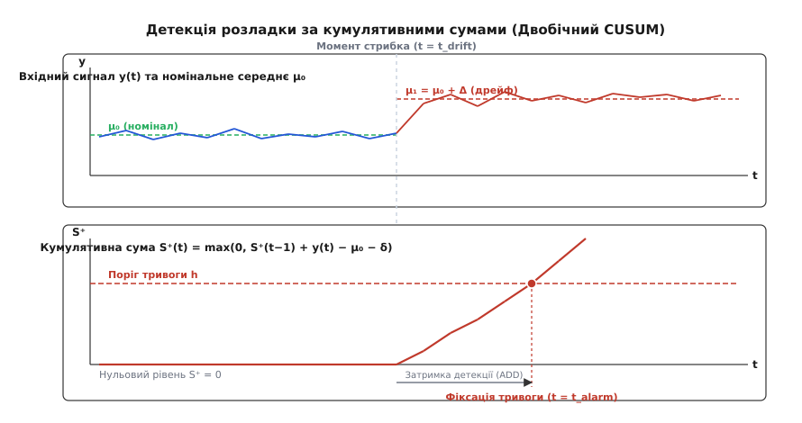
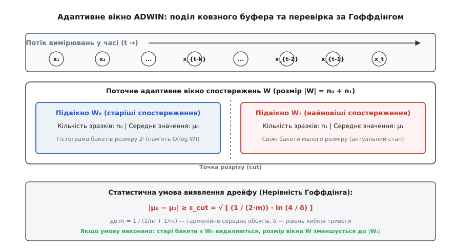

# Дрейф у полі: як помітити його на борту

<preknowlist>
- [Зсув розподілу даних](root:sf-ml/distribution-shift) — коваріатний, концептуальний та пріорний зсув; чому розподіли на борту відрізняються від навчальної вибірки.
- [«Не знаю»: відмова від рішення](root:sf-ml/ne-znaiu) — вибіркова класифікація, алеаторна й епістемічна невизначеність.
- [Калібрування впевненості моделі](root:sf-ml/confidence-calibration) — температурне масштабування та викривлення softmax-ймовірностей при дрейфі.
- [Модель у петлі реального часу](root:sf-ml/model-u-petli-realnoho-chasu) — часові дедлайни, детерміновані бекап-контролери та архітектура перемикання режимів.
- [Метрики якості моделі](root:sf-ml/metryky-iakosti-modeli) — матриця плутанини, чутливість і специфічність, які неможливо обчислити в польоті без істинних міток.
</preknowlist>

Бортовий комп'ютер безпілотного літального апарата виконує оптичну навігацію над пересічною місцевістю. На висоті ста метрів нейромережевий класифікатор кадрів із частотою 30 Гц розпізнає тип поверхні під апаратом: рілля, ліс, водна гладь, асфальтована смуга чи житлова забудова. У навчальній вибірці були тисячі літніх сонячних знімків із чітким контрастом і високою насиченістю кольорів. Під час виконання реального завдання сонце сідає за обрій, температура повітря падає до нуля градусів, на оптиці об'єктива конденсується тонка водяна плівка, а поверхня землі частково вкривається сніговою крупою. На вхід нейромережі потрапляють тензори, яскравість і спектральний розподіл яких виходять далеко за межі тренувального датасету. Традиційний вивід (англ. *inference*) на мікроконтролері чи прискорювачі продовжує обчислювати вихідні логіти, нормує їх через функцію softmax і видає категоричні мітки класів: засніжене поле класифікується як «бетонна посадкова смуга» з псевдоймовірністю 96.8%. Автопілот починає зниження на небезпечну ділянку й розбивається.

Головна небезпека цього сценарію полягає в тому, що вбудована нейромережа зламалася абсолютно мовчки. Вона не викликала апаратного виключення ядра `HardFault`, не перевищила виділений квант часу в планувальнику операційної системи реального часу (RTOS) і не повернула код помилки `NULL`. З точки зору прошивки мікроконтролера STM32H7 чи прискорювача NPU операція завершилася успішно. Безпосередня причина аварії криється у фундаментальній властивості автономного інференсу: **на борту немає доступу до істинних міток навколишнього середовища**. У хмарній інфраструктурі аналітики можуть відкласти сумнівні транзакції, розмітити їх вручну та обчислити падіння точності класифікації за попередній тиждень. На автономному дроні зворотного зв'язку за істинними мітками не існує в принципі. Якщо вбудована прошивка не має спеціальних потокових алгоритмів для виявлення статистичного зсуву даних безпосередньо в мілісекундному циклі керування, автономна система залишається сліпою до деградації власного штучного інтелекту.

### Чому на борту відсутня зворотна петля істинності

В інженерії класичного машинного навчання моніторинг моделі базується на безперервному порівнянні передбачень `ŷ` з реальними значеннями цільової змінної `y`. Якщо точність класифікації чи коефіцієнт детермінації регресії падає нижче контрольного порогу, система надсилає сигнал тривоги черговому інженеру. На борту безпілотного апарата, керованої ракети, медичного імплантату чи промислового контролера приводу ця схема принципово неможлива. Під час польоту сенсори (камера, лідар, інерціальний блок IMU, ультразвуковий сонар) щосекунди генерують гігабайти сирих сигнатур, але жоден зовнішній оракул не повідомляє процесору, чи справді перед камерою була суха трава, чи це тонкий лід на воді. Істинні мітки з'являються або занадто пізно (після посадки та ручного розбору чорної скриньки), або не з'являються взагалі (якщо апарат зазнав катастрофи).

Більше того, вузький пропускний канал бортової телеметрії унеможливлює трансляцію сирого потоку даних на наземну станцію. Радіоканал на базі протоколів Micro Air Vehicle Link (MAVLink) чи супутниковий лінк мають типову пропускну здатність від 9600 біт/с до 115200 біт/с. Цього ледве вистачає для передачі критичних навігаційних телеметрій (координати GNSS, кути Ейлера, напруга акумуляторної батареї, частота обертання двигунів). Передати сотні мегабайт відеопотоку високої роздільної здатності чи масивів вихідних активацій шарів для хмарного аналізу фізично неможливо.

```
┌─────────────────────────────────────────────────────────────────────────────┐
│                      БОРТОВИЙ АВТОНОМНИЙ КОМП'ЮТЕР                         │
│                                                                             │
│  ┌────────────────┐       ┌─────────────────┐       ┌────────────────────┐  │
│  │ Сенсорний потік│──────>│ ML-Інференс     │──────>│ Керування (FSM/PID)│  │
│  │ (Камера / IMU) │       │ (NPU / Cortex-M)│       │ (Сервоприводи/Тяга)│  │
│  └───────┬────────┘       └────────┬────────┘       └────────────────────┘  │
│          │                         │                                        │
│          ▼                         ▼                                        │
│  ┌──────────────────────────────────────────┐                               │
│  │ БОРТОВИЙ МОНІТОР ДРЕЙФУ БЕЗ МІТОК (O(1)) │                               │
│  │ • CUSUM / Page-Hinkley (стрибки сигналів)│                               │
│  │ • ADWIN (адаптивне вікно за Гоффдінгом)  │                               │
│  │ • Ентропія Softmax та норми ембеддінгів  │                               │
│  └─────────────────────┬────────────────────┘                               │
│                        │                                                    │
│                        ▼                                                    │
│  ┌──────────────────────────────────────────┐                               │
│  │     МАТРИЦЯ БЕЗПЕКОВОЇ ЕСКАЛАЦІЇ         │                               │
│  │ [Рівень 0]: Номінал -> 100% довіри ML   │                               │
│  │ [Рівень 1]: Попередження -> Лог у Flash  │                               │
│  │ [Рівень 2]: Дрейф -> Бекап-правила       │                               │
│  │ [Рівень 3]: Аварія -> Failsafe / RTL     │                               │
│  └──────────────────────────────────────────┘                               │
└─────────────────────────────────────────────────────────────────────────────┘
```

Таким чином, виявлення дрейфу на борту є виключно задачею **навчання без учителя в реальному часі** (англ. *unsupervised online drift detection*). Прошивка повинна аналізувати лише ті сутності, які генеруються всередині самого обчислювача:
1. Сирі вхідні сенсорні вектори `x ∈ ℝ^D` (або їхні стислі скалярні проєкції).
2. Внутрішні латентні ембеддінги (англ. *embeddings*) передостаннього лінійного шару `z ∈ ℝ^M`.
3. Вихідні розподіли ймовірностей `p = softmax(f(x)) ∈ ℝ^K` та їхню інформаційну ентропію.
4. Узгодженість передбачень моделі з незалежними фізичними оцінювачами стану (розширеним фільтром Калмана EKF або кінематикою польоту).

При цьому алгоритм моніторингу підпорядковується суворим обмеженням вбудованих систем: фіксований обсяг оперативної пам'яті (SRAM), повна заборона динамічного виділення пам'яті (`malloc`/`new`) під час польоту, детермінований час виконання найгіршого випадку (англ. *Worst-Case Execution Time*, WCET) та мінімальне навантаження на обчислювальні ядра, які зайняті виконанням основного контуру стабілізації.

### Анатомія бортового дрейфу: класифікація зсувів без істинних міток

У теорії ймовірностей спільний розподіл вхідних даних `X` та міток `Y` факторизується двома еквівалентними способами: `P(X, Y) = P(X) · P(Y | X) = P(Y) · P(X | Y)`. Коли апарат виходить у реальний світ, нестаціонарність середовища спричиняє деградацію одного або кількох компонентів цього розподілу.

```
                            ┌─────────────────────────────────┐
                            │    Зсуви розподілу на борту     │
                            └────────────────┬────────────────┘
                                             │
             ┌───────────────────────────────┴───────────────────────────────┐
             ▼                                                               ▼
┌───────────────────────────────┐                               ┌───────────────────────────────┐
│     Коваріатний зсув P(X)     │                               │   Концептуальний зсув P(Y|X)  │
│  (Зміна розподілу входів)     │                               │  (Зміна фізичного сенсу даних)│
├───────────────────────────────┤                               ├───────────────────────────────┤
│ • Деградація калібрування IMU │                               │ • Зміна коефіцієнта тертя шин │
│ • Запилення / конденсат камери│                               │ • Сезонна зміна стану покриття│
│ • Температурний дрейф нуля АЦП│                               │ • Аеродинамічні спотворення   │
│ • Зміна освітлення / сутінки  │                               │ • Нелінійний зрив потоку      │
│ ───────────────────────────── │                               │ ───────────────────────────── │
│ Доступність на борту:         │                               │ Доступність на борту:         │
│ ПРЯМА (моніторинг сенсорів)   │                               │ НЕПРЯМА (через нев'язки EKF)  │
└───────────────────────────────┘                               └───────────────────────────────┘
```

#### 1. Коваріатний зсув (англ. *Covariate Shift*, або Feature Drift)
Зсув розподілу вхідних ознак `P(X) ≠ P_train(X)` за умови незмінності умовної ймовірності `P(Y | X) = P_train(Y | X)`. Це найбільш поширений і найбільш доступний для прямого виявлення тип дрейфу на борту. Фізичні причини коваріатного зсуву охоплюють широкий спектр апаратних та погодних факторів:
- **Оптичний канал:** об'єктив камери потрапляє під пряме зустрічне сонячне проміння (засвітлення матриці), змінюється гамма-профіль, зростає тепловий шум CMOS-матриці при нагріванні процесора до 70°C, виникає хроматична аберація через мікродеформації пластикового корпусу об'єктива від нагріву.
- **Інерціальний канал:** інтегральний гіроскоп MEMS під дією вібрацій фюзеляжу зміщує нульову точку. Температурна модель зміщення зміщення гіроскопа описується виразом:

```
b(t) = b₀ + k_T · (T(t) − T₀) + w_b(t)
```

де `b₀` — початкове калібрувальне зміщення, `k_T` — температурний коефіцієнт, `T(t)` — поточна температура кристала сенсора, а `w_b(t)` — випадковий процес типу броунівського руху (англ. *random walk*). Якщо літальний апарат підіймається на висоту 2000 метрів, температура падає на 15°C, і без компенсації дисперсія та середнє значення інтегрованої кутової швидкості виходять за межі тренувального розподілу.
- **Акустичний та ультразвуковий канал:** швидкість звуку в повітрі залежить від абсолютної температури `T_k` за формулою `v_snd ≈ 20.05 · √T_k`. Зміна вологості та температури змінює як час приходу відбитого ехо-сигналу, так і коефіцієнт затухання на високих частотах (40 кГц).

Оскільки вхідні сенсорні потоки доступні мікроконтролеру безпосередньо, коваріатний зсув можна детектувати за допомогою потокових статистичних критеріїв над самими числовими вимірюваннями.

#### 2. Зсув апріорних ймовірностей (англ. *Prior Probability Shift*, або Prediction Drift)
Зсув маргінального розподілу передбачень `P(ŷ) ≠ P_train(ŷ)`. Якщо класифікатор підстильної поверхні навчений на збалансованому датасеті (де кожен із п'яти класів займав рівно 20%), а під час виконання польотного завдання над морським узбережжям протягом останніх 2000 циклів модель у 99.8% випадків видає клас «водна гладь», виникає зсув апріорного розподілу. Сама по собі наявність домінуючого класу над морем є фізично нормальною, проте якщо апарат повертається на материк, а внутрішня динаміка рекурентної мережі чи фільтра спадщини продовжує форсувати попередній пріор, виникає небезпека пропуску рідкісних перешкод. Моніторинг гістограми передбачених класів за адаптивним вікном дає змогу зафіксувати залипання або перекіс класифікатора.

#### 3. Зсув латентних ембеддінгів (англ. *Latent Space Drift*)
Під час проходження крізь згорткові чи повноз'єднані шари вхідний тензор стискається у компактний латентний вектор внутрішнього представлення `z = g(x) ∈ ℝ^M` (типово `M = 64` або `128` чисел на передостанньому шарі мережі). У просторі ембеддінгів приклади навчальної вибірки утворюють компактні гіпереліпсоїдальні кластери навколо еталонних центроїдів кожного класу:

```
μ_c = E_{x ~ Class_c} [ g(x) ]
```

Коли вхідний сенсорний потік зазнає нелінійного спотворення (наприклад, оптичний об'єктив забруднено краплями мастила з підшипника мотора), векторні представлення `z` виходять за межі щільних тренувальних кластерів. Вони зміщуються у малонаселені зони простору або зависають точно на гіперплощинах розділення класів. Відстеження норми вектора `||z||` та середньої відстані до найближчого центроїда дозволяє виявити деградацію моделі ще до того, як вихідний шар ухвалить помилкове рішення.

#### 4. Концептуальний зсув (англ. *Concept Drift*)
Зміна самої фізичної залежності між ознаками та мітками `P(Y | X) ≠ P_train(Y | X)` за можливої повної незмінності розподілу вхідних сигнатур `P(X)`. Розглянемо приклад наземного безпілотного шасі з оптичним датчиком швидкості (англ. *optical ground speed sensor*). Сенсор фіксує рух оптичної текстури покриття та видає вектор зміщення `Δx`. У навчальній вибірці колеса рухалися по сухому асфальту з коефіцієнтом тертя спокою `μ_fric = 0.85`, де зміщення `Δx` однозначно пов'язане з лінійним прискоренням шасі. Під час дощу або на ділянці з ожеледицею коефіцієнт тертя падає до `μ_fric = 0.15`. Вхідна картинка сенсора залишається такою самою, проте колеса переходять у режим пробуксовки: те саме значення `Δx` тепер відповідає абсолютно іншій фізичній швидкості корпусу.

Пряме детектування концептуального зсуву без істинних міток неможливе, проте на борту його можна зафіксувати через **непрямі фізичні нев'язки** (англ. *innovations / residuals*) між передбаченням ML-моделі та показами кінематичного фільтра Калмана (EKF).

Для практичної реалізації на мікроконтролерах інженери використовують ансамбль спеціалізованих легкозважених потокових алгоритмів.

### Попередня фільтрація сигналів перед детекторами

Перш ніж числовий потік потрапить до статистичних накопичувачів CUSUM чи віконного аналізатора ADWIN, прошивка повинна виконати первинну фільтрацію викидів (англ. *outlier preconditioning*). У польотних умовах апаратні шини передачі даних (I2C, SPI, UART) піддаються сильним електромагнітним завадам від силових ключів регуляторів обертів двигунів (ESC) та радіопередавача. Одиничний збійний біт на шині АЦП може згенерувати імпульсну заваду (англ. *single-event spike*), коли значення вимірювання на один такт стрибає від `0.1` до `999.0`.

Якщо такий сирий одиничний викид безпосередньо передати в CUSUM, кумулятивна сума миттєво перетне поріг `h`, спровокувавши помилкове перемикання автопілота в аварійний режим. Для запобігання цьому застосовують трирівневий конвеєр попередньої санітарної обробки з нульовим динамічним виділенням пам'яті:

```
┌─────────────────────────────────────────────────────────────────────────────┐
│                 ТРИРІВНЕВИЙ КОНВЕЄР ПОПЕРЕДНЬОЇ ОБРОБКИ                     │
│                                                                             │
│ ┌──────────────┐    ┌────────────────┐    ┌────────────────┐    ┌─────────┐ │
│ │ Сирий відлік │───>│ Санітарний     │───>│ Медіанний      │───>│ Зглад-  │ │
│ │ x_raw        │    │ діапазон [a, b]│    │ фільтр (k = 3) │    │ жування │ │
│ └──────────────┘    └────────────────┘    └────────────────┘    └────┬────┘ │
│                                                                      │      │
│                                           Потік для CUSUM / ADWIN <──┘      │
└─────────────────────────────────────────────────────────────────────────────┘
```

1. **Санітарний діапазон (Range Clamping):**
   Значення перевіряється на входження у фізично допустимі межі `[X_min, X_max]`. Для ентропії Softmax діапазон строго обмежений `[0.0, 1.0]`. Значення `NaN` або `±Infinity`, які можуть виникнути при апаратному діленні на нуль у FPU, негайно перехоплюються й замінюються на граничні значення з виставленням прапорця апаратної несправності.

2. **Швидкий медіанний фільтр на три відліки:**
   Медіана трьох послідовних відліків `x_{t-2}, x_{t-1}, x_t` повністю пригнічує будь-яку поодиноку імпульсну заваду без затримки фази сигналу. На мікроконтролері медіана трьох чисел обчислюється без виклику функцій сортування всього трьома операціями порівняння та обміну:

```
med(a, b, c) = max( min(a, b), min( max(a, b), c ) )
```

3. **Стійке зважування за функцією Хьюбера (Huber Loss Weighting):**
   Якщо дані мають важкі статистичні хвости (англ. *heavy-tailed distribution*), приріст для CUSUM обмежується функцією Хьюбера з параметром `k_hub`:

```
ψ(u) = { u,              якщо |u| ≤ k_hub
       { k_hub · sign(u), якщо |u| > k_hub
```

Це запобігає аномально швидкому наростанню кумулятивної суми під дією рідкісних, але допустимих польотних сплесків.

### Детектор кумулятивних сум (CUSUM) та тест Пейджа-Гінклі

Детектор кумулятивних сум (англ. *Cumulative Sum Control Chart*, CUSUM) розроблений Еваном Пейджем у 1954 році як неперервний статистичний критерій виявлення розладки випадкових процесів. Його модифікація для потокового аналізу числових сигналів — тест Пейджа-Гінклі (англ. *Page-Hinkley test*) — є базовим інструментом бортового моніторингу завдяки строгій обчислювальній складності `O(1)` за часом і пам'яттю.

#### Виведення критерію з послідовного аналізу Вальда
CUSUM базується на послідовному критерії відношення правдоподібностей (англ. *Sequential Probability Ratio Test*, SPRT), розробленому Абрахамом Вальдом. Нехай надходить послідовність незалежних вимірювань `x₁, x₂, ..., x_t`. Ми перевіряємо нульову гіпотезу `H₀` (процес стаціонарний із густиною розподілу `p₀(x)`) проти альтернативної гіпотези `H₁` (у момент часу `t_drift` відбувся стрибок параметрів розподілу, і дані генеруються густиною `p₁(x)`).

Логарифмічне відношення правдоподібності для вибірки обсягу `t` записується як:

```
Λ_t = ∑_{i=1}^t ln [ p₁(x_i) ÷ p₀(x_i) ]
```

Для гаусового шуму з відомою дисперсією `σ²`, де номінальне середнє дорівнює `μ₀`, а зміщене середнє становить `μ₁ = μ₀ + Δ`, логарифм відношення правдоподібностей для одного відліку спрощується:

```
ln [ p₁(x_i) ÷ p₀(x_i) ] = ln [ exp( −(x_i − μ₁)² / 2σ² ) ÷ exp( −(x_i − μ₀)² / 2σ² ) ]
                          = [ (x_i − μ₀)² − (x_i − μ₁)² ] ÷ (2σ²)
                          = [ 2 · x_i · (μ₁ − μ₀) + μ₀² − μ₁² ] ÷ (2σ²)
                          = (Δ / σ²) · [ x_i − (μ₀ + μ₁) / 2 ]
```

Позначивши величину `δ = (μ₁ − μ₀) / 2 = Δ / 2` як допустимий люфт (англ. *slack*), отримуємо, що приріст логарифмічної правдоподібності пропорційний величині `(x_i − μ₀ − δ)`.

#### Математичне формулювання CUSUM
Для детекції позитивного зсуву (збільшення середнього сигналу) однобічний накопичувач CUSUM формується за рекурентним правилом:

```
S⁺_0 = 0
S⁺_t = max(0, S⁺_{t-1} + (x_t − μ₀ − δ))
```

Для детекції негативного зсуву (зменшення середнього сигналу):

```
S⁻_0 = 0
S⁻_t = max(0, S⁻_{t-1} + (μ₀ − δ − x_t))
```

Тут беруть участь два ключові параметри:
1. **Люфт або допустимий зсув** (англ. *allowance parameter / slack*, позначається `δ`): величина, яка віднімається від кожного приросту для компенсації фонового статистичного шуму. Як правило, обирають `δ = Δ / 2`, де `Δ` — мінімальний розмір розладки, яку необхідно гарантовано зафіксувати. Якщо `x_t` коливається довкола номінального `μ₀`, різниця `x_t − μ₀ − δ` буде в середньому від'ємною, а оператор `max(0, ...)` утримує значення `S⁺_t` на нулі, запобігаючи накопиченню від'ємних значень.
2. **Поріг спрацьовування тривоги** (англ. *alarm threshold*, позначається `h`): фіксоване число. Щойно кумулятивна сума перевищує поріг `S⁺_t ≥ h` або `S⁻_t ≥ h`, алгоритм миттєво генерує прапорець зафіксованого дрейфу.

```
A·B + A·B̄ = A  [булева алгебра: стан детектора]
S⁺_t ≥ h  [умова позитивного дрейфу]
S⁻_t ≥ h  [умова негативного дрейфу]
```


*Часова діаграма CUSUM: до моменту розладки сума притиснута до нуля завдяки люфту δ; після стрибка середнього сигналу сума стрімко наростає до перетину порогу тривоги h.*

#### Тест Пейджа-Гінклі з адаптивним середнім
Якщо номінальне математичне сподівання `μ₀` не відоме заздалегідь або повільно змінюється в допустимих межах, застосовують тест Пейджа-Гінклі. У ньому використовується поточне кумулятивне середнє:

```
x̄_t = (1 / t) · ∑_{i=1}^t x_i = x̄_{t-1} + (x_t − x̄_{t-1}) / t
```

Кумулятивна нев'язка обчислюється як:

```
U_t = ∑_{i=1}^t (x_i − x̄_i − δ) = U_{t-1} + (x_t − x̄_t − δ)
m_t = min_{1 ≤ k ≤ t} U_k
```

Статистика тесту Пейджа-Гінклі визначається як різниця між поточним значенням `U_t` та історичним мінімумом `m_t`:

```
PH_t = U_t − m_t
```

Тривога дрейфу підіймається, якщо `PH_t ≥ h`. Після спрацьовування тривоги внутрішні змінні скидаються в початковий стан, що дозволяє системі адаптуватися до нового встановленого режиму.

#### Компроміс ARL та вибір параметрів
Якість роботи детектора CUSUM оцінюється двома показниками середньої тривалості інтервалів (англ. *Average Run Length*, ARL):
- `ARL₀` (англ. *in-control ARL*): середня кількість кроків між хибними тривогами за умови, що розподіл даних стаціонарний і дрейфу немає. Для бортових систем вимагається високе значення `ARL₀` (наприклад, `ARL₀ > 50 000` тактів), щоб уникнути помилкових перемикань автопілота в аварійний режим.
- `ARL₁` (англ. *out-of-control ARL*): середня кількість кроків від моменту реального виникнення зсуву до моменту його виявлення (затримка детекції).

Наближена формула Зігмунда (Siegmund's approximation) пов'язує поріг `h`, величину зсуву `Δ`, люфт `δ` та дисперсію шуму `σ²`:

```
ARL₀ ≈ exp(2 · (h / σ + 1.166) · (δ / σ)) ÷ (2 · (δ / σ)²)
```

З формули видно, що збільшення порогу `h` експоненційно пригнічує хибні спрацьовування (`ARL₀ ↑`), але лінійно збільшує час виявлення реальної аварії `ARL₁`. Для мікроконтролерів Cortex-M4/M7 усі операції CUSUM зводяться до трьох інструкцій додавання/віднімання та однієї інструкції умовного вибору `VSEL` або цілочисельного `SSAT`, що робить обчислення практично безкоштовними (менше 5 тактів процесора на один сенсорний канал).

### Адаптивне вікно ADWIN: статистичний контроль нестаціонарного потоку

Алгоритм ADWIN (англ. *Adaptive Windowing*, запропонований Альбертом Біфетом та Рікардом Ґавальдою у 2007 році) розв'язує головну проблему класичних методів із фіксованим ковзним вікном. Якщо розмір вікна `W` зафіксовано малим (наприклад, 32 вибірки), оцінка середнього зашумлена, і система страждає від частих хибних тривог. Якщо розмір вікна зафіксовано великим (наприклад, 2048 вибірок), затримка реакції на різкий стрибок умов стає критичною для збереження керованості літального апарата.

ADWIN автоматично підтримує вікно змінної довжини `W`:
- Поки дані стаціонарні й параметри не змінюються, розмір вікна динамічно зростає, зменшуючи дисперсію оцінки.
- Щойно в потоці виникає дрейф, старі невідповідні зразки відкидаються, і розмір вікна миттєво скорочується до актуального фрагмента.


*Схема ADWIN: загальне вікно спостережень W ділиться на два підвікна W₀ та W₁; якщо абсолютна різниця їхніх середніх перевищує статистичний поріг Гоффдінга ε_cut, старіші зразки W₀ видаляються.*

#### Статистичний критерій розщеплення за нерівністю Гоффдінга
Нехай поточне вікно `W` містить `n` спостережень. Для кожного можливого розбиття вікна `W` на два неперекривні підвікна `W₀` довжиною `n₀` та `W₁` довжиною `n₁` (де `n = n₀ + n₁`, причому `W₀` містить старіші дані, а `W₁` — найновіші) обчислюються вибіркові середні `μ₀` та `μ₁`.

Згідно з нерівністю Гоффдінга (W. Hoeffding, 1963), якщо генеральна сукупність розподілена на відрізку `[0, 1]`, то для двох незалежних вибірок різниця їхніх середніх за відсутності дрейфу перевищує значення `ε_cut` із ймовірністю, меншою за заданий параметр `δ ∈ (0, 1)`:

```
ε_cut = √ [ (1 / (2 · m)) · ln (4 / δ) ]
```

де `m` — гармонійне середнє обсягів вибірок двох підвікон:

```
m = 1 ÷ ( (1 / n₀) + (1 / n₁) ) = (n₀ · n₁) ÷ (n₀ + n₁)
```

Якщо для деякого розбиття виконується умова:

```
|μ₀ − μ₁| ≥ ε_cut
```

це є математичним доказом того, що математичні сподівання в підвікнах `W₀` та `W₁` статистично різняться. Алгоритм фіксує дрейф і видаляє всі найстаріші елементи, що належать `W₀`. Розмір вікна зменшується до `n₁`, після чого процес моніторингу продовжується.

#### Стиснення пам'яті: експоненційна гістограма бакетів
Зберігання сирого вікна `W` розміром до `M = 4096` елементів вимагало б 16 КБ пам'яті та `O(M)` операцій перевірки всіх можливих точок розрізу на кожному кроці, що неприпустимо для мікроконтролерів із жорстким дедлайном. Для подолання цієї перешкоди ADWIN використовує структуру даних **експоненційної гістограми бакетів** (модифікація алгоритму Датара-Джіонса-Індіка-Мотвані, DGIM, 2002).

Спостереження групуються у кошики (бакети). Бакет розміру `2^j` містить суму та кількість `2^j` послідовних зразків. Правила структури:
1. Кількість бакетів кожного розміру `2^j` не перевищує фіксованої константи `M_buckets` (зазвичай `M_buckets = 5`).
2. Коли новий елемент потрапляє в ADWIN, створюється новий бакет розміру `2⁰ = 1`.
3. Якщо кількість бакетів розміру `2^j` перевищує `M_buckets`, два найстаріших бакети об'єднуються в один бакет розміру `2^{j+1}` (їхні суми додаються, а розміри подвоюються).

Завдяки логарифмічній шкалі, вікно з максимальною місткістю `W_max = 8192` зразків компактно кодується масивом із менш ніж 60 бакетів. Це зменшує витрати оперативної пам'яті до сотень байтів, а кількість перевірок точок розрізу скорочується з `O(W)` до `O(log W)`. Усі операції злиття та оновлення бакетів мають гарантований логарифмічний час виконання, що ідеально узгоджується з вимогами RTOS.

### Відстеження ентропії Softmax та статистик простору ембеддінгів

Коли багатовимірний тензор зображення або спектрограми проходить крізь нейромережу, вихідні вектори містять концентровану інформацію про впевненість та внутрішню геометрію моделі. Навіть за відсутності розмітки, статистичний зсув проявляється у двох внутрішніх каналах: вихідній ентропії ймовірностей та дисперсії латентних ембеддінгів.

#### 1. Шеннонівська ентропія виходу Softmax
Для класифікатора на `K` класів вектор логітів `f(x)` перетворюється на апостеріорний розподіл імовірностей `p = [p₁, p₂, ..., p_K]`:

```
p_i = exp(f_i(x)) ÷ ∑_{j=1}^K exp(f_j(x))
```

Інформаційна ентропія Шеннона (лат. *entropia* — зворот, міра невизначеності) вимірює розмитість розподілу передбачень:

```
H(p) = − ∑_{i=1}^K p_i · ln(p_i)
```

Нормована ентропія варіюється в діапазоні `[0, 1]`:

```
H_norm(p) = H(p) ÷ ln(K)
```

- **Номінальний режим (In-Distribution):** якщо вхідні дані чітко відповідають тренувальній вибірці, один із логітів значно перевищує інші. Розподіл `p` гострий (наприклад, `[0.97, 0.02, 0.01]`), а ентропія прямує до нуля (`H_norm < 0.15`).
- **Алеаторний шум або розмиття сенсора:** вхідне зображення вкрите шумом чи краплями води. Мережа не бачить чітких ознак жодного класу. Логіти вирівнюються, розподіл стає майже рівномірним (`[0.34, 0.33, 0.33]`), а ентропія стрибає до максимуму (`H_norm → 1.0`).
- **Коваріатний зсув з аномальною поляризацією:** якщо новий фон чи артефакт підсилює паразитні зв'язки, класифікатор починає стабільно видавати низьку ентропію на хибному класі.

Потоковий моніторинг ковзного середнього нормованої ентропії `H_norm` за допомогою CUSUM або ADWIN дає можливість виявити деградацію сенсорного тракту за лічені мілісекунди.

#### 2. Енергетичний бал вільного стану (Free Energy Score)
Альтернативою ентропії є енергетична оцінка (англ. *Free Energy Score*), запропонована Вейяном Лю та співавторами у 2020 році для детектування аномалій OOD. Вільна енергія системи з температурою `T` визначається через логарифм знаменника Softmax:

```
E(x; T) = −T · ln [ ∑_{i=1}^K exp( f_i(x) ÷ T ) ]
```

На відміну від Softmax, який нормує логіти й тому втрачає інформацію про абсолютну амплітуду активацій, функція вільної енергії `E(x; T)` безпосередньо відстежує загальну енергетичну щільність вхідного образу. Для прикладів із навчального розподілу значення `-E(x; T)` високе (логіти великі та додатні); для спотворених або зашумлених входів вільна енергія зростає (значення `-E(x; T)` падає). Одночасне відстеження ентропії `H(p)` та вільної енергії `E(x; T)` дає надійний багатовимірний індикатор впевненості.

#### 3. Потоковий алгоритм Велфорда для статистик ембеддінгів
Для багатовимірного вектора латентних активацій `z ∈ ℝ^M` необхідно безперервно відстежувати поточне середнє `μ` та дисперсію `σ²`. Зберігати масив спостережень для прямого обчислення неможливо, а наївна рекурентна формула `∑ x² − (∑ x)² / N` страждає від катастрофічного скасування розрядів (англ. *catastrophic cancellation*) при роботі з числами з рухомою комою одиничної точності `float32_t`.

Алгоритм Б. П. Велфорда (B. P. Welford, 1962) забезпечує чисельно стабільне однопрохідне обчислення середнього та незсунутої дисперсії:

```
μ_0 = 0,   M2_0 = 0
μ_n = μ_{n-1} + (x_n − μ_{n-1}) ÷ n
M2_n = M2_{n-1} + (x_n − μ_{n-1}) · (x_n − μ_n)
σ²_n = M2_n ÷ (n − 1)    [при n ≥ 2]
```

На кожному кроці спостереження `x_n` оновлюється лише два скаляри: `μ_n` (поточне середнє) та `M2_n` (сума квадратів відхилень від середнього). Це вимагає всього двох операцій віднімання, двох множень та одного ділення.

#### 4. Діагональна відстань Махаланобіса в латентному просторі
Для детекції відхилення вектору ознак `z ∈ ℝ^M` від номінального кластера класу `c` повна матриця коваріації `Σ_c` розміру `M × M` є занадто ресурсомісткою (обчислення оберненої матриці `Σ⁻¹` на Cortex-M потребує сотень кілобайтів пам'яті). Тому на борту застосовують **діагональне наближення Махаланобіса** (англ. *diagonal Mahalanobis distance*):

```
D²_diag(z, μ_c, σ_c) = ∑_{j=1}^M [ (z_j − μ_{c,j})² ÷ (σ²_{c,j} + ε) ]
```

де `μ_{c,j}` та `σ²_{c,j}` — еталонне середнє та дисперсія `j`-ї координати ембеддінга для класу `c`, отримані під час офлайн-калібрування на валідаційному датасеті, а `ε = 10⁻⁶` — захисний коефіцієнт від ділення на нуль. Якщо вектор `z` лежить далеко за межами допустимого гіпереліпсоїда (`D²_diag > Threshold`), прошивка маркує даний вхід як аномальний (англ. *Out-of-Distribution*, OOD).

#### 5. Потокове відстеження головного підпростору за правилом Оя
Для глибшого аналізу багатовимірного латентного простору `z ∈ ℝ^M` без обчислення повної коваріаційної матриці застосовують правило Ерккі Оя (Erkki Oja, 1982) — потокову нейроноподібну модифікацію аналізу головних компонент (PCA). Нехай `w_t ∈ ℝ^M` — нормалізований вектор першої головної компоненти:

```
y_t = w_{t-1}^T · z_t
w_t = w_{t-1} + γ_t · y_t · (z_t − y_t · w_{t-1})
```

де `γ_t` — малий коефіцієнт швидкості адаптації. Член `−y_t · w_{t-1}` автоматично стабілізує норму вектора `||w_t|| ≈ 1` без необхідності явного обчислення квадратного кореня на кожному кроці. Похибка реконструкції вхідного вектора через проєкцію на першу головну компоненту визначається як:

```
e_rec = || z_t − y_t · w_t ||² = ||z_t||² − y_t²
```

Якщо похибка реконструкції `e_rec` перевищує історичний поріг, це свідчить про зміну просторової орієнтації латентного многовиду (англ. *manifold shift*), викликану викривленням сенсорного тракту.

### Цілочисельна реалізація з фіксованою крапкою (Q15/Q31)

На мікроконтролерах нижчого класу (ARM Cortex-M0+/M3) без апаратного блоку FPU операції з числами з рухомою комою емулюються програмно бібліотекою `libgcc`, що сповільнює виконання в 10–30 разів. Для таких платформ алгоритми CUSUM та ADWIN реалізуються у форматі з фіксованою крапкою **Q15** (1 знаковий біт, 15 дробових бітів, діапазон `[-1.0, 0.999969]`) або **Q31** (1 знаковий біт, 31 дробовий біт).

У форматі Q15 дійсне число `x ∈ [-1, 1)` представляється цілим 16-бітним числом `X_q15 = round(x · 32768)`. Оновлення накопичувача CUSUM виконується на рівні цілих чисел із використанням асемблерних інструкцій насичення:

```
diff_q15 = x_q15 − mu_q15 − delta_q15
s_pos_q15 = __SSAT(s_pos_q15 + diff_q15, 16)
if (s_pos_q15 < 0) s_pos_q15 = 0
```

Інструкція `__SSAT()` (англ. *Signed Saturate*) апаратно блокує переповнення 16-бітного регістра: якщо сума перевищує `32767`, вона не стає від'ємною, а фіксується на максимумі `0x7FFF`. Це гарантує математичну надійність детектора на архітектурах ARMv7E-M при споживанні всього 2 тактів процесора на ітерацію.

Для обчислення порогу Гоффдінга `ε_cut = √ [ (1 / 2m) · ln(4/δ) ]` у цілих числах значення константи `K_delta = ln(4/δ)` передрозраховується на етапі компіляції як константа, а квадратний корінь `√m` обчислюється через швидкий алгоритм бінарного зведення на базі інструкції підрахунку провідних нулів `__CLZ()` (Count Leading Zeros):

```
uint32_t isqrt32(uint32_t n) {
    uint32_t root = 0, bit = 1u << 30;
    while (bit > n) bit >>= 2;
    while (bit != 0) {
        if (n >= root + bit) {
            n -= root + bit;
            root = (root >> 1) + bit;
        } else {
            root >>= 1;
        }
        bit >>= 2;
    }
    return root;
}
```

Такий цілочисельний розрахунок завершується менш ніж за 35 тактів на будь-якому мікроконтролері Cortex-M0+, забезпечуючи повну незалежність бортового монітора від типу апаратного FPU.

### Профілювання обчислювального бюджету та трасування в RTOS

У критичних вбудованих системах керування кожен програмний модуль підпорядковується суворому часовому бюджету. Нехай польотний цикл інференсу працює з частотою `f_loop = 30` Гц, що дає загальний квант часу `T_period = 33.33` мс.

```
┌─────────────────────────────────────────────────────────────────────────────┐
│                   РОЗПОДІЛ КВАНТУ ЧАСУ ПОЛЬОТНОГО ЦИКЛУ                    │
│                                                                             │
│ ┌───────────────────────────────────────────────────┬────────────┬────────┐ │
│ │ Вивід нейромережі MobileNetV2 (INT8)              │ Монітор    │ Резерв │ │
│ │ Час: 28.5 мс (85.5% кванту)                       │ дрейфу     │ EKF/PID│ │
│ │                                                   │ 2.5 мкс    │ 4.8 мс │ │
│ └───────────────────────────────────────────────────┴────────────┴────────┘ │
│ ◄───────────────────────── T_period = 33.33 мс ───────────────────────────► │
└─────────────────────────────────────────────────────────────────────────────┘
```

Вимірювання кількості тактів на мікроконтролері STM32H753 (ядро ARM Cortex-M7, тактова частота 480 МГц) за допомогою апаратного лічильника `DWT->CYCCNT` (Data Watchpoint and Trace) демонструє такий детальний профіль витрат:

1. **Конвеєр санітарної фільтрації (санітарний діапазон + медіана 3 значень):** 48 тактів (0.10 мкс).
2. **Чисельно стабільний розрахунок нормованої ентропії Softmax на 10 класів:** 360 тактів (0.75 мкс).
3. **Оновлення CUSUM над ентропією та трьома сенсорними каналами:** 32 такти (0.07 мкс).
4. **Оновлення експоненційної гістограми бакетів ADWIN (найгірший випадок зі злиттям):** 680 тактів (1.42 мкс).
5. **Діагональна відстань Махаланобіса для вектора ембеддінгів M = 64:** 290 тактів (0.60 мкс).

Сумарний час виконання всього комплексу моніторингу становить менше **2.94 мікросекунди** (< 1410 тактів), що складає менше **0.009%** загального доступного часу польотного циклу. Це доводить, що повний математичний моніторинг дрейфу не створює відчутного навантаження на процесор і може безпечно виконуватися на кожній ітерації інференсу.

#### Lock-Free черги повідомлень між задачами
В архітектурі FreeRTOS / Zephyr задача інференсу `ML_Inference_Task` (пріоритет `configMAX_PRIORITIES - 2`) не повинна блокуватися при передачі даних у задачу моніторингу `Drift_Daemon_Task` (пріоритет `tskIDLE_PRIORITY + 2`). Для цього застосовується кільцевий буфер SPSC (Single-Producer Single-Consumer) без м'ютексів на базі атомарних покажчиків:

```
typedef struct {
    uint32_t head;
    uint32_t tail;
    ml_telemetry_frame_t ring[RING_BUFFER_CAPACITY];
} spsc_ring_buffer_t;
```

Виробник (інференс) інкрементує покажчик `head` за допомогою атомарної інструкції `__DMB()` (Data Memory Barrier). Споживач (монітор дрейфу) зчитує кадри з `tail` без виклику блокуючих системних викликів `vTaskDelay` або захоплення м'ютексів. Це гарантує повну відсутність явища інверсії пріоритетів (англ. *priority inversion*) у реальному часі.

### Взаємодія монітора дрейфу з розширеним фільтром Калмана (EKF)

В автономних літальних апаратах ML-моделі (наприклад, оптичний детектор перешкод чи семантичний одометр) інтегруються в загальний контур навігації через розширений фільтр Калмана (англ. *Extended Kalman Filter*, EKF2/EKF3). Стан фільтра описується вектором `x_k ∈ ℝ^{15}` (позиція, лінійна швидкість, кватерніон орієнтації, зміщення гіроскопів та акселерометрів).

```
┌─────────────────────────────────────────────────────────────────────────────┐
│                 ВЗАЄМОДІЯ МОНІТОРА ДРЕЙФУ З ФІЛЬТРОМ EKF                    │
│                                                                             │
│  ┌────────────────┐     Вектор z_ml      ┌───────────────────────────────┐  │
│  │ ML-Вивід       │─────────────────────>│ Фільтр Калмана (EKF)          │  │
│  │ (Одометрія/Зір)│                      │ x̂_k = f(x̂_{k-1}) + K_k · r_k  │  │
│  └───────┬────────┘                      └───────────────┬───────────────┘  │
│          │                                               │                  │
│          │ Ентропія / Скори                              │ Нев'язка r_k     │
│          ▼                                               ▼                  │
│  ┌────────────────────────┐              ┌───────────────────────────────┐  │
│  │ Монітор дрейфу (CUSUM) │              │ Критерій NIS:                 │  │
│  │ s_drift ∈ [0.0, 1.0]   │              │ NIS = r_k^T · S_k⁻¹ · r_k     │  │
│  └───────────┬────────────┘              └───────────────┬───────────────┘  │
│              │                                           │                  │
│              └────────────> Динамічний шум <─────────────┘                  │
│                             R_k = R_0 · (1 + α · s_drift)                   │
└─────────────────────────────────────────────────────────────────────────────┘
```

Модель генерує вимірювання `y_k = h(x_k) + v_k`, де `v_k ~ N(0, R_k)` — шум вимірювання. Нев'язка вимірювання (інновація) визначається як різниця між реальним виходом моделі та прогнозом фільтра:

```
r_k = y_k − h(x̂_k⁻)
S_k = H_k · P_k⁻ · H_k^T + R_k
```

де `P_k⁻` — апріорна коваріація помилки оцінки стану, а `H_k` — якобіан функції спостереження. Нормалізована квадратна інновація (англ. *Normalized Innovation Squared*, NIS) обчислюється як:

```
NIS_k = r_k^T · S_k⁻¹ · r_k
```

У номінальних умовах величина `NIS_k` підпорядковується розподілу хі-квадрат `χ²_d` із `d` ступенями вільності (де `d = dim(y_k)`). Якщо ML-модель потрапляє під дію коваріатного зсуву, її передбачення стають систематично зміщеними, і `NIS_k` стрімко виходить за критичний 95%-й довірчий квантиль.

Монітор дрейфу взаємодіє з EKF у двох напрямках:
1. **Прямий зв'язок (ML → EKF):** монітор транслює агрегований бал дрейфу `s_drift ∈ [0.0, 1.0]` у динамічне масштабування матриці коваріації шуму:

```
R_k = R_nominal · ( 1.0 + α_drift · s_drift² )
```

При зростанні дрейфу `R_k → ∞`, що змушує коефіцієнт підсилення Калмана `K_k = P_k⁻ · H_k^T · S_k⁻¹` прямувати до нуля: фільтр плавно ігнорує скомпрометовані візуальні вимірювання, повністю переходячи на інерціальну навігацію.
2. **Зворотний фізичний контроль (EKF → ML):** якщо `NIS_k` стабільно високий, а CUSUM над вихідною ентропією залишається низьким (модель надмірно впевнена у помилці через поляризацію Softmax), прошивка фіксує найбільш небезпечний випадок — **невиявлену ілюзію моделі** — і негайно активує Рівень 2 ескалації.

### Архітектура ескалації: чотирирівнева матриця реакції прошивки

Виявлення дрейфу є безглуздим, якщо воно не призводить до негайної зміни поведінки системи керування. Програмне забезпечення авіоніки та критичних вбудованих вузлів будується на базі **детермінованої матриці ескалації**, що пов'язує рівень статистичної впевненості у коректності ML-моделі з режимами польотного контролера.

```
┌─────────────────────────────────────────────────────────────────────────────┐
│                   ЧОТИРИРІВНЕВА МАТРИЦЯ ЕСКАЛАЦІЇ ДРЕЙФУ                    │
├─────────┬───────────────────┬────────────────────────┬──────────────────────┤
│ Рівень  │ Стан монітора     │ Дії системи керування  │ Апаратні операції    │
├─────────┼───────────────────┼────────────────────────┼──────────────────────┤
│ Рівень 0│ Номінальний       │ 100% довіра виводам ML;│ Звичайна телеметрія  │
│ [NOM]   │ CUSUM < h_warn,   │ Повна автономна        │ 1 Гц (MAVLink);      │
│         │ ADWIN стабільний  │ навігація за моделлю   │ Цикл виводу 30 Гц    │
├─────────┼───────────────────┼────────────────────────┼──────────────────────┤
│ Рівень 1│ Попередження      │ Збільшення коваріації  │ Аварійний бінарний   │
│ [WARN]  │ CUSUM ≥ h_warn,   │ шуму ML у фільтрі EKF; │ запис у NOR Flash;   │
│         │ поодинокі викиди  │ Підвищення пильності   │ Форсування ODR сенсора│
├─────────┼───────────────────┼────────────────────────┼──────────────────────┤
│ Рівень 2│ Підтверджений     │ Відключення ML від     │ Активація бекап-     │
│ [DRIFT] │ ADWIN розщеплений,│ прямого керування;     │ контролера (Optical  │
│         │ CUSUM ≥ h_alarm   │ Перехід на правила     │ Flow + Sonar PID)    │
├─────────┼───────────────────┼────────────────────────┼──────────────────────┤
│ Рівень 3│ Критичний збій    │ Екстрене зависання /   │ Запит калібрування;  │
│ [FAIL]  │ Повна OOD аномалія│ Повернення на базу     │ Передача керування   │
│         │ або відмова оптики│ (Return-to-Launch, RTL)│ пілоту-оператору     │
└─────────┴───────────────────┴────────────────────────┴──────────────────────┘
```

#### Рівень 0: Номінальний режим (Nominal Mode)
Усі статистичні акумулятори перебувають у межах норми (`S⁺_t < h_warn`, розмір вікна ADWIN росте, ентропія `H_norm < 0.25`).
- ML-модель генерує векторні команди орієнтації або маску сегментації зони посадки, які напряму надходять до навігаційного контуру.
- Вимірювання передаються до розширеного фільтра Калмана (EKF) із мінімальною дисперсією шуму спостереження `R_ml = R_nominal`.
- Моніторинг виконується у фоновому режимі з мінімальним споживанням енергії.

#### Рівень 1: Підозра на дрейф / Попередження (Drift Suspected)
Один із швидких детекторів (наприклад, CUSUM з низьким порогом `h_warn`) зафіксував тенденцію до зміщення середнього, проте підтвердження від адаптивного вікна ADWIN ще не надійшло.
- **Динамічне зважування у фільтрі Калмана:** прошивка динамічно роздуває матрицю коваріації шуму вимірювань `R_ml` за експоненційним законом:

```
R_ml = R_nominal · (1.0 + α_drift · (S⁺_t / h_alarm))
```

Це змушує навігаційний EKF спиратися переважно на фізичну інерціальну інтеграцію IMU та показання барометра, плавно зменшуючи вагу потенційно деградованого візуального ML-класифікатора без різких ривків у контурі стабілізації.
- **Енергонезалежне логування:** бінарний кадр телеметрії (вектор логітів, статус CUSUM, поточна оцінка EKF) записується у кільцевий буфер енергонезалежної Flash-пам'яті (SPI/QSPI NOR Flash W25Q128) для подальшого аналізу під час післяпольотного дебрифінгу.
- Частота опитування апаратних сенсорів (ODR, англ. *Output Data Rate*) тимчасово форсується до максимуму для накопичення діагностичної інформації.

#### Рівень 2: Підтверджений дрейф (Confirmed Drift)
Статистичний тест ADWIN зафіксував розщеплення вікон або CUSUM перетнув аварійний поріг `h_alarm`. Прошивка фіксує втрату адекватності моделі.
- **Ізоляція нейромережі:** виходи моделі повністю блокуються від впливу на сервоприводи чи контури просторової орієнтації.
- **Перехід на детерміновані евристики:** керування перемикається на простий, жорстко закодований бекап-контролер. Наприклад, замість семантичної сегментації поверхні активується класичний алгоритм оптичного потоку (Lucas-Kanade) у поєднанні з імпульсним ультразвуковим сонаром для оцінки висоти та відносної швидкості дрейфу над землею.
- У радіолінк MAVLink надсилається статусний прапорець `MAV_SEVERITY_WARNING: ML_DRIFT_DETECTED`.

#### Рівень 3: Критична відмова / Аварійний протокол (Failsafe & RTL)
Нейромережа видає граничну ентропію, діагональна відстань Махаланобіса перевищує критичний поріг, або бекап-правила фіксують неможливість стабілізації положення.
- Автопілот активує штатний аварійний протокол: набір безпечної висоти переходу (англ. *transition altitude*), розворот за геомагнітним курсом на точку зльоту та автоматичне повернення додому (англ. *Return-to-Launch*, RTL) за даними супутникової системи GNSS та магнітометра.
- Якщо апарат перебуває в режимі посадки, автопілот зупиняє вертикальне зниження, зависає на фіксованій висоті та надсилає акустичний/радіосигнал запиту ручного керування на пульт оператора.

#### Гістерезис відновлення та захист від дрижання (Anti-Chattering)
Перемикання між рівнями ескалації не повинно викликати високочастотних коливань (англ. *chattering*) стану автопілота на межі спрацьовування порогу. Для цього вводиться **двопороговий гістерезис і таймер охолодження**:
1. Перехід `Рівень 0 → Рівень 1` відбувається миттєво при `S⁺_t ≥ h_warn`.
2. Повернення `Рівень 1 → Рівень 0` дозволяється лише тоді, коли `S⁺_t` впаде нижче `h_warn / 2`, і цей стан стабільно утримується протягом щонайменше `T_cooldown = 150` послідовних тактів виводу.
3. Повернення з `Рівня 2` у `Рівень 1` вимагає повного скидання детектора ADWIN та успішного проходження валідаційного вікна стаціонарності.

### Захисний бар'єр безперервного донавчання на борту

В експериментальних автономних системах досліджується концепція неперервного донавчання моделей безпосередньо в польоті (англ. *on-device continuous learning*). Проте спроба оновлювати ваги нейромережі градієнтним спуском на нестаціонарному потоці без розмітки наражається на катастрофічне забування базових знань (англ. *catastrophic forgetting*). Монітор дрейфу виступає у ролі критичного арбітра (англ. *gatekeeper*):
1. **Фільтрація вибірок для адаптації:** якщо потік перебуває в Рівні 0, вибірки вважаються надлишковими й не зберігаються.
2. **Селективний буфер досвіду (Experience Replay Buffer):** якщо зафіксовано Рівень 1 (помірний коваріатний зсув без руйнування ентропії), зразки пакуються у захищений буфер SRAM і передаються у Flash для безпечного нічного перенавчання або калібрування на базовій станції.
3. **Блокування градієнтних кроків при Рівнях 2 і 3:** якщо дрейф підтверджено або система перебуває в зоні високої невизначеності, будь-яка онлайн-модифікація ваг суворо блокується, унеможливлюючи саморуйнування моделі під дією зашумлених спотворень.

### Порівняльний аналіз бортових алгоритмів моніторингу

При виборі детектора під конкретний обчислювальний вузол (Cortex-M4 без FPU, Cortex-M7 з подвійною точністю FPv5, чи NPU-хост Cortex-A53 під керуванням Linux) інженер враховує обчислювальну складність та специфіку кожного методу.

```
┌─────────────────────────────────────────────────────────────────────────────┐
│                ПОРІВНЯЛЬНА ХАРАКТЕРИСТИКА ДЕТЕКТОРІВ ДРЕЙФУ                 │
├────────────────────┬───────────┬───────────┬──────────────┬─────────────────┤
│ Алгоритм           │ Пам'ять   │ Час (такт)│ Тип дрейфу   │ Сфера           │
│                    │ (RAM)     │ на зразок │              │ застосування    │
├────────────────────┼───────────┼───────────┼──────────────┼─────────────────┤
│ Однобічний CUSUM   │ 16 байтів │ < 5       │ Раптовий     │ Сенсорні шуми,  │
│                    │ O(1)      │ O(1)      │ стрибок (step│ ентропія логітів│
├────────────────────┼───────────┼───────────┼──────────────┼─────────────────┤
│ Тест Пейджа-Гінклі │ 24 байти  │ < 10      │ Поступовий   │ Дрейф нульової  │
│ (Page-Hinkley)     │ O(1)      │ O(1)      │ лінійний     │ точки гіроскопа │
├────────────────────┼───────────┼───────────┼──────────────┼─────────────────┤
│ ADWIN (експонен-   │ 256–512 Б │ 20–80     │ Довільний    │ Розподіли класів│
│ ційні бакети)      │ O(log W)  │ O(log W)  │ (gradual/abru│ ймовірностей    │
├────────────────────┼───────────┼───────────┼──────────────┼─────────────────┤
│ Велфорд + Діагональ│ 8 Б на    │ 4·M       │ Багатовимірні│ Внутрішні шари  │
│ Махаланобіса       │ вимір M   │ O(M)      │ OOD-аномалії │ ембеддінгів     │
├────────────────────┼───────────┼───────────┼──────────────┼─────────────────┤
│ Правило Оя (PCA    │ 4·M байтів│ 6·M       │ Зміна кута   │ Реконструкція   │
│ підпростір)        │ O(M)      │ O(M)      │ многовиду    │ латентних ознак │
└────────────────────┴───────────┴───────────┴──────────────┴─────────────────┘
```

> 🔧 **Навіщо це.**
> У реальній авіоніці спроба розгорнути важкі статистичні критерії (наприклад, двохвибірковий тест Колмогорова-Смірнова або тест максимального розходження середніх MMD з гаусовим ядром) призводить до вичерпання пулу оперативної пам'яті SRAM мікроконтролера та зависання планувальника FreeRTOS через непередбачуваний час обчислення матриці Грама. 
> 
> Комбінація **CUSUM над ентропією Softmax** (швидкий відгук за 1–3 цикли) та **ADWIN над нормованими ембеддінгами** (надійне підтвердження з гарантією хибних тривог за Гоффдінгом) займає менше 1 КіБ пам'яті й укладається у 2 мікросекунди обчислень на процесорі STM32H7 (480 МГц). Це дозволяє виявити засліплення оптики, обмерзання датчиків чи зміну типу поверхні задовго до того, як автопілот втратить просторову орієнтацію.

### Реалізація потокового детектора дрейфу (C99 та C++20)

Нижче наведено фрагмент підсистеми моніторингу ентропії логітів та детекції розладки CUSUM з нульовим динамічним виділенням пам'яті.

:::tabs
```c
#include <stdint.h>
#include <stdbool.h>
#include <math.h>

#define DRIFT_EPSILON 1e-7f

typedef struct {
    float mu_target;     /* Номінальне математичне сподівання сигналу */
    float slack_delta;   /* Люфт для компенсації шуму */
    float threshold_h;   /* Поріг фіксації тривоги */
    float s_pos;         /* Позитивний накопичувач CUSUM */
    float s_neg;         /* Негативний накопичувач CUSUM */
    uint32_t sample_cnt; /* Загальна кількість оброблених вибірок */
} cusum_detector_t;

void cusum_init(cusum_detector_t *d, float mu, float delta, float threshold) {
    if (!d) return;
    d->mu_target = mu;
    d->slack_delta = delta;
    d->threshold_h = threshold;
    d->s_pos = 0.0f;
    d->s_neg = 0.0f;
    d->sample_cnt = 0;
}

bool cusum_update(cusum_detector_t *d, float x_val, bool *out_pos_alarm, bool *out_neg_alarm) {
    if (!d) return false;

    d->sample_cnt++;
    
    /* Оновлення верхнього та нижнього накопичувачів */
    float diff_pos = x_val - d->mu_target - d->slack_delta;
    float diff_neg = d->mu_target - d->slack_delta - x_val;

    d->s_pos = (d->s_pos + diff_pos > 0.0f) ? (d->s_pos + diff_pos) : 0.0f;
    d->s_neg = (d->s_neg + diff_neg > 0.0f) ? (d->s_neg + diff_neg) : 0.0f;

    bool pos_alarm = (d->s_pos >= d->threshold_h);
    bool neg_alarm = (d->s_neg >= d->threshold_h);

    if (out_pos_alarm) *out_pos_alarm = pos_alarm;
    if (out_neg_alarm) *out_neg_alarm = neg_alarm;

    return (pos_alarm || neg_alarm);
}

float compute_softmax_entropy(const float *logits, uint32_t num_classes) {
    if (!logits || num_classes == 0) return 0.0f;

    /* Чисельно стабільний Softmax через віднімання максимуму */
    float max_l = logits[0];
    for (uint32_t i = 1; i < num_classes; ++i) {
        if (logits[i] > max_l) max_l = logits[i];
    }

    float sum_exp = 0.0f;
    for (uint32_t i = 0; i < num_classes; ++i) {
        sum_exp += expf(logits[i] - max_l);
    }

    float entropy = 0.0f;
    for (uint32_t i = 0; i < num_classes; ++i) {
        float p = expf(logits[i] - max_l) / (sum_exp + DRIFT_EPSILON);
        if (p > DRIFT_EPSILON) {
            entropy -= p * logf(p);
        }
    }

    /* Нормування на log(K) */
    float max_entropy = logf((float)num_classes);
    return (max_entropy > DRIFT_EPSILON) ? (entropy / max_entropy) : 0.0f;
}
```
```cpp
#include <cstdint>
#include <cmath>
#include <algorithm>
#include <span>
#include <concepts>
#include <optional>

namespace avionics::ml {

template <std::floating_point T = float>
class CusumDetector final {
public:
    struct AlarmState {
        bool positive_drift{false};
        bool negative_drift{false};
        [[nodiscard]] constexpr bool has_alarm() const noexcept {
            return positive_drift || negative_drift;
        }
    };

    constexpr CusumDetector(T nominal_mean, T slack_delta, T threshold) noexcept
        : mu_target_{nominal_mean},
          slack_delta_{slack_delta},
          threshold_h_{threshold} {}

    constexpr void reset() noexcept {
        s_pos_ = T{0};
        s_neg_ = T{0};
        sample_count_ = 0;
    }

    [[nodiscard]] constexpr AlarmState update(T x_val) noexcept {
        ++sample_count_;

        const T diff_pos = x_val - mu_target_ - slack_delta_;
        const T diff_neg = mu_target_ - slack_delta_ - x_val;

        s_pos_ = std::max(T{0}, s_pos_ + diff_pos);
        s_neg_ = std::max(T{0}, s_neg_ + diff_neg);

        return AlarmState{
            .positive_drift = (s_pos_ >= threshold_h_),
            .negative_drift = (s_neg_ >= threshold_h_)
        };
    }

    [[nodiscard]] constexpr T positive_sum() const noexcept { return s_pos_; }
    [[nodiscard]] constexpr T negative_sum() const noexcept { return s_neg_; }
    [[nodiscard]] constexpr std::uint32_t sample_count() const noexcept { return sample_count_; }

private:
    T mu_target_;
    T slack_delta_;
    T threshold_h_;
    T s_pos_{T{0}};
    T s_neg_{T{0}};
    std::uint32_t sample_count_{0};
};

template <std::floating_point T = float>
[[nodiscard]] T compute_normalized_entropy(std::span<const T> logits) noexcept {
    if (logits.empty()) {
        return T{0};
    }

    const T max_val = *std::max_element(logits.begin(), logits.end());
    T sum_exp{T{0}};

    for (const T logit : logits) {
        sum_exp += std::exp(logit - max_val);
    }

    constexpr T eps = T{1e-7};
    T entropy{T{0}};

    for (const T logit : logits) {
        const T p = std::exp(logit - max_val) / (sum_exp + eps);
        if (p > eps) {
            entropy -= p * std::log(p);
        }
    }

    const T max_entropy = std::log(static_cast<T>(logits.size()));
    return (max_entropy > eps) ? (entropy / max_entropy) : T{0};
}

} // namespace avionics::ml
```
:::

Повний промисловий комплекс моніторингу, що об'єднує CUSUM, структуру експоненційних бакетів ADWIN, акумулятор Велфорда та тестовий стенд із нульовим динамічним виділенням пам'яті, детально реалізовано у вставці [Потоковий бортовий монітор дрейфу на C99 та C++20](root:sf-ml/dreif-u-poli/proj-ondevice-drift-monitor.md).

### Системні обмеження та апаратні пастки

Під час інтеграції монітора дрейфу в реальну прошивку бортового комп'ютера інженер стикається з низкою апаратних обмежень мікроконтролерів:

1. **Знос енергонезалежної Flash-пам'яті (Flash Wear-Out):**
   Сучасні мікросхеми NOR Flash мають ресурс від 10 000 до 100 000 циклів стирання сектору. Якщо монітор дрейфу при кожному спрацьовуванні CUSUM буде виконувати прямий запис у сектор флеш-пам'яті, ресурс чіпа вичерпається за кілька годин інтенсивних тестів. Логування аномалій обов'язково буферизується в SRAM і записується великими блоками через механізм вирівнювання зносу (англ. *wear leveling*) або кільцевий журнал логів.

2. **Переповнення розрядної сітки та втрата точності при тривалому польоті:**
   У тесті Пейджа-Гінклі пряме накопичення суми `U_t = ∑ (x_i − x̄)` протягом багатоденної автономної місії призводить до того, що абсолютне значення суми сягає `10⁷`. Додавання чергового малого приросту `0.001` до великого числа `float32_t` (24 біти мантиси) спричиняє повну втрату молодших розрядів (число перестає змінюватися). Тому вбудовані реалізації зобов'язані використовувати періодичний циклічний скид (англ. *epoch reset*) або масштабування відліків у форматі з фіксованою крапкою (fixed-point `int32_t`/`int64_t`).

3. **Розподіл квантів часу в RTOS:**
   Монітор дрейфу не повинен виконуватися всередині критичного обробника переривань (ISR) таймера ШІМ або IMU. Його місце — в окремому низькопріоритетному завданні (Task) після завершення кроку виводу нейромережі, де допустимі коливання джиттеру (англ. *jitter*) у межах кількох мілісекунд.

4. **Розрізнення апаратних відмов сенсорів та статистичного дрейфу:**
   Якщо камера повністю втрачає зв'язок по шині MIPI CSI-2 або видає суцільний чорний екран (значення пікселів 0), дисперсія вхідного сигналу стає рівною нулю. Спроба обчислити відстань Махаланобіса призведе до ділення на нуль або нескінченності. Монітор дрейфу повинен мати первинний фільтр санітарної перевірки даних (англ. *sanity check*): перевірка діапазону значень, відсутність константних значень (залипання шини) та ненульова дисперсія сирого сигналу.

5. **Фізична рекалібрація сенсорів у польоті:**
   При переході в Рівень 3 прошивка може ініціювати динамічну процедуру самокалібрування: скидання параметрів автоекспозиції (AEC) камери, виконання маневру стаціонарного зависання для перерахунку нульового зсуву гіроскопів (ZUPT, англ. *Zero-Velocity Update*) та вирівнювання теплового балансу оптичного модуля. Якщо після рекалібрації статистичні параметри повертаються в номінальну зону, система може санкціонувати плавне відновлення довіри до ML.

Вбудований моніторинг дрейфу перетворює чорну скриньку нейромережевого виводу на прогнозований і керований компонент авіоніки. Фіксація коваріатного та концептуального зсуву на борту без доступу до істинних міток забезпечує надійний захисний бар'єр, який своєчасно вимикає скомпрометовану модель і зберігає цілісність літального апарата в непередбачуваному середовищі реального світу.
