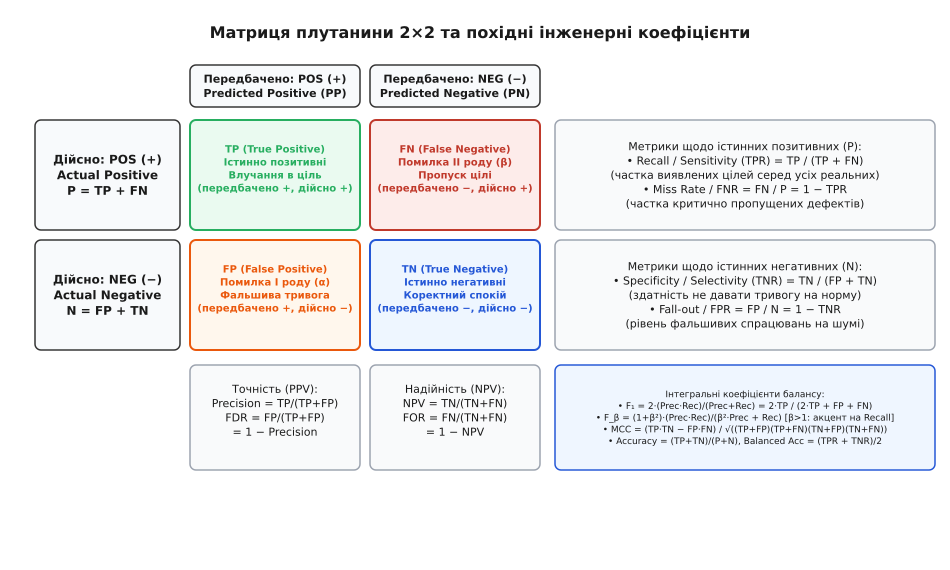
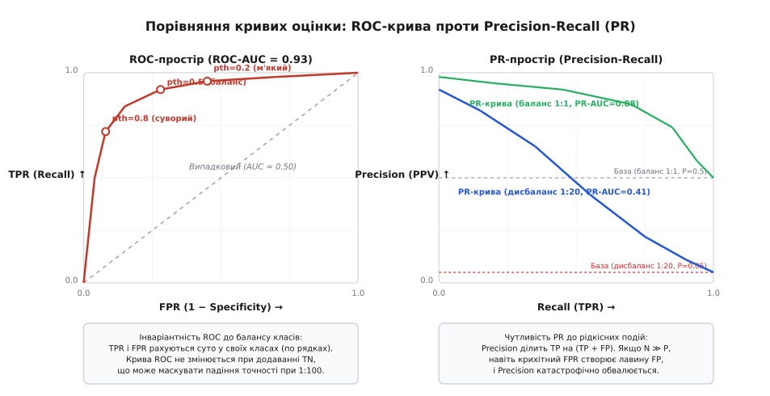

# Метрики якості моделі: точність, повнота, матриця плутанини

<preknowlist>
- [Навчання з учителем](root:sf-ml/supervised-learning) — постановка задачі класифікації, істинні мітки та передбачення моделі.
- [Функції втрат](root:sf-ml/loss-functions) — оптимізація гладких сурогатів втрат під час тренування нейромереж.
- [Крос-валідація](root:sf-ml/cross-validation) — розбиття вибірки на тренувальну, валідаційну й тестову частини.
- [Поріг і ціна помилки](root:sf-ml/porih-i-tsina-pomylky) — вибір робочої точки класифікатора залежно від вартості хибного спрацювання та пропуску.
</preknowlist>

Коли навчена модель класифікації завершує обробку тестового набору даних, вона видає масив числових прогнозів. Якщо зіставити ці прогнози з реальними мітками, виникає потреба оцінити роботу алгоритму одним або кількома числами. Найперший імпульс інженера-початківця — порахувати відсоток збігів між прогнозом і фактом, тобто частку правильних відповідей. Проте в реальних інженерних системах цей підхід миттєво зазнає краху.

Уявімо автономну систему виявлення тріщин у лопатках авіаційної турбіни на базі бортової оптичної камери. У вибірці з 100 000 знімків реальні критичні мікротріщини присутні лише на 50 лопатках, тоді як решта 99 950 деталей є цілими. Класифікатор, який узагалі не містить нейромережі, а просто повертає константну відповідь «дефектів немає» для будь-якого вхідного кадру, продемонструє частку правильних відповідей 99.95%. З погляду наївного підрахунку це здається бездоганним результатом. Проте на практиці цей алгоритм пропустив 100% аварійних випадків і гарантовано спричинить руйнування двигуна в польоті.

Цей парадокс виникає через те, що реальний світ несиметричний. Помилки класифікації мають принципово різну природу, різну ціну та різні наслідки для безпеки системи. Щоб отримати об'єктивну оцінку якості, інженер повинен розділити помилки за типами, виміряти здатність алгоритму знаходити рідкісні події, оцінити надійність позитивних сигналів і дослідити поведінку системи при зміні порогу прийняття рішень.

### Ймовірнісна природа класифікації та байєсівська межа помилки

Щоб зрозуміти, чому класифікатор помиляється, необхідно розглянути статистичну природу формування даних. Нехай кожен об'єкт описується вектором ознак `x ∈ ℝᵈ`, а його істинний стан задається дискретною міткою класу `y ∈ {0, 1}` (де 1 позначає цільовий позитивний стан, а 0 — фоновий негативний).

У просторі ознак об'єкти кожного класу утворюють власні статистичні розподіли з умовними густинами ймовірності `p(x | y = 1)` та `p(x | y = 0)`. Частоти появи самих класів у генеральній сукупності задаються апріорними ймовірностями `P(y = 1)` та `P(y = 0)`, причому `P(y = 1) + P(y = 0) = 1`.

За теоремою Баєса апостеріорна ймовірність того, що об'єкт із вектором ознак `x` належить до позитивного класу, дорівнює:

```
P(y = 1 | x) = (p(x | y = 1) · P(y = 1)) / p(x)
```

де повна густина ймовірності ознак становить:

```
p(x) = p(x | y = 1) · P(y = 1) + p(x | y = 0) · P(y = 0)
```

Якщо умовні розподіли `p(x | y = 1)` та `p(x | y = 0)` перекриваються у просторі ознак (через тепловий шум сенсорів, квантування або нестачу інформативних вимірів), не існує жодного детермінованого правила, здатного розділити класи з нульовою помилкою. Область перекриття породжує фундаментальну **байєсівську помилку** (англ. *Bayes error rate*), яка є теоретичною нижньою межею будь-якого алгоритму машинного навчання на цьому наборі ознак.

Будь-яка практична модель оцінює апостеріорну ймовірність `f(x) ≈ P(y = 1 | x)`. Щоб перетворити це неперервне число на категоріальне рішення `ŷ ∈ {0, 1}`, простір ознак розділяють вирішальною поверхнею (англ. *decision boundary*) за допомогою порогового значення `p_th ∈ (0, 1)`:

```
ŷ = 1, якщо f(x) ≥ p_th; інакше ŷ = 0
```

Форма роздільної поверхні та значення порогу генерують чотири взаємовиключні підмножини подій, які фіксуються в матриці плутанини.

### Анатомія помилок: матриця плутанини (Confusion Matrix)

Фундаментом для всіх подальших метрик оцінки якості класифікації є таблиця спряженості, яку в комп'ютерних науках називають **матрицею плутанини** (англ. *confusion matrix*, від латинського *confusio* — змішування, безлад). Вона розкладає всі прогнози моделі у двовимірну сітку, де рядки відповідають об'єктивній дійсності (істинним міткам), а стовпці — рішенню, ухваленому алгоритмом.

Для бінарної класифікації матриця має розмір 2 × 2 і утворює чотири неперетинні підмножини результатів:

1. **Істинно позитивні (True Positive, TP)**: об'єкти, які насправді є позитивними (`y = 1`), і модель коректно позначила їх як позитивні (`ŷ = 1`). Це прямі влучання в ціль.
2. **Хибно негативні (False Negative, FN)**: об'єкти, які насправді є позитивними (`y = 1`), але модель помилково оголосила їх негативними (`ŷ = 0`). У математичній статистиці це називають **помилкою II роду** (англ. *Type II error*, ризик споживача, пропуск цілі, бета-помилка).
3. **Хибно позитивні (False Positive, FP)**: об'єкти, які насправді є негативними (`y = 0`), але модель помилково кваліфікувала їх як позитивні (`ŷ = 1`). Це **помилка I роду** (англ. *Type I error*, фальшива тривога, альфа-помилка).
4. **Істинно негативні (True Negative, TN)**: об'єкти, які насправді є негативними (`y = 0`), і модель коректно підтвердила відсутність цільового сигналу (`ŷ = 0`). Це коректний стан спокою.


*Структура матриці плутанини 2 × 2 та її маргінальні похідні: відношення вздовж рядків характеризують якість щодо об'єктивної істини (Recall, Specificity), тоді як відношення вздовж стовпців показують надійність прогнозів моделі (Precision, NPV).*

Загальна кількість позитивних об'єктів у вибірці позначається як `P = TP + FN`, а загальна кількість негативних — як `N = FP + TN`. Загальний обсяг вибірки становить:

```
Total = P + N = TP + FP + FN + TN
```

З боку передбачень моделі ми маємо загальну кількість позитивних спрацювань `PP = TP + FP` (Predicted Positives) та негативних спрацювань `PN = FN + TN` (Predicted Negatives).

> 🔧 **Навіщо це.** Матриця плутанини зберігає повну первинну інформацію про роботу класифікатора без жодних втрат чи передчасних усереднень. Будь-яке числове зведення (точність, F-міра тощо) втрачає частину інформації, тоді як четвірка `(TP, FP, FN, TN)` дозволяє точно порахувати фінансові збитки, ризики відмови та зміну надійності при будь-яких припущеннях про вартість помилок.

### Повний спектр маргінальних коефіцієнтів

Жодне окреме число з матриці плутанини не дає повної картини. Проте їхні дробові співвідношення вздовж рядків і стовпців утворюють вісім взаємодоповнюючих коефіцієнтів.

#### 1. Метрики відносно істинного стану (по рядках матриці)

Ця група метрик оцінює, наскільки добре класифікатор покриває об'єктивну дійсність, незалежно від балансу між класами.

##### Повнота / Чутливість (Recall / Sensitivity / True Positive Rate, TPR)

**Повнота** (англ. *recall* — пригадування, або *sensitivity* — чутливість, від латинського *sensibilis*) вимірює частку позитивних об'єктів, успішно виявлених моделлю:

```
TPR = Recall = Sensitivity = TP / (TP + FN) = TP / P
```

Повнота відповідає на запитання: «Якщо в системі виникла аварія, з якою ймовірністю алгоритм її зафіксує?». У системах, де ціна пропуску катастрофічна (медична діагностика злоякісних пухлин, детектування мікротріщин лопаток, виявлення перешкод на залізничній колії), повнота є головним інженерним критерієм.

Для оцінки статистичної невизначеності повноти при скінченному обсязі вибірки `P` звичайна апроксимація нормальним розподілом часто ламається біля меж 0 та 1. У критичних застосунках обчислюють **довірчий інтервал Клоппера-Пірсона** (англ. *Clopper-Pearson exact interval*), що базується на квантилях бета-розподілу, або **інтервал Вільсона** зі зсувом до центру:

```
Wilson_Center = (TP + z² / 2) / (P + z²)
```

де `z` — квантиль стандартного нормального розподілу для обраного рівня довіри `1 − α` (наприклад, `z = 1.96` для довірчої ймовірності 95%).

##### Рівень пропуску цілі (Miss Rate / False Negative Rate, FNR)

Комплементарною величиною до повноти є коефіцієнт хибно негативних спрацювань:

```
FNR = Miss Rate = FN / (TP + FN) = FN / P = 1 − Recall
```

FNR показує частку небезпечних станів, які безперешкодно пройшли крізь захисний бар'єр автоматики.

##### Специфічність / Вибірковість (Specificity / Selectivity / True Negative Rate, TNR)

**Специфічність** (англ. *specificity*, від латинського *specificus* — видовий, особливий) характеризує здатність алгоритму не реагувати на штатний фоновий стан:

```
TNR = Specificity = TN / (FP + TN) = TN / N
```

Специфічність відповідає на запитання: «Якщо система перебуває в нормальному стані, з якою ймовірністю класифікатор підтвердить відсутність тривоги?».

##### Рівень фальшивих тривог (Fall-out / False Positive Rate, FPR)

Прямим антиподом специфічності є коефіцієнт хибного спрацювання на шумі:

```
FPR = Fall-out = FP / (FP + TN) = FP / N = 1 − Specificity
```

Цей показник відображає частку здорових об'єктів або нормальних пакетів трафіку, які були помилково позначені як небезпечні.

#### 2. Метрики відносно рішень моделі (по стовпцях матриці)

Ця група коефіцієнтів визначає прогностичну цінність сигналів, що надходять від системи.

##### Точність позитивного прогнозу (Precision / Positive Predictive Value, PPV)

**Точність** (англ. *precision*, від латинського *praecisio* — відсікання) показує, яка частка серед усіх позитивних вердиктів моделі дійсно відповідає реальній цілі:

```
Precision = PPV = TP / (TP + FP) = TP / PP
```

Точність відповідає на запитання чергового інженера: «Якщо система щойно подала сигнал тривоги, яка ймовірність того, що небезпека реальна, а не сталася помилка вимірювання?».

Якщо точність низька, виникає синдром втоми від тривог (англ. *alarm fatigue*): оператори перестають довіряти системі і починають механічно квитувати сповіщення або взагалі вимикати звукову сигналізацію.

##### Рівень хибного відкриття (False Discovery Rate, FDR)

Комплементарною величиною до точності є частка сміття серед позитивних спрацювань:

```
FDR = FP / (TP + FP) = 1 − Precision
```

У задачах широкомасштабного аналізу біомедичних маркерів або автоматичного пошуку вразливостей контроль FDR є критичним для мінімізації витрат на ручну перевірку помилкових гіпотез (процедура Беньяміні-Гохберга).

##### Надійність негативного прогнозу (Negative Predictive Value, NPV)

**NPV** характеризує надійність вердикту про повну безпеку:

```
NPV = TN / (TN + FN) = TN / PN
```

NPV показує ймовірність того, що деталь дійсно справна, якщо модель не виявила в ній жодних дефектів.

##### Рівень хибного заспокоєння (False Omission Rate, FOR)

Частка небезпечних пропусків серед усіх спокійних вердиктів моделі:

```
FOR = FN / (TN + FN) = 1 − NPV
```

#### Відношення правдоподібності (Likelihood Ratios) та діагностичні шанси (DOR)

У біомедичних дослідженнях та технічній діагностиці надійність тесту кількісно оцінюють через **відношення правдоподібності**:

1. **Позитивне відношення правдоподібності (Positive Likelihood Ratio, LR⁺)**:
   ```
   LR⁺ = TPR / FPR = Sensitivity / (1 − Specificity)
   ```
   `LR⁺` показує, у скільки разів ймовірність отримати позитивний результат вища для реально дефектного об'єкта, ніж для справного. Тест із `LR⁺ > 10` вважається високоефективним діагностичним інструментом.
2. **Негативне відношення правдоподібності (Negative Likelihood Ratio, LR⁻)**:
   ```
   LR⁻ = FNR / TNR = (1 − Sensitivity) / Specificity
   ```
   `LR⁻` показує, у скільки разів знижується ймовірність дефекту після отримання негативного вердикту моделі. Для надійного контролю якості прагнуть забезпечити `LR⁻ < 0.1`.
3. **Діагностичне відношення шансів (Diagnostic Odds Ratio, DOR)**:
   ```
   DOR = LR⁺ / LR⁻ = (TP · TN) / (FP · FN)
   ```
   DOR володіє важливою властивістю: воно повністю незалежне від балансу класів `Prevalence` і надає глобальну скалярну оцінку дискримінативної сили сенсора.

#### Закон Баєса і катастрофічне падіння Precision при рідкісних подіях

Між метриками за рядками (Recall, Specificity) та метриками за стовпцями (Precision, NPV) існує жорсткий математичний зв'язок, що задається теоремою Баєса. Позначимо апріорну поширеність цільового класу у вибірці як `Prevalence = P / (P + N) = P(y = 1)`. Тоді точність прогнозу розгортається у вираз:

```
               P(y = 1) · p(ŷ = 1 | y = 1)
Precision = ---------------------------------
                       p(ŷ = 1)

               Prevalence · Recall
Precision = ----------------------------------------------------
            Prevalence · Recall + (1 − Prevalence) · (1 − Specificity)
```

Аналогічно для рівня хибних спрацювань `FPR = 1 − Specificity`:

```
               Prevalence · TPR
Precision = ------------------------------------
            Prevalence · TPR + (1 − Prevalence) · FPR
```

Ця формула описує фундаментальне інженерне явище: **якщо цільова подія трапляється рідко (`Prevalence ≪ 1`), навіть надзвичайно досконалий класифікатор демонструє вкрай низьку точність (Precision)**.

Проілюструємо це числовим розрахунком. Припустимо, ми створили радіолокаційний розпізнавач малорозмірних безпілотників із чудовими параметрами:
- Чутливість `Recall = TPR = 0.99` (99% виявлених цілей).
- Специфічність `Specificity = 0.99 \implies FPR = 0.01` (лише 1% помилкових тривог на птахах чи хмарах).

Нехай у повітряному просторі за добу пролітає 1 000 000 об'єктів, з яких лише 10 є реальними ворожими БПЛА (`Prevalence = 10 / 1 000 000 = 0.00001`):

```
Чисельник  = 0.00001 · 0.99 = 0.0000099
Знаменник  = 0.0000099 + (1 − 0.00001) · 0.01 ≈ 0.0000099 + 0.0099999 = 0.0100098

Precision  = 0.0000099 / 0.0100098 ≈ 0.000989 (менше 0.1%!)
```

Незважаючи на паспортні «99% точності» сенсора, на кожні 10 реальних виявлених дронів припадатиме майже 10 000 хибних тривог. Корисний сигнал буде повністю похований під лавиною фальшивих спрацювань. Інженер, який не враховує вплив поширеності `Prevalence`, створить систему, яку оператори вимкнуть у перші ж години чергування.

### Інформативність Юдена, маркованість та теорія виявлення сигналів

Для оцінки чистої роздільної здатності класифікатора без впливу випадкового вгадування використовують дві взаємно дуальні метрики:

#### Інформативність (Youden's J-statistic / Informedness)

Запропонована Вільямом Юденом у 1950 році статистика `J` вимірює здатність класифікатора уникати випадкових рішень:

```
J = Informedness = Sensitivity + Specificity − 1 = TPR − FPR
```

Геометрично `J` дорівнює вертикальній відстані від точки класифікатора на ROC-кривій до діагоналі випадкового вибору.
- `J = 1.0`: абсолютно бездоганна класифікація (`TPR = 1, FPR = 0`).
- `J = 0.0`: повна відсутність інформативності (еквівалент випадкового підкидання монети).
- `J = −1.0`: абсолютно інвертований класифікатор.

#### Маркованість (Markedness / Δp)

Маркованість є дуальним аналогом індексу Юдена, але розраховується вздовж стовпців рішень моделі:

```
Markedness = Precision + NPV − 1 = PPV + NPV − 1
```

Маркованість показує, наскільки надійно позитивні та негативні передбачення алгоритму маркують реальний стан об'єкта.

Цікавий математичний зв'язок об'єднує обидві метрики: коефіцієнт кореляції Метьюза (MCC) є середнім геометричним інформативності та маркованості:

```
MCC = √(Informedness · Markedness) = √(J · Markedness)
```

#### Індекс чутливості d' (Signal Detection Theory)

У класичній радіолокації та психофізиці роздільну здатність системи вимірюють через індекс чутливості `d'` (англ. *d-prime*). Припускаючи, що розподіли шуму `p(x|0)` та сигналу з шумом `p(x|1)` є нормальними з однаковою дисперсією `σ²`, індекс `d'` визначає відстань між їхніми центрами у масштабі стандартного відхилення:

```
d' = (μ_сигнал − μ_шум) / σ = Φ⁻¹(TPR) − Φ⁻¹(FPR)
```

де `Φ⁻¹` — квантильна функція стандартного нормального розподілу (пробіт-функція). Індекс `d'` повністю відділяє внутрішню роздільну здатність сенсора від суб'єктивного критерію прийняття рішень оператором.

### Парадокс точності та збалансовані критерії

Повернемося до загальної частки правильних відповідей (**Accuracy**):

```
Accuracy = (TP + TN) / (P + N) = (TP + TN) / Total
```

Формула Accuracy зважує внесок класів пропорційно до їхньої чисельності у вибірці:

```
Accuracy = Prevalence · TPR + (1 − Prevalence) · TNR
```

Якщо `Prevalence = 0.001` (99.9% негативних об'єктів), то коефіцієнт перед `TPR` становить мізерні 0.001, тоді як вага `TNR` дорівнює 0.999. Модель, яка нічого не робить і завжди повертає 0, забезпечує `TNR = 1.0` і отримує `Accuracy = 0.999`.

#### Збалансована точність (Balanced Accuracy)

Щоб усунути вплив дисбалансу класів, визначають **збалансовану точність** як просте незважене середнє арифметичне повноти позитивного та негативного класів:

```
Balanced Accuracy = (TPR + TNR) / 2 = (Recall + Specificity) / 2
```

Зв'язок з індексом Юдена є прямим:

```
Balanced Accuracy = (J + 1) / 2
```

Для константного тривіального класифікатора `TPR = 0`, `TNR = 1`, що дає `Balanced Accuracy = (0 + 1) / 2 = 0.50`, чесно вказуючи на повну відсутність користі від моделі.

#### Геометричне середнє (G-Mean)

Іншим суворим критерієм є середнє геометричне чутливості та специфічності:

```
G-Mean = √(TPR · TNR) = √(Recall · Specificity)
```

Оскільки геометричне середнє містить добуток, воно миттєво обнуляється, якщо класифікатор повністю ігнорує хоча б один із класів (`TPR = 0 \implies G-Mean = 0`).

### Математична теорія F-мір: гармонійне середнє

Коли інженеру необхідно порівняти кілька моделей, аналізувати одночасно пару чисел (Precision та Recall) незручно: одна модель може демонструвати точність 0.90 при повноті 0.60, а інша — точність 0.70 при повноті 0.80. Виникає потреба згорнути їх у єдину скалярну функцію.

Розглянемо три класичні середні величини для чисел `P` (Precision) та `R` (Recall):
1. **Арифметичне середнє**: `AM(P, R) = (P + R) / 2`
2. **Геометричне середнє**: `GM(P, R) = √(P · R)`
3. **Гармонійне середнє**: `HM(P, R) = 2 / (1/P + 1/R) = (2 · P · R) / (P + R)`

Між цими величинами завжди виконується фундаментальна нерівність Коші:

```
AM(P, R) ≥ GM(P, R) ≥ HM(P, R)
```

Чому саме **гармонійне середнє** стало основою оцінки в інформаційному пошуку та машинному навчанні?

Розглянемо випадок екстремального перекосу: класифікатор видає `Recall = 1.0` при `Precision = 0.02` (знайшов усі цілі, але назвав позитивними всі об'єкти вибірки). Обчислимо значення трьох середніх:
- `AM = (1.0 + 0.02) / 2 = 0.51` (створює оманливе враження помірної придатності).
- `GM = √(1.0 · 0.02) ≈ 0.141` (помітно знижується, але все ще суттєво відмінне від нуля).
- `HM = (2 · 1.0 · 0.02) / (1.0 + 0.02) = 0.04 / 1.02 ≈ 0.0392` (прямує до найгіршого компонента).

Гармонійне середнє накладає найсуворіший штраф за дисбаланс між точністю та повнотою. Воно відображає концепцію вузького місця: система не може вважатися якісною, якщо хоча б одна з її критичних функцій деградувала.

Отримана метрика називається **збалансованою F-мірою** або **F₁-score**:

```
F₁ = 2 · (Precision · Recall) / (Precision + Recall)
```

Підставивши вирази через компоненти матриці плутанини `Precision = TP / (TP + FP)` та `Recall = TP / (TP + FN)`, отримуємо інженерну формулу:

```
F₁ = 2·TP / (2·TP + FP + FN)
```

З формули видно, що `F₁` являє собою частку правильно класифікованих позитивних прикладів щодо суми всіх позитивних міток і прогнозів, причому `TP` входить у знаменник з подвійною вагою.

#### Зважена F_β-міра (ван Різберген, 1979)

У фундаментальній монографії «Information Retrieval» Корнеліс ван Різберген увів параметричну родину мір ефективності `E`, засновану на зважуванні відносної важливості точності та повноти:

```
E = 1 − 1 / ( α · (1/P) + (1 − α) · (1/R) )
```

Перейшовши від міри втрат `E` до міри якості `F = 1 − E` та задавши параметризацію ваги через `α = 1 / (1 + β²)`, де `β ∈ (0, ∞)`, отримуємо канонічне рівняння **F_β-міри**:

```
F_β = (1 + β²) · (Precision · Recall) / (β² · Precision + Recall)
```

Параметр `β` (бета) визначає баланс пріоритетів:
- `β = 1.0`: класична збалансована `F₁`-міра.
- `β > 1.0`: повнота (Recall) має вищий пріоритет. Наприклад, при `β = 2.0` (`F₂`-score) повнота важить удвічі більше за точність:
  ```
  F₂ = 5 · (Precision · Recall) / (4 · Precision + Recall) = 5·TP / (5·TP + 4·FN + FP)
  ```
  Метрика `F₂` є галузевим стандартом у системах виявлення дефектів на конвеєрі, медичному скринінгу та моніторингу вторгнень у комп'ютерні мережі.
- `β < 1.0`: точність (Precision) має вищий пріоритет. При `β = 0.5` (`F₀.₅`-score) точність важить удвічі більше за повноту:
  ```
  F₀.₅ = 1.25 · (Precision · Recall) / (0.25 · Precision + Recall) = 5·TP / (5·TP + FN + 4·FP)
  ```
  Метрику `F₀.₅` використовують у генеративних моделях, автоматичних транскрипторах тексту та системах рекомендацій контенту, де фальшивий прогноз дратує користувача значно сильніше, ніж пропуск частини матеріалу.

### Коефіцієнт кореляції Метьюза (MCC) та Каппа Коена

Незважаючи на популярність, `F₁`-міра має фундаментальне обмеження: вона повністю ігнорує клітинку `TN` (True Negatives).

Формула `F₁` враховує лише `TP`, `FP` та `FN`. Якщо ми зафіксуємо значення `TP = 10, FP = 10, FN = 10`, значення `F₁` становитиме рівно `0.50`, незалежно від того, чому дорівнює кількість істинно негативних прикладів: `TN = 10` чи `TN = 10 000 000`. Більше того, якщо ми поміняємо визначення того, який клас вважати позитивним (наприклад, будемо прогнозувати «справність» замість «аварії»), значення `F₁` повністю зміниться.

#### Математичне виведення MCC через кореляцію Пірсона

Щоб подолати ці вади, біохімік Браян Метьюз у 1975 році запропонував коефіцієнт кореляції, який розглядає бінарну класифікацію як розрахунок лінійного коефіцієнта кореляції Пірсона `r_{XY}` між двома бінарними випадковими величинами: вектором реальних станів `X ∈ {0, 1}` та вектором передбачень моделі `Y ∈ {0, 1}`.

Нехай кожен екземпляр `i ∈ {1, ..., Total}` має пару `(x_i, y_i)`. Коефіцієнт кореляції Пірсона визначається як:

```
r_{XY} = Cov(X, Y) / ( σ_X · σ_Y )
```

Обчислимо компоненти через елементи матриці плутанини:

1. Середні значення випадкових величин:
   ```
   E[X] = (TP + FN) / Total = P / Total
   E[Y] = (TP + FP) / Total = PP / Total
   ```
2. Дисперсії бінарних змінних:
   ```
   σ_X² = E[X²] − (E[X])² = (P/Total) · (1 − P/Total) = (P · N) / Total²
   σ_Y² = E[Y²] − (E[Y])² = (PP/Total) · (1 − PP/Total) = (PP · PN) / Total²
   ```
3. Коваріація:
   ```
   Cov(X, Y) = E[X · Y] − E[X] · E[Y]
   E[X · Y]  = TP / Total
   Cov(X, Y) = (TP / Total) − (P · PP) / Total²
             = (TP · (TP + FP + FN + TN) − (TP + FN)·(TP + FP)) / Total²
             = (TP·TN − FP·FN) / Total²
   ```

Підставивши коваріацію та добуток середньоквадратичних відхилень у формулу кореляції, отримуємо канонічне рівняння **Matthews Correlation Coefficient (MCC)**:

```
MCC = (TP·TN − FP·FN) / √((TP + FP)·(TP + FN)·(TN + FP)·(TN + FN))
```

MCC володіє винятковими теоретичними властивостями:
1. **Інваріантність до маркування класів**: формула абсолютно симетрична. Якщо замінити всі 0 на 1 і навпаки, чисельник і знаменник залишаться тотожно незмінними.
2. **Строгий діапазон `[−1.0, +1.0]`**:
   - `MCC = +1.0`: бездоганна класифікація (`FP = 0, FN = 0`).
   - `MCC = 0.0`: робота моделі еквівалентна випадковому шуму.
   - `MCC = −1.0`: повна детермінована інверсія передбачень (`TP = 0, TN = 0`).
3. **Зв'язок зі статистикою Хі-квадрат Пірсона**:
   Для таблиці спряженості 2 × 2 критерій незалежності `χ²` безпосередньо пов'язаний з MCC:
   ```
   χ² = Total · MCC²
   |MCC| = √(χ² / Total)
   ```
   Це дозволяє миттєво перевіряти статистичну значущість отриманого значення MCC за стандартним розподілом хі-квадрат з 1 ступенем вільності.

#### Каппа Коена (Cohen's Kappa)

Метрика **Каппа Коена** (`κ`), запропонована в 1960 році, розглядає класифікатор та істинну розмітку як двох незалежних суддів-експертів і оцінює ступінь їхньої згоди понад рівень випадкового збігу:

```
κ = (p_o − p_e) / (1 − p_e)
```

де `p_o` — спостережувана частка збігів (Accuracy):

```
p_o = (TP + TN) / Total
```

а `p_e` — ймовірність того, що двоє суддів випадково виставлять однакові оцінки за умови збереження своїх індивідуальних маргінальних розподілів:

```
p_e = ( (TP + FP)·(TP + FN) + (FN + TN)·(FP + TN) ) / Total²
```

Хоча Каппа широко застосовується в медичних дослідженнях, вона страждає від відомого парадоксу Файнштейна-Чіккетті (Feinstein & Cicchetti, 1990): при надзвичайно високій спостережуваній згоді `p_o = 0.95` на сильно незбалансованому датасеті величина випадкового збігу `p_e` також наближається до 0.95, що призводить до обвалу `κ ≈ 0.0`, навіть якщо модель працює добре. Тому в інженерних задачах з високим дисбалансом пріоритет віддають MCC.

### Простір ROC та площа під кривою (ROC-AUC)

Оцінка класифікатора за фіксованого порогу `p_th = 0.5` страждає від випадковості вибору цієї точки. Щоби перевірити якість ранжування моделі в усьому континуумі можливих порогів від 0.0 до 1.0, застосовують аналіз робочих характеристик приймача.

**ROC-крива** (англ. *Receiver Operating Characteristic*, термін з теорії радіолокаційного виявлення сигналів) — це параметрична крива у двовимірному одиничному квадраті `[0, 1] × [0, 1]`, що відображає залежність повноти (`TPR(p_th)`) по осі ординат від рівня хибних спрацювань (`FPR(p_th)`) по осі абсцис при неперервній зміні порогу `p_th` від `+∞` до `−∞`.

Ключові топологічні властивості ROC-простору:
- Початкова точка `(0, 0)` відповідає порогу `p_th = 1.0`: модель усім призначає клас 0, отже `TP = 0, FP = 0 \implies TPR = 0, FPR = 0`.
- Кінцева точка `(1, 1)` відповідає порогу `p_th = 0.0`: модель усім призначає клас 1, отже `TP = P, FP = N \implies TPR = 1, FPR = 1`.
- Ідеальний класифікатор проходить крізь лівий верхній кут `(0, 1)`, де `FPR = 0` при `TPR = 1.0`.
- Діагональ від `(0, 0)` до `(1, 1)` являє собою характеристику абсолютно випадкового класифікатора: будь-яке незалежне підкидання монети дає `TPR(p_th) = FPR(p_th)`.


*Зіставлення кривих оцінки: ліворуч — ROC-простір, інваріантний до поширеності класу завдяки ізольованій нормалізації осей; праворуч — Precision-Recall простір, який наочно демонструє падіння надійності прогнозів за екстремального дисбалансу класів.*

#### Математичне виведення еквівалентності ROC-AUC статистиці Манна-Вітні

Площа під ROC-кривою (**ROC-AUC**) визначається інтегралом Рімана:

```
ROC-AUC = ∫₀¹ TPR(FPR) d(FPR)
```

Доведемо фундаментальну теорему: **площа ROC-AUC строго дорівнює ймовірності того, що випадково обраному позитивному об'єкту модель призначить вищий бал впевненості, ніж випадково обраному негативному об'єкту**.

Нехай `X⁺` — випадкова величина оцінки впевненості моделі для об'єкта з позитивного класу `(y = 1)`, а `X⁻` — для об'єкта з негативного класу `(y = 0)`. Нехай їхні кумулятивні функції розподілу дорівнюють `F⁺(t) = P(X⁺ ≤ t)` та `F⁻(t) = P(X⁻ ≤ t)`, а відповідні густини — `f⁺(t)` та `f⁻(t)`.

Для фіксованого порогу відсікання `t`:
```
TPR(t) = P(X⁺ > t) = 1 − F⁺(t)
FPR(t) = P(X⁻ > t) = 1 − F⁻(t)
```

Зробимо заміну змінної в інтегралі площі: `u = FPR(t) = 1 − F⁻(t) \implies du = −f⁻(t) dt`. Межі інтегрування переходять: при `u = 0 \implies t = +∞`, при `u = 1 \implies t = −∞`.

```
ROC-AUC = ∫₀¹ TPR(u) du
        = ∫_{+∞}^{-∞} (1 − F⁺(t)) · (−f⁻(t)) dt      [заміна змінної u = FPR(t)]
        = ∫_{-∞}^{+∞} (1 − F⁺(t)) · f⁻(t) dt         [перестановка меж інтегрування зі зміною знака]
        = ∫_{-∞}^{+∞} P(X⁺ > t) · f⁻(t) dt           [означення кумулятивної ймовірності P(X⁺ > t)]
        = P(X⁺ > X⁻)                                 [інтеграл сумісної густини та повної ймовірності]
```

Звідси випливає прямий зв'язок із непараметричною `U`-статистикою Манна-Вітні-Вілкоксона (Mann-Whitney U-test):

```
ROC-AUC = (1 / (P · N)) · ∑_{i=1}^P ∑_{j=1}^N S(score(x_i⁺), score(x_j⁻))
```

де ядрова функція порівняння `S(a, b)` дорівнює:
- `1.0`, якщо `a > b`;
- `0.5`, якщо `a = b` (зв'язані ранги);
- `0.0`, якщо `a < b`.

Це формулювання дозволяє обчислювати точне значення ROC-AUC за час `O(Total · log(Total))` шляхом простого сортування всіх об'єктів за спаданням скору з подальшим лінійним проходом.

#### Коефіцієнт Джині та криві кумулятивного відгуку (Lift Curves)

У фінансовому скорингу та маркетинговій аналітиці здатність моделі виділяти цільовий сегмент оцінюють через **коефіцієнт Джині** (Gini Coefficient) та **криві приросту (Lift Curves)**:

1. **Коефіцієнт Джині**: лінійна репараметризація ROC-AUC у діапазон `[−1.0, +1.0]`:
   ```
   Gini = 2 · ROC-AUC − 1
   ```
   Якщо модель випадкова (`AUC = 0.5`), `Gini = 0.0`. Для ідеальної моделі `Gini = 1.0`.
2. **Крива кумулятивного відгуку (Cumulative Gains Chart)**: відображає частку виявлених позитивних об'єктів `TPR(q)` у перших `q%` найбільш впевнених прогнозів моделі.
3. **Крива ліфту (Lift Curve)**: показує у скільки разів концентрація цільових об'єктів у верхніх `q%` списку перевершує середню поширеність у популяції:
   ```
   Lift(q) = TPR(q) / q
   ```
   Якщо при обробці 10% бази (`q = 0.10`) модель знаходить 70% усіх шахраїв (`TPR = 0.70`), ліфт становить `0.70 / 0.10 = 7.0` (модель у 7 разів ефективніша за випадковий пошук).

#### Статистика Колмогорова-Смірнова (KS-Statistic)

Для оцінки максимальної роздільної здатності класифікатора розраховують непараметричну статистику Колмогорова-Смірнова:

```
KS = max_t | TPR(t) − FPR(t) | = max_t | F⁺(t) − F⁻(t) | = max_t J(t)
```

де `J(t)` — індекс Юдена при порозі `t`. Точка максимуму кривої Колмогорова-Смірнова вказує на поріг із найбільшим абсолютним розділенням кумулятивних розподілів двох класів.

#### Частковий ROC-AUC (Partial AUC / pAUC)

У багатьох критичних системах (наприклад, медичний скринінг донорської крові чи бортові радари попередження зіткнень) область високих рівнів фальшивих тривог `FPR > 0.10` є абсолютно неприпустимою в експлуатації. Обчислювати стандартний ROC-AUC по всьому діапазону `[0, 1]` недоцільно, оскільки модель із високим початковим підйомом при `FPR ≤ 0.05` може отримати нижчий загальний бал через пологий хвіст при `FPR > 0.5`.

Для цього використовують **частковий ROC-AUC** (Partial AUC), що інтегрує площу лише в робочому діапазоні `[0, e_max]`:

```
pAUC(e_max) = ∫₀^{e_max} TPR(FPR) d(FPR)
```

Стандартизований індекс часткової площі нормують відносно випадкового класифікатора:

```
pAUC_norm = 0.5 · (1 + (pAUC − pAUC_min) / (pAUC_max − pAUC_min))
```

де `pAUC_min = e_max² / 2`, а `pAUC_max = e_max`.

#### Порівняння моделей за тестом Делонга (DeLong Test)

Коли дві різні моделі класифікації тестуються на одному й тому самому наборі даних, їхні ROC-криві є статистично залежними. Звичайні критерії порівняння середніх тут непридатні. Для перевірки гіпотези про статистичну значущість різниці між двома площами `AUC₁` та `AUC₂` застосовують **непараметричний метод Делонга** (DeLong et al., 1988).

Метод Делонга використовує теорію U-статистик для оцінки коваріаційної матриці векторів структурних компонентів `V₁₀` та `V₀₁` для обох моделей. Статистичний критерій має вигляд Z-статистики:

```
Z = (AUC₁ − AUC₂) / √( Var(AUC₁) + Var(AUC₂) − 2·Cov(AUC₁, AUC₂) )
```

Якщо `|Z| > 1.96`, нульова гіпотеза про еквівалентність моделей відкидається на рівні значущості `p < 0.05`.

#### Вибір оптимальної робочої точки на ROC-кривій

Якщо відома матриця вартостей помилок `C(FP)`, `C(FN)`, `C(TP)`, `C(TN)`, оптимальна робоча точка на ROC-кривій обирається в місці дотику лінії рівня мінімальних витрат.

Кутовий коефіцієнт (нахил) цієї дотичної лінії становить:

```
Slope = ( (C(FP) − C(TN)) / (C(FN) − C(TP)) ) · ( N / P )
```

Точка на ROC-кривій, у якій похідна `d(TPR)/d(FPR)` дорівнює значенню `Slope`, забезпечує глобальний мінімум очікуваних фінансових втрат при експлуатації моделі.

### Precision-Recall крива (PR-крива) та пастки інтерполяції

Як було доведено вище через закон Баєса, за умови `N ≫ P` простір ROC маскує реальні масштаби помилок першого роду. У таких сценаріях стандартом оцінки стає **Precision-Recall крива (PR-крива)**.

PR-крива відображає `Precision(p_th)` по осі ординат від `Recall(p_th)` по осі абсцис.

Ключові відмінності PR-простору:
1. **Базова лінія випадкового вибору**: на відміну від фіксованої прямої `AUC = 0.5` у ROC, базовий рівень на PR-кривій є горизонтальною прямою з висотою `Prevalence = P / (P + N)`. Для датасету з балансом 1:1000 випадковий рівень становить `0.001`.
2. **Нелінійність траєкторії**: крива не є монотонною і може мати пилкоподібний характер.

#### Небезпека трапецеїдальної інтерполяції (Пастка Девіса-Гудріча)

Широко поширеною інженерною помилкою є застосування стандартного правила трапецій для обчислення площі під PR-кривою (PR-AUC). Як строго довели Джессі Девіс та Марк Гудріч у 2006 році, лінійне з'єднання двох сусідніх точок `(R₁, P₁)` та `(R₂, P₂)` у просторі Precision-Recall є некоректним, оскільки при зміні кількості `TP` знаменник точності `TP + FP` змінюється нелінійно. Лінійна трапеція систематично завищує реальну площу.

Для точного інтегрування застосовують розрахунок **середньої точності (Average Precision, AP)**:

```
AP = ∑ₖ (Recall_k − Recall_{k−1}) · Precision_k
```

або інтерпольовану неперервну оцінку, де для кожного рівня повноти береться максимальна точність праворуч:

```
Precision_interp(r) = max_{r' ≥ r} Precision(r')
```

### Метрики ранжування для рекомендаційних та пошукових систем

У багатьох прикладних системах (пошукові рушії, рекомендаційні блоки інтернет-магазинів, вибір кандидатів для аналізу кіберзагроз) користувач не переглядає весь масив рішень, а отримує відсортований список із `K` найкращих елементів.

Для оцінки таких упорядкованих вибірок використовують спеціалізовані метрики:

1. **Precision@K (Точність у топ-K)**: частка релевантних документів серед перших `K` позицій видачі:
   ```
   Precision@K = (Кількість релевантних у топ-K) / K
   ```
2. **Recall@K (Повнота у топ-K)**: частка знайдених цільових об'єктів у топ-`K` відносно всіх існуючих релевантних документів у базі `Total_Relevant`:
   ```
   Recall@K = (Кількість релевантних у топ-K) / Total_Relevant
   ```
3. **Mean Reciprocal Rank (MRR)**: середнє гармонійне рангу першого релевантного результату по множині запитів `Q`:
   ```
   MRR = (1 / |Q|) · ∑_{q=1}^{|Q|} ( 1 / rank_q )
   ```
   де `rank_q` — позиція першого правильного документа у списку відповідей на запит `q`.
4. **Normalized Discounted Cumulative Gain (NDCG@K)**: інтегральний критерій, що враховує ступінь релевантності `rel_i` та штрафує за її розташування на далеких позиціях логарифмічним дисконтом:
   ```
   DCG@K = ∑_{i=1}^K ( (2^{rel_i} − 1) / log₂(i + 1) )
   NDCG@K = DCG@K / IDCG@K
   ```
   де `IDCG@K` — максимально можливе значення DCG при ідеальному сортуванні документів за спаданням релевантності.

### Ієрархічна класифікація (Hierarchical Classification Metrics)

Коли класи організовані у деревоподібну таксономію чи спрямований ациклічний граф (DAG) — наприклад, медичний класифікатор хвороб ICD-10 чи класифікатор типів технічних несправностей — звичайні пласкі метрики спотворюють реальність.

Помилка класифікації між близькими підвидами однієї гілки (наприклад, переплутати «підшипник кочення» та «підшипник ковзання») є значно менш небезпечною, ніж груба помилка між різними підсистемами («підшипник» та «генератор струму»).

Для обліку структури дерева використовують **ієрархічні метрики**:

1. Для кожного істинного класу `Y_true` та передбаченого класу `Y_pred` формуються розширені множини, що включають сам вузол та всіх його предків у дереві аж до кореня: `Ancestors(Y_true)` та `Ancestors(Y_pred)`.
2. **Ієрархічна точність (Hierarchical Precision, hP)**:
   ```
   hP = | Ancestors(Y_pred) ∩ Ancestors(Y_true) | / | Ancestors(Y_pred) |
   ```
3. **Ієрархічна повнота (Hierarchical Recall, hR)**:
   ```
   hR = | Ancestors(Y_pred) ∩ Ancestors(Y_true) | / | Ancestors(Y_true) |
   ```
4. **Ієрархічна F-міра (Hierarchical F₁, hF₁)**:
   ```
   hF₁ = (2 · hP · hR) / (hP + hR)
   ```

Якщо модель правильно визначила загальну групу агрегату, але помилилася в тонкому підвиді несправності, ієрархічна метрика нарахує високий частковий бал, чесно відображаючи корисність прогнозу.

### Коригування вибіркового зміщення (Selection Bias & IPW)

У промислових системах тестовий датасет часто збирається в умовах активної попередньої фільтрації (наприклад, банківські оператори вручну розслідували лише ті транзакції, які заблокувала стара евристична система). Виникає **вибіркове зміщення** (англ. *selection bias*), за якого нерозмічені об'єкти відсутні у тестовій вибірці не випадково (Missing Not At Random, MNAR).

Для відновлення істинної матриці плутанини застосовують метод **зважування за оберненою ймовірністю схильності** (Inverse Propensity Weighting, IPW). Нехай `s_i ∈ {0, 1}` — індикатор потрапляння об'єкта `i` у розмічену валідаційну вибірку, а `e(x_i) = P(s_i = 1 | x_i)` — ймовірність перевірки об'єкта з вектором ознак `x_i`:

```
TP_ipw = ∑_{i: s_i=1} ( y_i · ŷ_i ) / e(x_i)
FP_ipw = ∑_{i: s_i=1} ( (1 − y_i) · ŷ_i ) / e(x_i)
FN_ipw = ∑_{i: s_i=1} ( y_i · (1 − ŷ_i) ) / e(x_i)
TN_ipw = ∑_{i: s_i=1} ( (1 − y_i) · (1 − ŷ_i) ) / e(x_i)
```

IPW-оцінки матриці плутанини є асимптотично незміщеними та дозволяють розраховувати реальні виробничі значення `Precision`, `Recall` та `F₁` навіть при суттєвому зміщенні первинної вибірки.

### Сегментний аналіз та парадокс Сімпсона (Sliced Metrics)

Розрахунок єдиного агрегованого показника якості по всьому датасету може приховувати локальні катастрофічні провали алгоритму у вузьких експлуатаційних режимах (наприклад, збій автопілота під час дощу при 99% загальної точності в ясну погоду).

Для виявлення таких дефектів впроваджують **стратифіковану оцінку (Sliced Evaluation)**, розбиваючи вибірку на підгрупи (зрізи) за ключовими метаданими:
- За часом доби або сезоном.
- За географічним регіоном або моделлю сенсора.
- За діапазоном швидкостей або навантаження агрегату.

Під час сегментного аналізу інженер може зіткнутися з **парадоксом Сімпсона**: ситуацією, коли Модель А демонструє вищу точність, ніж Модель Б, у кожному окремому сегменті даних, але в загальному зведеному датасеті перемагає Модель Б через різну пропорцію складних і легких прикладів у вибірках. Це підкреслює необхідність завжди аналізувати локальні матриці плутанини для кожного критичного режиму окремо.

### Оцінка детектування даних за межами розподілу (OOD Detection)

У критичних автономних системах модель повинна вміти розпізнавати ситуації, коли вхідний сигнал суттєво відрізняється від тренувальної вибірки (Out-of-Distribution, OOD) — наприклад, поява на залізничній колії раніше небаченого типу перешкоди або відмова оптичного сенсора.

Для оцінки детектування аномальних станів використовують метрики:

1. **FPR95 (False Positive Rate at 95% TPR)**: рівень помилкових спрацювань на OOD-вибірці за умови вибору такого порогу, який забезпечує збереження 95% повноти на штатних штатних даних (In-Distribution). Чим нижчий `FPR95`, тим надійніше система виявляє небезпечні невідомі ситуації.
2. **AUPR-In та AUPR-Out**: площа під PR-кривою, де цільовим позитивним класом почергово призначається штатний або аномальний розподіл.

### Оцінка змагальної стійкості (Adversarial Robustness Evaluation)

Коли модель працює в умовах активної протидії зловмисників (виявлення шкідливого програмного забезпечення, біометричний контроль доступу), оцінки на випадкових чистих тестових вибірках недостатньо.

Для оцінки стійкості до спрямованих збурень застосовують:

1. **Стійка точність (Robust Accuracy)**: частка правильно класифікованих прикладів при застосуванні змагального шуму в межах допустимого бюджету збурення `‖δ‖_∞ ≤ ε`:
   ```
   Robust Accuracy = (1 / N) · ∑_{i=1}^N min_{‖δ‖_∞ ≤ ε} I( f(x_i + δ) = y_i )
   ```
2. **Частка успішних зламів (Attack Success Rate, ASR)**: відсоток об'єктів, на яких зловмиснику вдалося змінити правильний вердикт моделі:
   ```
   ASR = (Кількість успішно зламаних прикладів) / (Кількість спочатку правильно класифікованих)
   ```

### Багатокласова класифікація (Multiclass Metrics)

Коли кількість категорій перевищує дві (`K > 2`), матриця плутанини масштабується до розміру `K × K`.

Елемент `C_{i, j}` позначає кількість об'єктів класу `i`, яким алгоритм призначив клас `j`.
- Головна діагональ `C_{i, i}` відображає правильні відповіді.
- Позадіагональні елементи `C_{i, j} (i ≠ j)` містять точну структуру помилок між кожною парою категорій.

```
                  Передбачений клас (j)
                 Клас 0   Клас 1   Клас 2
Істинний Клас 0 [ C₀₀      C₀₁      C₀₂   ]  → Всього істинних класу 0: N₀ = C₀₀+C₀₁+C₀₂
клас (i) Клас 1 [ C₁₀      C₁₁      C₁₂   ]  → Всього істинних класу 1: N₁ = C₁₀+C₁₁+C₁₂
         Клас 2 [ C₂₀      C₂₁      C₂₂   ]  → Всього істинних класу 2: N₂ = C₂₀+C₂₁+C₂₂
                   ↓        ↓        ↓
                 PP₀      PP₁      PP₂
```

#### Декомпозиція «Один проти всіх» (One-vs-Rest / One-vs-All)

Для кожного класу `k ∈ {0, ..., K−1}` багатокласова матриця редукується до локальних бінарних показників:
- `TP_k = C_{k, k}`
- `FP_k = ∑_{j ≠ k} C_{j, k}` (сума по стовпцю `k` без діагоналі)
- `FN_k = ∑_{i ≠ k} C_{k, i}` (сума по рядку `k` без діагоналі)
- `TN_k = Total − (TP_k + FP_k + FN_k)`

Після цього для кожного класу розраховуються локальні значення `Precision_k`, `Recall_k`, `F1_k`.

#### Стратегії агрегації: Micro, Macro та Weighted Averaging

Для отримання єдиного підсумкового показника якості по всій системі використовують три стратегії:

##### 1. Макро-усереднення (Macro-averaging)

Метрика обчислюється незалежно для кожного класу, після чого береться просте середнє арифметичне:

```
Macro-Precision = (1 / K) · ∑ₖ Precision_k
Macro-Recall    = (1 / K) · ∑ₖ Recall_k
Macro-F₁        = (1 / K) · ∑ₖ F1_k
```

**Характеристика**: кожен клас має абсолютно **однакову вагу `1/K`**, незалежно від його чисельності (10 прикладів чи 100 000). Це найсуворіша метрика: провал на рідкісному класі призводить до обвалу всієї макро-оцінки.

##### 2. Мікро-усереднення (Micro-averaging)

Спочатку підсумовуються глобальні лічильники помилок, і лише потім розраховується фінальний коефіцієнт:

```
Total_TP = ∑ₖ TP_k
Total_FP = ∑ₖ FP_k
Total_FN = ∑ₖ FN_k

Micro-Precision = Total_TP / (Total_TP + Total_FP)
Micro-Recall    = Total_TP / (Total_TP + Total_FN)
Micro-F₁        = 2 · (Micro-Precision · Micro-Recall) / (Micro-Precision + Micro-Recall)
```

**Властивість**: для однолейблової класифікації будь-яке хибне спрацювання для одного класу є пропуском для іншого (`Total_FP = Total_FN`). Тому завжди виконується тотожність:

```
Micro-Precision = Micro-Recall = Micro-F₁ = Accuracy
```

Мікро-оцінка повністю визначається якістю роботи моделі на домінуючих масових класах.

##### 3. Зважене усереднення (Weighted-averaging)

Метрики класів зважуються пропорційно до їхньої реальної підтримки `N_k`:

```
Weighted-F₁ = ∑ₖ (N_k / Total) · F1_k
```

Цей варіант враховує природний розподіл задач, проте маскує нездатність моделі розпізнавати рідкісні категорії.

#### Багатокласовий коефіцієнт кореляції Метьюза (Gorodkin's MCC)

Ян Городкін у 2004 році узагальнив коефіцієнт Метьюза для довільної матриці `C` розміром `K × K`:

```
            ∑ₖ ∑ᵢ ∑ⱼ ( C_{k,k}·C_{i,j} − C_{k,i}·C_{j,k} )
MCC_multi = --------------------------------------------------------
            √( ∑ₖ (∑ᵢ C_{k,i})·(∑_{j≠k} ∑_{i} C_{j,i}) ) · √( ∑ₖ (∑ᵢ C_{i,k})·(∑_{j≠k} ∑_{i} C_{i,j}) )
```

Метрика набуває значень у діапазоні `[−1.0, +1.0]` і надає строгу симетричну оцінку багатокласової моделі без необхідності вибору між Micro та Macro стратегіями.

#### Оптимізація за довільною матрицею витрат (Cost-Sensitive Multiclass Optimization)

У виробничих процесах вартість плутанини між різними парами категорій суттєво різниться. Нехай `W ∈ ℝᴷˣᴷ` — матриця фінансових штрафів, де елемент `W_{i, j}` позначає прямі збитки від того, що об'єкт класу `i` помилково класифіковано як `j` (при цьому зазвичай `W_{i, i} = 0`).

Для вектора оцінок ймовірностей `p(x) = [P(y=0|x), ..., P(y=K−1|x)]` очікуваний байєсівський ризик призначення класу `j` становить:

```
Risk(j | x) = ∑_{i=0}^{K−1} P(y = i | x) · W_{i, j}
```

Оптимальне рішення полягає у виборі категорії, що мінімізує очікувані втрати:

```
ŷ = argmin_{j ∈ {0, ..., K−1}} Risk(j | x)
```

А сумарні фінансові витрати підприємства на валідаційному датасеті становлять:

```
Total_Cost = ∑_{i=0}^{K−1} ∑_{j=0}^{K−1} C_{i, j} · W_{i, j}
```

Мінімізація величини `Total_Cost` є кінцевою метою інженерної оптимізації будь-якої виробничої класифікаційної системи.

### Мультилейблова класифікація (Multilabel Metrics)

У багатьох інженерних застосунках об'єкт може одночасно належати до кількох категорій. Наприклад, звуковий сигнал вібраційного датчика двигуна може одночасно містити ознаки «перегріву підшипника» І «кавітації насоса» І «розбалансування валу».

У мультилейблових задачах вихід моделі є бінарним вектором довжини `K`: `ŷ ∈ {0, 1}ᴷ`.

Для оцінки таких систем використовують спеціалізовані метрики:
1. **Втрати Геммінга (Hamming Loss)**: середня частка некоректно передбачених бітів міток:
   ```
   Hamming Loss = (1 / (N · K)) · ∑_{i=1}^N ∑_{k=1}^K I(y_{i,k} ≠ ŷ_{i,k})
   ```
2. **Точність точного збігу (Subset Accuracy / Exact Match Ratio)**: частка прикладів, для яких весь вектор міток передбачено абсолютно безпомилково:
   ```
   Subset Accuracy = (1 / N) · ∑_{i=1}^N I( y_i = ŷ_i )
   ```
3. **Коефіцієнт Жаккара за прикладами (Example-based Jaccard Similarity)**: відношення перетину множин міток до їхнього об'єднання:
   ```
   Jaccard = (1 / N) · ∑_{i=1}^N ( |y_i ∩ ŷ_i| / |y_i ∪ ŷ_i| )
   ```

### Оцінка справедливості класифікаторів (Algorithmic Fairness)

У критичних автоматизованих системах (кредитний скоринг, автоматизований підбір персоналу, біометрична ідентифікація) помилки моделі не повинні бути зміщеними проти захищених підгруп населення (за статтю, віком, етнічним походженням тощо). Позначимо захищений бінарний атрибут як `A ∈ {0, 1}`.

Через матрицю плутанини визначаються ключові математичні критерії справедливості:

1. **Демографічний паритет (Demographic Parity / Statistical Parity)**: частка позитивних рішень однакова для обох груп:
   ```
   P(ŷ = 1 | A = 0) = P(ŷ = 1 | A = 1)
   ```
2. **Рівність можливостей (Equal Opportunity)**: повнота (TPR) однакова для обох підгруп:
   ```
   P(ŷ = 1 | y = 1, A = 0) = P(ŷ = 1 | y = 1, A = 1)
   ```
3. **Зрівняні шанси (Equalized Odds)**: одночасна рівність повноти (TPR) та рівня фальшивих тривог (FPR):
   ```
   TPR_{A=0} = TPR_{A=1}   та   FPR_{A=0} = FPR_{A=1}
   ```
4. **Прогностичний паритет (Predictive Parity)**: точність (Precision) однакова для обох підгруп:
   ```
   P(y = 1 | ŷ = 1, A = 0) = P(y = 1 | ŷ = 1, A = 1)
   ```

#### Теорема про неможливість одночасної справедливості (Chouldechova, 2017)

Александра Чулдехова та Джон Клейнберг строго довели теорему несумісності критеріїв справедливості: **якщо базові поширеності в групах різняться (`P(y = 1 | A = 0) ≠ P(y = 1 | A = 1)`), неможливо одночасно задовольнити критерії Зрівняних шансів (Equalized Odds) та Прогностичного паритету (Predictive Parity), за винятком випадку бездоганного класифікатора з нульовими помилками**.

Інженер змушений робити свідомий архітектурний вибір між вирівнюванням повноти (захист від дискримінації при отриманні послуги) та вирівнюванням точності (захист від нерівномірного навантаження на систему перевірок).

### Метрики для часових рядів і потокового виводу

Коли класифікатор працює в реальному часі на потоці даних (Edge AI, вбудовані системи моніторингу вібрацій), виникають додаткові часові аспекти оцінки.

#### Віконні метрики з експоненційним згладжуванням (EMA Confusion Matrix)

Для відстеження дрейфу концепту (Concept Drift) матрицю плутанини оновлюють у нескінченному часовому вікні з коефіцієнтом забування `γ ∈ (0, 1)`:

```
TP_t = γ · TP_{t−1} + (1 − γ) · I(y_t = 1 ∧ ŷ_t = 1)
FP_t = γ · FP_{t−1} + (1 − γ) · I(y_t = 0 ∧ ŷ_t = 1)
FN_t = γ · FN_{t−1} + (1 − γ) · I(y_t = 1 ∧ ŷ_t = 0)
TN_t = γ · TN_{t−1} + (1 − γ) · I(y_t = 0 ∧ ŷ_t = 0)
```

Це дозволяє бортовому контролеру в реальному часі реєструвати падіння F₁-міри або сплеск FPR при зношуванні підшипника чи забрудненні оптичного сенсора.

#### Метрика випередження (Lead-Time Recall)

У предиктивному технічному обслуговуванні важливо не просто виявити факт аварії, а попередити про неї заздалегідь:

```
Lead-Time Recall(Δt) = N_{detected_before_Δt} / N_{total_failures}
```

де `Δt` — мінімальний час, необхідний оператору або аварійній автоматиці для безпечної зупинки агрегату.

#### Компроміс між затримкою виводу та повнотою (Latency-Constrained Recall)

У системах керування реального часу корисність прогнозу стрімко падає, якщо час виводу нейромережі перевищує жорсткий дедлайн переривання (наприклад, 10 мілісекунд для системи екстреного гальмування автомобіля).

Для таких середовищ оцінюють повноту з обмеженням затримки:

```
Latency_Constrained_Recall(t_max) = N_{TP, latency ≤ t_max} / P
```

Будь-яке правильне спрацювання алгоритму, що надійшло із запізненням `t > t_max`, класифікується як небезпечний пропуск цілі `FN`.

#### Індекс стабільності популяції (Population Stability Index, PSI)

Для контролю стабільності роботи моделі в часі та раннього виявлення зміщення розподілу скорів без очікування появи запізнілих істинних міток застосовують **індекс PSI**:

```
PSI = ∑_{b=1}^B ( P_current(b) − P_reference(b) ) · ln( P_current(b) / P_reference(b) )
```

де `B` — кількість інтервалів оцінок (бінів).
- `PSI < 0.1`: стабільний режим, зміни розподілу незначні.
- `0.1 ≤ PSI < 0.25`: помірне зміщення, рекомендується провести сегментний аудит.
- `PSI ≥ 0.25`: критичний дрейф популяції, класифікатор потребує негайного донавчання.

### Оцінка калібрування ймовірностей та Brier Score

Усі правила оптимізації порогу `p*` спираються на припущення: числове значення `f(x)`, що видається класифікатором, є **справжньою ймовірністю** події `P(y = 1 | x)`.

Проте глибокі нейронні мережі після шару `softmax` часто страждають від надмірної самовпевненості (англ. *overconfidence*): модель видає оцінку `0.99`, але серед таких об'єктів реальна частка позитивних становить лише 0.70.

#### Brier Score та його розклад Мерфі

Для оцінки якості ймовірнісних прогнозів використовують **показник Брієра** (Brier Score, 1950), що є середньоквадратичною похибкою між спрогнозованою ймовірністю `p_i` та бінарним фактом `y_i ∈ {0, 1}`:

```
BS = (1 / N) · ∑_{i=1}^N (p_i − y_i)²
```

Показник Брієра змінюється від 0.0 (ідеальний калібрований детермінований класифікатор) до 1.0 (абсолютно помилковий).

Алан Мерфі у 1973 році строго довів розклад показника Брієра на три ортогональні компоненти за умови розбиття прогнозів на `M` бінів:

```
BS = Reliability − Resolution + Uncertainty
```

де:
1. **Надійність (Reliability)**: зважена сума квадратів відхилень середньої ймовірності біну `p̄_k` від емпіричної частки позитивних об'єктів у цьому біні `ȳ_k`:
   ```
   Reliability = ∑_{k=1}^M ( |B_k| / N ) · ( p̄_k − ȳ_k )²
   ```
   Для ідеально каліброваної моделі `Reliability = 0`.
2. **Роздільна здатність (Resolution)**: здатність моделі розносити прогнози по різних бінах, віддаляючи їх від загальної базової поширеності `ȳ`:
   ```
   Resolution = ∑_{k=1}^M ( |B_k| / N ) · ( ȳ_k − ȳ )²
   ```
   Чим вища роздільна здатність, тим сильніше модель відокремлює позитивні приклади від негативних, що зменшує загальний бал втрат.
3. **Невизначеність (Uncertainty)**: внутрішня дисперсія генеральної сукупності `ȳ · (1 − ȳ)`, яка не залежить від моделі.

#### Expected Calibration Error (ECE) та багатокласове калібрування

Для побудови діаграми надійності (Reliability Diagram) вибірку розбивають на `M` рівних інтервалів (наприклад, 10 бінів шириною 0.1) та обчислюють середньозважену абсолютну різницю між точністю та впевненістю:

```
ECE = ∑_{k=1}^M ( |B_k| / Total ) · | acc(B_k) − conf(B_k) |
```

де `acc(B_k)` — емпірична частка позитивних міток у біні, а `conf(B_k)` — середній бал впевненості моделі у цьому ж біні.

Для багатокласових систем якість калібрування оцінюють багатовимірним показником Брієра:

```
BS_multi = (1 / N) · ∑_{i=1}^N ∑_{k=0}^{K−1} ( p_{i,k} − y_{i,k} )²
```

Інженерними методами виправлення калібрування перед вибором порогу є:
1. **Температурне масштабування (Temperature Scaling)**: поділ логітів нейромережі на оптимізований скаляр `T > 0`:
   ```
   p_calibrated = softmax( logits / T )
   ```
2. **Векторне та матричне масштабування (Vector & Matrix Scaling)**: параметричне афінне перетворення логітів `logits_calibrated = W · logits + b` з подальшою оптимізацією матриці `W` та зміщення `b` на валідаційній вибірці.
3. **Масштабування Платта (Platt Scaling)**: навчання одномірної логістичної регресії над сирими виходами моделі.
4. **Ізотонічна регресія (Isotonic Regression)**: непараметрична кусково-постійна монотонна функція перетворення впевненості.

### Вплив шуму в розмітці на стійкість метрик (Label Noise Analysis)

У виробничих датасетах розмітка часто містить помилки анотаторів або випадкові збої сенсорів (англ. *label noise*). Розглянемо, як наявність випадкового шуму з ймовірністю перевороту мітки `η ∈ [0, 0.5)` спотворює розрахунок метрик.

Нехай істинний стан об'єкта `y`, а зашумлена мітка в датасеті `ỹ`:
```
P(ỹ = 0 | y = 1) = η_pos   та   P(ỹ = 1 | y = 0) = η_neg
```

1. **Спотворення повноти (Observed Recall)**:
   Спостережувана повнота `Recall_obs` зв'язана зі справжньою повнотою `Recall_true` та рівнем фальшивих тривог `FPR_true`:
   ```
   Recall_obs = Recall_true · (1 − η_pos) + FPR_true · ( (1 − Prevalence) / Prevalence ) · η_neg
   ```
2. **Стійкість рангових метрик (ROC-AUC)**:
   При симетричному шумі (`η_pos = η_neg = η`) порядок ранжування об'єктів самою моделлю не змінюється. Спостережувана площа ROC-AUC деградує за суворо лінійним законом:
   ```
   AUC_obs = (1 − 2·η) · AUC_true + η
   ```
   Це означає, що при симетричному шумі відносне порівняння двох архітектур залишається повністю валідним: модель із кращим `AUC_true` обов'язково матиме кращий `AUC_obs`.
3. **Критична вразливість Precision**:
   На відміну від ROC-AUC, точність (Precision) зазнає катастрофічного падіння навіть при крихітному шумі `η_neg` на негативному класі, оскільки за умови `N ≫ P` мізерний відсоток помилково інвертованих негативних міток утворює фіктивні `FP`, які повністю руйнують чисельник.

### Розбіжність між функцією втрат і метрикою оцінки (Loss-Metric Mismatch)

Фундаментальною дилемою машинного навчання є те, що метрики оцінки (`Accuracy`, `F₁`, `MCC`, `ROC-AUC`) неможливо оптимізувати градієнтним спуском напряму.

Усі ці метрики побудовані на основі ступінчастої індикаторної функції `I(f(x) ≥ p_th)`. Похідна цієї функції майже скрізь дорівнює нулю (`∂I/∂w = 0`), а в точці порогу терпить нескінченний розрив. Градієнтний спуск у такому полі не отримує жодного напрямку для оновлення ваг.

Тому нейромережі навчають за допомогою гладких опуклих сурогатів втрат (Surrogate Loss Functions), які є верхніми мажорантами для цільових помилок:

1. **Логістичні втрати (Binary Cross-Entropy / Log-loss)**:
   ```
   Loss_BCE = − (1 / N) · ∑_{i=1}^N [ y_i · ln(p_i) + (1 − y_i) · ln(1 − p_i) ]
   ```
   Крос-ентропія оптимізує максимальну правдоподібність і змушує модель видавати калібровані ймовірності, проте при сильному дисбалансі класів масовий негативний клас генерує сумарний градієнт, який повністю пригнічує навчання на міноритарному позитивному класі.
2. **Focal Loss (Lin et al., 2017)**:
   Вводить модулюючий коефіцієнт `(1 − p_t)^γ`, що динамічно масштабує градієнт:
   ```
   Loss_Focal = − (1 / N) · ∑_{i=1}^N (1 − p_t)^γ · ln(p_t)
   ```
   де `p_t = p_i` для позитивного класу і `p_t = 1 − p_i` для негативного. Якщо приклад класифікується легко і впевнено (`p_t = 0.99`), коефіцієнт `(1 − 0.99)² = 0.0001` практично обнуляє його внесок у градієнт, змушуючи мережу зосередитися на рідкісних і складних дефектах.
3. **Гладкі апроксимації F₁ та ROC-AUC (Soft-F₁ та AUC-Loss)**:
   Замість дискретних лічильників використовують неперервні ймовірності:
   ```
   Soft_TP = ∑_{i=1}^N y_i · p_i
   Soft_FP = ∑_{i=1}^N (1 − y_i) · p_i
   Soft_FN = ∑_{i=1}^N y_i · (1 − p_i)

   Soft_F₁ = 2 · Soft_TP / (2 · Soft_TP + Soft_FP + Soft_FN)
   Loss_SoftF1 = 1 − Soft_F₁
   ```
   Ця функція втрат є гладкою та диференційовною по всіх параметрах моделі й дозволяє безпосередньо максимізувати наближення до F₁-міри під час зворотного поширення помилки.

### Крайові сингулярності матриці плутанини

При автоматизованому модульному тестуванні та потоковому розрахунку метрик інженер стикається з особливими крайовими станами (англ. *corner cases*), де стандартні математичні вирази призводять до невизначеності ділення на нуль `0 / 0`:

1. **Повна відсутність позитивних об'єктів у тестовому пакеті (`P = 0`)**:
   - `TP = 0, FN = 0`.
   - Знаменник повноти `Recall = 0 / 0`.
   - Інженерна конвенція: якщо в системі не було жодної аварії, і модель не видала жодного хибного спрацювання (`FP = 0`), модель відпрацювала коректно (`Recall = 1.0` або повернення сигнального коду `NaN` із прапорцем валідності).
2. **Константний нульовий класифікатор (`PP = 0`)**:
   - `TP = 0, FP = 0`.
   - Знаменник точності `Precision = 0 / 0`.
   - У цьому стані модель не згенерувала жодного позитивного сигналу. При спробі обчислити точність захисний блок повинен повертати `0.0`, а не генерувати виняток `FloatingPointException`.
3. **Виродження знаменника MCC**:
   - Якщо будь-яка з сум `(TP + FP)`, `(TP + FN)`, `(TN + FP)` або `(TN + FN)` дорівнює нулю (наприклад, модель видає всі 0 або всі 1), знаменник MCC перетворюється на 0.
   - Стандартна угода: при нульовому знаменнику `MCC = 0.0`, що відповідає повній відсутності кореляції.

### Розбір чотирьох практичних інженерних кейсів

Щоб закріпити методику вибору метрик, розглянемо чотири реальні промислові системи з конкретними числовими даними та розрахунком матриць плутанини.

#### Кейс 1: Бортова система запобігання зіткненням БПЛА (TCAS / DAA)

- **Контекст**: безпілотний літальний апарат сканує повітряний простір оптичною та радіолокаційною системою.
- **Масштаб даних**: 500 000 вимірювань за політ. З них лише 10 ситуацій відповідають реальному ризику небезпечного зближення (`P = 10`), решта 499 990 — штатний простір (`N = 499 990`).
- **Вартість помилок**:
  - Пропуск цілі `C(FN) = 10 000 000 $` (катастрофічна втрата літака та ризик людських жертв).
  - Фальшива тривога `C(FP) = 500 $` (витрата палива на маневр ухилення та затримка рейсу).
  - `C(TP) = 1 000 $`, `C(TN) = 0 $`.
- **Розрахунок оптимального порогу**:
  ```
  p* = (500 − 0) / [ (500 − 0) + (10 000 000 − 1000) ] = 500 / 9 999 500 ≈ 0.00005
  ```
- **Цільова метрика**: `F₅`-score (пріоритет повноти у 5 разів вищий за точність) та Partial AUC при `FPR ≤ 0.001`.

#### Кейс 2: Високочастотний банківський антифрод у реальному часі

- **Контекст**: обробка транзакцій платіжного шлюзу.
- **Масштаб даних**: 10 000 000 транзакцій на добу. З них 1 000 шахрайських (`P = 1 000`), 9 999 000 легітимних (`N = 9 999 000`). Поширеність `Prevalence = 0.01%`.
- **Аналіз результатів моделі**:
  - `TPR = 0.95` (`TP = 950`, `FN = 50`).
  - `FPR = 0.001` (`FP = 9 999`, `TN = 9 989 001`).
- **Метрики**:
  - `ROC-AUC = 0.994` (створює ілюзію ідеальності).
  - `Precision = 950 / (950 + 9999) = 950 / 10949 ≈ 0.0867` (8.67%!).
- **Висновок**: 91.33% заблокованих операцій є помилковими тривогами. Інженерна служба переходить від ROC-AUC до оптимізації **PR-AUC (Average Precision)** та впроваджує дворівневу архітектуру з викликом OTP-підтвердження для сумнівних випадків.

#### Кейс 3: Автоматизований скринінг мікрокальцинатів у мамографії

- **Контекст**: раннє виявлення онкологічних утворень на цифрових рентгенограмах.
- **Масштаб даних**: 20 000 пацієнтів щорічно. З них 100 мають злоякісні пухлини (`P = 100`), 19 900 здорові (`N = 19 900`).
- **Порівняння двох моделей за матрицею плутанини**:
  - **Модель А**: `TP = 95, FN = 5, FP = 300, TN = 19600`.
    - `Recall = 95 / 100 = 0.95`
    - `Precision = 95 / 395 ≈ 0.2405`
    - `F₁ = 2 · 95 / (2·95 + 300 + 5) = 190 / 495 ≈ 0.3838`
    - `MCC = (95·19600 − 300·5) / √(395 · 100 · 19605 · 19900) = 1860500 / 3925585 ≈ 0.4739`
  - **Модель Б**: `TP = 80, FN = 20, FP = 40, TN = 19860`.
    - `Recall = 80 / 100 = 0.80`
    - `Precision = 80 / 120 ≈ 0.6667`
    - `F₁ = 160 / (160 + 40 + 20) = 160 / 220 ≈ 0.7273`
    - `MCC = (80·19860 − 40·20) / √(120 · 100 · 19880 · 19900) = 1588000 / 2179836 ≈ 0.7285`
- **Інженерне рішення**: Модель Б має вищі `F₁` та `MCC`, проте пропустила 20 смертельно небезпечних пухлин проти 5 у Моделі А. У медичному регуляторному регламенті затверджується Модель А з обов'язковою повторною біопсією для 395 підозрілих пацієнтів.

#### Кейс 4: Сортування дефектів кремнієвих пластин на напівпровідниковому заводі

- **Контекст**: багатокласова оптична інспекція мікросхем після фотолітографії (6 категорій).
- **Матриця плутанини 6 × 6** (К0 — Норма, К1 — Зсув шару, К2 — Мікротріщина, К3 — Коротке замикання, К4 — Пил, К5 — Недотравлення):
  ```
  Істина \ Прогноз   К0      К1     К2     К3     К4     К5    Разом (N_k)
  Клас 0 (Норма)   [ 95000   120     30     40    150     60 ]   95400
  Клас 1 (Зсув)    [    20   850     10     40      5     75 ]    1000
  Клас 2 (Тріщина) [     5     8    450     15      2     20 ]     500
  Клас 3 (КЗ)      [    10    15     12   1800     10     53 ]    1900
  Клас 4 (Пил)     [    50     5      2      8    900     35 ]    1000
  Клас 5 (Недотр)  [     8    45     15     35      7     90 ]     200
  Всього прогнозів   95093  1043    519   1938   1074    333   100000
  ```
- **Розрахунок локальних показників для міноритарного класу К5 (Недотравлення, N₅ = 200)**:
  - `TP₅ = 90`
  - `FP₅ = 333 − 90 = 243`
  - `FN₅ = 200 − 90 = 110`
  - `Precision₅ = 90 / 333 ≈ 0.270`
  - `Recall₅ = 90 / 200 = 0.450`
  - `F1₅ = 2 · (0.270 · 0.450) / (0.270 + 0.450) = 0.243 / 0.720 ≈ 0.3375`
- **Порівняння агрегацій**:
  - `Accuracy = Micro-F₁ = (95000 + 850 + 450 + 1800 + 900 + 90) / 100000 = 99090 / 100000 = 99.09%`
  - `Weighted-F₁ ≈ 98.92%`
  - `Macro-F₁ ≈ 71.45%`
- **Висновок**: високі Micro-F₁ та Accuracy повністю приховують провал на класі недотравлення (`F1 = 33.75%`). Тільки **Macro-F₁** оголює реальну проблему технологічного процесу та відправляє модель на донавчання з синтетичною аугментацією рідкісних дефектів.

### Статистичний бутстреп для інтервальної оцінки метрик

Окреме числове значення метрики (наприклад, `F₁ = 0.84`), отримане на фіксованому тестовому датасеті, є точковою оцінкою випадкової величини. Без оцінки довірчого інтервалу неможливо визначити, чи перевершує нова модель попередню версію, чи різниця зумовлена випадковою вибіркою.

Для непараметричної оцінки довірчих інтервалів складних метрик (`F_β`, `MCC`, `ROC-AUC`) використовують **метод бутстрепу** (Efron, 1979):

1. З тестового набору даних обсягом `N` генерується `B` псевдовибірок (зазвичай `B = 10 000`) такого самого розміру `N` шляхом випадкового вибору з поверненням (англ. *sampling with replacement*).
2. Для кожної з `B` псевдовибірок обчислюється матриця плутанини та цільова метрика `M_b (b = 1, ..., B)`.
3. Масив `M_b` сортується за зростанням.
4. Довірчий інтервал на рівні довіри `1 − α` (наприклад, 95%) визначається за емпіричними квантилями:
   ```
   CI_{95%} = [ M_{(0.025 · B)}, M_{(0.975 · B)} ]
   ```

Якщо 95% довірчі інтервали двох конкуруючих моделей не перетинаються, інженер має строге математичне обґрунтування для виведення нового алгоритму в промислову експлуатацію.

### Поглиблена програмна реалізація на мовах C та C++

Наведемо завершені програмні модулі для обчислення бінарних і багатокласових матриць плутанини, OvR декомпозиції, Micro/Macro/Weighted метрик, а також коефіцієнтів MCC та Городкіна.

:::tabs
```c
#include <stdio.h>
#include <stdlib.h>
#include <string.h>
#include <math.h>
#include <stdint.h>
#include <stdbool.h>

#define MAX_CLASSES 16

// Структура для бінарної матриці плутанини
typedef struct {
    uint64_t tp;
    uint64_t fp;
    uint64_t fn;
    uint64_t tn;
} BinaryConfusionMatrix;

// Структура повного звіту бінарних метрик
typedef struct {
    double accuracy;
    double balanced_accuracy;
    double precision;
    double recall;
    double specificity;
    double f1_score;
    double f2_score;
    double f05_score;
    double mcc;
    double cohen_kappa;
    double youden_j;
    double markedness;
} BinaryReport;

// Структура для багатокласової матриці KxK
typedef struct {
    uint32_t num_classes;
    uint64_t matrix[MAX_CLASSES][MAX_CLASSES];
    uint64_t total_samples;
} MulticlassConfusionMatrix;

// Структура багатокласового звіту
typedef struct {
    double precision_per_class[MAX_CLASSES];
    double recall_per_class[MAX_CLASSES];
    double f1_per_class[MAX_CLASSES];
    uint64_t support_per_class[MAX_CLASSES];
    
    double accuracy;
    double macro_precision;
    double macro_recall;
    double macro_f1;
    double weighted_f1;
    double micro_f1;
    double multiclass_mcc;
} MulticlassReport;

// Розрахунок F_beta міри із захистом від ділення на нуль
static inline double calc_f_beta(double p, double r, double beta) {
    double b2 = beta * beta;
    double denom = b2 * p + r;
    if (denom <= 1e-15) return 0.0;
    return (1.0 + b2) * (p * r) / denom;
}

BinaryConfusionMatrix compute_binary_matrix(const uint8_t *actual, const uint8_t *pred, size_t n) {
    BinaryConfusionMatrix cm = {0, 0, 0, 0};
    for (size_t i = 0; i < n; ++i) {
        if (actual[i] != 0) {
            if (pred[i] != 0) cm.tp++;
            else              cm.fn++;
        } else {
            if (pred[i] != 0) cm.fp++;
            else              cm.tn++;
        }
    }
    return cm;
}

BinaryReport evaluate_binary(BinaryConfusionMatrix cm) {
    BinaryReport rep;
    memset(&rep, 0, sizeof(rep));
    double tp = (double)cm.tp;
    double fp = (double)cm.fp;
    double fn = (double)cm.fn;
    double tn = (double)cm.tn;
    double total = tp + fp + fn + tn;
    if (total <= 0.0) return rep;

    rep.accuracy = (tp + tn) / total;

    double p_real = tp + fn;
    double n_real = fp + tn;
    rep.recall      = (p_real > 0.0) ? (tp / p_real) : 0.0;
    rep.specificity = (n_real > 0.0) ? (tn / n_real) : 0.0;
    rep.balanced_accuracy = 0.5 * (rep.recall + rep.specificity);
    rep.youden_j = rep.recall + rep.specificity - 1.0;

    double p_pred = tp + fp;
    double n_pred = fn + tn;
    rep.precision  = (p_pred > 0.0) ? (tp / p_pred) : 0.0;
    double npv     = (n_pred > 0.0) ? (tn / n_pred) : 0.0;
    rep.markedness = rep.precision + npv - 1.0;

    rep.f1_score  = calc_f_beta(rep.precision, rep.recall, 1.0);
    rep.f2_score  = calc_f_beta(rep.precision, rep.recall, 2.0);
    rep.f05_score = calc_f_beta(rep.precision, rep.recall, 0.5);

    double num_mcc = (tp * tn) - (fp * fn);
    double den_mcc = sqrt(p_pred * p_real * n_pred * n_real);
    rep.mcc = (den_mcc > 1e-15) ? (num_mcc / den_mcc) : 0.0;

    double p_o = rep.accuracy;
    double p_e = ((p_pred * p_real) + (n_pred * n_real)) / (total * total);
    double den_kappa = 1.0 - p_e;
    rep.cohen_kappa = (fabs(den_kappa) > 1e-15) ? ((p_o - p_e) / den_kappa) : 0.0;

    return rep;
}

MulticlassConfusionMatrix create_multiclass_matrix(uint32_t k) {
    MulticlassConfusionMatrix cm;
    cm.num_classes = (k > MAX_CLASSES) ? MAX_CLASSES : k;
    cm.total_samples = 0;
    memset(cm.matrix, 0, sizeof(cm.matrix));
    return cm;
}

void update_multiclass_matrix(MulticlassConfusionMatrix *cm, const uint32_t *actual, const uint32_t *pred, size_t n) {
    for (size_t i = 0; i < n; ++i) {
        uint32_t a = actual[i];
        uint32_t p = pred[i];
        if (a < cm->num_classes && p < cm->num_classes) {
            cm->matrix[a][p]++;
            cm->total_samples++;
        }
    }
}

MulticlassReport evaluate_multiclass(const MulticlassConfusionMatrix *cm) {
    MulticlassReport rep;
    memset(&rep, 0, sizeof(rep));
    uint32_t K = cm->num_classes;
    if (cm->total_samples == 0 || K == 0) return rep;

    uint64_t total_correct = 0;
    double macro_p_sum = 0.0, macro_r_sum = 0.0, macro_f1_sum = 0.0;
    double weighted_f1_sum = 0.0;

    for (uint32_t k = 0; k < K; ++k) {
        uint64_t tp = cm->matrix[k][k];
        total_correct += tp;

        uint64_t row_sum = 0;
        uint64_t col_sum = 0;
        for (uint32_t i = 0; i < K; ++i) {
            row_sum += cm->matrix[k][i];
            col_sum += cm->matrix[i][k];
        }
        rep.support_per_class[k] = row_sum;

        double prec = (col_sum > 0) ? ((double)tp / (double)col_sum) : 0.0;
        double rec  = (row_sum > 0) ? ((double)tp / (double)row_sum) : 0.0;
        double f1   = (prec + rec > 1e-15) ? (2.0 * prec * rec / (prec + rec)) : 0.0;

        rep.precision_per_class[k] = prec;
        rep.recall_per_class[k]    = rec;
        rep.f1_per_class[k]        = f1;

        macro_p_sum += prec;
        macro_r_sum += rec;
        macro_f1_sum += f1;
        weighted_f1_sum += f1 * (double)row_sum;
    }

    rep.accuracy = (double)total_correct / (double)cm->total_samples;
    rep.macro_precision = macro_p_sum / (double)K;
    rep.macro_recall    = macro_r_sum / (double)K;
    rep.macro_f1        = macro_f1_sum / (double)K;
    rep.weighted_f1     = weighted_f1_sum / (double)cm->total_samples;
    rep.micro_f1        = rep.accuracy;

    // Gorodkin Multiclass MCC
    double num_mcc = 0.0;
    for (uint32_t k = 0; k < K; ++k) {
        for (uint32_t i = 0; i < K; ++i) {
            for (uint32_t j = 0; j < K; ++j) {
                num_mcc += (double)cm->matrix[k][k] * (double)cm->matrix[i][j] -
                           (double)cm->matrix[k][i] * (double)cm->matrix[j][k];
            }
        }
    }

    double d1 = 0.0, d2 = 0.0;
    for (uint32_t k = 0; k < K; ++k) {
        double row_k = 0.0, col_k = 0.0;
        for (uint32_t i = 0; i < K; ++i) {
            row_k += (double)cm->matrix[k][i];
            col_k += (double)cm->matrix[i][k];
        }
        d1 += row_k * ((double)cm->total_samples - row_k);
        d2 += col_k * ((double)cm->total_samples - col_k);
    }

    double den_mcc = sqrt(d1) * sqrt(d2);
    rep.multiclass_mcc = (den_mcc > 1e-15) ? (num_mcc / den_mcc) : 0.0;

    return rep;
}
```
```cpp
#include <iostream>
#include <vector>
#include <span>
#include <cmath>
#include <cstdint>
#include <numeric>
#include <algorithm>

struct BinaryConfusionMatrix {
    uint64_t tp{0};
    uint64_t fp{0};
    uint64_t fn{0};
    uint64_t tn{0};

    [[nodiscard]] constexpr uint64_t total() const noexcept {
        return tp + fp + fn + tn;
    }
};

struct BinaryReport {
    double accuracy{0.0};
    double balanced_accuracy{0.0};
    double precision{0.0};
    double recall{0.0};
    double specificity{0.0};
    double f1_score{0.0};
    double f2_score{0.0};
    double f05_score{0.0};
    double mcc{0.0};
    double cohen_kappa{0.0};
    double youden_j{0.0};
    double markedness{0.0};
};

struct MulticlassReport {
    std::vector<double> precision_per_class;
    std::vector<double> recall_per_class;
    std::vector<double> f1_per_class;
    std::vector<uint64_t> support_per_class;

    double accuracy{0.0};
    double macro_precision{0.0};
    double macro_recall{0.0};
    double macro_f1{0.0};
    double weighted_f1{0.0};
    double micro_f1{0.0};
    double multiclass_mcc{0.0};
};

class MetricsEngine {
public:
    [[nodiscard]] static BinaryConfusionMatrix compute_binary(
        std::span<const uint8_t> actual,
        std::span<const uint8_t> pred) noexcept 
    {
        BinaryConfusionMatrix cm;
        const size_t n = std::min(actual.size(), pred.size());
        for (size_t i = 0; i < n; ++i) {
            const bool yt = (actual[i] != 0);
            const bool yp = (pred[i] != 0);
            if (yt && yp)        ++cm.tp;
            else if (!yt && yp)  ++cm.fp;
            else if (yt && !yp)  ++cm.fn;
            else                 ++cm.tn;
        }
        return cm;
    }

    [[nodiscard]] static BinaryReport evaluate_binary(const BinaryConfusionMatrix& cm) noexcept {
        BinaryReport rep;
        const double tp = static_cast<double>(cm.tp);
        const double fp = static_cast<double>(cm.fp);
        const double fn = static_cast<double>(cm.fn);
        const double tn = static_cast<double>(cm.tn);
        const double total = static_cast<double>(cm.total());
        if (total <= 0.0) return rep;

        rep.accuracy = (tp + tn) / total;

        const double p_real = tp + fn;
        const double n_real = fp + tn;
        rep.recall      = (p_real > 0.0) ? (tp / p_real) : 0.0;
        rep.specificity = (n_real > 0.0) ? (tn / n_real) : 0.0;
        rep.balanced_accuracy = 0.5 * (rep.recall + rep.specificity);
        rep.youden_j = rep.recall + rep.specificity - 1.0;

        const double p_pred = tp + fp;
        const double n_pred = fn + tn;
        rep.precision  = (p_pred > 0.0) ? (tp / p_pred) : 0.0;
        const double npv = (n_pred > 0.0) ? (tn / n_pred) : 0.0;
        rep.markedness = rep.precision + npv - 1.0;

        rep.f1_score  = calc_f_beta(rep.precision, rep.recall, 1.0);
        rep.f2_score  = calc_f_beta(rep.precision, rep.recall, 2.0);
        rep.f05_score = calc_f_beta(rep.precision, rep.recall, 0.5);

        const double num_mcc = (tp * tn) - (fp * fn);
        const double den_mcc = std::sqrt(p_pred * p_real * n_pred * n_real);
        rep.mcc = (den_mcc > 1e-15) ? (num_mcc / den_mcc) : 0.0;

        const double p_o = rep.accuracy;
        const double p_e = ((p_pred * p_real) + (n_pred * n_real)) / (total * total);
        const double den_kappa = 1.0 - p_e;
        rep.cohen_kappa = (std::abs(den_kappa) > 1e-15) ? ((p_o - p_e) / den_kappa) : 0.0;

        return rep;
    }

private:
    [[nodiscard]] static constexpr double calc_f_beta(
        double p, double r, double beta) noexcept 
    {
        const double b2 = beta * beta;
        const double denom = b2 * p + r;
        if (denom <= 1e-15) return 0.0;
        return (1.0 + b2) * (p * r) / denom;
    }
};

class MulticlassMetricsEngine {
public:
    explicit MulticlassMetricsEngine(size_t num_classes)
        : k_(num_classes), matrix_(num_classes * num_classes, 0) {}

    void update(std::span<const uint32_t> actual, std::span<const uint32_t> pred) noexcept {
        const size_t n = std::min(actual.size(), pred.size());
        for (size_t i = 0; i < n; ++i) {
            const size_t a = actual[i];
            const size_t p = pred[i];
            if (a < k_ && p < k_) {
                ++matrix_[a * k_ + p];
                ++total_samples_;
            }
        }
    }

    [[nodiscard]] MulticlassReport evaluate() const {
        MulticlassReport rep;
        if (total_samples_ == 0 || k_ == 0) return rep;

        rep.precision_per_class.resize(k_, 0.0);
        rep.recall_per_class.resize(k_, 0.0);
        rep.f1_per_class.resize(k_, 0.0);
        rep.support_per_class.resize(k_, 0);

        uint64_t total_correct = 0;
        double macro_p_sum = 0.0, macro_r_sum = 0.0, macro_f1_sum = 0.0;
        double weighted_f1_sum = 0.0;

        for (size_t k = 0; k < k_; ++k) {
            const uint64_t tp = matrix_[k * k_ + k];
            total_correct += tp;

            uint64_t row_sum = 0;
            uint64_t col_sum = 0;
            for (size_t i = 0; i < k_; ++i) {
                row_sum += matrix_[k * k_ + i];
                col_sum += matrix_[i * k_ + k];
            }
            rep.support_per_class[k] = row_sum;

            const double prec = (col_sum > 0) ? (static_cast<double>(tp) / col_sum) : 0.0;
            const double rec  = (row_sum > 0) ? (static_cast<double>(tp) / row_sum) : 0.0;
            const double f1   = (prec + rec > 1e-15) ? (2.0 * prec * rec / (prec + rec)) : 0.0;

            rep.precision_per_class[k] = prec;
            rep.recall_per_class[k]    = rec;
            rep.f1_per_class[k]        = f1;

            macro_p_sum += prec;
            macro_r_sum += rec;
            macro_f1_sum += f1;
            weighted_f1_sum += f1 * static_cast<double>(row_sum);
        }

        rep.accuracy = static_cast<double>(total_correct) / static_cast<double>(total_samples_);
        rep.macro_precision = macro_p_sum / static_cast<double>(k_);
        rep.macro_recall    = macro_r_sum / static_cast<double>(k_);
        rep.macro_f1        = macro_f1_sum / static_cast<double>(k_);
        rep.weighted_f1     = weighted_f1_sum / static_cast<double>(total_samples_);
        rep.micro_f1        = rep.accuracy;

        // Gorodkin Multiclass MCC
        double num_mcc = 0.0;
        for (size_t k = 0; k < k_; ++k) {
            for (size_t i = 0; i < k_; ++i) {
                for (size_t j = 0; j < k_; ++j) {
                    num_mcc += static_cast<double>(matrix_[k * k_ + k]) * static_cast<double>(matrix_[i * k_ + j]) -
                               static_cast<double>(matrix_[k * k_ + i]) * static_cast<double>(matrix_[j * k_ + k]);
                }
            }
        }

        double d1 = 0.0, d2 = 0.0;
        const double tot = static_cast<double>(total_samples_);
        for (size_t k = 0; k < k_; ++k) {
            double row_k = 0.0, col_k = 0.0;
            for (size_t i = 0; i < k_; ++i) {
                row_k += static_cast<double>(matrix_[k * k_ + i]);
                col_k += static_cast<double>(matrix_[i * k_ + k]);
            }
            d1 += row_k * (tot - row_k);
            d2 += col_k * (tot - col_k);
        }

        const double den_mcc = std::sqrt(d1) * std::sqrt(d2);
        rep.multiclass_mcc = (den_mcc > 1e-15) ? (num_mcc / den_mcc) : 0.0;

        return rep;
    }

private:
    size_t k_{0};
    uint64_t total_samples_{0};
    std::vector<uint64_t> matrix_;
};
```
:::

Для отримання оптимізованого алгоритму розрахунку метрик із нульовими динамічними алокаціями пам'яті для вбудованих систем реального часу зверніться до [високопродуктивного рушія розрахунку метрик класифікації](root:sf-ml/metryky-iakosti-modeli/proj-classification-metrics-engine.md).

### Практичний інженерний регламент аудиту класифікаторів

Підсумуємо послідовність дій інженера при валідації моделі класифікації перед впровадженням у виробниче середовище:

1. **Фіксація базової поширеності (`Prevalence`)**: визначити апріорну частку цільових подій у реальних умовах експлуатації, а не в штучно вирівняному тренувальному наборі.
2. **Побудова первинної матриці плутанини**: зафіксувати чисті значення `(TP, FP, FN, TN)` без передчасного згортання.
3. **Оцінка просторів ROC та PR**:
   - Побудувати ROC-криву та оцінити якість ранжування через ROC-AUC.
   - Побудувати PR-криву та визначити стійкість моделі до лавини хибних спрацювань за наявності дисбалансу.
4. **Вибір цільової метрики згідно з доменом**:
   - Безпекові задачі, де пропуск неприпустимий → максимізація `F₂` або `Recall` при гарантованому `FPR ≤ ε`.
   - Системи з високою вартістю обробки тривог → максимізація `F₀.₅` або `Precision`.
   - Загальний науковий аналіз на незбалансованих даних → оптимізація `MCC`.
5. **Калібрування порогу `p*` за матрицею витрат або обмеженнями**: обчислити оптимальний поріг `p*` на основі реальних вартостей `C(FP)` та `C(FN)` або бюджетних обмежень на кількість перевірок.
6. **Інтервальна валідація через бутстреп**: розрахувати 95% довірчий інтервал для ключових метрик перед затвердженням релізу.
