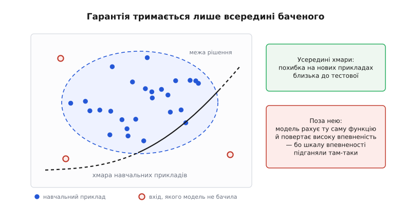
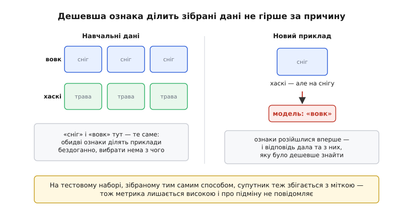
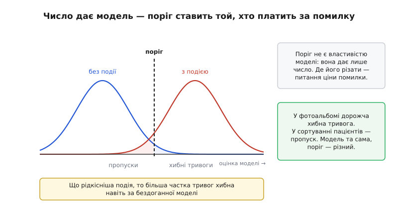
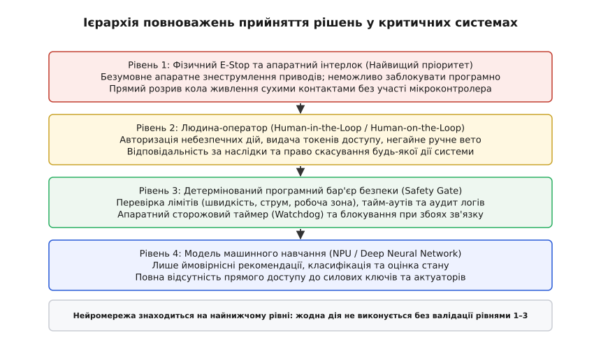
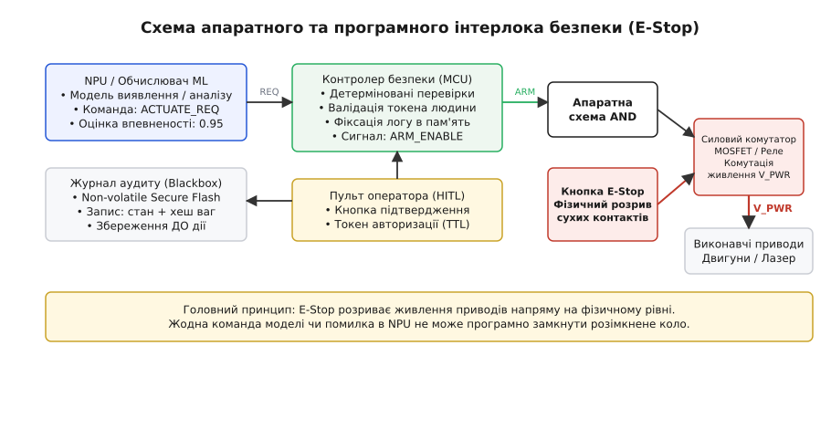

# Межі й етика автономного машинного навчання

<preknowlist>
- [Що таке ML](root:sf-ml/what-is-ml) — модель не проектують детермінованими правилами, її ваги підбирають оптимізацією під зібрані навчальні приклади.
- [Навчання vs вивід](root:sf-ml/train-vs-inference) — параметри фіксуються після завершення оптимізації, а бортовий інференс виконує прямий обчислювальний прохід без адаптації до нештатних умов.
- [Перенавчання](root:sf-ml/overfitting) — ризик захоплення моделлю випадкових шумів та супутніх кореляцій замість фізичної закономірності.
- [Зсув розподілу](root:sf-ml/distribution-shift) — зміна умов роботи в полі руйнує статистичні гарантії точності класифікатора.
- [Калібрування впевненості](root:sf-ml/confidence-calibration) — чому вихідне число нейромережі не є достовірною фізичною ймовірністю істини.
</preknowlist>

Бортова система технічного зору автономного автопілота на швидкості 110 км/год фіксує перешкоду на смузі руху й оцінює ймовірність вільного проїзду в 0.99, спираючись на відблиск сонця від білого борту причепа, який алгоритм оптимізації сприйняв за відкрите небо. Автомобіль продовжує рух без гальмування, оскільки обчислювальний граф не має внутрішнього сигналу сумніву: він видав таку саму максимальну впевненість, як і на тисячах штатних кадрів із навчального набору. Помилка виникає не через збій у синтаксисі коду чи пошкодження пам'яті. Вона закладена в самій математичній природі машинного навчання: алгоритм мінімізує емпіричний ризик на обмеженій вибірці минулого, а не будує строгу причинно-наслідкову модель фізичного світу.

У критичних доменах — автономному транспорті, медичній діагностиці, робототехніці та системах захисту — сліпа довіра до виходів нейромереж неприпустима. Будь-яка практична система з машинним навчанням повинна мати чітко окреслені інженерні та етичні межі застосування, підкріплені незмінним аудитом рішень і детермінованими апаратними бар'єрами безпеки.

---

### Статистична природа оптимізації та межі гарантій

Будь-яка модель машинного навчання знаходить функцію, яка мінімізує функцію втрат на наявних прикладах `D_train`. Статистична теорія гарантує надійність передбачень лише за суворої умови: нові вхідні вектори надходять із того самого ймовірнісного розподілу, на якому проводилося навчання. Якщо реальні умови експлуатації хоча б незначно відхиляються від навчальної вибірки, будь-які теоретичні гарантії точності перестають діяти.

*Модель ділить увесь простір ознак, хоча дані бачила лише в межах хмари. Поза хмарою межа продовжена випадковим чином, але відповіді мають такий самий високий рівень упевненості.*

Головна небезпека полягає в тому, що нейромережа не сигналізує про вихід за межі своєї компетентності. Вона продовжує перемножувати вагові матриці й видавати числові значення. Оскільки функція активації Softmax масштабує виходи відносно найбільшого значення, модель демонструє надмірну впевненість навіть на абсолютно випадковому шумі чи раніше небачених класах об'єктів.

Крім того, процес оптимізації завжди обирає найпростішу ознаку (англ. *shortcut learning* / *spurious correlation*), яка дозволяє зменшити похибку на вибірці, навіть якщо ця ознака не має жодного фізичного зв'язку з суттю явища.

*У зібраних даних дві ознаки ділять вибірку однаково добре. Модель закріплює дешеву супутню ознаку, яка дає збій при першій зміні умов.*

Коли класифікатор розпізнає вовків за наявністю снігу на тлі, а патологію легенів — за маркуванням конкретного рентгенівського апарата в кутку знімка, тестовий набір, зібраний у тій самій лікарні чи з того самого джерела, демонструє хибно високу точність. Як інженерна спільнота вчилася виявляти подібні викривлення, розглядає [історія виявлення прихованих підмін у машинному навчанні](root:sf-ml/ml-limits-ethics/hist-shortcut-legends.md).

---

### Критичні домени та ціна помилки

Вимоги до меж автономності моделі безпосередньо диктуються доменом її застосування та співвідношенням вартості різних типів помилок:

1. **Автономний транспорт (стандарти ISO 26262 ASIL-D, ISO 21448 SOTIF — Safety of the Functionality):** система сприйняття стикається з нескінченною варіативністю дорожньої обстановки (англ. *corner cases* — рідкісні крайові випадки). Неможливо зібрати навчальний набір, який покриває всі комбінації погодних умов, оптичних перешкод і нестандартної поведінки пішоходів. Тому нейромережі сприйняття ніколи не допускаються до прямого керування кермом і гальмами без нагляду з боку детермінованих алгоритмів планування траєкторій та фізичних радарних бар'єрів.
2. **Медичні прилади та діагностика (стандарт IEC 62304):** модель сортування пацієнтів чи дозування опромінення діє в умовах високої асиметрії втрат: пропуск небезпечного стану (хибнонегативна помилка) несе загрозу життю, тоді як зайва перевірка (хибнопозитивна помилка) коштує лише додаткового часу персоналу.
3. **Автономні комплекси застосування сили (англ. *Lethal Autonomous Weapon Systems*, LAWS):** у військових і охоронних системах діє абсолютна етична й міжнародно-правова заборона на передачу рішення про ураження цілі чистому алгоритму машинного навчання. Принципи міжнародного гуманітарного права (вимога розрізнення комбатантів і цивільних, принцип пропорційності) вимагають усвідомленого судження, яке може надати лише людина-оператор.

*Зсув порога класифікації не покращує якість моделі, а лише перерозподіляє втрати між пропусками та хибними тривогами відповідно до вартості помилки в домені.*

Математичний апарат оптимізації порогів за асиметричних цін помилок, а також фундаментальне доведення взаємної несумісності критеріїв справедливості розкрито у [математичному обґрунтуванні базових частот і порогів](root:sf-ml/ml-limits-ethics/math-base-rate-threshold.md).

---

### Принцип відповідальності та аудит чорної скриньки (Blackbox Auditability)

Алгоритм машинного навчання не є суб'єктом права (лат. *persona juris*): він не має власної волі, не несе моральної відповідальності й не може бути притягнутий до відповідальності за заподіяні збитки. Відповідальність за наслідки дій автономної системи завжди несуть люди: розробники архітектури, верифікатори навчальних вибірок, системні інтегратори та експлуатуючі оператори.

Для того щоб відповідальність була реальною, а будь-яка відмова або аварія могла бути розслідувана незалежною комісією, критична система зобов'язана підтримувати строгий аудит чорної скриньки (англ. *blackbox auditability*).

Головний принцип аудиту: **жодна критична чи потенційно небезпечна дія не виконується виконавчими органами без попередньої атомарної фіксації повного стану прийняття рішення в енергонезалежному журналі.**

До складу незмінного запису аудиту (англ. *Decision Audit Record*) входять такі поля:
- **Хеш версії моделі та ваг:** криптографічний хеш (SHA-256 або CRC32) бінарного файлу ваг, який однозначно визначає, яка саме версія нейромережі згенерувала прогноз.
- **Вхідний стан або сенсорний відбиток:** контрольна сума або вектор нормалізованих ознак на вході моделі.
- **Вектор логітів і калібрована впевненість:** сирі та відкалібровані оцінки впевненості для виявленого класу.
- **Застосований поріг відсікання:** конфігурація порога, що діяла в момент обчислення.
- **Ідентифікатор та авторизаційний токен оператора:** підтвердження того, хто саме дозволив виконання дії або перебував на нагляді.
- **Мітка монотонного часу:** часова мітка апаратного таймера з гарантією відсутності стрибків назад.

Нижче наведено зразок структури та функції формування журналу аудиту стану прийняття рішення перед виконанням силової команди:

:::tabs
:::code ml-limits-ethics-d/c/main.c
:::code ml-limits-ethics-d/cpp/main.cpp
:::

---

### Захисні бар'єри: градація контурів контролю

Для запобігання втраті контролю за автономними агентами інженерна практика виділяє три парадигми присутності людини в контурі управління (англ. *human agency and oversight*):

1. **Людина в контурі (англ. *Human-in-the-Loop*, HITL):** модель виконує функцію радника або детектора. Жодна виконавча дія не може відбутися без прямої команди людини. Наприклад, у радіології система підсвічує підозрілі ділянки, але діагноз та направлення на лікування підписує виключно лікар.
2. **Людина над контуром (англ. *Human-on-the-Loop*, HOTL):** система самостійно виконує типові операції під безперервним моніторингом оператора, який має фізичну можливість перехопити керування (англ. *operator override*) або накласти безумовне вето на будь-яку дію.
3. **Людина поза контуром (англ. *Human-out-of-the-Loop*, HOOTL):** система діє повністю автономно без можливості втручання людини. Такий режим категорично неприпустимий для систем із потенційно летальною або незворотною фізичною дією.

Взаємозв'язок між цими рівнями формує строгу ієрархію повноважень:

*Модель машинного навчання займає найнижчий рівень повноважень: її вихід є лише рекомендацією, яка підлягає обов'язковій валідації детермінованими бар'єрами та дозволом оператора.*

Щоб перевірити, чи не деградує якість моделі на специфічних групах вхідних даних перед впровадженням у контур, застосовують [інженерний метод аудиту зрізів вибірки та моніторингу дрейфу](root:sf-ml/ml-limits-ethics/proj-slice-audit.md).

---

### Апаратний інтерлок E-Stop: неможливість софтверного обходу

Найважливіший принцип проєктування безпекових систем стверджує: **програмне забезпечення, а тим більше ймовірнісна нейромережа, ніколи не має права контролювати лінію власного аварійного живлення.**

Якщо кнопка аварійної зупинки (англ. *Emergency Stop*, E-Stop) опитується через звичайний порт мікроконтролера, а зупинка двигунів реалізована програмним викликом функції, будь-яке зависання ядра, зациклення операційної системи реального часу чи збійний стан NPU призведе до ігнорування натискання кнопки.

*Кнопка аварійної зупинки E-Stop фізично розриває коло живлення приводів сухими контактами. Апаратна логічна схема AND унеможливлює подачу живлення без одночасного сигналу готовності від Safety MCU та замкненого ланцюга E-Stop.*

Схема апаратно гарантує два інваріанти:
1. **Безумовне знеструмлення:** фізичне натискання кнопки E-Stop розмикає сухі нормально замкнені (NC) контакти реле безпеки. Струм на виконавчі механізми припиняє подаватися миттєво на фізичному рівні, незалежно від стану регістрів процесора чи сигналів нейромережі.
2. **Двоканальний збіг (1oo2 / 2oo2):** силове реле відкривається лише за умови, коли апаратний логічний елемент AND одночасно отримує активний високий рівень сигналу `ARM_ENABLE` від детермінованого контролера безпеки та сигнал нормального замкненого стану лінії `ESTOP_OK`.

Детальна програмна реалізація перевірки токенів авторизації та взаємодії з апаратним інтерлоком представлена у [практичному проєкті побудови безпекового інтерлока](root:sf-ml/ml-limits-ethics/proj-ethical-safety-interlock.md).

---

### Синтез: межі технології як основа безпечної системної інженерії

> 🔧 **Навіщо це.** Справжня етика в інженерії машинного навчання полягає не у філософських деклараціях, а в суворій архітектурній дисципліні:
> 1. Визнавайте статистичні межі: модель не має доступу до фізичної суті речей, вона рахує кореляції на навчальній вибірці й не знає слова «не знаю», доки цей механізм не реалізовано ззовні.
> 2. Фіксуйте повний слід прийняття рішень: жодна критична дія не виконується без попереднього збереження підписаного аудит-логу в захищену енергонезалежну пам'ять.
> 3. Тримайте людину в контурі контролю: небезпечні дії вимагають явного авторизаційного токена з жорстким часовим вікном дії.
> 4. Будуйте апаратні бар'єри: фізичний E-Stop та реле безпеки повинні розривати коло живлення безпосередньо, позбавляючи будь-який програмний код змоги заблокувати аварійну зупинку.

Машинне навчання залишається потужним інструментом апроксимації функцій та розпізнавання складних багатовимірних образів. Проте безпека та життєздатність автономної системи залежать від того, наскільки надійно ймовірнісний інтелект обмежений детермінованими апаратними законами фізики та контролем з боку людини.
