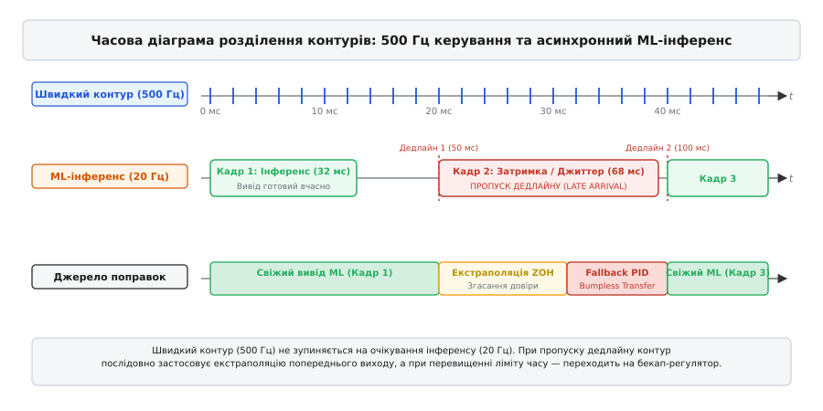
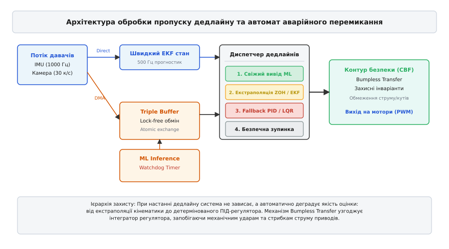

# Модель у петлі реального часу: що робити, коли вивід не встиг

<preknowlist>
- [Латентність інференсу](root:sf-ml/inference-latency) — вимірювання тривалості обчислень, джиттер та пропускна здатність нейромереж на мікроконтролерах.
- [Квантування моделей](root:sf-ml/model-quantization) — переведення ваг у цілочислові формати INT8/INT4 для прискорення матричних операцій.
- [TinyML](root:sf-ml/tinyml) — обмеження пам'яті, обчислювальні ресурси та розгортання моделей на вбудованих пристроях.
- [Дискретний ПІД-регулятор](root:com-signal/discrete-pid) — детермінований контур зворотного зв'язку з фіксованим кроком дискретизації.
- [Розширений фільтр Калмана](root:com-signal/kalman-ekf) — нелінійна оцінка вектора стану та кінематичне прогнозування динамічних систем.
- [Безперервне перемикання](root:com-signal/bumpless-transfer) — узгодження інтегральних складових регуляторів для запобігання стрибкам сигналу керування.
- [Синхронізація затримок](root:com-signal/latency-sync) — компенсація фазового зсуву та врахування часового запізнення сенсорних вимірювань.
</preknowlist>

Коли чотирироторний безпілотник або двоколісний балансуючий робот намагається зберегти вертикальну орієнтацію, його виконавчий контур зобов'язаний опитувати датчики та перераховувати напругу на двигунах із фіксованою частотою 1000 Гц — рівно один раз на мілісекунду. Якщо в цей контур стабілізації вбудовують нейромережу для компенсації складних аеродинамічних збурень чи нелінійного тертя, розробник стикається з фундаментальним конфліктом часових масштабів: аналітичний регулятор обчислюється за 15 мікросекунд, тоді як тензорний вивід компактної моделі на бортовому мікроконтролері триває від 15 до 60 мілісекунд. Будь-яка спроба змусити високочастотний контур очікувати на завершення обчислень нейромережі миттєво руйнує детермінізм системи: пропуск лише кількох тактів дискретизації створює фазове запізнення, вичерпує запас стійкості за фазою та перетворює від'ємний зворотний зв'язок на додатний, внаслідок чого об'єкт керування втрачає рівновагу та зазнає аварії.

Інженерна проблема полягає не лише в тому, що нейромережа повільніша за фізичний об'єкт, а в тому, що час її виконання є недетермінованим (англ. *inference jitter*). Навіть якщо модель у середньому виконується за 25 мілісекунд, конкуренція за спільну шину пам'яті, промахи процесорного кешу, температурний тротлінг обчислювального ядра та обробка переривань операційної системи реального часу призводять до того, що окремі кадри інференсу затримуються до 70 мілісекунд або взагалі не встигають до чергового фізичного такту. Надійне вбудовування машинного навчання в системи жорсткого реального часу (англ. *Hard Real-Time Systems*) вимагає повної відмови від синхронного очікування моделі на користь архітектури розділених контурів різної частоти, асинхронного обміну даними без блокувань та суворого протоколу деградації керування у випадку пропуску дедлайну (англ. *Deadline Miss*).

## Фізична природа фазового запізнення та втрати стійкості

Будь-яка часова затримка передачі інформації у замкненому контурі керування є чистим запізненням, яке в теорії автоматичного керування описується оператором затримки `e^(-s·τ)` у неперервному просторі Лапласа або оператором `z^(-d)` у дискретній `Z`-області, де `τ` — абсолютний час затримки в секундах, а `d` — затримка, виражена в цілій кількості тактів дискретизації `T_s`.

Якщо на об'єкт керування діє гармонічне збурення або команда зміни положення з частотою `ω` (вираженою в радіанах за секунду), чисте запізнення `τ` не змінює амплітудну характеристику тракту, але вносить фазовий зсув `Δφ`, величина якого лінійно зростає зі збільшенням частоти коливань та тривалості затримки:

```
Δφ = -ω · τ
```

Розглянемо практичний випадок безпілотного літального апарата, кутова динаміка якого стабілізується на частоті збурень `f = 20` Гц (`ω = 2·π·20 ≈ 125.66` рад/с). Якщо контур керування працює синхронно з частотою 1000 Гц (`T_s = 1` мс), власна апаратна затримка обчислення ПІД-алгоритму складає менше ніж 0.05 мс, створюючи зневажливо малий фазовий зсув `Δφ ≈ -0.006` радіана (`-0.36°`). Але якщо до контуру підключають нейромережу оцінки вітрового збурення, час обчислення якої становить `τ = 20` мс, і примушують мікроконтролер чекати результату перед видачею імпульсу на двигуни, додатковий фазовий зсув досягає катастрофічної величини:

```
Δφ = -125.66 · 0.020 = -2.513 рад ≈ -144°
```

Більшість аеродинамічних та робототехнічних систем проектуються із запасом стійкості за фазою (англ. *Phase Margin*) у діапазоні від `30°` до `60°`. Додаткове відставання за фазою на `144°` повністю ліквідує цей запас і переводить сумарний фазовий набіг розімкненої системи за критичну межу `-180°`. Сигнал коригування, покликаний пригальмувати крен апарата, надходить на виконавчі сервоприводи якраз у той момент, коли апарат під дією інерції вже рухається у протилежний бік. Замість демпфування кутової швидкості керівний вплив підштовхує систему, викликаючи розбіжні автоколивання зростаючої амплітуди, силове насичення драйверів двигунів та неминуче механічне руйнування.

Аналітично передавальна функція замкненої системи `W_cl(s)` для об'єкта `G(s)` та регулятора `K(s)` за наявності чистої затримки `τ` має вигляд:

```
W_cl(s) = [K(s)·G(s)·e^(-s·τ)] / [1 + K(s)·G(s)·e^(-s·τ)]
```

Характеристичне рівняння замкненої системи `1 + K(s)·G(s)·e^(-s·τ) = 0` через експоненційний множник стає квазіполіномом і породжує нескінченну кількість комплексних коренів (полюсів). У дискретній області перехід до запізнення на `d` тактів перетворює характеристичний поліном замкненої системи на рівняння вищого порядку:

```
1 + K(z) · G(z) · z^(-d) = 0
```

Кожен додатковий такт затримки додає до системи додатковий полюс у початку координат `z = 0`. Зі збільшенням коефіцієнтів зворотного зв'язку кореневий годограф (англ. *Root Locus*) зміщує домінантні полюси системи від початку координат у напрямку одиничного кола. При досягненні критичної затримки `d_crit` домінантна пара полюсів виходить за межі одиничного кола `|z| > 1`, що в дискретному часі відповідає переходу в нестійкий стан із експоненційним зростанням амплітуди коливань на кожному кроці дискретизації.

### Математичний аналіз систем зі змінним джиттером

У реальних умовах час запізнення не є постійним числом: він змінюється щотакту у діапазоні `τ(t) ∈ [τ_min, τ_max]`. Для дослідження стійкості таких систем застосовують функціонали Ляпунова-Красовського (англ. *Lyapunov-Krasovskii Functionals*). Нехай лінеаризована модель об'єкта зі зворотним зв'язком описується диференціальним рівнянням із запізненням:

```
ẋ(t) = A · x(t) + A_d · x(t - τ(t))
```

де `x(t) ∈ Rⁿ` — вектор відхилень стану від точки рівноваги, `A` — матриця власної динаміки системи, а `A_d` — матриця коефіцієнтів зворотного зв'язку з урахуванням запізнення. Кандидат на функціонал Ляпунова-Красовського обирається у формі:

```
V(x_t) = x(t)^T · P · x(t) + ∫_{t - τ_max}^t x(s)^T · Q · x(s) ds + τ_max · ∫_{-τ_max}^0 ∫_{t + θ}^t ẋ(s)^T · R · ẋ(s) ds dθ
```

де `P, Q, R` — симетричні додатно визначені матриці вагових коефіцієнтів розмірності `n × n`. Диференціювання цього функціоналу вздовж траєкторій системи за допомогою нерівності Єнсена для інтегральних квадратичних форм дозволяє звести вимогу асимптотичної стійкості `V̇(x_t) < 0` до системи матричних лінійних нерівностей (Linear Matrix Inequalities, LMIs).

Розв'язання LMIs дає можливість розрахувати точну аналітичну межу стійкості — максимально допустимий інтервал передачі даних (англ. *Maximum Allowable Transfer Interval*, MATI). Якщо максимальний джиттер нейромережі `τ_max` не перевищує знайденого значення MATI, система гарантовано зберігає експоненційну стійкість. Якщо ж `τ_max > MATI`, виникає ризик неконтрольованого розгойдування, що вимагає негайного втручання механізмів раннього відсікання або переходу на бекап-регулятор.

## Анатомія недетермінізму: чому інференс нейромережі має джиттер

У теорії цифрової обробки сигналів обчислювальний блок розглядається як детермінований автомат із фіксованим часом реакції. У реальних мікроконтролерах (наприклад, на базі архітектур ARM Cortex-M7, Cortex-M55 або RISC-V) та мікропроцесорах із вбудованими нейроприскорювачами (NPU) час виконання нейромережевого виводу піддається впливу множини недетермінованих факторів. Джиттер (англ. *jitter*) — це випадкова дисперсія тривалості виконання задачі між послідовними запусками:

```
Jitter = T_exec_max - T_exec_min
```

На вбудованих обчислювачах джерела виникнення джиттеру поділяються на три системні рівні: апаратний рівень шин та пам'яті, структурний рівень алгоритмів нейромережі та операційний рівень планування завдань у реальному часі.

### Апаратний рівень: ієрархія пам'яті та арбітраж шин

Сучасні компактні нейромережі (наприклад, MobileNet, EfficientNet-Lite або просторові CNN-регресори) оперують мільйонами вагових коефіцієнтів та активацій, сумарний обсяг яких значно перевищує розмір надшвидкої статичної пам'яті SRAM, інтегрованої безпосередньо в кристал мікроконтролера. Ваги зберігаються у зовнішній енергонезалежній флеш-пам'яті (QSPI/OctoSPI) або в динамічній пам'яті SDRAM, доступ до яких здійснюється через системну матрицю шин (англ. *AXI Crossbar Interconnect*).

1. **Промахи кеш-пам'яті першого та другого рівнів (L1/L2 Cache Misses):** Процесорне ядро здатне виконувати операції злитого множення з накопиченням (Fused Multiply-Add, FMA) за один такт лише тоді, коли дані знаходяться у регістровому файлі або L1 Data Cache. При виникненні промаху кешу конвеєр ядра блокується на 20–80 тактів в очікуванні вибірки рядка пам'яті з L2-кешу або на 100–300 тактів при зверненні до зовнішньої SDRAM. Якщо паралельна задача обробки мережевих пакетів або графічний контролер витискає вагові коефіцієнти з кешу, наступний цикл інференсу триватиме на 30–50% довше.
2. **Арбітраж та колізії на шині AXI (Bus Contention):** У типовій системі на кристалі (SoC) системна шина ділиться між процесорним ядром, нейроприскорювачем NPU, контролером прямого доступу до пам'яті (DMA), що перекачує кадри з камери, та контролерами комунікаційних інтерфейсів (CAN-FD, SPI, Ethernet). Пріоритетизація трафіку відеопотоку DMA автоматично пригальмовує вибірку тензорних даних процесором, породжуючи стохастичні затримки у кілька мілісекунд.
3. **Регенерація та черги SDRAM (DRAM Refresh Overhead):** Динамічна пам'ять потребує періодичних циклів регенерації комірок пам'яті (Refresh Cycles, tRFC), під час яких контролер SDRAM блокує доступ до відкритих банків. Запит на читання великого тензора, що збігся з командою регенерації, отримує додаткову затримку.
4. **Температурний тротлінг і зміна частоти (DVFS):** При інтенсивному навантаженні на ядро або NPU кристал нагрівається. Спрацьовування апаратного захисту за температурою знижує тактову частоту процесора (наприклад, із 480 МГц до 240 МГц), що миттєво подвоює час проходження графа моделі.

### Розподіл пам'яті: Tightly-Coupled Memory (TCM) проти AXI SRAM

Для мінімізації впливу кеш-промахів на критичний контур керування сучасні вбудовані архітектури містять роздільні блоки пам'яті зі спеціалізованим доступом:

* **Instruction TCM (ITCM) та Data TCM (DTCM):** Надшвидка пам'ять нульового очікування (0 Wait States), що підключена безпосередньо до внутрішнього конвеєра ядра в обхід системних шин AXI/AHB. Код швидкого регулятора, таблиця векторів переривань NVIC та структури стану фільтра Калмана розміщуються виключно в DTCM та ITCM. Це гарантує, що час реакції швидкого контуру становить фіксовані 15 мікросекунд незалежно від завантаження зовнішніх шин.
* **AXI SRAM та зовнішня SDRAM:** Області пам'яті з кешуванням, призначені для розміщення великих тензорних масивів та буферів нейромережі. Оскільки доступ сюди піддається впливу арбітражу шин, потік інференсу неминуче отримує джиттер, але цей джиттер фізично ізольований від швидкого контуру стабілізації.
* **Модуль захисту пам'яті (Memory Protection Unit, MPU):** Налаштування MPU забезпечує конфігурацію областей пам'яті: буфери обміну між процесором та DMA/NPU позначаються як `Normal Non-Cacheable` або `Write-Through`, що виключає необхідність постійної програмної інвалідації кешу при передачі коротких векторів стану.

```
                  ┌────────────────────────────────────────┐
                  │          Cortex-M Core                 │
                  │   ┌────────────────────────────────┐   │
                  │   │  Fast Loop ISR (in ITCM/DTCM)  │   │
                  │   └────────────────────────────────┘   │
                  └──────────────┬──────────────────┬──────┘
                   (0 wait-state)│                  │(AXI Bus Master)
                                 ▼                  ▼
                         ┌──────────────┐   ┌──────────────┐
                         │ DTCM Memory  │   │ AXI Crossbar │
                         │ (No Jitter)  │   └───────┬──────┘
                         └──────────────┘           │ (Contention & Jitter)
                                                    ├───────────────┐
                                                    ▼               ▼
                                            ┌──────────────┐ ┌──────────────┐
                                            │ Tensor Arena │ │ Video DMA    │
                                            │ (AXI SRAM)   │ │ Framebuffer  │
                                            └──────────────┘ └──────────────┘
```

### Структурний та алгоритмічний рівень нейромережі

Нейромережі часто сприймають як статичні послідовності шарів з константним числом операцій MAC (Multiply-Accumulate). Проте сучасні архітектури дедалі частіше використовують динамічні елементи:

* **Динамічна розрідженість (Dynamic Sparsity):** Оптимізовані рушії інференсу пропускають множення на нульові елементи після активацій типу ReLU. Якщо вхідний вектор містить багато нулів, шар розраховується втричі швидше; якщо ж прийшов шумний сигнал сенсорів із суцільними ненульовими значеннями, час виконання стрибає до максимального.
* **Операції фільтрації детекцій (Non-Maximum Suppression, NMS):** У задачах комп'ютерного зору або радарної детекції після нейромережі виконується класичний алгоритм NMS для відсіювання дублюючих рамок. Час роботи NMS залежить від кількості виявлених об'єктів у кадрі: чистий фон обробляється за 0.5 мс, а захаращена сцена з сотнею помилкових спрацювань затримує потік на 15–20 мс.
* **Архітектури суміші експертів (Mixture of Experts, MoE):** Маршрутизатори динамічно активують різні підмережі залежно від контексту, викликаючи суттєвий розкид тривалості викликів.

### Операційний рівень: планування завдань у RTOS

У системах під керуванням операційних систем реального часу (FreeRTOS, Zephyr, NuttX, RTEMS) потік інференсу нейромережі є звичайним завданням планувальника.

Навіть якщо потік має високий пріоритет, він піддається преемпції (англ. *preemption*) — примусовому витісненню апаратними перериваннями вищого пріоритету: обробниками переривань таймерів (Timer ISR), драйверами шин I2C/SPI та аварійними лініями датчиків. Кожне перемикання контексту (англ. *Context Switch*) забирає не лише процесорні такти на збереження та відновлення регістрів, але й руйнує локальність конвеєра інструкцій та кеш-пам'яті.

Внаслідок цих факторів відношення найгіршого часу виконання (англ. *Worst-Case Execution Time*, WCET) до середнього часу виконання (англ. *Average-Case Execution Time*, ACET) для вбудованих нейромереж часто знаходиться у співвідношенні:

```
WCET / ACET = 2.0 … 4.5
```

Якщо інженер проектує систему керування, вважаючи, що модель «завжди встигає за 20 мс», то при виникненні найгіршого збігу обставин (промах кешу + колізія на шині + NMS + переривання) система отримає затримку у 70–80 мс. Якщо в цей час контур керування заблокований в очікуванні, настає фазовий зрив і фізична аварія.

### Порівняння рушіїв виводу: інтерпретатор проти AOT-компіляції

Вибір рушія виконання нейромережі безпосередньо впливає на величину джиттеру.

У класичному підході TensorFlow Lite for Microcontrollers (TFLM) використовує динамічний інтерпретатор, який під час кожного прямого проходу послідовно обходить топологічний граф операторів, перевіряє розмірності тензорів та викликає функції ядер через вказівники на функції (Indirect Function Calls). Ці непрямі виклики спричиняють часті промахи блоку передбачення переходів процесора (Branch Misprediction) та вносять відчутний накладний час.

На противагу інтерпретаторам, сучасні Ahead-of-Time (AOT) компілятори (такі як Apache TVM / MicroTVM, Glow, X-CUBE-AI від STMicroelectronics або вбудовані генератори C-коду) повністю транслюють навчену модель у монолітний, плаский C-файл без жодного віртуального виклику та без структур динамічного графа. Всі адреси тензорів та зсуви в буферах розраховуються на етапі компіляції. Це дає дві фундаментальні переваги:
1. **Зниження латентності на 20–35%:** Процесор виконує чисті лінійні цикли злитого множення без диспетчеризації та перевірок.
2. **Радикальне стискання джиттеру:** Оскільки конвеєр інструкцій стає повністю детермінованим, розкид часу виконання між послідовними запусками зменшується в 3–5 разів.

### Частота Найквіста та запобігання накладанню спектрів (Anti-Aliasing)

При двочастотному керуванні виникає проблема взаємодії сенсорних шумів різної частоти. Швидкий контур опитує акселерометри та гіроскопи на частоті 1000 Гц, де частота Найквіста становить `f_Nyq_fast = 500` Гц. Проте повільний потік ML запускається на частоті лише 20 Гц, для якої частота Найквіста дорівнює `f_Nyq_slow = 10` Гц.

Якщо швидкі механічні вібрації пропелерів або шестерень на частотах 80–200 Гц потраплять у вхідний вектор нейромережі без попередньої фільтрації шляхом простого прорідження вибірки (Decimation), виникає ефект дзеркального накладання частот (англ. *Aliasing*). Високочастотна вібрація перетвориться на помилкові низькочастотні коливання амплітуди в діапазоні 2–5 Гц, змушуючи нейромережу видавати хибні компенсаційні зусилля.

Для запобігання цьому швидкий контур реалізує цифровий антиаліасинговий фільтр низьких частот 2-го порядку (дискретний біквадратний фільтр Баттерворта Direct Form II) з частотою зрізу `f_cutoff = 8` Гц:

```
y_filt[k] = b_0 · x[k] + b_1 · x[k-1] + b_2 · x[k-2] - a_1 · y_filt[k-1] - a_2 · y_filt[k-2]
```

Коефіцієнти фільтра попередньо розраховуються за методом білінійного Z-перетворення (Tustin transform) із преварпінгом частоти для компенсації стиснення частотної осі біля межі дискретизації. Усі вхідні сенсорні дані для нейромережі обов'язково проходять через цей фільтр на кожному швидкому такті 1000 Гц перед тим, як зріз значень буде захоплено у буфер обміну для повільного потоку ML.

### Ізоляція відмов сенсорів та калібрувальний дрейф (Sensor Fault Isolation)

У реальних вбудованих системах відмова нейромережі або пропуск дедлайну може бути наслідком не лише обчислювального зависання ядра, а й пошкодження сенсорного тракту (наприклад, залипання шини I2C/SPI, обрив кабелю датчика чи відмирання оптичного сенсора камери).

Якщо швидкий контур виявляє аномальну незмінність показників датчика (Frozen Sensor Fault) або вихід вимірів за допустимий фізичний діапазон (Out-of-Range ADC Fault), він негайно блокує передачу сенсорного вектора до нейромережі. Потік ML переводиться в режим очікування, а диспетчер дедлайнів примусово активує аварійний бекап-регулятор, який перемикається на резервний надлишковий датчик або використовує суто кінематичну модель вибігу.

## Апаратна ізоляція на гетерогенних багатоядерних SoC

Найвищий рівень детермінізму досягається на асиметричних багатопроцесорних чипах (Asymmetric Multiprocessing, AMP), таких як STM32H747 (Cortex-M7 + Cortex-M4) або NXP i.MX RT1170 (Cortex-M7 + Cortex-M4).

У такій архітектурі контури фізично розділяються по різних ядрах:
* **Ядро жорсткого реального часу (Cortex-M4, 240 МГц):** Виконує виключно швидкий 1000 Гц контур стабілізації з власної DTCM. Ядро не має кешу (повний детермінізм кожного такту), керує апаратними таймерами PWM та зчитує IMU через прямий виділений інтерфейс SPI.
* **Ядро обчислювального інтелекту (Cortex-M7, 480 МГц):** Оснащене кешем L1 і блоком векторних інструкцій (Helium / CMSIS-NN). Воно виконує виключно тензорний вивід нейромережі та комп'ютерний зір.
* **Міжядерна синхронізація через апаратний семафор (HSEM):** Обмін векторами поправок здійснюється через спільну область пам'яті SRAM4 з використанням апаратних прапорців HSEM або черг повідомлень OpenAMP RPMsg без жодного взаємного блокування процесорних конвеєрів.

```
┌───────────────────────────────────┐    ┌───────────────────────────────────┐
│     Cortex-M4 (Control Core)      │    │       Cortex-M7 (ML Core)         │
│  - 1000 Hz Fast Control ISR       │    │  - 20 Hz Neural Network Inference │
│  - Zero Cache (100% Determinism)  │    │  - L1 Cache + Vector DSP Engine   │
│  - Runs from ITCM/DTCM            │    │  - Runs from AXI SRAM / Flash     │
└─────────────────┬─────────────────┘    └─────────────────┬─────────────────┘
                  │                                        │
                  │   ┌────────────────────────────────┐   │
                  └──►│ Shared SRAM4 (Triple Buffer)   │◄──┘
                      │ + Hardware Semaphore (HSEM)    │
                      └────────────────────────────────┘
```

## Архітектурне розділення контурів: парадигма Dual-Rate Control

Єдиним надійним архітектурним рішенням для подолання недетермінізму машинного навчання є принцип розділення контурів за частотою (англ. *Frequency Separation Principle*) або двочастотне керування (англ. *Dual-Rate / Multi-Rate Control*).

Система управління розділяється на два незалежних, слабо зв'язаних функціональних контури: високочастотний внутрішній контур жорсткого реального часу та низькочастотний зовнішній контур адаптивного інтелекту.


*Часова діаграма взаємодії швидкого контуру стабілізації (500 Гц) та асинхронного потоку ML-інференсу (20 Гц) при нормальній роботі, запізненні та переході на екстраполяцію.*

### Внутрішній контур жорсткого реального часу (Fast Hard Real-Time Loop)

Швидкий контур працює на фіксованій частоті від 500 до 2000 Гц (типовий період `T_ctrl = 1 … 2` мс). Він виконується або безпосередньо всередині апаратного таймерного переривання (Timer ISR), або в потоці RTOS із найвищим пріоритетом, який ніколи не блокується операціями вводу-виводу чи очікуванням м'ютексів.

Внутрішній контур відповідає за **динамічну стійкість та безпеку** об'єкта. Його компоненти:

1. **Детермінований аналітичний регулятор:** Класичний ПІД-регулятор, лінійно-квадратичний регулятор (LQR) або замкнена матриця зворотного зв'язку за станом. Час виконання цього блоку суворо детермінований і становить від 5 до 30 мікросекунд на сучасних мікроконтролерах.
2. **Швидкий оцінювач стану (Fast State Estimator):** Комплементарний фільтр або крок передбачення розширеного фільтра Калмана (EKF), що інтегрує покази гіроскопа та акселерометра на кожному такті дискретизації, забезпечуючи неперервну оцінку просторової орієнтації, кутових швидкостей та прискорень.
3. **Захисні інваріанти та бар'єри безпеки (Safety Invariants / Control Barrier Functions):** Жорсткий математичний фільтр, який перевіряє команди керування перед їх відправкою на генератор ШІМ (PWM). Він обмежує граничний кут нахилу, максимальну кутову швидкість, струм статора двигуна та перевантаження. Якщо будь-який зовнішній модуль (включно з нейромережею) генерує небезпечну команду, захисний бар'єр зрізає її до допустимих меж.

### Зовнішній контур асинхронного інтелекту (Slow ML Loop)

Повільний контур виконується на частоті від 10 до 50 Гц (період `T_ml = 20 … 100` мс). Він живе в окремому низькопріоритетному потоці RTOS (наприклад, фонова задача `ml_worker_task`) або на окремому допоміжному ядрі чи асинхронному NPU.

Зовнішній контур відповідає за **високорівневу оптимізацію та сприйняття**:
* Візуальна одометрія та виявлення просторових орієнтирів.
* Ідентифікація змін маси апарата, положення центру ваги або аеродинамічного опору.
* Обчислення адаптивних поправок `Δu_ml` до сигналу керування або динамічне коригування коефіцієнтів матриць підсилення `K_p`, `K_i`, `K_d`.

Швидкий контур **ніколи не чекає** повільний контур. На кожному мікросекундному такті швидкий регулятор звертається до спеціального неблокуючого буфера обміну. Якщо модель встигла покласти туди свіжий результат — швидкий контур підхоплює його. Якщо ж інференс затримується через джиттер або пропуск дедлайну — швидкий контур миттєво активує алгоритми захисту від пропуску дедлайну, зберігаючи безперервність генерації фізичних сигналів керування.

## Стратегії обробки пропуску дедлайну (Deadline Miss Strategies)

Коли мікроконтролер фіксує, що на черговому такті швидкого контуру свіжі дані від нейромережі відсутні (або їхній вік перевищив гранично допустимий поріг `T_deadline`), система переходить у режим компенсації пропуску дедлайну. Вибір стратегії залежить від динаміки об'єкта, ступеня запізнення та обчислювальних ресурсів процесора.


*Архітектура обробки пропуску дедлайну: від lock-free буферизації та моніторингу часу життя даних до екстраполяції, бекап-регулятора та бар'єрів безпеки.*

### Стратегія 1: Екстраполяція виходу та кінематичне прогнозування

Якщо нейромережа видає значення компенсаційного зусилля чи бажаної траєкторії, найпростішим підходом є екстраполяція попередніх виходів на кілька мілісекунд уперед.

#### Фіксатор нульового порядку з експоненційним згасанням (Decayed Zero-Order Hold)
У класичному фіксаторі нульового порядку (ZOH) останнє відоме значення `u_ml[last]` утримується незмінним. Проте у динамічних системах тривале утримання старого керуючого зусилля загрожує накопиченням похибки (наприклад, якщо модель наказала створити максимальний відновлювальний момент під час пориву вітру, а вітер уже вщух). Тому застосовують згасаючий фіксатор з коефіцієнтом старіння `λ > 0`:

```
u_ml[k] = u_ml[last] · e^(-λ · Δt_age)
```

де `Δt_age = t_current - t_generated` — час, що минув з моменту зняття сенсорних даних для затриманого кадру інференсу. Зі зростанням затримки вплив застарілого виходу нейромережі плавно згасає до нуля, повертаючи управління виключно на базовий детермінований регулятор.

#### Лінійна екстраполяція першого порядку (First-Order Hold)
Якщо виходи нейромережі є гладкими функціями в часі, швидкий контур оцінює першу похідну сигналу `u_dot_ml` за останніми двома валідними кадрами:

```
u_dot_ml = (u_ml[n] - u_ml[n-1]) / (t[n] - t[n-1])
u_ml[k] = u_ml[n] + u_dot_ml · Δt_age
```

Лінійна екстраполяція ефективно компенсує затримку у 1–3 такти, проте при більших затримках вона може призвести до розгону сигналу («вистрілювання» в насичення). Тому до екстрапольованого значення обов'язково застосовують нелінійне насичення (англ. *Saturate*).

#### Дробово-раціональні екстраполятори (Fractional-Order Hold)
Для систем із вираженими гармонічними коливаннями застосовують дробовий екстраполятор (Fractional-Order Hold, FROH) з передавальною функцією:

```
W_froh(s) = (1 - e^(-s·T_s)) / s · (1 + β · (s·T_s - 1 + e^(-s·T_s)) / (s·T_s))
```

де `β ∈ [-1, 1]` — коефіцієнт дробовості. При `β = 0` вираз вироджується у стандартний ZOH, при `β = 1` — у лінійний FOH, а при підборі оптимального `β ≈ 0.35` досягається мінімальний фазовий зсув на частоті резонансу без небезпечного підсилення високих частот.

#### Кінематичне прогнозування через фільтр Калмана (EKF Forward Propagation)
Коли нейромережа оцінює вектор стану системи (наприклад, просторову орієнтацію та швидкість за візуальними даними), швидкий контур використовує рівняння руху об'єкта. На кожному швидкому такті `T_ctrl = 1` мс, поки свіжі виходи моделі відсутні, фільтр Калмана виконує лише крок прогнозу (англ. *Time Update / Prediction Step*), інтегруючи показники високочастотного гіроскопа:

```
x̂[k|k-1] = f(x̂[k-1|k-1], u[k-1], 0)
P[k|k-1] = F[k-1] · P[k-1|k-1] · F[k-1]^T + Q
```

де `x̂` — оцінка вектора стану, `P` — коваріаційна матриця невпевненості оцінки, `F` — матриця Якобі динаміки об'єкта, а `Q` — коваріація шуму процесу. З кожним пропущеним тактом коваріація `P` зростає, сигналізуючи системі про зростання невизначеності. Якщо невизначеність перевищує критичний поріг `trace(P) > P_crit`, екстраполяція негайно припиняється.

### Обробка запізнених спостережень (Out-of-Sequence Measurements, OOSM)

Коли затриманий кадр нейромережі нарешті надходить у контур керування через `N` тактів після зняття вимірів, пряме застосування формули оновлення Калмана `x̂ = x̂ + K·(z - H·x̂)` є неприпустимим: поточний стан системи `x̂[k]` пішов уперед, і вимір `z[k-N]` відноситься до минулої позиції.

Для правильного врахування запізнених даних застосовують ретроспективне згладжування з фіксованим запізненням (англ. *Fixed-Lag Smoothing* або *OOSM Algorithm B1*):
1. Швидкий контур зберігає кільцевий буфер історії станів `x̂[i]` та коваріацій `P[i]` за останні `M` тактів (типово `M = 50`).
2. При надходженні запізненого виміру з часовою міткою `t_meas` фільтр знаходить відповідний історичний стан `x̂[k-N]`.
3. Обчислюється ретроспективна нев'язка (англ. *Retroactive Innovation*):
```
ỹ = z_meas - h(x̂[k-N])
```
4. Обчислюється матриця ретроспективного підсилення `K_retro`, після чого поправка екстраполюється вперед через ланцюг матриць переходу стану `F`:
```
Δx[k] = ( ∏_{j=k-N}^{k-1} F[j] ) · K_retro · ỹ
x̂[k] = x̂[k] + Δx[k]
```
Це дозволяє безпечно інтегрувати вихід нейромережі в поточний стан без повторного перерахунку всіх проміжних тактів і без порушення детермінізму швидкого циклу.

### Стратегія 2: Нейромережі з раннім виходом (Early Exit & Any-Time Networks)

Для випадків, коли обчислювальне ядро не встигає завершити повний прямий прохід по всій глибині нейромережі, застосовують архітектури з ранніми точками виходу (англ. *Early-Exit Neural Networks* або *Any-Time Models*).

У такій нейромережі після певних проміжних блоків (наприклад, після 3-го, 6-го та 9-го згорткових шарів) встановлюються допоміжні легковагові вихідні «голови» (англ. *Early Exit Classifiers / Regressors*).

Механізм роботи з апаратним таймером:
1. Перед запуском прямого проходу нейромережі ініціалізується апаратний таймер зворотного відліку (Watchdog Deadline Timer), налаштований на жорсткий часовий бюджет (наприклад, 30 мс).
2. Модель послідовно обчислює тензорні шари. Після кожного проміжного блоку вона зберігає проміжний результат у спеціальному атомарному регістрі `latest_partial_output` із прапорцем валідності.
3. Якщо таймер дедлайну спрацьовує до того, як мережа дійде до фінального шару, генерується переривання, яке встановлює прапорець переривання інференсу.
4. Потік обчислень негайно зупиняє подальші шари, а контур керування отримує результат з останньої успішно завершеної проміжної голови.

Проміжні голови мають меншу точність, ніж повна мережа (наприклад, точність оцінки збурення може складати 85% замість 96%), але вони гарантують, що керівний контур отримає фізично релевантну поправку в межах відведеного ліміту часу замість повної відсутності сигналу.

### Стратегія 3: Миттєвий перехід на детермінований бекап-контролер (Fallback Controller)

Якщо затримка інференсу перевищує максимальний ліміт екстраполяції (типово `T_stale > 3 · T_ml`), або якщо сенсорні дані виявилися пошкодженими, система застосовує концепцію архітектури Simplex (запропоновану професором Луї Ша для авіаційних систем).

Архітектура Simplex базується на наявності двох регуляторів:
* **Advanced Complex Controller (ACC):** Складний, високопродуктивний, але потенційно ненадійний або недетермінований контролер (нейромережа або адаптивний MPC).
* **Baseline Safety Controller (BSC):** Простий, математично доведений, повністю детермінований регулятор (лінійний ПІД або H-infinity контролер), надійність якого формально верифікована для всієї робочої зони.

Перехід на Baseline Controller відбувається миттєво за сигналом монітора безпеки (англ. *Safety Decision Module*). Проте пряме перемикання виходів двох різних регуляторів викликає різкий стрибок сигналу керування (англ. *Control Bump*), що призводить до механічного удару по приводах та стрибка струму в силових колах.

#### Механізм безперервного перемикання (Bumpless Transfer)
Щоб перемикання відбулося абсолютно плавно, бекап-регулятор зобов'язаний підтримувати свій внутрішній стан (зокрема інтегральну складову) у гарячому резерві, постійно узгоджуючи його з поточним реальним виходом системи `u_active`.

Нехай класичний дискретний ПІД-регулятор описується рівнянням:

```
u_pid[k] = K_p · e[k] + K_i · I[k] + K_d · (e[k] - e[k-1]) / T_s
```

де `e[k] = r[k] - y[k]` — похибка регулювання, а `I[k]` — накопичена інтегральна сума. Поки система працює в режимі нейромережі і на приводи подається вихід `u_active = u_ml`, інтегратор ПІД-контролера **не інтегрує похибку наосліп**, а примусово перераховується у зворотному напрямку (англ. *Integral Tracking / Anti-Windup Tracking*):

```
I[k] = [u_active - K_p · e[k] - K_d · (e[k] - e[k-1]) / T_s] / K_i
```

Коли настає пропуск дедлайну і система в момент `t_switch` перемикає вихід із `u_ml` на `u_pid`, початковий вихід ПІД-регулятора точно дорівнює останньому виходу нейромережі:

```
u_pid[t_switch] ≡ u_ml[t_switch]
```

Це повністю виключає стрибки струму та крутного моменту, після чого детермінований ПІД-контролер плавно веде об'єкт до стабільного стану.

### Узгодження стану для регуляторів у просторі станів (State-Space Bumpless Transfer)

Якщо бекап-контролер реалізований як лінійно-квадратичний регулятор зі спостерігачем стану Люєнбергера:

```
x̂_obs[k+1] = A_obs · x̂_obs[k] + B_obs · u_active[k] + L · (y[k] - C_obs · x̂_obs[k])
u_lqr[k] = -K_lqr · x̂_obs[k] + k_r · r[k]
```

то вхідний сигнал `u_active[k]`, що подається в модель спостерігача, є фактичним сигналом, виданим на двигуни (навіть якщо він був сформований нейромережею).

Завдяки цьому спостерігач стану `x̂_obs` залишається строго когерентним із реальною фізикою руху об'єкта під час роботи ML-моделі. У момент перемикання з нейромережі на LQR вектор стану спостерігача вже відповідає дійсності, що усуває будь-які перехідні процеси ініціалізації.

### Стратегія 4: Пропуск кадрів та скидання застарілих черг (Frame Dropping & Buffer Flushing)

Класичною помилкою початківців є використання черг FIFO (First-In, First-Out) для передачі сенсорних даних до нейромережі та повернення виходів.

Якщо потік ML потрапив під затримку і пропустив один кадр, у черзі накопичуються застарілі сенсорні знімки. Після завершення затримки модель починає послідовно обробляти старі кадри з черги, відстаючи від реального фізичного часу все далі й далі — виникає ефект блокування голови черги (англ. *Head-of-Line Blocking*).

У контурах жорсткого реального часу діє залізне правило **Latest-Only**:
1. Черги повідомлень заборонені. Використовується виключно буфер заміщення глибиною в 1 елемент.
2. Якщо новий кадр сенсорів надійшов, а модель ще зайнята обробкою старого, старий кадр негайно перезаписується новим (Drop Frame).
3. Кожен пакет даних обов'язково маркується апаратним мікросекундним штампом часу `timestamp_us`.
4. Коли модель завершує інференс, вона перевіряє вік даних: якщо `t_now - timestamp_us > T_stale_limit`, результат вважається застарілим і **скидається в смітник (Flush)** без передачі у контур керування.

## Фільтрація, санітизація та згладжування виходів моделі

Навіть якщо нейромережа видала результат вчасно, безпосередня передача сирих тензорних чисел на вхід виконавчого контуру несе ризики дестабілізації через високочастотний обчислювальний шум, артефакти квантування INT8 або помилки узагальнення на нестандартних вхідних даних.

### Детекція аномалій та виходу за розподіл (Out-of-Distribution Detection)

Якщо сенсорні дані потрапляють в область простору станів, де нейромережа не навчалася (наприклад, нетиповий кут освітлення камери або зблиск сонця), вихід моделі може стати фізично абсурдним (Unbounded Prediction Spike).

Для верифікації правдоподібності виходу швидкий контур обчислює відстань Махаланобіса `d_M` відносно статистичного центру номінальних виходів `μ_ml` та коваріаційної матриці `Σ_ml`:

```
d_M² = (u_ml - μ_ml)^T · Σ_ml^(-1) · (u_ml - μ_ml)
```

Якщо `d_M² > χ²_{0.99}(m)`, де `χ²_{0.99}(m)` — квантиль розподілу хі-квадрат для розмірності виходу `m`, результат інференсу класифікується як аномальний викид (англ. *Adversarial / Out-of-Distribution Outlier*), негайно відкидається, а система залишається в режимі екстраполяції або ПІД-бекапу.

### Обмеження швидкості наростання (Slew-Rate Limiting) та альфа-блендинг

Щоб уникнути високочастотних ударів по шестернях редукторів та обмотках електродвигунів, вихідний сигнал поправки піддається фільтрації швидкості наростання (англ. *Slew-Rate Limiter*):

```
Δu_step = clamp(u_ml[k] - u_applied[k-1], -S_max · T_s, S_max · T_s)
u_applied[k] = u_applied[k-1] + Δu_step
```

де `S_max` — максимальна фізично допустима швидкість наростання зусилля (Н·м/с або В/с).

Коли система відновлюється після пропуску дедлайну і повертається від екстрапольованого значення `u_extrap` до свіжого виходу моделі `u_ml_fresh`, застосовують алгоритм плавного змішування (англ. *Alpha-Blending*):

```
u_applied[k] = α[k] · u_ml_fresh[k] + (1 - α[k]) · u_extrap[k]
```

Коефіцієнт `α[k]` лінійно зростає від 0.0 до 1.0 протягом вікна змішування `N_blend` тактів (типово 10–20 мс). Це повністю пригнічує перехідні стрибки і забезпечує плавний перезапуск нейромережевого контуру.

## Інструментарій простеження та профілювання затримок

Для точного налаштування порогів дедлайнів інженер зобов'язаний вимірювати реальний розподіл затримок на цільовому залізі під максимальним навантаженням.

### Апаратне вимірювання через лічильник циклів DWT

На процесорах ARM Cortex-M модуль DWT (Data Watchpoint and Trace) містить 32-бітний регістр `DWT->CYCCNT`, який інкрементується на кожному такті ядра:

:::tabs
```c
CoreDebug->DEMCR |= CoreDebug_DEMCR_TRCENA_Msk;
DWT->CTRL |= DWT_CTRL_CYCCNTENA_Msk;

uint32_t start_cycles = DWT->CYCCNT;
/* Виконання інференсу нейромережі */
uint32_t elapsed_cycles = DWT->CYCCNT - start_cycles;
float elapsed_us = (float)elapsed_cycles / (SystemCoreClock / 1000000.0f);
```
```cpp
CoreDebug->DEMCR |= CoreDebug_DEMCR_TRCENA_Msk;
DWT->CTRL |= DWT_CTRL_CYCCNTENA_Msk;

const uint32_t startCycles = DWT->CYCCNT;
// Виконання інференсу нейромережі
const uint32_t elapsedCycles = DWT->CYCCNT - startCycles;
const float elapsedUs = static_cast<float>(elapsedCycles) / (SystemCoreClock / 1'000'000.0f);
```
:::

### Фізичне трасування через апаратні піни GPIO

Для абсолютної верифікації без впливу налагоджувача один з виводів мікроконтролера (наприклад, `GPIOB_PIN_5`) встановлюється у високий рівень на початку інференсу і скидається в низький після запису в Triple Buffer. Цифровий осцилограф або логічний аналізатор вимірює ширину імпульсів та їхній розкид на вибірці з 100 000 кадрів, що дозволяє побудувати точну гістограму функції густини ймовірності затримок (PDF) та виявити приховані хвости розподілу P99.9.

## Синхронізація без блокувань: Lock-Free Triple Buffering та RCU

Оскільки швидкий контур керування (500 Гц) та повільний потік ML-інференсу (20 Гц) працюють асинхронно і з різними пріоритетами, виникає потреба в безпечному розділенні пам'яті.

Використання традиційних м'ютексів операційної системи (`pthread_mutex_t`, `xSemaphoreTake`) у цій точці категорично заборонено:
1. **Інверсія пріоритетів (Priority Inversion):** Якщо низькопріоритетний потік ML захопить м'ютекс буфера і буде витіснений середньопріоритетною задачею зв'язку, високопріоритетний контур керування заблокується на м'ютексі, що призведе до миттєвого зриву дедлайну жорсткого реального часу.
2. **Заборона блокувань у контексті переривань (ISR):** Якщо швидкий контур виконується у Timer ISR, виклик будь-якої блокуючої функції операційної системи є фатальною помилкою, що спричиняє Kernel Panic або HardFault мікроконтролера.

Єдиним допустимим рішенням є використання безблокувальних структур даних (англ. *Lock-Free Data Structures*) із семантикою очікування нульового часу (англ. *Wait-Free*).

### Алгоритм потрійної буферизації без блокувань (Lock-Free Triple Buffer)

Потрійна буферизація гарантує, що споживач (швидкий контур) і виробник (потік ML) ніколи не блокують один одного, ніколи не чекають звільнення пам'яті і ніколи не читають частково записані дані (стан гонки, Data Race).

Структура складається з трьох однакових слотів пам'яті:
* **Write Buffer (`write_idx`):** Слот, у який потік ML у поточний момент записує новий результат інференсу.
* **Dirty / Clean Buffer (`clean_idx`):** Слот, який містить найсвіжіший повністю записаний і верифікований результат інференсу.
* **Read Buffer (`read_idx`):** Слот, з якого швидкий контур керування у поточний момент читає дані.

```
       [ ML Producer ]
              │
         (writes to)
              ▼
      ┌───────────────┐
      │  Write Buffer │ (Index: write_idx)
      └───────┬───────┘
              │ atomic exchange (upon completion)
              ▼
      ┌───────────────┐
      │  Clean Buffer │ (Index: clean_idx, newest valid data)
      └───────┬───────┘
              │ atomic exchange (upon control tick)
              ▼
      ┌───────────────┐
      │  Read Buffer  │ (Index: read_idx)
      └───────────────┘
              │
          (reads by)
              ▼
     [ Fast Control ISR ]
```

Стан системи кодується в одному атомарному 32-бітному або 64-бітному числі, обмін яким здійснюється за допомогою апаратної інструкції `Atomic Compare-And-Swap` (CAS) або атомарного обміну `atomic_exchange` із відповідними бар'єрами пам'яті:

1. Потік ML завершує прямий прохід моделі та записує вихід у буфер з індексом `write_idx`.
2. Потік ML виконує атомарну операцію `atomic_exchange` з бар'єром пам'яті `memory_order_release`: індекс щойно заповненого буфера поміщається у змінну `clean_idx`, а старий індекс повертається у `write_idx`.
3. Коли настає такт швидкого контуру керування, контролер виконує читання з бар'єром `memory_order_acquire`: якщо з'явився новий `clean_idx`, він атомарно міняє його місцями з `read_idx`.
4. Швидкий контур миттєво отримує доступ до стабільного, повністю сформованого вектора поправок за `O(1)` тактів без жодної ітерації циклу очікування.

### Пастка хибного розділення (False Sharing) та вирівнювання пам'яті

На сучасних 32-бітних та 64-бітних процесорах лінія L1-кешу має фіксовану довжину 32 або 64 байти. Якщо змінні `clean_idx`, `write_idx` та `read_idx` розміщені компілятором у суміжних комірках пам'яті і потрапляють в одну лінію кешу, виникає ефект хибного розділення (англ. *False Sharing*).

Коли потік ML на одному ядрі виконує атомарний запис у `clean_idx`, апаратний протокол когерентності кешу (MESI / MOESI) миттєво інвалідує всю лінію кешу на іншому ядрі, де крутиться контур стабілізації. Це призводить до вимушеного перезавантаження кеш-лінії з повільної оперативної пам'яті та створює паразитні затримки у кількасот тактів у найкритичнішому місці швидкого циклу.

Щоб повністю усунути False Sharing, структури буферів та атомарні змінні обов'язково вирівнюються за межею кеш-лінії за допомогою директиви `alignas(64)` у C++20 або `__attribute__((aligned(64)))` у C99:

:::tabs
```c
typedef struct {
    alignas(64) ml_prediction_t buffers[3];
    alignas(64) atomic_uint_fast8_t clean_idx;
    uint8_t write_idx;
    uint8_t read_idx;
} lockfree_triple_buffer_t;
```
```cpp
struct alignas(64) LockFreeTripleBuffer {
    alignas(64) std::array<ml_prediction_t, 3> buffers{};
    alignas(64) std::atomic<uint_fast8_t> cleanIdx{0};
    uint8_t writeIdx{1};
    uint8_t readIdx{2};
};
```
:::

### Патерн Read-Copy-Update (RCU) для параметрів моделі

Якщо система підтримує динамічне оновлення ваг моделі або конфігураційних матриць під час роботи без зупинки апарата, застосовують адаптований для вбудованих систем патерн RCU (Read-Copy-Update).

Потоки керування читають параметри за прямим вказівником без будь-яких блокувань. Потік оновлення виділяє новий блок пам'яті, копіює туди ваги, модифікує їх, після чого виконує атомарну підміну вказівника за допомогою `atomic_store_explicit(..., memory_order_release)`. Старий блок пам'яті звільняється лише після того, як усі активні задачі реального часу завершать свій поточний такт (проходження так званого періоду благодаті, англ. *Grace Period*).

### Апаратна когерентність кешу при взаємодії з DMA/NPU

Коли інференс моделі виконується на апаратному прискорювачі NPU або дані камери передаються через DMA, процесорний кеш даних не знає про зміни, внесені стороннім апаратним мастером прямо в SDRAM.

Перед читанням результатів з буфера мікроконтролер зобов'язаний виконати операцію інвалідації кеш-ліній (англ. *Cache Invalidate*), а перед передачею вхідних даних до NPU, навпаки, операцію скидання кешу (англ. *Cache Clean / Flush*):

:::tabs
```c
/* Інвалідація кешу перед читанням результатів з NPU / DMA */
SCB_InvalidateDCache_by_Addr((uint32_t*)buffer_addr, buffer_size);

/* Скидання кешу перед передачею вхідних даних до NPU / DMA */
SCB_CleanDCache_by_Addr((uint32_t*)input_addr, input_size);
```
```cpp
// Інвалідація кешу перед читанням результатів з NPU / DMA
SCB_InvalidateDCache_by_Addr(reinterpret_cast<uint32_t*>(bufferAddr), bufferSize);

// Скидання кешу перед передачею вхідних даних до NPU / DMA
SCB_CleanDCache_by_Addr(reinterpret_cast<uint32_t*>(inputAddr), inputSize);
```
:::

## Математична верифікація: функції бар'єру керування (CBF)

Для гарантії того, що вихід нейромережі або помилка екстраполяції за жодних умов не призведе до виходу системи за межі фізичної безпеки, у швидкий контур інтегрують фільтр на основі функцій бар'єру керування (англ. *Control Barrier Functions*, CBF).

Нехай динаміка об'єкта описується афінним рівнянням стану:

```
ẋ = f(x) + g(x) · u
```

де `x ∈ Rⁿ` — вектор стану (кути, швидкості, координати), а `u ∈ Rᵐ` — вектор керуючих зусиль. Область безпечних станів `C` задається як нуль-суперрівень гладкої функції `h(x)`:

```
C = { x ∈ Rⁿ | h(x) ≥ 0 }
```

Наприклад, якщо граничний кут крену обмежений значенням `θ_max`, бар'єрна функція набуває вигляду:

```
h(x) = θ_max² - θ²
```

Згідно з теоремою Нагумо та теорією бар'єрних функцій, область `C` є строго прямо-інваріантною (система ніколи не покине безпечну зону), якщо швидкість зміни `h(x)` задовольняє нерівність:

```
ḣ(x) = ∇h(x) · ẋ = L_f h(x) + L_g h(x) · u ≥ -γ(h(x))
```

де `L_f h(x) = ∇h(x)·f(x)` та `L_g h(x) = ∇h(x)·g(x)` — похідні Лі вздовж векторних полів системи, а `γ` — розширена функція класу `K` (типово лінійна функція `γ(h) = α · h`, `α > 0`).

На кожному такті швидкого контуру (1000 Гц) фільтр безпеки розв'язує мікросекундну задачу квадратичного програмування (QP), яка знаходить найближче до команди нейромережі `u_ml` безпечне керування `u*`:

```
u* = argmin || u - u_ml ||²
за умови: L_f h(x) + L_g h(x) · u ≥ -α · h(x)
```

Для скалярного або невисокої розмірності простору керування ця оптимізаційна задача має аналітичний розв'язок у формі явного насичення (англ. *Explicit Closed-Form Projection*), який обчислюється процесором за лічені такти без чисельних ітерацій. Якщо вихід нейромережі або екстраполятор генерує команду, яка наближає апарат до критичного нахилу, CBF-фільтр плавно модифікує вектор керування, блокуючи небезпечну динаміку.

### Поєднання функцій Ляпунова та функцій бар'єру (CLF-CBF-QP)

У практичних системах управління завдання поділяється на дві одночасні цілі: швидке досягнення цільової точки траєкторії (стабілізація) та гарантоване перебування всередині безпечного коридору. Стабілізація формалізується через функцію Ляпунова керування (Control Lyapunov Function, CLF) `V(x) > 0`, швидкість спадання якої вздовж траєкторії повинна задовольняти умову:

```
V̇(x) = L_f V(x) + L_g V(x) · u ≤ -c · V(x) + δ
```

де `c > 0` — бажана швидкість збіжності, а `δ ≥ 0` — змінна релаксації (англ. *Slack Variable*), яка дозволяє системі тимчасово пожертвувати швидкістю збіжності заради безумовного збереження безпеки. Повна оптимізаційна задача на кожному кроці дискретизації набуває вигляду:

```
min_{u, δ} ( || u - u_ml ||² + p · δ² )
за умов:
  L_f V(x) + L_g V(x) · u ≤ -c · V(x) + δ    [вимога стабілізації CLF]
  L_f h(x) + L_g h(x) · u ≥ -α · h(x)        [жорстка вимога безпеки CBF]
  u_min ≤ u ≤ u_max                          [фізичні обмеження приводів]
```

де `p >> 1` — ваговий штраф за відхилення від ідеальної траєкторії. Ця квадратична програма гарантує строгу ієрархію пріоритетів: безпека (CBF) є жорстким обмеженням і не порушується ніколи; стабілізація (CLF) є пружним обмеженням і може пом'якшуватися при екстремальних збуреннях; а команда нейромережі `u_ml` є бажаною ціллю у функціоналі якості, яка виконується настільки точно, наскільки це дозволяють фізичні обмеження безпеки.

## Планування завдань змішаної критичності в RTOS

Інтеграція нейромереж у контури керування вимагає перегляду класичної теорії планування реального часу. Система, що поєднує детермінований ПІД-контур та нейромережу, є типовою системою змішаної критичності (англ. *Mixed-Criticality System*).

Згідно з класифікацією за рівнями безпеки (Safety Integrity Levels, SIL або DO-178C DAL):
* **Критичний рівень (High Criticality, HI):** Високочастотний контур стабілізації, зняття показників IMU та аварійний бекап-регулятор (рівень DAL-A / SIL-3). Пропуск дедлайну тут означає фізичну катастрофу.
* **Базовий рівень (Low Criticality, LO):** Нейромережевий інференс, оптимізація траєкторії, фільтрація зображень (рівень DAL-C / SIL-1). Пропуск дедлайну викликає лише тимчасове зниження якості керування.

### Модель планування Вестала (Vestal's Model)

У класичному аналізі фіксованих пріоритетів за алгоритмом монотонної частоти (Rate-Monotonic Scheduling, RMS) кожна задача `i` характеризується періодом `T_i` та єдиним найгіршим часом виконання `C_i`. У моделі Вестала кожна задача має два значення часу виконання: оптимістичне `C_i(LO)` та консервативне найгірше `C_i(HI)`, причому `C_i(HI) > C_i(LO)`.

Для високопріоритетного контуру керування (HI-задача) час виконання вимірюється з максимальною консервативністю з урахуванням усіх можливих промахів кешу та затримок шин `C_ctrl(HI) = 30` мкс. Для нейромережі (LO-задача) встановлюється бюджет `C_ml(LO) = 25` мс.

Планувальник RTOS працює за наступним протоколом змішаної критичності:
1. У нормальному режимі всі задачі плануються за схемою пріоритетів (HI-задача має вищий пріоритет, LO-задача виконується у фоні).
2. Якщо потік нейромережі перевищує свій ліміт часу `C_ml(LO)` і намагається захопити процесор, таймер моніторингу часу виконання (Execution Time Budget Watchdog) примусово блокує або знижує пріоритет потоку ML до мінімального рівня Idle.
3. Усі процесорні ресурси гарантовано резервуються під HI-задачу стабілізації.

### Сервери спорадичних задач (Sporadic Server) для ізоляції навантаження

Для запобігання ситуації, коли випадкові сплески тривалості інференсу виснажують процесор і відкладають виконання інших задач (наприклад, опитування аварійних кінцевих вимикачів чи обробку команд радіоканалу), потік нейромережі розміщують усередині спорадичного сервера (англ. *Sporadic Server* або *Constant Bandwidth Server*, CBS).

Спорадичний сервер виділяє потоку ML фіксований бюджет процесорного часу `Q_server` на кожний період поповнення `T_server` (наприклад, 20 мс кожні 50 мс, що відповідає виділенню 40% загальної потужності ядра).

Якщо модель вичерпує виділений квант `Q_server`, сервер блокує задачу до настання наступного періоду поповнення `T_server`. Це створює залізну стіну ізоляції: навіть якщо нейромережа через баг у коді увійде в нескінченний цикл або зависне на множенні розріджених матриць, вона фізично не зможе забрати більше 40% процесорного часу, гарантуючи 100% працездатність усім іншим підсистемам апарата.

### Налаштування рівнів переривань NVIC та конфігурація RTOS

На апаратному рівні мікроконтролерів ARM Cortex-M контролер переривань NVIC (Nested Vectored Interrupt Controller) налаштовується з урахуванням константи `configMAX_SYSCALL_INTERRUPT_PRIORITY`:

* **Пріоритети 0 … (MAX_SYSCALL - 1):** Переривання нульової затримки (Zero-Latency ISRs). Сюди підключаються апаратні таймери швидкого контуру (Timer ISR) та аварійні переривання датчиків. Ці обробники ніколи не маскуються ядром RTOS, їхній час входу становить строго 12 процесорних тактів, але їм заборонено викликати функції планувальника.
* **Пріоритети MAX_SYSCALL … 15:** Переривання, підконтрольні RTOS (драйвери DMA, NPU Done ISR, обробники системних квантів SysTick). Їхня преемпція може короткочасно блокуватися критичними секціями операційної системи.

Така конфігурація створює фундаментальну гарантію: навіть якщо FreeRTOS виконує важке перемикання контексту або NPU завершує генерацію тензорного шару, таймерний імпульс швидкого контуру стабілізації витісняє будь-яку операцію ядра за фіксовані наносекунди.

## Практична реалізація та інтеграція в прошивку

Повний виробничий модуль керування асинхронним ML-інференсом із підтримкою моніторингу дедлайнів, фільтрами кінематичної екстраполяції та стрес-тестами наведено у вставці [виробничий модуль керування асинхронним ML-інференсом](root:sf-ml/model-u-petli-realnoho-chasu/proj-realtime-ml-loop-controller.md).

Нижче наведено приклади ядра потрійної буферизації мовами C та C++.

:::tabs
```c
#include <stdint.h>
#include <stdbool.h>
#include <stdatomic.h>
#include <string.h>

#define ML_OUTPUT_DIM 4

typedef struct {
    float values[ML_OUTPUT_DIM];
    uint64_t timestamp_us;
    uint32_t frame_id;
} ml_prediction_t;

typedef struct {
    ml_prediction_t buffers[3];
    atomic_uint_fast8_t clean_idx;
    uint8_t write_idx;
    uint8_t read_idx;
} lockfree_triple_buffer_t;

void triple_buffer_init(lockfree_triple_buffer_t *tb) {
    memset(tb->buffers, 0, sizeof(tb->buffers));
    atomic_init(&tb->clean_idx, 0);
    tb->write_idx = 1;
    tb->read_idx = 2;
}

/* Викликається виключно фоновим потоком ML (Producer) */
void triple_buffer_write(lockfree_triple_buffer_t *tb, const ml_prediction_t *data) {
    /* Запис даних у робочий буфер виробника */
    memcpy(&tb->buffers[tb->write_idx], data, sizeof(ml_prediction_t));
    
    /* Атомарна публікація з бар'єром Release: новий індекс стає clean, старий повертається у write */
    uint_fast8_t old_clean = atomic_exchange_explicit(&tb->clean_idx, tb->write_idx, memory_order_release);
    tb->write_idx = (uint8_t)old_clean;
}

/* Викликається виключно швидким контуром керування ISR (Consumer) */
bool triple_buffer_read(lockfree_triple_buffer_t *tb, ml_prediction_t *out_data) {
    /* Перевірка та захоплення свіжого буфера з бар'єром Acquire */
    uint_fast8_t current_clean = atomic_load_explicit(&tb->clean_idx, memory_order_acquire);
    
    if (current_clean != tb->read_idx) {
        /* Обмін індексами: читач забирає clean собі */
        uint_fast8_t old_clean = atomic_exchange_explicit(&tb->clean_idx, tb->read_idx, memory_order_acq_rel);
        tb->read_idx = (uint8_t)old_clean;
        
        memcpy(out_data, &tb->buffers[tb->read_idx], sizeof(ml_prediction_t));
        return true; /* Отримано новий свіжий кадр */
    }
    
    /* Нових кадрів немає: читач повторно бере поточний read-буфер */
    memcpy(out_data, &tb->buffers[tb->read_idx], sizeof(ml_prediction_t));
    return false; /* Дані старі (потрібна екстраполяція) */
}
```
```cpp
#include <array>
#include <atomic>
#include <chrono>
#include <span>
#include <optional>
#include <cstring>

template <typename T, size_t OutputDim>
struct PredictionFrame {
    std::array<T, OutputDim> values{};
    std::chrono::microseconds timestamp{0};
    uint32_t frameId{0};
};

template <typename T, size_t OutputDim>
class LockFreeTripleBuffer {
public:
    using FrameType = PredictionFrame<T, OutputDim>;

    LockFreeTripleBuffer() noexcept 
        : cleanIdx_{0}, writeIdx_{1}, readIdx_{2} {
        buffers_.fill(FrameType{});
    }

    /* Викликається фоновим потоком ML */
    void write(const FrameType& data) noexcept {
        buffers_[writeIdx_] = data;
        // Публікуємо свіжий буфер із релізом пам'яті
        uint_fast8_t oldClean = cleanIdx_.exchange(writeIdx_, std::memory_order_release);
        writeIdx_ = static_cast<uint8_t>(oldClean);
    }

    /* Викликається високочастотним контуром керування (Wait-Free) */
    [[nodiscard]] std::pair<FrameType, bool> read() noexcept {
        uint_fast8_t currentClean = cleanIdx_.load(std::memory_order_acquire);
        bool isFresh = false;

        if (currentClean != readIdx_) {
            uint_fast8_t oldClean = cleanIdx_.exchange(readIdx_, std::memory_order_acq_rel);
            readIdx_ = static_cast<uint8_t>(oldClean);
            isFresh = true;
        }

        return { buffers_[readIdx_], isFresh };
    }

private:
    alignas(64) std::array<FrameType, 3> buffers_;
    alignas(64) std::atomic<uint_fast8_t> cleanIdx_;
    uint8_t writeIdx_;
    uint8_t readIdx_;
};
```
:::

Нижче наведено автомат обробки дедлайнів, який перевіряє вік даних і виконує перемикання між режимами свіжого інференсу, екстраполяції, резервного ПІД-регулятора та аварійної зупинки.

:::tabs
```c
#include <stdint.h>
#include <stdbool.h>
#include <math.h>

typedef enum {
    ML_MODE_FRESH = 0,
    ML_MODE_EXTRAPOLATED,
    ML_MODE_FALLBACK_PID,
    ML_MODE_SAFE_STOP
} ml_control_mode_t;

typedef struct {
    uint64_t deadline_limit_us;
    uint64_t max_extrapolation_us;
    uint64_t fatal_timeout_us;
    float decay_lambda;
    ml_prediction_t last_valid_prediction;
    float last_derivative[ML_OUTPUT_DIM];
} deadline_watchdog_t;

void watchdog_init(deadline_watchdog_t *wd, uint64_t deadline_us, uint64_t max_extrap_us, uint64_t fatal_us, float lambda) {
    wd->deadline_limit_us = deadline_us;
    wd->max_extrapolation_us = max_extrap_us;
    wd->fatal_timeout_us = fatal_us;
    wd->decay_lambda = lambda;
    memset(&wd->last_valid_prediction, 0, sizeof(ml_prediction_t));
    memset(wd->last_derivative, 0, sizeof(wd->last_derivative));
}

ml_control_mode_t watchdog_evaluate(
    deadline_watchdog_t *wd,
    const ml_prediction_t *incoming_data,
    bool is_fresh,
    uint64_t current_time_us,
    float out_correction[ML_OUTPUT_DIM])
{
    if (is_fresh) {
        /* Оновлюємо похідну між попереднім і новим кадром для лінійної екстраполяції */
        if (wd->last_valid_prediction.timestamp_us > 0) {
            float dt_sec = (float)(incoming_data->timestamp_us - wd->last_valid_prediction.timestamp_us) * 1e-6f;
            if (dt_sec > 1e-4f) {
                for (int i = 0; i < ML_OUTPUT_DIM; ++i) {
                    wd->last_derivative[i] = (incoming_data->values[i] - wd->last_valid_prediction.values[i]) / dt_sec;
                }
            }
        }
        wd->last_valid_prediction = *incoming_data;
    }

    if (wd->last_valid_prediction.timestamp_us == 0) {
        /* Модель ще жодного разу не видала вихід: чистий Fallback */
        memset(out_correction, 0, sizeof(float) * ML_OUTPUT_DIM);
        return ML_MODE_FALLBACK_PID;
    }

    uint64_t age_us = current_time_us - wd->last_valid_prediction.timestamp_us;

    /* Режим 1: Свіжі дані в межах дедлайну */
    if (age_us <= wd->deadline_limit_us) {
        for (int i = 0; i < ML_OUTPUT_DIM; ++i) {
            out_correction[i] = wd->last_valid_prediction.values[i];
        }
        return ML_MODE_FRESH;
    }

    /* Режим 2: Пропуск дедлайну, але в межах допустимої екстраполяції */
    if (age_us <= wd->max_extrapolation_us) {
        float dt_extrap_sec = (float)(age_us - wd->deadline_limit_us) * 1e-6f;
        float decay = expf(-wd->decay_lambda * dt_extrap_sec);

        for (int i = 0; i < ML_OUTPUT_DIM; ++i) {
            /* Лінійна екстраполяція з експоненційним загасанням довіри */
            float extrapolated = wd->last_valid_prediction.values[i] + wd->last_derivative[i] * dt_extrap_sec;
            out_correction[i] = extrapolated * decay;
        }
        return ML_MODE_EXTRAPOLATED;
    }

    /* Режим 3: Глибоке запізнення, перехід на Fallback PID контролер */
    if (age_us <= wd->fatal_timeout_us) {
        memset(out_correction, 0, sizeof(float) * ML_OUTPUT_DIM);
        return ML_MODE_FALLBACK_PID;
    }

    /* Режим 4: Фатальний таймаут (зависання NPU/підсистеми): аварійна безпечна зупинка */
    memset(out_correction, 0, sizeof(float) * ML_OUTPUT_DIM);
    return ML_MODE_SAFE_STOP;
}
```
```cpp
#include <array>
#include <chrono>
#include <cmath>
#include <algorithm>

enum class ControlMode : uint8_t {
    Fresh = 0,
    Extrapolated,
    FallbackPid,
    SafeStop
};

template <size_t OutputDim>
class DeadlineWatchdog {
public:
    using FrameType = PredictionFrame<float, OutputDim>;

    struct Config {
        std::chrono::microseconds deadlineLimit{50'000};
        std::chrono::microseconds maxExtrapolation{100'000};
        std::chrono::microseconds fatalTimeout{500'000};
        float decayLambda{15.0f};
    };

    explicit DeadlineWatchdog(Config config) noexcept : cfg_{config} {
        lastDerivative_.fill(0.0f);
    }

    std::pair<std::array<float, OutputDim>, ControlMode> evaluate(
        const FrameType& incomingData,
        bool isFresh,
        std::chrono::microseconds currentTime) noexcept 
    {
        if (isFresh) {
            if (lastValidFrame_.timestamp.count() > 0) {
                auto deltaUs = incomingData.timestamp - lastValidFrame_.timestamp;
                float dtSec = std::chrono::duration<float>(deltaUs).count();
                if (dtSec > 1e-4f) {
                    for (size_t i = 0; i < OutputDim; ++i) {
                        lastDerivative_[i] = (incomingData.values[i] - lastValidFrame_.values[i]) / dtSec;
                    }
                }
            }
            lastValidFrame_ = incomingData;
        }

        std::array<float, OutputDim> correction{};

        if (lastValidFrame_.timestamp.count() == 0) {
            return { correction, ControlMode::FallbackPid };
        }

        auto age = currentTime - lastValidFrame_.timestamp;

        // Режим 1: Свіжі дані в межах дедлайну
        if (age <= cfg_.deadlineLimit) {
            return { lastValidFrame_.values, ControlMode::Fresh };
        }

        // Режим 2: Екстраполяція з урахуванням швидкості зміни та згасання
        if (age <= cfg_.maxExtrapolation) {
            auto extrapDelta = age - cfg_.deadlineLimit;
            float dtExtrap = std::chrono::duration<float>(extrapDelta).count();
            float decay = std::exp(-cfg_.decayLambda * dtExtrap);

            for (size_t i = 0; i < OutputDim; ++i) {
                float rawExtrap = lastValidFrame_.values[i] + lastDerivative_[i] * dtExtrap;
                correction[i] = rawExtrap * decay;
            }
            return { correction, ControlMode::Extrapolated };
        }

        // Режим 3: Перехід на детермінований Fallback PID
        if (age <= cfg_.fatalTimeout) {
            return { correction, ControlMode::FallbackPid };
        }

        // Режим 4: Фатальний таймаут -> Безпечна аварійна зупинка
        return { correction, ControlMode::SafeStop };
    }

private:
    Config cfg_;
    FrameType lastValidFrame_{};
    std::array<float, OutputDim> lastDerivative_{};
};
```
:::

## Інженерні сценарії розгортання в реальних системах

Розглянемо, як розроблені механізми та стратегії взаємодіють у трьох типових практичних застосуваннях.

### Сценарій 1: Безпілотний квадрокоптер у турбулентній атмосфері

Квадрокоптер масою 1.5 кг виконує політ в умовах сильного приземного вітру та поривів (турбулентність до 15 м/с). Для точного утримання позиції використовується згорткова нейромережа, яка за послідовністю останніх 10 оцінок стану та струмів моторів прогнозує нелінійну аеродинамічну силу опору (Ground Effect та Wind Drag) і видає тривимірний вектор компенсації тяги `ΔF ∈ R³`.

* **Нормальний режим:** Швидкий контур (1000 Гц у DTCM) опитує IMU, розраховує орієнтацію через EKF та додає компенсацію `ΔF` від нейромережі (20 Гц, час інференсу 28 мс). Похибка утримання точки зменшується на 65% порівняно з чистим ПІД-контролером.
* **Стрибок джиттеру:** Внаслідок передачі потокового відео через DMA шина AXI перевантажується, і час інференсу кадру №142 зростає до 62 мс (пропуск дедлайну 50 мс).
* **Реакція системи:** На 51-й мілісекунді швидкий контур фіксує дедлайн і переходить у режим екстраполяції ZOH зі згасанням `λ = 10.0`. Вплив поправки плавно зменшується, не викликаючи коливань. На 62-й мілісекунді свіжий вивід записується у Triple Buffer, і на 63-му такті контур безшовно повертається до свіжого ML-виходу.

### Сценарій 2: Двоколісний балансуючий робот із візуальною одометрією

Двоколісний інвертований маятник балансує за допомогою швидкого LQR-регулятора (500 Гц), а нейромережа візуального одометра (CNN + GRU, 15 Гц) оцінює нахил поверхні та коефіцієнт ковзання коліс.

* **Критична ситуація:** Робот заїжджає на слизьку ділянку з різкою зміною освітлення. Обчислення оптичного потоку в нейромережі затримується до 180 мс через додаткові ітерації оптимізації.
* **Реакція системи:** Час затримки перевищує `T_max_extrap = 100` мс. Диспетчер дедлайнів переводить систему в режим `ML_MODE_FALLBACK_PID`. Механізм Bumpless Transfer миттєво підтягує інтегратор бекап-регулятора до поточного крутного моменту моторів. Робот залишається у вертикальному положенні виключно за рахунок детермінованого LQR, повністю ігноруючи застиглу нейромережу.

### Сценарій 3: Роботизований маніпулятор із компенсацією тертя

Шестиосьовий промисловий маніпулятор переміщує крихкі деталі. Нейромережа прогнозує момент тертя спокою та люфту редукторів на основі поточної конфігурації зчленувань.

* **Аварійна ситуація:** Апаратний збій живлення NPU спричиняє повне зависання тензорного прискорювача.
* **Реакція системи:** Watchdog дедлайну фіксує відсутність оновлень понад 500 мс (`ML_MODE_SAFE_STOP`). Контур безпеки CBF блокує будь-які динамічні маневри, переводить бекап-регулятор у режим демпфування швидкості (Braking Mode) та активує електромеханічні гальма зчленувань, запобігаючи падінню вантажу.

## Інженерний чеклист для розгортання ML у жорсткому реальному часі

Перед передачею прошивки з інтегрованою нейромережею у польотні або промислові випробування необхідно верифікувати виконання наступних правил:

1. **Ізоляція пам'яті та відсутність динамічного виділення (Zero-Heap Policy):** Усі буфери нейромережі, тензорні арени (Tensor Arena у TensorFlow Lite for Microcontrollers) та структури обміну виділяються виключно статично на етапі компіляції. Жодного виклику `malloc`, `free`, `new` чи `delete` під час роботи циклу керування.
2. **Абсолютна пріоритетизація переривань:** Переривання швидкого таймера керування та високочастотних датчиків (IMU SPI Ready) мають вищий пріоритет NVIC/PLIC, ніж будь-які переривання обчислювача NPU чи фонового потоку.
3. **Обмеження найгіршого часу реакції:** Значення `T_deadline` встановлюється не за середнім часом інференсу, а на рівні `ACET + 3·σ_jitter`. Максимальний час екстраполяції `T_max_extrap` розраховується з фазового запасу стійкості об'єкта.
4. **Тестування на перевантаження та інжекція збоїв (Fault Injection Testing):** Система повинна пройти стендові випробування з штучним примусовим блокуванням NPU на 100%, 500% та повним відключенням живлення тензорного прискорювача. Об'єкт зобов'язаний плавно переходити на бекап-регулятор без виходу за межі захисних інваріантів безпеки.
