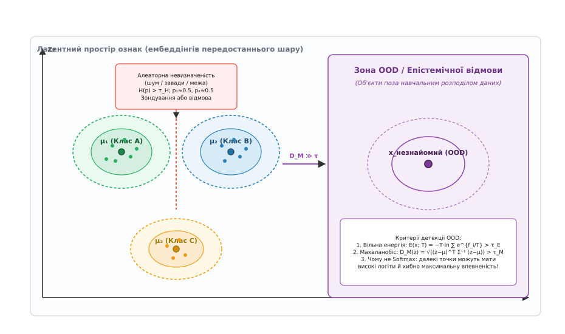
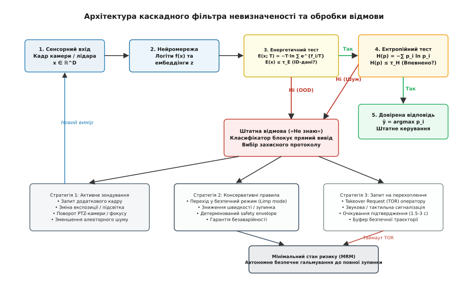

# «Не знаю»: відмова від рішення як штатна відповідь

<preknowlist>
- [Функції втрат](root:sf-ml/loss-functions) — оптимізація крос-ентропії змушує виходи softmax наближатися до одиниці навіть на сумнівних входах.
- [Функції активації](root:sf-ml/activation-functions) — softmax нормує логіти в розподіл імовірностей, але не вимірює абсолютної щільності даних.
- [Навчання vs вивід](root:sf-ml/train-vs-inference) — під час виводу модель стикається з умовами й об'єктами, яких не існувало у вибірці навчання.
- [Нейрон і шар](root:sf-ml/neuron-layer) — лінійне перетворення перед активацією породжує логіти f(x) та внутрішні латентні ембеддінги z.
- [Межі та етика ML](root:sf-ml/ml-limits-ethics) — ціна помилкової впевненості автономної системи переважає ціну штатної затримки чи відмови.
</preknowlist>

Бортова камера автономного автомобіля фіксує на шосе незвичний об'єкт — перевернуту вантажівку з білим дахом на тлі сліпучого сонця. У навчальній вибірці нейромережі були легкові машини, стандартні вантажівки на колесах, пішоходи та дорожні знаки, але жодного перевернутого причепа під таким кутом освітлення. Класифікатор на виході обчислює вектор із десяти чисел, нормує їх через експоненту й видає категоричний вердикт: із ймовірністю 98.4% перед нами «порожня смуга / дорожній просвіт». Автомобіль не гальмує і на повній швидкості врізається в перешкоду. Причина катастрофи полягає не в браку шарів чи параметрів мережі, а в самій постановці задачі: традиційний класифікатор **примушений вгадувати за будь-яких умов**. У нього немає виходу «я не знаю цього об'єкта». Здатність системи сказати «Не знаю» — це не збій і не аварійне вимкнення, а головна захисна функція інженерного машинного навчання, що перетворює ненадійний статистичний апроксиматор на безпечний промисловий вузол.

### Пастка примусового вибору та вибіркова класифікація

Звичайна модель класифікації реалізує відображення з простору вхідних ознак у дискретну множину з `K` заздалегідь визначених міток:

```
f: ℝ^D → {1, 2, ..., K}
```

Коли на вхід потрапляє зображення, звуковий фрагмент чи вектор телеметрії, модель обчислює логіти (сирі виходи лінійного шару) `f₁(x), f₂(x), ..., f_K(x)` і застосовує правило максимального значення (лат. *argumentum maximi* — аргумент максимуму):

```
ŷ = argmax_{i ∈ {1...K}} f_i(x)
```

Це правило не містить жодного механізму оцінки того, чи має вхідний вектор хоч якийсь стосунок до предметної області задачі. Якщо згортковій мережі, навченій розрізняти породи собак і котів, показати фотографію тостера, квантову схему чи шум телевізійної антени, сума вихідних імовірностей однаково дорівнюватиме одиниці, а функція `argmax` слухняно обере одну з порід собак. Математична конструкція стандартного класифікатора не залишає простору для сумніву: він за визначенням замкнений у власному просторі міток і примушений ділити весь простір `ℝ^D` на `K` областей без залишку.

В інженерних системах високої відповідальності — автопілотах, медичній діагностиці, автоматиці енергомереж, системах наведення — ціна помилкової дії та ціна відмови від дії кардинально відрізняються. Помилковий діагноз і призначення токсичного препарату здоровому пацієнту призводить до незворотних уражень; рішення лікаря «рентгенівський знімок нечіткий, призначаю повторну томографію» зберігає здоров'я. Помилкове рішення автопілота повернути кермо на зустрічну смугу спричиняє лобове зіткнення; перехід у режим екстреного утримання смуги та ввімкнення аварійної сигналізації зводить ризик до мінімуму.

Інженерною відповіддю на цю проблему є **вибіркова класифікація** (англ. *selective classification*, або *classification with a reject option* — класифікація з правом на відмову, запропонована Чоу у 1957 та 1970 роках). У такій системі класифікатор розширюється до пари функцій `(f, g)`:

```
(f, g)(x) = { f(x),  якщо g(x) = 1  (дозвіл: система впевнена у висновку)
            { ⊘,     якщо g(x) = 0  (відмова: система каже «не знаю»)
```

Тут `f(x)` позначає базовий класифікатор, а `g(x) ∈ {0, 1}` — селективну функцію-гейт (від англ. *gate* — брама, заслінка). Якщо `g(x) = 1`, система бере на себе відповідальність за результат і видає передбачений клас `f(x)`. Якщо `g(x) = 0`, система повертає спеціальний символ відмови `⊘` (англ. *rejection*), блокує виконання автоматичної дії та активує резервний протокол безпеки.

Поведінка вибіркового класифікатора описується двома взаємозалежними характеристиками:

1. **Покриття** (англ. *coverage*, позначається `Φ`): частка прикладів у потоці даних, для яких система наважується ухвалити самостійне рішення:

```
Φ(g) = P(g(x) = 1) = E_{x ~ P_X}[g(x)]
```

2. **Селективний ризик** (англ. *selective risk*, або помилка на прийнятих рішеннях): математичне сподівання функції втрат лише серед тих об'єктів, де модель не відмовилася від відповіді:

```
R(f, g) = E_{(x,y) ~ P_{XY}}[loss(f(x), y) | g(x) = 1]
        = E[loss(f(x), y) · g(x)] ÷ E[g(x)]
```

Між покриттям і селективним ризиком існує фундаментальний компроміс (англ. *risk-coverage trade-off*). Знижуючи поріг довіри, система береться класифікувати більше складних і зашумлених зразків, що збільшує покриття `Φ`, але неминуче підвищує селективний ризик `R`. Навпаки, вимагаючи майже абсолютної впевненості, можна знизити ризик помилки майже до нуля, але ціною стане падіння покриття: система відповідатиме лише на найпростіші 10–20% запитів, відхиляючи решту.

Повну характеристику системи дає **крива ризику-покриття** (англ. *Risk-Coverage curve*, RC-крива), яка відображає зміну селективного ризику при варіюванні порогу відмови від 0 до 1. Площа під цією кривою (AURC, англ. *Area Under the Risk-Coverage curve*) слугує інтегральною мірою якості системи вибіркової класифікації.

Оптимальна селективна функція в класичній теорії Чоу (Chow's rule) за відомого апостеріорного розподілу `P(Y = k | X = x)` відхиляє рішення, якщо максимальна ймовірність не перевищує порогового значення, пов'язаного з відносною вартістю відмови:

```
g_Chow(x) = { 1,  якщо max_k P(Y = k | x) ≥ 1 − (C_rej ÷ C_err)
            { 0,  інакше
```

де `C_rej` — ціна відмови від рішення (наприклад, затримка операції на 50 мс для додаткового сканування або виклик оператора), а `C_err` — ціна помилкового рішення (наприклад, аварія вартістю в мільйон доларів). Якщо помилка коштує в 100 разів дорожче за відмову (`C_rej / C_err = 0.01`), система зобов'язана відмовлятися від будь-якого висновку, впевненість у якому становить менше `1 − 0.01 = 0.99` (99%).

Проте в реальних нейромережах правило Чоу наражається на небезпечну перешкоду: вихідні числа softmax **не є реальними ймовірностями** `P(Y = k | x)`. Щоб побудувати надійну функцію `g(x)`, інженер повинен розібратися, звідки взагалі береться непевність у виході моделі.

### Два джерела незнання: алеаторна та епістемічна невизначеність

Невизначеність у прогнозах нейромережі не є монолітним явищем. Вона виникає з двох принципово різних фізичних джерел, які вимагають кардинально різних інженерних дій при відмові.

```
                  ┌──────────────────────────────────────────┐
                  │       Загальна невизначеність моделі     │
                  └─────────────────────┬────────────────────┘
                                        │
             ┌──────────────────────────┴──────────────────────────┐
             ▼                                                     ▼
┌──────────────────────────────┐              ┌──────────────────────────────┐
│   Алеаторна невизначеність   │              │   Епістемічна невизначеність │
│    (шум у даних / сенсорах)  │              │    (дефіцит знань моделі)    │
├──────────────────────────────┤              ├──────────────────────────────┤
│ • Розмиття кадру рухом       │              │ • Новий невідомий клас (OOD) │
│ • Шум матриці в темряві      │              │ • Рідкісні погодні аномалії  │
│ • Перекриття об'єкта гілкою  │              │ • Нетиповий ракурс чи колір  │
│ • Об'єктивна схожість класів │              │ • Зсув розподілу (drift)     │
│ ──────────────────────────── │              │ ──────────────────────────── │
│ Властивість: незменшувана    │              │ Властивість: зменшувана      │
│ додатковими даними того ж    │              │ збором додаткових прикладів  │
│ сенсора; лікується активним  │              │ і донавчанням ваг мережі     │
│ доопитуванням і фільтрацією  │              │                              │
└──────────────────────────────┘              └──────────────────────────────┘
```

#### 1. Алеаторна невизначеність (шум у спостереженнях)

Термін **алеаторний** походить від латинського *alea* — гральний кубик, жереб. Алеаторна невизначеність (англ. *aleatoric uncertainty*) відображає внутрішню випадковість, шум або втрату інформації в самому процесі спостереження:

- тепловий шум і дефекти пікселів матриці камери за низької освітленості;
- геометричне перекриття дорожнього знака гілками дерев чи рекламним щитом;
- краплі дощу, сніг чи бруд на оптиці сенсора;
- природна неоднозначність фізичного світу, коли силует собаки на відстані 200 метрів у тумані об'єктивно неможливо відрізнити від силуету вовка.

Головна характеристика алеаторної невизначеності — вона є **незменшуваною** (англ. *irreducible*) шляхом простого накопичення тренувальних даних. Скільки б мільйонів чистих зображень собак і вовків ми не згодували оптимізатору, розмите сіре фото розміром 4×4 пікселі ніколи не міститиме достатньо інформації для однозначного вибору.

Алеаторна невизначеність поділяється на два типи:
- **гомоскедастична** (від грец. *ὁμός* — однаковий + *σκεδάννυμι* — розсіювати): постійний базовий шум вимірювального тракту, однаковий для всіх входів (наприклад, тепловий шум АЦП);
- **гетероскедастична** (від грец. *ἕτερος* — інший, різний): шум, рівень якого залежить від конкретного вхідного зразка `x` (наприклад, один кадр знято проти сонця із засвіченням, а інший — за ідеального освітлення).

#### 2. Епістемічна невизначеність (незнання моделі)

Термін **епістемічний** походить від давньогрецького *ἐπιστήμη* (*episteme*) — знання, наука, пізнання. Епістемічна невизначеність (англ. *epistemic uncertainty*) відображає брак інформації в самій моделі через те, що її параметри навчалися на обмеженій вибірці й ніколи не бачили подібних комбінацій ознак.

Приклади епістемічної невизначеності:
- камера фіксує людину на сегвеї в костюмі динозавра (у тренувальному датасеті були або пішоходи в звичайному одязі, або транспортні засоби);
- промисловий дефектоскоп бачить тріщину нової кристалічної форми, яка виникла через зміну хімічного складу сплаву постачальником;
- система медичного аналізу крові обробляє зразок пацієнта з рідкісною генетичною мутацією, не представленою в клінічних випробуваннях.

Головна характеристика епістемічної невизначеності — вона є **зменшуваною** (англ. *reducible*). Якщо інженер збере колекцію фотографій людей на сегвеях у незвичному вбранні, розмітить їх і запустить повторний цикл навчання, модель розширить свої внутрішні межі знань, і епістемічна невизначеність для цих об'єктів впаде майже до нуля.

Для безпеки різниця критична:
- якщо невизначеність **алеаторна** (знак перекрито брудом або туманом), модель перебуває в знайомій області простору ознак, але вхід зашумлений. Тут допомагає **активне зондування**: увімкнути підсвітку, зробити ще 3 кадри й усереднити результат або дочекатися наближення до об'єкта;
- якщо невизначеність **епістемічна** (вхідний вектор лежить поза навчальним розподілом даних, Out-of-Distribution), додаткові кадри з тієї ж камери не допоможуть: модель у принципі не знає, що це таке. Єдине безпечне рішення — **штатна відмова від автономного висновку** і передача завдання консервативному детермінованому алгоритму або оператору-людині.


*Простір ембеддінгів передостаннього шару моделі. Всередині тренувального розподілу кластери класів формують компактні області навколо центроїдів. На стику класів виникає зона алеаторної невизначеності через шум сенсорів. Об'єкти поза розподілом (OOD) потрапляють у порожні області простору з великою відстанню Махаланобіса та високою вільною енергією.*

### Анатомія детекції даних поза розподілом (OOD Detection)

Найнебезпечніша помилка під час створення систем вибіркової класифікації — покладатися на максимальну ймовірність після softmax як на міру впевненості моделі:

```
p_max(x) = max_{i ∈ {1...K}} ( e^{f_i(x)} ÷ ∑_{j=1}^K e^{f_j(x)} )
```

У практиці машинного навчання цей ефект відомий як **патологічна надвпевненість softmax** (англ. *softmax overconfidence*, детально досліджена Хендріксом і Гімплом у 2016 році). 

Softmax є оператором нормування: він ділить експоненту кожного логіта на їхню суму. Якщо вектор логітів для знайомого дорожнього знака дорівнює `[8.0, 2.0, 1.0]`, максимальна ймовірність становить приблизно `0.997`. Але якщо на вхід подати абстрактний шум чи невідомий предмет, лінійні шари глибокої мережі через випадкове проектування ваг можуть згенерувати вектор логітів `[80.0, 20.0, 10.0]`. Softmax перетворить його на `1.00000000` (абсолютна впевненість), хоча сам вхідний вектор не має нічого спільного з навчальними даними!

Softmax відображає лише **відносний баланс** між класами, повністю втрачаючи інформацію про **абсолютну щільність** даних `p(x)` у просторі ознак. Щоб побудувати надійний селектор `g(x)`, інженери застосовують три комплементарні математичні підходи.

#### 1. Ентропія Шеннона над виходами ймовірностей

Якщо модель видає розподіл імовірностей `p = (p₁, p₂, ..., p_K)`, мірою невпорядкованості та неоднозначності вибору є інформаційна ентропія Шеннона (від грец. *ἐν* — у + *троπή* — зворот, перетворення; введена Клодом Шенноном у 1948 році):

```
H(p) = − ∑_{i=1}^K p_i · ln(p_i)
```

Нормована ентропія обчислюється діленням на максимально можливу ентропію для `K` класів (що досягається за рівномірного розподілу `p_i = 1/K`):

```
H_norm(p) = H(p) ÷ ln(K)
```

Діапазон значень `H_norm(p)` становить строго `[0.0, 1.0]`:
- `H_norm(p) = 0.0` — абсолютна однозначність: один клас має `p_k = 1.0`, решта — нулі;
- `H_norm(p) = 1.0` — повний хаос: усі `K` класів мають однакову ймовірність `1/K`.

**Покроковий розрахунок ентропії для трьох класів:**
Розглянемо випадок сумнівного виходу класифікатора дорожніх знаків (`K = 3`), коли бруд на камері зрівняв шанси між двома класами:

```
ймовірності:  p = [0.48, 0.48, 0.04]
ln(p):        ln(0.48) = −0.73397,  ln(0.04) = −3.21888

H(p)
= − (0.48·(−0.73397) + 0.48·(−0.73397) + 0.04·(−3.21888))  [за формулою Шеннона]
= − (−0.35231 − 0.35231 − 0.12876)                        [множення компонент]
= 0.83338 nats                                            [сума добутків]

ln(K) = ln(3) = 1.09861 nats

H_norm(p)
= 0.83338 ÷ 1.09861                                       [нормування на максимум]
= 0.75858 (75.9% невизначеності)
```

Якщо встановлено інженерний поріг максимальної ентропії `τ_H = 0.35` (35%), значення `0.759` перевищує поріг, і селектор активує відмову через алеаторну неоднозначність між класами 1 та 2.

**Обмеження ентропії:** ентропія чудово ловить **алеаторний шум на межі розділення класів**, але безсила проти згаданої патологічної надвпевненості на далеких OOD-входах, де через великі логіти вихідний вектор `p` штучно скочується в дельта-функцію з ентропією `H ≈ 0`.

#### 2. Відстань Махаланобіса в латентному просторі ембеддінгів

Щоб виявити епістемічну OOD-невизначеність, необхідно дивитися не на вихідні ймовірності, а на внутрішні геометричні представлення — вектор ознак `z = ϕ(x) ∈ ℝ^M`, що формується на передостанньому шарі нейромережі (перед фінальним лінійним класифікатором).

Підхід Лі та співавторів (2018) моделює розподіл ознак тренувального набору за допомогою суміші багатовимірних нормальних розподілів із спільними коваріаціями (ґаусовий дискримінантний аналіз):

```
P(z | Y = c) ~ 𝒩(μ_c, Σ)
```

де `μ_c` — центроїд (середній вектор ембеддінгів) класу `c` у тренувальних даних:

```
μ_c = (1 ÷ N_c) · ∑_{i: y_i = c} ϕ(x_i)
```

а `Σ` — усереднена внутрішньокласова матриця коваріацій розміру `M × M`:

```
Σ = (1 ÷ N) · ∑_{c=1}^K ∑_{i: y_i = c} (ϕ(x_i) − μ_c)(ϕ(x_i) − μ_c)^T
```

Для нового тестового вектора `z = ϕ(x)` обчислюється **відстань Махаланобіса** (англ. *Mahalanobis distance*, названа на честь індійського статистика Прасанти Чандри Махаланобіса, 1936) до найближчого центроїда класу:

```
D_M(z) = min_{c ∈ {1...K}} √((z − μ_c)^T · Σ⁻¹ · (z − μ_c))
```

На відміну від звичайної евклідової відстані `||z − μ_c||`, відстань Махаланобіса враховує кореляцію між ознаками та дисперсію вздовж кожної осі:

```
(z − μ_c)^T · Σ⁻¹ · (z − μ_c)
= (z − μ_c)^T · (V · Λ⁻¹ · V^T) · (z − μ_c)  [спектральний розклад матриці коваріації]
= ||Λ^{−1/2} · V^T · (z − μ_c)||²           [масштабування за власними осями дисперсії]
```

Якщо тестовий вектор лежить на відстані 5 стандартних відхилень уздовж осі низької дисперсії кластера, евклідова відстань може бути малою (наприклад, 0.2), але відстань Махаланобіса `D_M` буде великою (наприклад, 12.4).

Критерій відмови за Махаланобісом:

```
g_M(x) = { 1,  якщо D_M(ϕ(x)) ≤ τ_M
         { 0,  якщо D_M(ϕ(x)) > τ_M  (відмова: точка лежить у порожнечі латентного простору)
```

**Інженерне розширення для глибоких шарів (Ensemble of Features):** найвища якість детекції досягається, коли відстань Махаланобіса обчислюється не лише на останньому шарі, а на кількох проміжних шарах мережі `l ∈ {1, 2, ..., L}`. Ранні шари реагують на аномалії текстури та кольору (наприклад, штучний шум або перешкоди сенсора), а глибинні шари — на семантичну невідповідність форми об'єкта. Сумарний скор формується як зважена сума стандартизованих відстаней:

```
Score_M(x) = ∑_{l=1}^L α_l · D_M^{(l)}(ϕ^{(l)}(x))
```

де ваги `α_l` підбираються логістичною регресією на невеликій валідаційній вибірці.

**Практичні виклики обчислення коваріацій:** у реальних моделях розмірність ембеддінгів `M` становить від 256 до 2048. Матриця `Σ` містить `M²` елементів і часто є погано обумовленою. Для гарантії чисельної стійкості використовують регуляризацію Ледуа-Вольфа (Ledoit-Wolf shrinkage):

```
Σ_shrunk = (1 − γ) · Σ + γ · (Tr(Σ) ÷ M) · I
```

де параметр `γ ∈ (0, 1)` автоматично мінімізує середньоквадратичну помилку оцінки матриці.

#### 3. Енергетичний скор (Energy-based OOD Detection)

Найелегантнішим і найменш ресурсомістким методом виявлення OOD-даних є детекція на основі вільної енергії (запропонована Вейяном Лю та ін. у 2020 році).

Будь-яку дискретну модель класифікатора на логітах `f(x)` можна розглядати як енергетичну модель (англ. *energy-based model*, концепція статистичної фізики Больцмана та Гіббса). Вільна енергія Гельмгольца (нім. *Freie Energie*) для вхідного зразка `x` за температури `T` визначається через оператор LogSumExp над усім вектором логітів:

```
E(x; T) = − T · ln ( ∑_{i=1}^K exp( f_i(x) ÷ T ) )
```

Чому енергетичний скор працює там, де зазнає поразки softmax? Розглянемо фундаментальний зв'язок між вільною енергією та маргінальною густиною ймовірності вхідних даних `p(x)`:

```
p(x) = (1 ÷ Z) · ∑_{i=1}^K exp( f_i(x) ÷ T )
     = (1 ÷ Z) · exp( − E(x; T) ÷ T )
```

де `Z = ∫ exp(−E(x; T)/T) dx` — нормувальна статистична сума (англ. *partition function*).

Логарифмуючи обидві частини, отримуємо прямий аналітичний зв'язок:

```
ln p(x) = − (E(x; T) ÷ T) − ln Z
```

Звідси випливає фундаментальний фізичний факт: **вільна енергія `E(x; T)` лінійно та монотонно спадає зі зростанням густини ймовірності вхідних даних `p(x)`**. 

- Для знайомих даних з тренувального розподілу (In-Distribution, ID), де `p(x)` велике, вільна енергія набуває **сильно від'ємних значень** (`E(x) ≪ 0`, наприклад `−18.5`);
- Для сторонніх даних поза розподілом (Out-of-Distribution, OOD), де `p(x) ≈ 0`, вільна енергія є **високою** (`E(x)` наближається до нуля або стає додатною, наприклад `−1.2` або `+3.4`).

**Числовий приклад порівняння Softmax та Вільної Енергії:**
Розглянемо два вектори логітів для трикласової задачі (`T = 1.0`):
- Вхід A (знайомий дорожній знак ID): `f_A = [7.0, 1.0, 0.5]`
- Вхід B (аномальний OOD вхід з патологічною надвпевненістю): `f_B = [25.0, 1.0, 0.5]`
- Вхід C (слабкий сторонній OOD шум): `f_C = [0.8, 0.2, 0.1]`

Обчислимо для кожного виходу softmax і вільну енергію:

```
Вхід A (ID):
  p_max = e^7 / (e^7 + e^1 + e^0.5) = 1096.63 / (1096.63 + 2.72 + 1.65) = 0.9960
  E(A)  = − ln(1096.63 + 2.72 + 1.65) = − ln(1101.00) = −7.004

Вхід B (OOD із надвеликим логітом):
  p_max = e^25 / (e^25 + e^1 + e^0.5) = 7.20e10 / 7.20e10 = 0.9999999999
  E(B)  = − ln(7.20e10) = −25.000

Вхід C (OOD шум у порожньому просторі):
  p_max = e^0.8 / (e^0.8 + e^0.2 + e^0.1) = 2.225 / (2.225 + 1.221 + 1.105) = 0.4889
  E(C)  = − ln(2.225 + 1.221 + 1.105) = − ln(4.551) = −1.515
```

Зверніть увагу: для входу C softmax видає розподіл `[0.49, 0.27, 0.24]`, що може здатися просто "сумнівним", але енергія `E(C) = −1.515` кардинально відрізняється від норми знайомих класів `E(A) = −7.004`. Якщо встановити поріг енергії `τ_E = −5.0`, система миттєво відсікає всі входи з `E(x) > −5.0` як OOD-аномалії.

Енергетичний фільтр обчислюється безпосередньо з логітів вихідного шару за `O(K)` операцій, не вимагає збереження матриць коваріацій і додає лише лічені мікросекунди до загального часу виводу моделі.

#### 4. Енергетично-контрастивне навчання (Energy-Bounded Learning)

Хоча енергетичний скор працює на стандартних попередньо навчених моделях без жодної модифікації ваг, ще більшого розриву між ID та OOD можна досягти на етапі навчання. Для цього стандартну функцію крос-ентропії доповнюють регуляризатором контрастної енергії:

```
L_total = L_CE(f(x_in), y) + λ · L_energy(x_in, x_out)
```

де енергетичний штраф явно розсуває рівні вільної енергії для тренувальних даних `x_in` та синтетичних або сторонніх аномалій `x_out`:

```
L_energy = (max(0, E(x_in) − m_in))² + (max(0, m_out − E(x_out)))²
```

Тут `m_in` — цільовий верхній поріг енергії для відомих класів (наприклад, `−20.0`), а `m_out` — цільовий нижній поріг для аномалій (наприклад, `−2.0`). Таке навчання буквально видовбує глибокі енергетичні колодязі навколо знайомих даних, перетворюючи всю решту латентного простору на енергетичне плато з високим рівнем `E(x) ≈ 0`.

```
                      СЕНСОРНИЙ КАДР x
                             │
                             ▼
                 ┌──────────────────────┐
                 │    Нейромережа f(x)  │
                 └───────────┬──────────┘
                             │ Вектор логітів f_i(x)
                             ▼
               ┌───────────────────────────┐
               │    Енергетичний тест      │
               │   E(x; T) ≤ τ_energy ?    │
               └─────────────┬─────────────┘
                             │
              ┌──────────────┴──────────────┐
              │ ТАК                         │ НІ (Енергія висока)
              ▼                             ▼
  ┌────────────────────────┐   ┌─────────────────────────┐
  │   Ентропійний тест     │   │     ВІДМОВА: OOD        │
  │ H_norm(p) ≤ τ_entropy? │   │ (Епістемічне незнання)  │
  └───────────┬────────────┘   └─────────────────────────┘
              │
       ┌──────┴──────┐
       │ ТАК         │ НІ (Ентропія висока)
       ▼             ▼
┌──────────────┐ ┌─────────────────────────┐
│  ДОВІРЕНИЙ   │ │   ВІДМОВА: АМБІВАЛЕНТНО │
│   ВИСНОВОК   │ │ (Алеаторний шум/межа)   │
│ ŷ = argmax   │ └─────────────────────────┘
└──────────────┘
```

Такий дворівневий каскад (енергетичний фільтр для OOD + ентропійний фільтр для алеаторного шуму) забезпечує повний захист як від незнайомих об'єктів, так і від зашумлених прикордонних станів.

### Архітектура обробки відмови: що робити після «Не знаю»

Сказати «Не знаю» — це лише половина інженерної задачі. Якщо автономна система просто зупинить свій головний цикл виконання команди (`exit()` або `throw std::runtime_error`), це спричинить миттєву аварію. Відмова вибіркового класифікатора є **штатною подією керування**, яка переводить систему в один із трьох заздалегідь спроектованих захисних контурів.


*Кінцевий автомат обробки невизначеності. Послідовна фільтрація через енергетичний та ентропійний гейти відокремлює довірені класифікації від випадків штатної відмови. При відмові система обирає активне зондування, застосування консервативних правил або запит на перехоплення керування оператором.*

#### 1. Активне сенсорне доопитування (Active Sensing)

Коли селектор зафіксував алеаторну невизначеність (висока ентропія за нормальної енергії), система намагається самостійно усунути шум за рахунок активного впливу на вимірювальний тракт:

- **Часова інтеграція (Temporal Accumulation):** замість ухвалення рішення за одним кадром система накопичує буфер із `N = 5` послідовних кадрів і виконує баєсівське оновлення ймовірностей або мажоритарне голосування з урахуванням руху камери;
- **Адаптація параметрів сенсора:** зміна часу експозиції (авто-HDR) у разі пересвіту сонцем, зміна частоти опитування радарного модуля, перемикання смуги пропускання смугового фільтра звукового тракту;
- **Активація активного випромінювання:** увімкнення інфрачервоного підсвічування, запуск лазерного далекоміра (LiDAR) для прямого вимірювання дистанції замість оптичної оцінки;
- **Зміна просторового ракурсу:** команда на мікроповорот поворотно-похилого пристрою (PTZ-камери) чи зміну траєкторії дрона на 10 см убік, щоб вийти із зони відблиску або перекриття перешкодою.

Якщо після трьох циклів активного доопитування ентропія залишається вищою за поріг `τ_H`, система ескалує стан до жорсткої відмови.

#### 2. Детерміновані консервативні правила безпеки (Safe Fallback Rules)

У разі епістемічної відмови (OOD) або вичерпання ліміту активного зондування керування передається від стохастичної нейромережі до **жорстко запрограмованого детермінованого автомата безпеки**:

- **Принцип домінування безпеки (Safety Envelope):** класифікатор розпізнавання дорожніх знаків не знає, що за невідомий щит стоїть попереду. Детерміноване правило безпеки стверджує: *«За будь-якого невідомого об'єкта біля смуги руху максимальна дозволена швидкість автоматично обмежується до 30 км/год, а дистанція до попереду їдучого транспорту подвоюється»*;
- **Перехід у безпечний режим (Limp Mode):** відключення експериментальних автономних функцій високого рівня (автоматична зміна смуги, обгін) зі збереженням базових детермінованих рефлексів (утримання смуги за ультразвуковими датчиками, аварійне гальмування за даними прямого радарного луни);
- **Консервативна сегрегація рішень:** у медичному аналізі всі зразки з міткою `⊘` автоматично позначаються як «підозра на патологію високого пріоритету» і потрапляють у початок черги ручної перевірки головним лікарем лабораторії.

#### 3. Запит на перехоплення керування людиною-оператором (Takeover Request)

У людино-машинних системах (рівні автономності автопілотів SAE Level 3 / Level 4, дистанційне пілотування БПЛА, диспетчеризація роботизованих складів) штатна відмова ініціює протокол передачі контролю оператору (англ. *Takeover Request*, TOR):

1. **Мультимодальне сповіщення (t = 0.0 с):** активація високочастотного звукового сигналу, вібромоторів у сидінні або штурвалі та виведення візуального контрастного попередження на HUD-дисплей;
2. **Гарантований часовий буфер безпеки (Transition Budget, t = 0.0...3.5 с):** людина не здатна миттєво оцінити ситуацію (час когнітивної переорієнтації водія становить від 1.5 до 4 секунд). Протягом цього інтервалу детермінований контролер зобов'язаний самостійно утримувати безпечну траєкторію в межах розрахованого коридору;
3. **Підтвердження перехоплення (t = 1.8 с):** реєстрація зусилля на кермі (понад 2.5 Н·м) чи натискання педалі гальма фіксує перехід контролю людині;
4. **Мінімальний стан ризику (Minimum Risk Maneuver, MRM, t > 4.0 с):** якщо людина не відповіла на запит протягом відведеного таймауту (наприклад, водій заснув або втратив свідомість), система виконує безаварійне автоматичне гальмування в межах поточної смуги руху або з'їзд на узбіччя з увімкненням аварійної світлової сигналізації.

#### 4. Апаратна ізоляція контуру безпеки (Safety Islands та ISO 26262)

В автомобільних та авіаційних стандартах функціональної безпеки (ISO 26262 ASIL-D, DO-178C) нейромережевий класифікатор розглядається як компонента невисокого рівня довіри (QM або ASIL-B). 

Для гарантії надійності вибіркову класифікацію реалізують за **двоканальною асиметричною архітектурою**:
- **Основний канал (High-Performance Compute):** потужний GPU або NPU-прискорювач, який виконує глибоку згорткову мережу чи трансформер і генерує сирі логіти та ембеддінги;
- **Наглядовий канал (Safety Island Watchdog):** апаратно ізольований мікроконтролер із сертифікацією ASIL-D (наприклад, Infineon AURIX або ARM Cortex-R52 з lockstep-ядрами). Цей мікроконтролер незалежно приймає логіти від прискорювача, самостійно обчислює вільну енергію та ентропію і видає апаратний дозвіл (`g = 1`) на виконавчі сервоприводи через захисне реле. Якщо головний процесор завис або згенерував аномальний логіт, контролер безпеки миттєво скидає лінію дозволу в 0, блокуючи небезпечну дію.

### Калібрування порогів та інженерний баланс

Ефективність вибіркової класифікації повністю визначається коректним налаштуванням порогових значень `τ_E` (вільна енергія) та `τ_H` (ентропія).

Для калібрування інженер формує два тестові набори даних:
1. **In-Distribution Validation Set (`D_in`):** валідаційні дані знайомих класів, зібрані в реальних умовах експлуатації;
2. **Out-of-Distribution Benchmark Set (`D_out`):** вибірка об'єктів сторонніх класів, аномалій, текстурного шуму та зображень з інших предметних областей.

На цих вибірках будуються операційні характеристики приймача (ROC-криві) та вимірюються дві головні метрики безпеки:
- **FPR95 (False Positive Rate at 95% True Positive Rate):** частка сторонніх OOD-об'єктів, які система помилково пропустила як знайомі, за умови, що 95% справжніх знайомих ID-об'єктів успішно проходять фільтр (ідеальне значення — 0.0%);
- **AUROC (Area Under the ROC Curve):** площа під кривою розпізнавання OOD-аномалій (ідеальне значення — 1.0).

```
  FPR (пропуск OOD-аномалій)
  1.0 ┌──────────────────────────────────────────┐
      │                                          │
  0.8 │                                          │
      │                                          │
  0.6 │                                          │
      │                  Точка компромісу:       │
  0.4 │                  TPR = 95%, FPR = 2.8%   │
      │                  (τ_energy = −6.2)       │
  0.2 │                     ●                    │
      │                  ───┘                    │
  0.0 └───┬──────────────┬──────────────┬────────┘
     0.0 0.2            0.6            1.0   TPR (покриття знайомих даних)
```

Для оптимізації чутливості логітів перед обчисленням енергії та ентропії застосовують **температурне масштабування** (англ. *temperature scaling*, запропоноване Го Чоном та ін. у 2017 році). Ділення логітів на скаляр `T > 1.0` згладжує надмірні піки експоненти, відновлюючи каліброваність імовірностей без зміни порядку класів (`argmax` залишається незмінним).

Особливу увагу слід звернути на **квантування моделі (INT8)**. Перехід від float32 до 8-бітних цілих ваг стискає динамічний діапазон логітів, що призводить до зміщення середнього енергетичного скору `E(x)` на 10–30%. Калібрування порогів `τ_E` та `τ_H` обов'язково має виконуватися **після квантування** безпосередньо на цільовому залізі з квантованими логітами.

Детальний аналіз алгоритмічних пасток, чисельної стійкості обчислення LogSumExp та повну реалізацію модуля вибіркової класифікації з тестами наведено в статті [Реалізація модуля вибіркової класифікації](root:sf-ml/ne-znaiu/proj-selective-classifier.md).

### Програмний інтерфейс вибіркового класифікатора

Нижче наведено виробничий приклад реалізації вибіркового класифікатора, що виконує стабільний розрахунок softmax з вирівнюванням максимального логіта, обчислення нормованої ентропії Шеннона та вільної енергії з подальшою дворівневою селекцією.

:::tabs
```c
#include <stdio.h>
#include <math.h>
#include <stdbool.h>

#define MAX_CLASSES 8

typedef enum {
    DECISION_ACCEPTED = 0,
    DECISION_REJECT_OOD = 1,
    DECISION_REJECT_AMBIGUOUS = 2
} decision_status_t;

typedef struct {
    int class_id;
    float confidence;
    float energy;
    float normalized_entropy;
    decision_status_t status;
} selective_result_t;

selective_result_t classify_selective(
    const float* logits,
    int num_classes,
    float temperature,
    float energy_threshold,
    float entropy_threshold
) {
    selective_result_t res = {
        .class_id = -1,
        .confidence = 0.0f,
        .energy = 0.0f,
        .normalized_entropy = 0.0f,
        .status = DECISION_ACCEPTED
    };

    if (num_classes <= 0 || num_classes > MAX_CLASSES || temperature <= 0.0f) {
        res.status = DECISION_REJECT_OOD;
        return res;
    }

    // 1. Пошук максимального логіта для чисельної стабільності LogSumExp
    float max_logit = logits[0];
    int argmax_idx = 0;
    for (int i = 1; i < num_classes; ++i) {
        if (logits[i] > max_logit) {
            max_logit = logits[i];
            argmax_idx = i;
        }
    }

    // 2. Обчислення вільної енергії: E(x) = -T * (max/T + ln(sum(e^{(f_i - max)/T})))
    float sum_exp = 0.0f;
    float exp_scaled[MAX_CLASSES];
    for (int i = 0; i < num_classes; ++i) {
        exp_scaled[i] = expf((logits[i] - max_logit) / temperature);
        sum_exp += exp_scaled[i];
    }
    res.energy = -temperature * ((max_logit / temperature) + logf(sum_exp));

    // Перевірка OOD-гейта за вільною енергією (чим більша енергія, тим далі від ID)
    if (res.energy > energy_threshold) {
        res.status = DECISION_REJECT_OOD;
        return res;
    }

    // 3. Обчислення ймовірностей Softmax та ентропії Шеннона
    float probs[MAX_CLASSES];
    float entropy = 0.0f;
    for (int i = 0; i < num_classes; ++i) {
        probs[i] = exp_scaled[i] / sum_exp;
        if (probs[i] > 1e-8f) {
            entropy -= probs[i] * logf(probs[i]);
        }
    }

    float max_entropy = logf((float)num_classes);
    res.normalized_entropy = (max_entropy > 0.0f) ? (entropy / max_entropy) : 0.0f;
    res.confidence = probs[argmax_idx];
    res.class_id = argmax_idx;

    // Перевірка гейта алеаторної неоднозначності за ентропією
    if (res.normalized_entropy > entropy_threshold) {
        res.status = DECISION_REJECT_AMBIGUOUS;
        return res;
    }

    res.status = DECISION_ACCEPTED;
    return res;
}
```
```cpp
#include <iostream>
#include <cmath>
#include <array>
#include <span>
#include <expected>
#include <algorithm>
#include <numeric>

enum class DecisionStatus {
    Accepted,
    RejectOOD,
    RejectAmbiguous
};

struct SelectiveResult {
    int class_id{-1};
    float confidence{0.0f};
    float energy{0.0f};
    float normalized_entropy{0.0f};
    DecisionStatus status{DecisionStatus::Accepted};
};

template <std::size_t MaxClasses = 8>
class SelectiveClassifier {
public:
    struct Config {
        float temperature{1.0f};
        float energy_threshold{-5.0f};
        float entropy_threshold{0.45f};
    };

    explicit constexpr SelectiveClassifier(Config cfg) noexcept : cfg_(cfg) {}

    [[nodiscard]] std::expected<SelectiveResult, const char*> evaluate(
        std::span<const float> logits
    ) const noexcept {
        if (logits.empty() || logits.size() > MaxClasses || cfg_.temperature <= 0.0f) {
            return std::unexpected("Некоректний розмір вектора логітів або температура");
        }

        SelectiveResult res{};
        const auto num_classes = logits.size();

        // 1. Пошук максимального логіта (запобігання переповненню expf)
        const auto max_it = std::max_element(logits.begin(), logits.end());
        const float max_logit = *max_it;
        res.class_id = static_cast<int>(std::distance(logits.begin(), max_it));

        // 2. Обчислення вільної енергії Гельмгольца
        std::array<float, MaxClasses> exp_scaled{};
        float sum_exp = 0.0f;
        for (std::size_t i = 0; i < num_classes; ++i) {
            exp_scaled[i] = std::exp((logits[i] - max_logit) / cfg_.temperature);
            sum_exp += exp_scaled[i];
        }

        res.energy = -cfg_.temperature * ((max_logit / cfg_.temperature) + std::log(sum_exp));

        if (res.energy > cfg_.energy_threshold) {
            res.status = DecisionStatus::RejectOOD;
            return res;
        }

        // 3. Розрахунок нормованої ентропії Шеннона
        float entropy = 0.0f;
        for (std::size_t i = 0; i < num_classes; ++i) {
            const float p = exp_scaled[i] / sum_exp;
            if (p > 1e-8f) {
                entropy -= p * std::log(p);
            }
        }

        const float max_entropy = std::log(static_cast<float>(num_classes));
        res.normalized_entropy = (max_entropy > 0.0f) ? (entropy / max_entropy) : 0.0f;
        res.confidence = exp_scaled[static_cast<std::size_t>(res.class_id)] / sum_exp;

        if (res.normalized_entropy > cfg_.entropy_threshold) {
            res.status = DecisionStatus::RejectAmbiguous;
            return res;
        }

        res.status = DecisionStatus::Accepted;
        return res;
    }

private:
    Config cfg_;
};
```
:::

> 🔧 **Навіщо це.** У промислових системах комп'ютерного зору (сортування деталей на конвеєрі, дефектоскопія друкованих плат, оптичні сканери на складах) селективний класифікатор дозволяє усунути 99% людської рутинної праці, не ризикуючи якістю: 90–95% простих і чітких деталей автомат відбраковує або приймає миттєво з нульовим рівнем дефектів, а 5–10% спірних, затінених чи незнайомих зразків маркує кодом «Не знаю» і скидає в окремий лоток для уважного огляду контролером ВТК.
