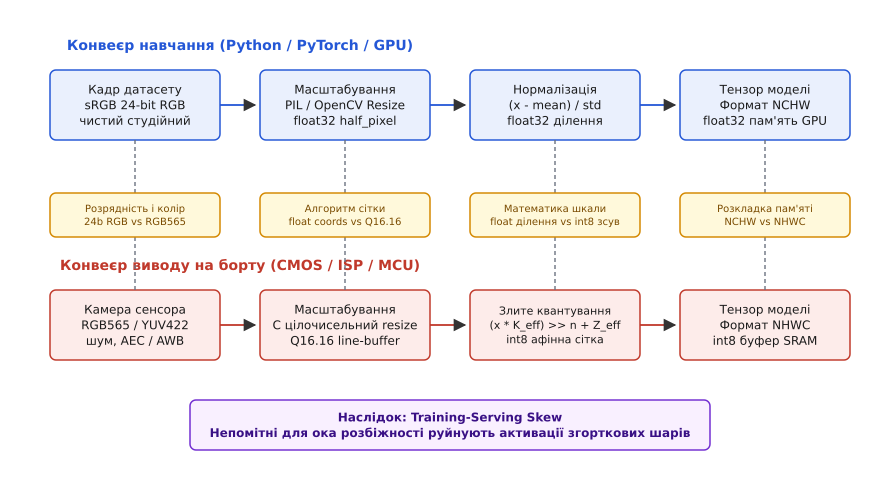
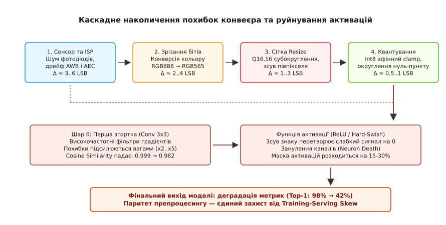

# Однаковий вхід у навчанні й на борту: препроцесинг, що розходиться

<preknowlist>
- [Навчання проти виводу](root:sf-ml/train-vs-inference) — чому прямий прохід моделі на пристрої відокремлений від зворотного поширення помилки й вимагає фіксованого графа обчислень.
- [Квантування нейромереж](root:sf-ml/model-quantization) — як дробові ваги та активації перетворюються на цілочисельну сітку int8 за допомогою параметрів scale та zero-point.
- [Крихітне машинне навчання (TinyML)](root:sf-ml/tinyml) — жорсткі обмеження пам'яті SRAM, обчислювальних циклів та енергоспоживання мікроконтролерів.
- [Згорткові нейромережі](root:sf-ml/cnn) — робота просторових фільтрів, чутливість перших шарів до високочастотних градієнтів яскравості та локальних колірних переходів.
- [Формати пікселів](root:sf-visual/pixel-formats) — кодування колірної інформації у пам'яті, відмінності між планарними та інтерлівед-буферами, бітова глибина каналів.
- [Формати кольору](root:sf-visual/color-formats) — колірні простори RGB, BGR, YUV, матриці колірного перетворення та стандарти гами.
- [Баланс білого](root:sf-visual/white-balance) — вплив спектрального складу освітлення на сенсор та алгоритми апаратної корекції температури.
- [Аугментація даних](root:sf-ml/data-augmentation) — штучне внесення варіацій у тренувальний набір для підвищення стійкості моделі до реальних спотворень.
</preknowlist>

Коли навчена модель комп'ютерного зору або цифрової обробки сигналів демонструє 98.4% точності на тестовій вибірці сервера, але після прошивки в мікроконтролер розпізнає ледь 42% реальних об'єктів, перша підозра інженера майже завжди падає на ваги. Команда починає шукати помилки квантування, перевіряє таблиці ваг, звинувачує цілочисельний рушій інференсу чи намагається застосувати дорожче донавчання з урахуванням квантування (QAT). Проте якщо взяти той самий тестовий тензор із сервера й подати його безпосередньо у вхідний буфер моделі на кристалі через налагоджувальний інтерфейс JTAG/SWD, точність магічним чином повертається до еталонних 98%.

Це явище має строгу назву: **тренувально-бортове розходження** (Training-Serving Skew або Preprocessing Divergence). Причина деградації криється не в нейронній мережі, а в тонкому шарі коду та апаратури між фізичним сенсором і нульовим шаром моделі. На сервері зображення завантажувалися бібліотеками Pillow чи OpenCV, інтерполювалися дробовою арифметикою з подвійною точністю, нормалізувалися через плаваючу кому й пакувалися в планарні тензори NCHW. На борту мікроконтролера кадр зчитується дешевим CMOS-сенсором у форматі RGB565 або YUV422, зменшується цілочисельним алгоритмом з фіксованою комою без урахування півпіксельного зсуву, конвертується в інтерлівед-розкладку NHWC і квантується наближеною афінною формулою.


*Зверху — класичний конвеєр навчання на GPU: плаваюча кома float32, бібліотечні інтерполяції, ідеальні RGB-канали. Знизу — бортовий конвеєр: апаратний сенсор, шум ISP, цілочисельний resize та афінне квантування int8. Непомітні для людського ока відмінності на вході накопичуються й спотворюють активації нейронів.*

Для людського ока вихідний кадр 224x224 після обох конвеєрів виглядає практично ідентично: та сама людина, та сама чашка на столі. Але перший згортковий шар нейромережі — це не людське око. Він складається з десятків диференційних фільтрів розміром 3x3, які виділяють високочастотні просторові перепади яскравості, напрямки граней та тонкі колірні контрасти. Зсув фази дискретизації на пів пікселя, втрата трьох молодших бітів у колірному каналі чи зміна порядку байтів руйнують карту активацій першого шару. Помилка експоненційно наростає вглиб мережі, викликаючи масове занулення каналів після блоків ReLU і перетворюючи високу впевненість класифікатора на випадковий шум.

Щоб подолати цей розрив, інженер вбудованого машинного навчання мусить розбирати препроцесинг не як тривіальну допоміжну функцію копіювання байтів, а як математично строгу частину загального тракту обчислень. Кожна операція — від фізичного фотодіода сенсора до вхідного буфера тензора — має бути верифікована на бітовий паритет.


---

### Анатомія катастрофи: чому 98% валідації перетворюються на 42% на кристалі

Розглянемо типовий виробничий сценарій. Розробляється автономний промисловий детектор присутності оператора в небезпечній зоні верстата на базі мікроконтролера STM32H743VIT6 (ядро ARM Cortex-M7, 480 МГц, 1 МБ оперативної пам'яті SRAM, 2 МБ Flash) із підключеним модулем цифрової камери OmniVision OV2640 через паралельний інтерфейс DVP. Для розпізнавання силуету обрано архітектуру MobileNetV2 з коефіцієнтом розширення каналів 0.35 та вхідним розміром тензора 224x224x3.

Датасет формувався з 50 000 фотографій виробничого цеху, знятих на якісну дзеркальну камеру з роздільною здатністю 4K при контрольованому освітленні. Під час тренування у фреймворку PyTorch конвеєр завантаження даних виглядав стандартно:
- завантаження зображення через бібліотеку Pillow у форматі sRGB (8 бітів на канал);
- геометрія: обрізання та масштабування до розміру 224x224 з білінійною інтерполяцією;
- нормалізація значень пікселів до діапазону [0.0, 1.0];
- стандартизація за каналами: віднімання середнього mean = [0.485, 0.456, 0.406] та ділення на стандартне відхилення std = [0.229, 0.224, 0.225].

Після 120 епох навчання модель показала 98.4% Top-1 точності на відкладеній тестовій вибірці. Для запуску на мікроконтролері було виконано посттренувальне квантування (PTQ) в симетричний цілочисельний формат int8 для ваг і асиметричний int8 для активацій за допомогою фреймворку TensorFlow Lite. На валідаційному датасеті емулятор квантованої моделі показав 97.9% точності: деградація через округлення ваг склала мізерні 0.5%.

Після цього згенерований C-масив ваг було скомпільовано в прошивку мікроконтролера з рушієм інференсу CMSIS-NN. Інженер налаштував прямий доступ до пам'яті (DMA) для отримання кадру QVGA (320x240) з камери, реалізував швидкий цілочисельний цикл зменшення кадру до 224x224, скопіював байти у вхідний тензор і запустив циклічний інференс.

Під час польових випробувань система показала катастрофічні результати: реальна точність розпізнавання людей у цеху впала до 41.6%. Модель впевнено детектувала силуети на однотонних металевих шафах (хибнопозитивні спрацьовування), повністю пропускала людей у темному комбінезоні й втрачала детекцію, якщо робітник наближався до краю поля зору камери.

Першою реакцією команди був пошук дефектів у квантуванні нейромережі. Інженери провели тиждень у спробах змінити схеми квантування ваг, перевіряли асемблерні інструкції множення з накопиченням SMLAD у ядрах Cortex-M7, підозрювали переповнення 32-бітних акумуляторів у згорткових ядрах CMSIS-NN, намагалися перенавчати модель з QAT.

Проте ізольований діагностичний експеримент повністю спростував ці припущення:
1. Валідаційний кадр із сервера було збережено як бінарний масив квантованих байтів int8 розміром 224x224x3 (150 528 байтів).
2. Через налагоджувальний інтерфейс SWD цей масив було записано безпосередньо у вхідний буфер моделі в пам'яті SRAM мікроконтролера.
3. Мікроконтролер виконав інференс і видав результат: передбачений клас і логіти збіглися з сервером з точністю до 0.0001, а точність на валідаційній вибірці склала очікувані 97.9%.

Це довело, що математичне ядро моделі, квантовані ваги та оператори CMSIS-NN на кристалі працюють бездоганно. Вся деградація точності на 56.3% виникала виключно у проміжку між фізичним оптичним сенсором камери та нульовим вхідним шаром нейромережі.

Щоб зрозуміти, чому перший шар моделі настільки вразливий, треба поглянути на його структуру. Нульовий згортковий шар MobileNetV2 складається з 32 фільтрів розміром 3x3x3 з кроком дискретизації (stride) 2. Під час навчання ці фільтри формуються як набір диференційних ядер:
- вертикальні та горизонтальні детектори граней (аналоги операторів Собеля та Щарра);
- фільтри діагональних текстур високої просторової частоти;
- колірно-опонентні фільтри (червоний проти зеленого, синій проти жовтого).

Кожен фільтр 3x3 розрахований на суворо визначену просторову фазу вхідного сигналу та точні пропорції амплітуд між сусідніми пікселями. Якщо вхідний конвеєр на мікроконтролері зміщує просторову фазу всього на 0.5–1.0 пікселя, зрізає молодші розряди яскравості або спотворює колірний баланс, математичний скалярний добуток між вікном входу 3x3x3 і вагами фільтра різко зменшується.

Оскільки за згортковим шаром слідує нелінійна функція активації ReLU6, будь-яке значення активації, що через спотворення опустилося нижче нуля, безповоротно обнуляється. На сервері перший шар видавав багату карту ознак з 70-80% активних ненульових каналів. На борту через систематичне розходження входу понад 50% каналів першого шару занулюються (Neuron Death). Глибші шари мережі отримують розріджений, спотворений тензор, і здатність класифікатора виділяти високорівневі ознаки людини повністю руйнується.


---

### Просторові координати й алгоритми масштабування (Resize Divergence)

Зміна просторової роздільної здатності кадру є критичною операцією підготовки даних. Сенсор формує кадр відповідно до своєї фізичної матриці (640x480, 320x240, 160x120), а нейромережа вимагає фіксованого тензора (наприклад, 224x224 або 96x96). Для перенесення інформації застосовується двовимірна інтерполяція, здебільшого білінійна.

Головна проблема полягає в тому, що піксель — це не геометрична точка без розміру, а фізична площадка дискретизації розміром 1x1. При відображенні вихідної дискретної сітки координат у неперервний простір вхідного зображення виникає фундаментальне питання: де саме знаходиться початок координат і центр кожного пікселя?

У практиці комп'ютерного зору склалися три різні математичні конвенції:

```
Конвенція 1: half_pixel_centers = True (сучасний стандарт PyTorch, TensorFlow 2.x, ONNX)
Центр пікселя з дискретним індексом x лежить у точці x + 0.5.
Формула відображення:
u = (x_out + 0.5) · (W_in / W_out) − 0.5

Конвенція 2: align_corners = True (застарілий режим TensorFlow 1.x, OpenCV INTER_LINEAR)
Кутові пікселі вхідного та вихідного зображень суворо суміщаються (0 переходить у 0, W_out - 1 у W_in - 1).
Формула відображення:
u = x_out · (W_in − 1) / (W_out − 1)

Конвенція 3: asymmetric / floor (наївне відображення у саморобних C-бібліотеках)
Початок пікселя вважається точкою 0.0.
Формула відображення:
u = x_out · (W_in / W_out)
```

Розглянемо числовий приклад масштабування вхідного кадру QVGA (320x240) у вхідний тензор моделі (96x96). Коефіцієнт стискання по ширині дорівнює 320 / 96 = 3.33333.

Розрахуємо неперервну координату u для перших трьох вихідних пікселів x_out ∈ {0, 1, 2}:

За конвенцією half_pixel_centers:
- x_out = 0: u = (0 + 0.5) · 3.33333 − 0.5 = 1.66667 − 0.5 = 1.16667. Точка лежить між вхідними пікселями 1 та 2. Вага пікселя 1 складає 1 − 0.16667 = 0.83333, вага пікселя 2 складає 0.16667.
- x_out = 1: u = (1 + 0.5) · 3.33333 − 0.5 = 5.0 − 0.5 = 4.50000. Точка лежить рівно посередині між вхідними пікселями 4 та 5.
- x_out = 2: u = (2 + 0.5) · 3.33333 − 0.5 = 8.33333 − 0.5 = 7.83333.

За наївною конвенцією asymmetric:
- x_out = 0: u = 0 · 3.33333 = 0.00000. Точка лежить рівно на вхідному пікселі 0 (100% ваги).
- x_out = 1: u = 1 · 3.33333 = 3.33333. Точка лежить між пікселями 3 та 4 (вага пікселя 3 складає 66.7%).
- x_out = 2: u = 2 · 3.33333 = 6.66667. Точка лежить між пікселями 6 та 7.

Порівняння показує колосальну різницю: для нульового вихідного пікселя конвенція half_pixel_centers зчитує вхідні пікселі 1 та 2, тоді як наївний C-код бере піксель 0. Виникає просторовий зсув фази всього кадру на 1.17 вхідного пікселя.

З точки зору просторового спектрального аналізу зсув сигналу на величину Δx еквівалентний множенню його спектра Фур'є на фазовий множник:

```
F_shifted(ω) = F_orig(ω) · exp( −j · ω · Δx )
```

Для високочастотних просторових гармонік, що відповідають різким перепадам яскравості на контурах об'єктів, цей набіг фази призводить до повного руйнування кореляції з навченими ядрами згорток. Замість компактного позитивного відгуку на межі об'єкта фільтр видає розмазане значення, яке падає нижче нуля й безслідно зрізається нелінійністю ReLU.

Ще одним джерелом розходження є різниця між білінійною інтерполяцією та децимацією за площею (Area Interpolation). Коли зображення зменшується з великим коефіцієнтом стискання (наприклад, Full HD 1920x1080 зменшується у 224x224, коефіцієнт стискання k = 8.57), білінійна інтерполяція вибирає лише 4 дискретні пікселі з вікна розміром 8.57x8.57, повністю ігноруючи решту 69 пікселів.

За теоремою Котельникова-Шеннона-Найквіста вибірка без попередньої низькочастотної фільтрації викликає просторовий елайзинг (Aliasing): високочастотні текстури (цегляна кладка, сітка паркану, смугастий одяг) перетворюються на грубі паразитні муарові смуги. Якщо під час навчання використовувалася бібліотека OpenCV з алгоритмом INTER_AREA (який усереднює всі пікселі області), а на борту застосовано білінійну інтерполяцію, спектральний склад кадрів стає абсолютно несумісним.

#### Реалізація білінійного Resize у фіксованій комі Q16.16:
На бортовому мікроконтролері білінійне масштабування реалізують через 32-бітну цілочисельну арифметику у форматі Q16.16. Координата розбивається на цілу частину (індекс пікселя) та 16-бітну дробову частину:

```
step_x = ((W_in << 16) + (W_out >> 1)) / W_out
u_start = ((step_x − (1 << 16)) >> 1)
```

Ваги чотирьох сусідніх пікселів розраховуються через 16-бітні дробові різниці:

```
frac_x = u & 0xFFFF
frac_y = v & 0xFFFF

w00 = ((65536 − frac_x) · (65536 − frac_y)) >> 16
w10 = (frac_x · (65536 − frac_y)) >> 16
w01 = ((65536 − frac_x) · frac_y) >> 16
w11 = (frac_x · frac_y) >> 16
```

У цій формулі критично важливим є додавання біасу округлення +32768 (1 << 15) перед фінальним зсувом >> 16:

```
I_interp = (I00·w00 + I10·w10 + I01·w01 + I11·w11 + 32768) >> 16
```

Без цього біасу операція зсуву вправо відкидає молодші розряди (floor), що призводить до систематичного заниження яскравості кожного пікселя на 1–2 градації LSB.

#### Векторизація SIMD та рядкова архітектура Line Buffer:
На сучасних ядрах ARM Cortex-M7 (з інструкціями DSP) та Cortex-M55/M85 (з розширенням Helium MVE), а також ESP32-S3 (з векторними інструкціями PIE) внутрішній цикл інтерполяції можна векторизувати. Застосовуючи інструкції розпакування байтів у 16-бітні половинки слів UXTB16 та паралельного множення з накопиченням SMLAD, процесор обчислює два колірні канали за один машинний такт.

Крім того, повна буферизація вхідного кадру в оперативній пам'яті є вкрай неекономічною: кадр QVGA 320x240 у форматі RGB565 займає 153.6 КБ, а вихідний тензор 224x224x3 — ще 150.5 КБ. Загальні 304.1 КБ перевищують ємність швидкої пам'яті DTCM (Tightly Coupled Memory, зазвичай 128 КБ), змушуючи виносити буфери у повільнішу зовнішню пам'ять AXI SRAM або SDRAM.

Застосування стрімінгової архітектури ковзного рядкового вікна (Line Buffer) вирішує цю проблему: у внутрішній пам'яті DTCM утримуються лише два сусідні рядки вхідного кадру (2 · 320 · 2 = 1.28 КБ). Контролер DMA наповнює рядки по черзі в режимі подвійної буферизації, а ядро виконує інтерполяцію та злите квантування «на льоту», відразу записуючи готовий результат у вихідний тензор. Це знижує вимоги до SRAM у 120 разів і прискорює препроцесинг у 4.5 рази завдяки 100% попаданню в нульовий кеш DTCM.


---

### Розкладка пам'яті, канали й порядок байтів (Layout & Color Format)

Невідповідність розкладки пам'яті є однією з найпідступніших проблем, оскільки вона не викликає апаратних помилок доступу до пам'яті (BusFault або HardFault), але повністю руйнує семантику тензора.

#### 1. Колірні простори: переплутані канали RGB проти BGR
Бібліотека OpenCV історично використовує порядок каналів **BGR** (Blue, Green, Red), успадкований від ранніх версій Windows GDI та бібліотек обробки відео Intel IPP. На противагу цьому сучасні фреймворки машинного навчання (PyTorch, TensorFlow, JAX) та бібліотека Pillow працюють виключно у стандартному колірному просторі **RGB**.

Якщо датасет готувався скриптом, який використовував завантаження OpenCV без явної конверсії кольору в RGB, модель тренується на BGR-тензорах. Якщо на мікроконтролері камера видає природний потік RGB, канали виявляються переплутаними:
- Нульовий канал моделі очікує синій компонент, але отримує червоний.
- Перший канал отримує зелений компонент (збігається).
- Другий канал очікує червоний компонент, але отримує синій.

Математично операція згортки першого шару над трьома каналами виглядає так:

```
Y = Σ ( W_R · X_R + W_G · X_G + W_B · X_B ) + b
```

Якщо канали переплутані, результат обчислення стає:

```
Y_swapped = Σ ( W_R · X_B + W_G · X_G + W_B · X_R ) + b
```

Різниця між правильним і спотвореним результатом дорівнює:

```
ΔY = Σ ( (W_R − W_B) · (X_B − X_R) )
```

Якщо фільтр навчений виділяти ділянки червоного кольору (наприклад, дорожній знак «Стоп» або колір шкіри людини), його ваги мають структуру W_R > 0, W_B < 0. Для червоного об'єкта X_R ≈ 255, X_B ≈ 30. У правильному конвеєрі фільтр видає велике додатне значення активації. У переплутаному конвеєрі активація стає глибоко від'ємною і повністю обнуляється нелінійністю ReLU. Сигнал про наявність об'єкта безслідно зникає вже в нульовому шарі.

#### 2. Організація масивів у пам'яті: NCHW проти NHWC
Розкладка багатовимірних масивів визначає послідовність розміщення байтів у лінійному адресному просторі:

- **NCHW (Batch, Channel, Height, Width):** планарний формат. Усі пікселі червоного каналу R зберігаються одним неперервним блоком розміром H · W байтів, потім іде блок зеленого каналу G, потім синій B.
- **NHWC (Batch, Height, Width, Channel):** інтерлівед-формат (попіксельний). Значення колірних компонентів зберігаються послідовно для кожного пікселя: R0, G0, B0, R1, G1, B1, R2, G2, B2...

Графічні процесори серверів (GPU) оптимізовані під формат NCHW, оскільки їхні векторні процесори виконують однотипні інструкції над суміжними просторовими пікселями одного каналу. На противагу цьому вбудовані мікроконтролери та DSP-ядра (ARM Cortex-M з інструкціями Helium/DSP, ESP32-S3) оптимізовані під формат NHWC.

У форматі NHWC один 32-бітний регістр мікроконтролера за одну транзакцію шини зчитує відразу кілька сусідніх каналів пікселя. Бібліотеки оптимізованого інференсу (ARM CMSIS-NN, TensorFlow Lite for Microcontrollers) будують внутрішні цикли матричного множення з розрахунку на NHWC.

Якщо модель експортовано у форматі NCHW, спроба подати на її вхід потік камери без попереднього транспонування призводить до того, що перший шар згортки інтерпретує послідовність R0, G0, B0, R1, G1... як просторову сітку червоного каналу, руйнуючи просторову геометрію вхідного зображення.

Виконання транспонування NHWC → NCHW на мікроконтролері "на льоту" є вкрай неефективною операцією. Для кадру 224x224x3 це вимагає перестановки 150 528 байтів з нелінійним кроком адресації. Розмір рядка кешу даних Cortex-M7 складає 32 байти. При записі планарних каналів у три віддалені області пам'яті виникають постійні промахи кешу (Cache Eviction), що може збільшити час препроцесингу на 15–25 мілісекунд на кадр. Модель повинна експортуватися та квантуватися під формат NHWC ще на етапі підготовки на сервері.

#### 3. Розпакування 16-бітних форматів сенсора (RGB565 / YUV422)
Більшість недорогих камерних інтерфейсів видають дані у 16-бітному форматі **RGB565** (5 бітів Red, 6 бітів Green, 5 бітів Blue) або **YUV422** через обмеження пропускної здатності паралельної шини DVP.

Класичною помилкою у вбудованих драйверах є наївне розпакування зсувом уліво:

```
R_8 = (raw_pixel >> 11) << 3
G_8 = ((raw_pixel >> 5) & 0x3F) << 2
B_8 = (raw_pixel & 0x1F) << 3
```

При такому підході три молодші біти червоного та синього каналів завжди залишаються нулями. Максимальне значення 5-бітного коду 31 перетворюється на 31 · 8 = 248 замість еталонного 255. Білий колір на борту розпізнається як брудно-сірий (248, 252, 248).

Математично коректне розпакування вимагає дублювання старших бітів у молодші розряди (bit replication):

```
r5 = (raw_pixel >> 11) & 0x1F
g6 = (raw_pixel >> 5) & 0x3F
b5 = raw_pixel & 0x1F

R_8 = (r5 << 3) | (r5 >> 2)   [31 перетворюється на 248 | 7 = 255]
G_8 = (g6 << 2) | (g6 >> 4)   [63 перетворюється на 252 | 3 = 255]
B_8 = (b5 << 3) | (b5 >> 2)   [31 перетворюється на 248 | 7 = 255]
```

Це перетворення забезпечує рівномірне покриття повного динамічного діапазону [0, 255] без виконання дорогих операцій ділення.

#### 4. Колірні матриці YUV → RGB (BT.601 проти BT.709):
Якщо сенсор камери видає кадр у форматі YUV422 (YUYV), перетворення у простір RGB вимагає застосування матриці перетворення кольору. У стандартах відео існує два різні стандарти:
- **ITU-R BT.601** (стандартна чіткість, камери OV2640/OV7670);
- **ITU-R BT.709** (висока чіткість, веб-зображення).

Різниця коефіцієнтів між BT.601 та BT.709 досягає 10–15% у червоному та синьому каналах:

```
Стандарт BT.601 (цілочисельна арифметика з фіксованою комою):
R = Y + ((359 · (V − 128)) >> 8)
G = Y − ((88 · (U − 128) + 183 · (V − 128)) >> 8)
B = Y + ((454 · (U − 128)) >> 8)
```

Якщо під час навчання використовувалася матриця BT.709, а вбудований драйвер застосовує BT.601, колірні компоненти отримують систематичний зсув насиченості, що негативно впливає на роботу колірних згорток.


---

### Нормалізація та квантування: математичне злиття операцій (Fused Normalization)

Після просторового масштабування та приведення до колірного формату вхідний кадр має пройти нормалізацію та квантування у цілочисельну сітку int8 вхідного шару моделі.

На сервері нормалізація виконується у 32-бітних числах з плаваючою комою:

```
x_norm = ((x_raw / 255.0) − mean) / std
```

Далі значення квантується в асиметричний формат int8 за формулою афінного відображення:

```
q = clamp( round(x_norm / S_in) + Z_in, −128, 127 )
```

де S_in — крок квантування вхідного шару (scale), а Z_in — цілочисельна нульова точка (zero-point).

Пряме виконання цих обчислень на мікроконтролері вимагає понад 900 000 операцій з плаваючою комою на кадр 224x224x3. На мікроконтролерах без апаратного блоку FPU (Cortex-M0+, Cortex-M3, більшість архітектур RISC-V RV32IMC) програмна емуляція float32 займає від 50 до 120 тактів на одну операцію, що повністю паралізує систему.

Рішенням є **математичне злиття (Fusion)** операцій нормалізації та квантування в одну цілочисельну формулу над вихідним цілим пікселем x_raw ∈ [0, 255].

#### Повне аналітичне виведення злитого перетворення:

Підставимо вираз для x_norm безпосередньо у формулу квантування:

```
q = round( ( ((x_raw / 255.0) − mean) / std ) / S_in ) + Z_in
```

Розкриємо дужки та згрупуємо коефіцієнти:

```
q = round( ( (x_raw / 255.0) − mean ) / (std · S_in) ) + Z_in
  = round( ( x_raw − (255.0 · mean) ) / (255.0 · std · S_in) ) + Z_in
```

Розділимо дріб на змінну частину, що залежить від x_raw, та константну частину, що залежить від параметрів датасету:

```
q = round( x_raw / (255.0 · std · S_in) − (255.0 · mean) / (255.0 · std · S_in) ) + Z_in
  = round( x_raw / (255.0 · std · S_in) − mean / (std · S_in) ) + Z_in
```

Введемо поняття ефективного комбінованого масштабу (Effective Scale) S_eff та ефективного зсуву нуля (Effective Zero Point) Z_eff:

```
S_eff = 255.0 · std · S_in
Z_eff = Z_in − round( mean / (std · S_in) )
```

Тоді рівняння квантування набуває компактного лінійного вигляду:

```
q = round( x_raw / S_eff ) + Z_eff
```

Щоб повністю позбутися операції ділення на борту, переведемо множник 1 / S_eff у формат з фіксованою комою Q0.31:

```
M_0 = round( (1.0 / S_eff) · (2^31) )
```

де M_0 — 32-бітне ціле число зі знаком (int32_t).

Остаточна формула розрахунку для кожного каналу пікселя на мікроконтролері:

```
q = clamp( ((int64_t)x_raw · M_0 + (1 << 30)) >> 31 + Z_eff, −128, 127 )
```

Константи M_0 та Z_eff обчислюються офлайн під час компіляції прошивки окремо для кожного з трьох каналів (R, G, B). Обчислення значення квантованого пікселя на борту зводиться до одного 32-бітного множення, одного бітового зсуву та одного додавання:

:::tabs
=== "C99"
```c
// Швидкий цілочисельний препроцесинг одного колірного каналу
int32_t val = (int32_t)(((int64_t)raw_byte * M0 + (1 << 30)) >> 31);
int8_t q_byte = (int8_t)CLAMP(val + Z_EFF, -128, 127);
```
=== "C++20"
```cpp
// Швидкий цілочисельний препроцесинг одного колірного каналу
const auto val = static_cast<int32_t>(((static_cast<int64_t>(raw_byte) * M0 + (1 << 30)) >> 31));
const auto q_byte = static_cast<int8_t>(std::clamp<int32_t>(val + Z_EFF, -128, 127));
```
:::

#### Асиметричне та симетричне квантування входів:
Ваги нейромережі квантують симетрично (Z_weight = 0), оскільки їхній розподіл природно центрований навколо нуля. Проте активації та вхідні тензори квантують асиметрично (Z_in ≠ 0), оскільки значення пікселів лежать у невід'ємному діапазоні [0, 255].

Під час обчислення згортки наявність ненульового Z_in вимагає врахування компенсаційного доданка в матричному множенні:

```
Y = Σ W_i · (X_i − Z_in) = Σ (W_i · X_i) − Z_in · Σ W_i
```

Сума ваг фільтра Σ W_i є константою і попередньо обчислюється під час компіляції моделі, додаючись до зміщення шару (Bias). Злите квантування на борту формує саме значення X_i безпосередньо в кодах int8, що забезпечує пряму сумісність із високооптимізованими ядрами CMSIS-NN arm_convolve_s8.

#### Доведення відсутності похибки округлення:
Оцінимо максимальну абсолютну похибку представлення коефіцієнта 1 / S_eff у форматі Q0.31:

```
| ε_M0 | = | 1 / S_eff − M_0 / (2^31) | ≤ 1 / (2^32)
```

Для максимального значення вхідного байта x_raw = 255 максимальна похибка проміжного значення перед фінальним округленням складає:

```
| ε_total | ≤ 255 · (1 / 2^32) ≈ 5.94 · 10^(−8) LSB
```

Оскільки похибка на вісім порядків менша за крок квантування 1 LSB, цілочисельна формула дає строго ідентичний результат із дробовим обчисленням float32 для всіх 256 можливих значень вхідного байта. Це гарантує 100% математичний паритет, прискорюючи виконання препроцесингу у 8–15 разів і повністю виключаючи FPU з циклу обробки.


---

### Фізичний розрив: ISP, шум сенсора, автоекспозиція та баланс білого

Останній бар'єр між навчанням і бортом — це фізика сенсора та динаміка апаратного процесора обробки сигналів зображення (ISP).

Навчальні вибірки формуються з готових зображень, що пройшли високоякісну обробку на студійних або споживчих камерах. Реальний вбудований сенсор формує сирий аналоговий сигнал на кремнієвій підкладці, який піддається численним фізичним спотворенням.


*Кожен вузол конвеєра додає власну похибку: шум фотодіодів та автобаланс білого вносять 3..6 LSB, зрізання розрядності до RGB565 — 2..4 LSB, а субпіксельне заокруглення — ще 1..3 LSB. Потрапляючи в перший шар згортки, ці відхилення руйнують високочастотні активації й занулюють критичні нейрони через ReLU.*

Розглянемо ключові фактори фізичного розходження:

#### 1. Дробовий шум фотодіодів та темновий струм
Фізичний процес накопичення фотонів у потенційній ямі пікселя підпорядковується розподілу Пуассона. При низькому рівні освітленості відношення сигнал/шум (SNR) різко падає. До фотонного шуму додається темновий струм теплової генерації носіїв (Dark Current) та просторовий шум неоднорідності пікселів (Fixed Pattern Noise, FPN).

З підвищенням температури кристала темновий струм зростає експоненційно, подвоюючись на кожні 6°C–8°C нагріву. Вбудована система в закритому промисловому корпусі при температурі +60°C має рівень темнового шуму у 15–30 разів вищий, ніж під час лабораторного тестування при +20°C.

Високочастотний некорельований шум сенсора амплітудою ±3..6 градацій яскравості сприймається першими згортковими шарами як паразитна дрібна текстура. У результаті карта активацій шару 0 покривається високочастотним «шумовинням», яке знижує відгук на корисні контури об'єктів.

#### 2. Демозаїка байєрівського патерну (Demosaicing Artifacts)
Матриця камери вкрита мозаїчним колірним фільтром Байєра (RGGB, BGGR або GRBG), де кожен піксель фіксує лише одну довжину хвилі: 50% зелених фотодіодів, 25% червоних і 25% синіх. Для відновлення повноцінного триканального RGB-кадру ISP виконує алгоритм інтерполяції (демозаїки).

У дешевих вбудованих камерах застосовують простий білінійний алгоритм демозаїки. На різких контрастних діагональних межах (наприклад, край чорного тексту на білому тлі або металевий кут верстата) цей алгоритм генерує характерний «зубчастий» артефакт (Zipper Effect) та паразитно забарвлює краї у випадкові фіолетові й зелені відтінки (False Color). Якщо модель тренувалася на студійних фотографіях без подібних артефактів, колірно-опонентні фільтри нульового шару видають хибні активації.

#### 3. Динамічний дрейф контурів автоекспозиції (AEC) та автопідсилення (AGC)
Вбудований ISP камери намагається підтримувати стабільну яскравість сцени за допомогою контуру зі зворотним зв'язком. При зміні освітленості алгоритм змінює час накопичення заряду та аналогове підсилення матриці.

Цей процес має часову затримку: для стабілізації експозиції потрібно від 3 до 10 кадрів. Під час перехідного процесу середня яскравість зображення може коливатися на ±30–50%.

Крім того, під штучним освітленням люмінесцентних або світлодіодних ламп виникає мерехтіння з частотою 100 Гц або 120 Гц. Через роботу електронного щілинного затвора (Rolling Shutter) це мерехтіння перетворюється на горизонтальні темні та світлі смуги по всьому кадру, які руйнують просторову інваріантність згорток.

#### 4. Помилки та коливання автобалансу білого (AWB)
Алгоритми автобалансу білого (наприклад, Gray-World або White Patch) розраховують коефіцієнти підсилення червоного G_R та синього G_B каналів на основі припущення про спектральний розподіл сцени.

Якщо перед камерою з'являється великий одноколірний об'єкт (наприклад, людина в синій куртці закриває 60% площі кадру), алгоритм AWB помилково інтерпретує це як зміщення освітлення в синю область і різко підсилює червоний канал. Увесь кадр миттєво набуває неприродного червоно-помаранчевого відтінку. Модель, навчена на стабільному балансі білого D65 (денне світло), повністю втрачає здатність розпізнавати колірні патерни.

#### 5. Оптичне віньєтування та калібрування LSC (Lens Shading Correction)
Мініатюрні лінзи вбудованих камер мають значне падіння освітленості від центру до країв кадру відповідно до закону косинуса четвертого степеня:

```
E(θ) = E_0 · cos^4(θ)
```

Яскравість у кутах кадру може бути на 30–45% нижчою, ніж у центрі. Для компенсації цього ефекту в ISP вбудовано блок Lens Shading Correction, який множить пікселі на радіальний поліном:

```
G(r) = 1.0 + a_1 · r^2 + a_2 · r^4
```

де r — нормалізована відстань від оптичного центру.

У кутах кадру коефіцієнт підсилення G(r) сягає 1.5–1.8. Разом із яскравістю це підсилення пропорційно збільшує рівень шуму матриці в кутових областях. Об'єкти на периферії кадру мають значно нижче відношення сигнал/шум, ніж у центрі, що викликає асиметрію детекції.

#### 6. Методи подолання фізичного розриву на етапі навчання:
Щоб навчити модель стійкості до недосконалостей бортового сенсора, необхідно застосовувати спеціалізовану аугментацію даних під час тренування:
- **Інжекція шуму сенсора:** додавання суміші пуассонівського фотонного шуму та гаусівського шуму зчитування з динамічною дисперсією σ ∈ [2.0, 8.0] LSB.
- **Колірний джитер автобалансу білого:** незалежне випадкове масштабування червоного та синього каналів на ±15–20% для симуляції температурного дрейфу AWB.
- **Синтетичне віньєтування:** накладання радіальної маски спадання яскравості cos^4(θ) з випадковим центром і коефіцієнтом спадання до 40% на краях.
- **Моделювання мерехтіння Rolling Shutter:** додавання синусоїдальних горизонтальних смуг яскравості з випадковою просторовою частотою та амплітудою до 10% LSB.


---

### Методологія паритетного тестування (Parity Testing & Golden Vectors)

Для повного виключення тренувально-бортового розходження на етапі розробки застосовується регламент **паритетного тестування (Parity Testing)**.

Суть методу полягає у створенні наскрізного тестового стенду, який порівнює проміжні буфери обчислень на хості (Python) та на цільовому мікроконтролері (C/C++) на кожному етапі конвеєра:

```
Етап 1: Вхідний бінарний кадр з камери (Raw Input Frame)
  ↓ [Збереження gold_0_raw.bin]
Етап 2: Зменшене зображення після Resize (Resized Image)
  ↓ [Збереження gold_1_resized.bin]
Етап 3: Квантований тензор int8 перед входом у шар 0 (Quantized Tensor)
  ↓ [Збереження gold_2_input_tensor.bin]
Етап 4: Активації після першого згорткового шару (Conv2d Layer 0)
  ↓ [Збереження gold_3_conv0_out.bin]
Етап 5: Фінальний вектор вихідних ймовірностей моделі (Logits / Output)
  ↓ [Збереження gold_4_final_output.bin]
```

#### Математичні метрики верифікації:

Для порівняння еталонного золотого вектора u та бортового вектора v довжиною N використовуються чотири обов'язкові метрики:

```
1. Косинусна подібність (Cosine Similarity):
S_C(u, v) = ( Σ u_i · v_i ) / ( sqrt(Σ u_i^2) · sqrt(Σ v_i^2) )

2. Середня абсолютна похибка (Mean Absolute Error, MAE):
MAE(u, v) = ( 1 / N ) · Σ | u_i − v_i |

3. Максимальна абсолютна похибка (Maximum Absolute Error, MaxAE):
MaxAE(u, v) = max_i | u_i − v_i |

4. Відношення сигналу до шуму квантування (SQNR):
SQNR(u, v) = 10 · log10( ( Σ u_i^2 ) / ( Σ (u_i − v_i)^2 ) )  [дБ]
```

#### Інженерні критерії проходження гейта:
- Для квантованого вхідного тензора int8 (Етап 3):
  - S_C > 0.9995
  - MAE ≤ 0.15 LSB
  - MaxAE ≤ 1 LSB (допускається похибка не більше ніж в 1 квант сітки виключно через різницю округлення на краях)
  - SQNR ≥ 42.0 дБ
- Для виходу першого згорткового шару (Етап 4):
  - S_C > 0.9990
  - MaxAE ≤ 2 LSB
- Для фінального виходу моделі (Етап 5):
  - S_C > 0.9990
  - 100% збіг класу Top-1 на всій тестовій вибірці.

#### Накопичення похибки в залишкових блоках (Residual Blocks):
У сучасних архітектурах нейромереж (MobileNetV2, ResNet) обчислення організовані через залишкові зв'язки (Skip Connections):

```
x_(l+1) = ReLU( x_l + F(x_l) )
```

Якщо у вхідний тензор внесено похибку Δx, вона поширюється відразу двома шляхами: через нелінійне перетворення F(x_l) та через прямий зв'язок x_l. На відміну від класичних послідовних мереж (типу VGG), де похибка частково згладжується наступними шарами пулінгу, у залишкових мережах похибка препроцесингу підсумовується конструктивно, наростаючи вглиб графа обчислень.

Це робить сучасні компактні моделі ще чутливішими до відхилень препроцесингу, підкреслюючи критичну необхідність пошарового паритетного тестування.

#### Покроковий протокол локалізації розходжень:
Якщо під час тестування на реальній платі фіксується розходження метрик:
1. Якщо S_C вхідного тензора int8 падає нижче 0.9990, перевіряють початкову фазу u_start алгоритму Resize та розпакування RGB565.
2. Якщо MAE перевищує 0.5 LSB при високій косинусній подібності (S_C > 0.999), це свідчить про постійне зміщення через відсутність біасу округлення (+32768) або помилку в розрахунку константи Z_eff.
3. Якщо тензор int8 показує ідеальний паритет (S_C > 0.9999), але вихід шару 0 розходиться (S_C < 0.980), проблема локалізована в операторі згортки CMSIS-NN (наприклад, помилка квантування зміщення bias або невідповідність порядку фільтрів).

Детальний приклад реалізації генератора Golden Vectors на Python та вбудованого тестового фреймворку наведено у [вставці-проєкті про бортовий конвеєр препроцесингу](root:sf-ml/odnakovyi-vkhid-u-navchanni-i-na-bortu/proj-parity-preprocessing-pipeline.md).


---

### Бортовий конвеєр препроцесингу на C та C++

Нижче наведено робочу реалізацію високопродуктивного бортового конвеєра препроцесингу. Алгоритм виконує потокове масштабування рядків RGB565 за схемою half_pixel_centers з використанням цілочисельної арифметики Q16.16 та формує вихідний квантований тензор int8 у форматі NHWC зі злитою нормалізацією.

:::tabs
@tab C (C99)
:::code odnakovyi-vkhid-u-navchanni-i-na-bortu-d/c/main.c
@tab C++ (C++20)
:::code odnakovyi-vkhid-u-navchanni-i-na-bortu-d/cpp/main.cpp
:::


---

### Інженерний чеклист досягнення паритету перед розгортанням

Щоб надійно захистити вбудовану систему від деградації точності через розходження препроцесингу, команда розробки повинна дотримуватися обов'язкового інженерного регламенту:

1. **Єдиний генератор конфігурації препроцесингу:** Параметри нормалізації, квантування та колірного перетворення повинні генеруватися автоматичним Python-скриптом безпосередньо з навченої моделі й зберігатися у вигляді C/C++ заголовного файлу model_preprocess_config.h. Ручне перенесення констант заборонено.
2. **Аугментація з урахуванням фізики сенсора (Sensor-Aware Augmentation):** Під час тренування моделі до датасету необхідно додавати синтетичні спотворення, характерні для реальної камери: випадковий шум фотодіодів (Poisson-Gaussian noise), випадковий дрейф колірної температури AWB (колірний джитер на ±15%), моделювання смуг мерехтіння 50/60 Гц та віньєтування лінзи.
3. **Експорт моделі в нативний формат пам'яті (NHWC):** Переконайтеся, що граф моделі під час квантування сконфігуровано під розкладку NHWC. Це усуває потребу в дорогих і схильних до помилок операціях транспонування пам'яті на мікроконтролері.
4. **Контроль півпіксельного зсуву (Coordinate Parity):** Перевірте, що алгоритм масштабування на хості та на борту використовує однаковий режим розрахунку координат (half_pixel_centers = True). Відхилення початкової точки інтерполяції руйнує просторовий паритет градієнтних фільтрів.
5. **Бітова реплікація стиснених форматів:** При розпакуванні кадрів RGB565 чи YUV422 завжди застосовуйте реплікацію старших бітів у молодші розряди замість простого побітового зсуву, щоб покрити повний динамічний діапазон [0, 255].
6. **Злита цілочисельна нормалізація:** Використовуйте математично виведене злиття нормалізації та квантування у фіксовану кому (Q0.31). Це заощаджує до 80% тактових циклів препроцесингу й усуває похибки накопичення дробів.
7. **Автоматизований Golden Tensor Gate у CI/CD:** Кожен реліз прошивки повинен автоматично проходити тест паритету на симуляторі (QEMU/Renode) або реальній налагоджувальній платі (HIL testing). Тест повинен перевіряти Косинусну подібність (S_C > 0.9995) та максимальну абсолютну похибку (MaxAE ≤ 1 LSB) на контрольному наборі тестових кадрів.
8. **Калібрування та блокування ISP (Locking AEC/AWB):** У критичних задачах комп'ютерного зору (наприклад, розпізнавання промислових дефектів або маркерів) уникайте постійної динамічної адаптації сенсора. Налаштуйте експозицію та баланс білого один раз під час запуску системи або використовуйте фіксовані калібрувальні таблиці під конкретні умови освітлення.
9. **Вирівнювання буферів по межах рядків кешу (32-Byte Alignment):** Усі проміжні лінійні буфери та вхідні тензори повинні бути вирівняні в пам'яті за адресами, кратними 32 байтам (alignas(32) або __attribute__((aligned(32)))). Це запобігає штрафам несинхронізованого доступу DMA та прискорює векторні інструкції SIMD.
10. **Апаратний моніторинг стабільності кадрового потоку:** Впровадьте сторожовий таймер перевірки цілісності кадру (Watchdog / Frame Drop Detector). Втрата синхроімпульсу VSYNC або поодиноких байтів на шині DVP призводить до зсуву колірних каналів на пів кадру, що повністю спотворює препроцесинг.

Дотримання цих правил гарантує, що висока точність нейромережі, досягнута тижнями навчання на потужних серверах, без найменших втрат перенесеться на компактний бортовий мікроконтролер.
