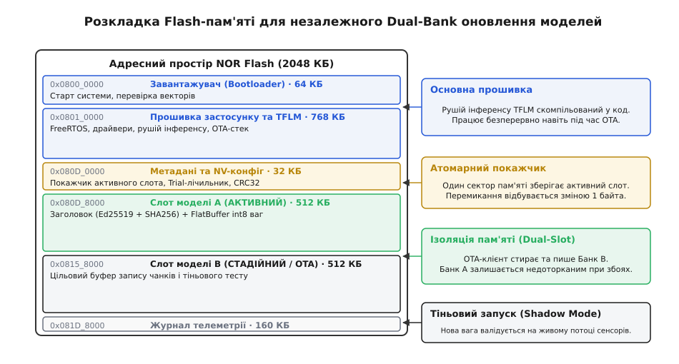
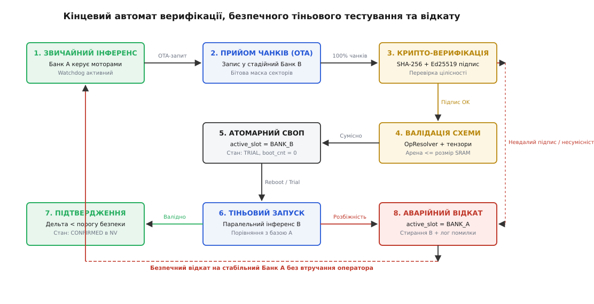

# Оновлення моделі в полі: модель як частина прошивки

<preknowlist>
- [TinyML](root:sf-ml/tinyml) — запуск нейромереж на мікроконтролерах: обмеження пам'яті (Flash, SRAM) та організація тензорної арени.
- [Квантування нейромереж](root:sf-ml/model-quantization) — переведення ваг у цілочисельний формат int8 із параметрами scale та zero_point.
- [Латентність інференсу](root:sf-ml/inference-latency) — жорсткі дедлайни виконання моделі у циклах реального часу.
- [Навчання проти інференсу](root:sf-ml/train-vs-inference) — розподіл ролей: бортовий чип виконує фіксований граф, а оптимізація ваг відбувається на сервері.
</preknowlist>

Автономний вібраційний датчик на роторі промислового насоса чи бортовий контролер безпілотного апарата працює під керуванням мікроконтролера з 2 МБ вбудованої Flash-пам'яті та 256 КБ оперативної пам'яті SRAM. Для діагностики дефектів підшипників або стабілізації польоту в реальному часі виконується квантована нейромережа розміром 380 КБ. Якщо модель скомпільована як звичайний статичний масив констант (`const unsigned char g_model[]`) безпосередньо в секцію коду `.rodata` монолітної прошивки, будь-яке коригування ваг — наприклад, після донавчання на нових типах шумів — вимагає повної перепрошивки всього мікроконтролера.

Повне оновлення монолітного двійкового файлу розміром 1.5 МБ через польовий радіоканал (протокол MAVLink FTP або Bluetooth Low Energy зі швидкістю передачі 15–30 кбіт/с) триває від 10 до 20 хвилин. Увесь цей час пристрій змушений перебувати у спеціальному режимі завантажувача: планувальник RTOS зупинено, ШІМ-генератори моторів вимкнено, а сенсори не опитуються. Якщо під час запису секторів Flash станеться просідання напруги батареї або втрата зв'язку, пошкодження системного завантажувача перетворює пристрій на непрацездатний блок («цеглину»), відновлення якого в польових умовах вимагає фізичного демонтажу та підключення програматора SWD/JTAG.

Відокремлення нейромережі від виконуваного коду операційної системи у незалежний розділ пам'яті (Dedicated Model Partition) змінює парадигму обслуговування бортового інтелекту. Замість ризикованої заміни системного ядра пристрій приймає лише новий двійковий артефакт ваг, записує його в резервний банк Flash без зупинки основного циклу керування, валідує криптографічну цілісність, перевіряє сумісність із рушієм інференсу та виконує безпечне перемикання з можливістю автоматичного відкату.

## Монолітне вшивання проти виділеного розділу Flash

Традиційний підхід до розгортання моделей у мікроконтролерах полягає у перетворенні двійкового файлу FlatBuffer (`.tflite`) у вихідний C-файл за допомогою утиліти `xxd -i` або правила CMake `bin2c`. Компілятор розміщує масив ваг у секції констант `.rodata`, а лінкер призначає йому фіксовану абсолютну адресу в адресному просторі Flash поруч із машинним кодом ядра:

```
Linker Script (Monolithic Layout):
  FLASH (rx) : ORIGIN = 0x08000000, LENGTH = 2048K
  SECTIONS {
    .text   : { *(.text*) } > FLASH
    .rodata : { *(.rodata*) } > FLASH   <-- Ваги моделі змішані з рядками та кодом
    .data   : { *(.data*) } > SRAM AT> FLASH
  }
```

Такий підхід має одну перевагу: простоту початкової розробки. Не потрібно налаштовувати розмітку пам'яті, писати драйвер стирання Flash чи керувати покажчиками адрес. Проте в умовах реальної експлуатації виникає комплекс фундаментальних обмежень:

1. **Нероздільність життєвих циклів ПЗ та ваг**: виправлення помилки в драйвері I2C вимагає перекомпіляції та повторного завантаження 400 КБ ваг моделі, а зміна коефіцієнтів нейромережі змушує перезаписувати перевірений двійковий код RTOS;
2. **Неможливість часткового OTA-оновлення**: протокол передачі оновлень не може передати лише дельту ваг, оскільки компілятор міняє зміщення адрес усіх функцій при будь-якій зміні розміру моделі;
3. **Блокування Flash-контролера (Flash Stall)**: запис у спільний банк пам'яті унеможливлює вибірку коду ядра, що спричиняє зависання контролера під час прийому пакетів.

Альтернативою є виділення двох ізольованих областей (Банк A та Банк B) у структурі Flash-пам'яті. У скрипті компонування (Linker Script) базова прошивка та рушій TensorFlow Lite for Microcontrollers (TFLM) лінкуються у початкові сектори Flash, а слоти моделей виносяться на фіксовані границі фізичних секторів:

```
Linker Script (Partitioned Layout):
  BOOTLOADER   (rx) : ORIGIN = 0x08000000, LENGTH = 64K
  APP_FIRMWARE (rx) : ORIGIN = 0x08010000, LENGTH = 768K
  NV_METADATA  (r)  : ORIGIN = 0x080D0000, LENGTH = 32K
  MODEL_BANK_A (r)  : ORIGIN = 0x080D8000, LENGTH = 512K
  MODEL_BANK_B (r)  : ORIGIN = 0x08158000, LENGTH = 512K
  TELEMETRY    (r)  : ORIGIN = 0x081D8000, LENGTH = 160K
  
  SECTIONS {
    .bootloader   : { *(.bootloader*) } > BOOTLOADER
    .text         : { *(.text*) *(.rodata*) } > APP_FIRMWARE
    .nv_metadata  : { *(.nv_metadata*) } > NV_METADATA
    .model_bank_a : { 
        . = ALIGN(16);
        _smodel_bank_a = .;
        *(.model_bank_a*) 
        _emodel_bank_a = .;
    } > MODEL_BANK_A
    .model_bank_b : { 
        . = ALIGN(16);
        _smodel_bank_b = .;
        *(.model_bank_b*) 
        _emodel_bank_b = .;
    } > MODEL_BANK_B
  }
```

Вимога `. = ALIGN(16)` є критично важливою: апаратні векторні прискорювачі та DSP-інструкції ядер ARM Cortex-M (інструкції SIMD/NEON у Cortex-M4/M7 або векторне розширення Helium MVE у Cortex-M55/M85) вимагають вирівнювання адрес тензорних масивів за межею 4, 8 або 16 байтів. Якщо покажчик на ваги виявиться непарним або не кратним 4 байтам, перша ж операція множення `SMLAD` викличе апаратне переривання `UsageFault (UNALIGNED access)`.

У цій архітектурі рушій інференсу ініціалізується не статичним масивом `g_model`, а покажчиком на активну адресу:
`const uint8_t *model_ptr = (const uint8_t*)active_slot_address;`
Детальна реалізація низькорівневого коду запису та перемикання банків винесена в інженерну вставку [модуля безпечного OTA-оновлення](root:sf-ml/onovlennia-modeli-v-poli/proj-ota-model-updater.md).

## Фізика Flash-пам'яті, Dual-Bank архітектура та блокування шин

Щоб проектувати надійні системи польового оновлення, інженер має розуміти фізичні процеси всередині кремнієвого кристала Flash-пам'яті. Мікроконтролери використовують пам'ять типу NOR, комірки якої організовані паралельно. Запис здійснюється інжекцією гарячих електронів (Hot Electron Injection) у плаваючий затвор, що підвищує порогову напругу транзистора і переводить біт із стану `1` у стан `0`.

Для переведення нуля назад в одиницю застосовується тунелювання Фаулера-Нордгейма (Fowler-Nordheim Tunneling). Генератор високої напруги (Charge Pump) на кристалі чипа формує потенціал 12–18 В на підкладці всього сектора, видаляючи накопичений заряд з усіх затворів одночасно. Цей процес триває від десятків до сотень мілісекунд (наприклад, стирання 128 КБ сектора у чипах STM32H7 триває до 1.5–2 секунд, а стирання 4 КБ сектора у SPI Flash — 40–100 мс).


*Розкладка Flash-пам'яті: ізоляція системної прошивки, двох слотів моделей та сектору метаданих.*

Під час стирання сектора внутрішній Flash-контролер перемикає лінії адреси та даних у службовий режим. Якщо ядро процесора (Cortex-M4/M7) спробує виконати чергову інструкцію із того ж фізичного масиву Flash, шинна матриця AHB/AXI виставляє сигнали `HREADY / WAIT STATES`, повністю призупиняючи тактування конвеєра CPU. Це явище називається **Flash Controller Stall**.

Flash Stall створює неприпустимий джиттер у системах реального часу: переривання від таймера ШІМ або датчика IMU не можуть виконатися, оскільки таблиця векторів переривань або код обробника ISR розташовані у заблокованій пам'яті.

Розв'язанням цієї проблеми є застосування однієї з двох апаратних топологій:
1. **Двобанкова внутрішня пам'ять (Dual-Bank Internal Flash)**. Кристал мікроконтролера містить два незалежні масиви Flash (Bank 1 та Bank 2), кожен із власним помповим генератором напруги та лініями керування. Процесор безперервно вибирає інструкції та константи з Банку 1 на максимальній частоті, тоді як DMA або фоновий потік стирає та програмує Банк 2;
2. **Зовнішня NOR Flash через шину Quad-SPI / Octo-SPI (XIP)**. Основне ядро прошивки та RTOS працюють із внутрішньої Flash мікроконтролера, а слоти моделей виносяться на зовнішній чип пам'яті (наприклад, Winbond W25Q128 або Macronix MX25L). Зчитування ваг під час інференсу здійснюється в режимі прямого відображення пам'яті (Execute-in-Place, XIP) через апаратний кеш контролера QSPI, а запис чанків оновлення виконується незалежними транзакціями шини SPI.

> 🔧 **Навіщо це.** Якщо розмістити код обробників переривань керування у внутрішньому ОЗП (`.ramfunc` / `IRAM_ATTR`), а слоти моделей винести у другий банк Flash або зовнішній QSPI-чип, оновлення ваг вагою 500 КБ відбувається у фоновому режимі без жодного пропущеного такту в критичних контурах стабілізації чи зв'язку.

## Протоколи польової доставки: чанкування, керування вікном та відновлення

Нейромережевий файл занадто великий, щоб передати його одним пакетом через низькошвидкісні польові канали зв'язку. Процес оновлення завжди базується на **чанкуванні** — нарізанні файлу на блоки фіксованого розміру, які відповідають обмеженням транспортного протоколу.

```
+-------------------------------------------------------------------------------+
|                       Chunked OTA Transmission Flow                           |
|                                                                               |
|  Server / GCS                     Target Node (MCU)                           |
|       |                                   |                                   |
|       |-- Session Open (Size, Hash) ----->| Allocates Bank B, Erases Sector 0 |
|       |<-- Session ACK (Next Offset: 0) --|                                   |
|       |                                   |                                   |
|       |-- Chunk 0 (Offset 0, 240 B) ----->| Writes to Bank B + 0              |
|       |-- Chunk 1 (Offset 240, 240 B) --->| Writes to Bank B + 240            |
|       |-- Chunk 2 (Offset 480, 240 B) --->| Writes to Bank B + 480            |
|       |             [Packet Dropped]      |                                   |
|       |-- Chunk 3 (Offset 720, 240 B) --->| Offset Gap! Expected 720 != 480   |
|       |<-- NACK (Expected Offset: 480) ---|                                   |
|       |                                   |                                   |
|       |-- Chunk 2 Resend (Offset 480) --->| Writes to Bank B + 480            |
|       |<-- ACK (Next Offset: 720) --------|                                   |
+-------------------------------------------------------------------------------+
```

Особливості реалізації чанкування залежать від каналу зв'язку:
- **Bluetooth Low Energy (BLE GATT)**: Стандартний кадр BLE L2CAP має розмір MTU (Maximum Transmission Unit) 23 байти (3 байти службові, 20 байтів корисних даних). У сучасних стеках BLE 4.2/5.0 клієнт ініціює процедуру `GATT MTU Exchange`, розширюючи буфер до 247–512 байтів (Data Length Extension, DLE). Це дозволяє передавати чанки розміром 240 байтів без фрагментації на канальному рівні;
- **CAN / CAN FD**: Класичний CAN обмежує довжину кадру 8 байтами, вимагаючи використання транспортного рівня ISO 15765-2 (ISO-TP) для збирання пакетів. У CAN FD розмір кадру збільшено до 64 байтів, де перші 4 байти відводяться під порядковий номер чанка, а 60 байтів — під payload;
- **MAVLink FTP (Telemetry Radio)**: Протокол MAVLink використовує службове повідомлення `FILE_TRANSFER_PROTOCOL` (ID #110). Кожен пакет несе 239 байтів корисних даних із заголовком операції (Read/Write/Burst), ідентифікатором сесії та 32-бітним зміщенням файлу (`offset`);
- **CoAP / HTTP через Wi-Fi або LTE-M**: Застосування розширення CoAP Block-Wise Transfer (RFC 7959) із розміром блоку `SZX=6` (1024 байти), що дозволяє асинхронно запитувати послідовні сегменти через ненадійні бездротові мережі з контролем переповнення вікна (Congestion Control).

### Керування вікном та оптимізація пропускної здатності
У класичному режимі підтвердження кожного пакета (Stop-and-Wait ACK) значна частина радіоефіру витрачається на перемикання трансивера між режимами прийому та передачі (Turn-around Time). Для передачі 380 КБ файлу при розмірі чанка 240 байтів необхідно надіслати близько 1600 пакетів. Якщо час підтвердження одного кадру становить 100 мс, оновлення триває понад 160 секунд.

Для оптимізації застосовують блокове підтвердження (Block Acknowledgment):
1. Сервер передає пачку (Burst) із 16 чанків (3840 байтів, що вкладається в один 4-кілобайтний сектор Flash) без очікування проміжних відповідей;
2. Клієнт записує дані у Flash та підтримує бітову маску отриманих пакетів (`uint16_t received_mask`);
3. Після завершення пачки клієнт надсилає єдиний пакет статусу з маскою відсутніх чанків;
4. Сервер повторно надсилає лише ті зміщення, біти яких дорівнюють нулю.

Такий підхід на фізичному рівні BLE 2M PHY підвищує реальну швидкість передачі з 2.4 кБ/с до 42 кБ/с, скорочуючи тривалість сесії оновлення моделі вагою 380 КБ до менш ніж 10 секунд.

Ключовим елементом надійності є **управління зміщенням (Offset Tracking)**. Клієнт на мікроконтролері не зберігає стан проміжних чанків у великих буферах ОЗП (це вичерпало б SRAM). Замість цього кожен отриманий пакет негайно записується у Flash за зміщенням `target_bank_address + offset`.

Якщо у промисловому цеху через електромагнітні завади чи відбиття сигналу від металевих конструкцій стається тимчасове падіння відношення сигнал/шум (SNR Fade), окремі радіопакети губляться. Клієнт підтримує бітову маску підтверджених блоків (ACK Bitmap Vector). Замість пересилання всього файлу сервер отримує запит на повторну передачу виключно втрачених зміщень, що скорочує енерговитрати радіотракту на 80–90%.

Якщо під час передачі стається повний обрив зв'язку, клієнт зберігає останнє підтверджене зміщення `received_bytes` у секторі метаданих. Після відновлення радіоканалу сервер запитує поточний стан сесії, зчитує `received_bytes` і продовжує передачу саме з цієї позиції, без необхідності повторного завантаження вже прийнятих сотень кілобайтів.

## Захист цілісності, криптографічні підписи та валідація сумісності

Захист оновлення складається з трьох послідовних бар'єрів: перевірки цілісності передачі, криптографічної автентифікації автора та перевірки апаратної сумісності графу нейромережі.

```
+-------------------------------------------------------------------------------+
|                       Three-Stage Validation Pipeline                         |
|                                                                               |
| 1. Transmission Integrity (CRC32 / SHA-256)                                   |
|    - CRC32: catches bit-level corruption on radio/bus packets                |
|    - SHA-256: verifies whole binary payload against header digest             |
|                                                                               |
| 2. Cryptographic Authenticity (Ed25519 / ECDSA)                               |
|    - Verifies digital signature over SHA-256 hash using baked public key      |
|    - Rejects unauthorized, tampered, or third-party modified models           |
|                                                                               |
| 3. Runtime Compatibility & Resource Gate (TFLM Contract)                      |
|    - FlatBuffer Schema Version check (Schema v3)                              |
|    - Required Tensor Arena size <= Available SRAM Budget                      |
|    - OpResolver Check: all model operators compiled into firmware             |
|    - Tensor Shapes & Quantization Parameters (Scale, Zero-Point) match driver |
+-------------------------------------------------------------------------------+
```

### 1. Перевірка цілісності передачі та криптографічний підпис
Контрольна сума CRC32 ефективно виявляє випадкові спотворення бітів під час проходження через радіоканал чи шину зв'язку, однак вона не захищає від навмисної підміни файлу. Для гарантії цілісності всього 512-кілобайтного образу обчислюється криптографічний хеш SHA-256.

Оскільки мікроконтролер не може завантажити весь файл у RAM, обчислення виконується потоково:
```
H₀ = SHA256_INIT()
H₁ = SHA256_UPDATE(H₀, Chunk_0)
...
Hₙ = SHA256_UPDATE(Hₙ₋₁, Chunk_N)
Digest = SHA256_FINAL(Hₙ)
```

Отриманий дайджест перевіряється за допомогою цифрового підпису **Ed25519** (на еліптичній кривій Curve25519) або **ECDSA secp256r1**. Відкритий ключ розробника прошивається у захищені комірки одноразового програмування (OTP / eFuses) або компілюється в захищений сектор завантажувача. Підпис гарантує, що модель створена авторизованою командою інженерів і не містить шкідливих маніпуляцій вагами (Backdoor attacks / Adversarial weight perturbation).

Математична перевага Ed25519 над класичним RSA-2048 полягає у компактності ключів та обчислювальній ефективності на 32-бітних мікроконтролерах:
- Розмір відкритого ключа Ed25519 становить лише 32 байти (проти 256 байтів у RSA-2048);
- Розмір цифрового підпису становить 64 байти (проти 256 байтів у RSA-2048);
- Перевірка підпису Ed25519 виконується з фіксованим часом без динамічного виділення пам'яті (No Dynamic Memory Allocation), що усуває ризик фрагментації купи під час криптографічних операцій;
- Витрати процесорного часу становлять близько 18 мільйонів тактів на ядрі Cortex-M4 (приблизно 105 мс на частоті 168 МГц), що є одноразовою операцією під час фіналізації образу і не впливає на постійну латентність інференсу.

### 2. Структурна інспекція FlatBuffer без динамічної пам'яті
Двійковий формат FlatBuffer організований у вигляді ієрархічних таблиць зі зміщеннями (vtable offsets). Перед викликом парсера TFLM модуль оновлення виконує попередню інспекцію безпеки безпосередньо у Flash-пам'яті:
1. Зчитується перше 32-бітне слово файлу, яке містить зміщення до кореневої таблиці `Model`;
2. Перевіряється наявність сигнатури `TFL3` за зміщенням 4–7 байтів від початку файлу;
3. Виконується санітарна перевірка зміщень таблиць операторів (`operator_codes`), підграфів (`subgraphs`) та буферів тензорів (`buffers`). Усі зміщення повинні перебувати строго в межах діапазону `[0, payload_size]`.

Така попередня перевірка захищає мікроконтролер від атак типу Memory-Mapped Escape, коли спеціально сформований файл FlatBuffer містить зміщення, спрямовані на адреси периферійних регістрів мікроконтролера (наприклад, скидання захисту Flash чи конфігурації портів GPIO).

### 3. Контракт сумісності метаданих (Runtime Compatibility Gate)
Навіть якщо підпис валідний, модель може бути скомпільована для іншої конфігурації прошивки. Перед перемиканням активного банку модуль OTA виконує санітарний аудит контейнера:

- **Версія схеми FlatBuffer**: файл повинен відповідати версії FlatBuffer, яку підтримує компільований парсер TFLM;
- **Перевірка реєстратора операторів (OpResolver Audit)**: рушій TFLM для економії Flash не включає повний набір із сотень ядер TensorFlow, а використовує `tflite::MicroMutableOpResolver<N>`, де вручну зареєстровано лише потрібні операції:
  ```cpp
  tflite::MicroMutableOpResolver<5> resolver;
  resolver.AddConv2D();
  resolver.AddDepthwiseConv2D();
  resolver.AddRelu();
  resolver.AddReshape();
  resolver.AddFullyConnected();
  ```
  Якщо нова модель містить шар `Add` або `Softmax`, який не був доданий у `resolver` на етапі компіляції прошивки, функція `AllocateTensors()` поверне помилку `kTfLiteError`. Модуль оновлення парсить список операторів у заголовку моделі і відхиляє оновлення ще до перезавантаження, якщо виявлено незареєстрований оператор;
- **Ліміт тензорної арени (Tensor Arena Limit)**: заголовок моделі декларує точний обсяг пам'яті, необхідний для роботи планувача тензорів. Якщо нова модель вимагає 96 КБ арени, а системний конфіг виділяє під нейромережу лише 64 КБ SRAM, спроба алокації спричинить падіння системи. Оновлення блокується за правилом `required_arena_size <= kMaxAllowedArena`;
- **Розмірності та параметри квантування тензорів**: вхідний масив сенсорів (наприклад, віконний зріз 128 відліків акселерометра) повинен відповідати формі вхідного тензора `[1, 128, 1, 1]` та очікуваному типу `int8_t`. Крім того, перевіряються параметри квантування (масштаб `scale` та нульова точка `zero_point`): якщо модель навчена під іншу чутливість АЦП, вихідні передбачення будуть спотворені.

## А/В тестування в полі, тіньовий запуск (Shadow Mode) та відкат

Найнебезпечніший момент оновлення — передача новій моделі прямого керування виконавчими механізмами (моторами, клапанами, кермовими машинками). Якщо нова нейромережа містить дефект узагальнення (Overfitting на специфічні дані) або генерує неадекватні значення в нештатних режимах польоту, пристрій зазнає аварії.

Для запобігання польовим аваріям застосовується концепція **Тіньового режиму (Shadow Mode / Canary Deployment)**.


*Кінцевий автомат валідації, тіньового запуску та автоматичного відкату моделі.*

Життєвий цикл переходу на нову модель складається з чітких фаз кінцевого автомата:

1. **Фаза запису та стадіювання (Staging)**: пасивний Банк B заповнюється даними, перевіряється підпис SHA-256/Ed25519 та сумісність метаданих;
2. **Фаза атомарного перемикання (Atomic Swap)**: покажчик `active_slot` у секторі метаданих перемикається на Банк B, статус встановлюється у `ML_STATE_TRIAL`, а лічильник спроб `trial_boots_remaining` ініціалізується числом 3;
3. **Фаза тіньового запуску (Shadow Execution)**: після перезавантаження мікроконтролер ініціалізує обидва інтерпретатори:
   - Основна модель (Банк A) отримує реальні дані сенсорів, виконує інференс і **керує актуаторами**;
   - Кандидатна модель (Банк B) паралельно отримує **копію тих самих сенсорних даних** у фоновому потоці з нижчим пріоритетом. Виходи моделі B **не передаються на мотори**, а записуються у діагностичний буфер телеметрії;
   - Фоновий монітор обчислює розбіжність виходів (Divergence Metric):
     ```
     Δ = |Output_A - Output_B|
     ```
     Для задач класифікації розбіжність оцінюється як відстань Кульбака-Лейблера або різниця максимальних ймовірностей класів, а для задач виявлення аномалій — як зміщення порогу похибки реконструкції автоенкодера. Для регресійних систем керування розраховується середньоквадратична різниця передбачень на ковзному вікні з 64 відліків:
     ```
     RMSD = sqrt( (1/64) · ∑ (y_A[i] - y_B[i])² )
     ```
   - Якщо протягом контрольного періоду (наприклад, 1000 циклів інференсу) модель B працює стабільно, не спричиняє винятків ділення на нуль, вкладається у дедлайни реального часу (Latency < 20 мс) і показує кореляцію з базовою моделлю, вона отримує статус `CONFIRMED`;
4. **Фаза промоції (Canary Promotion)**: нова модель призначається основним джерелом керування, а Банк A звільняється для майбутніх оновлень;
5. **Аварійний відкат (Rollback on Boot / Watchdog Trigger)**: якщо кандидатна модель зависає, апаратний сторожовий таймер (Watchdog) перезавантажує мікроконтролер. Під час старту функція `boot_validate_or_rollback` бачить статус `ML_STATE_TRIAL` і декрементує лічильник `trial_boots_remaining`. Якщо лічильник вичерпано, система миттєво повертає покажчик `active_slot` на стабільний Банк A, маркує Банк B як `ML_STATE_FAILED` і відправляє діагностичне повідомлення на станцію моніторингу.

## Реалізація модуля завантаження та тіньового моніторингу

Нижче наведено практичну реалізацію менеджера моделей мовами C99 та C++20. Код реалізує вибірку моделі з активного слота, запуск інтерпретатора TFLM та обчислення метрики розбіжності передбачень у тіньовому режимі.

:::tabs
:::code onovlennia-modeli-v-poli-d/c/main.c
:::code onovlennia-modeli-v-poli-d/cpp/main.cpp
:::

## Польовий сценарій: повний життєвий цикл оновлення на борту БПЛА

Для демонстрації взаємодії всіх компонентів розглянемо реальний інженерний сценарій: розвідувальний дрон виконує місію на висоті 100 метрів. На борту працює акустична нейромережа (Cortex-M7, 216 МГц), яка аналізує спектр мікрофона для виявлення детонації двигуна та пошкоджень лопатей.

Хронологія польового оновлення розгортається таким чином:
1. **00:00 (Виявлення потреби)**: Наземна станція керування (GCS) отримує телеметрію з підвищеним рівнем шуму через сильний зустрічний вітер. Серверна модель адаптується, квантується в INT8 (розмір 312 КБ) і підписується закритим ключем Ed25519;
2. **00:02 (Ініціалізація OTA)**: GCS надсилає команду початку сеансу через MAVLink FTP на швидкості 57600 бод. Модуль OTA на дроні відкриває сесію, стирає Банк B і підтверджує готовність;
3. **00:08 (Передача чанків у фоні)**: За 6 секунд передаються 1300 пакетів по 240 байтів. 14 втрачених пакетів повторно запитуються через маску втрат. Головний контур стабілізації польоту з частотою 400 Гц працює з Банку A у внутрішній пам'яті без жодної мікросекунди затримки;
4. **00:09 (Фіналізація та верифікація)**: Бортовий CPU витрачає 88 мс на обчислення SHA-256 та перевірку підпису Ed25519. Схема підтверджує сумісність: необхідний розмір арени 38 КБ укладається у виділені 48 КБ SRAM;
5. **00:10 (Тіньовий запуск)**: Покажчик перемикається у стан `TRIAL`. Протягом наступних 30 секунд (300 інференсів) нова модель працює паралельно з основною у фоновому потоці RTOS (пріоритет `osPriorityLow`). Середня розбіжність передбачень становить `Δ = 0.03`, а час одного інференсу — 11.2 мс при дедлайні 30 мс;
6. **00:40 (Промоція)**: Усі критерії успішно виконані. Покажчик у секторі метаданих оновлюється на `CONFIRMED`. Нова модель бере на себе захист двигуна.

## Інженерні компроміси, ресурс пам'яті та діагностика

Впровадження незалежного OTA-оновлення моделей вимагає зваженого інженерного аналізу ціни архітектурних рішень:

1. **Накладні витрати Flash-пам'яті (Overhead Allocation)**:
   Подвійна буферизація (Dual-Slot) вимагає резервування додаткового обсягу Flash, рівного максимальному розміру моделі (наприклад, 2 × 512 КБ = 1 МБ). У бюджетних чипах із загальним обсягом 512 КБ чи 1 МБ реалізувати Dual-Bank всередині мікроконтролера неможливо без скорочення коду застосунку. У таких сценаріях єдиним економічно обґрунтованим рішенням є встановлення зовнішньої мікросхеми SPI/QSPI NOR Flash вартістю менше $0.30, що знімає обмеження на розмір моделей і захищає системний кристал від теплового деградування;
2. **Зношування секторів метаданих (Endurance Management)**:
   Кількість циклів перезапису стандартної вбудованої Flash становить від 10 000 до 100 000 операцій. Якщо сектор метаданих перезаписується при кожному запуску системи чи зміні режиму, фізичний сектор деградує протягом року. Застосування алгоритму послідовного запису записів зі зміщенням (Log-Structured Metadata Append) дозволяє виконати 64 оновлення метаданих на один фізичний цикл стирання сектора 4096 байтів;
3. **Діагностичне простеження через SWO та RTT**:
   Під час польового налагодження стан процесу OTA транслюється через високошвидкісні неблокуючі інтерфейси SEGGER Real-Time Transfer (RTT) або ARM Cortex Serial Wire Output (SWO), що не спотворює часові характеристики інференсу на відміну від стандартного `printf` через повільний UART;
4. **Конкуренція за доступ до оперативної пам'яті під час тіньового інференсу**:
   Одночасний запуск двох моделей (основної та тіньової) подвоює пікове навантаження на тензорну арену. Якщо виділити дві окремі арени по 48 КБ (загалом 96 КБ із 128 КБ доступних у чипі), оперативна пам'ять для мережевих буферів та стека RTOS-задач критично скорочується. Інженерне рішення полягає у **послідовному перевикористанні єдиної арени**: спочатку в арені виконується основний інференс для генерації керуючого сигналу, після чого той самий буфер пам'яті передається тіньовому інтерпретатору для розрахунку кандидатних передбачень;
5. **Вплив робочої температури на утримання заряду (Data Retention)**:
   В умовах промислового використання при температурах від +70°C до +85°C швидкість витоку заряду з плаваючих затворів комірок Flash суттєво зростає. Якщо за нормальної температури термін зберігання даних становить 20 років, то при підвищеній температурі він скорочується до 3–5 років. Регулярна фонова перевірка цілісності ваг через CRC32/SHA-256 дозволяє вчасно виявити деградацію окремих бітів (Bit Rot) і запросити планове OTA-оновлення банку;
6. **Захист від скидання живлення (Power-Fail Invariants)**:
   Оновлення метаданих спроектовано як транзакційний лог: стирання сектора метаданих відбувається лише тоді, коли сектор повністю заповнений застарілими записами. У кожному записі прапорець валідності встановлюється окремим атомарним записом 32-бітного слова після запису всіх полів структури. Якщо живлення зникає посеред запису, наступне завантаження виявляє нульовий або пошкоджений прапорець і відкатується до попереднього цілісного стану без втрати працездатності.

Відокремлення моделі у виділений розділ Flash у поєднанні з криптографічною верифікацією та механізмом тіньового запуску перетворює вбудовану систему на захищену платформу з можливістю безперервного навчання та еволюції інтелекту без ризику відмови польового обладнання.
