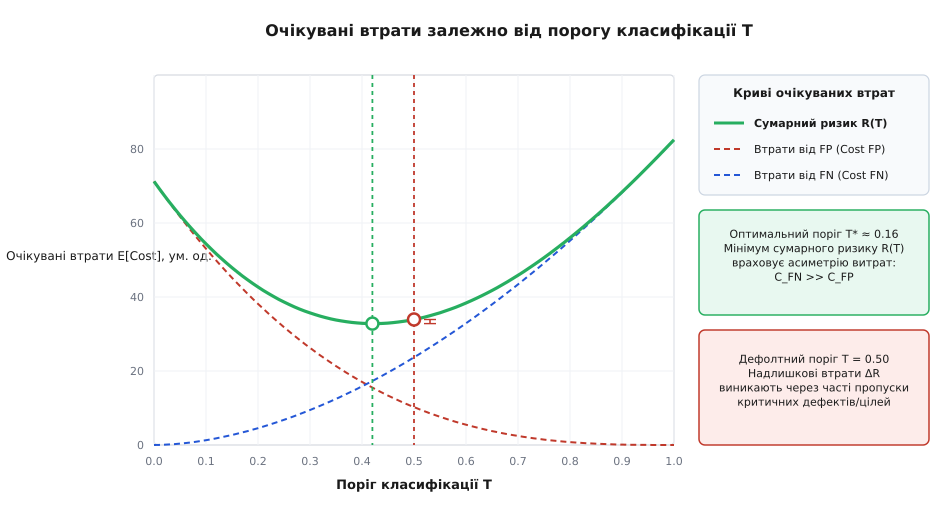
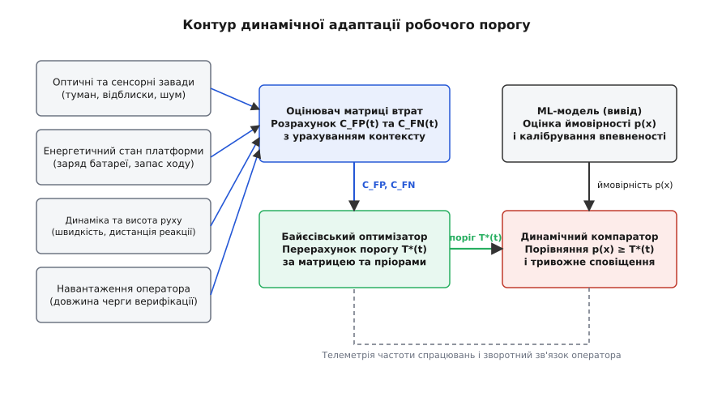

# Поріг і ціна помилки: хибне спрацювання проти пропуску

<preknowlist>
- [Метрики якості моделі: точність, повнота, матриця плутанини](root:sf-ml/metryky-iakosti-modeli) — значення True Positive, False Positive, True Negative, False Negative, чутливість (recall) та точність (precision).
- [Правило чи модель](root:sf-ml/pravylo-chy-model) — вибір між детерміністичними евристиками та ймовірнісним виводом в автономних інженерних системах.
- [Калібрування впевненості моделі](root:sf-ml/confidence-calibration) — перетворення сирих логітів або оцінок моделі на достовірну апостеріорну ймовірність.
</preknowlist>

Бортовий комп'ютер діагностики авіаційного газотурбінного двигуна аналізує спектрограму вібрацій підшипника головного вала. Нейромережевий класифікатор формує неперервну оцінку ймовірності наявності мікротріщини: для поточного кадру обчислене значення становить `0.23`. Якщо система використовує стандартне вирішальне правило з порогом `0.50`, вона класифікує стан як нормальний і не генерує тривоги. Через двадцять годин польоту мікротріщина спричиняє втомне руйнування сепаратора підшипника, заклинювання турбіни на ешелоні та екстрену посадку з руйнуванням мотогондоли вартістю 450 000 доларів. Водночас позапланова стендова ультразвукова перевірка підшипника за сигналом хибної тривоги коштує 350 доларів і триває тридцять хвилин. Застосування математично симетричного порогу перетворило асиметричну фізичну задачу з катастрофічними наслідками на джерело системного руйнування.

Будь-який імовірнісний класифікатор (від латинського *classis* — розряд, група та *facere* — робити) у машинному навчанні не ухвалює остаточного фізичного рішення, а лише оцінює апостеріорну ймовірність (від латинського *a posteriori* — з наступного, на основі досвіду) належності вхідного вектора ознак до певного класу. Перехід від неперервної оцінки впевненості до дискретної дії — активації реле аварійного скидання тиску, наведення оптичного трекера, блокування банківської транзакції чи пропуску деталі на наступний етап збирання — вимагає явного вибору робочого порогу (англ. *decision threshold*). Цей поріг визначає межу розділення простору ймовірностей на зони дії.

Усталена академічна практика фіксації порогу на рівні `0.50` спирається на неявне припущення про те, що всі типи помилок класифікації мають абсолютно однакову вартість, а класи в генеральній сукупності зустрічаються з рівною частотою. У реальних інженерних системах жодне з цих двох припущень майже ніколи не справджується. Наслідки пропуску критичного дефекту в тримальних конструкціях літальних апаратів, витоку газу в компресорних станціях чи зіткнення автономного робота з перешкодою неспівмірно перевищують витрати на перевірку хибного спрацювання. Вибір робочої точки класифікатора є не статистичною константою моделі, а інженерним компромісом між фінансовими, часовими та безпековими втратами.

## Небезпека дефолтного порогу 0.5 у фізичному світі

Поріг `0.50` природно виникає під час мінімізації симетричної логістичної функції втрат (англ. *binary cross-entropy loss* або *log-loss*), де помилка першого роду (хибне спрацювання, англ. *false positive*, `FP`) та помилка другого роду (пропуск цілі чи дефекту, англ. *false negative*, `FN`) штрафуються однаковим ваговим коефіцієнтом, рівним одиниці. Якщо навчальна вибірка штучно збалансована і містить рівно половину позитивних та половину негативних зразків, значення `p(x) = 0.50` відповідає точці максимальної невизначеності, де апостеріорне відношення шансів дорівнює одиниці.

Коли така модель потрапляє в реальну експлуатацію, вона стикається з двома незалежними факторами, які зміщують раціональну межу ухвалення рішень далеко від математичного центра `0.50`.

Першим фактором є апріорний дисбаланс класів (англ. *class imbalance*), відомий у теорії ймовірностей як помилка базової частоти (англ. *base rate fallacy*). Рідкісні критичні події — відмова сервоприводу, займання акумуляторної комірки, виявлення малорозмірного безпілотника в радіолокаційному відбитті — трапляються в частці `10⁻³` або `10⁻⁵` від загального обсягу спостережень. Якщо апріорна ймовірність дефекту становить `P(Y = 1) = 0.001`, класифікатор з порогом `0.50` вимагатиме від детектора настільки високого відношення правдоподібності, що більшість реальних пошкоджень на ранніх стадіях розвитку буде пропущено.

Другим фактором є асиметрія фізичних і фінансових наслідків. У промисловому виробництві мікроелектроніки пропуск бракованого кристала процесора в готовий серверний вузол спричиняє відкликання готового виробу з дата-центру та компенсаційні виплати замовнику. Вартість пропуску браку (`C_FN`) у сотні разів перевищує вартість автоматичного відкидання працездатного кристала на повторне тестування (`C_FP`).

Розглянемо докладний приклад функціонування системи вібраційного моніторингу роторного механізму на насосній станції магістрального нафтопроводу. У системі здійснюється безперервний збір спектрограм вібрації з частотою один вимір на секунду, що формує рівно 86 400 вимірювань за одну добу безперервної роботи. Апріорна ймовірність виникнення аварійного стану підшипника становить `0.001` (одна десята відсотка). Вартість хибного спрацювання `C_FP` становить 120 доларів (витрати часу змінного інженера на позаплановий ручний замір портативним вібрографом та заповнення акту перевірки). Вартість пропуску дефекту `C_FN` оцінюється у 85 000 доларів (руйнування вала, виникнення гідроудару в нафтопроводі, аварійна зупинка перекачування та штрафні санкції за порушення графіка транспортування). Витрати на коректні рішення `C_TP` та `C_TN` вважаються нульовими.

Якщо класифікатор має чутливість (повноту) `92%` та частку хибних спрацювань `1%` при стандартному порозі `0.50`, то за добу з 86.4 реальних дефектних станів модель коректно виявить приблизно 79.5 подій, пропустивши 6.9 критичних дефектів. Водночас із 86 313.6 нормальних станів система згенерує 863.1 хибних тривог.

Розрахунок добових збитків підприємства за дефолтного налаштування показує:
- Збитки від хибних тривог: 863.1 помножити на 120 доларів дорівнює 103 572 долари.
- Збитки від пропущених аварій: 6.9 помножити на 85 000 доларів дорівнює 586 500 доларів.
- Сумарні щодобові втрати становлять 690 072 долари.

Якщо інженер змінить поріг спрацювання і встановить його на рівні `0.08`, чутливість моделі зросте до `99.5%`, а частка хибних спрацювань підвищиться до `3.5%`. За такого налаштування кількість пропущених аварій зменшиться з 6.9 до 0.43 події на добу, хоча кількість хибних тривог зросте до 3020.98.

Перерахунок сумарних збитків за оптимізованого порогу дає:
- Збитки від хибних тривог: 3020.98 помножити на 120 доларів дорівнює 362 518 доларів.
- Збитки від пропущених аварій: 0.43 помножити на 85 000 доларів дорівнює 36 550 доларів.
- Сумарні втрати становлять 399 068 доларів.

Просте зміщення робочої точки класифікатора зменшило щоденні збитки підприємства на 291 004 долари (на сорок два відсотки) без будь-якої зміни архітектури нейронної мережі чи додаткового навчання моделі.

> 🔧 **Навіщо це.**
> Зміна робочого порогу — це найдешевший спосіб оптимізації інженерної системи. Вона не вимагає повторного збору даних, перенавчання моделі чи оновлення апаратних прискорювачів. Один числовий параметр у конфігураційному файлі прошивки адаптує ту саму математичну модель під кардинально відмінні експлуатаційні вимоги замовника.

## Фізичні прояви асиметрії помилок у критичних галузях

Щоб глибше зрозуміти природу асиметрії вартостей помилок, розглянемо п'ять типових інженерних систем, де вибір порогу безпосередньо впливає на надійність та безпеку технологічного процесу:

### 1. Автоматична стрілочна система швидкісної залізниці
В оптико-акустичній системі контролю затискання залізничного стрілочного переводу датчик фіксує сторонні предмети (камені баластної призми чи намерзання льоду) між вістряком і рамною рейкою перед проходженням поїзда.
- **Хибне спрацювання (FP)**: система сигналізує про заваду, коли в зону потрапив сухий листок або снігова пороша. Світлофор перемикається на червоний сигнал, швидкісний експрес сповільнюється, затримка рейсу становить сім хвилин. Вартість диспетчерського інциденту складає приблизно 400 доларів.
- **Пропуск перешкоди (FN)**: стрілка не замикається повністю через застряглий щебінь, але датчик не формує тривоги. Колісна пара локомотива на швидкості 160 кілометрів на годину врізається в незамкнений вістряк, що призводить до сходження поїзда з рейок, людських жертв та руйнування колії на суму понад 12 000 000 доларів.
- **Співвідношення вартостей**: вартість пропуску перевищує вартість хибного спрацювання у 30 000 разів. Оптимальний поріг класифікатора зміщується в зону надвисокої чутливості `T* ≈ 0.00003`.

### 2. Зоряний датчик орієнтації космічного апарата
Оптико-електронний зоряний трекер супутника зв'язку зіставляє скупчення світлових плям на ПЗЗ-матриці з бортовим зоряним каталогом для визначення кутової орієнтації апарата в інерційному просторі.
- **Хибне спрацювання (FP)**: трекер помилково приймає спалах від потрапляння космічної високоенергетичної частинки (космічного променя) за яскраву зірку навігаційного сузір'я. Алгоритм тріангуляції не сходиться, система скидає поточний кадр і переходить до наступного зрізу через 50 мілісекунд. Вартість становить нуль доларів.
- **Пропуск зірок (FN)**: через завищений поріг яскравості трекер відкидає тьмяні реальні зірки в умовах засвічення сонячним світлом від краю сонячних батарей. Супутник втрачає просторову фіксацію, починає неконтрольоване закручування, втрачає зв'язок із командним центром та розряджає буферні акумулятори через втрату освітлення панелей, що веде до повної втрати місії вартістю 180 000 000 доларів.
- **Співвідношення вартостей**: поріг детектування зірок має обиратися максимально низьким із подальшою фільтрацією хибних точок на рівні просторової геометрії сузір'я.

### 3. Лазерний 3D-принтер виготовлення титанових імплантів (SLM)
В установці селективного лазерного плавлення металевих порошків оптична пірометрична камера сканує ванну розплаву з частотою 10 000 кадрів на секунду для виявлення мікропор та несплавлень у тілі медичного ендопротеза тазостегнового суглоба.
- **Хибне спрацювання (FP)**: модель фіксує дефект у повністю проплавленій зоні через локальну флуктуацію відбиття лазерного променя. Контролер виконує додатковий холостий прохід лазером для переплавлення ділянки. Час друку виробу зростає на 0.2 секунди.
- **Пропуск пори (FN)**: внутрішня мікропорожнина розміром 40 мікрометрів залишається непоміченою всередині шийки імпланта. Через два роки експлуатації в тілі пацієнта виникає втомна тріщина, руйнування конструкції та необхідність важкої повторної хірургічної операції з судовим позовом на суму 250 000 доларів.
- **Співвідношення вартостей**: вартість пропуску дефекту в медичному виробництві диктує вибір порогу на рівні `0.01 ... 0.03`.

### 4. Інфузійний насос реанімаційного відділення
Мікроконтролерний дозатор лікарських засобів аналізує сигнал ультразвукового датчика прозорості трубки для виявлення бульбашок повітря в системі внутрішньовенного введення (запобігання повітряній емболії).
- **Хибне спрацювання (FP)**: тимчасова оптична неоднорідність або мікровібрація викликає коротку зупинку інфузії та звуковий сигнал тривоги. Чергова медсестра скидає попередження за три секунди.
- **Пропуск бульбашки (FN)**: потрапляння повітряного болюса об'ємом понад 0.5 мілілітра в центральний венозний катетер спричиняє закриття легеневої артерії та смерть пацієнта.
- **Співвідношення вартостей**: надійність захисту від пропуску має найвищий рівень функціональної безпеки (SIL-4), що вимагає виставлення порогу відсікання за мінімальним перевищенням порогу акустичного шуму.

### 5. Контролер компресора високого тиску на газорозподільній станції
Нейромережевий детектор аномалій аналізує акустичні шуми та тиск газу на виході ступеня нагнітання для своєчасного виявлення газодинамічного помпажу компресора.
- **Хибне спрацювання (FP)**: відкриття байпасного антипомпажного клапана при нормальній роботі компресора. Відбувається короткочасне скидання газу на факел або контур рециркуляції вартістю 800 доларів.
- **Пропуск помпажу (FN)**: розвиток помпажних коливань протягом трьох секунд призводить до зриву потоку з лопаток робочого колеса, руйнування підшипникових опор та пожежі на газовому терміналі з сумарними збитками понад 4 500 000 доларів.
- **Співвідношення вартостей**: відкриття клапана повинно ініціюватися за найменшої підозри на виникнення помпажної хвилі.

## Матриця вартості помилок (Cost Matrix / Loss Matrix)

Щоб оптимізувати поріг у формальній постановці, інженерний контекст формалізують у вигляді матриці втрат або матриці вартостей (від латинського *matrix* — першоджерело, реєстраційна таблиця). Для бінарної задачі матриця розмірністю `2 × 2` ставить у відповідність кожній парі «істинний стан середовища — ухвалене рішення» скалярну величину втрат `C(d, y)`, де `y ∈ {0, 1}` — істинний клас, а `d ∈ {0, 1}` — дискретне рішення системи:

```
                 Істинний клас y = 1       Істинний клас y = 0
Рішення d = 1          C_TP                      C_FP
Рішення d = 0          C_FN                      C_TN
```

Діагональні елементи `C_TP` (True Positive) та `C_TN` (True Negative) описують витрати на виконання коректної дії. У більшості задач ці величини вважають нульовими (`C_TP = 0, C_TN = 0`), проте в реальних системах вони можуть мати від'ємні значення (якщо позначають економічний прибуток від продажу або успішного захоплення цілі) чи додатні значення (якщо сама активація сканера або пуск ракети має ненульову собівартість пального чи ресурсу).

Позадіагональні елементи визначають ціну помилок:
- `C_FP` (вартість хибного спрацювання, або помилки I роду) — штраф за непотрібну дію в безпечному середовищі;
- `C_FN` (вартість пропуску дефекту чи події, або помилки II роду) — штраф за бездіяльність у момент реальної небезпеки чи наявності дефекту.

У реальній інженерній системі вартість помилки формується у трьох взаємопов'язаних вимірах:

```
               ┌────────────────────────────────────────────────┐
               │         ТРИ ВИМІРИ ЦІНИ ПОМИЛКИ                │
               └──────────────────────┬─────────────────────────┘
                                      │
         ┌────────────────────────────┼────────────────────────────┐
         ▼                            ▼                            ▼
  ┌──────────────┐             ┌──────────────┐             ┌──────────────┐
  │  ФІНАНСОВИЙ  │             │   ЧАСОВИЙ    │             │  БЕЗПЕКОВИЙ  │
  ├──────────────┤             ├──────────────┤             ├──────────────┤
  │• Ремонт      │             │• Затримка    │             │• Життя людей │
  │• Простій     │             │• Черга валі- │             │• Втрата борта│
  │• Штрафи      │             │  дації       │             │• Екологічна  │
  │• Матеріали   │             │• Вичерпання  │             │  катастрофа  │
  │  на заміну   │             │  тайм-аутів  │             │• Незворотні  │
  └──────────────┘             └──────────────┘             │  деформації  │
                                                            └──────────────┘
```

1. **Фінансовий вимір**: прямі грошові витрати на заміну зруйнованого обладнання, оплату праці ремонтної бригади, утилізацію бракованої партії продукції, штрафи за порушення умов договору на постачання енергії або виплату страхових премій.
2. **Часовий вимір**: деградація продуктивності конвеєра або каналу зв'язку. Кожне хибне спрацювання системи модерації контенту чи детектора аномалій мережевого трафіку ставить пакет у чергу на ручний розбір оператором. Якщо потік хибних тривог перевищує пропускну здатність операторського пункту, черга починає нелінійно зростати за законами теорії масового обслуговування, спричиняючи відмову в обслуговуванні для легітимних користувачів.
3. **Безпековий вимір**: загроза фізичній цілісності апарата, здоров'ю або життю операторів і пасажирів. У безпілотних транспортних засобах пропуск пішохода на проїзній частині (`C_FN`) має нескінченний або законодавчо граничний пріоритет над затримкою руху через хибне гальмування перед тінню від мосту (`C_FP`).

Для зведення цих трьох несумірних шкал до єдиної числової матриці застосовують метод утилітарної еквівалентності (англ. *utility theory*). Часові затримки перераховують у грошовий еквівалент через погодинну ставку операторів та штрафи за угодами про рівень сервісу SLA. Безпекові ризики виражають через коефіцієнти гранично допустимої ймовірності відмови, встановлені міжнародними стандартами функціональної безпеки DO-178C або ISO 26262, де критичні наслідки штучно отримують вагу від ста тисяч до десяти мільйонів відносно вартості звичайної перевірки.

Головна умова математичної осмисленості бінарної матриці втрат вимагає, щоб помилка завжди була дорожчою за правильне рішення: `C_FN > C_TP` та `C_FP > C_TN`. Якщо ця умова порушується (наприклад, якщо вартість перевірки та підтвердження цілі `C_TP` перевищує вартість її повного пропуску `C_FN`), то раціональна інженерна система взагалі не повинна використовувати класифікатор і має завжди обирати пасивну дію `d = 0`.

## Теорія статистичних рішень Байєса: мінімізація очікуваного ризику

Маючи вектор ознак об'єкта `x` та оцінку апостеріорної ймовірності `p = P(Y = 1 | x)`, система має обрати дію `d ∈ {0, 1}`. Теорія статистичних рішень Байєса (названа на честь англійського математика Томаса Байєса, англ. *Thomas Bayes*) стверджує: оптимальним є рішення, яке мінімізує математичне сподівання загальних втрат, тобто умовний байєсівський ризик (англ. *conditional Bayes risk*) `R(d | x)`.

Обчислимо очікуваний ризик для обох варіантів дії:

Для позитивного рішення `d = 1` (оголосити тривогу / класифікувати як позитивний):
Очікувані втрати становлять суму двох складових: якщо об'єкт дійсно позитивний (імовірність `p`), ми несемо витрати `C_TP`; якщо об'єкт насправді негативний (імовірність `1 - p`), ми платимо штраф за хибне спрацювання `C_FP`. Загальний очікуваний ризик записується як: `R(1 | x) = p · C_TP + (1.0 - p) · C_FP`.

Для негативного рішення `d = 0` (ігнорувати / класифікувати як негативний):
Очікувані втрати визначаються аналогічно: якщо об'єкт був позитивним (імовірність `p`), ми зазнаємо збитків від пропуску цілі `C_FN`; якщо об'єкт був негативним (імовірність `1 - p`), витрати становлять `C_TN`. Загальний очікуваний ризик записується як: `R(0 | x) = p · C_FN + (1.0 - p) · C_TN`.

Правило мінімізації ризику вимагає ухвалити рішення `d = 1` тоді й лише тоді, коли очікувані втрати від вибору дії `d = 1` не перевищують очікуваних втрат від вибору дії `d = 0`, тобто коли виконується умова `R(1 | x) ≤ R(0 | x)`.

Виведемо аналітичний вираз для оптимального ймовірнісного порогу `T*`, за якого обидва ризики зрівнюються:

```
p · C_TP + (1.0 - p) · C_FP ≤ p · C_FN + (1.0 - p) · C_TN
p · C_TP + C_FP - p · C_FP ≤ p · C_FN + C_TN - p · C_TN               [розкриття дужок]
(1.0 - p) · C_FP - (1.0 - p) · C_TN ≤ p · C_FN - p · C_TP             [перегрупування доданків]
(1.0 - p) · (C_FP - C_TN) ≤ p · (C_FN - C_TP)                         [винесення спільних множників]
(1.0 - p) / p ≤ (C_FN - C_TP) / (C_FP - C_TN)                         [ділення на p · (C_FP - C_TN)]
1.0 / p - 1.0 ≤ (C_FN - C_TP) / (C_FP - C_TN)                         [почленне ділення лівої частини]
1.0 / p ≤ 1.0 + (C_FN - C_TP) / (C_FP - C_TN)                         [перенесення одиниці праворуч]
1.0 / p ≤ [(C_FP - C_TN) + (C_FN - C_TP)] / (C_FP - C_TN)             [зведення до спільного знаменника]
p ≥ (C_FP - C_TN) / [(C_FP - C_TN) + (C_FN - C_TP)]                   [взяття оберненої величини зі зміною знака нерівності]
```

Звідси отримуємо замкнену формулу оптимального байєсівського порогу `T*` для каліброваної апостеріорної ймовірності:

```
T* = (C_FP - C_TN) / [(C_FP - C_TN) + (C_FN - C_TP)]
```

Якщо коректні класифікації не несуть штрафів (`C_TN = 0, C_TP = 0`), формула спрощується до канонічного вигляду: `T* = C_FP / (C_FP + C_FN) = 1.0 / (1.0 + C_FN / C_FP)`.

Цей висновок наочно ілюструє поведінку системи за крайніх співвідношень вартостей:
- Якщо помилки абсолютно симетричні (`C_FN = C_FP = 1`), то поріг дорівнює точно `0.50`.
- Якщо пропуск дефекту в 99 разів дорожчий за хибне спрацювання (`C_FN = 99 · C_FP`), то поріг становить `0.01`. Будь-який спостережуваний об'єкт, імовірність дефекту якого перевищує лише `1%`, повинен маркуватися як дефектний.
- Якщо хибне спрацювання в 19 разів дорожче за пропуск (`C_FP = 19 · C_FN`, як у задачі автоматичного спам-блокування повідомлень від ключових клієнтів), то поріг дорівнює `0.95`. Тривога активується лише за майже абсолютної впевненості моделі.

Розглянемо тепер випадок, коли класифікатор оптимізується не на індивідуальному спостереженні `x`, а на всій генеральній сукупності з урахуванням апріорних ймовірностей позитивного класу `P(Positive)` та негативного класу `P(Negative)`.

Сумарні очікувані втрати `E[Loss](T)` як функція від фіксованого порогу `T` виражаються через робочі характеристики моделі — частку хибних спрацювань `FPR(T)` та частку пропусків цілі `FNR(T) = 1.0 - TPR(T)`:

```
E[Loss](T) = P(Negative) · FPR(T) · (C_FP - C_TN) + P(Positive) · (1.0 - TPR(T)) · (C_FN - C_TP) + C_0
```

де `C_0 = P(Positive) · C_TP + P(Negative) · C_TN` — незнижуваний базисний рівень втрат за ідеальної класифікації.


*Графік залежності очікуваних втрат від вибору порогу класифікації T: сумарний ризик R(T) досягає мінімуму в точці T* ≈ 0.16, тоді як дефолтний поріг 0.50 призводить до значних надлишкових витрат ΔR через високу ціну пропуску C_FN >> C_FP.*

Як видно з графіка, крива втрат від хибних спрацювань монотонно спадає зі зростанням порогу `T`, оскільки жорсткіший критерій відсікає шум. Навпаки, крива втрат від пропусків монотонно зростає, оскільки все більше реальних позитивних подій не долають поріг. Сумарний байєсівський ризик утворює опуклу функцію з чітким глобальним мінімумом `T*`. Відхилення від цієї точки в бік дефолтного порогу `0.50` створює зону надлишкових втрат `ΔR`, яка у високоасиметричних задачах може перевищувати мінімальний ризик у кілька разів.

## Аналіз чутливості та стійкості байєсівського порогу

На практиці інженери рідко знають точні значення елементів матриці втрат. Вартість пропуску дефекту `C_FN` може коливатися залежно від ринкових цін на компоненти або поточної завантаженості конвеєра. Тому критично важливим є аналіз чутливості (англ. *sensitivity analysis*) порогу `T*` до похибок оцінки штрафів.

Визначимо відношення вартостей помилок як `ρ = C_FN / C_FP` за умови `C_TP = 0, C_TN = 0`. Тоді оптимальний поріг має вигляд: `T*(ρ) = 1.0 / (1.0 + ρ)`.

Знайдемо чутливість порогу до варіації співвідношення вартостей через взяття першої похідної: `d(T*) / dρ = -1.0 / (1.0 + ρ)²`.

Звідси видно, що чутливість порогу до абсолютної зміни `ρ` різко падає при великих значеннях `ρ`. Якщо система працює у високоасиметричному режимі (`ρ = 100`), зміна співвідношення вартостей на 20 одиниць (наприклад, `ρ` зросло від 90 до 110) зміщує поріг лише на мізерну частку: для `ρ = 90` поріг становить `0.010989`, а для `ρ = 110` поріг дорівнює `0.009009`, тобто зміщення складає менше двох десятитисячних.

Навпаки, в околі симетричної точки (`ρ = 1.0`) модуль похідної сягає максимуму `0.25`. Тут навіть незначна неточність у визначенні вартості хибного спрацювання спричиняє відчутний зсув робочої точки: зміна від `0.8` до `1.2` зміщує поріг від `0.5555` до `0.4545`, тобто більше ніж на одну десяту.

Це свідчить про високу параметричну стійкість систем із критичною безпекою: якщо пропуск дефекту на порядки дорожчий за хибну тривогу, інженеру не обов'язково знати точну цифру збитків до долара. Достатньо визначити порядок величини співвідношення штрафів (близько ста або тисячі), щоб коректно обрати поріг у діапазоні `0.001 ... 0.01`, що надійно убезпечить технологічний комплекс від катастрофічних аварій.

## Зв'язок із F-мірою та оцінкою Брієра

У практиці машинного навчання інженери часто налаштовують поріг класифікатора за допомогою зваженої `F_β`-міри (англ. *F_β-score*), яка поєднує точність (`Precision = TP / (TP + FP)`) та повноту (`Recall = TP / (TP + FN)`):

```
F_β = (1.0 + β²) · [ Precision · Recall ] / [ β² · Precision + Recall ]
```

Параметр `β` визначає відносну важливість повноти відносно точності:
- `β = 1.0` (`F_1`-score) — гармонійне середнє з однаковою вагою точності та повноти;
- `β = 2.0` (`F_2`-score) — повнота вважається вдвічі важливішою за точність (пріоритет уникнення пропусків);
- `β = 0.5` (`F_0.5`-score) — точність вважається вдвічі важливішою за повноту (пріоритет уникнення хибних тривог).

Математично максимізація `F_β`-міри на фіксованому наборі даних еквівалентна неявному вибору специфічної матриці втрат, де вартість помилки першого роду дорівнює одиниці (`C_FP = 1.0`), а вартість помилки другого роду масштабується параметром `β`: `C_FN ≈ β²`.

Проте пряма оптимізація `F_β`-міри має суттєвий недолік: вона оптимізує відносне співвідношення між частками помилок на фіксованій валідаційній вибірці й не враховує абсолютних фізичних чи фінансових витрат підприємства. Якщо в продакшені зміниться співвідношення потоку вхідних транзакцій чи апріорна частота дефектів, раніше знайдений поріг для максимуму `F_2`-score перестане мінімізувати грошові збитки. Байєсівська матриця втрат позбавлена цього обмеження, оскільки вона прямо оперує фізичними величинами (долари, секунди, літри пального) незалежно від вибірки.

Ще одним важливим аспектом є зв'язок між якістю калібрування ймовірностей та оцінкою Брієра (англ. *Brier Score*). Оцінка Брієра вимірює середньоквадратичне відхилення передбаченої ймовірності `p_k` від істинного бінарного класу `y_k ∈ {0, 1}`:

```
BS = (1.0 / N) · ∑_{k=1}^N (p_k - y_k)²
```

За декомпозицією Мерфі (англ. *Murphy decomposition*), оцінка Брієра розкладається на три взаємно незалежні компоненти:

```
BS = Надійність (Reliability) - Роздільність (Resolution) + Невизначеність (Uncertainty)
```

1. **Невизначеність (Uncertainty)** — незнижувана ентропія генеральної сукупності `P(Y=1) · (1.0 - P(Y=1))`, яка залежить лише від апріорного балансу класів.
2. **Роздільність (Resolution)** — здатність моделі розділяти простір на підгрупи з різними ймовірностями (властивість самої дискримінативної архітектури).
3. **Надійність (Reliability)** — похибка калібрування, що показує відхилення оцінки впевненості моделі від істинної емпіричної частоти в калібрувальному бакеті.

Якщо складова надійності (Reliability) є ненульовою, підстановка модельної оцінки `p(x)` в аналітичну формулу байєсівського порогу `T*` призводить до системного зміщення робочої точки та додаткових фінансових втрат. Калібрування ймовірностей мінімізує складову Reliability до нуля, гарантуючи точну відповідність між теоретичним мінімумом ризику `R(T*)` та реальними втратами в експлуатації.

## Багатокласове узагальнення: матриця втрат для K класів

Коли система розв'язує задачу класифікації на `K > 2` станів (наприклад, класифікація вібрації на «норма», «дефект сепаратора», «тріщина внутрішнього кільця», «критичний перекіс вала»), матриця втрат стає квадратною таблицею розмірністю `K × K`:

```
C = [ C(i, j) ]  для i, j від 1 до K
```

де `C(i, j)` — штраф за призначення об'єкта до класу `i` за умови, що його істинним класом є `j`. Діагональні елементи `C(j, j)` описують витрати правильної класифікації.

Модель машинного навчання видає вектор апостеріорних ймовірностей `p(x) = [p_1(x), p_2(x), ..., p_K(x)]`, де `p_j(x) = P(Y = j | x)` та сума всіх `p_j(x)` дорівнює `1.0`.

Умовний очікуваний ризик вибору дії `d = i` обчислюється як зважена сума втрат по всіх можливих істинних станах:

```
R(i | x) = ∑_{j=1}^K p_j(x) · C(i, j)
```

Оптимальним байєсівським рішенням `d*(x)` є вибір того індексу класу, який мінімізує очікуваний ризик:

```
d*(x) = argmin_{i ∈ {1, ..., K}} R(i | x) = argmin_{i ∈ {1, ..., K}} [ ∑_{j=1}^K p_j(x) · C(i, j) ]
```

У багатокласовому просторі вирішальні межі вже не описуються єдиним скалярним порогом `T*`, а утворюють опуклі поліедричні області на ймовірнісному симплексі. Межа між класами `i` та `k` визначається гіперплощиною, де очікувані втрати двох дій однакові:

```
∑_{j=1}^K p_j(x) · C(i, j) = ∑_{j=1}^K p_j(x) · C(k, j)
∑_{j=1}^K p_j(x) · [ C(i, j) - C(k, j) ] = 0
```

Якщо матриця втрат є симетричною і нульовою на діагоналі (`C(i, j) = 1.0` при `i ≠ j` та `C(j, j) = 0`), правило спрощується до стандартного вибору класу з максимальною ймовірністю:

```
R(i | x) = ∑_{j ≠ i} p_j(x) = 1.0 - p_i(x)
argmin_i R(i | x) = argmax_i p_i(x)
```

Проте в інженерних діагностичних системах матриця втрат завжди асиметрична. Сплутати «дефект сепаратора» з «тріщиною кільця» коштує значно дешевше (`C(2, 3) = $500` за повторне уточнення вузла), ніж сплутати «критичний перекіс» із «нормою» (`C(1, 4) = $150 000` за руйнування агрегату). Матричний байєсівський компаратор природно враховує ці перехресні штрафи без ускладнення базової нейромережі.

## Налаштування робочої точки класифікатора (Operating Point Selection)

Коли класифікатор видає не калібровану ймовірність, а монотонний сирий скор `s(x)` (наприклад, вихід лінійного дискримінанта або відступ опорних векторів SVM), прямий розрахунок `T*` за формулою байєсівського балансу є неможливим без попереднього калібрування. У цьому випадку робочу точку класифікатора обирають геометрично на кривій робочої характеристики приймача (англ. *Receiver Operating Characteristic*, ROC).

Крива ROC відображає залежність частки істинно позитивних результатів `TPR(T)` від частки хибно позитивних результатів `FPR(T)` при варіації порогу `T`. Кожна точка на кривій відповідає конкретному значенню порогу.

Для знаходження оптимальної робочої точки на площині ROC визначимо лінії однакової вартості — ізо-кост лінії (англ. *iso-cost lines*). Рівняння прямої ізо-кост на площині `(FPR, TPR)` має вигляд:

```
TPR = 1.0 - E[Loss] / [P(Pos) · (C_FN - C_TP)] + FPR · [P(Neg) · (C_FP - C_TN)] / [P(Pos) · (C_FN - C_TP)]
```

Кутовий коефіцієнт (нахил) `m` цієї лінії визначається виключно зовнішніми інженерними умовами:

```
m = [ (C_FP - C_TN) / (C_FN - C_TP) ] · [ P(Negative) / P(Positive) ]
```

Мінімізація очікуваних втрат еквівалентна переміщенню прямої з фіксованим нахилом `m` паралельно самій собі в напрямку верхнього лівого кута `(0, 1)` до точки першого дотику до опуклої оболонки кривої ROC. У точці дотику похідна кривої ROC точно дорівнює нахилу ізо-кост лінії, що визначає шуканий оптимальний робочий поріг `T*`.

У випадках, коли апріорна ймовірність чи матриця вартостей змінюються в широкому діапазоні, застосовують криві вартості (англ. *Cost Curves* Друммонда і Голта). У цьому просторі по осі абсцис відкладають нормалізовану ймовірнісну вартість `PC(+)`, яка поєднує баланс класів та асиметрію штрафів:

```
PC(+) = [ P(Pos) · C_FN ] / [ P(Pos) · C_FN + P(Neg) · C_FP ]
```

Кожна робоча точка класифікатора відображається у просторі кривих вартості як пряма лінія `NE[Loss](PC(+)) = FNR · PC(+) + FPR · (1.0 - PC(+))`. Нижня огинаюча лінія сімейства таких прямих утворює криву мінімальних витрат системи, з якої миттєво зчитується як очікувана ціна помилки, так і оптимальний поріг.

## Алгоритм швидкого емпіричного сканування порогів

Якщо аналітичне калібрування є недоступним, а валідаційний набір містить `N` розмічених прикладів `(s_k, y_k)`, оптимальний поріг можна знайти прямим чисельним скануванням.

Алгоритм інкрементного пошуку оптимального порогу працює за час `O(N log N)`:
1. Масив із `N` зразків сортується за спаданням скору моделі `s_k` за час `O(N log N)`.
2. Встановлюються початкові лічильники для порогу, що перевищує максимальний скор (усі зразки класифікуються як негативні): `TP = 0, FP = 0, FN = N_positive, TN = N_negative`. Початкові втрати становлять `MinCost = FN · (C_FN - C_TP) + TN · C_TN + C_0`.
3. Алгоритм виконує один лінійний прохід по відсортованому масиву: для кожного зразка з істинним класом `1` лічильник `TP` збільшується на одиницю, `FN` зменшується на одиницю, а поточні втрати зменшуються на різницю `(C_FN - C_TP)`. Для зразка з класом `0` лічильник `FP` зростає, `TN` зменшується, а втрати зростають на різницю `(C_FP - C_TN)`.
4. У точках зміни скору обчислюється поточний поріг як середнє арифметичне сусідніх скорів і фіксується точка абсолютного мінімуму витрат.

Такий інкрементний прохід знаходить глобальний мінімум емпіричного ризику менш ніж за десять мілісекунд для масивів із ста тисяч зразків.

## Динамічний та адаптивний поріг (Dynamic/Adaptive Thresholding)

У стаціонарних лабораторних умовах поріг `T*` можна розрахувати один раз під час валідації системи й зашити в константу прошивки. Проте в реальних мобільних та автономних робототехнічних комплексах умови експлуатації неперервно змінюються в часі залежно від вектора контексту середовища, стану платформи та апріорної щільності цілей.


*Архітектура контуру динамічного регулювання порогу: контекстні сенсори середовища та стану платформи коригують матрицю втрат C(t), після чого оптимізатор перераховує робочий поріг T*(t) для швидкого компаратора виводу ML-моделі.*

Розглянемо чотири головні фактори, що вимагають динамічної зміни порогу в реальному часі:

### 1. Рівень завад і деградація сенсорного каналу
Під час польоту безпілотного літального апарата в умовах щільного туману, дощу або прямого сонячного засвічення оптичної камери відношення сигнал/шум у сенсорних даних різко падає. Модель комп'ютерного зору стає менш упевненою: дисперсія вихідних оцінок зростає, а розподіли ймовірностей для дефектів і фонового шуму розмиваються і перекриваються. Якщо поріг зафіксовано на низькому рівні, адаптованому під ідеальну видимість, система миттєво перевантажується хибними спрацюваннями (англ. *false alarm flood*). Адаптивний контролер вимірює дисперсію сенсорного шуму та оптичну прозорість атмосфери і тимчасово зміщує поріг угору, запобігаючи паралічу виконавчих механізмів.

### 2. Заряд батареї та енергетичний бюджет платформи
Кожне підтвердження потенційної перешкоди або виявленої цілі вимагає від автономного апарата виконання енерговитратних дій: активації активного лідара високої потужності, запуску ресурсомісткої моделі вторинної верифікації на бортовому NPU або виконання маневру ухилення з увімкненням двигунів на максимальну тягу.

Коли заряд акумулятора `E_batt(t)` високий (`> 70%`), ціна виконання помилкового маневру `C_FP` відносно низька: платформа може дозволити собі часті перевірки заради гарантії безпеки (`C_FN >> C_FP => T* ≈ 0.05`). Коли ж залишковий заряд падає нижче критичної межі (`E_batt(t) < 18%`), кожен зайвий маневр загрожує падінням апарата через повне вичерпання енергії. Вартість хибного спрацювання `C_FP(t)` нелінійно зростає як функція від дефіциту заряду:

```
C_FP(t) = C_FP,0 · [ 1.0 + β / max(E_batt(t) - E_min, 0.01) ]
```

Це автоматично зміщує поріг `T*(t)` у бік вищих значень, змушуючи систему реагувати лише на найбільш вірогідні загрози.

### 3. Швидкість руху та дистанція реакції
Динамічні характеристики рухомого робота визначають ціну пропуску перешкоди `C_FN`. Гальмівний шлях транспортного засобу масою `M` зі швидкістю `V` масштабується пропорційно квадрату швидкості: `S_brake ≈ V² / (2 μ g)`.

На високій швидкості час на ухвалення рішення `Δt = D / V` скорочується, а кінетична енергія можливого зіткнення зростає пропорційно квадрату швидкості. Відповідно, вартість пропуску перешкоди `C_FN(V)` динамічно зростає: `C_FN(V) = C_FN,0 · (1.0 + k_v · V²)`. Зі збільшенням швидкості поріг `T*(V)` монотонно зменшується, переводячи сенсорну систему в режим підвищеної пильності на дальніх дистанціях.

### 4. Навантаження на оператора в системі «Human-in-the-Loop»
В автоматизованих комплексах розвідки та моніторингу кінцеве рішення про верифікацію цілі ухвалює оператор-людина. Потік тривог від моделі надходить у буфер черги перевірки ємністю `Q_max`. Пропускна здатність оператора обмежена часом аналізу одного кадру `τ_human ≈ 3 ... 5 с`.

Якщо інтенсивність генерації тривог перевищує темп обробки, довжина черги `q(t)` починає зростати. Переповнення буфера призводить до неконтрольованого відкидання нових повідомлень, серед яких можуть бути критичні цілі. Динамічний контролер відстежує заповнення черги `q(t)` і модифікує вартість `C_FP`: `C_FP(q) = C_FP,0 · (1.0 + γ · [ q(t) / Q_max ]²)`. Коли черга заповнена на вісімдесят відсотків, система автоматично піднімає поріг `T*`, зменшуючи потік тривог до рівня, який оператор фізично здатний обробити без втрати контролю.

### Запобігання автоколиванням (Hysteresis та EMA)
Пряма миттєва зміна порогу за шумними контекстними параметрами може спричинити явище релейного деренчання (англ. *chattering* або *hunting*), коли поріг стрибає туди й назад на межі двох вимірювань. Для стабілізації контуру застосовують експоненційне згладжування EMA для розрахункового порогу `T_smoothed(t) = α · T*(t) + (1.0 - α) · T_smoothed(t - 1)` та зону нечутливості (гістерезис) `ΔT_hyst`, яка блокує перемикання режиму, якщо зміна ймовірності не перевищує захисного інтервалу.

Детальний практичний розбір побудови такого бортового оптимізатора з нульовим динамічним виділенням пам'яті наведено у вставці [модуль байєсівської оптимізації порогу з урахуванням матриці втрат та адаптивного регулювання робочої точки](root:sf-ml/porih-i-tsina-pomylky/proj-cost-sensitive-threshold-optimizer.md).

## Інженерні галузеві кейси та тризонна класифікація

Для закріплення розуміння розглянемо три характерні прикладні задачі, де правильний вибір порогу є визначальним для життєздатності системи:

### 1. Антифрод-системи у платіжних шлюзах (Financial Triage)
Високонавантажений платіжний шлюз обробляє 40 000 транзакцій на секунду. Апріорна частка шахрайських операцій становить `P(Fraud) = 0.0004` (0.04%).

Втрати від пропуску шахрайства `C_FN` складаються із суми списання (у середньому $180) та штрафу платіжної системи за зворотне списання (Chargeback fee $25), тобто `C_FN = $205`.
Втрати від хибного блокування чесної транзакції `C_FP` складаються з втраченої комісії банку ($3.50), вартості обробки скарги в кол-центрі ($4.20) та ризику відтоку клієнта до конкурентів ($30.00), тобто `C_FP = $37.70`.

Замість жорсткого бінарного розділення інженери застосовують тризонну схему класифікації (англ. *triage pattern*) з двома порогами:

```
               Ймовірність шахрайства p(x)
0.0 ───────────────────┬──────────────────────────┬─────────────────── 1.0
                       │                          │
        ЗЕЛЕНА ЗОНА    │       ЖОВТА ЗОНА         │    ЧЕРВОНА ЗОНА
     (Автоматичний     │   (Додаткова перевірка:  │   (Миттєве відхи-
      пропуск тран-    │    3D-Secure, SMS OTP,   │    лення та блоку-
      закції)          │    ручний аудит)         │    вання картки)
                       │                          │
                       ▼                          ▼
                  T_allow ≈ 0.02             T_block ≈ 0.45
```

- Якщо `p(x) < T_allow = 0.02`, платіж виконується миттєво за 15 мілісекунд без жодного тертя для користувача.
- Якщо `T_allow ≤ p(x) < T_block`, транзакція перенаправляється на двофакторну автентифікацію (3D-Secure). Це додає 5 секунд затримки, але зменшує ризик пропуску майже до нуля.
- Якщо `p(x) ≥ T_block = 0.45`, операція блокується миттєво з надсиланням сповіщення до служби безпеки банку.

### 2. Радіолокаційні системи виявлення БПЛА (Radar Drone Defense)
У радіолокаційному комплексі ППО малорозмірний пластиковий дрон має ефективну площу розсіювання менше однієї сотої квадратного метра. Відбитий сигнал потопає у фоновому шумі від поверхні землі та хмар.

Якщо поріг виявлення зафіксовано зависоко, дрон буде помічено лише на дистанції триста метрів, коли час на реакцію зенітно-кулеметного модуля вичерпано. Якщо поріг опустити надто низько, радари виявлятимуть зграї птахів і турбулентні вихори повітря, викликаючи хибну стрільбу та вичерпання боєкомплекту вартістю 5000 доларів за чергу.

Рішення полягає у просторово-залежному адаптивному порозі: на дальніх дистанціях (понад п'ять кілометрів) поріг встановлюється на рівні `0.65`, запобігаючи перевантаженню обчислювача первинної обробки; при наближенні об'єкта до внутрішнього периметра (менше півтора кілометра) поріг плавно знижується до `0.05`, оскільки ціна пропуску стає абсолютно критичною.

### 3. Автоматизований медичний скринінг (Medical Triage)
Під час масового скринінгу цифрових рентгенограм на туберкульоз чи рак легенів модель комп'ютерного зору обробляє мільйони знімків на рік. Пропуск пухлини на першій стадії коштує життя пацієнта та сотні тисяч доларів на пізнє лікування. Хибна тривога вимагає проведення додаткової низькодозової комп'ютерної томографії вартістю 80 доларів. Інженери налаштовують поріг моделі так, щоб досягти чутливості понад `99.8%` за порогу близько `0.04`. Модель автоматично відсікає три чверті гарантовано здорових пацієнтів, знімаючи рутинне навантаження з лікарів, а всі сумнівні випадки спрямовує на консиліум спеціалістів.

## Інженерна реалізація розрахунку порогу

Нижче наведено базовий модуль розрахунку оптимального байєсівського порогу та дискретної класифікації потоку спостережень мовами C99 та C++20. Обидві версії повністю позбавлені динамічного виділення пам'яті в гарячому циклі та придатні для вбудованих систем реального часу.

:::tabs
:::code porih-i-tsina-pomylky-d/c/main.c
:::code porih-i-tsina-pomylky-d/cpp/main.cpp
:::

## Спостережуваність і телеметрія в експлуатації (Observability & Monitoring)

Впровадження динамічного порогу вимагає неперервного інженерного моніторингу стану системи у виробничому середовищі. Інфраструктура телеметрії повинна транслювати в систему збору метрик (Prometheus, OpenTelemetry) такі ключові показники:

1. `ml_decision_threshold_current` (Gauge) — поточне значення робочого порогу `T*(t)`, що дозволяє інженерам бачити реакцію адаптивного контуру на зміну погодних умов чи заряду батареї.
2. `ml_expected_loss_instantaneous` (Gauge) — розрахункові миттєві втрати за секунду, що сигналізують про економічну ефективність поточного режиму роботи.
3. `ml_confidence_margin_histogram` (Histogram) — розподіл відстаней `|p(x) - T*|`. Якщо більшість передбачень групується в безпосередній близькості до порогу (`|p - T*| < 0.02`), це свідчить про високу невизначеність моделі або потрапляння на вхід даних поза навчальним розподілом (OOD).
4. `ml_audit_sampling_ratio` (Gauge) — частка відкинутих зразків (`p(x) < T*`), що направляється на контрольний аудит для запобігання зміщенню вибірки через цензурування даних.

## Інженерні пастки та крайові випадки

Практичне впровадження байєсівської оптимізації порогів пов'язане з низкою прихованих пасток, які можуть нівелювати переваги математичного моделювання.

### 1. Некалібровані ймовірності глибоких нейромереж
Сучасні глибокі нейронні мережі (CNN, Vision Transformers), навчені з функцією втрат Cross-Entropy та оптимізатором Adam із застосуванням Batch Normalization або Weight Decay, страждають на системне перекалібрування впевненості (англ. *overconfidence*). Сирий вихід софтмаксу зміщується до крайніх значень `0.999` або `0.001` навіть там, де реальна апостеріорна ймовірність становить `0.65`.

Якщо підставити аналітичний поріг `T* = 0.08` у вихід некаліброваної нейромережі, модель згенерує колосальний масив хибних тривог, оскільки її проміжні оцінки викривлені. Перед оптимізацією порогу необхідно застосувати алгоритм калібрування — калібрування Платта (англ. *Platt Scaling*), температурне масштабування (англ. *Temperature Scaling*) чи ізотонічну регресію (англ. *Isotonic Regression*). Лише після того, як значення `p(x)` почне відповідати реальній емпіричній частоті подій у валідаційному бакеті, аналітичний поріг Байєса стане коректним.

### 2. Прихований дрейф апріорних ймовірностей (Prior Shift)
В аналітичній формулі `T*` нахил ізо-кост лінії залежить від відношення `P(Negative) / P(Positive)`. На практиці частота появи дефектів чи загроз не є константою. Сезонні коливання, зміна партії сировини на конвеєрі або зміна тактики противника у військовій сфері спричиняють дрейф апріорної ймовірності (англ. *prior shift*).

Якщо апріорна частка дефектів `P(Positive)` раптово впала з `0.01` до `0.0001`, раніше розрахований поріг `T*` виявиться занадто низьким, і система почне продукувати надмірні хибні спрацювання, частка яких у потоці перевищить усі допустимі межі. Бортова система повинна містити контур онлайн-оцінки поточної частоти класів на ковзному часовому вікні або тест на вихід за межі розподілу (англ. *Out-of-Distribution Detection*).

### 3. Проблема цензурованих даних та замкненого зворотного зв'язку (Feedback Loop)
Коли система класифікації починає керувати реальними діями, виникає ефект фільтраційного цензурування даних (англ. *censored feedback*).

Якщо детектор дефектів встановлює поріг `T* = 0.15`, усі деталі з оцінкою нижче `0.15` автоматично вважаються справними і йдуть на пакування без ручної перевірки. Якщо серед них трапляється пропуск дефекту (FN), система ніколи не зафіксує цей факт у телеметрії, доки не надійде рекламація від кінцевого споживача (із затримкою в кілька місяців). Водночас усі деталі з оцінкою вище `0.15` надходять на ручний контроль, де інспектор точно фіксує істинний клас (TP чи FP).

У результаті навчальна вибірка наступного покоління отримує зміщену статистику: система бачить усі свої помилки типу FP, але залишається «сліпою» до помилок типу FN. Автоматичне перенавчання чи коригування порогу за такою зміщеною телеметрією неминуче призведе до поступового завищення порогу до значень `0.50` чи `0.80`, доки пропуски дефектів не зруйнують весь технологічний процес. Для подолання цензурування інженерний протокол повинен вимагати рандомізованого контролю: фіксована частка відкинутих зразків (від одного до трьох відсотків) має направлятися на повну верифікацію незалежно від обчисленого значення ймовірності.

### 4. Телекомунікаційний та обчислювальний бюджет телеметрії
У розподілених сенсорних мережах кожне спрацювання детектора генерує пакет телеметрії, який передається через радіоканал з обмеженою пропускною здатністю (наприклад, LoRaWAN або супутниковий зв'язок Iridium). Якщо поріг встановлено надто низько, зростання потоку хибних спрацювань вичерпує тарифний ліміт супутникового зв'язку або спричиняє колізії пакетів у радіоефірі. Відтак у вартість `C_FP` необхідно прямо закладати вартість радіотрафіку та споживання енергії передавача під час сеансу зв'язку.

---

Оптимальний поріг класифікатора — це не внутрішня константа алгоритму машинного навчання, а динамічний інтерфейс зв'язку між абстрактними ймовірностями математичної моделі та матеріальною ціною наслідків у фізичному світі. Ігнорування асиметрії вартості помилок зводить нанівець якість найскладніших нейромережевих архітектур, тоді як коректне байєсівське калібрування робочої точки забезпечує максимальну стійкість, економічну ефективність та безпеку інженерної системи.
