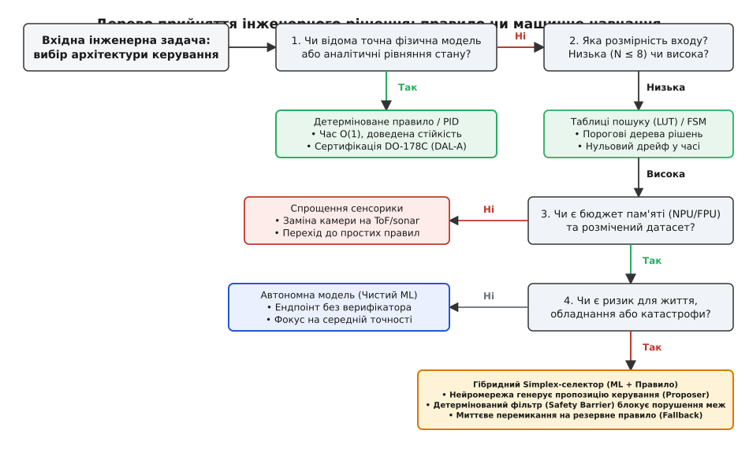
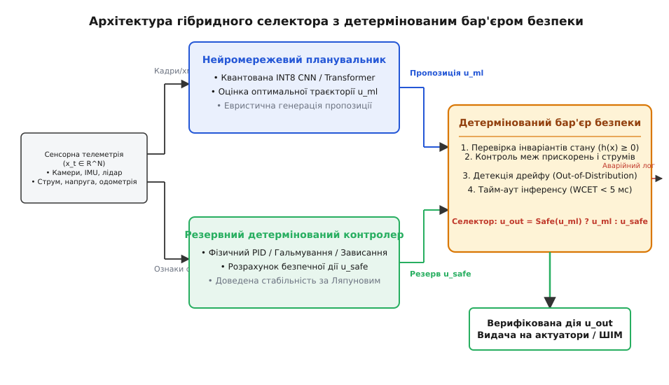

# Правило чи модель: коли навчання виправдане

<preknowlist>
- [Що таке ML](root:sf-ml/what-is-ml) — машинне навчання знаходить статистичні закономірності у вибірках замість виконання явних інструкцій.
- [Навчання vs вивід](root:sf-ml/train-vs-inference) — важкий одноразовий пошук ваг у хмарі проти жорстко обмеженого обчислення на цільовому пристрої.
- [TinyML: машинне навчання на мікроконтролері](root:sf-ml/tinyml) — чотири апаратні бюджети вбудованих систем: флеш, оперативна пам'ять, такти та мілівати.
- [Дрейф розподілу](root:sf-ml/distribution-shift) — деградація передбачень моделі через розбіжність між навчальним датасетом і реальними умовами експлуатації.
- [Квантування нейромереж](root:sf-ml/model-quantization) — стиснення ваг та активацій у цілочисельний формат INT8 для прискорення обчислень.
- [Калібрування впевненості](root:sf-ml/confidence-calibration) — відповідність вихідної ймовірності класифікатора його реальній точності.
- [Межі простих правил у керуванні](root:embedded/mezhi-pravyl) — комбінаторний вибух евристик у складних багатовимірних середовищах.
</preknowlist>

Бортовий контролер стабілізації квадрокоптера виконує цикл керування з частотою 500 Гц: кожні 2 мілісекунди він зчитує дані триосьового гіроскопа та акселерометра, фільтрує шум і розраховує корекцію кутових швидкостей моторів. Класичний пропорційно-інтегрально-диференціальний (PID) регулятор робить це за 40 тактів мікроконтролера Cortex-M4, займає 240 байтів пам'яті програм і гарантує повернення дрона в горизонт відповідно до аналітичних рівнянь динаміки твердого тіла. Спроба замінити цей математичний закон глибокою нейромережею з двома повнозв'язними шарами призводить до аварії: замість 40 тактів процесор витрачає 12 000 тактів на матричні множення, затримка в контурі зворотного зв'язку перевищує допустимий ліміт фазового запізнення у 4 мілісекунди, а випадковий оптичний блік на камері оптичного потоку переводить модель у невідому область вхідного простору, викликаючи стрибкоподібний викид керуючого сигналу та зрив апарата в некерований штопор.

Цей збій виявляє фундаментальну проблему системної інженерії: вибір між детермінованим аналітичним правилом та навченою статистичною моделлю. Машинне навчання не є універсальною еволюційною заміною класичного програмування; це вузькоспеціалізований математичний інструмент апроксимації функцій у просторах, де формалізація правил людиною стає алгоритмічно неможливою. Застосування моделі там, де існує точне математичне або логічне правило, перетворює просту, надійну й верифіковану систему на дороге, енерговитратне й потенційно небезпечне джерело випадкових відмов.

---

## Дві парадигми інженерного мислення: детермінізм проти індукції

У класичному програмуванні інженер самостійно вибудовує повний причинно-наслідковий ланцюг поведінки системи. Він аналізує фізику процесу, записує граничні умови, виділяє скінченну кількість станів системи та кодує алгоритм у вигляді кінцевих автоматів (FSM), порогових компараторів або систем замкнених диференціальних рівнянь.

```
Класичний підхід (Дедукція та детермінізм):
  [Вхідні дані X] + [Фізичні закони / Експертні правила] ──► [Детермінована дія Y]
  Властивості: Час O(1), 100% покриття гілок коду, доведена стійкість за Ляпуновим.

Підхід машинного навчання (Індукція та статистика):
  [Вхідні дані X] + [Цільові мітки Y_train]              ──► [Навчена модель (W, b)]
  Властивості: Статистичне узагальнення, недетермінована похибка, евристичний вивід.
```

Детерміноване правило спирається на три непохитні інженерні властивості:
1. **Просторова та часова детермінованість.** Час виконання коду обчислюється аналітично через суму машинних циклів інструкцій, а обсяг необхідної оперативної пам'яті фіксується на етапі лінкування бінарного файлу. У системі відсутні непередбачувані ітераційні цикли, динамічне виділення пам'яті чи плаваючі затримки синхронізації.
2. **Формальна верифікованість.** Поведінку алгоритму можна повністю перевірити аналізом граничних значень (Boundary Value Analysis) та довести стійкість системи аналітичними методами — наприклад, перевіркою від'ємної визначеності похідної функції Ляпунова або розрахунком запасів стійкості за амплітудою та фазою на діаграмах Боде.
3. **Абсолютна локалізація причин відмови.** Якщо правило спрацювало неправильно, інженер точно вказує рядок вихідного коду, логічну умову або фізичний коефіцієнт, який спричинив помилку, і виправляє його без ризику зруйнувати працездатність решти логічних гілок системи.

Машинне навчання працює за діаметрально протилежним принципом. Замість дедуктивного виведення правил з відомих фізичних законів алгоритм оптимізації індуктивно налаштовує мільйони числових коефіцієнтів (ваг `W` та зміщень `b`), намагаючись мінімізувати емпіричний ризик на обмеженому наборі прецедентів. Модель не володіє внутрішнім розумінням фізики процесу: вона будує гладку статистичну гіперповерхню, яка розділяє класи або інтерполює числові значення. Через це модель неминуче несе в собі ненульову ймовірність статистичної помилки, стає критично вразливою до невідомих режимів експлуатації та вимагає колосальних обчислювальних витрат навіть для обчислення тривіальних операцій.

---

## Чотиривимірна матриця прийняття рішень

Щоб уникнути суб'єктивних оцінок та маркетингового тиску під час вибору технологічного стека, архітектор вбудованої системи повинен пропустити задачу крізь чотиривимірну матрицю критеріїв.

```
                  ┌─────────────────────────────────────────┐
                  │    ОСНОВНІ ОСІ АРХІТЕКТУРНОГО ВИБОРУ     │
                  └────────────────────┬────────────────────┘
                                       │
     ┌───────────────────┬─────────────┴───────┬───────────────────┐
     ▼                   ▼                     ▼                   ▼
1. Розмірність      2. Фізична            3. Жорсткий          4. Стандарти
   вхідного            модель                реальний             безпеки
   простору            процесу               час (WCET)           (DO-178C)
```

### 1. Розмірність та структура вхідного простору

Розмірність та внутрішня структура вхідних даних — це перший вододіл між алгоритмами та навчанням.

Коли вектор стану системи складається з невеликої кількості структурованих фізичних величин (наприклад, тиск у гідросистемі, напруга на акумуляторі, струм фази мотора та температура радіатора — загалом 4 параметри), простір можливих комбінацій легко осягається людиною. Кожна змінна має зрозумілу розмірність (Паскалі, Вольти, Ампери, градуси Цельсія), а її допустимий робочий діапазон однозначно задається паспортом обладнання. Будь-які взаємозв'язки між ними описуються системою умовних операторів `if-else` або таблицями калібрування (Look-Up Tables, LUT). Навчання нейромережі для детектування аварійного тиску є грубою помилкою: модель не додасть жодного відсотка точності, але внесе ризик непередбачуваної поведінки при збої АЦП.

Кардинально інша ситуація виникає, коли вхідний сигнал є неструктурованим масивом високої розмірності:
* Одноканальний кадр з камери 640×480 містить 307 200 окремих значень яскравості.
* Сирий радіолокаційний масив комплексних відліків I/Q (In-phase / Quadrature) або спектрограма звукового датчика акустичної розвідки містить тисячі спектральних бінів.
* Вхідний вектор не має явного аналітичного зв'язку з цільовим класом (наприклад, яскравість піксела з координатами (120, 340) сама по собі нічого не говорить про наявність перешкоди на дорозі).

Спроба виписати явні геометричні правила для розпізнавання силуету пішохода або дефекту зварного шва веде до комбінаторного вибуху евристик. Зміна кута освітлення на 10 градусів, поява відблиску від дощу або нахил камери породжують нескінченну кількість винятків, які неможливо покрити кодом вручну. Тут машинне навчання незамінне: згорткові шари автоматично виділяють просторові інваріанти на різних масштабах (лінії, текстури, контури), зменшуючи розмірність простору від сотень тисяч пікселів до єдиного вектора ймовірностей класів.

```
Порівняння розмірності та підходів:

Клас задачі                  Розмірність входу (N)    Оптимальний підхід
─────────────────────────────────────────────────────────────────────────────
Контроль батареї / ДБЖ       1 – 6 параметрів         Порогові правила, FSM
Керування польотом БПЛА      6 – 16 параметрів        PID, LQR, фільтр Кальмана
Розпізнавання звукових хвиль 128 – 2048 бінів спектра DSP + 1D-CNN або SVM
Машинний зір / Камери        > 100 000 пікселів       Глибокі CNN / Transformers
```

### 2. Наявність формалізованої фізичної моделі

Коли динаміка системи підпорядковується фундаментальним фізичним законам, інженер має в руках математично досконалий апарат.

Розглянемо задачу стабілізації температури нагрівального елемента в автоклаві. Теплообмін описується рівнянням теплопровідності та законом збереження енергії. Зв'язок між потужністю нагрівача та швидкістю зростання температури є лінійним з урахуванням теплоємності тіла та коефіцієнта розсіювання в навколишнє середовище. Аналітичний PID-регулятор із компенсацією збурень (Feedforward Control) або регулятор у просторі станів (LQR) забезпечує аперіодичний перехідний процес із нульовою статичною похибкою.

Використання нейромережі для прямого керування нагрівачем несе пряму шкоду:
* Аналітичний регулятор гарантує стійкість за будь-якої початкової температури.
* Нейромережа, навчена на діапазоні від +20 °C до +100 °C, під час аварійного охолодження до -30 °C потрапляє в область екстраполяції і здатна видати від'ємну потужність нагріву або увійти в автоколивальний режим, який зруйнує установку.

Машинне навчання є виправданим лише тоді, коли фізичний процес є принципово нелінійним, нестаціонарним або аналітично нерозв'язним у реальному часі:
* Нестаціонарна аеродинаміка еластичного крила на межі зриву потоку.
* Динаміка контакту коліс шасі з нестабільним ґрунтом (пісок, багнюка, лід), де коефіцієнт тертя змінюється стохастично.
* Прогнозування траєкторії руху пішоходів і тварин у міському середовищі.

### 3. Детермінізм часу виконання та жорсткий реальний час (WCET)

У системах жорсткого реального часу (Hard Real-Time) коректність роботи системи залежить не лише від числового результату, але й від суворого дотримання часового дедлайну. Якщо контур стабілізації крокового двигуна не видасть черговий імпульс кроку через рівно 100 мікросекунд, ротор втратить синхронізацію і механізм заклинить.

Детерміноване правило на C має строгу часову верхню оцінку (Worst-Case Execution Time, WCET):
* Час виконання коду не залежить від значень вхідних даних (якщо код написаний без плаваючих циклів).
* Усі операції виконуються за константну кількість циклів `O(1)`.
* Відсутнє динамічне виділення пам'яті (`malloc`), що унеможливлює фрагментацію купи та зупинки на збирання сміття.

Нейромережевий вивід, навіть при фіксованому графі обчислень, створює серйозні проблеми для мікроконтролерів:
* **Конфлікти шини пам'яті (Bus Contention).** Постійне прокачування сотень кілобайтів ваг із флеш-пам'яті в робочі регістри навантажує шину AHB/AXI, створюючи затримки доступу для інших критичних периферійних модулів (DMA, таймерів, АЦП).
* **Відсутність апаратного FPU на бюджетних чипах.** Ядра Cortex-M0/M3 не мають апаратного блоку дробових чисел. Емуляція одного множення `float32` займає до 80 машинних тактів замість 1 такту для цілочисельного множення, що робить вивід неквантованої моделі неприпустимо повільним.
* **Джитер тривалості обчислення.** Використання оптимізацій зі структурованим прорідженням (Pruning) призводить до того, що час обробки кадру залежить від кількості ненульових активацій, руйнуючи детермінізм часової сітки.

```
Порівняння характеристик виконання:

Параметр                  Детерміноване правило     Квантована нейромережа (INT8)
─────────────────────────────────────────────────────────────────────────────────
Типова затримка (Latency) 0.05 – 2 мкс              200 – 20 000 мкс
Джитер затримки           < 0.01 мкс                10 – 100 мкс (DMA contention)
Пам'ять Flash (код/ваги)  0.2 – 2 КБ                20 – 2000 КБ
Оперативна пам'ять RAM    0.05 – 0.2 КБ             8 – 256 КБ (пік активацій)
Складність алгоритму      O(1)                      O(∑ W_i · H_i · C_in · C_out)
```

Зв'язок затримки із теорією керування описується теоремою відліків Шеннона-Найквіста та аналізом фазового запізнення. Якщо резонансна частота механічної конструкції становить 50 Гц, контур зворотного зв'язку зобов'язаний працювати на частоті не менше 500–1000 Гц (період `T = 1–2 мс`). Детерміноване правило зі швидкістю виконання 5 мікросекунд займає менше 0.5% бюджету процесорного часу. Нейромережа із часом виводу 15 мілісекунд взагалі не здатна працювати у такому контурі: вона вносить фазове запізнення `Δφ = ω · T_d`, яке повністю з'їдає запас стійкості за фазою і неминуче переводить замкнену систему в некерований автоколивальний зрив.

### 4. Сертифікація та функціональна безпека (DO-178C, ISO 26262)

У критичних галузях програмне забезпечення не може бути розгорнуте без проходження суворих процедур державної та галузевої сертифікації:
* **DO-178C (Авіаційні бортові системи):** стандартизує рівні надійності від DAL-E (немає впливу на безпеку) до DAL-A (катастрофічні наслідки з загибеллю літака). Для рівня DAL-A вимагається 100% покриття вихідного коду тестами за критерієм модифікованого стану та покриття рішень (MC/DC — Modified Condition/Decision Coverage).
* **ISO 26262 (Автомобільна функціональна безпека):** рівні ризику від ASIL-A до ASIL-D. Вимагається повна трасованість кожної вимоги безпеки до конкретного рядка вихідного коду та апаратного регістру.

Для класичного алгоритму на мові C критерій MC/DC досягається вичерпним модульним тестуванням: інженер формує тестові вектори для кожної логічної комбінації в операторах розгалуження і доводить, що кожен окремий прапорець самостійно впливає на кінцеве рішення.

Для глибоких нейромереж концепція MC/DC виявляється принципово непридатною:
* Код ядра згортки або множення матриць є циклом із кількох рядків, який легко покрити тестами на 100%, але поведінка системи визначається не кодом, а **масивом ваг (Data-driven Logic)**.
* Мільйони дійсних чисел у вагах не мають взаємно однозначної трасованості до інженерних вимог безпеки («Вимога: не вмикати реверс тяги у повітрі» не може бути прив'язана до окремого числового коефіцієнта `W_342_115`).
* Наявність феномену збурювальних атак (Adversarial Perturbations): додавання до вхідного зображення мікроскопічного шуму, невидимого для ока, кардинально змінює вихідний клас моделі (наприклад, дорожній знак «Стоп» класифікується як «Обмеження швидкості 80 км/год»).

Формальна верифікація нейромереж за допомогою SMT-солверів (Satisfiability Modulo Theories, такі як інструменти Reluplex чи Marabou) розбивається об комбінаторну складність: мережа з функціями активації ReLU та `N` нейронами розбиває простір на `2^N` локально лінійних політопів. Доведення інваріанта безпеки для мережі навіть із кількома сотнями нейронів є NP-повною задачею і вимагає годин обчислень на суперкомп'ютері, що робить повну верифікацію великих бортових моделей нездійсненною. На противагу цьому, формальна верифікація кінцевого автомата на 50 станів методом перевірки моделей (Model Checking) виконується за кілька мілісекунд.

Через це сучасні сертифікаційні органи (FAA, EASA) забороняють пряме підключення виходу штучних нейромереж до виконавчих контурів авіаційного керування рівня DAL-A без детермінованого верифікатора або апаратної схеми захисту.

---

## Архітектура пам'яті мікроконтролера: TCM проти XIP Flash

Окремим критичним фактором при виборі між алгоритмом та моделлю є топологія внутрішньої пам'яті сучасних мікроконтролерів (наприклад, сімейств STM32H7, NXP i.MX RT чи TI Sitara).

```
        ┌────────────────────────────────────────────────────────┐
        │                 ЯДРО ПРОЦЕСОРА (Cortex-M7)             │
        └───────────────┬────────────────────────┬───────────────┘
                        │                        │
             Прямий доступ 0 тактів     Прямий доступ 0 тактів
                        ▼                        ▼
        ┌────────────────────────┐      ┌────────────────────────┐
        │  ITCM RAM (Код правил) │      │ DTCM RAM (Стан правил) │
        └────────────────────────┘      └────────────────────────┘
                        │                        │
               Системна шина AXI (Конфлікти / Затримки)
                        │                        │
                        ▼                        ▼
        ┌────────────────────────┐      ┌────────────────────────┐
        │ AXI SRAM (Арена тенз.) │      │ QSPI Flash (Ваги INT8) │
        │   Затримка: 2–4 такти  │      │   Затримка: 6–12 тактів│
        └────────────────────────┘      └────────────────────────┘
```

Детерміноване правило володіє мінімальним просторовим слідом (Footprint) і повністю розміщується у **тісно пов'язаній пам'яті інструкцій (ITCM)** та **пам'яті даних (DTCM)**. Ядро процесора звертається до ITCM/DTCM безпосередньо через виділені 64-бітні шини без проходження крізь шинний комутатор AXI та без використання кеш-пам'яті:
* Затримка читання інструкцій становить рівно **0 тактів очікування (Zero Wait-States)**.
* Відсутні промахи кешу (Cache Misses) та витіснення рядків кеш-пам'яті.
* Гарантується 100% повторюваність часу виконання кожної інструкції на рівні наносекунд.

Нейромережева модель не вміщається в компактну пам'ять DTCM (обсяг якої рідко перевищує 64–128 КБ). Ваги моделі розміщуються у зовнішній або внутрішній Flash-пам'яті, що працює через контролер Execute-in-Place (XIP):
* На тактовій частоті 400 МГц доступ до Flash вимагає від 5 до 12 тактів очікування (Flash Latency).
* Прокачування матриць через кеш інструкцій (ICache) та кеш даних (DCache) викликає постійне вимивання кеш-рядків (Cache Thrashing), сповільнюючи виконання сусідніх завдань операційної системи реального часу (RTOS).
* Одночасне пересилання даних сенсорів через канали прямого доступу до пам'яті (DMA) конкурує з тензорним рушієм за пропускну здатність шини SRAM, створюючи плаваючий джитер тривалості виводу.

---

## Повна вартість життєвого циклу моделі (TCO)

Поширена помилка розробників — оцінювати вартість впровадження машинного навчання виключно за часом компіляції бібліотеки виводу. Реальні фінансові та інженерні витрати розгортаються на етапі експлуатації та підтримки.

```
Структура повної вартості володіння (TCO):

Детерміноване правило:
  [Розробка алгоритму] ──► [Верифікація меж] ──► [Незмінна експлуатація]
  (90% витрат на початку, 10% на супровід)

Машинне навчання:
  [Збір сирих даних] ──► [Розмітка датасету] ──► [Навчання у хмарі] ──►
  [Квантування / Тести] ──► [Моніторинг дрейфу] ──► [Повторні ітерації циклу]
  (20% витрат на старті, 80% витрат протягом життєвого циклу)
```

### 1. Збір даних, калібрування та розмітка

Створення надійного детермінованого правила вимагає роботи інженера-математика протягом кількох днів. Створення навіть невеликої нейромережі тягне за собою створення повноцінного виробничого конвеєра даних:
* **Збір польової телеметрії:** тисячі годин записів у всьому діапазоні експлуатаційних умов (різні пори року, нічний час, туман, вібрації корпусу, деградація сенсорів).
* **Помилки розмітки:** людський фактор при розмітці датасетів вносить від 1% до 5% некоректних міток. Якщо для класифікації котів це не критично, то в системах безпеки помилкова мітка в навчальній вибірці навчає модель ігнорувати реальну небезпеку.
* **Калібрування апаратної частини:** якщо на виробництві змінили постачальника об'єктивів камери або партія мікросхем АЦП має інше зміщення нуля, модель потребує нового калібрування і повного повторного прогону валідаційних тестів.

### 2. Дрейф розподілу та коваріантний зсув у полі

Детерміноване правило `if (voltage < 3.2f) trigger_cutoff();` працюватиме з абсолютною надійністю незалежно від того, де експлуатується прилад — у пустелі чи в арктичній тундрі.

Модель машинного навчання навчається на неявному розподілі ймовірностей вхідних ознак `P_train(X)`. У польових умовах цей розподіл неминуче дрейфує:
* **Коваріантний зсув (Covariate Shift):** форма об'єкта залишається незмінною, але вхідний розподіл зсувається через зовнішні фактори (наприклад, оптика камери покрилася конденсатом, або асфальт мокрий після дощу). Статистична впевненість моделі падає, а частота хибних спрацьовувань стрімко зростає.
* **Зсув концепції (Concept Drift):** змінюються фізичні характеристики самого об'єкта спостереження (наприклад, природне старіння підшипника змінює спектральний профіль вібрації двигуна, який перестає розпізнаватися моделлю як нормальний стан).

Для детектування виходу вхідного вектора за межі навчального розподілу (Out-of-Distribution, OOD) бортову систему доводиться оснащувати додатковими статистичними фільтрами:
* **Енергетичний скоринг:** розрахунок енергетичної функції `E(x) = -T · ln(∑ exp(z_i / T))` над логітами нейромережі `z_i`. Якщо енергія перевищує калібрований поріг, вхід вважається аномальним.
* **Відстань Махаланобіса в просторі активацій:** вимірювання статистичної відстані вектора проміжних ознак до центроїдів тренувальних класів з урахуванням коваріаційної матриці.
* **Похибка реконструкції автоенкодера:** паралельний прогін входу крізь компактний автоенкодер; якщо похибка відновлення різко зростає, на сенсорі діє невідоме збурення.

Кожен із цих механізмів OOD-детекції сам по собі вимагає додаткових обчислювальних ресурсів, збільшуючи загальну затримку виводу на 15–25%.

### 3. Апаратний бюджет та споживання енергії

Для портативних пристроїв з батарейним живленням (медичні імпланти, автономні польові сенсори, носима електроніка) обчислювальна складність безпосередньо транслюється у тривалість автономної роботи.

Проведемо прямий енергетичний розрахунок:
* Виконання детермінованого фільтра на базі кінцевого автомата (50 машинних інструкцій на мікроконтролері Cortex-M4 при частоті 64 МГц і струмі споживання 10 мА): час обчислення становить 0.78 мкс, а витрачена енергія — близько 0.025 мкДж.
* Вивід компактної квантованої моделі MobileNetV1-0.25 (близько 10 мільйонів операцій множення-накопичення MAC на тому ж ядрі з використанням бібліотеки CMSIS-NN): час обчислення становить близько 150 мс, а витрачена енергія — близько 4.95 мДж.

Різниця в енерговитратах становить майже 200 000 разів. Якщо пристрій на правилах здатний безперервно моніторити датчик протягом 3 років від монетної батарейки CR2032, то нейромережевий аналізатор повністю виснажить її за 18 годин безперервної роботи.

---

## Дерево прийняття інженерного рішення

Для швидкої навігації між альтернативними технологічними рішеннями застосовують послідовне дерево прийняття інженерних рішень.


*Послідовність інженерного вибору між детермінованими правилами, чистим машинним навчанням та гібридними системами. Навчання вибирається лише за високої розмірності та відсутності точної фізичної моделі, а критичні контури обов'язково доповнюються детермінованим бар'єром безпеки.*

Головний принцип цього дерева — мінімізація складності: якщо задача задовільно розв'язується кінцевим автоматом або пороговим правилом, використання нейромережі забороняється як невиправдане ускладнення системи.

---

## Гібридні архітектури: архітектура Simplex та бар'єри безпеки

Найбільш зрілим інженерним підходом у сучасних автономних системах є відмова від крайніх позицій на користь **гібридної архітектури** (відомої в авіації та робототехніці як **архітектура Simplex** або **детермінований фільтр безпеки**).

```
                  ┌─────────────────────────────────────────┐
                  │    Сенсорний потік високої розмірності   │
                  └────────────────────┬────────────────────┘
                                       │
                   ┌───────────────────┴───────────────────┐
                   ▼                                       ▼
        ┌───────────────────────┐               ┌───────────────────────┐
        │  Нейромережевий блок  │               │ Резервний аналітичний │
        │ (Proposer / Planner)  │               │ контролер (Fail-safe) │
        └──────────┬────────────┘               └───────────┬───────────┘
                   │                                        │
             Пропозиція u_ml                           Резерв u_safe
                   │                                        │
                   └───────────────────┬────────────────────┘
                                       ▼
                        ┌──────────────────────────────┐
                        │ Детермінований фільтр безпеки│
                        │    (Control Barrier Filter)  │
                        └──────────────┬───────────────┘
                                       │
                               Верифікована дія u_out
                                       ▼
                        ┌──────────────────────────────┐
                        │      Виконавчі приводи       │
                        └──────────────────────────────┘
```

У цій схемі кожен компонент виконує саме ту функцію, для якої він найкраще пристосований:
1. **Нейромережевий планувальник (Proposer):** опрацьовує високовимірний неструктурований сенсорний потік (зображення, хмари точок лідара, акустичні спектри) і формує бажаний вектор керування `u_ml`. Він забезпечує адаптивність, розпізнавання складних образів та оптимізацію траєкторії в невідомому середовищі.
2. **Резервний контролер (Fail-safe Controller):** максимально простий, формально верифікований аналітичний алгоритм (наприклад, екстрене гальмування, стабілізація кутів крену та диференту за гіроскопами або повернення в точку старту за компасом). Його стійкість доведена математично.
3. **Детермінований бар'єр безпеки (Safety Barrier / Simplex Arbiter):** швидкий алгоритм на мові C, який виконується в кожному циклі керування перед видачею сигналу на актуатори. Він перевіряє, чи задовольняє дія `u_ml` систему інваріантів стану.


*Детальна схема інформаційних потоків гібридного селектора: сенсорні дані паралельно надходять до нейромережевого планувальника та аналітичного контролера, а детермінований фільтр безпеки виконує строгу верифікацію інваріантів перед подачею сигналу на актуатори.*

Математичною основою таких бар'єрів є **функції бар'єра керування (Control Barrier Functions, CBF)**. Нехай безпечна область станів системи `C` задана функцією `h(x) ≥ 0`. Бар'єр безпеки гарантує пряму інваріантність множини `C` (тобто якщо система стартувала в безпечній зоні, вона ніколи її не покине), розв'язуючи задачу швидкої корекції в реальному часі:

```
min || u - u_ml ||²
при обмеженні:  (∂h/∂x) · (f(x) + g(x)·u) + γ(h(x)) ≥ 0
```

де `f(x)` та `g(x)` — відома фізична модель динаміки апарата `x' = f(x) + g(x)·u`, а `γ` — монотонно зростаюча функція запасу стійкості. Якщо дія нейромережі `u_ml` безпечна, фільтр пропускає її без змін (`u = u_ml`). Якщо дія веде до зіткнення чи перевантаження, фільтр миттєво зрізає небезпечну складову до допустимої межі або перемикає керування на `u_safe`.

### Захист від деренчання режимів (Hysteresis & Anti-Chattering)

При побудові гібридного селектора виникає специфічний динамічний дефект: **деренчання режимів керування (Mode Chattering)**. Якщо впевненість нейромережі коливається біля порога перемикання (наприклад, 0.74 ↔ 0.76 через високочастотний шум датчика), арбітр починає хаотично перемикати керування між моделлю та резервним правилом у кожному такті. Це викликає високочастотні вібрації приводів, перегрів обмоток двигунів та акустичний шум.

Для усунення деренчання застосовують три захисні детерміновані механізми:
1. **Подвійний поріг із гістерезисом (Schmitt Trigger):** перехід на модель дозволяється лише тоді, коли впевненість перевищує `τ_high = 0.80`, а повернення на аварійне правило ініціюється лише при падінні нижче `τ_low = 0.65`.
2. **Мінімальний час утримання стану (Minimum Dwell Time):** після кожного перемикання арбітр блокує зміну режиму на фіксовану кількість циклів `N_dwell` (наприклад, на 50 тактів або 100 мілісекунд), даючи перехідним процесам у механіці повністю згаснути.
3. **Плавне змішування команд (Smooth Blending):** замість миттєвого стрибка керування вихідний сигнал плавно інтерполюється між `u_ml` та `u_safe` за допомогою фільтра низьких частот першого порядку зі швидкістю адаптації `α`.

---

## Програмна реалізація гібридного арбітра на C та C++

Наведений нижче модуль демонструє практичну реалізацію детермінованого арбітра для системи автономного електроприводу. Він верифікує команду швидкості від нейромережі, контролює швидкість наростання сигналу (Slew Rate), захищає двигун від перегріву та перевантаження по струму, а у разі низької впевненості моделі плавно переводить привід у безпечний стан.

:::tabs
```c
#include <stdint.h>
#include <stdbool.h>
#include <math.h>

#define MAX_SPEED_RAD_S        150.0f
#define MAX_ACCEL_RAD_S2       300.0f
#define MAX_CURRENT_AMPS        15.0f
#define MAX_TEMP_CELSIUS        80.0f
#define CONFIDENCE_THRESHOLD     0.75f

typedef struct {
    float speed_rad_s;
    float current_amps;
    float temperature_c;
} Telemetry_t;

typedef struct {
    float proposed_speed;
    float confidence;
    bool  inference_valid;
} MlProposal_t;

typedef enum {
    SOURCE_ML_OPTIMAL    = 0,
    SOURCE_RULE_CLAMPED  = 1,
    SOURCE_RULE_FALLBACK = 2
} DecisionSource_t;

typedef struct {
    float last_applied_speed;
    uint32_t fallback_counter;
    bool  emergency_state;
} ArbiterState_t;

typedef struct {
    float            applied_speed;
    DecisionSource_t source;
} ArbiterResult_t;

ArbiterResult_t Arbiter_ProcessStep(
    ArbiterState_t*       state,
    const Telemetry_t*    telem,
    const MlProposal_t*   ml,
    float                 dt_sec
) {
    ArbiterResult_t result;
    float safe_speed = 0.0f;

    // 1. Апаратний захист від критичного перегріву та надструму (Hard Rules)
    if (telem->temperature_c >= MAX_TEMP_CELSIUS || telem->current_amps >= MAX_CURRENT_AMPS) {
        state->emergency_state = true;
        state->fallback_counter++;
        result.applied_speed = 0.0f; // Екстрена зупинка
        result.source = SOURCE_RULE_FALLBACK;
        state->last_applied_speed = 0.0f;
        return result;
    }

    // 2. Верифікація статусу та впевненості нейромережі
    bool ml_acceptable = ml->inference_valid && 
                         (ml->confidence >= CONFIDENCE_THRESHOLD) &&
                         (!state->emergency_state);

    if (ml_acceptable) {
        float target = ml->proposed_speed;

        // 3. Обмеження абсолютного значення швидкості (Safety Envelope)
        if (target > MAX_SPEED_RAD_S) {
            target = MAX_SPEED_RAD_S;
        } else if (target < -MAX_SPEED_RAD_S) {
            target = -MAX_SPEED_RAD_S;
        }

        // 4. Обмеження темпу наростання швидкості (Slew Rate / Прискорення)
        float max_delta = MAX_ACCEL_RAD_S2 * dt_sec;
        float actual_delta = target - state->last_applied_speed;

        if (actual_delta > max_delta) {
            safe_speed = state->last_applied_speed + max_delta;
            result.source = SOURCE_RULE_CLAMPED;
        } else if (actual_delta < -max_delta) {
            safe_speed = state->last_applied_speed - max_delta;
            result.source = SOURCE_RULE_CLAMPED;
        } else {
            safe_speed = target;
            result.source = SOURCE_ML_OPTIMAL;
        }
    } else {
        // 5. Детермінований Fallback: плавне гальмування до повної зупинки
        float max_delta = MAX_ACCEL_RAD_S2 * dt_sec;
        if (state->last_applied_speed > max_delta) {
            safe_speed = state->last_applied_speed - max_delta;
        } else if (state->last_applied_speed < -max_delta) {
            safe_speed = state->last_applied_speed + max_delta;
        } else {
            safe_speed = 0.0f;
        }
        state->fallback_counter++;
        result.source = SOURCE_RULE_FALLBACK;
    }

    state->last_applied_speed = safe_speed;
    result.applied_speed = safe_speed;
    return result;
}
```
```cpp
#include <cstdint>
#include <algorithm>
#include <cmath>
#include <span>
#include <expected>

namespace embedded::control {

struct Telemetry {
    float speed_rad_s{0.0f};
    float current_amps{0.0f};
    float temperature_c{0.0f};
};

struct MlProposal {
    float proposed_speed{0.0f};
    float confidence{0.0f};
    bool  inference_valid{false};
};

enum class DecisionSource : uint8_t {
    MlOptimal,
    RuleClamped,
    RuleFallback
};

struct ArbiterResult {
    float applied_speed{0.0f};
    DecisionSource source{DecisionSource::RuleFallback};
};

class HybridArbiter {
public:
    static constexpr float kMaxSpeedRadS{150.0f};
    static constexpr float kMaxAccelRadS2{300.0f};
    static constexpr float kMaxCurrentAmps{15.0f};
    static constexpr float kMaxTempCelsius{80.0f};
    static constexpr float kConfidenceThreshold{0.75f};

    constexpr HybridArbiter() noexcept = default;

    [[nodiscard]] ArbiterResult process_step(
        const Telemetry& telem,
        const MlProposal& ml,
        float dt_sec
    ) noexcept {
        // 1. Апаратний захист: безумовна перевірка критичних інваріантів
        if (telem.temperature_c >= kMaxTempCelsius || telem.current_amps >= kMaxCurrentAmps) {
            emergency_state_ = true;
            ++fallback_counter_;
            last_applied_speed_ = 0.0f;
            return {.applied_speed = 0.0f, .source = DecisionSource::RuleFallback};
        }

        // 2. Оцінка валідності пропозиції нейромережі
        const bool ml_valid = ml.inference_valid && 
                              (ml.confidence >= kConfidenceThreshold) && 
                              !emergency_state_;

        if (ml_valid) {
            // 3. Обмеження амплітуди та прискорення (Safety Envelope)
            const float clamped_target = std::clamp(ml.proposed_speed, -kMaxSpeedRadS, kMaxSpeedRadS);
            const float max_delta = kMaxAccelRadS2 * dt_sec;
            const float actual_delta = clamped_target - last_applied_speed_;

            if (std::abs(actual_delta) <= max_delta) {
                last_applied_speed_ = clamped_target;
                return {.applied_speed = clamped_target, .source = DecisionSource::MlOptimal};
            }

            const float adjusted_speed = last_applied_speed_ + std::clamp(actual_delta, -max_delta, max_delta);
            last_applied_speed_ = adjusted_speed;
            return {.applied_speed = adjusted_speed, .source = DecisionSource::RuleClamped};
        }

        // 4. Резервний детермінований контролер (Fail-safe Deceleration)
        ++fallback_counter_;
        const float max_delta = kMaxAccelRadS2 * dt_sec;
        if (last_applied_speed_ > max_delta) {
            last_applied_speed_ -= max_delta;
        } else if (last_applied_speed_ < -max_delta) {
            last_applied_speed_ += max_delta;
        } else {
            last_applied_speed_ = 0.0f;
        }

        return {.applied_speed = last_applied_speed_, .source = DecisionSource::RuleFallback};
    }

    [[nodiscard]] constexpr uint32_t fallback_count() const noexcept { return fallback_counter_; }
    constexpr void reset_emergency() noexcept { emergency_state_ = false; }

private:
    float last_applied_speed_{0.0f};
    uint32_t fallback_counter_{0};
    bool emergency_state_{false};
};

} // namespace embedded::control
```
:::

У цій архітектурі детермінований бар'єр виступає апаратним наглядачем: жодна аномалія всередині тензорних обчислень нейромережі не здатна вивести двигун на небезпечні оберти чи викликати теплове руйнування транзисторів інвертора.

Повний цикл вимірювання затримок, профілювання тактів ядра, оцінку матриці вартості помилок селектора та практичні тести перемикання на реальному залізі наведено у практичній вставці [Бенчмарк гібридного арбітражу між правилом і моделлю](root:sf-ml/pravylo-chy-model/proj-rule-vs-model-bench.md).

---

## Інженерні висновки: зведені правила вибору

1. **Правило — за замовчуванням, модель — за необхідністю.** Починайте проєктування будь-якого вузла з аналітичної моделі, кінцевого автомата чи системи порогових евристик. Машинне навчання вводиться лише тоді, коли розмірність входу унеможливлює ручний опис правил.
2. **Низьковимірні фізичні параметри не потребують навчання.** Напруги, струми, температури, лінійні прискорення та тиск опрацьовуються класичними методами фільтрації та регулювання (PID, Кальман, LUT).
3. **Високовимірні неструктуровані потоки — природна зона ML.** Комп'ютерний зір, акустична класифікація, спектральний аналіз радіосигналів та прогнозування складних поведінкових патернів вимагають застосування нейромереж.
4. **Критичні контури вимагають гібридної схеми Simplex.** Якщо відмова алгоритму загрожує життю людей або руйнуванням техніки, нейромережа ніколи не підключається до виконавчих приводів напряму: її вихід обов'язково фільтрується детермінованим бар'єром безпеки.
5. **Враховуйте повну вартість життєвого циклу.** Бюджет проєкту повинен включати не лише пам'ять мікроконтролера під ваги, але й постійні витрати на збір польових даних, моніторинг дрейфу розподілу та регулярне перенавчання моделі.
