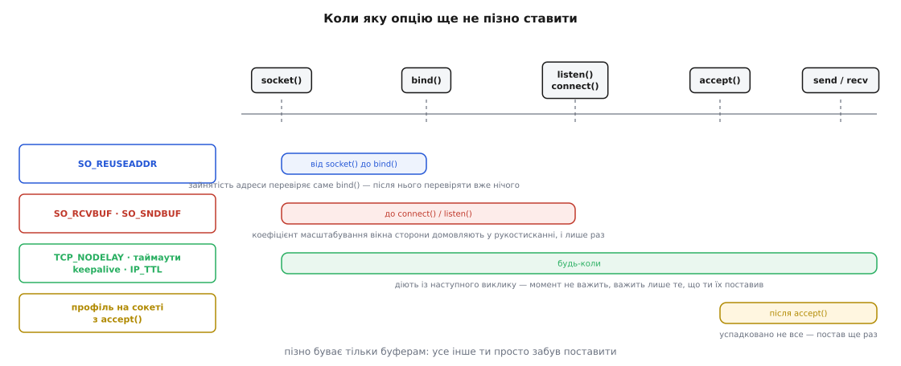
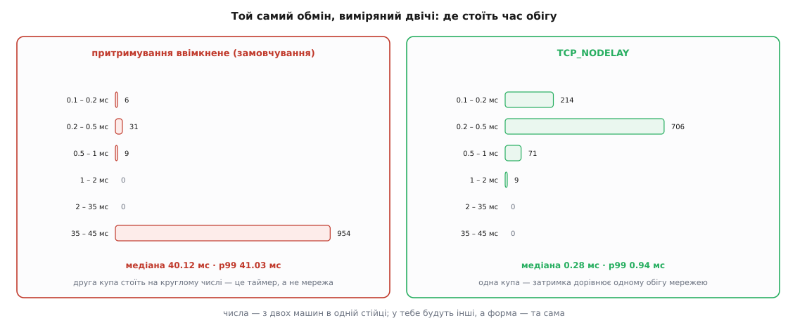

# ⚙️ Налаштування сокета в коді: два профілі й вимірювач, що ловить сорок мілісекунд

Тут зібрано два робочі шматки коду на C: модуль, який перетворює **намір** програми — «важить час реакції» або «важить швидкість потоку» — на набір опцій і чесно звітує, що з них ядро прийняло, а що мовчки підмінило, і крихітний вимірювач, який на твоїх власних машинах покаже сталі сорок мілісекунд і те, як вони зникають. Стоять вони поруч навмисно: без другого перший лишається набором вірувань.

Мова тут одна, і не за звичкою. `setsockopt` бере нетипізований покажчик і довжину, а вся наука — саме в тому, який тип ти передав, у який момент і що ядро повернуло **замість** проханого. Обгортка вищою мовою ховає рівно ці три речі.

## Завдання

Типовий мережевий код виглядає так: у функції створення сокета стовпчиком стоять шість `setsockopt`, результат жодного не перевірено, а поруч коментар «без цього гальмує». Через рік ніхто не скаже, який із шести рядків справді щось робить, а який давно не підтримується на новому стеку й тихо повертає `ENOPROTOOPT`.

Модуль має розв'язати три речі, і жодна з них не «поставити опції».

**Перше.** У коді має бути записаний **намір**, а не список опцій. Намірів рівно два, бо рішення стека мають дві протилежні відповіді: що дорожче — час реакції окремого повідомлення чи швидкість великого потоку.

**Друге.** Кожна опція має бути перевірена **читанням назад**. Ядро вільне подвоїти прохане, обрізати його системною стелею або не мати цієї опції взагалі — і про жодне з цього `setsockopt` не скаже.

**Третє.** Профіль має лягати у **правильний момент**, і код повинен помічати, коли момент уже минув, — сам, а не в чужій голові.

Далі йде вимірювач, і в нього завдання простіше й суворіше: показати різницю **до** того, як опція потрапить у продукт. Опція, поставлена без виміру, — це не налаштування, а прикмета.

## Каркас: звіт замість `bool`

Почнімо з підпису, бо він визначає все інше. Функція, що повертає `bool`, тут безпорадна: «не вдалося» і «вдалося, але ядро дало вчетверо менше» — різні події, і друга трапляється частіше. Тож результат — **звіт**: по рядку на опцію з тим, що просили, що маємо і як це кваліфікувати.

:::code proj-socket-tuning/c/socktune.h

Найважливіше рішення тут — `sock_link` як окремий аргумент, який дозволено не передати. Розмір буфера не береться з голови: він дорівнює добутку швидкості на час обігу, і обидва числа треба **знати**. Немає їх — модуль не вгадує, а просто не чіпає буферів. Це не педантизм: буфер, поставлений навмання, — найчастіший спосіб зробити гірше, ніж було, бо явне значення вимикає в Linux самоналаштування приймального буфера, тобто міняє постійний вимір ядра на твій одноразовий здогад.

Тепер серце модуля — одна функція, крізь яку проходить кожна цілочисельна опція.

:::code proj-socket-tuning/c/socktune.c

Зверни увагу, чого тут **немає**: гілки «повернути помилку, бо значення не збіглося». Розбіжність — це не збій, а відповідь ядра, і працювати з нею буде людина, що читає звіт. Код, який на це падає, не запуститься на жодній машині з нижчою стелею `net.core.rmem_max`, а таких більшість.

Окремої функції потребують таймаути — не через складність, а тому що саме тут ховається переносність.

:::code proj-socket-tuning/c/karkas-zvit-zamist-bool.c

## Момент: спитати ядро, а не сподіватися

Розміри буферів мають сенс лише **до рукостискання**. Коефіцієнт масштабування вікна сторони домовляють саме там і лише раз, тож після встановлення з'єднання стеля вже зафіксована. Поставиш пізніше — число зміниться, а швидкість ні, і шукатимеш причину в мережі.

Перевірити це можна прямо в коді, двома дешевими запитами до ядра.

:::code proj-socket-tuning/c/moment-spytaty-iadro-a-ne.c

`getpeername` вдається лише тоді, коли в сокета вже є партнер, а `SO_ACCEPTCONN` каже, чи був `listen`. Разом вони відповідають на питання «чи вже пізно» — і модуль не мовчить, а ставить у звіті прапорець `too_late`.



*Пізно буває тільки розмірам буферів; решта ручок діє з наступного виклику, тож там питання не «коли», а «чи поставив узагалі».*

## Профіль «низька затримка»

Тепер сам переклад наміру в опції. Кожен рядок нижче має причину, і причина написана поруч — інакше наступний читач видалить незрозуміле.

:::code proj-socket-tuning/c/profil-nyzka-zatrymka.c

Числа в профілі затримки не з повітря. Порахуймо буфер для двох машин в одній стійці:

**Профіль затримки, канал 100 Мбіт/с, час обігу 0.4 мс**

```text
Байтів за секунду:  100·10⁶ / 8 = 12 500 000
Даних «у дорозі»:   12 500 000 · 0.0004 = 5000 байтів
Нижня межа модуля:  16 384
Ставимо:            16 384 (спрацювала межа, бо обіг надто короткий)
```

І той самий розрахунок для профілю потоку через півсвіту:

**Профіль потоку, канал 100 Мбіт/с, час обігу 80 мс**

```text
Даних «у дорозі»:   12 500 000 · 0.080 = 1 000 000 байтів
Подвійний запас:    2 000 000
Просимо:            2 000 000 байтів
```

А тепер найцікавіше — що з цього вийде насправді.

**Вивід `sock_report_print` для профілю потоку на типовій машині**

```text
SO_SNDBUF          просив 2000000  маю 425984   інше число
SO_RCVBUF          просив 2000000  маю 425984   інше число
SO_RCVTIMEO        просив 30000    маю 30000    ок
SO_SNDTIMEO        просив 30000    маю 30000    ок
TCP_USER_TIMEOUT   просив 60000    маю 60000    ок
```

Число 425984 — це подвоєні 212992, а 212992 — типова стеля `net.core.wmem_max` і `net.core.rmem_max` на багатьох збірках Linux. Тобто ти попросив два мегабайти, дістав чотириста кілобайтів, `setsockopt` повернув успіх, і без цих п'яти рядків звіту шукав би причину в мережі тижнями. Стеля піднімається через `sysctl`, а не через опцію сокета: перевищити системну межу опція не має права — і в цьому вона права.

:::code proj-socket-tuning/c/profil-nyzka-zatrymka-2.c

Розрізнення `OPT_UNSUPPORTED` і `OPT_FAILED` варте окремого слова. `ENOPROTOOPT` означає «такої опції на цьому рівні немає» — на іншому стеку, у lwIP на мікроконтролері, у старішому ядрі це нормальний стан справ, і валити через нього запуск немає підстав. `EINVAL` — уже твоя провина: не той тип, не той розмір, заборонене значення. Ці два випадки треба бачити окремо, і саме тому в звіті є `unsupported` поруч із `failed`. Про решту кодів і про те, чому `errno` читають одразу після невдалого виклику й ніколи пізніше, — у [errno та POSIX-кодах помилок](root:sf-apps/errno).

> 🔧 **Навіщо це.** Три рядки `getsockopt` після налаштування коштують мікросекунди раз на з'єднання й відповідають на єдине питання, заради якого все це писалося: «а воно взагалі спрацювало?». Половина звітів «поставили опцію — нічого не змінилося» закривається саме цим виводом, ще до того, як хтось відкриє аналізатор трафіку.

## Одним записом: `writev` і часткові записи

Профіль затримки вимикає притримування, але глибше лікування інше — не створювати візерунка, на якому воно спрацьовує. Заголовок і тіло — це одне повідомлення, тож і в сокет вони мають потрапити одним записом. Копіювати їх заради цього в спільний буфер не треба: `writev` бере масив шматків і віддає їх ядру як один потік байтів.

:::code proj-socket-tuning/c/odnym-zapysom-writev-i.c

Три речі в цьому шматку неочевидні.

**Годинник монотонний.** `CLOCK_MONOTONIC` не стрибає, коли систему підводять під точний час, а `CLOCK_REALTIME` стрибає — разом із твоїм дедлайном. Різниця з'їдає години налагодження раз на кілька років і завжди в найгіршу мить; чому це два різні годинники, а не один поганий, — у [монотонному проти настінного часу](root:sf-apps/monotonic-vs-wall-time).

**Дедлайн перекриває `SO_SNDTIMEO` профілю.** Це навмисно: таймаут виклику обмежує один виклик, а нас цікавить операція цілком. Ціна — сокет після операції лишається з останнім виставленим значенням; якщо профільне число комусь потрібне, його доведеться повернути. Обмеження в профілі при цьому не зайве: воно рятує код, який дедлайнами не користується.

**Помилка посеред запису означає закриття.** Частковий `writev`, який далі не вдалося дописати, лишає в дроті половину повідомлення. Інший бік читає заголовок, чекає на тіло — і чекатиме, доки не спрацює його власний таймаут. Продовжувати такий потік нічим: межі повідомлень у TCP немає, і відновити її після діри неможливо — про це саме й [кадрування повідомлень](root:com-protocol/tcp-message-framing). Єдина чесна реакція — `close`.

Масив `iov` має ще одну межу, про яку згадують уже після відмови: кількість шматків обмежена `IOV_MAX` (на сучасному Linux — 1024), і перевищення дає `EINVAL`. Для двох шматків це теорія, для збирача, що складає повідомлення з кожного поля окремо, — цілком реальна стеля.

## Вимірювач: побачити сорок мілісекунд на власних машинах

Тепер друга програма. Вона робить одне: жене візерунок «два записи, тоді читання» тисячу разів і друкує **розподіл** часу обігу. Не середнє — саме розподіл: середнє змішає дві різні популяції в одне число, яке не описує жодну з них.

Сервер навмисно не чіпає жодної опції: перевіряємо поведінку клієнта, тож на іншому кінці має бути найзвичайніший сокет.

:::code proj-socket-tuning/c/rttprobe.c

Клієнт відрізняється від сервера рівно одним рядком, і цей рядок — уся суть виміру.

:::code proj-socket-tuning/c/vymiriuvach-pobachyty.c

Лишилася гістограма. Межі кошиків підібрані так, щоб сорок мілісекунд не розмазалися по сусідніх стовпчиках, а стали окремою купою.

:::code proj-socket-tuning/c/vymiriuvach-pobachyty-2.c

Лишається розбір аргументів — рівно стільки, щоб одна програма була і сервером, і клієнтом, і щоб прогони відрізнялися одним прапорцем.

:::code proj-socket-tuning/c/vymiriuvach-pobachyty-3.c

`p99` тут не прикраса. Затримка, яку створює таймер, живе саме у **хвості**: якщо повільним виявиться кожен двадцятий обмін, середнє зсунеться на дві мілісекунди й нікого не насторожить — а кожен двадцятий користувач чекатиме сорок. Чому хвіст описує враження від системи краще, ніж середнє, — у [перцентилях і хвостах](root:math-probability/percentiles-quantiles).

Запускаємо двічі — на двох різних машинах, не на одній.

**Що друкує вимірювач між двома серверами в одній стійці**

```text
$ ./rttprobe -c 10.0.0.7 -n 1000          # притримування ввімкнене
  0.10 -   0.20 ms |# 6
  0.20 -   0.50 ms |# 31
  0.50 -   1.00 ms |# 9
 35.00 -  45.00 ms |######################################## 954
min 0.14  median 40.12  p99 41.03  max 42.77 ms

$ ./rttprobe -c 10.0.0.7 -n 1000 -d       # TCP_NODELAY
  0.10 -   0.20 ms |############ 214
  0.20 -   0.50 ms |######################################## 706
  0.50 -   1.00 ms |#### 71
  1.00 -   2.00 ms |# 9
min 0.11  median 0.28  p99 0.94  max 1.83 ms
```



*Різницю видно не в середньому, а у формі: друга купа на круглому числі — підпис таймера, і впізнавати треба саме її.*

Найважливіше в цьому виводі — не те, що медіана впала в сто сорок разів. Важлива **форма**: у першому прогоні розподіл має дві купи, і між ними порожньо. Порожньо тому, що затримку створює не завантаженість і не черга — ті дали б суцільний розмазаний хвіст, — а таймер, який завжди спрацьовує через той самий проміжок. Дві розділені купи на круглому числі — це підпис, і після одного погляду на такий графік діагноз ставиться без здогадів.

## Чому картинка залежить від ядра

Тепер найчесніша частина. Вивід вище відтвориться не завжди, і причини варто знати наперед — інакше «не побачив сорока мілісекунд» переросте в хибний висновок «у нас цього немає».

**На одній машині виміру не буде.** Через локальну петлю (loopback) обіг триває мікросекунди, і підтвердження встигає повернутися раніше, ніж програма дійде до другого запису. Притримувати нема чого, глухого кута немає. Вимірювати треба між двома машинами, і бажано через справжній комутатор.

**Перші обміни будуть швидкими навіть без `TCP_NODELAY`.** Linux після встановлення з'єднання деякий час підтверджує сегменти негайно, і відкладене підтвердження вмикається лише згодом. Саме тому в коді є `WARMUP`: двісті перших обмінів викидаємо, бо вони описують інший стан стека. Без цього гістограма змішує дві поведінки, і купа на сорока мілісекундах виглядає меншою, ніж вона є в усталеному режимі.

**Ядро має власне притримування.** Починаючи з Linux 3.14 типово ввімкнено `net.ipv4.tcp_autocorking` — ядро само склеює дрібні записи, поки попередній пакет ще не пішов у мережевий адаптер. Це не той самий механізм, що правило Нейгла, але на цьому ж візерунку він додає власну затримку. Тому точні числа залежать від версії ядра сильніше, ніж хотілося б, — і саме тому вимірювач важливіший за таблицю «правильних» опцій.

Висновок із цих трьох застережень один і незручний: **опція без виміру — прикмета**. Виміряти дві хвилини на своїх машинах дешевше, ніж рік пояснювати новим людям, навіщо в коді рядок, який ніхто не наважується прибрати.

## Пастки, які коштують найдорожче

**Момент.** Розміри буферів після `connect` або `listen` — це число, яке зміниться, але ні на що не вплине. Для сервера з цього випливає неочевидне: профіль ставлять на **слухаючий** сокет, до `listen`. Сокет із `accept` успадковує не все, і перелік успадкованого різниться між системами, тож надійніше поставити профіль ще раз після `accept` — це десяток системних викликів раз на з'єднання, ціна нульова. Порядок «створив → опції → `bind`/`connect`» — частина [API сокетів](root:sf-os/sockets-tcp-udp), а не стильова забаганка.

**Подвоєння й стеля.** Linux подвоює `SO_RCVBUF` і `SO_SNDBUF` (частина пам'яті йде на службові структури) і повертає з `getsockopt` уже подвоєне значення; окремо він обрізає результат стелею `net.core.rmem_max` / `wmem_max` — **без помилки**. Тому в модулі `got == 2 * want` вважається успіхом, а будь-яке інше число потрапляє в звіт. Мінімальні (вже подвоєні) значення теж є: 256 для приймального і 2048 для передавального буфера — попросиш менше, дістанеш їх.

**Часткові `send` і `recv`.** `send` має право взяти менше, ніж ти дав; `recv` — віддати менше, ніж ти попросив. Обидва — норма, а не збій. Підступніший випадок — таймаут посеред передачі: якщо частину даних уже передано, виклик поверне **кількість байтів**, а не помилку, і код, який перевіряє лише `n < 0`, тихо піде далі з половиною повідомлення. Саме тому цикли `read_exact` і `writev_all` написані так, а не через один виклик із перевіркою.

**Свіжий таймаут на кожній ітерації.** `SO_RCVTIMEO` обмежує **виклик**, не операцію. Цикл із п'яти читань по дві секунди чекає десять. Дедлайн, перерахований перед кожним викликом, — єдиний спосіб обмежити операцію цілком, і саме тому `writev_all` бере `deadline`, а не `timeout`.

**Годинник.** Дедлайн і тривалість рахують монотонним годинником. Настінний час стрибає під час синхронізації, і дедлайн стрибає з ним — у гіршому разі в минуле.

**`ENOPROTOOPT` — не аварія.** На lwIP, на старому ядрі, на іншій системі опції може просто не бути. Валити запуск через відсутність `TCP_USER_TIMEOUT` означає зробити код непереносним заради ручки, яка й так лише корисна, а не обов'язкова.

## Скільки це коштує

Профіль — десять системних викликів `setsockopt` плюс стільки ж `getsockopt`, разом одиниці мікросекунд. Раз на з'єднання цього не видно навіть під профілювальником; у циклі обробки повідомлень — уже видно, тож функція називається `sock_apply_profile`, а не `sock_send_with_profile`, і кличеться там, де сокет народжується.

`writev_all` у звичайному випадку — один `writev` і один `setsockopt` на повідомлення. Другий системний виклик можна прибрати, якщо дедлайни коду не потрібні; поки вони потрібні, це чесна ціна за передбачувану верхню межу.

Вимірювач витрачає `8·N` байтів на вибірку й `O(N log N)` на сортування заради медіани та `p99`; для тисячі обмінів це мілісекунди після кількох десятків секунд самих обмінів. Якби вибірка була не тисячею, а мільйонами, довелося б рахувати квантилі потоково, не тримаючи всіх значень, — але для рішення «ставити опцію чи ні» тисячі обмінів вистачає з великим запасом.
