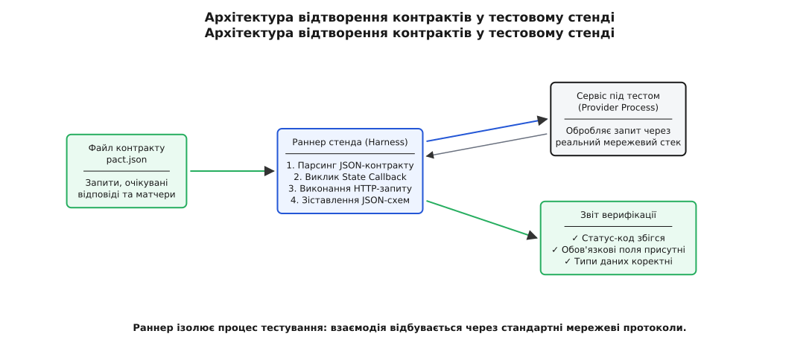

# ⚙️ Стенд контрактного тестування: верифікація та відтворення протоколу

У розподілених системах або на межах важливих модулів перевірка сумісності не повинна залежати від сторонніх хмарних інструментів чи важких фреймворків. Головний механізм контрактного тестування простий і детермінований: є структурований артефакт (специфікація запитів та очікуваних відповідей), є сервіс або модуль, що реалізує цей інтерфейс, і є легкий верифікатор, який налаштовує передумови, виконує виклики та зіставляє відповіді з правилами контракту.

Цей практичний розділ демонструє побудову компактного, але повністю функціонального стенда верифікації контрактів: від моделі взаємодій до обробників стану постачальника (Provider States), структурного матчингу тіл відповідей та діагностики помилок.

## Архітектура стенда: від файлу контракту до звіту

Верифікаційний стенд працює за принципом чорної скриньки на протокольному рівні. Він не заглядає у внутрішню структуру класів чи функцій постачальника, а взаємодіє з ним виключно через вхідні запити та вихідні відповіді. Це дозволяє гарантувати, що тест перевіряє публічний протокол обміну, а не приватні деталі реалізації.

Процес верифікації складається з чотирьох послідовних кроків:

1. **Завантаження та парсинг контракту:** Раннер стенда зчитує список взаємодій (Interactions). Кожна взаємодія містить текстовий опис передумови (Provider State), параметри HTTP-запиту (метод, шлях, заголовки, параметри) та очікувану форму відповіді (статус-код, перелік обов'язкових полів, очікувані типи даних).
2. **Підготовка стану (Provider State Setup):** Перед надсиланням кожного окремого запиту раннер шукає у внутрішньому реєстрі функцію зворотного виклику (callback), що відповідає текстовому опису стану. Ця функція приводить локальне сховище або пам'ять постачальника у потрібний детермінований стан (наприклад, створює користувача з потрібним числовим ідентифікатором, активує підписку або повністю очищає таблиці бази).
3. **Відтворення виклику:** Раннер посилає сформований запит через реальний інтерфейс постачальника. Це може бути прямий виклик API-контролера або передача байтів через локальний мережевий сокет.
4. **Структурна валідація та звіт:** Отримана відповідь порівнюється з очікуваннями контракту. Статус-код перевіряється на точний збіг, а тіло відповіді перевіряється на дотримання структурних правил (перевірка наявності обов'язкових полів, відповідність типів значень, толерантність до додаткових неоголошених полів). Якщо виявлено невідповідність, раннер формує деталізований звіт про розбіжність.

*Архітектура відтворення контрактів: раннер ізолює процес тестування та перевіряє дотримання протоколу без підняття зовнішніх інфраструктурних залежностей.*

## Керування станом та ізоляція тестів

Головний виклик під час тестування постачальника — забезпечення чистоти стану між прогонами різних взаємодій. Якщо перший тест змінив баланс користувача, а другий тест очікує початковий нульовий баланс, виникає небезпека взаємного отруєння стану (англ. *state leakage*).

Стенд усуває цю проблему через обов'язкову реєстрацію обробників стану. Кожен тестовий випадок явно декларує свій початковий стан. Обробник стану викликається синхронно безпосередньо перед формуванням запиту. Завдяки цьому відпадає потреба у відновленні гігабайтних резервних копій бази даних: потрібні два-три записи створюються в пам'яті за частки мікросекунди.

## Реалізація стенда верифікації контрактів

Нижче наведено повну, самодостатню реалізацію верифікаційного стенда двома мовами: чистим C (C99/C11) з явною роботою над пам'яттю та вказівниками на функції, та ідіоматичним C++20 із застосуванням RAII, безпечних типів `std::string_view`, `std::variant`, лямбда-функцій та структурованих звітів про помилки.

Стенд перевіряє дві взаємодії сервісу керування балансами облікових записів:
1. Отримання балансу для існуючого активного користувача (очікується `200 OK`, наявність поля `user_id` типу integer та `balance` типу float).
2. Запит балансу для неіснуючого користувача (очікується `404 Not Found` та поле `error_code` типу string).

:::tabs
:::code proj-contract-harness/c/main.c
:::code proj-contract-harness/cpp/main.cpp
:::

## Інженерний аналіз та порівняння реалізацій

Порівняння двох вкладок демонструє, як різняться підходи до реалізації одного й того самого протокольного механізму:

1. **Керування пам'яттю та рядками:** У версії на C структури мають фіксовані розміри буферів (`char key[32]`) для уникнення динамічного виділення пам'яті (`malloc`/`free`) на гарячому шляху тесту. У версії C++ застосовано безпечні динамічні контейнери `std::string` та неволодіючі представлення `std::string_view`.
2. **Представлення динамічних типів:** У C зіставлення типів реалізовано через явний енум `field_type_t` та текстові поля. У C++ використано безпечний суворо типізований контейнер `std::variant<std::string, int, double>` разом із функцією `std::holds_alternative`, що унеможливлює некоректне приведення типів під час виконання.
3. **Реєстр зворотних викликів:** У C стан реєструється як масив пар `(назва, вказівник на функцію)`. У C++ використано `std::function<void()>` та лямбда-замикання, що дозволяє легко захоплювати контекст тестового екземпляра сервісу.

## Ключові уроки побудови тестового стенда

1. **Асиметрія та Закон Постела:** Зверніть увагу на поле `server_time` у відповіді постачальника на запит `/users/42`. Постачальник формує це поле, але споживач його не декларував у правилах. Тестовий стенд успішно пропускає відповідь, бо споживач перевіряє лише ті поля, які йому життєво необхідні. Це дає постачальнику свободу додавати нові властивості без узгодження зі споживачем.
2. **Ізоляція через стан (Provider State):** Стенд не потребує збереження «золотого образу» бази даних на 10 гігабайтів. Кожна взаємодія атомарно готує лише потрібний їй стан за мілісекунди.
3. **Швидкість зворотного зв'язку:** Уся верифікація виконується в межах одного процесу або локального сокета за лічені мілісекунди, що робить її ідеальним кандидатом для запуску при кожному локальному коміті та у швидких пайплайнах неперервної інтеграції.
