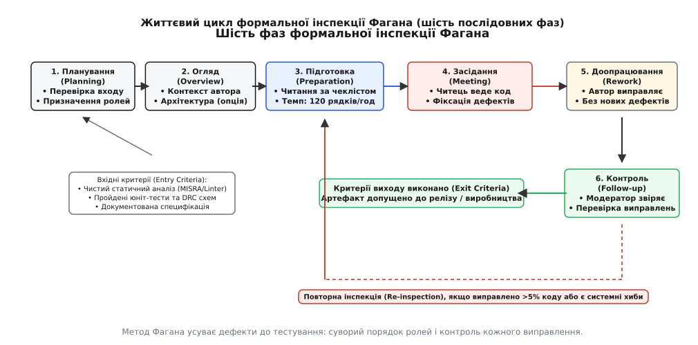
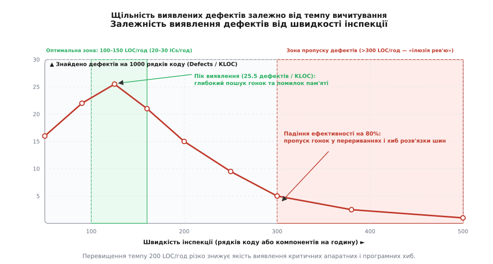

# Формальна інспекція (метод Фагана)

<preknowlist>
- [Рев'ю коду](root:sf-release/code-review) — неформальні та асинхронні перевірки змін, відмінність від структурованої верифікації.
- [Статичний аналіз](root:sf-release/static-analysis) — автоматичне виявлення синтаксичних та шаблонних дефектів.
- [Модульне тестування](root:sf-release/unit-testing) — динамічна перевірка поведінки окремих функцій та ізольованих компонентів.
- [Аналіз дерева відмов](root:sf-release/fault-tree-analysis) — ідентифікація критичних шляхів виходу системи з ладу.
- [Ревізія плати й версія прошивки](root:sf-release/reviziia-platy-versiia-proshyvky) — апаратні обмеження та взаємозв'язок трасування з низькорівневим кодом.
</preknowlist>

Партія з десяти тисяч блоків керування медичними інфузійними насосами пішла у серійне виробництво після успішного проходження автоматичних модульних тестів і безперервної компіляції без попереджень лінтера. Через три тижні роботи в клінічних умовах сорок два прилади раптово припинили подачу розчину через апаратне блокування шини зв'язку I2C: обробник переривання таймера змінював спільну змінну стану драйвера без вимкнення глобальних переривань, що викликало гонку даних і зациклення автомата передавача. Відкликання партії, розбирання корпусів та заміна мікросхем контролерів коштували виробнику 185 000 доларів, тоді як чотиригодинне структуроване засідання трьох провідних інженерів із вичитування вихідного коду драйвера та схеми узгодження рівнів до запуску фабричної лінії вимагало б 12 людино-годин праці вартістю близько 900 доларів.

Цей розрив у витратах описує класичне правило зростання вартості дефекту в розробці складних інженерних систем: помилка, виявлена на етапі проектування архітектури або написання вихідного коду, усувається в десятки й сотні разів дешевше, ніж той самий дефект, знайдений на стадії інтеграційного тестування, і в тисячі разів дешевше за аварію на працюючому об'єкті. Динамічне тестування та автоматичний статичний аналіз покривають лише частину простору відмов: тести перевіряють виконання сценаріїв, закладених автором тесту, а лінтери шукають відомі синтаксичні шаблони. Проте фундаментальні системні помилки — хибні припущення про роботу апаратних таймінгів, гонки в обробниках асинхронних подій, пропущені захисні ланцюги на лініях живлення — виявляються лише людським розумом, здатним зіставити фізичну поведінку схеми з логікою прошивки.

Для системного, повторюваного виявлення таких проблем без покладання на випадкову інтуїцію розробників застосовується методологія формальної інспекції Фагана (англ. *Fagan inspection*, від латинського *inspectio* — ретельний огляд, розгляд). Розроблений інженером Майклом Фаганом (Michael Fagan) в корпорації IBM у 1976 році, цей метод перетворив суб'єктивне рецензування на суворий інженерний процес із фіксованими фазами, чітким розподілом обов'язків, нормативними темпами вичитування матеріалу та кількісними критеріями завершення.

> 🔧 **Навіщо це.**
> У розробці вбудованих систем (embedded systems), де прошивка безпосередньо взаємодіє з кремнієвою периферією мікроконтролера та друкованою платою, ціна помилки не обмежується програмним збоєм. Помилковий біт у конфігурації регістра таймера може викликати наскрізний струм у силових ключах інвертора й спалити плату, а пропущений підтягувальний резистор — знерухомити промисловий верстат. Формальна інспекція Фагана дає команді детермінований спосіб знайти та знешкодити ці дефекти на папері та в коді до подачі напруги на дослідний зразок.

## Відмінність формальної інспекції від асинхронного код-рев'ю

У сучасній практиці розробники часто плутають формальну інспекцію зі звичайним асинхронним переглядом коду (pull request / code review) на платформі контролю версій. Незважаючи на спільну мету — пошук помилок у вихідних текстах, — ці два підходи мають кардинально різну структуру, цілі та глибину занурення.

Асинхронне код-рев'ю є фрагментарним: рецензент відкриває веб-інтерфейс у вільний між основними завданнями час і переглядає виключно диференційний зріз змін (diff). У такому режимі рецензент фокусується на синтаксисі, форматуванні, чистоті коментарів та стилістичних дрібницях («ефект велосипедного сараю», або bikeshedding). Контекст системи, взаємодія з апаратними регістрами та системні крайові випадки часто випадають із поля зору, оскільки диференційний перегляд не показує ширшої картини архітектури. Більше того, асинхронне рев'ю не регламентує швидкість читання: інженер може проглянути 500 рядків за десять хвилин, отримати хибне відчуття безпеки та поставити схвалення без реальної перевірки логіки.

На противагу цьому формальна інспекція Фагана є синхронним, сфокусованим процесом, де об'єктом аналізу виступає цілісний артефакт (завершений драйвер периферійного модуля, схема вузла живлення або трасування інтерфейсної шини), а не просто набір змінених рядків. Процес регулюється суворими правилами:
1. **Фіксований темп вичитування:** не більше 100–150 рядків низькорівневого коду на годину або 20–30 мікросхем на годину для апаратних схем.
2. **Обов'язкова індивідуальна підготовка:** кожен інспектор самостійно опрацьовує матеріал за спеціалізованими чеклістами до початку спільного засідання.
3. **Синхронне засідання:** очна або відеоконференційна сесія обмеженої тривалості (не більше двох годин), де матеріал читається вголос або покроково ведеться окремим учасником.
4. **Повна заборона проектування під час зустрічі:** на засіданні дозволено лише фіксувати факт наявності дефекту та його локацію, але суворо заборонено обговорювати варіанти виправлення чи сперечатися про альтернативні архітектурні рішення.
5. **Формальні критерії входу та виходу (Entry/Exit Criteria):** артефакт не допускається до інспекції без проходження автоматичних перевірок і не допускається до релізу без особистої верифікації кожного виправлення модератором.

## Чотири фіксовані ролі в інспекційній групі

Успіх інспекції Фагана тримається на психологічному розвантаженні автора та суворому розмежуванні процесуальних функцій між учасниками. Оптимальний розмір інспекційної групи складає від трьох до чотирьох осіб. Кожен учасник на час проведення інспекції отримує конкретну роль із фіксованими правилами поведінки.

```
+-----------------------------------------------------------------------------+
|                           МОДЕРАТОР (Moderator)                             |
|  • Організує процес, перевіряє критерії входу та індивідуальну підготовку    |
|  • Керує засіданням, тримає темп (100-150 LOC/год), зупиняє суперечки       |
|  • Веде офіційний протокол дефектів, перевіряє виправлення на фазі Follow-up|
+-----------------------------------------------------------------------------+
         |                                           |
         v                                           v
+-----------------------+                   +---------------------------------+
|     АВТОР (Author)    |                   |         ЧИТЕЦЬ (Reader)         |
| • Творець артефакту   |                   | • Веде групу по коду / схемі    |
| • Відповідає на прямі |                   | • Перефразовує логіку словами   |
|   запитання модератора|                   | • Виявляє нестиковки сприйняття |
| • НЕ керує зустріччю  |                   | • Не є автором артефакту        |
| • Усуває знайдені     |                   +---------------------------------+
|   дефекти на фазі     |                                    |
|   доопрацювання       |                                    v
+-----------------------+                   +---------------------------------+
                                            |       ІНСПЕКТОР (Inspector)     |
                                            | • Профільний експерт-рецензент  |
                                            | • Шукає дефекти за чеклістом    |
                                            | • Оцінює граничні режими, гонки |
                                            |   та апаратні обмеження         |
                                            +---------------------------------+
```

### 1. Модератор (Moderator)
Модератор є центральною фігурою процесу і гарантом дотримання регламенту. Цю роль виконує досвідчений інженер, який не є автором артефакту і не є безпосереднім адміністративним керівником учасників групи (щоб уникнути тиску субординації).

Обов'язки модератора:
- Перевірити вхідні критерії артефакту перед плануванням засідання (наявність специфікації, успішна компіляція без попереджень, пройдені правила DRC для схем).
- Призначити ролі та розподілити матеріали між учасниками.
- На початку засідання перевірити готовність інспекторів: якщо хоча б один експерт не провів індивідуальне вичитування, модератор зобов'язаний скасувати засідання та перенести його.
- Керувати ходом засідання: стежити за часом, не дозволяти команді затримуватися на дрібницях або поспішати, жорстко припиняти будь-які спроби обговорення виправлень («Ми тут шукаємо проблеми, а не проектуємо рішення»).
- Особисто вести протокол знахідок, записуючи точне місце, категорію та критичність дефекту.
- Провести фінальну фазу контролю (Follow-up) і прийняти рішення щодо допуску артефакту до наступного етапу розробки.

### 2. Автор (Author)
Автор — це інженер (схемотехнік, трасувальник, системний програміст), який створив інспектований артефакт.

Особливості поведінки автора:
- Автор зобов'язаний займати відкриту, безоціночну позицію: об'єктом критики є текст програми або схема на екрані, а не професійні навички автора.
- Автор відповідає на прямі фактичні запитання групи щодо вимог специфікації, проте йому заборонено захищати код, виправдовувати рішення або перехоплювати ініціативу в читця.
- Якщо читець чи інспектор неправильно зрозумів фрагмент коду — це не привід для автора сперечатися; це пряме свідчення дефекту (неоднозначність або надмірна складність структури, яка заплутає наступного розробника).
- Автор самостійно усуває всі занесені до протоколу дефекти на фазі доопрацювання.

### 3. Читець (Reader)
Читцем призначається один із незалежних інспекторів (ніколи не автор). На засіданні читець веде всю групу за артефактом, крок за кроком озвучуючи логіку роботи системи своїми словами, а не просто зачитуючи синтаксичні конструкції.

Наприклад, замість фрази «тут ми пишемо одиницю в біт два регістру CR1» читець формулює намір: «тут драйвер вмикає тактування передавача SPI і очікує підтвердження готовності шини». Коли читець намагається перекласти машинний код людською мовою, миттєво викриваються пропущені гілки перевірок, невідповідності між коментарями та реальною поведінкою регістрів, а також неочевидні побічні ефекти.

### 4. Інспектор (Inspector)
Інспектори — це профільні фахівці (системні архітектори, інженери з надійності, схемотехніки суміжних модулів), чиє завдання полягає в пошуку невідповідностей технічному завданню, помилок синхронізації, порушень галузевих стандартів (MISRA, ISO 26262) та крайових умов за допомогою спеціалізованих опитувальників (чеклістів).

## Шість послідовних фаз інспекційного циклу

Життєвий цикл інспекції Фагана складається з шести послідовних етапів. Пропуск будь-якої фази нівелює результат усього процесу, перетворюючи його на формальну бюрократію.


*Шість послідовних фаз інспекції Фагана від планування до контролю виправлень з умовою обов'язкової повторної перевірки при перевищенні порогу дефектів.*

### Фаза 1: Планування (Planning)
Модератор отримує артефакт від автора та перевіряє виконання вхідних критеріїв (Entry Criteria).
Для програмного коду критеріями входу є:
- Успішна компіляція без попереджень компілятора з прапорцями `-Wall -Wextra -Wpedantic -Werror`.
- Проходження статичного аналізу лінтером (наприклад, Clang-Tidy або PC-lint) без нерозглянутих порушень обов'язкових правил MISRA.
- Наявність затвердженої функціональної специфікації або часової діаграми протоколу.
- Наявність робочих модульних тестів (якщо перевіряється готова реалізація).

Для схемотехніки критеріями входу є:
- Завершений схемний файл із повністю призначеними позиційними позначеннями (RefDes).
- Успішне проходження електричного правила перевірки схеми (ERC, Electrical Rules Check) без непідключених виводів живлення або конфліктів виходів.

Якщо критерії входу виконані, модератор оцінює розмір артефакту, розраховує необхідний час, обирає читця та інспекторів і надсилає учасникам пакет матеріалів із чеклістами.

### Фаза 2: Огляд (Overview)
Ця фаза є опціональною і застосовується тоді, коли артефакт реалізує принципово нову для команди архітектуру, нестандартний математичний алгоритм фільтрації або складний апаратний інтерфейс. Автор проводить коротку презентацію (до 30–40 хвилин), пояснюючи загальний контекст системи, призначення ключових блоків та особливості взаємодії з апаратурою. Жодних зауважень та оцінок на цій фазі не висловлюється — це суто передача знань.

### Фаза 3: Індивідуальна підготовка (Preparation)
Кожен інспектор та читець самостійно опрацьовує наданий матеріал. Це найбільш трудомістка фаза, яка вимагає глибокої індивідуальної концентрації. Інспектор вичитує код чи схему рядок за рядком, звіряючись із технічною специфікацією, даташитами на застосовані мікросхеми та галузевими чеклістами.

Усі попередньо знайдені дефекти, незрозумілі місця та потенційні ризики інспектор записує в особистий журнал підготовки із зазначенням номера рядка чи позиційного позначення на схемі. Тривалість підготовки суворо регламентується нормативом швидкості: на модуль розміром 300 рядків коду кожен інспектор повинен витратити від двох до двох із половиною годин чистого часу.

### Фаза 4: Засідання інспекції (Inspection Meeting)
Очне або синхронне онлайн-засідання, регламент якого жорстко контролюється модератором:
1. Модератор відкриває зустріч, фіксує присутність усіх ролей і запитує час підготовки кожного учасника. Якщо хтось із інспекторів готувався менше 70% від розрахункового часу, зустріч негайно переноситься.
2. Читець починає покрокове ведення матеріалу.
3. Коли читець, інспектор або автор помічають невідповідність, дефект оголошується вголос.
4. Модератор перевіряє, чи є згода групи щодо наявності дефекту, визначає його критичність (`CRITICAL`, `MAJOR`, `MINOR`), категорію та вносить стислий, однозначний запис до підсумкового протоколу.
5. Будь-які спроби почати обговорення того, «як це краще переписати», модератор миттєво зупиняє фразою: «Дефект зафіксовано в протоколі, рухаємося далі».
6. Тривалість засідання не повинна перевищувати 100–120 хвилин: людська увага після двох годин напруженого технічного аналізу виснажується, і ефективність виявлення помилок падає на 60–80%.

### Фаза 5: Доопрацювання (Rework)
Автор отримує офіційний підписаний протокол засідання і приступає до виправлення зафіксованих дефектів. Автор не має права ігнорувати жоден пункт протоколу. Якщо дефект потребує складнішої зміни, ніж очікувалося, автор зобов'язаний узгодити стратегію модифікації з архітектором або модератором. На цій фазі категорично забороняється додавати сторонні, не пов'язані з протоколом зміни в код чи схему, оскільки будь-яка неперевірена правка несе ризик внесення вторинних дефектів.

### Фаза 6: Контроль виправлень (Follow-up)
Модератор особисто зустрічається з автором або перевіряє диференційний зріз правок за протоколом:
- Кожен пункт протоколу повинен мати чітке підтвердження виправлення у вихідному коді чи схемі.
- Модератор оцінює обсяг внесених змін: якщо в процесі доопрацювання автор змінив понад 5% загального обсягу коду або якщо знайдено системні хиби базової архітектури, модератор приймає рішення про **повну повторну інспекцію (Re-inspection)** модифікованого артефакту з проходженням усіх фаз.
- Якщо всі зауваження виправлено коректно і нових ризиків не виникло, модератор підписує фінальний протокол, а артефакт офіційно вважається таким, що пройшов контроль якості, і допускається до інтеграції.

## Динаміка та математика темпу інспекції

Ефективність виявлення дефектів у методі Фагана безпосередньо залежить від швидкості опрацювання матеріалу. Багато команд роблять фатальну помилку, намагаючись проінспектувати тисячу рядків коду за одногодинну зустріч. Результатом такого поспіху є стовідсотковий пропуск системних та конкурентних дефектів.


*Залежність виявлення дефектів від темпу вичитування: максимальна ефективність досягається на швидкості 100–150 рядків коду на годину.*

Емпіричні дослідження якості програмного та апаратного забезпечення показують стійку закономірність, відображену на графіку:
- **Діапазон 100–150 рядків коду на годину (20–30 компонентів/год):** оптимальна когнітивна зона. Інспектори мають достатньо часу для зіставлення типів даних, аналізу взаємного блокування м'ютексів, перевірки прапорців апаратних регістрів та розрахунку навантажувальної здатності шин. Щільність виявлення дефектів досягає пікового значення — від 20 до 25 дефектів на тисячу рядків коду (KLOC).
- **Швидкість понад 200–250 рядків коду на годину:** настає ефект когнітивного перевантаження. Мозок перестає будувати ментальну модель взаємодії потоків та апаратних автоматів станів, перемикаючись на автоматичне сканування синтаксису.
- **Швидкість понад 300 рядків коду на годину:** виявлення дефектів падає нижче 3–5 дефектів на KLOC. Відбувається створення небезпечної «ілюзії контролю»: час і ресурси команди витрачено, протокол підписано, але критичні апаратні баги залишилися в коді й гарантовано призведуть до аварії на етапі експлуатації.

Математична залежність метрик розраховується за формулами:

```
Швидкість інспекції (R):
R = (Size_Units × 60.0) / Duration_Minutes      [LOC/год або IC/год]

Щільність знайдених дефектів (D):
D = (Total_Defects × 1000.0) / Size_Units       [дефектів / KLOC]

Ефективність інспекції (E):
E = Defects_Found / (Defects_Found + Defects_Field) × 100%
```

У зрілих інженерних процесах показник ефективності інспекції `E` стабільно перевищує 80–85%, що означає знешкодження переважної більшості дефектів до першого ввімкнення апаратури в лабораторії.

## Чеклісти аудиту апаратних схем та друкованих плат

Апаратна частина вбудованої системи не має можливості оперативного виправлення патчем після запуску друкованої плати у виробництво. Помилка в топології шарів або переплутані виводи мікросхеми вимагають повної переробки трасування, замовлення нових фотошаблонів і повторного монтажу, що затримує реліз виробу на місяці. Тому інспекція принципових схем і трасування друкованих плат (PCB) виконується за суворими спеціалізованими чеклістами.

### 1. Джерела живлення та фільтрація перешкод
- **Запас за струмом і падінням напруги:** лінійні стабілізатори (LDO) та імпульсні перетворювачі (DC-DC) розраховані з коефіцієнтом запасу за струмом не менше 1.4–1.5 від пікового споживання вузла.
- **Розміщення блокувальних конденсаторів:** кожен вивід живлення інтегральної мікросхеми (`VDD`, `VDDA`) має власний керамічний конденсатор ємністю 0.1 мкФ (типорозмір 0402/0603) із мінімальним паразитним послідовним опором (ESR), розташований на відстані не більше 2 мм від фізичного виводу корпусу.
- **Аналогове та цифрове живлення:** лінії аналогового живлення прецизійних АЦП/ЦАП розв'язані від шумного цифрового живлення за допомогою феритових бусин (Ferrite Beads) або LC-фільтрів.
- **Послідовність подачі напруг (Power Sequencing):** якщо мікроконтролер чи FPGA вимагає різної напруги для ядра (наприклад, 1.2 В) та периферійних інтерфейсів (3.3 В), схема гарантує правильний порядок підйому шин для уникнення тиристорного замикання (latch-up).

### 2. Цілісність сигналів і шини зв'язку
- **Підтягувальні резистори інтерфейсів із відкритим стоком:** на лініях шини I2C (`SDA`, `SCL`) присутні фізичні підтягувальні резистори до шини 3.3 В. Номінал резисторів розраховано за формулою з урахуванням сумарної паразитної ємності лінії `C_b`:
  ```
  R_max = t_r / (0.8473 · C_b)
  ```
  де `t_r` — максимально допустимий час наростання фронту за стандартом I2C (1000 нс для Standard Mode, 300 нс для Fast Mode).
- **Узгодження диференційних пар:** на шинах CAN, RS-485 або USB передбачені кінцеві узгоджувальні термінатори (наприклад, 120 Ом для диференційної пари CAN між лініями `CAN_H` та `CAN_L`).
- **Захист від перенапруги та статики (ESD):** усі лінії, що виходять на зовнішні роз'єми пристрою, оснащені швидкодіючими захисними діодами TVS (Transient Voltage Suppressors), з'єднаними з корпусною землею за мінімальним імпедансом.

### 3. Схеми скидання, тактування та конфігурації
- **Ланцюг апаратного скидання (NRST):** присутній фільтрувальний конденсатор (типово 100 нФ) та зовнішній підтягувальний резистор до живлення для усунення випадкових перезавантажень від електромагнітних наведень.
- **Кварцові резонатори:** ємність навантажувальних конденсаторів кварцового генератора `C_L` точно відповідає паспорту резонатора з урахуванням паразитної ємності монтажних трас плати `C_stray` за формулою `C_ext = 2·C_L - 2·C_stray`.
- **Конфігураційні виводи (BOOT/Strapping pins):** жоден із виводів вибору режиму завантаження мікроконтролера не залишений у висячому стані (floating) і підключений до чіткого логічного рівня через підтяжки.

### 4. Трасування друкованої плати (PCB Layout)
- **Суцільний полігон зворотного струму землі (Ground Plane):** під високошвидкісними сигнальними трасами SPI, UART та тактових сигналів відсутні розриви, вирізи та щілини в шарі землі, що створюють паразитні контури випромінювання.
- **Силові траси:** ширина доріжок живлення розрахована відповідно до стандарту IPC-2152 для допустимого перегріву не більше ніж на 10 °C.
- **Тепловідведення:** під мікросхемами в корпусах QFN/BGA із нижнім тепловим майданчиком (Exposed Pad) спроектована матриця наскрізних металізованих отворів (Thermal Vias) у внутрішні мідні шари тепловідведення.

## Чеклісти аудиту вбудованого C/C++ коду

Аудит низькорівневого програмного забезпечення зосереджений на аспектах, які зазвичай не здатні повноцінно верифікувати компілятори: атомарності доступу до регістрів, захисті від гонок даних між контекстами виконання, коректності роботи з апаратними буферами та виключенні невизначеної поведінки (Undefined Behavior).

### 1. Кваліфікатори пам'яті та робота з регістрами MMIO
- **Обов'язковість кваліфікатора `volatile`:** усі вказівники на апаратні периферійні регістри (Memory-Mapped I/O), а також глобальні змінні, значення яких змінюється всередині обробників переривань (ISR) або паралельних RTOS-задач, обов'язково оголошені як `volatile`. Без цього оптимізатор компілятора закешує значення у внутрішньому регістрі ядра процесора та проігнорує апаратні зміни прапорців у пам'яті.
- **Бар'єри пам'яті (Memory Barriers):** у місцях передачі буфера під керування контролера прямого доступу до пам'яті (DMA) або запуску апаратного блоку криптографії вставлені явні інструкції синхронізації шини даних (`__DMB()`, `__DSB()`, `std::atomic_thread_fence`), щоб гарантувати завершення запису всіх даних у фізичну SRAM до початку передачі.

### 2. Конкурентність та контексти переривань
- **Атомарність доступу до багатобайтових змінних:** читання чи запис 32-бітних змінних на 8/16-бітних архітектурах або 64-бітних значень на 32-бітних процесорах виконується виключно всередині критичної секції з тимчасовим вимкненням переривань або із застосуванням безблокуючих атомарних примітивів `std::atomic`.
- **Мінімальність коду в ISR:** обробник переривання лише зчитує статусний регістр периферії, скидає прапорець переривання, копіює дані в кільцевий буфер і виставляє повідомлення/семафор для обробки у фоновому потоці. Категорично заборонено використання блокуючих викликів затримок (`delay_ms`), операцій форматованого виводу (`printf`) або динамічного виділення пам'яті (`malloc`/`new`) у контексті переривань.

### 3. Межі буферів та безпека пам'яті
- **Стекова безпека та заборона купи:** у safety-critical системах заборонено використання динамічного виділення пам'яті з купи після завершення фази ініціалізації приладу для виключення фрагментації пам'яті.
- **Кільцеві буфери зі ступенем двійки:** розмір буферів фіксується як ступінь двійки (`2^N`), що дозволяє замінити повільну й небезпечну операцію ділення за модулем `%` на швидку та безпечну побітову маску `(index & (BUFFER_SIZE - 1))`.
- **Перевірка меж індексів:** будь-який доступ до масиву за вхідним параметром перевіряється перед розіменуванням вказівника.

### 4. Стандартизація та безпека числових типів
- **Фіксована розрядність типів:** використання типів фіксованої ширини стандарту C99 (`uint8_t`, `int16_t`, `uint32_t`) замість платформно-залежних `short`, `int`, `long`.
- **Захист від знакового переповнення:** виключення операцій зсуву над від'ємними або знаковими типами, явне приведення констант до беззнакового вигляду (`1u << 15`).

## Практичний приклад: усунення дефекту кільцевого буфера

Розглянемо класичний приклад небезпечного дефекту в драйвері кільцевого буфера послідовного порту UART, знайдений під час формальної інспекції Фагана, та його нормативне виправлення на стандартах C99 і C++20.

Початковий проблемний код містив критичну вразливість: покажчики голови та хвоста буфера не були оголошені як `volatile`, оновлення індексу здійснювалося неатомарно, а для обчислення індексу використовувався знаковий тип `int`, що створювало гонку даних між перериванням приймача UART та фоновою задачею вичитування пакетів.

:::tabs
```c
#include <stdint.h>
#include <stdbool.h>
#include <stddef.h>

#define UART_RING_BUF_SIZE 128u
#define UART_RING_BUF_MASK (UART_RING_BUF_SIZE - 1u)

/* Перевірка на етапі компіляції: розмір буфера мусить бути степенем двійки */
typedef char static_assert_ring_power_of_two[(UART_RING_BUF_SIZE & UART_RING_BUF_MASK) == 0 ? 1 : -1];

typedef struct {
    uint8_t storage[UART_RING_BUF_SIZE];
    volatile uint32_t head; /* Індекс запису (оновлюється в ISR) */
    volatile uint32_t tail; /* Індекс читання (оновлюється в main) */
} uart_ring_buffer_t;

void ring_buf_init(uart_ring_buffer_t *rb) {
    if (rb != NULL) {
        rb->head = 0u;
        rb->tail = 0u;
    }
}

/* Викликається виключно з контексту переривання UART RX ISR */
bool ring_buf_put_from_isr(uart_ring_buffer_t *rb, uint8_t byte) {
    if (rb == NULL) {
        return false;
    }
    uint32_t current_head = rb->head;
    uint32_t next_head = (current_head + 1u) & UART_RING_BUF_MASK;

    /* Якщо наступний індекс голови досяг хвоста — буфер переповнено */
    if (next_head == rb->tail) {
        return false;
    }

    rb->storage[current_head] = byte;
    rb->head = next_head; /* Атомарне оновлення 32-бітного слова на ARM Cortex-M */
    return true;
}

/* Викликається з основного фонового циклу */
bool ring_buf_get(uart_ring_buffer_t *rb, uint8_t *out_byte) {
    if ((rb == NULL) || (out_byte == NULL)) {
        return false;
    }
    uint32_t current_tail = rb->tail;

    /* Якщо хвіст наздогнав голову — буфер порожній */
    if (current_tail == rb->head) {
        return false;
    }

    *out_byte = rb->storage[current_tail];
    rb->tail = (current_tail + 1u) & UART_RING_BUF_MASK;
    return true;
}
```
```cpp
#include <cstdint>
#include <cstddef>
#include <array>
#include <optional>
#include <atomic>
#include <span>
#include <concepts>

template <std::size_t Capacity>
    requires ((Capacity > 0) && ((Capacity & (Capacity - 1)) == 0))
class LockFreeIsrRingBuffer {
public:
    constexpr LockFreeIsrRingBuffer() noexcept = default;

    /* Заборона копіювання для збереження атомарності */
    LockFreeIsrRingBuffer(const LockFreeIsrRingBuffer&) = delete;
    LockFreeIsrRingBuffer& operator=(const LockFreeIsrRingBuffer&) = delete;

    /* Викликається з обробника переривань (ISR) */
    [[nodiscard]] bool put_from_isr(std::uint8_t byte) noexcept {
        const std::size_t current_head = head_.load(std::memory_order_relaxed);
        const std::size_t next_head = (current_head + 1U) & Mask;

        if (next_head == tail_.load(std::memory_order_acquire)) {
            return false; /* Переповнення буфера */
        }

        storage_[current_head] = byte;
        head_.store(next_head, std::memory_order_release);
        return true;
    }

    /* Викликається з фонового потоку */
    [[nodiscard]] std::optional<std::uint8_t> get() noexcept {
        const std::size_t current_tail = tail_.load(std::memory_order_relaxed);

        if (current_tail == head_.load(std::memory_order_acquire)) {
            return std::nullopt; /* Буфер порожній */
        }

        const std::uint8_t byte = storage_[current_tail];
        tail_.store((current_tail + 1U) & Mask, std::memory_order_release);
        return byte;
    }

    [[nodiscard]] bool empty() const noexcept {
        return head_.load(std::memory_order_relaxed) == tail_.load(std::memory_order_relaxed);
    }

    [[nodiscard]] static constexpr std::size_t capacity() noexcept {
        return Capacity;
    }

private:
    static constexpr std::size_t Mask = Capacity - 1U;
    std::array<std::uint8_t, Capacity> storage_{};
    std::atomic<std::size_t> head_{0U};
    std::atomic<std::size_t> tail_{0U};
};
```
:::

У наведеній реалізації застосовано фундаментальні інженерні покращення, які вимагаються чеклістом формальної інспекції:
1. **Контроль розміру на етапі компіляції:** у мові C використано статичний асерт на базі масиву з від'ємним розміром при помилці, а в C++20 — концепт `requires` із перевіркою `(Capacity & (Capacity - 1)) == 0`. Це унеможливлює створення буфера некоректного розміру.
2. **Явні бар'єри та атомарність:** у C++20 версії застосовано `std::atomic` із явними моделями пам'яті `memory_order_acquire` та `memory_order_release`. Це гарантує, що процесор і компілятор не переставлять запис байта в масив місцями з оновленням індексу `head_`.
3. **Безпека типів:** C++20 версія повертає `std::optional<std::uint8_t>`, що виключає читання неініціалізованої змінної при порожньому буфері.

Для автоматизації збору протоколів, розрахунку швидкості інспекції та генерації актів відповідності критеріям виходу створено спеціалізований інструмент [програмний трекер інспекційного процесу](root:sf-release/fagan-inspection/proj-fagan-inspection-tracker.md), який реалізує повний математичний апарат метрик Фагана.

## Типові виробничі пастки та межі застосування

Впровадження методу Фагана в інженерній практиці наражається на низку організаційних та психологічних бар'єрів, які можуть знизити ефективність інспекції:

1. **Пастка 1: Перетворення інспекції на судилище автора.**
   Якщо модератор дозволяє коментарі на зразок «як можна було припуститися такої безглуздої помилки», у автора вмикається психологічний захист. Автор починає приховувати проблемні місця або сперечатися за кожне зауваження. Правило Фагана вимагає абсолютної психологічної безпеки: дефекти належать усьому колективу, а знайдена на інспекції помилка вважається спільним успіхом команди, яка врятувала проєкт від аварії.

2. **Пастка 2: Проектування рішень під час засідання (Design-on-the-fly).**
   Інженери за своєю природою схильні негайно пропонувати варіанти оптимізації та рефакторингу. Якщо група витрачає 20 хвилин на обговорення найкращої структури абстракції замість пошуку наступних помилок, темп інспекції падає до нуля, засідання виходить за межі двох годин, а половина артефакту залишається неперевіреною. Завдання засідання — виключно **ідентифікація**, а не **лікування**.

3. **Пастка 3: Ігнорування фази контролю виправлень (Follow-up).**
   Найнебезпечніша помилка менеджменту — вважати інспекцію завершеною в момент підписання протоколу засідання. За статистикою, автор під час самостійного усунення 20 знайдених дефектів у 10–15% випадків вносить як мінімум один новий дефект через неуважність або побічні ефекти. Без особистої верифікації кожного виправленого рядка модератором процес втрачає гарантії надійності.

4. **Межі застосування та компроміси:**
   Формальна інспекція Фагана є ресурсомісткою процедурою: сумарні трудовитрати команди на один модуль можуть складати від 15 до 25 людино-годин. Тому метод не застосовується для другорядних, некритичних скриптів складання чи експериментальних прототипів.
   Метод Фагана є обов'язковим для:
   - Апаратних схем і трасування друкованих плат перед відправкою у виробництво.
   - Драйверів апаратних інтерфейсів, HAL-рівня та модулів взаємодії з перериваннями.
   - Завантажувачів (Bootloaders) та механізмів безпечного оновлення прошивки по повітрю (OTA).
   - Критичних для безпеки життя алгоритмів (керування двигунами, медична дозація, гальмівні системи).

У поєднанні з автоматизованим статичним аналізом та модульним тестуванням формальна інспекція Фагана утворює надійний багатоешелонований бар'єр захисту, що гарантує бездоганну надійність приладів у польових умовах експлуатації.
