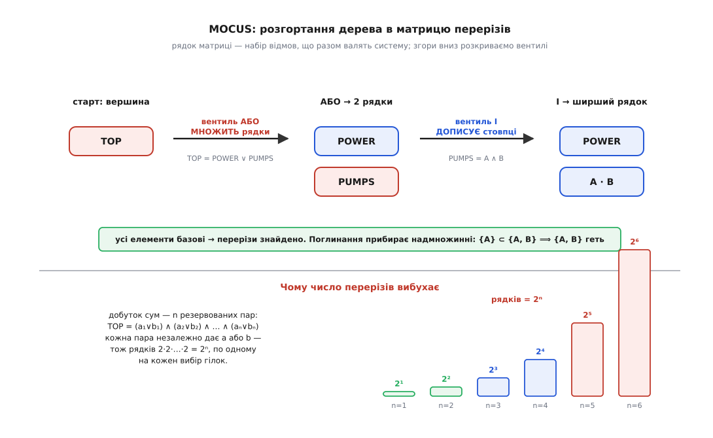

# ⚙️ Конвеєр FTA у коді: MOCUS шукає перерізи, BDD рахує точно

Дерево відмов ми звели до булевої функції — тепер треба зробити з нею дві практичні речі, і це рівно дві половини робочого конвеєра. Перша **читає структуру**: перелічує мінімальні перерізи, найменші набори відмов, що валять систему. Друга **дає число**: точну ймовірність вершинної події. Обидві впираються в ту саму експоненційну стіну, але підходять до неї з різних боків — і найкраще видно, де саме ховається експонента, коли конвеєр стоїть перед очима цілком, кількасот рядків справжнього коду. Зберімо його від початку до кінця й простежмо, як діаграма рішень цю експоненту приборкує (а де не може — чесно віддає її назад).

Домовмося про спільну модель даних, щоб обидві половини читали те саме дерево. Вентиль — це його тип (`І`/`АБО`) і список входів; **базова подія — це просто ім'я, якого немає серед вентилів**. Наскрізний приклад лишається той самий: система охолодження, `TOP = POWER ∨ (PUMP_A ∧ PUMP_B)` — спільне живлення або обидва насоси разом.

## Половина перша: MOCUS розгортає дерево в перерізи

Найстаріший і досі найпоширеніший спосіб дістати перерізи — алгоритм **MOCUS** (англ. *method of obtaining cut sets*), який Джеррі Фассел і Білл Везелі описали 1972 року й який тепер сидить ядром у безлічі інструментів FTA. Ідея тримається на одному спостереженні, простому до банальності: **вентиль АБО збільшує кількість перерізів, вентиль І — їхній розмір**. Це усталений, багато разів перевідкритий факт, і на ньому будується вся механіка.

Уяви **матрицю перерізів**: таблицю, кожен рядок якої — набір подій, чия одночасна поява (поки що) веде до вершини. Почни з єдиного рядка `{TOP}` і розкривай згори вниз: бери в якомусь рядку символ-вентиль і заміняй його на входи за одним правилом.

- **Вентиль АБО** — це «досить будь-якого з входів». Кожен вхід дає **свій окремий спосіб** дійти до події, тож рядок **розмножується** на стільки нових рядків, скільки в АБО входів. АБО **множить рядки**.
- **Вентиль І** — це «потрібні всі входи разом». Усі вони мусять сидіти в **одному** наборі, тож вентиль у рядку заміняється **всіма своїми входами одразу**, той самий рядок лише ширшає. І **дописує стовпці**.

Продовжуй, доки в жодному рядку не лишиться вентиля — самі базові події. Кожен такий рядок — це переріз-кандидат. Чому заміни зберігають зміст? Бо рядок увесь час означає кон'юнкцію своїх подій, а розкриття вентиля — це буквально підстановка його булевого означення (диз'юнкції для АБО, кон'юнкції для І). Уся процедура — не що інше, як розкриття дужок булевого виразу дерева до **диз'юнктивної нормальної форми**: суми добутків, де кожен добуток і є переріз.


*Розгортання згори вниз. Матриця стартує з самої вершини. АБО розмножує рядки (кожен вхід — окремий переріз-кандидат), І дописує стовпці (усі входи в один рядок). Коли всі елементи базові — перерізи знайдено, лишається прибрати немінімальні. Унизу — джерело експоненти: якщо дерево є добутком `n` незалежних сум, кожен вентиль АБО множить число рядків удвічі, і на виході їх `2ⁿ`.*

Лишається одна дія — **поглинання** (англ. *absorption*). Розкриття дужок легко родить набори, що містять усередині менший переріз: якщо система падає вже від `{A}`, то роздутий `{A, B}` — не окремий спосіб програти, а той самий, обтяжений зайвиною. Мінімальний переріз — той, з якого не можна викинути жодної події; тож із усіх кандидатів лишаємо тільки ті, всередині яких немає меншого вже знайденого. Це рівно пошук **простих імплікантів** булевої функції — та сама машинерія, що й [мінімізація логічних функцій](root:hw-digital/logic-minimization): найкоротші кон'юнкції, кожна з яких сама вмикає вихід.

> 🔧 **Навіщо це.** Порядок найменшого перерізу — найдешевша чесна оцінка крихкості, яку взагалі можна дістати з проєкту: переріз розміру 1 кричить про єдину точку відмови ще до того, як хтось назве бодай одну ймовірність. Тому MOCUS запускають найпершим — він видає карту слабин, за якою вирішують, куди ставити резервування, і робить це без жодного числа.

Ось повний робочий MOCUS. Дерево — словник вентилів; `mocus` веде список рядків, що ще містять вентилі (черга роботи), і копить готові перерізи; `minimal` робить поглинання.

:::tabs
:::code proj-fault-tree-eval/py/polovyna-persha-mocus.py
:::code proj-fault-tree-eval/cpp/polovyna-persha-mocus.cpp
:::

Дерево охолодження віддає рівно два перерізи — `{POWER}` і `{PUMP_A, PUMP_B}`, — і це вичерпний список способів програти. Підсунь замість нього систему «2 з 3» (`TOP = (A∧B) ∨ (B∧C) ∨ (A∧C)`), і той самий код видасть три перерізи розміру 2, кожен блок у двох із них — от де народжуються спільні події.

А тепер підстав дерево, що є **добутком сум**: `TOP = (a₁∨b₁) ∧ (a₂∨b₂) ∧ … ∧ (aₙ∨bₙ)` — `n` резервованих пар, система падає, коли в кожній парі відмовив хоч один бік. Кожен вентиль АБО помножить число рядків удвічі, і на виході перерізів буде `2ⁿ`: усі способи вибрати по одному винуватцю з кожної пари. При `n = 20` це вже мільйон рядків, при `n = 40` — трильйон. MOCUS не гальмує через невдалу реалізацію — він упирається в те, що **самих перерізів експоненційно багато**, і жоден алгоритм не перелічить швидше, ніж їх існує. Це та сама стіна складності, тільки показана з якісного боку: ще без ймовірностей, самим лише числом наборів.

## Половина друга: BDD рахує ймовірність точно й одним проходом

Здавалося б, перерізи вже все дають — склади їхні ймовірності, та й по всьому. Але щойно дерево має спільні події, ця сума **бреше**. У «2 з 3» три перерізи по `0.1²`, наївна сума — `0.030`; а точна відповідь `0.028`, бо перерізи `{A,B}` і `{B,C}` можуть спрацювати водночас (коли відмовили всі троє), і сума рахує цей світ двічі. Чесно виправити перекриття — це включення-виключення з `2ᵐ` доданками на `m` перерізів: знову експонента, тепер із кількісного боку.

Вихід придумали Олів'є Кудер, Жан-Крістоф Мадр і, окремо для надійності, Антуан Розі 1993 року: не рахувати по перерізах узагалі, а переписати булеву функцію в **двійкову діаграму рішень** ([BDD](root:hw-digital/binary-decision-diagram)), де ймовірність знімається одним лінійним проходом. Секрет — у формі діаграми.

В основі — **розклад Шеннона**: будь-яку булеву функцію можна розщепити по одній змінній на дві простіші, взявши її [кофактори](root:math-logic/shannon-expansion) — те, у що функція перетворюється, коли змінну зафіксувати нулем чи одиницею:

```
f = (¬x · f|ₓ₌₀)  ∨  (x · f|ₓ₌₁)
```

Роби так рекурсивно, змінну за змінною **в одному наперед заданому порядку**, — і функція розкладеться в дерево рішень: у кожному вузлі питаємо про одну змінну, гілка `0` веде в піддерево «змінна ціла», гілка `1` — «змінна відмовила». Саме по собі це дерево завбільшки `2ⁿ` — нічого не виграли. Виграш дають **два стискання**, що обертають дерево на компактний орієнтований граф (їх увів Рендал Браянт 1986 року, зробивши BDD канонічною структурою):

1. **Прибрати надлишкові вузли.** Якщо обидві гілки вузла ведуть в одне й те саме — вузол нічого не вирішує, викидаємо його, лишаємо ту гілку.
2. **Хеш-консинг** — не створювати двох однакових вузлів. Тримаємо таблицю `(змінна, гілка-0, гілка-1) → вузол`; перш ніж зробити новий вузол, дивимося, чи такий уже є, і **ділимося** наявним. Це просто [мемоізація](root:sf-algorithms/memoization) побудови: ізоморфні піддерева зливаються в один спільний, і граф із дерева на `2ⁿ` листків усихає до жмені вузлів.

І тоді — головний подарунок. У кожному вузлі гілки `0` і `1` **взаємовиключні за побудовою**: змінна або ціла, або відмовила, третього нема. Ймовірність взаємовиключних випадків просто **додається**, без жодних поправок на перекриття. Тому точна ймовірність вершини знімається одним проходом знизу вгору:

```
P(термінал 1) = 1,   P(термінал 0) = 0
P(вузол на змінній v) = (1 − pᵥ) · P(гілка-0)  +  pᵥ · P(гілка-1)
```

> 🔧 **Навіщо це.** Уся хитрість спільних подій розчиняється саме тут. Наївна сума перерізів бреше, бо перерізи **перекриваються**; включення-виключення чесне, але коштує `2ᵐ`. BDD ж не має чого перекривати: розклад по змінній ділить світ на дві половини, що не мають спільних станів, тож ймовірності лягають у просту суму. Спільна подія, заведена в кілька гілок, проходиться в діаграмі **один раз** і автоматично враховується в усіх — жодного подвійного рахунку, жодних поправок. Ось чому BDD — золотий стандарт точного розрахунку.


*Ймовірність одним проходом. Кожен вузол питає про одну змінну: пунктир — «ціла» (гілка 0), суцільне — «відмовила» (гілка 1). Знизу вгору `P(вузол) = (1−p)·P(0) + p·P(1)`; гілки взаємовиключні, тож просто складаються. Для охолодження проходом угору спливають `0.01 → 0.0001 → 0.0011`. Праворуч — ахіллесова п'ята BDD: розмір діаграми залежить від порядку змінних, і той самий приклад коштує 120 вузлів за доброго порядку й 3069 за поганого.*

Ось повний BDD-рушій: побудова діаграми з дерева через операцію `apply` (рекурсія за розкладом Шеннона з мемоізацією) і зняття ймовірності. Обидві таблиці — `unique` (хеш-консинг вузлів) і `memo` (мемо `apply`) — це те, що не дає рекурсії розсипатися в експоненту на кожному кроці.

:::tabs
:::code proj-fault-tree-eval/py/polovyna-druha-bdd-rakhuie.py
:::code proj-fault-tree-eval/cpp/polovyna-druha-bdd-rakhuie.cpp
:::

Для охолодження — `0.0010999`, точнісінько як дав ручний прохід угору по вентилях. Але тепер підсунь «2 з 3» зі спільними подіями: той самий `probability` видасть `0.028` при `p = 0.1` і `0.000298` при `p = 0.01` — **точні** значення, які інакше довелося б добувати включенням-виключенням. BDD їх дає одним проходом і навіть не помічає, що події спільні: розклад Шеннона розв'язав перекриття сам, самою своєю формою.

## Складність і пастки

Здавалося б, BDD переміг стіну — точна відповідь лінійним проходом. Але придивися: прохід лінійний **за розміром діаграми**, а розмір ми обійшли мовчанкою. Якби діаграма завжди виходила малою, ми б розв'язали [#P-складну](root:computability/sharp-p-counting) задачу дешево — а цього не буває. Отже, десь захована та сама експонента. Вона в **порядку змінних**.

Той самий приклад — `n` резервованих пар, `TOP = (a₁∧b₁) ∨ … ∨ (aₙ∧bₙ)` — за доброго порядку (переплести пару: `a₁ b₁ a₂ b₂ …`) дає діаграму, що росте поліноміально; за поганого (усі `a`, потім усі `b`) — вибухає майже як `3·2ⁿ`. Виміряти легко тим самим кодом, дописавши `len(bdd.nodes)`:

```
n = 10 пар    добрий порядок:  120 вузлів     поганий: 3069 вузлів
              обидва дають ту саму ймовірність 0.0956 — різниться лише РОЗМІР
```

Це не вада реалізації, а фундаментальний факт, який довів Браянт: у одних порядків BDD лінійна, в інших — експоненційна, для тієї самої функції. #P-стіна не зникла — BDD **переселив** її з часу обчислення в розмір діаграми. Для багатьох реальних дерев це велика перемога (структура з інженерії часто дає добрий порядок сама собою, і діаграма виходить напрочуд компактною), але гарантії немає: знайти оптимальний порядок — теж важка задача, і на злих деревах діаграма розростається так само нездоланно, як росла б формула включень-виключень.

> 🔧 **Навіщо це.** Практичний висновок жорсткий: кнопки «порахуй точно» для будь-якого дерева не існує в жодному інструменті. Замість неї є вибір, чим пожертвувати. Точний BDD — поки діаграма тримається малою; коли роздувається, її обрізають евристикою впорядкування (порядок обходом дерева в глибину часто добрий) або динамічним пересіванням змінних. Не помогло — переходь на безпечну оцінку зверху (проста сума перерізів) чи на статистичну вибірку. Розуміти, **де** твоє дерево вдариться об стіну, — і є половина інженерної роботи.

Головні пастки конвеєра, кожна з механізмом:

- **Спільні (повторювані) події.** Найпідступніша. Проста сума ймовірностей перерізів завищує відповідь, бо перерізи ділять базові події й можуть спрацювати водночас — те саме `0.030` замість `0.028`. Не лікуй це власноруч правкою суми: або чесне включення-виключення (`2ᵐ` доданків), або BDD, який розв'язує перекриття формою й дає точне число одним проходом.
- **Забуте поглинання.** Пропустиш `minimal` — і немінімальний `{A, B}` залишиться поряд із `{A}`, роздуваючи список перерізів, а з ним і будь-яку похідну оцінку (важливість подій, суму перерізів). Перерізи без поглинання — це не мінімальні перерізи, а сира ДНФ.
- **Вибух діаграми за поганого впорядкування.** Розібраний вище: та сама функція, той самий результат, але поганий порядок роздуває BDD експоненційно. Ніколи не будуй велику діаграму на першому-ліпшому порядку змінних — почни з порядку, підказаного структурою дерева.
- **Спокуса перелічити всі перерізи «про всяк випадок».** На добутку сум їх `2ⁿ`; спроба виписати їх усі покладе інструмент ще до квантифікації. Коли перерізів забагато, їх **усікають** за порядком чи внеском — а точну ймовірність усе одно беруть із BDD, який квантифікує, не перелічуючи перерізів наодинці.

Зберімо конвеєр у ціле. Перша половина, MOCUS, **читає структуру**: розгортає дерево в перерізи розкриттям дужок до ДНФ — і може вибухнути числом самих перерізів. Друга половина, BDD, **дає число**: точну ймовірність лінійним проходом по діаграмі, взаємовиключність гілок дарує просту суму замість включень-виключень — і може вибухнути розміром діаграми за поганого порядку змінних. Експонента, як бачиш, **зберігається**: обидві половини впираються в ту саму #P-стіну, тільки одна ловить її в кількості перерізів, а друга — у розмірі діаграми. Увесь фокус інженерної квантифікації FTA — обрати те подання, у якому конкретне реальне дерево лишається малим, а де жодне не рятує — свідомо відступити на оцінку зверху чи вибірку. Кількасот рядків коду, і вся драма складності видно в тому єдиному місці, де кожна половина починає гальмувати.
