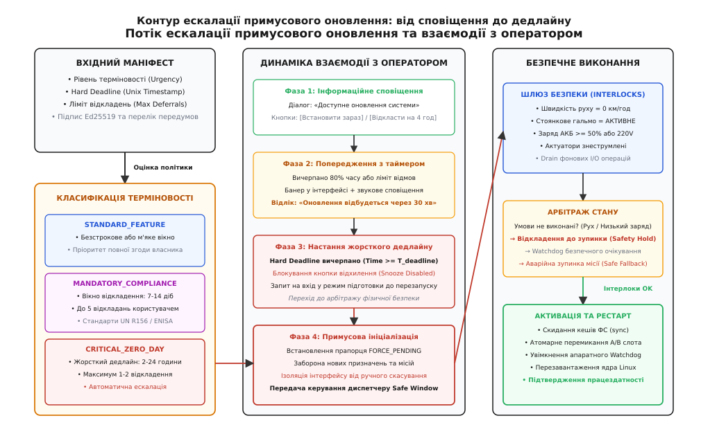
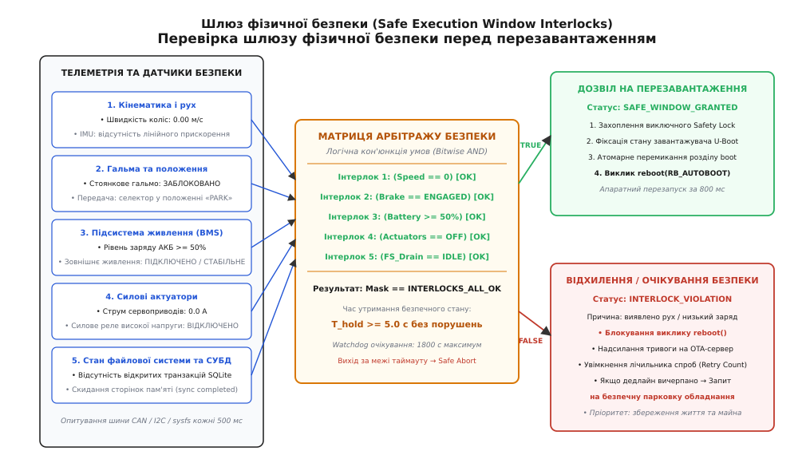

# Примусове оновлення й згода власника: дилема автономії, ескалація дедлайнів та перевірка безпечного стану

<preknowlist>
- [Керування кампанією](root:sf-release/keruvannia-kampaniieiu) — хвилі розгортання, ліміти відмов та метрики повернення пристроїв.
- [Публікація випуску на сервер оновлень](root:sf-release/publikatsiia-vypusku-na-server-onovlen) — криптографічний підпис маніфестів, перевірка сумісності ревізій та доставка артефактів.
- [Штатне вимкнення і drain](root:sf-release/graceful-shutdown) — фази зупинки процесів, збереження стану та вивільнення ресурсів.
- [Стратегії деплою](root:sf-release/deployment-strategies) — поступова доставка, канарковий аналіз та контроль радіуса ураження.
</preknowlist>

Парк із 25 000 автономних мобільних роботів (AMR) забезпечує цілодобове переміщення вантажів у шести великих розподільчих логістичних центрах. У бібліотеці криптографічного протоколу захисту каналів зв'язку виявлено критичну вразливість нульового дня, яка дозволяє неавтентифіковане віддалене виконання довільного коду через переповнення динамічного буфера під час обробки сесійних TLS-квитків. Зловмисник, що перебуває у радіусі дії бездротової мережі Wi-Fi або зламав граничний маршрутизатор, здатен отримати привілеї суперкористувача `root` на бортовому комп'ютері робота, перехопити керування силовими приводами та скомпрометувати решту промислової інфраструктури. Інженерна команда виробника випускає оновлений бінарний образ операційної системи Linux із виправленням драйвера та надсилає команду обов'язкового термінового розгортання на всі 25 000 машин.

Якщо сервер керування кампанією ініціює миттєвий примусовий рестарт (Vendor Force-Push) безпосередньо в момент виконання роботом транспортної операції, коли важкий візок масою 800 кг рухається зі швидкістю 2.5 м/с вузьким проїздом між стелажами, раптове завершення роботи ядра Linux та скидання керуючих сигналів ШІМ на мікроконтролерах інверторів призводить до знеструмлення серводвигунів. Апаратні пружинні стоянкові гальма спрацьовують миттєво; кінетична енергія рухомої маси (E_k = 0.5 · m · v² = 0.5 · 800 · 2.5² = 2500 Дж) зриває незакріплений піддон із товаром, деформує конструкції стелажного комплексу та створює пряму загрозу травмування персоналу складу. Якщо ж вендор передає абсолютне право ухвалення рішення місцевим змінним диспетчерам логістичного термінала, оператори, мотивовані виконанням добових планів відвантаження, послідовно натискають кнопку «Відкласти на 8 годин» протягом чотирьох тижнів. Через 28 діб 14 000 роботів залишаються без виправлення безпеки, підпадають під масовану атаку автоматизованого мережевого хробака-вимагача, і робота логістичної мережі повністю зупиняється зі збитками понад два мільйони доларів на добу.

Ця аварійна дихотомія оголює головний виклик оновлення кіберфізичних систем: неможливо побудувати надійний парк обладнання ані на диктатурі виробника, ані на необмеженому праві відхилення з боку експлуатанта. Надійна архітектура вимагає формалізованого протоколу взаємодії між сервером і пристроєм, що базується на градуйованій ескалації дедлайнів (Graduated Deferral Escalation) та непорушному шлюзі перевірки умов фізичної безпеки (Safe Execution Window).

## Дилема автономії: конфлікт інтересів виробника та власника

Конфлікт між виробником програмного забезпечення (Vendor) та власником або оператором обладнання (Asset Owner) має глибоке технічне, економічне та юридичне коріння. Обидві сторони діють раціонально в межах власних зон відповідальності, але їхні оптимізаційні критерії діаметрально протилежні:

```text
┌─────────────────────────────────────────────────────────────────────────────┐
│                 АРХІТЕКТУРНА ДИЛЕМА ПРИМУСОВОГО ОНОВЛЕННЯ                   │
│                                                                             │
│ [ Вендор / Виробник ПЗ ]                         [ Власник / Оператор ]     │
│  • Глобальна безпека парку                        • Безперервність процесів │
│  • Запобігання експлойтам 0-Day                   • Збереження контексту    │
│  • Регуляторний комплаєнс (CRA, R156)             • Фізичний суверенітет    │
│                 │                                         │                 │
│                 ▼                                         ▼                 │
│         [ ПРИМУСОВИЙ ПУШ ]                        [ ПРАВО ВЕТО ]            │
│         (Force-Push Update)                       (Perpetual Deferral)      │
│                 │                                         │                 │
│                 ├───────────────────┬─────────────────────┤                 │
│                 ▼                   ▼                     ▼                 │
│         Аварійний рестарт,   [ СИНТЕЗ: ШЛЮЗ ]     Масове зараження,         │
│         фізична небезпека,   [ БЕЗПЕКИ ТА   ]     деградація безпеки,       │
│         втрата даних I/O     [ ЕСКАЛАЦІЇ    ]     відкликання сертифікатів  │
└─────────────────────────────────────────────────────────────────────────────┘
```

1. **Мотивація та ризики виробника:**
   - **Репутаційна та юридична відповідальність:** Якщо пристрої виробника стають інструментом масованої DDoS-атаки або через вразливість у прошивці відбувається витік конфіденційних даних клієнтів, регулятори та ринок карають саме постачальника платформи.
   - **Підтримка фрагментації:** Наявність у польових умовах сотень різних проміжних версій мікрокоду та операційної системи експоненційно ускладнює тестування наступних релізів. Виробник прагне якомога швидше стягнути весь парк до єдиної актуальної базової лінії (Baseline Convergence).
   - **Захист інфраструктури хмари:** Неоновлені клієнтські термінали продовжують використовувати застарілі криптографічні набори шифрів (TLS 1.2 з небезпечними CBC-режимами) або сертифікати відкритого ключа, термін дії яких добігає кінця, що змушує бекенд підтримувати небезпечні застарілі інтерфейси.

2. **Мотивація та ризики власника обладнання:**
   - **Ціна простою (Cost of Downtime):** У металургії, нафтогазовій галузі, автоматизованих складах або центрах обробки даних одна хвилина технологічного простою конвеєра чи технологічної лінії вимірюється десятками тисяч доларів. Неконтрольоване перезавантаження навіть на дві хвилини ламає виробничий графік цілої зміни.
   - **Втрата тимчасового та транзакційного стану:** Раптовий рестарт операційної системи знищує оперативні кеші в оперативній пам'яті, розриває активні сесії обміну даними через промислові шини CAN/Modbus/EtherCAT та може призвести до пошкодження напівзаписаних блоків у базах даних SQLite без активного журналу випереджального запису.
   - **Ризик функціональної регресії («Працює — не чіпай»):** Власник обґрунтовано побоюється, що новий реліз, скомпільований вендором, може містити невідомі дефекти, які змінять калібрування сенсорів або знизять загальну продуктивність апаратного вузла.

Коли система залишає оновлення на розсуд людини без обмеження часу, спрацьовує психологічний ефект «втоми від сповіщень» (Notification Fatigue). Оператор звикає закривати модальні діалогові вікна автоматично, не читаючи зміст повідомлення про критичність загрози. Практичні вимірювання показують: якщо корпоративні пристрої не мають механізму примусової ескалації дедлайнів, частка неоновлених терміналів через 90 діб після публікації критичного патча становить від 65% до 80%.

## Нормативна база: вимоги NIST, ENISA, UN R156 та EU CRA

Сучасна розробка систем доставки вбудованого програмного забезпечення регулюється жорсткими міжнародними стандартами кібербезпеки та функціональної надійності, які чітко визначають межі допустимого примусу:

1. **NIST SP 800-193 (Platform Firmware Resiliency Guidelines):**
   - Документ Національного інституту стандартів і технологій США визначає три фундаментальні принципи стійкості прошивки: **Protection (Захист)**, **Detection (Виявлення)** та **Recovery (Відновлення)**.
   - Механізм оновлення зобов'язаний забезпечувати захист від відкату на старіші вразливі версії (Anti-Rollback Protection) через запис мінімального дозволеного номера версії в апаратні одноразово програмовані регістри (eFuses) або захищені лічильники TPM 2.0 (NV Index).
   - Якщо в процесі примусового перезавантаження нова версія виявляється пошкодженою, система зобов'язана автоматично відновити працездатність із захищеного золотого образу (Golden Image) або альтернативного слота пам'яті.

2. **Регламент UN R156 (UNECE Software Update and Software Updates Management System):**
   - Міжнародний стандарт для автомобільної промисловості, що встановлює суворі вимоги до безпеки розгортання оновлень (OTA SUMS).
   - Стандарт прямо вимагає розділення процесів доставки оновлення та його активації: транспортний засіб може завантажувати образ у фоновому режимі під час руху, але виконання процедури перезавантаження або перепрошивки електронних блоків керування (ECU) **категорично забороняється під час руху** (Driving Inhibit).
   - Виробник зобов'язаний надати водієві або оператору вичерпну інформацію про тривалість процедури, забезпечити інформування про неможливість користування транспортним засобом під час оновлення та отримати підтвердження згоди або дочекатися безпечного паркування.

3. **Європейський акт кіберстійкості (EU Cyber Resilience Act — CRA):**
   - Законодавчий акт Європейського Союзу, що покладає юридичний обов'язок на виробників цифрових пристроїв усувати виявлені вразливості протягом усього життєвого циклу продукту.
   - Виробник зобов'язаний надати механізм автоматичної або керованої доставки виправлень безпеки. Для критичних вразливостей (Zero-Day) встановлюються нормативні дедлайни реагування: повідомлення регулятора про активний експлойт протягом 24 годин та надання патча протягом визначеного періоду.

4. **Функціональна безпека (ISO 26262 / IEC 61508):**
   - Стандарти функціональної безпеки визначають рівні повноти безпеки (ASIL від A до D у транспорті, SIL 1..4 у промисловості).
   - Головне правило сумісності полягає в тому, що підсистема безпеки вищого рангу (наприклад, контур аварійної зупинки ASIL D) має безумовний пріоритет над підсистемою керування оновленнями (яка зазвичай сертифікується за рівнями QM або ASIL B). Програмний демон оновлення не має фізичної та логічної можливості зняти апаратне блокування перезавантаження, якщо контролер безпеки сигналізує про рух або небезпечний стан середовища.

## Таксономія випусків: матриця терміновості та ціна простою

Класифікація випусків дозволяє відокремити рутинне додавання функцій від екстреного закриття дірок у безпеці. Рівень терміновості призначається релізу на етапі криптографічного підпису маніфесту в конвеєрі CI/CD на основі комбінованого аналізу показників загрози (CVSS, EPSS, CISA KEV) та бізнес-впливу:

| Рівень терміновості (`urgency_level`) | Критерії вразливості та бізнес-впливу | Пільгове вікно (Grace Period) | Ліміт відкладень (Snooze Limit) | Поведінка системи після настання дедлайну |
|---|---|---|---|---|
| `STANDARD_FEATURE` | Планові релізи функціональності, оновлення перекладів, UI/UX покращення (CVSS < 4.0). | Безстроково або 30–60 діб | Необмежено | Лише рекомендаційні сповіщення. Примус відсутній; встановлення тільки за прямою ініціативою власника. |
| `IMPORTANT_BUGFIX` | Виправлення помилок стабільності, витоків пам'яті, низькоризикових патчів (CVSS 4.0–6.9). | 14 діб | 10 разів по 12–24 год | Наполегливі модальні нагадування; автоматичне встановлення під час виявлення тривалого нічного простою. |
| `MANDATORY_REGULATORY` | Відповідність правовим нормам, заміна TLS/CA сертифікатів до закінчення терміну дії, регламенти UN R156. | 7 діб | 5 разів по 8 год | Блокування призначення нових бізнес-задач пристрою до проходження оновлення у найближчому вікні безпеки. |
| `CRITICAL_ZERO_DAY` | Активний експлойт RCE у дикій природі, скомпрометований кореневий ключ (CVSS 7.0–10.0, EPSS > 0.5). | 2–24 години | 1–2 рази по 1–2 год | Жорсткий дедлайн: обов'язковий перехід у стан готовності, заборона відкладень та примусовий рестарт у безпечному вікні. |
| `SAFETY_EMERGENCY_RECALL` | Критичний апаратний дефект прошивки, що загрожує загорянням АКБ, аварією або руйнуванням механіки. | 0 годин (негайно) | 0 (відкладення заборонено) | Негайне переведення обладнання в безпечний паркувальний режим (Safe State) та блокуюча прошивка. |

Розрахунок інтегрального індексу критичності R базується на формулі комбінованого ризику:

```text
R = CVSS_base · (1 + 0.5 · I_KEV) · (1 + EPSS)   [комбінований індекс загрози]
```

де `CVSS_base` — базовий бал уразливості за стандартом CVSS v3.1 (від 0.0 до 10.0), `I_KEV` — бінарний індикатор наявності вразливості в каталозі відомих експлуатованих вразливостей CISA KEV (0 або 1), а `EPSS` — ймовірність появи експлойта в найближчі 30 днів за шкалою від 0.0 до 1.0. Якщо значення R ≥ 12.0, реліз автоматично маркується рівнем `CRITICAL_ZERO_DAY`.

## Механізм градуйованої ескалації дедлайнів

Ескалація дедлайну розгортається у часі через чотири послідовні фази. Мета алгоритму — надати оператору максимальну гнучкість на початковому етапі, поступово підвищуючи рівень помітності та обмежуючи права відкладення в міру наближення до критичної часової мітки:

```text
       ┌──────────────────────────────────────────────────────────────────┐
       │     ЧАСОВА ШКАЛА ЕСКАЛАЦІЇ ДЕДЛАЙНУ ПРИМУСОВОГО ОНОВЛЕННЯ        │
       └──────────────────────────────────────────────────────────────────┘

 Час T:  T_0                     T_1                     T_deadline           T_exec
 ───────┼───────────────────────┼───────────────────────┼────────────────────┼────────>
 Стадія:  [ Фаза 1: Сповіщення ]  [ Фаза 2: Попередження] [ Фаза 3: Дедлайн ]  [ Фаза 4 ]
          • Доступний реліз       • 80% часу вичерпано    • Snooze заблоковано • Шлюз безпеки
          • Кнопка: [Відкласти]   • Таймер зворотного     • Примусова          • Активація
          • Пільговий лічильник     відліку               підготовка           A/B слота
```

1. **Фаза 1: Інформаційне сповіщення (Advisory Notification):**
   - Пристрій отримує метадані випуску від OTA-сервера, завантажує двійкові артефакти у фоновий розділ флеш-пам'яті (пасивний слот B) та верифікує криптографічний підпис Ed25519.
   - Користувацький інтерфейс виводить неблокуюче повідомлення з описом змін та двома основними діями: «Встановити зараз» або «Відкласти». Клієнт може самостійно вибрати інтервал відкладення (наприклад, 2, 4 або 8 годин) у межах доступного кроку `deferral_step_sec`. Лічильник `deferrals_used` збільшується на одиницю при кожному виборі.

2. **Фаза 2: Наполегливе попередження зі зворотним відліком (Warning Countdown):**
   - Фаза настає, коли виконано хоча б одну з умов:
```text
(T_current - T_issued) / (T_deadline - T_issued) ≥ 0.80   [вичерпання 80% вікна]
(max_deferrals - deferrals_used) ≤ 1                      [останнє доступне відкладення]
```
   - Інтерфейс закріплює помітний банер у робочій зоні екрана. У промислових терміналах активуються звукові сигнали та жовта світлодіодна індикація.
   - Відображається динамічний таймер прямого зворотного відліку: «До примусового перезавантаження системи залишилося: 00:29:45». Доступні опції відкладення скорочуються за тривалістю до мінімального кроку.

3. **Фаза 3: Вичерпання жорсткого дедлайну (Hard Deadline Expiration):**
   - Настає у момент `T_current ≥ T_deadline` або при вичерпанні ліміту `deferrals_used >= max_deferrals`.
   - Кнопка відкладення (Snooze) повністю деактивується та блокується в інтерфейсі HMI та через API віддаленого керування.
   - Агент переводить внутрішній автомат станів у режим `FORCE_PENDING`. Пристрій переходить у стан зупинки прийому нових завдань: планувальник місій відхиляє нові замовлення на транспортування, черга повідомлень переводиться в режим зливу (drain), а поточні критичні цикли доводяться до найближчої безпечної контрольної точки.

4. **Фаза 4: Передача керування диспетчеру безпечного вікна (Safe Window Handover):**
   - Навіть за умов повної ескалації дедлайну агент оновлення не має права виконати системний виклик `reboot()` безпосередньо.
   - Керування передається підсистемі верифікації апаратних блокувань (Safety Interlock Subsystem). Якщо робот у цей момент рухається або контролер фіксує нестабільне живлення, оновлення утримується в стані очікування (Safety Hold) до повної зупинки апарата.


*Контур ескалації примусового оновлення: послідовний перехід від рекомендаційного сповіщення до жорсткого дедлайну, арбітражу умов безпеки та атомарної активації нового слота.*

## Шлюз фізичної безпеки (Safe Execution Window)

Концепція шлюзу фізичної безпеки (Safe Execution Window) втілює базовий принцип кіберфізичної інженерії: **пріоритет функціональної безпеки життя та обладнання над будь-якими цифровими дедлайнами**. Жоден криптографічний дедлайн, регуляторний припис чи наказ віддаленого сервера не має права ініціювати перезапуск обчислювального вузла, якщо це призведе до фізичної аварії.

```text
┌─────────────────────────────────────────────────────────────────────────────┐
│                 АРХІТЕКТУРА ШЛЮЗУ ФІЗИЧНОЇ БЕЗПЕКИ (INTERLOCKS)             │
│                                                                             │
│ [ Сенсор швидкості ] ──> ( v == 0.00 м/с )                ─────┐            │
│ [ Стоянкове гальмо] ──> ( State == ENGAGED )             ─────┤            │
│ [ Контролер АКБ    ] ──> ( SoC >= 50% || AC_Powered )     ─────┼──> [ AND ] │
│ [ Силові реле      ] ──> ( Current == 0.0 A )             ─────┤      │     │
│ [ Системний I/O    ] ──> ( DB_Transactions == 0 && sync ) ─────┘      │     │
│                                                                       ▼     │
│ [ Утримання стану: T_hold >= 5.0 с ] <────────────────────────────────┘     │
│        │                                                                    │
│        ├───> [ ВСІ УМОВИ ВИКОНАНО ] ──> Дозвіл на A/B Switch + reboot()     │
│        └───> [ ПОРУШЕННЯ УМОВИ    ] ──> Скидання таймера, перехід у Hold   │
└─────────────────────────────────────────────────────────────────────────────┘
```

Для перевірки можливості безпечного перезавантаження агент збирає телеметрію з п'яти незалежних категорій датчиків та системних підсистем:

1. **Кінематичні та просторові інтерлоки:**
   - Швидкість руху за показами колісних одометричних енкодерів, оптичних датчиків потоку та супутникової навігації дорівнює нулю: `|v| ≤ 0.01` м/с.
   - Дані триосьового акселерометра та гіроскопа (IMU) свідчать про відсутність кутових швидкостей та лінійних прискорень, відмінних від гравітаційного прискорення `g`.
   - Механічне стоянкове гальмо активоване (Brake Engaged), а селектор трансмісії переведений у положення «Паркування» (Park Mode).

2. **Електротехнічні та теплові інтерлоки:**
   - Силові контактори живлення електроприводів знеструмлені або переведені у режим утримання нульового струму (`|I_actuator| ≤ 0.05` А).
   - Підсистема керування батареєю (Battery Management System, BMS) підтверджує залишковий заряд `SoC ≥ 50%`, або зафіксовано фізичне підключення до зовнішньої живильної мережі змінного струму (Mains Power / Charging Dock). Це унеможливлює раптове знеструмлення процесора через просідання напруги акумулятора під час фіксації запису в пам'ять NAND Flash.
   - Температура кристала процесора, силових ключів інвертора та осередків батареї перебуває у робочому діапазоні (`T_cpu ≤ 75 °C`, `T_bat ≤ 45 °C`).

3. **Системні та програмні інтерлоки:**
   - Демон системного керування `systemd` перевіряє відсутність активних блокувань завершення роботи через механізм інгібіторів (`systemd-inhibit --what=shutdown`).
   - Локальні транзакційні рушії (наприклад, SQLite або RocksDB) завершили всі незавершені транзакції, виконали контрольні точки журналу WAL (`sqlite3_wal_checkpoint_v2`) та закрили файлові дескриптори.
   - Виконано синхронізацію буферів файлової системи ядра Linux із фізичним носієм через системний виклик `sync()`, що гарантує збереження журналу ext4/f2fs.

4. **Інтерлоки виробничого середовища:**
   - Лазерні сканери безпеки (Safety LiDAR) не фіксують присутності людей або перешкод у радіусі 1.5 метра від робота.
   - Пристрій не перебуває всередині технологічної зони підвищеної небезпеки (наприклад, підйомні механізми, фарбувальні камери, зони роботи кранів).

5. **Часовий фільтр стабілізації (Stability Hold Duration):**
   - Одноразового виконання всіх умов недостатньо: робот міг просто на пів секунди зупинитися перед зміною напрямку руху. Усі інтерлоки зобов'язані залишатися в істинному стані неперервно протягом часу `T_hold ≥ 5.0` секунд. Будь-яка флуктуація (наприклад, сплеск струму двигуна або імпульс швидкості) миттєво скидає таймер стабілізації в нуль.


*Шлюз фізичної безпеки (Safe Execution Window Interlocks): збір сенсорних даних, бітова кон'юнкція умов та захист від перезапуску під час руху або критичного навантаження.*

## Протокольний контракт маніфесту примусу

Для забезпечення сумісності між хмарним сервером керування флотом та локальним клієнтським агентом релізний маніфест містить стандартизовану структуру політики розгортання `policy_enforcement`:

```json
{
  "manifest_version": 2,
  "bundle_id": "com.fleet.firmware-amr-5.12.4",
  "artifact_type": "dual-slot-rootfs",
  "sha256": "8f434346648f6b96df89dda901c5176b10a6d83961dd3c1ac88b59b2dc327aa4",
  "signature_ed25519": "e2c39d891b9347596b4ef823190b2c1538a7c29e13498b584d0b17849c9a2f71...",
  "policy_enforcement": {
    "urgency": "CRITICAL_ZERO_DAY",
    "issued_at_epoch": 1774915200,
    "grace_period_sec": 43200,
    "hard_deadline_epoch": 1774958400,
    "max_deferrals": 3,
    "deferral_step_sec": 7200,
    "required_interlocks_bitmask": "0x0000001F",
    "stability_hold_sec": 5,
    "safety_wait_watchdog_sec": 3600,
    "auto_abort_mission_on_deadline": true
  }
}
```

- `urgency`: текстовий ідентифікатор терміновості релізу для класифікації у звітах аудиту.
- `issued_at_epoch`: часова мітка генерації та підпису маніфесту на сервері (Unix Timestamp, UTC).
- `grace_period_sec`: тривалість початкового пільгового періоду в секундах (12 годин у наведеному прикладі).
- `hard_deadline_epoch`: абсолютна часова мітка жорсткого дедлайну. Використання абсолютного значення Epoch UTC запобігає маніпуляціям зі штучним затягуванням часу на клієнті.
- `max_deferrals`: гранична кількість дозволених запитів на відкладення з боку оператора або локальної бізнес-логіки.
- `deferral_step_sec`: рекомендований квант часу, на який відкладається виконання за одне натискання (2 години).
- `required_interlocks_bitmask`: шістнадцяткова маска прапорців обов'язкових перевірок безпеки (біти 0..4 відповідають швидкості, гальмам, акумулятору, актуаторам та I/O drain).
- `stability_hold_sec`: тривалість неперервного утримання стабільного безпечного стану перед видачею дозволу на перезавантаження.
- `safety_wait_watchdog_sec`: максимальний час очікування безпечного вікна після настання дедлайну. Якщо протягом години пристрій не зміг зупинитися у штатному режимі, активується прапорець `auto_abort_mission_on_deadline`, і робот здійснює аварійну зупинку поточної місії з паркуванням біля найближчої стіни проїзду.

## Системна інтеграція та інтерфейси операційної системи Linux

Для надійної координації між процесами простору користувача та апаратними драйверами ядра агент оновлення спирається на низку стандартизованих інтерфейсів Linux:

1. **Інгібітори вимкнення та D-Bus API (`systemd-logind`):**
   Під час фонового запису образу на флеш-накопичувач eMMC агент оновлення створює дескриптор блокування вимкнення через системну шину D-Bus за допомогою виклику методу `Inhibit` інтерфейсу `org.freedesktop.login1.Manager`:
   ```bash
   systemd-inhibit --what=shutdown:sleep --who="ota-agent" \
                   --why="Writing firmware to inactive slot" \
                   --mode=delay /usr/libexec/ota-write-worker
   ```
   Це гарантує, що випадкове натискання кнопки живлення або автоматичний перехід у сплячий режим не перервуть транзакційний запис секторів.

2. **Криптографічний аудит згоди та відкладень (User Consent Receipts):**
   Вимоги стандарту UN R156 передбачають збереження неспростовного журналу всіх взаємодій оператора з системою оновлень. Коли диспетчер натискає кнопку «Встановити зараз» або «Відкласти», демон оновлення формує структуру квитанції аудиту (Audit Receipt), що містить ідентифікатор оператора, хеш маніфесту, часову мітку та обрану дію. Ця квитанція підписується локальним апаратним ключем пристрою за допомогою команди TPM 2.0 `TPM2_Sign` та зберігається у захищеному журналі `systemd-journald` із пересиланням на сервер моніторингу кампанії.

3. **Координація I/O на рівні блокових пристроїв:**
   Перед скиданням живлення агент здійснює заморожування файлових систем, відкритих для запису, за допомогою керуючих викликів `ioctl(fd, FIFREEZE, 0)`. Це зупиняє нові операції модифікації метаданих на рівні VFS ядра Linux, скидає брудні сторінки сторінкового кешу на фізичний диск і переводить файлову систему у повністю узгоджений стан до моменту перезавантаження.

4. **Багатовузловий консенсус безпеки (Multi-Node Cluster Interlocks):**
   У складних робототехнічних комплексах обчислювальна архітектура складається не з одного процесора, а з гетерогенного кластера: головний промисловий комп'ютер (Single Board Computer на x86/ARM під Linux), контролер функціональної безпеки руху (Safety PLC / Dual Lockstep ARM Cortex-R5), модуль машинного зору (NVIDIA Jetson) та контролер керування батареєю (BMS на STM32). Перед тим як головний вузол ініціює перезавантаження, він виконує розподілений двофазний коміт (Two-Phase Commit, 2PC) через ізольовану шину CAN/Ethernet:
   - **Фаза підготовки (Prepare Phase):** Координатор надсилає запит `PREPARE_REBOOT` до всіх трьох допоміжних контролерів. Кожен модуль перевіряє власні інтерлоки: контролер батареї засвідчує відсутність режиму балансування комірок, модуль маніпулятора підтверджує паркування механічної руки, а Safety PLC підтверджує нульову швидкість коліс.
   - **Фаза фіксації (Commit Phase):** Лише за умови отримання одностайного схвалення `VOTE_COMMIT` від усіх трьох копроцесорів координатор надсилає фінальну команду `EXECUTE_REBOOT`. Якщо хоча б один вузол відповідає `VOTE_ABORT`, уся процедура оновлення блокується, а пристрій залишається у стані очікування.

## Реалізація алгоритму оцінки політики та шлюзу безпеки

Нижче наведено порівняльну реалізацію модуля перевірки політики примусового оновлення та валідації шлюзу безпеки на мовах C99 та C++20. Обидва варіанти повністю реалізують логіку бітових масок інтерлоків, розрахунок дедлайнів та захист від передчасного перезавантаження.

:::tabs
```c
#include <stdio.h>
#include <stdint.h>
#include <stdbool.h>
#include <time.h>
#include <string.h>

#define INTERLOCK_SPEED_ZERO     (1U << 0)
#define INTERLOCK_BRAKE_ENGAGED  (1U << 1)
#define INTERLOCK_BATTERY_OK     (1U << 2)
#define INTERLOCK_ACTUATORS_OFF  (1U << 3)
#define INTERLOCK_FS_DRAINED     (1U << 4)

#define INTERLOCKS_REQUIRED_MASK (INTERLOCK_SPEED_ZERO | \
                                  INTERLOCK_BRAKE_ENGAGED | \
                                  INTERLOCK_BATTERY_OK | \
                                  INTERLOCK_ACTUATORS_OFF | \
                                  INTERLOCK_FS_DRAINED)

typedef enum {
    URGENCY_STANDARD_FEATURE = 0,
    URGENCY_IMPORTANT_BUGFIX = 1,
    URGENCY_MANDATORY_REGULATORY = 2,
    URGENCY_CRITICAL_ZERO_DAY = 3,
    URGENCY_SAFETY_EMERGENCY_RECALL = 4
} update_urgency_t;

typedef enum {
    DECISION_NOTIFY_AND_WAIT,
    DECISION_ALLOW_DEFERRAL,
    DECISION_FORCE_IMMEDIATE_SAFE_WINDOW,
    DECISION_SAFETY_HOLD_WAITING_CONDITIONS,
    DECISION_EXECUTE_REBOOT_AND_SWITCH
} policy_decision_t;

typedef struct {
    update_urgency_t urgency;
    time_t issued_at;
    time_t hard_deadline;
    uint32_t max_deferrals;
    uint32_t deferrals_used;
    uint32_t stability_hold_sec;
} update_policy_state_t;

typedef struct {
    double velocity_mps;
    bool parking_brake;
    uint8_t battery_soc_percent;
    bool is_ac_connected;
    double actuator_current_amps;
    bool filesystem_drained;
} vehicle_telemetry_t;

static uint32_t evaluate_interlocks(const vehicle_telemetry_t* telem) {
    uint32_t mask = 0;
    if (telem->velocity_mps >= -0.01 && telem->velocity_mps <= 0.01) {
        mask |= INTERLOCK_SPEED_ZERO;
    }
    if (telem->parking_brake) {
        mask |= INTERLOCK_BRAKE_ENGAGED;
    }
    if (telem->battery_soc_percent >= 50 || telem->is_ac_connected) {
        mask |= INTERLOCK_BATTERY_OK;
    }
    if (telem->actuator_current_amps >= -0.05 && telem->actuator_current_amps <= 0.05) {
        mask |= INTERLOCK_ACTUATORS_OFF;
    }
    if (telem->filesystem_drained) {
        mask |= INTERLOCK_FS_DRAINED;
    }
    return mask;
}

policy_decision_t policy_engine_evaluate(
    const update_policy_state_t* policy,
    const vehicle_telemetry_t* telem,
    time_t current_time,
    time_t safe_conditions_held_since_sec)
{
    bool deadline_expired = (current_time >= policy->hard_deadline);
    bool deferrals_exhausted = (policy->deferrals_used >= policy->max_deferrals);
    bool must_force = deadline_expired || deferrals_exhausted || 
                       (policy->urgency == URGENCY_SAFETY_EMERGENCY_RECALL);

    if (!must_force) {
        return DECISION_ALLOW_DEFERRAL;
    }

    uint32_t current_mask = evaluate_interlocks(telem);
    if ((current_mask & INTERLOCKS_REQUIRED_MASK) != INTERLOCKS_REQUIRED_MASK) {
        return DECISION_SAFETY_HOLD_WAITING_CONDITIONS;
    }

    if (safe_conditions_held_since_sec > 0 && 
        (current_time - safe_conditions_held_since_sec) >= (time_t)policy->stability_hold_sec) {
        return DECISION_EXECUTE_REBOOT_AND_SWITCH;
    }

    return DECISION_FORCE_IMMEDIATE_SAFE_WINDOW;
}
```
```cpp
#include <iostream>
#include <cstdint>
#include <chrono>
#include <optional>
#include <expected>

namespace fleet::ota {

enum class UrgencyLevel : uint8_t {
    StandardFeature = 0,
    ImportantBugfix = 1,
    MandatoryRegulatory = 2,
    CriticalZeroDay = 3,
    SafetyEmergencyRecall = 4
};

enum class PolicyDecision : uint8_t {
    AllowDeferral,
    ForceImmediateSafeWindow,
    SafetyHoldWaitingConditions,
    ExecuteRebootAndSwitch
};

struct InterlockFlags {
    static constexpr uint32_t SpeedZero    = 1U << 0;
    static constexpr uint32_t BrakeEngaged = 1U << 1;
    static constexpr uint32_t BatteryOk    = 1U << 2;
    static constexpr uint32_t ActuatorsOff = 1U << 3;
    static constexpr uint32_t FsDrained    = 1U << 4;
    static constexpr uint32_t AllRequired  = SpeedZero | BrakeEngaged | BatteryOk | ActuatorsOff | FsDrained;
};

struct PolicyParameters {
    UrgencyLevel urgency{UrgencyLevel::StandardFeature};
    std::chrono::system_clock::time_point issued_at;
    std::chrono::system_clock::time_point hard_deadline;
    uint32_t max_deferrals{3};
    uint32_t deferrals_used{0};
    std::chrono::seconds stability_hold_duration{5};
};

struct VehicleTelemetry {
    double velocity_mps{0.0};
    bool parking_brake{false};
    uint8_t battery_soc_percent{0};
    bool is_ac_connected{false};
    double actuator_current_amps{0.0};
    bool filesystem_drained{false};

    [[nodiscard]] constexpr uint32_t compute_interlock_mask() const noexcept {
        uint32_t mask = 0;
        if (velocity_mps >= -0.01 && velocity_mps <= 0.01) {
            mask |= InterlockFlags::SpeedZero;
        }
        if (parking_brake) {
            mask |= InterlockFlags::BrakeEngaged;
        }
        if (battery_soc_percent >= 50 || is_ac_connected) {
            mask |= InterlockFlags::BatteryOk;
        }
        if (actuator_current_amps >= -0.05 && actuator_current_amps <= 0.05) {
            mask |= InterlockFlags::ActuatorsOff;
        }
        if (filesystem_drained) {
            mask |= InterlockFlags::FsDrained;
        }
        return mask;
    }
};

class PolicyEvaluator {
public:
    [[nodiscard]] static PolicyDecision evaluate(
        const PolicyParameters& policy,
        const VehicleTelemetry& telem,
        std::chrono::system_clock::time_point current_time,
        std::optional<std::chrono::steady_clock::time_point> safe_conditions_start,
        std::chrono::steady_clock::time_point steady_now) noexcept
    {
        const bool deadline_expired = (current_time >= policy.hard_deadline);
        const bool deferrals_exhausted = (policy.deferrals_used >= policy.max_deferrals);
        const bool must_force = deadline_expired || deferrals_exhausted || 
                               (policy.urgency == UrgencyLevel::SafetyEmergencyRecall);

        if (!must_force) {
            return PolicyDecision::AllowDeferral;
        }

        const uint32_t mask = telem.compute_interlock_mask();
        if ((mask & InterlockFlags::AllRequired) != InterlockFlags::AllRequired) {
            return PolicyDecision::SafetyHoldWaitingConditions;
        }

        if (safe_conditions_start.has_value()) {
            const auto elapsed = std::chrono::duration_cast<std::chrono::seconds>(
                steady_now - *safe_conditions_start
            );
            if (elapsed >= policy.stability_hold_duration) {
                return PolicyDecision::ExecuteRebootAndSwitch;
            }
        }

        return PolicyDecision::ForceImmediateSafeWindow;
    }
};

} // namespace fleet::ota
```
:::

## Крайові випадки: відмова сенсорів, годинникові зсуви та Watchdog

Під час експлуатації автономних пристроїв виникають граничні ситуації, здатні дестабілізувати роботу алгоритму або створити загрозу безпеці:

1. **Апаратна відмова сенсора (Sensor Failure / Stuck-at Fault):**
   - Якщо датчик швидкості або лінія передачі даних CAN-шини виходить із ладу і постійно повертає фіксоване ненульове значення (наприклад, v = 45.0 км/год через обрив сигнального дроту), шлюз безпеки переходить у стан нескінченного блокування перезапуску.
   - Для вирішення цієї проблеми агент оновлення реалізує перехресну валідацію сенсорів (Sensor Cross-Validation): якщо колісний одометр показує рух, але триосьовий акселерометр фіксує повний спокій, оптичний датчик потоку не реєструє зміщення поверхні, а струм двигунів дорівнює нулю, система діагностує відмову каналу одометрії. Агент фіксує діагностичний код несправності (DTC), переходить у режим деградованої безпеки (Degraded Safe Mode) та вимагає від оператора ручного введення фізичного PIN-коду підтвердження зупинки або використовує апаратний ключ блокування сервопідсилювачів.

2. **Захист від маніпуляцій із системним часом (Clock Tampering & RTC Drift):**
   - Недобросовісний оператор або шкідливий процес із привілеями адміністратора може спробувати відсунути системний годинник Linux назад за допомогою команди `date -s` або фальшивого локального NTP-сервера, щоб штучно продовжити пільговий період і запобігти настанню `hard_deadline_epoch`.
   - Для нейтралізації цієї загрози агент оновлення веде подвійний облік часу:
     - Монотонний апаратний таймер ядра `CLOCK_MONOTONIC_RAW`, який не піддається коригуванню командами зміни часу і рахує такти процесора від моменту подачі живлення.
     - Захищені монотонні лічильники в криптомодулі TPM 2.0 (Non-Volatile Monotonic Counters), які апаратно збільшуються при кожній фіксації подій і не можуть бути зменшені програмним шляхом.
     - Перевірка монотонності штампів часу: якщо системний годинник показує час, менший за збережену в захищеному файлі попередню мітку `last_known_utc`, агент фіксує спробу атаки (Time Rollback Attack), миттєво анулює всі права відкладення та активує жорсткий дедлайн.

3. **Вичерпання таймауту безпечного очікування (Safety Wait Timeout):**
   - Коли жорсткий дедлайн настав, але робот не може увійти в безпечний стан через тривалу навігаційну помилку або застрягання на маршруті, запускається сторожовий таймер очікування безпеки `safety_wait_watchdog_sec` (зазвичай від 30 до 60 хвилин).
   - Якщо протягом цього інтервалу умови безпеки так і не були виконані, агент оновлення не має права виконати раптовий рестарт під час руху. Натомість генерується пріоритетний сигнал тривоги (Priority Alarm) на центральний диспетчерський пункт. Планувальник завдань флоту скасовує поточне транспортне завдання робота, переводить його в режим повільного доїзду до найближчої безпечної зони зупинки зі швидкістю не більше 0.3 м/с та активує механічні гальма.

4. **Апаратний сторожовий таймер та автоматичний відкат (A/B Bootloader Rollback):**
   - Після успішної перевірки шлюзу безпеки агент викликає `sync()`, встановлює змінні оточення завантажувача U-Boot (`upgrade_available=1`, `bootcount=0`, `bootlimit=3`) та ініціює апаратний перезапуск через системний виклик `reboot(RB_AUTOBOOT)`.
   - Ядро операційної системи Linux стартує з нового розділу пам'яті (слот B). Системний сторожовий демон відкриває символьний пристрій `/dev/watchdog` з таймаутом 60 секунд. Якщо протягом двох хвилин нова версія не може підтвердити власну працездатність (наприклад, падає мережевий стек, зависає демон авторизації або ядро зазнає паніки `Kernel Panic`), апаратний таймер Watchdog скидає живлення процесора.
   - Завантажувач U-Boot інкрементує лічильник `bootcount`. Досягнувши порогу `bootlimit`, завантажувач автоматично скидає активний слот назад на перевірений слот A, відновлює працездатність попередньої робочої версії та надсилає детальний діагностичний звіт про невдалу спробу оновлення на сервер керування флотом.

5. **Захист від часткового оновлення у розподіленому сховищі (Partial Update Inconsistency):**
   - Якщо пристрій має декілька незалежних банків пам'яті (наприклад, окремий чіп SPI NOR Flash для первинного завантажувача U-Boot та eMMC для кореневої файлової системи Linux), оновлення обох компонентів має виконуватися строго транзакційно.
   - Якщо новий образ ядра вимагає оновленої версії вторинного завантажувача (SPL/U-Boot), але запис у NOR Flash завершується помилкою через апаратний збій контролера SPI, агент оновлення скасовує перемикання розділу eMMC і фіксує статус `BOOTLOADER_MISMATCH_ABORT`. Це унеможливлює ситуацію розсинхронізації, коли оновлене ядро намагається ініціалізувати дерево пристроїв старішої несумісної ревізії завантажувача.

[Повний проект рушія оцінки політик примусового оновлення та модуля верифікації безпечного стану з персистентним збереженням конфігурації на C99 та C++20](root:sf-release/prymusove-onovlennia-i-zhoda-vlasnyka/proj-update-policy-engine.md) наведено у практичній вставці — він містить закінчену архітектуру кінцевого автомата, менеджер блокувань та обробку аварійних сценаріїв.
