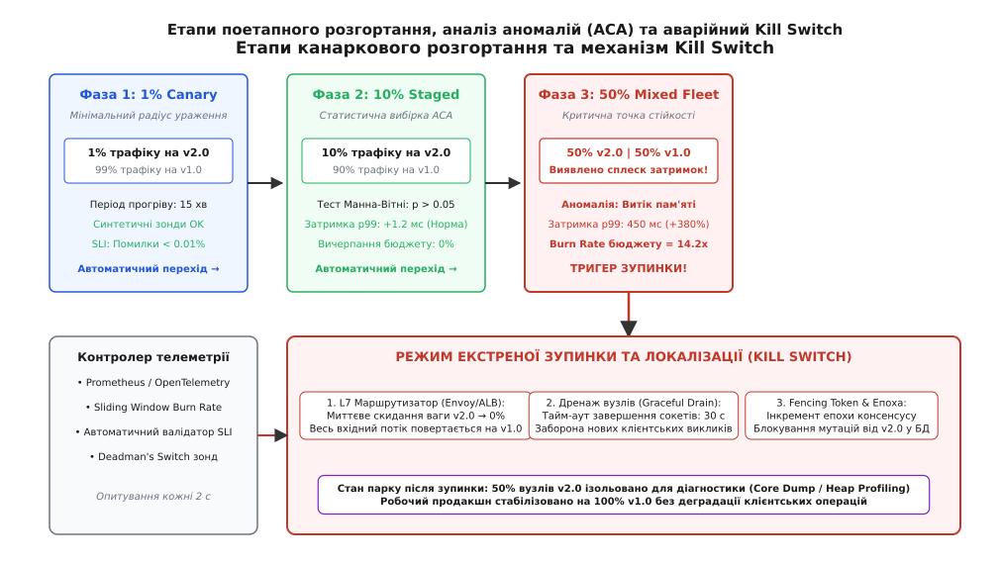
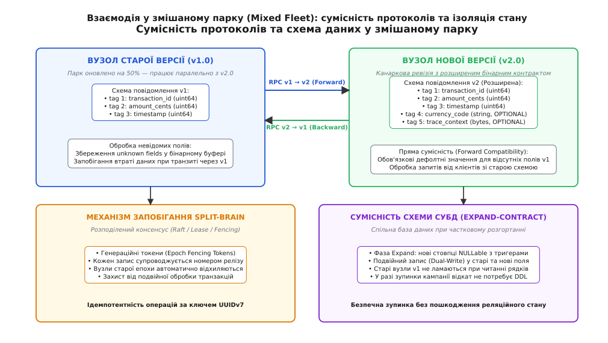

# Зупинка кампанії й парк, оновлений наполовину: стійкість змішаних версій, автоматизований аналіз аномалій та аварійний Kill Switch

<preknowlist>
- [Стратегії деплою](root:sf-release/deployment-strategies) — класифікація підходів до викачування релізів від прямої заміни до канаркових та синьо-зелених контурів.
- [Канаркове розгортання](root:sf-release/canary-deployment) — концепція ізоляції мінімальної частки трафіку для оцінки поведінки нової версії в реальному середовищі.
- [Штатне вимкнення і drain](root:sf-release/graceful-shutdown) — механіка вичерпання активних клієнтських сокетів перед виведенням вузла з експлуатації.
- [Метрики](root:sf-release/metrics-monitoring) — спостережуваність затримки, частоти помилок та системних ресурсів у часових рядах.
- [Керування кампанією випуску](root:sf-release/keruvannia-kampaniieiu) — оркестрація етапів, цільових груп і контрольних точок просування артефактів.
- [Патерн Expand-Contract](root:sf-release/expand-contract) — трифазна еволюція персистентних схем даних без порушення зворотної сумісності.
</preknowlist>

Розподілений фінансовий кліринговий кластер із 4 000 сервісних екземплярів обробляє вхідний потік у 180 000 RPC-викликів на секунду під час відкриття ранкової торгової сесії. Оркестратор розгортання ініціює поступову кампанію оновлення бінарного коду з релізу 1.14 на реліз 2.0. Коли конвеєр оновлює 1 800 серверних вузлів (рівно 45% загальної обчислювальної потужності парку), система автоматичного аналізу телеметрії фіксує лавиноподібну деградацію: затримка обробки запитів на дев'яносто дев'ятому процентилі (p99) підскакує з 14 мілісекунд до 1 850 мілісекунд через блокування спільних м'ютексів у новому пулі пам'яті. Контролер кампанії негайно активує аварійний захист і блокує подальше викачування артефактів. У цей момент система потрапляє у критичний стан: 2 200 вузлів продовжують виконувати старий бінарний файл v1.14, тоді як 1 800 вузлів уже функціонують на коді v2.0, розділяючи спільні черги повідомлень, кеші та реляційні таблиці.

Упродовж перших трьох хвилин після зупинки виявляється, що оновлені вузли v2.0 записують транзакційні журнали у спільну базу даних з новим бінарним форматом додаткового аудиторського блоку. Старі процеси v1.14, вичитуючи ці записи для проведення перехресних розрахунків, не розпізнають новий формат, вважають дані пошкодженими та скидають транзакції з внутрішньою помилкою десеріалізації. Одночасно старі вузли v1.14, виступаючи лідерами у чергах розподіленого брокера повідомлень, транслюють у кластер команди клірингу без нового службового поля маршрутизації. Вузли v2.0 відкидають ці повідомлення як невалідні. Це спричиняє розрив узгодженості, зациклення черг повторних спроб і подвійне списання коштів на рахунках клієнтів на суму 4.2 мільйона доларів. Коли чергова зміна намагається здійснити швидкий відкат усього кластера назад на версію v1.14, 1 800 вузлів одночасно скидають з'єднання до бази даних і під час рестарту генерують шторм повторних підключень, що остаточно виводить із ладу головний персистентний вузол.

Ця експлуатаційна катастрофа оголює ключовий факт розподілених обчислень: у масштабованих інфраструктурах оновлення ніколи не відбувається за нульовий час, а екстрена зупинка кампанії через виявлений дефект є стандартним сценарієм захисту системи. Парк, оновлений наполовину (Mixed Fleet), — це повноцінний і вкрай небезпечний експлуатаційний режим, у якому система може перебувати годинами або тижнями. Якщо протоколи взаємодії, моделі серіалізації, механізми консенсусу та схеми збереження стану заздалегідь не розраховані на безпечну паралельну роботу різних версій коду, аварійна зупинка розгортання завдає більших руйнувань, ніж сама помилка у новому релізі.

## Анатомія поетапного розгортання: когорти, геометричний крок та вистоювання

Поетапне розгортання (англ. *staged rollout*) є основою сучасного реліз-інжинірингу і замінює ризиковану одномоментну заміну компонентів керованим розширенням радіуса дії нової версії. Парк обчислювальних вузлів або вхідний клієнтський трафік ділиться на строго калібровані частки, які послідовно вводяться в експлуатацію.

```text
Схема просування фаз поетапної кампанії:

Фаза 0: Внутрішній контур [ 0% публічного трафіку ] ──> Синтетичне зондування та верифікація збірки
                               │ (Зонди успішні)
                               ▼
Фаза 1: Канаркова когорта [ 1% трафіку / 40 вузлів ] ──> Soak: 30 хв (ACA аналіз SLI/SLO)
                               │ (ACA: Всі метрики в межах норми)
                               ▼
Фаза 2: Рання когорта    [ 10% трафіку / 400 вузлів ] ──> Soak: 60 хв (Оцінка p95/p99 затримок)
                               │ (ACA: Норма)
                               ▼
Фаза 3: Змішаний парк    [ 50% трафіку / 2000 вузлів ] ──> Soak: 120 хв (Оцінка навантаження на СУБД)
                               │ (ВИЯВЛЕНО ДЕГРАДАЦІЮ SLI!)
                               ▼
[ АВАРІЙНА ЗУПИНКА ТА KILL SWITCH ] ──> Фіксація парку на рівні 50% v1 / 50% v2
                               │
                               ├──> Сценарій 1: Ізоляція трафіку (Швидке повернення ваги 100% на v1)
                               ├──> Сценарій 2: Дренаж активних з'єднань (Graceful Connection Drain)
                               └──> Сценарій 3: Дослідження дампу пам'яті канарки в карантині
```

### Формування когорт та алгоритми маршрутизації

Розподіл парку на етапи базується на детермінованому сегментуванні. Якщо трафік перемикається на рівні L7-балансувальників (Envoy, NGINX, HAProxy), використовують зважену маршрутизацію (weighted clusters) або консистентне хешування ідентифікатора користувача. 

При консистентному хешуванні заголовок запиту або токен автентифікації перетворюється на 32-бітне ціле число:

```text
хеш_користувача = MurmurHash3_x86_32(user_id, довжина_id, зерно)
відносна_позиція = (хеш_користувача % 10000) / 100.0
```

Якщо обчислена позиція користувача є меншою за поточний відсоток канаркового етапу (наприклад, `відносна_позиція < 10.0` для 10% когорти), запит спрямовується до вузлів нової версії v2.0. Це гарантує стабільність користувацької сесії (sticky sessions): конкретний клієнт не стрибає між версіями v1 та v2 при кожному наступному кліку, що виключає появу артефактів несумісності на клієнтському боці.

У сценарії фізичного оновлення серверів або пристроїв (bare-metal сервери, IoT-шлюзи, мобільні клієнти) формуються когорти вузлів. Порядок включення вузлів у когорти не може бути випадковим:

1. **Зональна диверсифікація:** кожна когорта рівномірно чергує вузли між різними зонами доступності (Availability Zones) та стійками живлення. Якщо нова версія містить помилку ініціалізації мережевого інтерфейсу, це не призведе до одночасної втрати цілої зони доступності.
2. **Каналізація за типами навантаження:** якщо парк обслуговує змішані типи задач (наприклад, інтерактивні API-запити та фонові пакетні обчислення), канаркова фаза обов'язково розгортається на обох типах екземплярів.
3. **Вибір прогресії кроків:** для систем із високою вартістю помилки застосовують консервативну геометричну прогресію: 1% → 5% → 25% → 50% → 100%. На малих частках (1% і 5%) радіус ураження мінімальний, а на етапі 25% і 50% вибірка стає достатньою для фіксації тонких статистичних аномалій у системних ресурсах.


*Етапи поетапного розгортання: автоматичний перехід між фазами за сигналами телеметрії та негайна активація аварійного Kill Switch при виявленні деградації SLI.*

### Роль періоду вистоювання (Soak Period)

Період вистоювання — це часовий інтервал, протягом якого канаркова когорта працює під реальним навантаженням без зміни конфігурації. Спроба прискорити релізний цикл шляхом скорочення періоду вистоювання до кількох хвилин є типовою інженерною помилкою.

Існує цілий клас відмов, які залишаються непомітними під час швидких синтетичних перевірок:

* **Повільні витоки оперативної пам'яті:** якщо фрагмент коду втрачає 64 байти на кожну транзакцію, за інтенсивності 1 000 запитів на секунду процес вичерпає 1 ГБ оперативної пам'яті лише через 4.5 години безперервної роботи.
* **Фрагментація пулів з'єднань і дескрипторів:** витік сокетів у нештатних гілках обробки помилок (наприклад, при отриманні таймауту від зовнішнього платіжного шлюзу) проявляється лише тоді, коли накопичується статистично рідкісна комбінація мережевих затримок.
* **Нерівномірність бізнес-циклів:** поведінка користувачів у системі має добову та щогодинну циклічність. Версія коду, що бездоганно працює в умовах фонового денного читання даних, може спричинити дедлок у базі даних увечері, коли запускається масова генерація фінансових звітів.

Тому час вистоювання розраховується з урахуванням частоти викликів критичних шляхів коду та тривалості циклів збирання сміття (Garbage Collection) або очищення внутрішніх кешів.

## Автоматизований аналіз аномалій (Automated Canary Analysis, ACA)

Оцінка працездатності канаркового релізу людиною-оператором у реальному часі є ненадійною: оператор фокусується на загальних графіках завантаження процесора або сумарній кількості помилок, пропускаючи локальні сплески затримок окремих ендпоінтів. Системи Automated Canary Analysis (ACA) автоматизують процес прийняття рішень на основі строгого математичного апарату.

### Принцип симетричних когорт: Baseline проти Canary

Головна вимога коректного аналізу полягає у порівнянні канарки (Canary) не з усім рештою парку, а з контрольною групою (Baseline). 

```text
[ Загальний вхідний трафік системи ]
         │
         ├──> [ 90% трафіку ] ──> Основний виробничий парк (Версія v1.14)
         │
         ├──> [  5% трафіку ] ──> КОНТРОЛЬНА ГРУПА (Baseline: Версія v1.14, 200 вузлів)
         │                                │
         │                                ▼ Телеметрія B(t)
         │                         [ СТАТИСТИЧНИЙ СУДДЯ ACA ] ──> { Продовжити / Зупинити }
         │                                ▲ Телеметрія C(t)
         │                                │
         └──> [  5% трафіку ] ──> КАНАРКОВА ГРУПА   (Canary:   Версія v2.00, 200 вузлів)
```

Контрольна група — це вибірка вузлів старої версії v1.14, яка була розгорнута одночасно з канаркою і отримує точно такий самий обсяг навантаження. Це нівелює вплив зовнішніх факторів: якщо провайдер мережі починає втрачати пакети або глобальний сервіс авторизації збільшує час відповіді, затримки зростуть одночасно і на Baseline, і на Canary. Алгоритм ACA зафіксує зовнішній фактор і не звинуватить новий код у загальносистемній деградації.

### Статистичний тест Манна-Вітні для оцінки затримок

Час виконання запитів у розподілених сервісах не підпорядковується симетричному закону Гауса. Він має виражений важкий хвіст (long tail), зумовлений паузами виділення пам'яті, контекстними перемиканнями ядра операційної системи та очікуванням дискового вводу-виводу. Застосування параметричного t-критерію Стьюдента або простого порівняння середніх арифметичних у таких умовах дає велику кількість хибнопозитивних або хибнонегативних висновків.

Для об'єктивної оцінки застосовують непараметричний U-критерій Манна-Вітні. Він порівнює медіани та загальний розподіл рангів двох незалежних вибірок без припущень про форму розподілу.

Нехай за інтервал спостереження отримано n вимірювань затримки від контрольної групи:

```text
X = { x_1, x_2, ..., x_n }
```

та m вимірювань від канаркової когорти:

```text
Y = { y_1, y_2, ..., y_m }
```

Процедура обчислення U-статистики складається з таких кроків:

1. Усі N = n + m значень об'єднуються в єдиний масив і сортуються за зростанням.
2. Кожному елементу присвоюється ранг від 1 до N. У разі однакових значень (ties) кожному з них присвоюється середнє арифметичне відповідних рангів.
3. Обчислюється сума рангів R_1 для елементів контрольної групи X та сума рангів R_2 для елементів канарки Y.
4. Обчислюються статистики U_1 та U_2:

```text
U_1 = n * m + (n * (n + 1)) / 2 - R_1
U_2 = n * m + (m * (m + 1)) / 2 - R_2
U   = min(U_1, U_2)
```

5. Для вибірок великого розміру (n, m > 20) розподіл U апроксимується нормальним розподілом із параметрами:

```text
mu_U    = (n * m) / 2
sigma_U = sqrt((n * m * (n + m + 1)) / 12)
Z       = (U - mu_U) / sigma_U
```

Якщо обчислене значення Z перевищує критичний поріг для обраного рівня значущості alpha = 0.01 (|Z| > 2.58), нульова гіпотеза про рівність розподілів відкидається. Контролер фіксує статистично достовірну деградацію затримки і блокує перехід до наступної когорти.

### Критерій Колмогорова-Смирнова для порівняння кумулятивних функцій

Окрім рангового тесту Манна-Вітні, аналізатор ACA застосовує двовибірковий тест Колмогорова-Смирнова. Цей критерій оцінює максимальну абсолютну відстань D між емпіричними функціями розподілу F_1(x) контрольної групи та F_2(x) канарки:

```text
D = sup_x | F_1(x) - F_2(x) |
```

Статистика Колмогорова-Смирнова чутлива не лише до зсуву медіани, але й до зміни форми хвоста розподілу: появи бімодальності, розширення дисперсії або сплесків мікропауз. Якщо емпірична відстань перевищує критичне значення:

```text
D_критичне = c(alpha) * sqrt((n + m) / (n * m))
```

де коефіцієнт c(0.01) = 1.63 для 99% рівня довіри, алгоритм ACA фіксує аномальну зміну профілю виконання запитів.

### Робастна фільтрація викидів через міжквартильний розмах (Tukey Fences)

У живих виробничих системах поодинокі екстремальні значення затримок (наприклад, викликані паузою TCP-ретрансмісії при втраті пакету на рівні магістрального комутатора) можуть спотворити загальну картину. Перед виконанням статистичних тестів вибірки проходять попереднє очищення методом огороджень Тьюкі.

Для вибірки обчислюються перший квартиль Q_1 (25-й процентиль), третій квартиль Q_3 (75-й процентиль) та міжквартильний розмах IQR:

```text
IQR = Q_3 - Q_1
нижня_межа = Q_1 - 1.5 * IQR
верхня_межа = Q_3 + 1.5 * IQR
```

Будь-які вимірювання, що лежать за межами інтервалу [нижня_межа, верхня_межа], маркуються як технічні викиди і виключаються з обчислення рангових сум. Для оцінки варіативності замість стандартного відхилення використовують медіанне абсолютне відхилення (Median Absolute Deviation, MAD):

```text
MAD = median( | x_i - median(X) | )
```

MAD є стійким до важких хвостів і не роздувається при одиничних аномаліях, що робить його ідеальним базисом для динамічного калібрування порогів у системах ACA.

### Багатокритеріальний скоринг релізу

Система ACA приймає рішення про просування або блокування релізу на основі комплексного вагового скорингу. Метрики розділяються на три рівні пріоритету:

1. **Жорсткі інваріанти (Hard Gate):** показники, перевищення яких викликає негайне аварійне зупинення релізу (частка помилок HTTP 5xx, розбіжність контрольних сум фінансових транзакцій, падіння процесів через OOM).
2. **М'які інваріанти (Soft Gate):** показники затримки p95/p99, черги очікування блокувань бази даних, використання процесорного часу.
3. **Ресурсні тренди (Resource Drift):** темп приросту виділеної оперативної пам'яті за хвилину, кількість активних дескрипторів сокетів.

Підсумковий бал надійності S обчислюється як зважена сума оцінок окремих метрик:

```text
S = w_err * S_err + w_lat * S_lat + w_res * S_res
```

Якщо показник S опускається нижче 80 балів зі 100, кампанія переходить у режим очікування; якщо S < 60, негайно спрацьовує аварійний Kill Switch.

### Оцінка швидкості вичерпання бюджету помилок (Multi-Window Burn Rate)

Критичним індикатором для зупинки кампанії є швидкість, із якою новий реліз витрачає допустимий бюджет ненадійності (Error Budget).

Якщо угода про рівень обслуговування (SLO) встановлює ціль у 99.9% успішних відповідей за вікно у 30 днів (T = 2592000 секунд), допустима частка браку становить:

```text
F_допустима = 1.0 - 0.999 = 0.001 (0.1%)
```

Коефіцієнт вичерпання (Burn Rate, BR) визначає відношення поточної частки помилок у вимірюваному вікні до номінально дозволеної:

```text
BR = F_поточна / F_допустима
```

При BR = 1.0 система витратить рівно 100% свого місячного бюджету за 30 днів. Але якщо в канарковій когорті виникає помилка, значення BR різко підскакує:

```text
BR = 14.4  -->  100% бюджету буде вичерпано за 50 годин (2 дні)
BR = 36.0  -->  100% бюджету буде вичерпано за 20 годин
```

Для запобігання хибним спрацьовуванням від коротких одиночних сплесків та швидкої реакції на катастрофічні збої застосовують багатовіконну систему тригерів (Multi-Window Multi-Burn-Rate):

```text
Вікно 1 (Коротке, 5 хв):   BR > 14.0 ТА Частка помилок > 1.4%  --> Екстрена зупинка (Kill Switch)
Вікно 2 (Середнє, 30 хв):  BR > 6.0  ТА Частка помилок > 0.6%  --> Зупинка просування кампанії
Вікно 3 (Довге, 2 години): BR > 2.0  ТА Частка помилок > 0.2%  --> Попередження та блокування наступного кроку
```

Одночасне виконання умов у короткому та довгому вікнах дозволяє системі миттєво відреагувати на масовий збій і не зупиняти розгортання через випадковий одиночний таймаут.

## Екстрений Kill Switch: механіка переривання та дренажу

Коли аналізатор ACA або датчик вичерпання бюджету сигналізує про критичну аномалію, запускається процедура екстреного переривання — **Kill Switch**. Головна інженерна мета цієї операції — миттєво припинити вплив помилки на клієнтів і при цьому не спровокувати вторинний каскадний колапс інфраструктури.

```text
                              [ Сигнал тригера Kill Switch ]
                                            │
                                            ▼
                           [ КРОК 1: L7 Перемикання ]
                    Скидання ваги маршруту канарки v2 -> 0%
                    Повернення 100% клієнтських викликів на v1
                                            │
                                            ▼
                           [ КРОК 2: Замороження черги ]
                    Блокування диспетчера релізів (HALT)
                    Заборона запуску нових контейнерів/процесів
                                            │
                                            ▼
                           [ КРОК 3: Керований дренаж ]
                    Надсилання HTTP/2 GOAWAY або SIGTERM
                    Таймаут вичерпання сокетів (30 секунд)
                                            │
                                            ▼
                           [ КРОК 4: Карантин та ізоляція ]
                    Вузли v2 ізолюються від балансувальника
                    Збереження Core Dump / Heap Profiling
```

### Скидання маршрутної ваги за час O(1)

Першим кроком є миттєва зміна конфігурації проксі-маршрутизаторів. Замість тривалого вимкнення серверів балансувальник оновлює динамічну таблицю кінцевих точок (Endpoint Discovery Service у сервіс-меші або таблицю upstream в пам'яті ядра). Вага канаркового пулу встановлюється в 0. Нові вхідні TCP-з'єднання та HTTP-запити негайно спрямовуються виключно на перевірені вузли версії v1.14.

### Робота мережевого стека ядра при зупинці трафіку

Миттєве відсікання трафіку вимагає врахування черг ядра операційної системи Linux:

* **Черга непідтверджених з'єднань (SYN backlog):** параметр `tcp_max_syn_backlog` визначає кількість напіввідкритих з'єднань. Якщо балансувальник раптово перенаправляє тисячі з'єднань на стару групу вузлів v1, її черга SYN може переповнитися, що призведе до скидання пакетів і повторних спроб клієнтів.
* **Черга слухаючого сокета (Listen backlog):** параметр `somaxconn` обмежує довжину черги повністю встановлених з'єднань TCP (`ESTABLISHED`), які очікують виклику `accept()`. Під час аварійного перемикання балансувальник застосовує плавне нарощування навантаження (slow start), щоб уникнути переповнення черги `somaxconn` на приймаючих вузлах.
* **Скидання RST проти закриття FIN:** грубе закриття сокета процесом за наявності невичитаних даних у буфері прийому змушує ядро Linux надіслати клієнту пакет `TCP RST`, що відображається у клієнта як помилка `Connection reset by peer`. Штатний дренаж вимагає коректного двостороннього обміну пакетами `FIN-ACK`.
* **Повторне використання портів TIME_WAIT:** параметр ядра `net.ipv4.tcp_tw_reuse = 1` дозволяє безпечно виділяти сокети у стані `TIME_WAIT` для нових вихідних підключень, запобігаючи вичерпанню локального пулу портів `net.ipv4.ip_local_port_range` під час лавиноподібного перенаправлення потоків.
* **Розподілене обмеження швидкості (Rate Limiting):** глобальні токен-бакети (Token Bucket) у сервісному проксі динамічно адаптують ліміти вхідних запитів, запобігаючи локальному перевантаженню вузлів версії v1 при раптовому скиданні ваги канарки.

### Трасування перехідних процесів через eBPF

Для низькорівневого контролю поведінки сокетів під час активації Kill Switch використовують eBPF-програми, підключені до точок трасування ядра:

* `sock:inet_sock_set_state` — фіксує переходи станів TCP (`ESTABLISHED -> FIN_WAIT_1 -> TIME_WAIT`).
* `tcp:tcp_retransmit_skb` — відстежує сплески повторних відправок пакетів через перевантаження буферів старих вузлів v1.
* `sched:sched_switch` — виявляє підвищення затримок планувальника CFS (Completely Fair Scheduler) при різкому зростанні активних потоків.

Завдяки eBPF інженерна команда отримує точний часовий профіль дренажу з точністю до мікросекунд без внесення накладних витрат у гарячий шлях передачі пакетів.

### Керування пулами пам'яті алокаторів (Arena Decay & Purge)

У багатопотокових сервісах високої продуктивності виділення пам'яті делегується масштабованим алокаторам (jemalloc, tcmalloc). Кожен потік утримує локальний кеш об'єктів (Thread Cache) і звертається до виділених арен пам'яті. Коли потік запитів до канаркового вузла раптово скидається до нуля, виникає ефект «застиглої пам'яті»: об'єкти звільнені в коді, проте алокатор не повертає сторінки операційній системі через інтервал затримки деградації (decay time).

Якщо процес підлягає тривалому вистоюванню у стані карантину, диспетчер зобов'язаний виконати явний системний виклик примусового скидання невикористаних брудних сторінок (Dirty Pages Purge):

:::tabs
```c
/* Примусове повернення невикористаної пам'яті ядру ОС під час карантину */
mallctl("arena.0.purge", NULL, NULL, NULL, 0);
```
```cpp
// Примусове повернення невикористаної пам'яті ядру ОС під час карантину
mallctl("arena.0.purge", nullptr, nullptr, nullptr, 0);
```
:::

Це знижує споживання пам'яті вузлом v2 на 60–80%, запобігаючи вичерпанню оперативної пам'яті хоста іншими процесами.

### Штатний дренаж активних з'єднань (Graceful Connection Draining)

Аварійна зупинка не повинна супроводжуватися грубим розривом уже відкритих клієнтських сокетів. Якщо вузол v2 обробляє довгу операцію (наприклад, проведення платежу чи формування звіту), миттєве вбивство процесу сигналом `SIGKILL` призведе до втрати транзакції.

Замість цього виконується процедура штатного дренажу:

1. Вузол перестає відповідати на зонди готовності (Readiness Probes), що змушує балансувальник виключити його зі списку активних цілей.
2. Для протоколів HTTP/2 та gRPC вузол надсилає клієнтам службовий кадр `GOAWAY` з ідентифікатором останнього прийнятого стріму (`Last-Stream-ID`). Це сигналізує клієнтським бібліотекам, що нові запити по цьому TCP-з'єднанню відправляти заборонено, але вже прийняті запити будуть успішно доопрацьовані.
3. Процес очікує завершення активних потоків протягом фіксованого вікна безпеки (draining timeout, зазвичай 30–45 секунд).
4. Лише після закриття всіх клієнтських сокетів процес скидає з'єднання з базою даних і зупиняється.

### Карантинна діагностика дефектних екземплярів

Одна з найбільших втрат під час панічного відкату — знищення слідів помилки. Якщо дефектний процес перезапустити або знищити контейнер, стан його пам'яті буде втрачено, і інженери не зможуть відтворити причину аномалії.

У зрілому конвеєрі канаркові вузли після виведення з балансування переводяться в режим **Quarantine**:

* Процес переводиться у стан паузи (`SIGSTOP` або відключення від внутрішньої шини).
* Автоматизований діагностичний демон генерує повний зліпок пам'яті (Core Dump) або знімає профіль розміщення об'єктів у купі (Heap Dump / Allocation Profiling).
* Журнали останніх 10 000 транзакцій із детальним рівнем трасування (Debug/Trace) вивантажуються у захищене сховище аналізу інцидентів.
* Лише після завершення експорту діагностичних артефактів вузол передається під керування процедури повернення до базової версії.

[Практичну реалізацію диспетчера канаркових релізів із машиною станів, автоматичним аналізом телеметрії та відкатом за сигналом Kill Switch](root:sf-release/zupynka-kampanii-i-park-onovlenyi-napolovynu/proj-canary-rollout-controller.md) наведено у супровідному проекті, де детально розібрано програмну координацію всіх фаз життєвого циклу.

## Співіснування у змішаному парку (Mixed Fleet)

Коли кампанія зупиняється посередині, система переходить у стан змішаного парку (Mixed Fleet). Цей стан не завжди можна усунути швидким відкатом: якщо оновлено 2 000 серверів, одночасне повернення їх на стару версію може зайняти години або взагалі бути заблокованим через незворотні зміни конфігурації. Кластер зобов'язаний стабільно функціонувати в умовах паралельної роботи версій v1 та v2.


*Архітектура взаємодії у змішаному парку: зворотна та пряма сумісність мережевих контрактів, генераційні токени консенсусу та схема бази даних за патерном Expand-Contract.*

Розглянемо чотири головні виклики змішаного парку та архітектурні патерни їх подолання.

### 1. Двостороння сумісність мережевих контрактів

У мікросервісній топології запити циркулюють між сервісами хаотично. Старий сервіс A (v1) може викликати оновлений сервіс B (v2), який, у свою чергу, звертається до старого сервісу C (v1).

Для забезпечення стабільності мережевих контрактів діють два залізні правила:

#### Зворотна сумісність (Backward Compatibility)
Новий код версії v2 зобов'язаний безпомилково обробляти будь-яке повідомлення, створене старим кодом v1. Якщо у версії v2 додано нове обов'язкове бізнес-поле (наприклад, `currency_code`), десеріалізатор зобов'язаний підставити безпечне значення за замовчуванням (`"USD"`), якщо запит надійшов від клієнта v1, де такого поля ще не існувало.

#### Пряма сумісність (Forward Compatibility) та збереження невідомих полів
Старий код версії v1 не повинен завершуватися аварійно при отриманні повідомлення від v2, що містить незнайомі йому теги. Найнебезпечнішим явищем є зрізання даних (data slicing): якщо вузол v1 зчитує повідомлення v2, десеріалізує лише відомі йому поля, модифікує статус і ретранслює його далі у брокер повідомлень, усі нові поля версії v2 будуть стерті.

Для запобігання втраті даних бінарні серіалізатори зобов'язані вичитувати всі невідомі теги у спеціальний буфер `unknown_fields` і додавати їх назад до бінарного кадру під час наступної серіалізації.

### 2. Асинхронні брокери повідомлень та потокові черги (Kafka, RabbitMQ)

У системах на основі подій (Event-Driven Architecture) повідомлення зберігаються у персистентних топіках брокерів (Apache Kafka, RabbitMQ, NATS). У змішаному парку виникає ситуація, коли вузол v2 публікує подію у новому форматі, а споживачем цієї ж партиції є група вузлів v1.

```text
[ Продюсер v2 ] ──> Публікація події: Event_v2 { id, amount, new_metadata }
                           │
                           ▼ Топік Kafka / Черга
                           │
[ Споживач v1 ] ──> Вичитка події:
                           ├──> Сценарій А (Без захисту):  Помилка десеріалізації --> Зациклення черги (Poison Pill)
                           └──> Сценарій Б (Зі Schema Registry): Безпечний парсинг відомих полів + DLQ
```

Для стабільної обробки черг у змішаному парку застосовують такі правила:

1. **Реєстр схем (Schema Registry):** кожне повідомлення містить 5-байтний заголовок із магічним байтом та 4-байтним ідентифікатором схеми. Споживач динамічно завантажує схему відповідної версії для десеріалізації.
2. **Ізоляція отруйних повідомлень (Poison Pill Isolation):** якщо повідомлення не може бути десеріалізоване після 3 повторних спроб, споживач переміщує його у чергу невідповідностей (Dead Letter Queue, DLQ) зі збереженням оригінальних заголовків і зміщення (offset), не зупиняючи конвеєр обробки решти потоку.
3. **Кооперативне ребалансування (Incremental Cooperative Rebalancing):** під час перезапуску вузлів у ході канаркового розгортання споживачі Kafka використовують протокол кооперативного перерозподілу партицій, що запобігає глобальній зупинці читання (Stop-the-World pause) для всього кластера.

### 3. Розподілені саги та компенсаційні транзакції у змішаному парку

У транзакційних системах тривалі бізнес-операції виконуються за патерном розподіленої саги (Saga Pattern). Якщо пряма транзакція ініціюється вузлом v2 (який зберігає додаткові бізнес-атрибути), а в процесі виконання виникає збій, компенсуюча транзакція може бути передана на обробку вузлу версії v1 через зупинку канаркового контуру.

```text
[ Пряма транзакція (Вузол v2) ] ──> Списання коштів + Створення розширеного запису аудиту
                                             │ (Збій на наступному кроці саги)
                                             ▼
[ АВАРІЙНА ЗУПИНКА КАМПАНІЇ ]   ──> Вузол v2 переведено в карантин
                                             │
                                             ▼
[ Компенсуюча транзакція (Вузол v1) ] ──> Скасування операції та повернення коштів
                                             │ (Вимога: коректне читання запису v2)
                                             ▼
[ Спільна база даних ]          ──> Стан відновлено без втрати інваріантів
```

Компенсуюча логіка вузлів v1 повинна вміти обробляти записи, залишені вузлами v2, використовуючи лише універсальні ідентифікатори транзакцій і не покладаючись на відсутні в старій версії структури даних.

### 4. Динамічні прапорці функцій (Feature Flags) та синхронізація конфігурацій

Відокремлення фізичного розгортання бінарного коду від активації бізнес-функціоналу через динамічні прапорці є надійним бар'єром проти аварій. Проте у змішаному парку виникає ризик розсинхронізації прапорців:

* Якщо вузол v2 завантажує нову конфігурацію прапорця, а старий вузол v1 ще не підтримує її семантику, поведінка системи для одного клієнта стає стохастичною.
* Для запобігання конфліктам прапорці супроводжуються монотонним номером ревізії конфігурації. Будь-який прапорець, що змінює формат персистентних даних, активується лише після того, як 100% парку підтвердили підтримку нового формату через шину консенсусу.

### 5. Еволюція схеми бази даних за патерном Expand-Contract

Спільне персистентне сховище — найбільш вразливий вузол при зупинці кампанії. Якщо нова версія v2 вимагає зміни структури реляційної таблиці, виконання прямої міграції перед початком розгортання неприпустиме.

Якщо інженер виконає міграцію:

```sql
-- ПОМИЛКА: Негайне видалення старого поля руйнує роботу старих вузлів v1!
ALTER TABLE payments DROP COLUMN card_number;
ALTER TABLE payments ADD COLUMN tokenized_card VARCHAR(64) NOT NULL;
```

Вузли старої версії v1.14 миттєво почнуть генерувати критичні помилки `Column "card_number" not found` при кожній спробі запису. Якщо ж кампанію буде зупинено на 50%, повернути систему назад стане неможливо без ручного відновлення бази з бекапу.

Для запобігання цій катастрофі використовується трифазна еволюція за патерном **Expand-Contract**:

```text
Фаза 1: РОЗШИРЕННЯ (Expand) — виконується ДО старту кампанії:
  • У таблицю додаються нові стовпці: tokenized_card (NULLable).
  • Старі стовпці card_number залишаються недоторканими.
  • Створюється тригер СУБД, який при записі у card_number автоматично заповнює tokenized_card.

Фаза 2: ЗМІШАНИЙ ПАРК (Mixed Fleet) — триває під час розгортання та зупинки:
  • Вузли v1 продовжують читати й писати у старий стовпець card_number.
  • Вузли v2 використовують подвійний запис (Dual-Write): пишуть у tokenized_card і дублюють у card_number.
  • Зупинка кампанії або повний відкат не потребують жодних змін у структурі СУБД.

Фаза 3: ЗВУЖЕННЯ (Contract) — виконується лише ПІСЛЯ успішного оновлення 100% парку:
  • Фоновий воркер оновлює історичні записи (backfill).
  • Тригери сумісності видаляються.
  • Окремим релізом накладається обмеження NOT NULL і видаляється старий стовпець card_number.
```

### 6. Онлайн-інструменти міграції баз даних без блокування

Для великих таблиць обсягом понад 1 ТБ виконання навіть операції додавання стовпця може призвести до блокування читання або копіювання таблиці на диску. У виробничих середовищах застосовують онлайн-інструменти міграції без блокувань (gh-ost, pt-online-schema-change):

* Утиліта створює тіньову таблицю `_payments_gho` з новою структурою.
* Рядки копіюються порціями по 1 000 записів із застосуванням тротлінгу, щоб не створювати реплікаційного лагу.
* Бінарний журнал (binlog) або тригери реплікують усі поточні зміни від вузлів v1 та v2 у тіньову таблицю в режимі реального часу.
* Фінальна заміна таблиць виконується через атомарну команду `RENAME TABLE payments TO payments_old, _payments_gho TO payments;` за час менше 2 мілісекунд.

### 7. Ізоляція розподіленого кешу за версіями (Cache Poisoning Mitigation)

У змішаному парку критичною точкою відмови є спільний розподілений кеш (Redis, Memcached, Hazelcast). Якщо вузол v2 серіалізує об'єкт у кеш за новою бінарною схемою (наприклад, використовуючи новий формат JSON або бінарний зліпок із додатковими полями), вузол v1, зчитуючи цей ключ, зазнає збою десеріалізації або отримує `NullPointerException`.

Для запобігання отруєнню кешу (Cache Serialization Poisoning) застосовують просторове розділення ключів за мажором схеми:

```text
Ключ для вузлів v1: cache:v1:user:48291
Ключ для вузлів v2: cache:v2:user:48291
```

Кожна версія коду працює у власному ізольованому просторі імен кешу. Це вимагає додаткового обсягу оперативної пам'яті для зберігання дубльованих записів під час змішаної фази, проте повністю виключає міжверсійні збої та дозволяє миттєво очистити кеш нової версії в разі спрацювання Kill Switch без шкоди для стабільного контуру.

### 8. Запобігання Split-Brain через генераційні токени (Epoch Fencing)

У змішаному парку можлива ситуація, коли вузол старої версії v1 і вузол нової версії v2 одночасно вважають себе лідерами в обробці певної задачі (наприклад, розрахунку балансу клієнта). Якщо вони застосовують різні бізнес-алгоритми, виникає стан розщепленого мозку (Split-Brain) і пошкодження бізнес-інваріантів.

Для вирішення цієї проблеми застосовують механізм генераційного огородження (Epoch Fencing Tokens):

* Кожен крок релізної кампанії або процедура аварійної зупинки інвалідує поточний номер генерації в розподіленому координаторі консенсусу (etcd, Consul або Raft-групі) та інкрементує лічильник епохи: Epoch = Epoch + 1.
* Будь-яка команда на модифікацію критичного стану супроводжується поточним генераційним токеном вузла.
* Сховище даних (або розподілений лок) атомарно перевіряє умову: запис дозволяється лише в тому випадку, якщо токен у запиті строго відповідає або перевищує актуальну епоху ресурсу.
* Якщо вузол старої версії v1.14, виконання якого зависло в довгій паузі збирання сміття, прокидається і намагається записати результат зі застарілим токеном Epoch_104, транзакція відхиляється СУБД з помилкою `StaleEpochException`, оскільки активна епоха вже підвищена до Epoch_105.

### 9. Ідемпотентність операцій та дедуплікація

У змішаному парку під час зупинки кампанії та перемикання балансувальника неминуче виникають повторні надсилання запитів (retries). Якщо клієнт надіслав запит на списання коштів вузлу v2, а той був аварійно виведений у режим дренажу, клієнтський SDK повторить виклик до вузла v1.

Якщо операція не є строго ідемпотентною, кошти буде списано двічі. Кожен критичний виклик повинен супроводжуватися унікальним ключем ідемпотентності (Idempotency Key), сгенерованим клієнтом (наприклад, `UUIDv7` із монотонною міткою часу). Сервери v1 та v2 звіряють ключ із таблицею виконаних операцій перед виконанням будь-яких фінансових мутацій.

## Інженерний розбір на C99 та C++20

Нижче наведено робочі реалізації п'яти критичних компонентів забезпечення надійності змішаного парку:

1. **Бінарний парсер кадрів із збереженням невідомих тегів (Unknown Field Preserving Frame Parser):** гарантує пряму сумісність і запобігає втраті даних при проходженні нових структур крізь старі вузли v1.
2. **Статистичний обчислювач ACA на основі критерію Манна-Вітні:** реалізує швидкий розрахунок рангів із корекцією зв'язок (ties) та апроксимацією нормального Z-розподілу для виявлення деградації затримок.
3. **Обчислювач критерію Колмогорова-Смирнова:** оцінює максимальне розходження кумулятивних функцій розподілу затримок для виявлення бімодальності та деградації хвостів.
4. **Контролер версіонованого кешу (Versioned Cache Router):** запобігає отруєнню кешу шляхом ізоляції просторів імен ключів за версіями схеми.
5. **Координатор генераційного огородження (Epoch Fencing Controller):** забезпечує атомарну валідацію епох і захист від Split-Brain у багатопотоковому розподіленому середовищі.

Кожен алгоритм реалізовано мовами C99 та C++20. Приклади мовою C++20 використовують сучасні концепції: діапазони (`std::span`), обробку помилок без винятків (`std::expected`), потокобезпечні блокування (`std::shared_mutex`) та RAII-управління пам'яттю.

### 1. Бінарний парсер кадрів зі збереженням невідомих полів

:::tabs
:::code zupynka-kampanii-i-park-onovlenyi-napolovynu-d/c/1-binarnyi-parser-kadriv.c
:::code zupynka-kampanii-i-park-onovlenyi-napolovynu-d/cpp/1-binarnyi-parser-kadriv.cpp
:::

### 2. Статистичний обчислювач критерію Манна-Вітні для ACA

:::tabs
:::code zupynka-kampanii-i-park-onovlenyi-napolovynu-d/c/2-statystychnyi.c
:::code zupynka-kampanii-i-park-onovlenyi-napolovynu-d/cpp/2-statystychnyi.cpp
:::

### 3. Обчислювач критерію Колмогорова-Смирнова для двох вибірок

:::tabs
:::code zupynka-kampanii-i-park-onovlenyi-napolovynu-d/c/3-obchysliuvach-kryteriiu.c
:::code zupynka-kampanii-i-park-onovlenyi-napolovynu-d/cpp/3-obchysliuvach-kryteriiu.cpp
:::

### 4. Контролер ізоляції кешу за версіями схеми

:::tabs
:::code zupynka-kampanii-i-park-onovlenyi-napolovynu-d/c/4-kontroler-izoliatsii.c
:::code zupynka-kampanii-i-park-onovlenyi-napolovynu-d/cpp/4-kontroler-izoliatsii.cpp
:::

### 5. Контролер генераційного огородження (Epoch Fencing Token Coordinator)

:::tabs
:::code zupynka-kampanii-i-park-onovlenyi-napolovynu-d/c/5-kontroler-heneratsiinoho.c
:::code zupynka-kampanii-i-park-onovlenyi-napolovynu-d/cpp/5-kontroler-heneratsiinoho.cpp
:::

## Експлуатаційні пастки та крайові випадки у змішаному парку

Тривале функціонування парку, оновленого наполовину, породжує неочевидні пастки на стику мережі, операційної системи та бази даних. Розглянемо сценарії, де інженери найчастіше припускаються помилок під час аварійної зупинки.

### 1. Явище флапінгу розгортання (Rollout Flapping & Hysteresis)

Коли система ACA фіксує сплеск затримок на канаркових вузлах v2 і скидає їхню вагу до нуля, весь обсяг навантаження повертається назад на базові вузли v1. Якщо парк v1 був зменшений під час попередніх етапів розгортання (наприклад, замінено 40% серверів), раптовий 100% потік запитів викликає перевантаження вузлів v1: процесорні черги ростуть, затримки на v1 різко стрибають.

Якщо система моніторингу налаштована на абсолютні пороги затримки, вона фіксує деградацію вже на версії v1 і намагається повторно перемкнути трафік на v2. Виникає катастрофічний автоколивальний процес (flapping), під час якого балансувальник безперервно перекидає потік між версіями кожні кілька секунд, остаточно паралізуючи систему.

Для запобігання флапінгу впроваджують механізм гістерезису:

* Після спрацювання Kill Switch встановлюється таймер охолодження (cooldown period) тривалістю щонайменше 30 хвилин, під час якого будь-які повторні автоматичні перемикання суворо заблоковані.
* У разі дефіциту обчислювальної потужності вузлів v1 автоматично активується горизонтальне автоскейлювання базового пулу перед відсіканням канарки.

### 2. Асиметричне мережеве розщеплення (Canary Partitioning)

У великих хмарних кластерах трапляються часткові мережеві збої: вузли канарки v2 втрачають зв'язок із сервісом координації консенсусу (etcd), але продовжують отримувати трафік від зовнішнього балансувальника та мають відкриті з'єднання до бази даних.

Вузол v2, не отримуючи оновлень про аварійну зупинку кампанії, продовжує вважати свій генераційний токен валідним і намагається виконувати мутації. Якщо сховище даних не виконує строгу перевірку епохи на рівні транзакції СУБД, вузол у стані ізоляції записуватиме суперечливі дані. Вимога активної перевірки токена при кожному зверненні до сховища усуває цей ризик.

### 3. Отруєння сесійних кукі та залипання клієнтів (Sticky Session Trap)

Якщо балансувальник навантаження використовує сесійні кукі (sticky cookies) для прив'язки користувача до конкретного релізу, аварійне обнулення ваги канарки може призвести до того, що клієнти з кукі `release=v2` отримуватимуть помилку `HTTP 503 Service Unavailable`.

Маршрутизатор повинен містити fallback-правило: якщо цільовий пул, зазначений у клієнтській кукі, позначений як неактивний або аварійно зупинений, балансувальник зобов'язаний проігнорувати сесійну куку, атомарно перенаправити запит на пул за замовчуванням v1 і оновити заголовок `Set-Cookie` у відповіді клієнту.

### 4. Втрата скалярних блокувань та вичерпання пулів підключень

Під час аварійного перемикання трафіку з версії v2 на версію v1 виникає нерівномірний перерозподіл з'єднань до СУБД. Вузли v2, перебуваючи в режимі дренажу, продовжують утримувати відкриті транзакції та пули з'єднань (`max_connections`), блокуючи ресурси бази даних. Одночасно вузли v1, отримуючи 100% клієнтського потоку, намагаються відкрити додаткові з'єднання до СУБД для обробки черги запитів.

Якщо сумарний ліміт з'єднань СУБД вичерпується, база даних починає відхиляти нові підключення з помилкою `FATAL: too many connections`. Контролер Kill Switch зобов'язаний надсилати канарковим вузлам сигнал форсованого звуження пулу з'єднань (Connection Pool Downscaling), щоб звільнити слоти бази даних для вузлів версії v1.

### 5. Розсинхронізація схем у розподілених кеш-інвалідаціях

Якщо версія v2 використовує новий патерн ключів інвалідації кешу (наприклад, інвалідація через Redis Pub/Sub повідомлення з тегом сутності), старі вузли v1, не підписані на цей формат повідомлень, продовжать віддавати застарілі дані з локального in-memory кешу процесу.

Для запобігання розсинхронізації час життя (TTL) локальних кешів пам'яті під час виконання кампанії розгортання примусово скорочується до мінімального значення (наприклад, з 10 хвилин до 5 секунд). Це гарантує швидке оновлення локального стану навіть у разі повної зупинки кампанії та відсутності міжверсійної шини подій.

## Метрики спостережуваності стану змішаного парку

Для постійного моніторингу кластера під час зупиненого розгортання інженерна платформа використовує набір спеціалізованих метрик у системі Prometheus:

* `mixed_fleet_version_skew_ratio` — поточне відношення потужності парку нової версії до загальної кількості активних серверів.
* `schema_registry_decode_fallback_total` — лічильник успішних спрацьовувань підстановки дефолтних полів при читанні старих форматів.
* `epoch_fencing_stale_mutation_rejected_total` — кількість мутацій, відхилених через застарілий генераційний токен вузла.
* `connection_draining_active_streams` — кількість активних HTTP/2 та gRPC потоків, що залишаються на вузлах у стані карантину.

Безперервний контроль цих метрик дає черговій зміні повну картину надійності та дозволяє безпечно утримувати змішаний парк у стабільному стані до виправлення виявлених дефектів.

## Регламент відновлення кампанії після ізоляції дефекту

Коли дефект зафіксовано у карантині, а причину усунуто в патч-релізі v2.1, відновлення розгортання відбувається за суворим інженерним протоколом:

1. **Санація персистентного стану:** фоновий скрипт перевіряє таблиці бази даних на наявність записів із пошкодженими значеннями за замовчуванням або незавершених транзакцій саги, що виникли під час змішаної фази.
2. **Очищення версіонованих кешів:** простори імен ключів дефектного релізу v2 (`cache:v2:*`) примусово скидаються командами видалення за шаблоном без впливу на робочий кеш v1.
3. **Холодний старт та попередній прогрів (Cache Pre-warming):** перед подачею реального навантаження на нові вузли v2.1 генератор синтетичних запитів прогріває критичні ключі кешу та ініціалізує пули потоків виконання, запобігаючи сплескам затримок на перших запитах користувачів.
4. **Перезапуск канаркового циклу з Фази 1:** викачування патчу v2.1 не відновлюється з точки зупинки (45%), а починається заново з мінімальної канаркової когорти (1%) з повним 30-хвилинним періодом статистичного вистоювання.

## Інженерний висновок: стійкість змішаного парку як фундаментальний інваріант

Зупинка релізної кампанії на середині розгортання — це не катастрофа, а штатна перевірка системи на архітектурну зрілість. Безпечне функціонування у стані змішаних версій забезпечується комплексним дотриманням чотирьох залізних інваріантів:

1. **Ізоляція радіуса ураження:** канаркові фази малого обсягу у поєднанні з непараметричним статистичним аналізом за критерієм Манна-Вітні та тестом Колмогорова-Смирнова запобігають поширенню прихованих дефектів на весь кластер.
2. **Аварійне переривання O(1):** Kill Switch миттєво відсікає клієнтський трафік від підозрілих вузлів і переводить систему в режим керованого вистоювання без скидання клієнтських сокетів.
3. **Двостороння толерантність мережевих контрактів:** збереження невідомих бінарних тегів усуває загрозу втрати даних при проходженні запитів крізь старі вузли парку.
4. **Розщеплення персистентного стану через Expand-Contract та ізоляцію кешів:** трифазна еволюція бази даних і роздільні простори імен ключів гарантують, що змішаний парк може безпечно працювати необмежений час, а аварійна зупинка не вимагає екстреного відкату структури реляційних таблиць.
