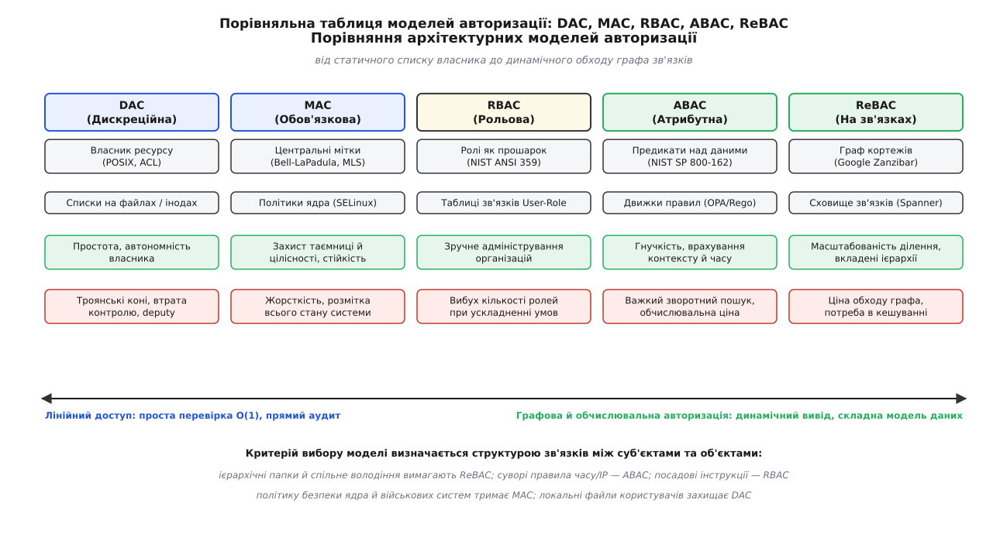
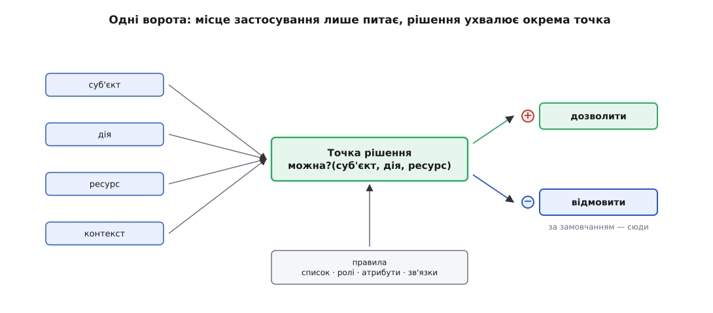
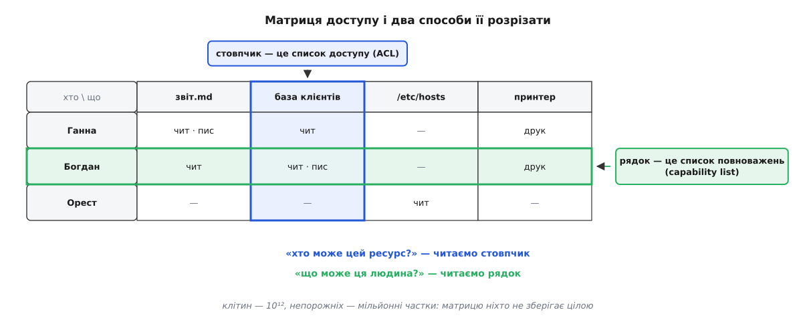
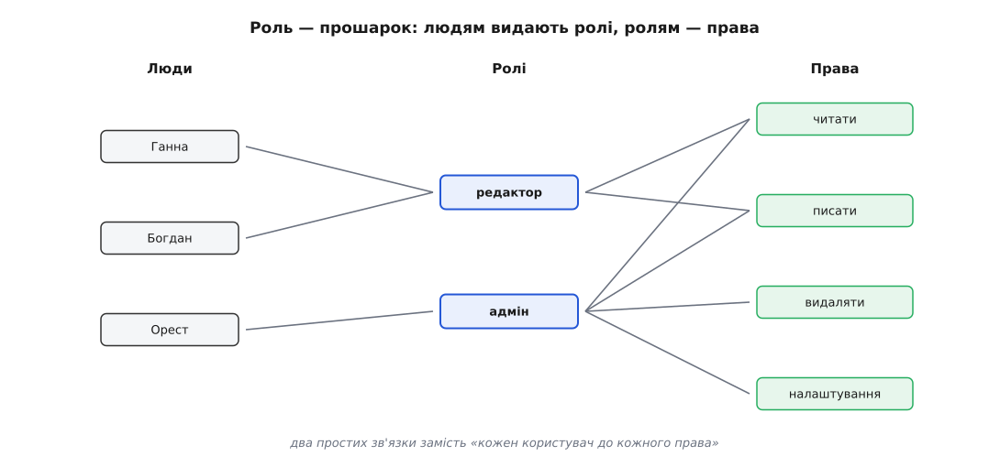
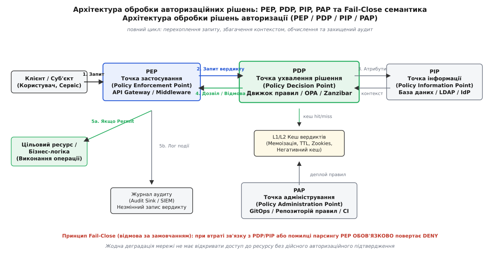

# Моделі авторизації

<preknowlist>
- [Автентифікація](root:sf-security/authentication) — як сервер встановлює особу того, хто надіслав запит (пароль, криптографічний підпис, сесійний жетон).
- [Найменші привілеї](root:sf-security/least-privilege) — надання мінімально необхідного набору прав для виконання конкретної операції.
- [Обов'язковий доступ (MAC)](root:sf-security/mandatory-access-control) — мітки безпеки та примусове розмежування доступу на рівні ядра операційної системи.
- [Повноваження як модель доступу](root:sf-security/capability-based-security) — невразливі маркери прав (capabilities) замість централізованих перевірок списків.
</preknowlist>

Коли веб-сервер фінансової системи обробляє HTTP-запит `DELETE /api/v1/accounts/4815162342/transactions/9918`, модуль автентифікації вже виконав свою роботу: криптографічний підпис жетона валідний, ідентифікатор користувача `user_8812` встановлено достовірно, сесія активна. Проте сам факт підтвердженої особи не дає відповіді на критичне питання: чи має цей конкретний суб'єкт законне право безповоротно стерти запис про грошовий переказ на суму сорок мільйонів гривень? Якщо перевірку реалізовано наївним умовним оператором `if (current_user.is_admin)` усередині обробника маршруту, система вже скомпрометована. Вона не враховує, чи належить транзакція до підрозділу користувача, чи діє тимчасове судове блокування рахунку, чи не перебуває оператор у стані конфлікту інтересів і чи не відкликано його повноваження п'ять секунд тому через систему виявлення шахрайства.

Авторизація (від латинського *auctoritas* — право, повноваження, вплив) є обчислювальним процесом перевірки того, чи дозволено суб'єктові виконати конкретну дію над цільовим ресурсом у поточному контексті виконання. Фундаментальний закон безпеки вимагає зведення будь-якого авторизаційного запиту до строго детермінованої функції:

```
can(Sub, Act, Res, Ctx) ↦ {Permit, Deny}
```

де `Sub` — ідентифікатор та властивості ініціатора (суб'єкта), `Act` — тип операції, `Res` — цільовий об'єкт або ресурс, а `Ctx` — динамічний контекст середовища (поточний час, мережева зона, рівень ризику, стан сесії).

Головна інженерна проблема полягає в тому, де саме зберігати стан, на основі якого обчислюється ця функція, як структурувати правила розмежування прав та як масштабувати систему до мільярдів перевірок за секунду із затримкою у частки мілісекунди. Еволюція комп'ютерних систем породила п'ять базових архітектурних парадигм авторизації: дискреційну (DAC), обов'язкову (MAC), рольову (RBAC), атрибутну (ABAC) та модель на основі зв'язків (ReBAC). Кожна з них вирішує свій клас завдань і має строго окреслені межі масштабованості.



*Архітектурні моделі авторизації утворюють континуум: від локального переліку прав на ресурсах до глобального обчислення графів досяжності та динамічних предикатів.*

## Архітектурний дефект: розсіяна перевірка проти єдиних воріт

Найпоширеніша помилка побудови корпоративного програмного забезпечення полягає в розмиванні авторизаційної логіки по компонентах бізнес-коду. Розглянемо наслідки, коли правила перевірки прав розкидані по контролерах, сервісних шарах та SQL-запитах:

1. **Неузгодженість політик (Policy Drift).** Якщо бізнес-вимога «звіти аудиту бачать лише комплаєнс-офіцери у робочий час» дублюється у REST API, GraphQL-резолвері, фоновому генераторі звітів та експорті в CSV, будь-яка зміна правила неминуче призведе до розсинхронізації. Одне з місць обов'язково забудуть оновити, утворивши діру безпеки.
2. **Неможливість зворотного аудиту.** На пряме запитання офіцера безпеки «Які користувачі в системі мають право редагувати зарплатну відомість співробітника X?» неможливо відповісти структурованим запитом. Єдиний спосіб — здійснювати текстовий пошук регулярними виразами (`grep`) по всій кодовій базі у пошуках комбінацій умовних конструкцій.
3. **Порушення принципу Fail-Close.** Якщо метод бізнес-логіки не містить явної перевірки або кидає неперехоплений виняток у блоці аналізу ролей, система за відсутності єдиного шлюзу ризикує перейти у стан дозволу за замовчанням (Fail-Open), відкриваючи доступ до захищеного ресурсу.
4. **Уразливість до BOLA / IDOR (Broken Object Level Authorization).** Коли авторизація обмежується лише перевіркою ролі (наприклад, `if (user.role == "user")`), але не перевіряє зв'язок між користувачем і конкретним ID ресурсу, зловмисник підставляє чужий ідентифікатор об'єкта в URL або JSON-тіло запиту, отримуючи повний несанкціонований доступ до чужих конфіденційних даних. Це вразливість №1 у світовому рейтингу OWASP API Security Top 10.

Виправлення цього дефекту полягає у винесенні авторизації в окремий ізольований модуль — точку ухвалення рішень (Policy Decision Point, PDP), до якої звертається точка застосування політик (Policy Enforcement Point, PEP). Програма, що виконує бізнес-дію, повністю позбавляється самостійного ухвалення рішень: вона формує стандартизований запит, передає його в PDP і лише кориється отриманому вердикту.



*Єдині ворота: точка застосування лише передає параметри запиту, а ізольоване осердя ухвалює вердикт за завантаженими правилами, гарантуючи відмову за замовчанням при будь-якій помилці.*

Історично кожна нова модель авторизації з'являлася тоді, коли попередня впиралася в організаційний або обчислювальний затор — від перших багатокористувацьких систем з розподілом часу до глобальних сервісів із мільярдами зв'язків між об'єктами. [Історична хронологія заторів](root:sf-security/authorization-models/hist-access-models.md) детально розкриває контекст і передумови кожної кризи.

## Матриця Лемпсона: списки доступу (ACL) проти списків повноважень (Capabilities)

Теоретичний фундамент усіх сучасних моделей авторизації заклав Батлер Лемпсон (Butler W. Lampson) у 1971 році, формалізувавши захист у багатозадачних обчислювальних системах як двовимірну матрицю доступу `M`.

Нехай `S = {s₁, s₂, ..., sₙ}` — множина суб'єктів системи (процеси, користувачі), а `O = {o₁, o₂, ..., oₘ}` — множина захищених об'єктів (файли, сокети, таблиці бази даних, пристрої). Матриця доступу `M` має розмірність `|S| × |O|`, де кожен елемент `M[s, o]` містить підмножину дозволених операцій `R ⊆ {read, write, execute, delete, own, ...}`:

```
          o₁ (звіт.docx)     o₂ (/etc/shadow)     o₃ (база_транзакцій)
s₁ (Аліса)   {read, write}           ∅                {read}
s₂ (Боб)     {read}                  ∅                {read, write}
s₃ (root)    {read, write, own}  {read, write}        {read, write, own}
```

У реальній виробничій системі з 100 000 користувачів та 100 000 000 об'єктів матриця містила б `10¹³` клітинок. Оскільки кожен користувач зазвичай взаємодіє лише з кількома сотнями файлів, 99.9999% клітинок матриці є порожніми (`∅`). Зберігати таку розріджену матрицю як суцільний масив неможливо.

Існує рівно два канонічні способи фізичного розрізання матриці Лемпсона:

1. **Розрізання по стовпчиках (Списки контролю доступу, Access Control Lists, ACL).** Для кожного об'єкта `oⱼ` створюється список пар `(sᵢ, rights)`. Цей список прив'язується безпосередньо до ресурсу (зберігається в іноді файлової системи або заголовку документа).
   - *Перевага:* Миттєва відповідь на запитання «Хто має доступ до цього об'єкта?». Зручно змінювати права на окремий файл чи видаляти сам ресурс.
   - *Недолік:* Вкрай висока ціна операції відкликання всіх прав конкретного користувача (вимагає повного сканування ACL усіх об'єктів у системі).

2. **Розрізання по рядках (Списки повноважень, Capability Lists).** Для кожного суб'єкта `sᵢ` зберігається захищений набір криптографічно підписаних або апаратно захищених токенів-повноважень `(oⱼ, rights)`. Суб'єкт пред'являє відповідне повноваження при кожному зверненні до об'єкта.
   - *Перевага:* Відсутність проблеми [заплутаного заступника](root:sf-security/capability-based-security) (Confused Deputy): право подорожує разом із викликом. Миттєве видалення суб'єкта.
   - *Недолік:* Складність відкликання прав на конкретний об'єкт (необхідно інвалідувати всі видані на руки повноваження або змінювати епоху/ключ ресурсу).



*Два погляди на одну матрицю: розріз по стовпчику формує список доступу на ресурсі (ACL), розріз по рядку — мандат повноважень у руках суб'єкта.*

### Структура та обчислення списків POSIX 1e ACL, NFSv4 та Windows DACL

У класичних Unix-подібних системах базовий ACL стиснутий до 9 бітів режиму доступу (`rwxrwxrwx`), де права групуються для трьох фіксованих сутностей: власника (Owner), групи (Group) та всіх інших (Others). Для складніших сценаріїв стандарт POSIX 1003.1e Draft 17 визначає розширені ACL (`getfacl`/`setfacl`), де кожен запис містить тег типу, необов'язковий кваліфікатор (UID або GID) та бітову маску прав:

```
# Обчислення ефективних прав POSIX 1e ACL
user::rwx
user:alice:r--          # Іменований користувач
group::r-x
group:devs:rwx          # Іменована група
mask::r-x               # Маска: обмежує максимальні права іменованих записів
other::---
```

Алгоритм ухвалення рішення в POSIX ACL виконується суворо за кроками:
1. Якщо UID процесу збігається з UID власника файлу, застосовуються виключно права `user::`. Решта записів ігнорується.
2. Якщо UID процесу збігається з іменованим записом `user:alice:`, його ефективні права обчислюються як побітове `AND` з маскою: `rights = user_entry.perms & mask.perms`. Якщо запит задовольняється — доступ надається, інакше — негайна відмова.
3. Перевіряються всі групи процесу проти `group::` та іменованих `group:devs:`. Права об'єднуються побітовим `OR` і фільтруються маскою: `effective_group = (⋃ matching_groups.perms) & mask.perms`.
4. Якщо жоден запис не підійшов, застосовуються права `other::`.

Важливим аспектом POSIX 1e є наявність **Default ACL** на каталогах. Записи Default ACL не беруть участі у перевірці доступу до самого каталогу, але автоматично успадковуються новоствореними файлами та підкаталогами при викликах `open(..., O_CREAT)` або `mkdir()`, модифікуючись бітовим `AND` з системною маскою створення `umask`.

Подальшим розвитком стандарту стали списки NFSv4 ACL (RFC 7530), які наблизили Unix до моделі Windows NT. У NFSv4 кожен запис (ACE) містить явний тип (`ALLOW` або `DENY`), прапорці успадкування (`FILE_INHERIT`, `DIRECTORY_INHERIT`, `NO_PROPAGATE_INHERIT`, `INHERIT_ONLY`) та деталізовані бітові прапорці операцій (читання даних, читання атрибутів, додавання даних, запис атрибутів, видалення, читання ACL, зміна ACL, зміна власника).

У Windows NT архітектура реалізована через бінарні дескриптори безпеки (Security Descriptors). Кожен дескриптор містить ідентифікатор власника (Owner SID), первинну групу (Group SID), дискреційний список доступу (Discretionary ACL, DACL) та системний список аудиту (System ACL, SACL). Ідентифікатор безпеки (Security Identifier, SID) є структурою змінного розміру, що складається з 8-бітного рівня ревізії, 48-бітного значення авторитету (Identifier Authority) та масиву 32-бітних субавторитетів (Sub-Authorities / Relative Identifiers, RID):

```
S-1-5-21-3623811015-3361044348-30300820-1013
 | | |  |                                  |
 | | |  |                                  +-- RID (конкретний користувач/група)
 | | |  +-- Ідентифікатор домену Windows
 | | +-- NT Authority (Security NT Authority)
 | +-- Ревізія 1
 +-- Префікс SID
```

DACL складається з послідовності елементів контролю доступу (Access Control Entries, ACE). Кожен ACE містить прапорці типу (`ACCESS_ALLOWED_ACE_TYPE`, `ACCESS_DENIED_ACE_TYPE`), прапорці успадкування (`OBJECT_INHERIT_ACE`, `CONTAINER_INHERIT_ACE`, `INHERIT_ONLY_ACE`, `NO_PROPAGATE_INHERIT_ACE`), маску доступу (32-бітне поле) та SID суб'єкта.

Текстове представлення дескрипторів безпеки у Windows формалізується мовою SDDL (Security Descriptor Definition Language):

```
D:(D;OICI;GA;;;S-1-5-21-...-500)(A;OICI;GRGW;;;S-1-5-21-...-1002)
```

Алгоритм обчислення вердикту у Windows Security Reference Monitor (SRM) за викликом `SeAccessCheck` працює за правилом першого однозначного співпадіння з обов'язковим пріоритетом явних заборон:

```
Запит: User_SID + Groups_SIDs запитують права DesiredAccess
Поточний стан: RemainingAccess = DesiredAccess, GrantedAccess = 0

1. Якщо DACL відсутній (NULL DACL) → ПОВНИЙ ДОСТУП ВСІМ (Permit All).
2. Якщо DACL порожній (0 записів) → ВІДМОВА ВСІМ (Deny All).
3. Прохід по ACE від початку до кінця списку:
   a. Канонічний порядок: явні заборони (Explicit Deny) 
      → явні дозволи (Explicit Allow) 
      → успадковані заборони (Inherited Deny) 
      → успадковані дозволи (Inherited Allow).
   b. Якщо SID у ACE збігається з User_SID або однією з Groups_SIDs:
      - Якщо ACE є DENIED:
          if (ACE.Mask & RemainingAccess) ≠ 0 → НЕГАЙНА ВІДМОВА (Access Denied)!
      - Якщо ACE є ALLOWED:
          GrantedAccess |= (ACE.Mask & RemainingAccess)
          RemainingAccess &= ~(ACE.Mask)
   c. Якщо RemainingAccess == 0 → ДОСТУП НАДАНО (Access Granted)!
4. Якщо список ACE вичерпано, а RemainingAccess ≠ 0 → ВІДМОВА (Deny by Default).
```

Цей детермінований алгоритм демонструє, чому у Windows порядок слідування ACE є критичним: явні заборони завжди розміщуються перед явними дозволами, а дозволи — перед успадкованими записами батьківських контейнерів.

## Дискреційний доступ (DAC): механіка та фундаментальні вразливості

Дискреційний контроль доступу (Discretionary Access Control, DAC) — це модель, у якій суб'єкт-власник ресурсу має повну свободу на власний розсуд (discretion) призначати, делегувати або відкликати права доступу до створеного ним об'єкта для будь-яких інших суб'єктів.

Головна перевага DAC — простота реалізації та повна децентралізація управління. Саме на DAC базуються класичні файлові системи UNIX та Windows NTFS. Однак DAC володіє фундаментальною архітектурною вразливістю: він не здійснює контролю над подальшим розповсюдженням інформації після того, як доступ було легітимно надано.

Розглянемо класичний сценарій витоку даних у системі DAC:
1. Користувач `Аліса` володіє файлом `контракт.pdf` і встановлює права `chmod 600` (читання/запис тільки для себе).
2. `Аліса` вирішує надати право читання колезі `Бобу` для рецензування: `setfacl -m u:bob:r контракт.pdf`.
3. `Боб` виконує процес, що зчитує байти з `контракт.pdf` і записує їх у новий файл `/tmp/public_leak.pdf`, власником якого стає сам `Боб`.
4. `Боб` встановлює на створений файл права `chmod 644` (читання всім у світі).

З точки зору системи DAC жодного порушення правил не сталося: `Боб` мав легітимне право на читання оригінального файлу і має легітимне право встановлювати будь-які права на файл, який він сам створив. DAC контролює доступ до *контейнера* (файлу), але принципово неспроможний контролювати поширення *інформації*, яка в ньому міститься.

Друга критична загроза DAC — вразливість до троянських програм та шкідливого коду. Оскільки будь-яка програма, запущена користувачем, успадковує всі привілеї цього користувача, випадковий запуск утиліти з інтернету призводить до того, що ця утиліта отримує повний доступ до всіх файлів користувача, може модифікувати їхній вміст або відкрити до них мережевий доступ третім особам від імені самого власника.

Третя загроза пов'язана з бінарними програмами з прапорцем підвищення привілеїв (`setuid`/`setgid` у Unix). Якщо файл належить користувачу `root` і має встановлений біт `chmod u+s`, процес виконується з ефективним UID суперкористувача (`euid = 0`). Це створює широку поверхню атак:
- **Отруєння оточення (Environment Variable Poisoning):** Маніпуляція змінними `LD_PRELOAD`, `LD_LIBRARY_PATH`, `PATH` або `IFS` змушує привілейований процес завантажити підконтрольну зловмиснику бібліотеку чи виконати сторонній бінарник.
- **Витік файлових дескрипторів:** Якщо привілейований процес відкриває конфіденційний файл без прапорця `O_CLOEXEC` і запускає дочірній непривілейований процес через `execve()`, цей нащадок успадковує відкритий дескриптор файлу в таблиці ядра, повністю обходячи будь-які подальші перевірки списків доступу DAC при викликах `read()` чи `write()`.
- **Атака заплутаного заступника (Confused Deputy):** Коли привілейований демон (заступник) виконує операцію запису від власного імені, але за вказівкою клієнта, не перевіряючи, чи мав сам клієнт право писати у вказаний файл.
- **Стан гонитви TOCTOU (Time-of-Check to Time-of-Use):** Коли між системною перевіркою прав (наприклад, викликом `access("/tmp/target", W_OK)`) та безпосереднім відкриттям файлу (`open("/tmp/target", O_WRONLY)`) зловмисник встигає підмінити файл символічним посиланням на `/etc/shadow`.

Для подолання цих вад у Linux було введено механізм роздільних можливостей ядра (Linux POSIX Capabilities, `cap_setuid`, `cap_net_bind_service`, `cap_sys_admin`), що дозволило відмовитися від монолітного суперкористувача root на користь атомарних дозволів.

## Обов'язковий доступ (MAC): Белл–ЛаПадула, Біба, Кларк–Вілсон та Type Enforcement

Обов'язковий контроль доступу (Mandatory Access Control, MAC) позбавляє користувачів і творців файлів права самостійно вирішувати, кому надавати доступ. Усі рішення ухвалюються централізовано на рівні операційної системи або платформи на основі формальних правил політики безпеки та незмінних міток (security labels), прив'язаних до суб'єктів і об'єктів.

### Модель конфіденційності Белла–ЛаПадули (Bell-LaPadula, BLP)

Розроблена Девідом Беллом та Леонардом ЛаПадулою у 1973 році на замовлення Міністерства оборони США, модель BLP призначена для гарантування державної таємниці та запобігання несанкціонованому витоку інформації.

Кожен суб'єкт `s` має рівень допуску `L(s)`, а кожен об'єкт `o` — рівень таємності `L(o)`. Окрім ієрархічних рівнів таємності (`Unclassified < Confidential < Secret < Top Secret`), модель включає неієрархічні категорії доступу `C` (наприклад, `{Ядерна_програма, Криптографія, Розвідка}`). Повний рівень безпеки є парою `(Рівень, Категорії)`.

Простір міток утворює математичну решітку (Lattice), де відношення домінування (Dominance) визначається як:
```
(L₁, C₁) dom (L₂, C₂) ⇔ (L₁ ≥ L₂) ∧ (C₂ ⊆ C₁)
```

Операція об'єднання рівнів (Least Upper Bound / Join `⊔`):
```
(L₁, C₁) ⊔ (L₂, C₂) = (max(L₁, L₂), C₁ ∪ C₂)
```

Операція перетину рівнів (Greatest Lower Bound / Meet `⊓`):
```
(L₁, C₁) ⊓ (L₂, C₂) = (min(L₁, L₂), C₁ ∩ C₂)
```

Модель базується на двох фундаментальних аксіомах:

1. **Проста властивість безпеки (Simple Security Property / "No Read-Up"):**
   Суб'єкт `s` має право читати об'єкт `o` тоді й тільки тоді, коли рівень допуску суб'єкта домінує над рівнем таємності об'єкта:
   ```
   can_read(s, o) ⇔ L(s) dom L(o)
   ```
   Користувач із допуском `(Secret, {Криптографія})` не може прочитати документ `(Top Secret, {Криптографія})` або документ `(Secret, {Криптографія, Ядерна_програма})`.

2. **Зіркова властивість цілісності (*-Property / Star Property / "No Write-Down"):**
   Суб'єкт `s`, що здійснює читання даних рівня `L(s)`, має право записувати дані в об'єкт `o` тоді й тільки тоді, коли рівень таємності об'єкта домінує над рівнем суб'єкта:
   ```
   can_write(s, o) ⇔ L(o) dom L(s)
   ```

Правило «No Write-Down» на перший погляд здається контрінтуїтивним: чому користувач рівня `Top Secret` не може записати файл рівня `Unclassified`? Причина полягає у захисті від троянських програм. Якщо агент рівня `Top Secret` запускає скомпрометований процес, цей процес позбавлений фізичної можливості вичитати секретні дані з пам'яті й скинути їх у публічний файл `Unclassified`.

Модель також формалізує принцип спокою (Tranquility Principle):
- **Суворий спокій (Strong Tranquility):** Рівні безпеки суб'єктів та об'єктів ніколи не змінюються протягом життєвого циклу системи.
- **Слабкий спокій (Weak Tranquility):** Рівні безпеки можуть змінюватися за суворими правилами, які гарантують, що жодна зміна мітки не порушить поточний стан безпеки системи.

У системах із плаваючими мітками (Floating Labels / High-Water Mark) рівень безпеки процесу динамічно піднімається до рівня найвищого прочитаного об'єкта: `L'(s) = L(s) ⊔ L(o)`. Проте це неминуче призводить до проблеми "розповзання міток" (Label Creep), коли процес швидко піднімається до максимального рівня `Top Secret` і втрачає можливість взаємодіяти з рештою компонентів ОС.

### Модель цілісності Біби (Biba Integrity Model)

Опублікована Кеннетом Бібою у 1977 році, ця модель є дзеркальним математичним відображенням моделі Белла–ЛаПадули, але замість захисту конфіденційності вона захищає *цілісність* та достовірність даних від несанкціонованої модифікації.

Кожному суб'єкту та об'єкту присвоюється рівень цілісності `I(s)` та `I(o)`. Модель декларує правила:

1. **Проста властивість цілісності (Simple Integrity Property / "No Read-Down"):**
   ```
   can_read(s, o) ⇔ I(o) dom I(s)
   ```
   Високонадійний процес (наприклад, ядро ОС чи критичний банківський сервіс) не має права читати низьконадійні неперевірені дані (наприклад, сирий сокет з інтернету) без попередньої санітизації, щоб уникнути ін'єкції шкідливого стану.

2. **Зіркова властивість цілісності (*-Integrity Property / "No Write-Up"):**
   ```
   can_write(s, o) ⇔ I(s) dom I(o)
   ```
   Низьконадійний процес (наприклад, скрипт веб-браузера) не має права записувати або модифікувати системні файли чи бази даних високого рівня цілісності.

3. **Властивість виклику (Invocation Property):** Суб'єкт `s₁` може викликати на виконання суб'єкт `s₂` тоді й тільки тоді, коли `I(s₁) dom I(s₂)`. Це запобігає ситуаціям, коли непривілейований процес керує виконанням високоцілісного демона.

### Модель Кларка–Вілсона (Clark-Wilson Integrity Model)

У 1987 році Девід Кларк та Девід Вілсон запропонували модель цілісності для комерційних систем, відкинувши абстрактні рівні Біби на користь моделювання бізнес-транзакцій. Модель базується на концепціях:
- **CDI (Constrained Data Items):** Дані всередині системи, цілісність яких захищається (наприклад, баланси банківських рахунків).
- **UDI (Unconstrained Data Items):** Неконтрольовані зовнішні дані (користувацьке введення, HTTP-пакети).
- **IVP (Integrity Verification Procedures):** Процедури перевірки цілісності (перевіряють, що стан усіх CDI є коректним і збалансованим).
- **TP (Transformation Procedures):** Процедури трансформації даних (єдиний легітимний спосіб змінити стан CDI або перетворити UDI на валідний CDI).

Кларк–Вілсон вимагає обов'язкового зв'язування `(Суб'єкт, TP, {CDI})` та ведення незмінного журналу аудиту, що унеможливлює модифікацію даних в обхід перевіреної бізнес-логіки.

### Реалізація Type Enforcement у SELinux та архітектура Flask

У промислових операційних системах Linux реалізація MAC здійснюється через підсистему Security Enhanced Linux (SELinux), побудовану на архітектурі Flask. Flask чітко розділяє політику безпеки від механізмів її застосування:
- **Object Manager (OM):** Підсистеми ядра (файлові системи VFS, мережевий стек IPC/Sockets, менеджер пам'яті), які володіють ресурсами та встановлюють хуки LSM.
- **Security Server (SS):** Центральний компонент у ядрі, що завантажує компільовану бінарну політику і виконує обчислення рішень через функцію `security_compute_av()`.
- **Access Vector Cache (AVC):** Високопродуктивна хеш-таблиця в пам'яті ядра, що зберігає бітові маски рішень для пар SID суб'єкта та ресурсу з використанням бар'єрів пам'яті `smp_mb()` для безблокувального паралельного читання.

Кожен процес і файл позначається контекстом безпеки:

```
user:role:type:mls_level
system_u:system_r:httpd_t:s0
system_u:object_r:httpd_sys_content_t:s0
system_u:object_r:shadow_t:s0
```

Ядро Linux містить хуки LSM на кожному системному виклику. При зверненні веб-сервера `httpd_t` до файлу паролів `shadow_t`, модуль SELinux перевіряє завантажену матрицю переходів типів у пам'яті. Якщо явне правило виду:

```
allow httpd_t shadow_t : file { read open getattr };
```

відсутнє у політиці ядра, запит блокується з кодом помилки `-EACCES`, навіть якщо процес `httpd` запущено від імені суперкористувача `root` (UID 0). Додатково підсистема MCS/MLS підтримує бітові маски категорій `s0:c0.c1023`, що дозволяє ізолювати контейнери Docker/Kubernetes через генерацію унікальних пар категорій (наприклад, `s0:c42,c89`) без зміни типів процесів.

## Рольовий доступ (RBAC): стандартизація NIST ANSI 359-2004 та вибух ролей

Рольовий контроль доступу (Role-Based Access Control, RBAC) замінює пряме призначення прав користувачам введенням проміжного абстрактного рівня — ролі. Роль моделює функціональні обов'язки співробітника в організації (наприклад, «Бухгалтер», «Лікар-терапевт», «Інженер підтримки»).

Стандарт NIST ANSI INCITS 359-2004 формалізує чотири рівні зрілості RBAC:

```
RBAC0 (Базовий) ──┬──> RBAC1 (Ієрархічний) ──┬──> RBAC3 (Консолідований)
                  │                          │
                  └──> RBAC2 (З обмеженнями) ─┘
```

1. **RBAC0 (Core RBAC):**
   - Множини: `Users` (користувачі), `Roles` (ролі), `Permissions` (права доступу), `Sessions` (сесії).
   - Відношення багато-до-багатьох:
     - `UA ⊆ Users × Roles` (User Assignment — закріплення ролей за людьми).
     - `PA ⊆ Permissions × Roles` (Permission Assignment — прив'язка прав до ролей).
   - Функція сесії активує підмножину призначених користувачу ролей: `user_sessions(u) ↦ 2^{Roles}`.

2. **RBAC1 (Hierarchical RBAC):**
   Вводить частковий порядок над множиною ролей `(Roles, ⪰)`. Якщо `Role_A ⪰ Role_B` (роль `Role_A` є старшою за `Role_B`), то `Role_A` автоматично успадковує всі дозволи, надані `Role_B`:
   ```
   assigned_permissions(r) = PA(r) ∪ { p ∈ PA(r') | r ⪰ r' }
   ```
   Граф ролей зобов'язаний бути спрямованим ациклічним графом (DAG). Наявність циклу `Role_A ⪰ Role_B ⪰ Role_A` призводить до колапсу ієрархії та еквівалентності ролей.

3. **RBAC2 (Constrained RBAC):**
   Накладає обмеження для реалізації фінансового контролю та принципу найменших привілеїв через розділення обов'язків (Separation of Duties, SoD):
   - **Статичне розділення обов'язків (Static SoD, SSD):** Користувач не може бути одночасно призначений на взаємовиключні ролі (наприклад, `Оператор створення рахунку` та `Аудитор схвалення платежу`). Математично: для конфліктуючої пари `(r₁, r₂) ∈ SSD` не існує користувача `u`, такого що `(u, r₁) ∈ UA ∧ (u, r₂) ∈ UA`.
   - **Динамічне розділення обов'язків (Dynamic SoD, DSD):** Користувач може володіти обома ролями, але політика забороняє одночасну їх активацію в межах однієї користувацької сесії `s`.

4. **RBAC3 (Consolidated RBAC):** Об'єднує ієрархію ролей з RBAC1 та механізми обмежень SoD з RBAC2.



*Роль як архітектурний прошарок згортає матрицю N × M у дві компактні таблиці: зв'язок користувач-роль та роль-дозвіл.*

### Проблема вибуху кількості ролей (Role Explosion)

RBAC бездоганно працює в статичних organizational структурах, але зазнає колапсу при спробі виразити контекстуальні та дрібногранулярні правила доступу.

Розглянемо корпоративну систему, де базова роль `Редактор` має бути звужена за чотирма параметрами:
- Відділ (Маркетинг, Фінанси, Розробка, Юристи) — 4 варіанти.
- Регіон присутності (Україна, Польща, Німеччина, США) — 4 варіанти.
- Рівень секретності проєкту (Публічний, Внутрішній, NDA) — 3 варіанти.
- Час доступу (Тільки робочі години, Цілодобово) — 2 варіанти.

Щоб виразити ці обмеження засобами чистого RBAC, адміністратор змушений плодити спеціалізовані сутності:
```
editor_marketing_ua_nda_workhours
editor_finance_pl_public_24x7
editor_dev_de_internal_workhours
...
```

Кількість необхідних ролей розраховується комбінаторним множенням: `4 × 4 × 3 × 2 = 96` штучних ролей для одного лише базового редактора! Якщо в системі є 50 базових ролей, загальна кількість ролей сягає `4800`.

Для проектування ролей у великих підприємствах застосовують методи інженерії ролей (Role Engineering):
- **Top-Down (Згори-вниз):** Аналіз бізнес-процесів, регламентів та посадових інструкцій для формування нормативних ролей.
- **Bottom-Up / Role Mining (Знизу-вгору):** Алгоритмічний аналіз реальної матриці доступу за допомогою методів кластеризації та факторизації булевих матриць (Boolean Matrix Factorization) для виявлення щільних підматриць спільних прав.

Проте навіть оптимізований Role Mining не вирішує проблему динамічних контекстів середовища, що призвело до створення атрибутної моделі ABAC.

## Атрибутний доступ (ABAC): NIST SP 800-162 та динамічні предикати

Атрибутний контроль доступу (Attribute-Based Access Control, ABAC), формалізований у стандарті NIST SP 800-162 (2014 рік), відмовляється від статичних ролей на користь динамічного обчислення булевих предикатів над кортежами атрибутів.

Рішення про доступ ухвалюється на основі аналізу чотирьох категорій характеристик:
1. **Атрибути суб'єкта (`Sub`):** ідентифікатор, посада, відділ, наявність сертифікації, стаж, рівень допуску, громадянство.
2. **Атрибути ресурсу (`Res`):** тип об'єкта, власник, гриф таємності, дата створення, статус блокування, департамент-власник.
3. **Атрибути дії (`Act`):** операція читання, модифікації, видалення, підписання, експорту.
4. **Атрибути середовища / контексту (`Ctx`):** поточний системний час, IP-адреса клієнта, геолокація, TLS-версія з'єднання, тип пристрою (корпоративний/особистий), оцінка поведінкового ризику (Risk Score).

Формальне правило політики ABAC є логічним виразом:

```
Rule: (Sub.department == Res.department) ∧
      (Res.classification ≤ Sub.clearance) ∧
      (Ctx.time >= 09:00 ∧ Ctx.time ≤ 18:00) ∧
      (Ctx.is_corporate_vpn == true) ∧
      (Act == "write")
      ⟹ Permit
```

Одне-єдине таке правило замінює сотні комбінаторних ролей у моделі RBAC. Якщо співробітник переходить з відділу маркетингу до юридичного департаменту, адміністратору не потрібно змінювати сотні призначень прав: достатньо оновити одне поле `user.department = "legal"` у службі каталогів (LDAP/IdP), і всі політики ABAC миттєво почнуть обчислюватися з новим значенням.

### Трансляція політик та розв'язання проблеми зворотного пошуку

Головне вузьке місце ABAC — проблема зворотного пошуку (Reverse Search Problem): як отримати список усіх доступних користувачеві записів без повного перебору мільйонів рядків бази даних?

Сучасні движки (Open Policy Agent із компілятором Partial Evaluation та AWS Cedar) вирішують цю задачу трансляцією політик у предикати SQL:
- При виконанні запиту `list_documents(user_alice)` движок PDP запускає алгоритм часткового обчислення (Partial Evaluation), підставляючи відомі константи суб'єкта (`Sub.id = "alice"`, `Sub.dept = "finance"`).
- Невідомі атрибути цільового ресурсу (`Res.id`, `Res.department`) залишаються вільними змінними в дереві виразів AST.
- Движок генерує залишковий предикат (Residual Predicate) у вигляді SQL-виразу:
  ```sql
  SELECT * FROM documents 
  WHERE department = 'finance' 
    AND classification <= 3 
    AND is_deleted = false;
  ```
- Цей запит передається в реляційну СУБД, яка використовує звичайні B-Tree індекси для вибірки результатів за частки мілісекунди.

## Доступ на основі зв'язків (ReBAC) та архітектура Google Zanzibar

У багатокористувацьких хмарних системах, соціальних платформах та корпоративних інструментах спільної роботи (Google Drive, GitHub, Figma, Linear) права доступу природно формуються через відношення між сутностями. Користувач має право редагувати документ не тому, що він «менеджер», а тому, що він є учасником групи розробників, яка призначена редактором батьківської теки проєкту.

Модель контролю доступу на основі зв'язків (Relationship-Based Access Control, ReBAC) моделює весь простір авторизації як орієнтований граф, де вершини — це об'єкти та суб'єкти, а ребра — типізовані зв'язки між ними.

Промисловим стандартом ReBAC стала система Google Zanzibar, представлена у 2019 році на конференції USENIX ATC. Zanzibar обробляє понад 10 000 000 запитів авторизації на секунду для мільярдів користувачів сервісів Google (Drive, YouTube, Cloud, Maps) з медіанною затримкою менше 5 мілісекунд.

### Кортежі зв'язків та простір імен

Увесь авторизаційний стан у ReBAC зберігається у вигляді елементарних фактів — кортежів відношень (Relation Tuples):

```
⟨object⟩#⟨relation⟩@⟨subject⟩
```

Граматика кортежу розрізняє прямих суб'єктів-користувачів та вкладені множини користувачів (Usersets):

```
⟨object⟩    ::= ⟨namespace⟩:⟨id⟩           doc:roadmap_2026, folder:finance
⟨relation⟩  ::= ⟨string⟩                   owner, editor, viewer, parent, member
⟨subject⟩   ::= ⟨user_id⟩ | ⟨userset⟩       user:alice, group:core_devs#member
⟨userset⟩   ::= ⟨object⟩#⟨relation⟩
```

Ключова сила полягає в userset: рядок `doc:spec#viewer@group:eng#member` декларує: «читачами документа є всі суб'єкти, які мають зв'язок member з об'єктом group:eng».

### Правила перезапису простору імен (Namespace Rewrite Rules)

Реальний граф зв'язків не обмежується збереженими фактами. Zanzibar використовує декларативні правила перезапису (Userset Rewrite Rules), які визначають, як права транслюються крізь граф:

```
# Схема простору імен doc
name: "doc"
relation {
  name: "owner"
}
relation {
  name: "editor"
  userset_rewrite {
    union {
      child { _this {} }                         # 1. Прямо призначені редактори
      child { computed_userset { relation: "owner" } } # 2. Усі власники є редакторами
      child {
        tuple_to_userset {                      # 3. Успадкування з батьківської теки
          tupleset { relation: "parent" }
          computed_userset { relation: "editor" }
        }
      }
    }
  }
}
relation {
  name: "viewer"
  userset_rewrite {
    union {
      child { _this {} }
      child { computed_userset { relation: "editor" } } # Усі редактори є читачами
      child {
        tuple_to_userset {
          tupleset { relation: "parent" }
          computed_userset { relation: "viewer" }
        }
      }
    }
  }
}
```

Правила перезапису поділяються на три базові операції:
1. `_this`: прямі ребра, завантажені зі сховища фактів.
2. `computed_userset`: локальний перехід на тому самому об'єкті (наприклад, `owner ⟹ editor ⟹ viewer`).
3. `tuple_to_userset`: прохід за зв'язком (наприклад, перейти по ребру `parent` до об'єкта `folder:X` і обчислити множину `editor` для нього).

### Алгоритм перевірки досяжності та оптимізації

Запит перевірки `check(user:alice, doc:roadmap#viewer)` зводиться до задачі пошуку шляху досяжності в орієнтованому графі від вершини `doc:roadmap#viewer` до листка `user:alice`.

Алгоритм виконує пошук у ширину (Breadth-First Search, BFS) рівнями із застосуванням трьох фундаментальних оптимізацій:
- **Пачкове читання (Batch Fetching / `ReadMany`):** Усі вузли поточного фронту збираються в один масив, і до розподіленої бази даних надсилається рівно один батч-запит замість сотень послідовних викликів. Затримка визначається глибиною графа, а не його шириною: `T ≈ Depth × RTT`.
- **Мемоізація та просторове кешування (Memoization):** Якщо підграф `group:all_staff#member` вже перевірявся в межах поточного запиту чи паралельної гілки, результат запам'ятовується, відсікаючи повторний обхід.
- **Детекція циклів:** Якщо користувач випадково замкнув групи `group:A#member@group:B#member` та `group:B#member@group:A#member`, хеш-таблиця відвіданих вершин `seen_nodes` блокує повторний розгляд вузла, запобігаючи нескінченній рекурсії.

### Оптимізація зворотного пошуку: індексація Leopard

Для відповіді на запит «Перелічити всі групи, до яких належить користувач Alice» або для перевірки членства у глибоко вкладених групах (де глибина вкладеності сягає десятків рівнів) Zanzibar використовує спеціалізовану підсистему **Leopard**.

Leopard періодично будує в пам'яті транзитивне замикання графа груп у фоновому режимі. Кожна група перетворюється на впорядкований масив 64-бітних цілих чисел або компактну бітову маску (Roaring Bitmap). Перевірка членства користувача у великій ієрархії груп зводиться до пошуку перетину двох упорядкованих масивів цілих чисел за допомогою векторних SIMD-інструкцій процесора, виконуючись менш ніж за 100 наносекунд без жодного мережевого запиту до дискової бази даних.

### Узгодженість у розподіленому середовищі: Проблема "Нового ворога" та Zookies

У розподіленій системі, де дані реплікуються між дата-центрами по всьому світу, затримка реплікації створює критичну вразливість, відому як **Проблема "Нового ворога" (New Enemy Problem)**:

1. `Аліса` має конфіденційний документ `doc:secret` у спільній папці з `Бобом`.
2. `Аліса` дізнається, що `Боб` перейшов до конкурента, і відкликає його доступ: видаляє кортеж `doc:secret#viewer@user:bob`. Транзакція записується в первинну базу даних у Європі (час `t₁`).
3. О 14:00 `Аліса` завантажує в `doc:secret` нові секретні креслення (час `t₂ > t₁`).
4. `Боб` надсилає запит на читання `doc:secret` до репліки у США, куди через мережевий лаг реплікація транзакції `t₁` ще не добігла, але транзакція `t₂` вже доступна.
5. Репліка відповідає «Дозволено», і `Боб` краде секретні креслення, завантажені вже *після* позбавлення його прав!

Zanzibar вирішує цю проблему за допомогою міток часу знімків (Snapshot Timestamps) на базі Google TrueTime API та протоколу **Zookie** (Zanzibar Cookie):
- Кожна зміна прав повертає непрозорий токен `Zookie`, що містить глобальну мітку часу коміту `t_commit`.
- Коли клієнт звертається до ресурсу, він передає `Zookie` останньої відомої йому версії.
- Точка PDP гарантує, що запит перевірки `check` буде обчислюватися над знімком бази даних зі штампом часу `t_eval ≥ t_commit`. Якщо локальна репліка відстає від `t_commit`, вона або призупиняє обробку запиту до догону журналу реплікації, або перенаправляє читання на актуальний сервер.

Повний інженерний розбір рушія ReBAC із просторовим кешуванням, транзитивним замиканням та інтерфейсом перевірки детально винесено у [практичну реалізацію рушія ReBAC](root:sf-security/authorization-models/proj-rebac-check.md).

## Архітектура систем ухвалення рішень: XACML, OPA та OpenFGA

Для розділення обов'язків в інженерних системах спираються на класичну еталонну архітектуру, запропоновану консорціумом OASIS у стандарті XACML (eXtensible Access Control Markup Language) та успадковану сучасними рушіями OPA (Open Policy Agent) і Cedar (AWS):

```
┌────────┐     1. Запит дії       ┌──────────────────────┐   5. Дозвіл/Відмова   ┌──────────┐
│ Клієнт ├───────────────────────>│         PEP          ├──────────────────────>│  Ресурс  │
└────────┘                        │ (Точка застосування) │                       └──────────┘
                                  └──────────┬───────────┘
                                             │ 2. Запит вердикту
                                             ▼
                                  ┌──────────────────────┐
            ┌────────────────────>│         PDP          │<─────────────────────┐
            │   3. Завантаження   │ (Точка рішення)      │   4. Отримання       │
            │      атрибутів      └──────────┬───────────┘      правил          │
            │                                │                                  │
  ┌─────────┴─────────┐                      │                       ┌──────────┴─────────┐
  │        PIP        │                      ▼                       │        PAP         │
  │ (Точка інформації)│              ┌───────────────┐               │(Точка адмініструв.)│
  │ LDAP / DB / Redis │              │  Кеш вердиктів│               │  (L1 LRU TTL)      │
  └───────────────────┘              │  (L1 LRU TTL) │               └────────────────────┘
                                     └───────────────┘
```



*Еталонний потік обробки запиту: PEP перехоплює звернення, збагачує контекст через PIP, PDP обчислює вердикт за правилами з PAP, результат кешується та записується в захищений аудит.*

### Компоненти системи:
1. **PEP (Policy Enforcement Point):** Шлюз, API Gateway або middleware у веб-фреймворку. Перехоплює запит клієнта, зупиняє його виконання, формує канонічний авторизаційний контекст, передає його до PDP і застосовує отримане рішення (пропускає запит або повертає HTTP 403 Forbidden).
2. **PDP (Policy Decision Point):** Окремий сервіс або вбудована бібліотека, що містить движок правил. Отримує контекст від PEP, завантажує політики, за потреби запитує відсутні дані у PIP, зіставляє правила та повертає вердикт `Permit` або `Deny`.
3. **PIP (Policy Information Point):** Джерело правди про стан системи: база даних користувачів, сервіс профілів, LDAP-каталог, Redis-кеш сесій, звідки підтягуються відсутні атрибути або зв'язки.
4. **PAP (Policy Administration Point):** Інструментарій управління політиками: Git-репозиторій із конвеєром CI/CD, адміністративна консоль, звідки нові версії правил деплояться у PDP у вигляді скомпільованих бінарних бандлів або WebAssembly-модулів ([політики як код](root:sf-security/policy-as-code)).

### Топології розгортання PDP

В інженерній практиці застосовують три схеми розміщення точки ухвалення рішень:
1. **Централізований PDP-кластер:** PDP розгорнуто як окремий мікросервіс позаду мережевого балансувальника (gRPC/HTTP).
   - *Плюси:* Єдина точка оновлення політик, мінімальне споживання RAM на вузлах сервісів.
   - *Мінуси:* Додатковий мережевий RTT (1–5 мс) на кожен запит авторизації, ризик відмови всієї інфраструктури при падінні кластера PDP.
2. **Sidecar PDP (Локальний агент на Pod/Host):** PDP (наприклад, демон OPA або OpenFGA) запускається поруч із сервісом на тому самому хості через локальний сокет або `localhost`.
   - *Плюси:* Затримка менше 0.5 мс (зв'язок через Unix Domain Socket), локальна стійкість.
   - *Мінуси:* Необхідність синхронізації бандлів політик та атрибутів на сотні агентів.
3. **Вбудована бібліотека (In-Process PDP / WASM):** Движок правил компілюється безпосередньо у бінарний файл застосунку (наприклад, OPA WebAssembly або С++ модуль).
   - *Плюси:* Максимальна продуктивність (затримка менше 10 мікросекунд), нульовий мережевий оверхед.
   - *Мінуси:* Обмеженість мовного стеку, необхідність перезавантаження сервісу або гарячої заміни пам'яті для оновлення правил.

### Специфікація декларативних мов політик: Rego та Cedar

Сучасні движки відмовилися від громіздкого XML мови XACML на користь спеціалізованих декларативних мов:

- **Rego (Open Policy Agent):** Базується на розширеній мові Datalog з підтримкою заперечення та агрегацій. Політика в Rego є набором продукційних правил. Якщо тіло правила є істинним, вихідний документ отримує згенероване значення:
  ```rego
  package authz.finance

  default allow = false

  # Правило: Дозволити читання, якщо користувач у відділі фінансів і час робочий
  allow {
      input.action == "read"
      input.subject.department == input.resource.department
      time.weekday(input.context.timestamp) < 6
  }
  ```

- **Cedar (AWS):** Розроблена Amazon для високопродуктивної авторизації з гарантією детермінованого часу виконання. Cedar має строгу типізацію та підтримує формальну математичну верифікацію за допомогою автоматичних доводчиків теорем (SMT Solvers), що математично гарантує відсутність суперечливих або недосяжних правил:
  ```cedar
  permit(
      principal in Role::"FinancialAuditor",
      action == Action::"ViewReport",
      resource in Folder::"QuarterlyReports"
  ) when {
      context.is_mfa_verified == true
  };
  ```

### Алгоритми комбінування правил (Rule Combining Algorithms)

Політика часто містить кілька правил, які можуть суперечити одне одному (наприклад, одне правило дозволяє дію за посадою, а інше забороняє через нічний час). Стандарт XACML 3.0 формалізує алгоритми об'єднання на основі тризначної логіки `{Permit, Deny, Indeterminate}`:

1. **Deny-Overrides (Заборона має абсолютний пріоритет):** Якщо хоча б одне правило обчислилося в `Deny`, загальний вердикт — `Deny`, незалежно від кількості правил, що повернули `Permit`. Будь-яка помилка обчислення (`Indeterminate`) у комбінації з `Permit` призводить до `Deny`. Це базовий стандарт для банківських та військових систем.
2. **Permit-Overrides (Дозвіл має пріоритет):** Якщо хоча б одне правило повернуло `Permit`, доступ надається, навіть за наявності явних заборон або помилок обчислення.
3. **First-Applicable (Перше застосовне правило):** Правила перевіряються строго за порядком у файлі. Перше правило, чия умова виконалася (повернуло `Permit` або `Deny`), визначає остаточний вердикт. Решта правил ігнорується (аналог правил брандмауера iptables).
4. **Only-One-Applicable:** Якщо умова виконується для двох і більше правил одночасно, система переходить у стан критичної помилки конфігурації `Indeterminate` та повертає `Deny`.

## Кешування вердиктів та безпека при деградації зв'язку (Fail-Close)

Авторизаційні перевірки розташовані на критичному шляху кожного вхідного запиту. Якщо PDP обробляє рішення за 10 мс, затримка кожного запиту користувача зростає на 10 мс. Для досягнення субмілісекундної швидкості використовують багаторівневе кешування:

```
Запит ──> [ L1: Внутрішньопроцесний LRU-кеш (RAM, затримка ~50 нс) ]
                 │ (Cache Miss)
                 ▼
          [ L2: Розподілений кеш Redis / Memcached (затримка ~1 мс) ]
                 │ (Cache Miss)
                 ▼
          [ L3: Повне обчислення в PDP / Обхід графа ReBAC ]
```

### Позитивне та негативне кешування

- **Позитивний кеш (Permit Cache):** Зберігає дозволи. Час життя (TTL) встановлюється коротким (наприклад, 10–30 секунд), щоб мінімізувати вікно неактуальності при відкликанні прав.
- **Негативний кеш (Deny Cache):** Зберігає відмови. Негативний кеш є критично важливим для захисту самої системи авторизації від атак типу Denial of Service (DoS) та підбору паролів: якщо атакуючий генерує мільйон невалідних запитів, негативний кеш гасить навантаження в L1, не навантажуючи базу даних і PDP.

### Захист від лавинного навантаження (Thundering Herd / SingleFlight)

Коли термін дії кешу для популярного ресурсу (наприклад, головної сторінки публічного репозиторію) спливає, сотні одночасних запитів отримують Cache Miss і паралельно кидаються обчислювати складний граф авторизації в PDP. Це спричиняє сплеск навантаження (Cache Stampede).

Для нейтралізації цієї загрози застосовують патерн **SingleFlight (коалесценція запитів)**:
- Якщо запит `can(user_A, read, doc_root)` вже перебуває в процесі обчислення в PDP, усі наступні конкурентні запити з ідентичним ключем блокуються на умовній змінній (Mutex/Condition Variable) і очікують завершення першого запиту.
- Отриманий результат одночасно розсилається всім очікуючим потокам і записується в кеш, генеруючи рівно один похід у PDP замість тисячі.

### Стратегії інвалідації кешу

1. **TTL (Time-To-Live):** Найпростіша, але пасивна стратегія. Створює вікно вразливості тривалістю в TTL між моментом видалення прав адміністратором та фактичним припиненням доступу користувача.
2. **Event-Driven Invalidation (CDC / Change Data Capture):** Будь-яка зміна в базі даних користувачів або таблиці кортежів через транзакційний лог (Debezium/Kafka) публікує подію інвалідації, яка скидає відповідні ключі в L1/L2 кешах усіх сервісів.
3. **Generation Counter / Epoch Invalidation:** Для кожного простору імен або великої групи зберігається монотонно зростаючий лічильник епохи `epoch`. Ключ кешу формується як `hash(sub, act, res, epoch)`. Для миттєвого скидання кешу 100 000 користувачів групи достатньо збільшити `epoch = epoch + 1`, зробивши всі старі записи застарілими за одну операцію O(1).

### Фундаментальний принцип Fail-Close проти Fail-Open

Що має робити точка застосування PEP, якщо зв'язок із сервером PDP обірвався через мережевий збій (Network Partition), база даних PIP відповідає тайм-аутом, а локальний кеш порожній?

У комп'ютерній інженерії існують дві моделі поведінки при збоях:
- **Fail-Open (Аварійне відкриття):** Система пропускає запит, вважаючи, що доступність важливіша за безпеку (застосовується у публічних контентних CDN або системах екстреного виклику).
- **Fail-Close (Аварійне блокування / Відмова за замовчанням):** Будь-яка системна помилка, тайм-аут чи збій інфраструктури розцінюється як категорична відмова `Deny`.

В інженерії захищених систем вибір однозначний: **авторизація завжди зобов'язана працювати в режимі Fail-Close**. Жодна деградація мережі, падіння сервісів чи переповнення пам'яті не має відкривати шлях до виконання захищеної операції. Якщо PEP не отримав валідного, криптографічно цілісного підтвердження `Permit` за виділений бюджет часу (наприклад, 50 мс), він зобов'язаний негайно перервати операцію, повернути клієнту помилку та записати інцидент у [захищений журнал аудиту](root:sf-security/audit-logging).

Для запобігання каскадним відмовам у точці PEP застосовують патерн автоматичного вимикача ланцюга (Circuit Breaker): якщо частка мережевих помилок PDP перевищує поріг 50% протягом 10 секунд, автомат розмикає ланцюг, миттєво відхиляючи запити клієнтів локальним вердиктом Deny без виснаження пулу з'єднань і очікування вичерпання тайм-аутів.

## Децентралізовані токени авторизації: Macaroons та Biscuit

Поряд із централізованими перевірками в PDP розвивається альтернативний підхід — децентралізована авторизація на основі криптографічно захищених токенів-мандатів (Capabilities):

- **Macaroons (Google Research):** Токени авторизації, що підтримують послідовне звуження прав (Attenuation) за допомогою ланцюжка HMAC-підписів. Користувач може взяти виданий сервером токен із правом читання всіх файлів і самостійно додати застереження (Caveat): `time < 2026-08-28T22:00:00` та `ip == 192.168.1.50`. Сторонній сервіс перевіряє ланцюжок HMAC без звернення до центральної бази даних.
- **Biscuit Tokens:** Сучасний криптографічний формат токенів на базі еліптичних кривих (Ed25519) та вбудованої логічної мови Datalog. Токен містить предикати прав та криптографічні блоки застережень, які будь-який проміжний проксі-сервер може звузити (додати обмеження), але принципово не може розширити.

## Апаратне розмежування пам'яті та рівні ізоляції

На найнижчому апаратному рівні обчислювальних систем авторизація спирається на апаратні механізми процесора:

1. **Апаратні повноваження CHERI (Capability Hardware Enhanced RISC Instructions):** Дослідницький проєкт Кембриджського університету та SRI International, реалізований у процесорах Arm Morello. CHERI розширює 64-бітні вказівники до 128-бітних апаратних повноважень (Fat Pointers), які містять базову адресу пам'яті, межі буфера (Bounds) та бітову маску дозволів (читання, запис, виконання). Процесор апаратно блокує розіменування покажчика при виході за межі або спробі запису в сегмент лише для читання, унеможливлюючи вразливості переповнення буфера на апаратному рівні.
2. **Ключі захисту пам'яті (Intel MPK / Memory Protection Keys):** Апаратне розширення процесорів x86-64, що дозволяє виділити 16 доменів захисту в межах одного адресного простору віртуальної пам'яті процесу. Спеціальний регістр процесора `PKRU` перемикає права доступу (читання/запис) до доменів пам'яті за одну інструкцію `WRPKRU` (менше 20 тактів CPU), дозволяючи захистити ключі шифрування та сесії всередині одного процесу без витратних системних викликів ядра `mprotect()`.

## Безпека багатоарендних середовищ (Multi-Tenancy) та криптографічна валідація меж

У багатокористувацьких хмарних SaaS-платформах критичним завданням є недопущення витоку даних між різними організаціями-орендарями (Tenants). Архітектурне забезпечення ізоляції орендарів базується на трьох рівнях захисту:

1. **Криптографічна прив'язка контексту в PEP:** Кожен вхідний запит несе валідний токен, у якому `tenant_id` захищено підписом постачальника автентифікації. Точка перехоплення PEP перевіряє збіг ідентифікатора орендаря з маршруту URL із значенням із токена перед відправкою запиту в PDP.
2. **Обов'язкова ізоляція на рівні PDP:** Усі політики ABAC та схеми ReBAC формуються з урахуванням простору імен орендаря: `tenant_12:doc:budget#viewer@tenant_12:user:alice`. Будь-яка спроба послатися на об'єкт іншого орендаря блокується на етапі валідації схеми.
3. **Захист на рівні бази даних (PostgreSQL Row-Level Security, RLS):** Для унеможливлення помилок бізнес-коду СУБД налаштовується з автоматичною фільтрацією рядків таблиці за встановленою змінною сесії:
   ```sql
   ALTER TABLE transactions ENABLE ROW LEVEL SECURITY;
   CREATE POLICY tenant_isolation_policy ON transactions
       USING (tenant_id = current_setting('app.current_tenant_id'));
   ```
   Це гарантує, що навіть при наявності SQL-ін'єкції або багу в ORM запит поверне виключно рядки поточного орендаря.

## Тестування та формальна верифікація авторизаційних правил

Політики авторизації є таким самим програмним кодом, як і бізнес-логіка, тому вони вимагають повного життєвого циклу інженерного тестування:

1. **Модульне тестування (Unit & Table-Driven Tests):** Набір матричних тест-кейсів, що перевіряють граничні значення атрибутів, переходи часу та комбінації ролей.
2. **Мутаційне тестування (Mutation Testing):** Спеціальний фаззер вносить штучні мутації в код політики (змінює оператор `==` на `!=`, інвертує булевий результат або видаляє правило SoD). Якщо набір тестів продовжує проходити успішно після мутації — тестове покриття є фіктивним і не захищає від регресій.
3. **Property-Based Testing:** Генерація псевдовипадкових кортежів та перевірка математичних інваріантів (наприклад: «користувач без ролі auditors ні за яких умов і комбінацій атрибутів не може отримати доступ до журналів фінансових транзакцій»).

## Методологія плавної міграції між моделями: патерн Shadow Evaluation

Перехід від застарілих спадкових списків доступу (Legacy ACL) або некерованого монолітного RBAC до централізованого движка ReBAC чи ABAC у діючій високонавантаженій системі здійснюється за чотириетапною інженерною стратегією:

1. **Етап 1: Подвійний запис фактів (Dual-Writing via CDC).** За допомогою інструментів захоплення змін бази даних (Debezium/Kafka) кожна подія створення файлу чи зміни прав паралельно записується як у старі таблиці СУБД, так і транслюється у кортежі ReBAC у новому сховищі фактів PDP.
2. **Етап 2: Тіньове обчислення рішень (Shadow Evaluation).** Точка PEP перехоплює вхідний запит і надсилає його до старого механізму перевірки, але асинхронно у фоновому потоці передає той самий контекст до нового PDP. Якщо вердикти старого і нового движків розходяться, у систему телеметрії надсилається критичне сповіщення для аналізу розбіжностей у правилах без впливу на користувача.
3. **Етап 3: Канарковий перемикач застосування (Canary Enforcement).** Новий PDP стає основним джерелом вердиктів для 1% орендарів або некритичних ресурсів. Поступово частка трафіку збільшується до 100%.
4. **Етап 4: Виведення з експлуатації (Decommissioning).** Старий код перевірок та спадкові таблиці видаляються з репозиторію бізнес-сервісів.

## Реплікація стану в георозподілених середовищах та теорема CAP

При розгортанні систем авторизації на кілька континентів інженери стикаються з фундаментальним компромісом теореми CAP:
- Під час розриву зв'язку між дата-центрами (Network Partition) система авторизації зобов'язана обирати між доступністю запису (Availability) та узгодженістю рішень (Consistency).
- Промислові рушії ReBAC обирають послідовну узгодженість (CP): читання дозволів завжди виконується локально за знімком часу, але операції надання або відкликання прав вимагають кворумного консенсусу (Raft/Paxos). Якщо кворум недоступний, операція модифікації прав блокується з помилкою, унеможливлюючи появу розсинхронізованих або небезпечних станів доступу.

## Інженерна реалізація движків авторизації на C99 та C++20

Нижче наведено робочу реалізацію високопродуктивного ядра авторизації, що підтримує списки доступу (ACL), рольову модель (RBAC), перевірку атрибутів середовища (ABAC) та вбудований L1-кеш вердиктів із семантикою Fail-Close.

:::tabs
```c
#include <stdio.h>
#include <stdlib.h>
#include <string.h>
#include <stdbool.h>
#include <stdint.h>
#include <time.h>

#define MAX_ROLES_PER_USER   8
#define MAX_PERMS_PER_ROLE   16
#define MAX_NAME_LEN         32
#define CACHE_SIZE           256
#define CACHE_TTL_SEC        10

/* Бітові маски операцій */
typedef enum {
    PERM_NONE   = 0,
    PERM_READ   = (1 << 0),
    PERM_WRITE  = (1 << 1),
    PERM_DELETE = (1 << 2),
    PERM_ADMIN  = (1 << 3)
} PermissionFlags;

/* Вердикт авторизації */
typedef enum {
    AUTHZ_DENY = 0,
    AUTHZ_PERMIT = 1,
    AUTHZ_ERROR_TIMEOUT = -1,
    AUTHZ_ERROR_INTERNAL = -2
} AuthzVerdict;

/* Структура ролі та закріплених дозволів */
typedef struct {
    char name[MAX_NAME_LEN];
    uint32_t allowed_permissions;
} RoleDefinition;

/* Суб'єкт із контекстом */
typedef struct {
    char user_id[MAX_NAME_LEN];
    char roles[MAX_ROLES_PER_USER][MAX_NAME_LEN];
    size_count_t role_count;
    char department[MAX_NAME_LEN];
    uint32_t clearance_level;
} SubjectContext;

/* Захищений ресурс */
typedef struct {
    char resource_id[MAX_NAME_LEN];
    char department[MAX_NAME_LEN];
    uint32_t classification_level;
    char owner_id[MAX_NAME_LEN];
} ResourceDescriptor;

/* Контекст середовища (ABAC) */
typedef struct {
    time_t request_time;
    bool is_corporate_network;
    uint32_t risk_score;
} EnvironmentContext;

/* Запис L1-кешу вердиктів */
typedef struct {
    uint64_t query_hash;
    AuthzVerdict verdict;
    time_t expires_at;
    bool valid;
} CacheEntry;

/* Движок PDP */
typedef struct {
    RoleDefinition roles[16];
    size_t role_count;
    CacheEntry cache[CACHE_SIZE];
    uint64_t cache_hits;
    uint64_t cache_misses;
} PolicyDecisionPoint;

/* Простий 64-бітний хеш FNV-1a для кешування */
static uint64_t hash_query(const char *user, const char *res, PermissionFlags act) {
    uint64_t hash = 14695981039346656037ULL;
    const char *p = user;
    while (*p) { hash = (hash ^ (uint8_t)*p++) * 1099511628211ULL; }
    p = res;
    while (*p) { hash = (hash ^ (uint8_t)*p++) * 1099511628211ULL; }
    hash = (hash ^ (uint8_t)act) * 1099511628211ULL;
    return hash;
}

/* Ініціалізація PDP */
void pdp_init(PolicyDecisionPoint *pdp) {
    memset(pdp, 0, sizeof(PolicyDecisionPoint));
    
    /* Реєстрація базових ролей */
    strncpy(pdp->roles[0].name, "admin", MAX_NAME_LEN);
    pdp->roles[0].allowed_permissions = PERM_READ | PERM_WRITE | PERM_DELETE | PERM_ADMIN;
    
    strncpy(pdp->roles[1].name, "editor", MAX_NAME_LEN);
    pdp->roles[1].allowed_permissions = PERM_READ | PERM_WRITE;
    
    strncpy(pdp->roles[2].name, "viewer", MAX_NAME_LEN);
    pdp->roles[2].allowed_permissions = PERM_READ;
    
    pdp->role_count = 3;
}

/* Оцінка політики (Core Evaluation) */
static AuthzVerdict pdp_evaluate_rules(
    const PolicyDecisionPoint *pdp,
    const SubjectContext *sub,
    const ResourceDescriptor *res,
    PermissionFlags action,
    const EnvironmentContext *env
) {
    /* 1. ABAC: Перевірка рівня ризику та мережевого периметра */
    if (env->risk_score > 80 || !env->is_corporate_network) {
        if (action & (PERM_WRITE | PERM_DELETE | PERM_ADMIN)) {
            return AUTHZ_DENY; /* Критичні дії поза офісом або під ризиком заборонено */
        }
    }

    /* 2. MAC: Перевірка рівня допуску (No Read-Up / No Write-Down) */
    if (sub->clearance_level < res->classification_level) {
        return AUTHZ_DENY; /* Допуск суб'єкта нижчий за гриф ресурсу */
    }

    /* 3. DAC: Власник ресурсу має повний доступ у межах свого відділу */
    if (strncmp(sub->user_id, res->owner_id, MAX_NAME_LEN) == 0 &&
        strncmp(sub->department, res->department, MAX_NAME_LEN) == 0) {
        return AUTHZ_PERMIT;
    }

    /* 4. RBAC: Збір дозволів за всіма активними ролями суб'єкта */
    uint32_t cumulative_permissions = PERM_NONE;
    for (size_t i = 0; i < sub->role_count; i++) {
        for (size_t r = 0; r < pdp->role_count; r++) {
            if (strncmp(sub->roles[i], pdp->roles[r].name, MAX_NAME_LEN) == 0) {
                cumulative_permissions |= pdp->roles[r].allowed_permissions;
            }
        }
    }

    /* 5. ABAC: Дозволи ролі діють лише в межах одного департаменту */
    if (strncmp(sub->department, res->department, MAX_NAME_LEN) == 0) {
        if ((cumulative_permissions & action) == action) {
            return AUTHZ_PERMIT;
        }
    }

    /* За замовчанням — сувора відмова (Fail-Close / Deny-by-default) */
    return AUTHZ_DENY;
}

/* Публічний інтерфейс PDP з L1-кешуванням */
AuthzVerdict pdp_decide(
    PolicyDecisionPoint *pdp,
    const SubjectContext *sub,
    const ResourceDescriptor *res,
    PermissionFlags action,
    const EnvironmentContext *env
) {
    if (!sub || !res || !env) {
        return AUTHZ_DENY; /* Fail-Close при невалідних вхідних даних */
    }

    uint64_t q_hash = hash_query(sub->user_id, res->resource_id, action);
    size_t cache_idx = q_hash % CACHE_SIZE;

    /* Перевірка кешу */
    CacheEntry *entry = &pdp->cache[cache_idx];
    if (entry->valid && entry->query_hash == q_hash) {
        if (env->request_time <= entry->expires_at) {
            pdp->cache_hits++;
            return entry->verdict;
        }
    }

    /* Кеш-промах: обчислення вердикту */
    pdp->cache_misses++;
    AuthzVerdict verdict = pdp_evaluate_rules(pdp, sub, res, action, env);

    /* Запис у кеш */
    entry->query_hash = q_hash;
    entry->verdict = verdict;
    entry->expires_at = env->request_time + CACHE_TTL_SEC;
    entry->valid = true;

    return verdict;
}

/* Точка застосування (PEP): перехоплення та виконання */
bool pep_enforce(
    PolicyDecisionPoint *pdp,
    const SubjectContext *sub,
    const ResourceDescriptor *res,
    PermissionFlags action,
    const EnvironmentContext *env
) {
    AuthzVerdict verdict = pdp_decide(pdp, sub, res, action, env);

    /* Аудит запиту */
    printf("[AUDIT] User: %-8s | Res: %-12s | Act: %u | Verdict: %s\n",
           sub->user_id, res->resource_id, action,
           (verdict == AUTHZ_PERMIT) ? "PERMIT" : "DENY");

    return (verdict == AUTHZ_PERMIT);
}

int main(void) {
    PolicyDecisionPoint pdp;
    pdp_init(&pdp);

    time_t now = time(NULL);

    SubjectContext alice = {
        .user_id = "alice",
        .roles = {"editor"},
        .role_count = 1,
        .department = "finance",
        .clearance_level = 3
    };

    SubjectContext bob = {
        .user_id = "bob",
        .roles = {"viewer"},
        .role_count = 1,
        .department = "marketing",
        .clearance_level = 1
    };

    ResourceDescriptor doc_budget = {
        .resource_id = "budget_2026",
        .department = "finance",
        .classification_level = 2,
        .owner_id = "alice"
    };

    EnvironmentContext corporate_env = {
        .request_time = now,
        .is_corporate_network = true,
        .risk_score = 10
    };

    EnvironmentContext untrusted_env = {
        .request_time = now,
        .is_corporate_network = false,
        .risk_score = 85
    };

    printf("=== Демонстрація роботи авторизаційного ядра (C99) ===\n\n");

    /* Тест 1: Аліса пише у свій фінансовий документ у корпоративній мережі */
    pep_enforce(&pdp, &alice, &doc_budget, PERM_WRITE, &corporate_env);

    /* Тест 2: Повторний запит Аліси (має влучити в L1-кеш) */
    pep_enforce(&pdp, &alice, &doc_budget, PERM_WRITE, &corporate_env);

    /* Тест 3: Аліса намагається писати з публічної ненадійної мережі (ABAC блок) */
    pep_enforce(&pdp, &alice, &doc_budget, PERM_WRITE, &untrusted_env);

    /* Тест 4: Боб з іншого відділу намагається читати фінансовий бюджет (Відмова) */
    pep_enforce(&pdp, &bob, &doc_budget, PERM_READ, &corporate_env);

    printf("\nСтатистика L1-кешу: Hits = %llu, Misses = %llu\n",
           (unsigned long long)pdp.cache_hits, (unsigned long long)pdp.cache_misses);

    return 0;
}
```
```cpp
#include <iostream>
#include <string>
#include <string_view>
#include <vector>
#include <unordered_map>
#include <chrono>
#include <optional>
#include <expected>
#include <cstdint>
#include <span>

namespace authz {

enum class Permission : uint32_t {
    None   = 0,
    Read   = 1 << 0,
    Write  = 1 << 1,
    Delete = 1 << 2,
    Admin  = 1 << 3
};

constexpr Permission operator|(Permission a, Permission b) noexcept {
    return static_cast<Permission>(static_cast<uint32_t>(a) | static_cast<uint32_t>(b));
}

constexpr Permission operator&(Permission a, Permission b) noexcept {
    return static_cast<Permission>(static_cast<uint32_t>(a) & static_cast<uint32_t>(b));
}

enum class PolicyError {
    InvalidContext,
    EvaluationTimeout,
    BackendUnavailable
};

struct Subject {
    std::string user_id;
    std::vector<std::string> roles;
    std::string department;
    uint32_t clearance_level{0};
};

struct Resource {
    std::string resource_id;
    std::string department;
    uint32_t classification_level{0};
    std::string owner_id;
};

struct Environment {
    std::chrono::system_clock::time_point timestamp{std::chrono::system_clock::now()};
    bool is_corporate_network{true};
    uint32_t risk_score{0};
};

class PolicyDecisionPoint {
public:
    PolicyDecisionPoint() {
        role_definitions_["admin"]  = Permission::Read | Permission::Write | Permission::Delete | Permission::Admin;
        role_definitions_["editor"] = Permission::Read | Permission::Write;
        role_definitions_["viewer"] = Permission::Read;
    }

    [[nodiscard]] std::expected<bool, PolicyError> evaluate(
        const Subject& sub,
        const Resource& res,
        Permission action,
        const Environment& env
    ) const noexcept {
        // Fail-close: перевірка валідності вхідних даних
        if (sub.user_id.empty() || res.resource_id.empty()) {
            return std::unexpected(PolicyError::InvalidContext);
        }

        // 1. ABAC: Перевірка ризику та мережевого контексту
        if (env.risk_score > 80 || !env.is_corporate_network) {
            if ((action & (Permission::Write | Permission::Delete | Permission::Admin)) != Permission::None) {
                return false; // Відхилено через високий ризик
            }
        }

        // 2. MAC: Перевірка допуску суб'єкта проти грифа ресурсу
        if (sub.clearance_level < res.classification_level) {
            return false;
        }

        // 3. DAC: Прямий власник у своєму відділі має повні права
        if (sub.user_id == res.owner_id && sub.department == res.department) {
            return true;
        }

        // 4. RBAC: Агрегація прав за всіма ролями суб'єкта
        Permission granted_permissions = Permission::None;
        for (const auto& role : sub.roles) {
            if (auto it = role_definitions_.find(role); it != role_definitions_.end()) {
                granted_permissions = granted_permissions | it->second;
            }
        }

        // 5. ABAC: Дія дозволяється лише в межах того самого департаменту
        if (sub.department == res.department) {
            if ((granted_permissions & action) == action) {
                return true;
            }
        }

        // Суворе правило відмови за замовчанням (Deny by default)
        return false;
    }

private:
    std::unordered_map<std::string, Permission> role_definitions_;
};

class PolicyEnforcementPoint {
public:
    explicit PolicyEnforcementPoint(PolicyDecisionPoint pdp) : pdp_(std::move(pdp)) {}

    [[nodiscard]] bool authorize(
        const Subject& sub,
        const Resource& res,
        Permission action,
        const Environment& env
    ) {
        auto result = pdp_.evaluate(sub, res, action, env);

        bool allowed = false;
        if (result.has_value()) {
            allowed = result.value();
        } else {
            // При будь-якій помилці PDP обов'язково обираємо Fail-Close
            std::cerr << "[SECURITY ALERT] Authorization error encountered! Enforcing Fail-Close.\n";
            allowed = false;
        }

        log_audit(sub.user_id, res.resource_id, action, allowed);
        return allowed;
    }

private:
    void log_audit(std::string_view user, std::string_view resource, Permission act, bool verdict) const {
        std::cout << "[AUDIT C++20] User: " << user 
                  << " | Resource: " << resource 
                  << " | Action: " << static_cast<uint32_t>(act) 
                  << " | Verdict: " << (verdict ? "PERMIT" : "DENY") << "\n";
    }

    PolicyDecisionPoint pdp_;
};

} // namespace authz

int main() {
    using namespace authz;

    PolicyDecisionPoint pdp;
    PolicyEnforcementPoint pep(std::move(pdp));

    Subject alice{
        .user_id = "alice",
        .roles = {"editor"},
        .department = "engineering",
        .clearance_level = 4
    };

    Subject eve{
        .user_id = "eve",
        .roles = {"viewer"},
        .department = "marketing",
        .clearance_level = 1
    };

    Resource core_repo{
        .resource_id = "repo_core_engine",
        .department = "engineering",
        .classification_level = 3,
        .owner_id = "alice"
    };

    Environment safe_env{
        .timestamp = std::chrono::system_clock::now(),
        .is_corporate_network = true,
        .risk_score = 5
    };

    std::cout << "=== Демонстрація авторизації на C++20 ===\n\n";

    // Аліса редагує репозиторій інженерного відділу (Дозволено)
    pep.authorize(alice, core_repo, Permission::Write, safe_env);

    // Єва з маркетингу намагається видалити ядро (Відхилено)
    pep.authorize(eve, core_repo, Permission::Delete, safe_env);

    return 0;
}
```
:::

## Сценарії реальних інцидентів та захист від компрометації авторизації

Аналіз великих витоків даних показує, що зловмисники рідко зламують криптографічні алгоритми — вони атакують логічні вади реалізації авторизаційного шлюзу:

1. **BFLA (Broken Function Level Authorization / Порушення прав функцій):** Розробники приховують адміністративну кнопку в користувацькому UI, але не встановлюють перевірку ролей на бекенд-ендпоінті `POST /api/v1/admin/export_all_users`. Зловмисник із правами звичайного користувача надсилає прямий HTTP-запит і отримує повну базу даних. Захист полягає у декларації прав на рівні маршрутизатора (PEP-фільтр).
2. **Параметричне забруднення та підміна ідентифікаторів (HPP / IDOR):** Передача кількох значень одного параметра `?account_id=101&account_id=202` призводить до того, що WAF або PEP перевіряє перше значення (на яке у користувача є дозвіл), а внутрішній сервіс СУБД обробляє друге, надаючи доступ до чужого рахунку. Канонічний парсинг і єдиний контекст унеможливлюють цю атаку.
3. **Накопичення привілеїв (Privilege Creep):** Співробітник змінює кілька посад у компанії (з підтримки в розробку, а потім у фінанси), накопичуючи ролі попередніх посад. Без регулярного аудиту (Access Certification Campaigns) та обмежень Dynamic Separation of Duties (DSD) обліковий запис стає супер-привілейованим вектором атаки.

## Порівняльний інженерний вибір та комбінування моделей

Для практичного вибору моделі в архітектурі системи враховують ключові технічні параметри кожного підходу:

- **DAC (Списки POSIX/NTFS):** Складність перевірки O(K), де K — кількість ACE; миттєве локальне оновлення прав на окремому файлі, але вкрай дороге відкликання прав суб'єкта по всій системі. Ідеально підходить для локальних односерверних файлових сховищ.
- **MAC (SELinux/BLP):** Складність перевірки O(1) через бітові маски в пам'яті ядра (AVC); повна централізація та захист від компрометації процесів. Ідеально для ізоляції контейнерів та системних демонів ОС.
- **RBAC (NIST RBAC1-3):** Складність перевірки O(R) з урахуванням ієрархії DAG; зручне відображення на штатний розклад підприємства, але загроза вибуху кількості ролей при появі контекстних обмежень. Ідеально для внутрішніх корпоративних ERP-систем.
- **ABAC (Rego/Cedar):** Складність перевірки O(P), де P — кількість предикатів у дереві AST; необмежена гнучкість динамічного контексту середовища, але високі обчислювальні витрати на зворотний пошук без трансляції в SQL. Ідеально для фінансових API Gateway та хмарних сервісів.
- **ReBAC (Zanzibar):** Складність перевірки O(Depth) завдяки паралельному BFS та Leopard-індексам; ідеальне моделювання спільних просторів, вкладених папок та делегування прав між мільярдами об'єктів. Ідеально для SaaS-платформ колективної роботи.

У зрілій промисловій системі моделі утворюють взаємодоповнюючий стек: ядро захищене MAC, внутрішній персонал маршрутизується через RBAC, зовнішній мережевий периметр перевіряється ABAC, а користувацькі ресурси зв'язуються графом ReBAC. Суворе дотримання семантики Fail-Close, багаторівневе кешування з контролем узгодженості та збереження незмінного журналу аудиту гарантують надійний і масштабований захист сучасних інформаційних систем.
