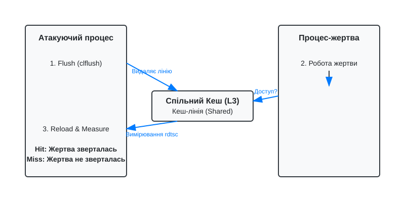

# Кеш як побічний канал: Flush+Reload і Prime+Probe

Процесорний кеш створений для пришвидшення роботи системи шляхом збереження часто використовуваних даних ближче до обчислювальних ядер. Проте саме ця оптимізація створює мікроархітектурний побічний канал (side-channel), через який зловмисник може дізнатися про дані інших процесів. Атаки за часом доступу до кешу (cache timing attacks) використовують вимірювання різниці в часі між потраплянням у кеш (cache hit) та промахом (cache miss).

## Ієрархія кеш-пам'яті та її властивості

Сучасні процесори мають багаторівневу ієрархію кешу:
- **L1 (Level 1)**: Найшвидший і найменший кеш, розділений на кеш інструкцій (L1i) та даних (L1d). Є приватним для кожного ядра.
- **L2 (Level 2)**: Більший, але дещо повільніший, зазвичай також приватний для конкретного ядра.
- **L3 / LLC (Last Level Cache)**: Найбільший кеш, спільний для всіх ядер процесора.

Для реалізації атак на кеш критичними є два архітектурних рішення:
1. **Інклюзивність (Inclusivity)**: В інклюзивній ієрархії (inclusive cache) будь-які дані, що знаходяться в L1 або L2, обов'язково присутні в LLC. Це означає, що витіснення даних з LLC автоматично призводить до їх видалення з приватних кешів ядер (механізм *back-invalidation*).
2. **Асоціативність сетів (Set Associativity)**: Кеш поділений на "сети" (sets), кожен з яких може зберігати певну кількість кеш-ліній (ways). Адреса в пам'яті алгоритмічно визначає, у який саме сет можуть потрапити дані. Це дозволяє зловмиснику націлюватися на конкретні сети для витіснення даних жертви.

## Дельта часу доступу: Hit vs Miss

Фундамент кеш-атак лежить у точному вимірюванні часу виконання інструкцій читання пам'яті. Зловмисник використовує високоточні таймери, такі як інструкція `rdtsc` в архітектурі x86_64, щоб визначити, звідки саме були завантажені дані:
- **Cache Hit (Попадання)**: Читання відбувається з кешу і займає від кількох до десятків тактів процесора.
- **Cache Miss (Промах)**: Читання відбувається з основної оперативної пам'яті (RAM) і вимагає кількох сотень тактів.

Обчислюючи межу розподілу (threshold) між цими двома показниками з урахуванням шуму, атакуючий може визначити, чи звертався інший процес до конкретної адреси пам'яті останнім часом.

## Атака Flush+Reload

Метод Flush+Reload — це високоточна атака, що вимагає наявності спільної пам'яті (shared memory) між атакуючим і процесом-жертвою. Найчастіше це досягається завдяки оптимізаціям операційної системи, яка завантажує динамічні бібліотеки (наприклад, криптографічні реалізації OpenSSL) в оперативну пам'ять лише один раз, розшарюючи їхні сторінки (Page Deduplication або Shared Libraries) між усіма процесами.



Алгоритм атаки складається з трьох повторюваних фаз:
1. **Flush (Скидання)**: Атакуючий використовує інструкцію `clflush` (cache line flush), щоб примусово видалити конкретну кеш-лінію з усієї ієрархії кешу, включно з L1/L2 жертви. Ця лінія може відповідати, наприклад, таблиці пошуку AES (T-tables) або гілці коду експоненціювання RSA.
2. **Wait (Очікування)**: Атакуючий призупиняє своє виконання, дозволяючи процесу-жертві виконати свої обчислення. Якщо алгоритм жертви під час цього вікна звертається до цільової адреси пам'яті, процесор знову завантажує її в кеш.
3. **Reload (Повторне завантаження)**: Атакуючий читає ту саму кеш-лінію і вимірює час доступу за допомогою `rdtsc`. 
   - Якщо час короткий (**Hit**), це означає, що жертва зверталася до цих даних під час кроку 2.
   - Якщо час довгий (**Miss**) — жертва не зверталася до них.

Відстежуючи таким чином доступи до пам'яті, зловмисник може реконструювати потік виконання (control flow) жертви або індекси доступу до масивів, крок за кроком витягуючи секретні криптографічні ключі.

## Атака Prime+Probe

На відміну від Flush+Reload, атака Prime+Probe не потребує спільної пам'яті і не використовує інструкції скидання кешу (`clflush`). Вона маніпулює станом кешу через заповнення його власними даними і базується виключно на асоціативності кешу. Це робить її небезпечною навіть у хмарних середовищах або віртуалізованих системах, де віртуальні машини ізольовані на рівні пам'яті, але поділяють спільний процесорний L3 кеш.

Кроки атаки:
1. **Prime (Заповнення)**: Атакуючий визначає кеш-сети, які ймовірно використовує жертва, і заповнює їх лініями власних даних. Оскільки кількість кеш-ліній (ways) у сеті обмежена, дані жертви витісняються.
2. **Wait (Очікування)**: Жертва продовжує роботу. Якщо їй потрібні власні дані, вони завантажуються в кеш, неминуче витісняючи частину даних атакуючого з відповідних сетів (евакція кеш-лінії).
3. **Probe (Зондування)**: Атакуючий знову читає свої ж дані, послідовно вимірюючи час доступу до кожного сету. Якщо читання відбувається довго (**Miss**), це означає, що дані атакуючого були витіснені даними жертви. Таким чином визначається, до яких саме кеш-сетів зверталася жертва.

Prime+Probe має нижчу роздільну здатність порівняно з Flush+Reload, адже дозволяє відстежувати лише доступи на рівні кеш-сетів, а не конкретних байтів, і є значно більш схильною до шуму від інших процесів.

## Вразливі шаблони коду та захист

Головна причина успішності мікроархітектурних атак на кеш — це залежність потоку керування (control flow) або патернів доступу до пам'яті (memory access patterns) від секретних даних.

**Вразливі шаблони (небезпечний код):**
- **Розгалуження, що залежить від секрету** (Secret-dependent branching).
  Коли виконання умовної гілки залежить від значення ключа, зловмисник побачить завантаження коду цієї гілки в кеш:
  ```c
  // ВРАЗЛИВО
  if (secret_bit == 1) {
      multiply_and_square(); 
  } else {
      square();
  }
  ```
- **Індексація масивів, що залежить від секрету** (Secret-dependent memory access).
  Якщо секрет використовується як індекс, зловмисник може дізнатися індекс (а отже і секрет), відстежуючи, яка саме кеш-лінія таблиці була завантажена:
  ```c
  // ВРАЗЛИВО
  uint8_t value = lookup_table[secret_byte]; 
  ```

### Програмування сталого часу (Constant-Time Execution)
Щоб нейтралізувати кеш-атаки, криптографічні алгоритми повинні виконуватися за постійний час і здійснювати однакові доступи до пам'яті, незалежно від оброблюваних даних. 

- **Уникнення розгалужень**: Замість `if-else` використовується побітова арифметика та маскування для вибору результатів обчислень без зміни потоку керування (наприклад, сходи Монтгомері).
- **Уникнення секретів у індексах**: Замість табличних підстановок (як-от S-box у старих реалізаціях AES) використовується обчислення значень "на льоту" (bitslicing) або сканування всієї таблиці від початку до кінця щоразу (коли читається кожна комірка, але потрібне значення витягується за допомогою арифметичних масок).
- **Апаратні механізми**: На рівні сучасних процесорів застосовується ізоляція кешу (наприклад, Cache Partitioning), рандомізація витіснення ліній або обмеження доступу користувацьких процесів до високоточних таймерів (наприклад, відключення вільного доступу до `rdtsc` або навмисне зменшення його роздільної здатності).
