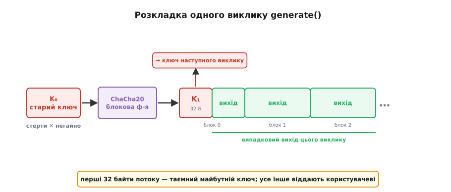

# 🔑 Швидке стирання ключа: робочий CSPRNG на ChaCha20

Зберемо генератор, який — якщо його стан викрадуть просто зараз — не видасть жодного байта з того, що вже роздав, і робить це швидко, звичайним C, на одному-єдиному примітиві. Прийом зветься **швидким стиранням ключа** (*fast-key-erasure*), Даніель Бернстайн описав його 23 липня 2017 року, і сьогодні він працює всередині генераторів Linux та BSD. Уся хитрість — одна операція `memset`, поставлена в правильному місці.

## Задача

Треба функція `generate(out, n)`, що заповнює буфер `n` непередбачними байтами, і при цьому:

- **швидко** — гігабайти за секунду, без звертання до повільного джерела ентропії на кожен байт;
- **пряма таємність** — якщо стан захоплять, увесь **раніше** виданий вихід лишається недосяжним;
- **відновлюваність** — окрема функція `reseed(entropy)` вливає свіжу непередбачність, щоб оговтатися після витоку.

Обмеження навмисно жорсткі: чистий C, стан — 32 байти, один криптографічний примітив на все. Цей примітив — **ChaCha20**, потоковий шифр Бернстайна: з 32-байтового ключа він розгортає скільки завгодно псевдовипадкового потоку, швидко й без апаратної підтримки.

> ⚠️ Це **навчальна** реалізація — щоб побачити механізм оголеним. Збір ентропії й керування станом на реальній системі робить ядро; насіння тут теж береться від системного генератора.

## Ідея одним абзацом

Тримаємо в стані лише 32-байтовий ключ `Kᵢ` — більше нічого. Щоб обслужити запит: женемо потік ChaCha на цьому ключі, **перші 32 байти потоку відрізаємо й робимо наступним ключем** `Kᵢ₊₁`, усе решта віддаємо як відповідь, а старий `Kᵢ` **негайно затираємо**. Оскільки блокова функція ChaCha одностороння, з `Kᵢ₊₁` неможливо відкрутити назад до `Kᵢ` — тож пряма таємність коштує рівно один зайвий блок і один `memset`.

## Цеглина: блокова функція ChaCha20

Уся сила спирається на одну функцію: з ключа й лічильника вона рахує 64 псевдовипадкові байти так, що вперед це миттєво, а назад — обчислювально неможливо. Розберімо її, бо саме її односторонність робить храповик храповиком.

Стан ChaCha — матриця 4×4 із шістнадцяти 32-бітових слів: чотири сталі (ASCII-рядок `"expand 32-byte k"`), вісім слів ключа, слово лічильника блоку й три слова одноразового номера (тут — нулі). Серце — **чвертькрок** (*quarter-round*): чотири додавання, чотири XOR-и й чотири циклічні зсуви, що перемішують четвірку слів. Двадцять раундів (десять «стовпцевих» і десять «діагональних» чвертькроків поспіль) розганяють будь-яку зміну входу на весь стан.

:::code proj-fast-key-erasure/c/tsehlyna-blokova-funktsiia.c

Уся односторонність народжується в одному, легко пропущеному рядку — `v = x[i] + s[i]`. Двадцять раундів самі по собі оборотні: це перестановка, її можна відкрутити крок за кроком. Але наприкінці до перемішаного стану `x` **додають вихідний стан** `s`, а `s` містить таємний ключ. Щоб обернути результат, треба відняти `s` — а `s` ти й шукаєш. Саме це подвійне «замикання» (перемішати, тоді додати незмішаний вхід) перетворює оборотну перестановку на [односторонню функцію](root:sf-security/cryptographic-hash) — таку, що вперед рахується легко, а назад обертається лише повним перебором усіх можливих ключів. На цій асиметрії стоятиме весь храповик.

> 🔧 **Навіщо це.** `nonce = 0` виглядає підозріло — адже повторити пару «ключ + лічильник» у потоковому шифрі означає видати ту саму гаму двічі, катастрофа рівня повторного одноразового блокнота. Але тут номер можна тримати нулем безкарно: ключ **міняється щовиклику**, тож пара (ключ, лічильник) ніколи не повторюється, навіть коли лічильник щоразу стартує з нуля. Швидке стирання ключа саме й дарує цю унікальність задарма.

## Генератор і generate()

Стан — рівно ключ (плюс мітка процесу, вона знадобиться проти fork). Ініціалізуємо його насінням від системного генератора:

:::code proj-fast-key-erasure/c/henerator-i-generate.c

Тепер сам храповик. Перший блок ділимо навпіл: його перші 32 байти ховаємо в майбутній ключ, другі 32 — це вже вихід. Дальші блоки того самого потоку йдуть у вихід цілком. І аж наприкінці, коли весь запит обслужено старим ключем, ставимо на його місце новий і затираємо все тимчасове.

:::code proj-fast-key-erasure/c/henerator-i-generate-2.c

Вдумаймося, чому цей десяток рядків дає пряму таємність. **Увесь** вихід цього виклику порахований зі старого `Kᵢ`; наприкінці `Kᵢ` затерто, а в стані лежить лише `Kᵢ₊₁ = ChaCha(Kᵢ)[0:32]`. Хай тепер супротивник захопить стан — він тримає `Kᵢ₊₁`. Щоб відтворити бодай байт минулого виходу, йому треба `Kᵢ`; щоб дістати `Kᵢ` з `Kᵢ₊₁`, треба обернути блокову функцію — обчислювально неможливо. Ланцюг `K₀ → K₁ → K₂ → …` є однобічною доріжкою, і кожен затертий ключ замикає за собою двері.


*Перші 32 байти потоку — це `K₁`, таємний ключ наступного виклику; їх не показують нікому. Другі 32 байти першого блоку й усі дальші блоки — випадковий вихід цього виклику. Старий ключ затирають одразу, тож захоплення стану після виклику не дає відкрутити потік назад.*

## reseed(): вливання свіжої ентропії

Храповик береже минуле, але майбутнє — ні: із захопленого `Kᵢ₊₁` супротивник чудово рахує весь **наступний** потік, бо храповик детермінований уперед. Оговтатися можна лише одним способом — влити в ключ непередбачність, якої супротивник не бачив. І вливати треба **в суміш** зі старим станом, а не начисто: тоді генератор надійний, якщо чисте бодай одне джерело — або старий стан (супротивник його не мав), або нова ентропія (супротивник її не бачив).

Ту саму односторонню блокову функцію тут вживаємо як мішалку: поглинаємо насіння шматками, кожен XOR-имо в ключ і одразу проганяємо крізь ChaCha.

:::code proj-fast-key-erasure/c/reseed-vlyvannia-svizhoi.c

Новий ключ залежить і від старого, і від насіння, бо перше XOR-иться з другим, а результат проходить крізь односторонній блок. Навіть якщо супротивник знав увесь старий стан, свіжої ентропії він не бачив — тож новий ключ для нього непередбачний, і потік праворуч знову закритий. Поглинання шматками по 32 байти дозволяє влити насіння будь-якої довжини, а не тільки рівно 32.

## Пастки

Алгоритм короткий, але майже вся реальна вразливість випадковості ховається не в ньому, а в тому, як його вбудовують. Чотири місця, де легко все зіпсувати.

**1. Fork і клон віртуалки без пересіву.** Найпідступніше. Коли процес форкається, дитина успадковує **копію** стану — той самий `Kᵢ`. Далі батько й дитина рахують той самий потік, видають ті самі ключі, і дві незалежні на вигляд машини раптом мають спільні секрети. Те саме коли клонують образ віртуалки. Розв'язок — помітити fork і пересіятися перед першим байтом:

:::code proj-fast-key-erasure/c/pastky.c

Перевірка `getpid()` — лише мінімальна підлога: номери процесів переповнюються й повторюються, а `vfork`/`clone` та клон віртуалки її взагалі обходять. Надійно проблему закриває ядро — сторінкою з прапорцем `MADV_WIPEONFORK` (її вміст обнуляється в дитині після fork) або лічильником покоління віртуалки. Це одна з головних причин, чому генератор із простору користувача взагалі небезпечний, а системний — ні.

**2. Стирання, яке компілятор викидає.** Затерти ключ звичайним `memset(key, 0, 32)` перед виходом із функції — і оптимізатор має повне право його **прибрати**: з погляду стандарту C у мертву пам'ять уже ніхто не дивиться, отже, запис зайвий. Ключ лишається в пам'яті (а може, і в дампі чи своп-файлі) відкритим. Тому стирати треба способом, який не «оптимізується»: через `volatile`-вказівник (як `secure_wipe` вище) або платформною функцією — `explicit_bzero` (BSD, glibc), `memset_s` (C11 Annex K), `SecureZeroMemory` (Windows). Для параної ще й `mlock`, щоб ключ не потрапив у своп.

**3. Лічильник і одноразовий номер: пара (ключ, лічильник) не сміє повторитися.** У ChaCha повторення пари (ключ, лічильник) при тому самому nonce дає **ту саму** гаму — це двічі накладений одноразовий блокнот, з якого XOR виймає обидва повідомлення. Швидке стирання ключа рятує тут само собою: ключ міняється щовиклику, тож повторити пару неможливо, навіть коли лічильник щоразу з нуля. Але межа лишається: 32-бітовий лічильник вміщує 2³² блоків по 64 байти на один виклик:

```
2³² блоків · 64 Б = 2³⁸ Б = 256 ГіБ на ОДИН виклик generate()
```

Запит більший за 256 ГіБ переповнить лічильник і поверне гаму по колу. На практиці такого не буває, але коректна реалізація або ріже гігантський запит на шматки з окремим ключем, або тримає 64-бітовий лічильник.

**4. Буферизація заради швидкості.** Платити цілим блоком ChaCha за кожні 8 байтів марнотратно, тож справжні генератори (той-таки `arc4random`) наперед набивають буфер і роздають з нього скибками. Це вмикає три нові обов'язки, і забути будь-який — злам: перші 32 байти буфера (майбутній ключ) **не можна** віддати назовні; кожен виданий байт треба **одразу затерти** в буфері (пряма таємність поширюється й на нього — захоплений буфер не сміє видати вже роздане); а на fork **увесь буфер** треба викинути, не лише ключ, інакше дитина роздасть ті самі буферизовані байти. Швидкість буфера купується дисципліною стирання.

## Складність

Робота лінійна від довжини запиту: `generate(out, n)` рахує `⌈n/64⌉ + 1` блоків ChaCha, кожен — сталі 20 раундів по 8 чвертькроків (десь 15 простих операцій над 32-бітовим словом на байт виходу), тобто **O(n)** часу з кількома тактами процесора на байт. Храповик додає рівно **один** зайвий блок на виклик — на великому запиті це губиться, але для крихітних (скажімо, 8 байтів) ти все одно платиш повний блок за майбутній ключ, тож часті мікрозапити вигідніше обслуговувати з буфера. Пам'ять стану — **O(1)**, ті самі 32 байти ключа незалежно від того, скільки терабайтів уже роздано.

Це і є, з точністю до буферизації та роботи з ентропією, форма ядра `getrandom` в Linux і `arc4random` у BSD: увесь секрет живучості вміщується у 32 байти, а вся пряма таємність — в один затертий ключ на виході з функції.
