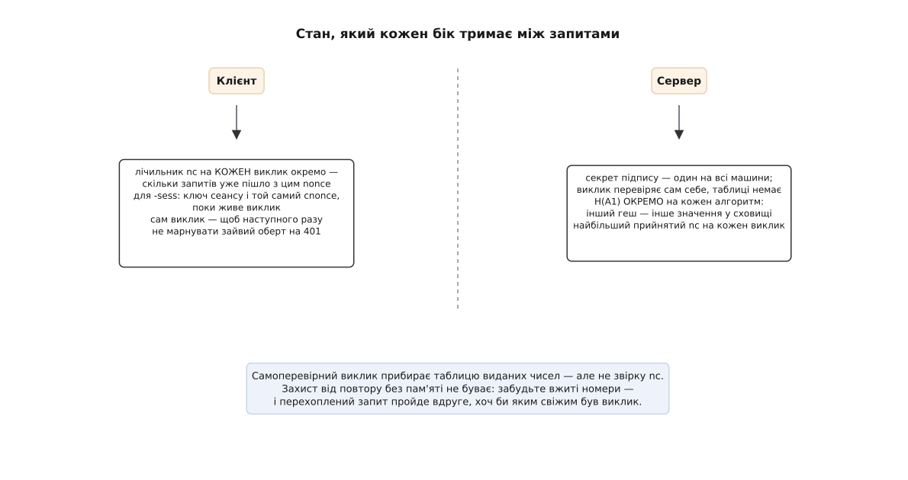

# ⚙️ Клієнт і сервер дайджест-автентифікації в коді

Формула доказу — три рядки гешування, і саме на ній ніхто не спотикається. Реалізації ламаються на іншому: на заголовку, який не ріжеться комами, на лічильнику, що мусить пережити запит, і на виклику, який службі нема де тримати. Ось обидва боки цілком — разом із тими місцями, де очевидне рішення виявляється хибним.

## Заголовок ріжеться не комами

Виклик приїздить одним рядком:

```
WWW-Authenticate: Digest realm="api.example.org", qop="auth,auth-int",
    algorithm=SHA-256, nonce="MTc4NjE1NzM2MC45Mj…", opaque="s7f1", stale=false
```

Спокуса розрізати його комами, а кожен шматок навпіл по знаку рівності, живе рівно до першої зустрічі зі справжньою службою. Кома всередині лапок — не роздільник: `qop="auth,auth-int"` це одне поле, а не два. У лапках трапляється й екранована лапка, після якої наївний розбір з'їжджає на весь решту рядка.

Але справжня халепа інша. Служба має право покласти в один заголовок кілька викликів поспіль, і **жодного роздільника між ними не передбачено** — вони йдуть через ту саму кому, що й поля всередині:

```
WWW-Authenticate: Digest realm="api", algorithm=SHA-256, nonce="new",
                  Digest realm="api", algorithm=MD5, nonce="old"
```

Де закінчується перший виклик? Ознака рівно одна: слово, за яким **не** стоїть знак рівності, — це назва схеми, а отже, початок нового виклику. Тому заголовок треба проходити потоком лексем, а не розрізанням: пробігти рядок один раз, видаючи пари «ім'я — значення», і вважати новим викликом кожне ім'я, що прийшло без значення.

Навіщо службі два виклики одразу — зрозуміло: вона переходить із MD5 на SHA-256 і якийсь час мусить розуміти обох. [RFC 7616](https://www.rfc-editor.org/rfc/rfc7616.html) вимагає перелічувати їх у порядку переваги, найкращий перший, а клієнтові радить брати перший, який той уміє. Тут ми робимо строгіше — ранжуємо самі, за власною таблицею сили. Причина проста: порядок у заголовку не накритий жодним доказом, бо доказу ще нема, і посередник вільно міняє виклики місцями. Своя таблиця коштує три рядки, а помилка в цьому місці не видима ніяк — запит успішно проходить, просто на MD5.

:::tabs
:::code proj-digest-client/py/zaholovok-rizhetsia-ne.py
:::code proj-digest-client/ts/zaholovok-rizhetsia-ne.ts
:::

## Клієнт: те, що мусить пережити запит

Схему задумано для служби без пам'яті, але клієнт без пам'яті працювати не може: два значення мусять жити довше за один запит.

**Лічильник `nc`** ведуть **на кожен виклик окремо**, а не один на все з'єднання: новий `nonce` — і відлік починається з `00000001`. У геш іде рядок із провідними нулями, точнісінько такий, як поїде в заголовок: `00000002` і `2` — різні тексти, а отже, різні геші. Тому лічильник зберігають числом, форматують один раз, і те саме значення кладуть і в геш, і в заголовок.

**`cnonce`** мусить бути **непередбачуваним**, а не просто щоразу іншим. Уся його робота — не дати недоброзичливій службі назвати той виклик, під який у неї вже готова таблиця «пароль → відповідь». Лічильник чи мітка часу цієї роботи не виконують, бо їх обчислюють наперед. Тому джерело тут — тільки [криптографічний генератор](root:sf-security/csprng): `os.urandom`, `randomBytes` — і жодного `random()` зі звичайної бібліотеки загального призначення.

Різновид **`-sess`** додає третє. Ключ сеансу рахують **один раз** на виклик, і в нього входить `cnonce` — отже, з цієї миті `cnonce` заморожений: доки живе цей `nonce`, у кожному запиті їде той самий. Клієнт, який чесно генерує свіжий `cnonce` щоразу, з `-sess` не працюватиме, і зламається це не на першому запиті, а на другому.

:::tabs
:::code proj-digest-client/py/kliient-te-shcho-musyt.py
:::code proj-digest-client/ts/kliient-te-shcho-musyt.ts
:::

## Оберт, який клієнт робить мовчки

Коли служба відповідає `401` із позначкою `stale=true`, вона каже: доказ правильний, застарів лише виклик. Питати людину нема про що — клієнт бере новий `nonce` із того самого `401`, рахує доказ наново й повторює запит сам. Оскільки `authorization()` — чиста функція від виклику, методу й шляху, увесь повтор зводиться до другого виклику тієї самої функції.

Дві осторо́ги. Перша: лічити оберти. Служба зі зламаним годинником оголосить `stale` навіть на щойно виданий виклик, і клієнт без обмеження крутитиметься вічно; двох-трьох спроб цілком досить. Друга: мовчазний повтор дозволено **тільки** за наявності `stale=true`. Звичайний `401` без цієї позначки означає «пароль не той», і повторювати його мовчки — це перебирати паролі, доки обліковий запис заблокують.

Симетричний бік — заголовок `Authentication-Info` з полем `rspauth`. Служба рахує його за тією самою формулою, але з `A2 = ":" URI` — без методу, бо метод обирала не вона. Перевіривши це поле, клієнт переконується, що співрозмовник знає `H(A1)`. Межу варто розуміти чітко: доведено знання секрету, а не цілісність відповіді — тіло лишається неприкритим. Туди ж служба часто кладе `nextnonce`, і клієнт, який його підхопить, заощадить наступний зайвий оберт.

## Служба: виклик, що перевіряє сам себе

Таблиці виданих чисел служба не тримає — вона кладе в саме число власний підпис. Мітка часу їде відкрито, поруч із нею тег, порахований із секретом, який знають усі машини за балансувальником і не знає ніхто зовні. Виклик повернувся — тег перерахували, зіставили, глянули на вік мітки. Стандарт описує тег як `H(мітка:ETag:секрет)`; тут узято [HMAC](root:sf-security/hmac) — той самий намір, але без питань про те, як гешфункція поводиться, коли секрет доточують до даних.

Далі йде порядок перевірок, і він не косметичний: спершу дешеве й безпечне, гешування останнім. П'ять рішень у цьому коді варті окремої уваги.

`uri` із заголовка звіряють із рядком запиту, а `A2` рахують **із самого запиту**. Візьміть шлях із заголовка — і нападник впише туди той, під який має доказ, а виконати змусить зовсім інший.

`algorithm` беруть зі свого списку дозволених. Повірити заголовку означає дозволити клієнтові обрати нам MD5.

`H(A1)` лежить у сховищі **окремо на кожен алгоритм**, бо гешфункція сидить усередині самого значення. Саме тому перехід на SHA-256 не буває миттєвим: доки нові значення не набралися, служба мусить пропонувати обидва виклики й тримати обидва записи.

`nc` записують до «бачених» **лише після** того, як доказ зійшовся. Інакше будь-хто спалить чужі номери, надіславши сміття.

Порівнюють постійним часом — `hmac.compare_digest`, `timingSafeEqual`. Звичайне `==` на рядках виходить на першій розбіжності, і за часом відповіді доказ добирають байт за байтом: це [атака за часом](root:sf-security/timing-attack).

:::tabs
:::code proj-digest-client/py/sluzhba-vyklyk-shcho.py
:::code proj-digest-client/ts/sluzhba-vyklyk-shcho.ts
:::



*Самоперевірний виклик прибирає таблицю виданих чисел, але не звірку `nc`: остання дрібка стану лишається саме там, де її найменше хочеться бачити.*

## Скільки це коштує

Обчислень тут майже немає. Клієнт на запит гешує три короткі рядки, служба — стільки ж плюс один HMAC на перевірку виклику; на будь-якому процесорі це мікросекунди, і вузьким місцем воно не стає ніколи. Уся справжня ціна схеми — той зайвий оберт, який клієнт робить раз на кожен новий виклик, і зменшують її не швидшим гешем, а довшим життям виклику та полем `nextnonce`.

А от пам'ять недогледіти легко. Мапа `seen` росте на кожен виданий виклик і сама по собі не зменшується — за добу жвавого руху це мільйони записів і рівний, повільний витік. Рятує те, що запис має сенс рівно доти, доки живий його виклик: `nc` старішого за `NONCE_TTL` числа перевіряти нема потреби, бо таке число вже відкидає `check_nonce`. Оскільки мітка часу лежить у самому ключі, чистка зводиться до того, щоб зрідка пройтися мапою й викинути все, що старіше за строк життя. Іронія в тому, що єдина таблиця, яку самоперевірний виклик не зміг прибрати, — це та сама таблиця, яку тепер треба не забути прибирати вручну.

## Пастки

**Лапки.** `nc`, `qop` і `algorithm` їдуть **без лапок**, решта — у лапках. Це не питання стилю: RFC 7616 прямо забороняє брати `qop` і `nc` у лапки — «for historical reasons», — і суворі служби відкидають запит із `nc="00000001"`. Дзеркальна пастка на розборі: не забути зняти екранування зі значень, що прийшли в лапках.

**Точний збіг `uri`.** Значення має дослівно збігатися з тим, що стоїть у рядку запиту, разом із частиною після `?`. Нормалізація шляху, дописаний скісний у кінці, прибраний порожній параметр — і доказ не зійдеться, хоча пароль правильний.

**Кодування пароля.** RFC 7616 додав параметр `charset=UTF-8`: ім'я й пароль перед гешуванням переводять у нормальну форму NFC і кодують [у UTF-8](root:sf-data/ascii-utf8). Без цього пароль із не-латинкою дає різний `H(A1)` на різних клієнтах — а старіші реалізації мовчки беруть ISO-8859-1 і не збігаються ні з ким.

**`SHA-512-256` — це не обрізаний SHA-512.** Це окремий алгоритм із FIPS 180-4, з іншими початковими значеннями. У бібліотеках він так і зветься (`sha512_256`, `sha512-256`); написати `sha512(…)[:32]` означає тихо порахувати не те.

**Відсутній `qop`.** RFC 7616 вимагає `qop` від усіх реалізацій і скасував сумісність із найпершою редакцією схеми, де відповідь рахували без `nc`, `cnonce` і `qop` узагалі. Стандарт стандартом, а камери й маршрутизатори, випущені до 2015 року, досі говорять саме так — тож клієнт, що йде до вбудованої техніки, мусить бути готовий до виклику без цього поля й до старішої формули, а служба — свідомо вирішити, чи взагалі його підтримувати.
