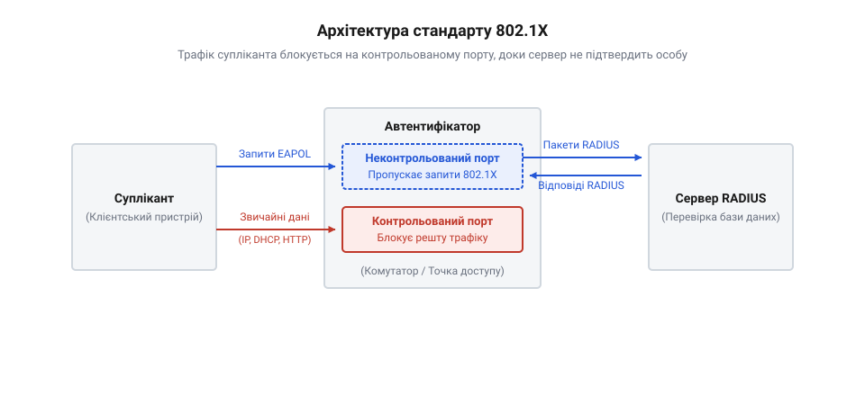
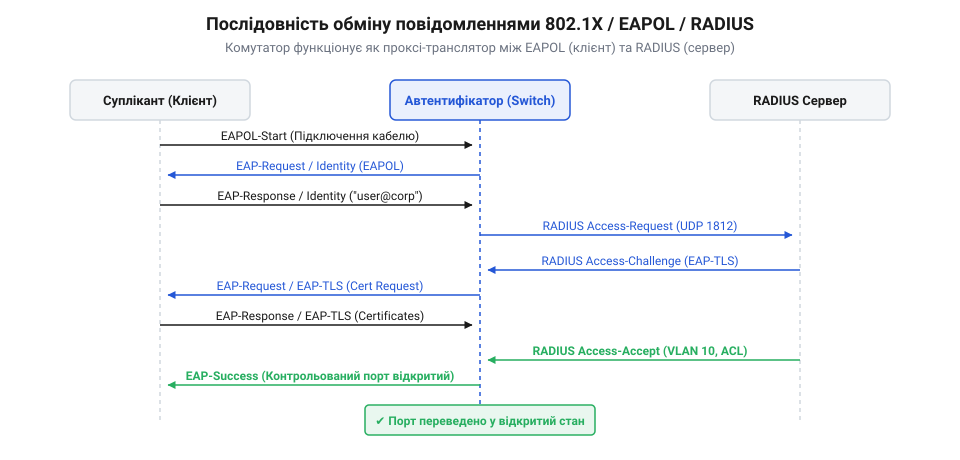

# Мережева автентифікація 802.1X, EAP та RADIUS

<preknowlist>
- [Автентифікація](root:sf-security/authentication) — базове розуміння того, що таке перевірка особи і як вона відрізняється від авторизації.
</preknowlist>

## Проблема неконтрольованого мережевого доступу

Коли людина підключає кабель до вільної мережевої розетки в офісі або обирає корпоративну бездротову мережу, пристрій зазвичай одразу отримує IP-адресу та доступ до внутрішніх ресурсів. Якщо цей пристрій належить зловмиснику або неавторизованому гостю, він може безперешкодно сканувати локальну мережу, перехоплювати трафік чи атакувати сервери. Відкритий доступ означає, що інфраструктура повністю довіряє будь-кому, хто фізично дістався до дроту або перебуває в радіусі дії Wi-Fi.

Щоб запобігти цьому, мережа повинна вимагати доказ особи, тобто [здійснювати перевірку](root:sf-security/authentication) (@@en|authentication@@), перш ніж надати доступ до ресурсів. Найпростіший підхід — встановити єдиний спільний пароль на мережу, як це робиться в домашніх роутерах. Але в корпоративному середовищі це не працює: якщо працівник звільняється або пароль стає відомим стороннім, доводиться змінювати його на всіх пристроях компанії одночасно. До того ж, спільний пароль не дозволяє розрізнити, хто саме зараз підключився до мережі, і які права йому слід надати.

Тому виникає потреба в механізмі, який би індивідуально перевіряв кожного користувача або пристрій під час спроби підключення. Цей механізм має блокувати будь-яку мережеву активність на самому вході — на розетці або точці доступу — доки пристрій надійно не підтвердить свою особу за допомогою унікального логіна з паролем або цифрового сертифіката. Логічно це реалізується через зміну стану порту: за замовчуванням він є неконтрольованим, тобто відкидає весь звичайний трафік (навіть запити на отримання IP-адреси) і пропускає лише службові повідомлення перевірки. Лише після успішного підтвердження особи мережеве обладнання переводить порт у контрольований стан, чим «відчиняє двері» для передачі корисних даних і повноцінної роботи.

## Архітектура стандарту 802.1X

Для вирішення проблеми контролю доступу на рівні портів було створено стандарт 802.1X. Він не вигадує нових криптографічних протоколів чи методів шифрування, а пропонує сувору логічну архітектуру з трьох учасників. Кожен із них виконує вузькоспеціалізовану функцію, і лише їхня спільна робота визначає, чи отримає новий пристрій дозвіл на передачу даних у мережу. 

Ця архітектура жорстко поділяє відповідальність між такими сторонами:
- Клієнтський пристрій, який ініціює підключення і просить доступу, називається суплікантом (@@en|supplicant@@). Це може бути ноутбук, смартфон або інший розумний пристрій, на якому працює спеціальне програмне забезпечення, здатне вести діалог із мережею та надавати облікові дані. - Пристрій інфраструктури, до якого клієнт безпосередньо підключається фізично або через радіоефір, виступає автентифікатором (@@en|authenticator@@). Зазвичай цю роль виконує корпоративна точка доступу Wi-Fi або керований мережевий комутатор. - Віддалений центральний вузол, який зберігає базу даних користувачів, обчислює криптографічні хеші та приймає остаточне рішення, називається сервером автентифікації (@@en|authentication server@@).

Мережевий комутатор або бездротова точка доступу, виконуючи роль автентифікатора, діє як сліпий посередник. Коли новий пристрій підключається до порту комутатора, цей порт переходить у логічно заблокований стан. У цьому стані порт функціонує як жорсткий фільтр: він пропускає виключно службові пакети запиту доступу і безжально відкидає решту мережевого трафіку. Сам комутатор не містить списку дозволених MAC-адрес, не знає паролів користувачів і не вміє перевіряти цифрові сертифікати. Його завдання — лише слухати порт, отримувати ідентифікаційні дані від супліканта, загортати їх у мережевий пакет і пересилати далі безпечним каналом до центрального сервера. Щойно сервер підтверджує особу і надсилає команду розблокування, комутатор знімає фільтр, дозволяючи пристрою повноцінно працювати в мережі.

*Архітектура 802.1X: комутатор виконує роль автентифікатора, пропускаючи через неконтрольований порт лише запити на підтвердження особи, доки сервер не дозволить відкрити контрольований порт для звичайного трафіку.*

Механізм блокування стандарту 802.1X реалізовано через концепцію двох віртуальних портів у межах одного фізичного підключення. Коли суплікант під'єднується до розетки, його трафік потрапляє на роздоріжжя. Перший шлях — неконтрольований порт — завжди залишається відкритим, але налаштований так, що приймає лише повідомлення, безпосередньо пов'язані з процедурою перевірки особи. Усі інші кадри він просто ігнорує. Водночас другий шлях — контрольований порт, через який має йти весь корисний трафік (наприклад, запити DHCP для отримання IP-адреси чи доступ до внутрішніх вебсерверів) — залишається закритим на рівні мікросхеми комутатора. Автентифікатор діє як суворий охоронець на прохідній, який лише передає документи відвідувача керівництву. Тільки після того, як сервер автентифікації перевірить ці документи і дасть команду пропустити, автентифікатор переводить контрольований порт у відкритий стан. Якщо ж перевірка провалюється, порт залишається закритим, і корпоративна мережа залишається абсолютно недосяжною для зловмисника, немов кабель взагалі не підключено.

Проте в реальній інфраструктурі існують пристрої, які не мають операційної системи з підтримкою супліканта, наприклад, старі мережеві принтери, камери відеоспостереження чи медичне обладнання. Якщо такий пристрій підключити до порту з увімкненим 802.1X, він ніколи не надішле запит на перевірку і назавжди залишиться заблокованим. Щоб вирішити цю проблему без зниження безпеки для решти мережі, використовують механізм обходу (@@en|MAC Authentication Bypass, MAB@@). Якщо комутатор протягом певного часу не отримує від клієнта жодних повідомлень супліканта, він самостійно бере MAC-адресу цього пристрою і відправляє її серверу автентифікації замість логіна й пароля. Сервер звіряє цю адресу зі списком дозволених інфраструктурних пристроїв і, якщо знаходить збіг, наказує комутатору відкрити порт, часто з жорсткими обмеженнями доступу виключно до потрібних серверів. Це створює діру (адже MAC-адресу легко підробити), але дозволяє компромісно підтримувати старе обладнання в сучасній мережі.

## Гнучкість через протокол EAP

Стандарт 802.1X описує загальну архітектуру — хто і коли відкриває порт. Але він не визначає, як саме клієнт має довести свою справжність. Цим займається протокол розширеної автентифікації (@@en|Extensible Authentication Protocol@@, EAP). Замість того, щоб жорстко зашивати в стандарт один метод перевірки (наприклад, лише за паролем), EAP працює як універсальний контейнер. Він дозволяє супліканту та серверу автентифікації «домовитися» про те, яку саме перевірку вони будуть використовувати. Завдяки такій інкапсуляції, 802.1X може передавати будь-які типи облікових даних, не змінюючи логіки роботи самого мережевого обладнання.

Історично еволюція методів перевірки почалася з простих протоколів, таких як PAP та CHAP, які передавали паролі відкритим текстом або у вигляді слабких хешів. Із поширенням бездротових мереж, де трафік легко перехопити з ефіру, такі методи стали вразливими. Це змусило індустрію перейти до складніших захищених методів усередині EAP. З'явилися [методи EAP-TLS та PEAP](root:sf-security/eap-tls-peap-methods), які використовують цифрові сертифікати та зашифровані тунелі для захисту облікових даних від підглядання, навіть якщо фізичне середовище передачі є небезпечним.

Автентифікатор (комутатор або точка доступу) взагалі не розбирає вміст повідомлень EAP. Він просто бере пакет EAP від клієнта, запаковує його та відправляє на сервер, а відповідь від сервера передає назад клієнту. Це означає, що коли з'являється новий метод автентифікації, адміністратору мережі достатньо оновити програмне забезпечення на клієнтах та на центральному сервері. Точки доступу та комутатори не потребують жодних оновлень, оскільки вони лишаються сліпими транспортерами для EAP.

## RADIUS як центр прийняття рішень

Коли автентифікатор отримує від клієнта повідомлення EAP, йому потрібно кудись його надіслати. У корпоративних мережах для цього найчастіше використовується протокол RADIUS (@@en|Remote Authentication Dial-In User Service@@). Сервер RADIUS виступає в ролі того самого центрального сервера автентифікації, який приймає остаточне рішення про надання доступу. Він бере на себе всю обчислювальну і криптографічну роботу, повністю розвантажуючи мережеве обладнання.

Механізм роботи RADIUS побудований на концепції AAA: автентифікація (@@en|Authentication@@), авторизація (@@en|Authorization@@) та облік (@@en|Accounting@@). Спочатку сервер перевіряє, чи дійсно клієнт є тим, за кого себе видає, звіряючи його дані з внутрішньою базою (наприклад, Active Directory). Якщо перевірка успішна, RADIUS виконує авторизацію: він передає автентифікатору спеціальні атрибути, які вказують, які саме права надати цьому пристрою. Наприклад, сервер може наказати комутатору помістити пристрій бухгалтера у відповідну віртуальну мережу (VLAN) або застосувати певний список контролю доступу (ACL). Третій компонент, облік, дозволяє фіксувати, коли пристрій підключився до мережі і скільки часу там перебував, що важливо для безпекового аудиту. Детальніше про [структуру пакетів та атрибутів RADIUS](root:sf-security/eap-radius-network-access/api-radius-packets.md) можна дізнатися в окремій довідці.

Саме використання RADIUS робить корпоративну автентифікацію масштабованою. Замість того, щоб налаштовувати облікові записи на сотнях комутаторів і точок доступу, адміністратор керує доступом в єдиному центрі. Якщо ви бажаєте спробувати це на практиці, ознайомтеся з керівництвом [Налаштування FreeRADIUS для 802.1X](root:sf-security/eap-radius-network-access/proj-radius-setup.md). Завдяки цій централізації мережа отримує єдину точку контролю, де можна швидко заблокувати скомпрометований пристрій або змінити політики доступу для цілих відділів, не торкаючись фізичного обладнання.

## Процес встановлення захищеного з'єднання

Тепер, коли всі учасники та їхні ролі визначені, погляньмо на те, як вони взаємодіють з моменту підключення кабелю. Процес починається, коли суплікант фізично з'єднується з портом комутатора. Комутатор відразу переводить порт у заблокований стан для звичайного трафіку і надсилає клієнту запит на ідентифікацію. Оскільки клієнт ще не має IP-адреси, для цього спілкування на найнижчому рівні використовується протокол EAPOL (@@en|EAP over LAN@@).

Суплікант відповідає повідомленням зі своїм іменем користувача. Комутатор не аналізує це повідомлення: він бере пакет EAP, загортає його у пакет RADIUS і пересилає на сервер автентифікації. Далі сервер і суплікант починають обмін повідомленнями через комутатор, щоб домовитися про метод перевірки, наприклад, обрати EAP-TLS для використання сертифікатів. Після узгодження методу вони виконують саму перевірку. Якщо клієнт успішно доводить свою особу, сервер генерує повідомлення про успіх і надсилає його комутатору разом із правилами авторизації та ключами.

Отримавши фінальне повідомлення про успіх, комутатор розблоковує контрольований порт. Лише з цього моменту клієнт може надіслати запит на отримання IP-адреси та розпочати нормальну роботу в мережі. Увесь цей ланцюжок повідомлень забезпечує, що жоден байт корисних даних не потрапить до інфраструктури до завершення перевірки.

*Послідовність обміну повідомленнями: комутатор працює транслятором між протоколами EAPOL (до клієнта) та RADIUS (до сервера) до моменту успішної перевірки.*

## Захист від атак на мережу

Описана архітектура не лише блокує доступ невідомим пристроям, а й захищає саму процедуру підключення від активних мережевих атак. У звичайних відкритих мережах існує проблема підміни точок доступу (@@en|Rogue AP@@): зловмисник може принести свій роутер, назвати його так само як корпоративну мережу, і клієнтські пристрої підключаться до нього, віддаючи свої паролі або трафік.

Стандарт 802.1X у поєднанні з сучасними методами EAP вирішує цю проблему завдяки взаємній автентифікації (@@en|mutual authentication@@). Під час обміну повідомленнями не лише клієнт доводить серверу, що має право на доступ, але й сервер доводить клієнту, що він є справжнім корпоративним вузлом. Суплікант перевіряє цифровий сертифікат сервера RADIUS, і якщо сертифікат не збігається з очікуваним або є підробленим, клієнт негайно розриває з'єднання. Це унеможливлює атаки типу «людина посередині» (@@en|Man-in-the-Middle, MitM@@), оскільки зловмисник не має доступу до закритого ключа справжнього сервера.

Крім того, після успішної перевірки сервер передає комутатору та клієнту унікальні криптографічні ключі для поточного сеансу. У бездротових мережах ці ключі використовуються для шифрування всього подальшого радіотрафіку між клієнтом і точкою доступу. Навіть якщо зловмисник перехопить пакети з ефіру, він не зможе їх розшифрувати або підробити. Таким чином, комбінація цих трьох технологій перетворює будь-яке фізичне підключення на надійний і захищений бар'єр, який гарантує безпеку як корпоративних даних, так і самих користувачів.