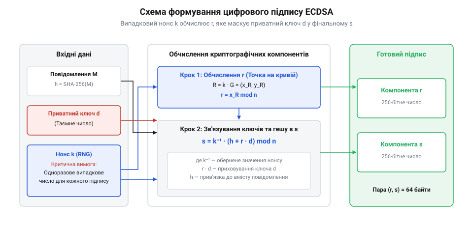
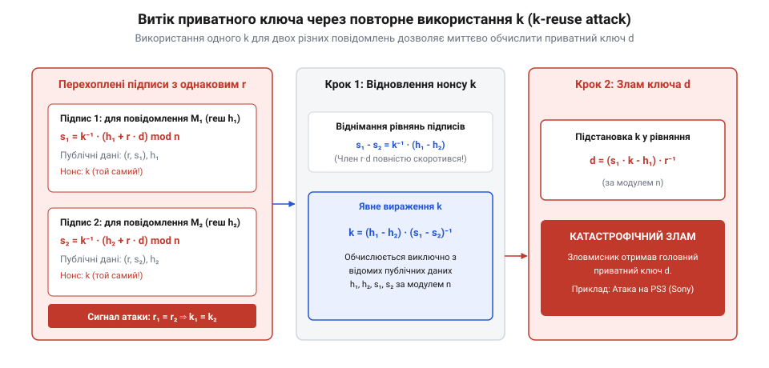
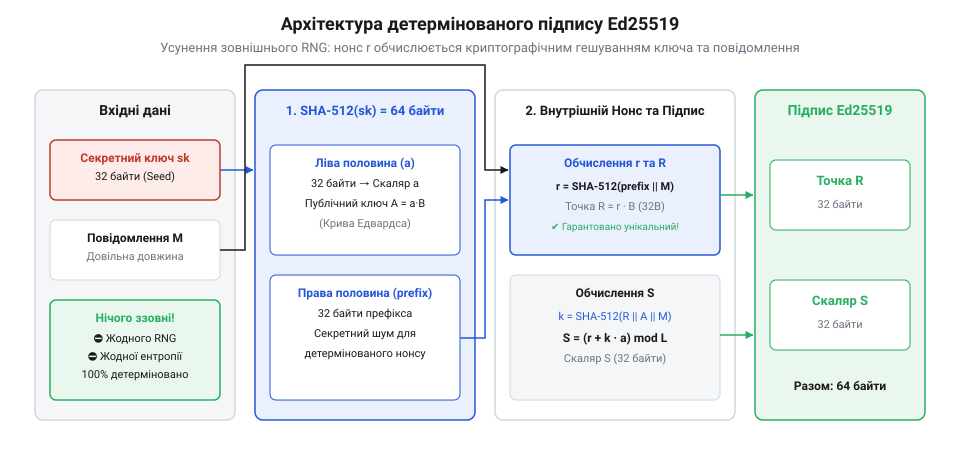

# Цифрові підписи ECDSA та Ed25519: еліптичні криві, витік через nonce та детермінований підпис

<preknowlist>
- [Хеш і цифровий підпис](root:sf-security/hash-and-digital-signature) — Розуміння концепції криптографічного гешування (SHA-256) та базового принципу створення і перевірки цифрового підпису асиметричними ключами.
</preknowlist>

## Проблема важких ключів підпису

Щоб підтвердити авторство та цілісність повідомлення в цифровій мережі, пристрій створює [цифровий підпис](root:sf-security/hash-and-digital-signature). Тривалий час стандартом для цієї задачі був алгоритм RSA. Проте з розвитком обчислювальних потужностей зловмисників довжину ключів RSA довелося постійно збільшувати, щоб зберігати надійність. Сьогодні безпечний ключ RSA має розмір 2048 або навіть 4096 бітів.

Для потужного сервера оперувати такими числами неважко, але для смарт-картки, мобільного телефону або вузла децентралізованої мережі це стає проблемою. Зберігання великих ключів вимагає більше пам'яті. Передавання підписів розміром у пів кілобайта перевантажує вузькі канали зв'язку. А саме формування підпису вимагає зведення гігантських чисел у ступінь, що виснажує батарею та забирає процесорний час слабких пристроїв.

Індустрії був потрібен новий математичний апарат, який забезпечував би таку саму стійкість до зламу, але з набагато меншими ключами. Розв'язком стала криптографія на еліптичних кривих (@@en|Elliptic Curve Cryptography@@). Завдяки складнішій структурі математичної задачі, 256-бітний ключ на еліптичній кривій забезпечує такий самий рівень безпеки, як і 3072-бітний ключ RSA. Це кардинальне зменшення обсягу даних прямо конвертується у швидкість: формування підпису за допомогою еліптичних кривих відбувається в десятки разів швидше і споживає кратно менше енергії акумулятора порівняно зі зведенням гігантських чисел у ступінь у RSA. Саме цей стрибок обчислювальної ефективності дозволив повноцінно впровадити надійну криптографію у світ мобільного зв'язку, пристроїв інтернету речей та блокчейн-мереж.

Найпоширенішим алгоритмом, який реалізує цю ідею на практиці, став ECDSA (@@en|Elliptic Curve Digital Signature Algorithm@@).

## Механізм формування підпису ECDSA

В основі алгоритму лежить набір параметрів еліптичної кривої над скінченним полем. Усі учасники системи домовляються про єдину криву (наприклад, secp256k1), яка має базову точку `G` та певний порядок `n`, що визначає кількість точок на ній. Приватний ключ `d` — це просто велике випадкове число, яке власник тримає в таємниці. Публічний ключ `Q` утворюється шляхом скалярного множення базової точки кривої на це число: `Q = d · G`. Щоб розібратися, як саме працює додавання та множення точок у цій алгебраїчній структурі і чому цю дію неможливо обернути, варто розглянути [групові операції на еліптичних кривих](root:sf-security/ecdsa-and-ed25519/math-elliptic-curve-group.md). Для глибшого розуміння математичного апарату, що використовується в цих алгоритмах, варто ознайомитися з темою [[Основи криптографії на еліптичних кривих (ECC)]] — [Основи криптографії на еліптичних кривих (ECC)](root:sf-security/elliptic-curves-basics).

Коли пристрій хоче підписати повідомлення, він спершу обчислює його криптографічний геш `h`. Гешування гарантує, що підпис завжди працюватиме з фіксованою довжиною даних, незалежно від того, підписуємо ми коротке текстове повідомлення чи гігабайтний файл. Проте гешу та приватного ключа недостатньо: алгоритм ECDSA вимагає введення додаткового випадкового числа, яке називається нонсом `k` (@@en|number used once@@). Це число має бути абсолютно непередбачуваним і генеруватися наново для кожного нового підпису.

Сам підпис є парою з двох чисел, які позначаються як `r` та `s`. Алгоритм обчислює їх послідовно.

Значення `r` формується винятково з нонсу `k` та не залежить від повідомлення чи ключа. Алгоритм бере базову точку кривої `G` і множить її на число `k`, отримуючи нову точку на кривій `R = k · G`. Точка `R` має дві координати: X та Y. Щоб отримати `r`, алгоритм просто відкидає координату Y і залишає лише координату X (за модулем `n`). 

Чому ми беремо саме координату X? Еліптичні криві симетричні відносно горизонтальної осі. Для будь-якого дійсного значення X на кривій існує дві можливі точки з різними значеннями Y. Відкидаючи Y, ми навмисно втрачаємо частину геометричної інформації про точку `R`. Головне ж полягає в тому, що відновити початковий нонс `k` з координати X математично неможливо: це вимагає розв'язання задачі дискретного логарифмування, яка лежить в основі всієї криптографії на еліптичних кривих і вважається обчислювально нездоланною. Таким чином `r` стає безпечним публічним маркером того, що підписант дійсно знає `k`, не розкриваючи самого `k`.

Коли `r` обчислено, настає черга значення `s`, яке об'єднує всі складові підпису в єдине математичне рівняння. Воно обчислюється за такою формулою:

    s 
    = k⁻¹ · (h + r · d) mod n     [формула підпису ECDSA]

Тут `n` — це вже згаданий порядок базової точки кривої. Алгоритм бере обернене значення нонсу `k⁻¹` і множить його на суму гешу повідомлення `h` та добутку `r` на приватний ключ `d`. Цей вираз виконує дві критичні функції. По-перше, він "замішує" приватний ключ `d` у підпис пропорційно до числа `r`. По-друге, він маскує цей ключ діленням на таємний нонс `k` (множення на `k⁻¹` у модульній арифметиці є аналогом ділення). Оскільки нонс відомий лише підписанту, зловмисник, маючи публічні значення `h`, `r` та `s`, не може розв'язати рівняння у зворотному напрямку, щоб дізнатися `d`.

*Схема формування підпису ECDSA: випадковий нонс визначає значення `r`, яке потім зв'язує геш повідомлення та приватний ключ у єдине значення `s`.*

Існує вкрай мала математична ймовірність, що під час обчислень `r` або `s` випадково виявляться рівними нулю. Якщо `r = 0`, підпис перестає залежати від приватного ключа. Якщо `s = 0`, рівняння втрачає свій сенс для перевірки. У таких крайових випадках підпис вважається недійсним, і пристрій повинен згенерувати абсолютно нове число `k` та повторити весь процес із самого початку.

Така багатокрокова структура гарантує, що без знання приватного ключа `d` неможливо підібрати правильну пару `(r, s)` для заданого повідомлення. Той, хто перевіряє підпис, бере публічний ключ `Q` та числа `r` і `s`, виконує серію зворотних операцій на кривій і перевіряє, чи збігається відновлена координата X зі значенням `r`. Проте вся ця математична елегантність приховує в собі фундаментальну залежність: оскільки рівняння для `s` ділить ключ на нонс, безпека всього механізму абсолютно тримається на тому, що нонс `k` залишається таємним.

## Катастрофа випадкового нонсу

Безпека всього механізму ECDSA тримається на одній вимозі: нонс `k` має бути абсолютно непередбачуваним і суворо унікальним для кожного підпису. Якщо алгоритм використовує слабкий генератор псевдовипадкових чисел, зловмисник може вгадати `k` і миттєво відновити приватний ключ. Ще гірша ситуація виникає тоді, коли через програмну помилку однаковий нонс використовується для підпису двох різних повідомлень. Ця вразливість відома як витік через повторне використання (@@en|k-reuse leak@@).

Коли зловмисник перехоплює два підписи `(r, s₁)` та `(r, s₂)` для різних гешів `h₁` та `h₂`, він одразу бачить проблему: значення `r` у них однакове. Оскільки `r` залежить винятково від нонсу, однакове `r` гарантовано означає використання однакового `k`. Це дозволяє зловмиснику скласти просту систему з двох лінійних рівнянь. Детальний хід розв'язання цієї системи показано у вставці [Математика витоку приватного ключа через nonce](root:sf-security/ecdsa-and-ed25519/math-ecdsa-k-reuse.md).

*Візуалізація системи з двох рівнянь підпису: однаковий нонс `k` дозволяє легко виключити його з рівнянь та алгебраїчно виразити приватний ключ.*

Ця математична вразливість стала причиною одного з найгучніших провалів у криптографії — зламу консолі PlayStation 3 у 2010 році. Компанія Sony використовувала алгоритм ECDSA для підпису ігор та оновлень, щоб консоль запускала лише офіційний софт. Проте розробники припустилися фатальної помилки: замість того, щоб генерувати унікальне випадкове число для кожного підпису, вони жорстко зашили в код генератора константу, яка завжди повертала одне й те саме значення `k`. Хакерам вистачило двох офіційно підписаних файлів, щоб скласти систему рівнянь, обчислити головний приватний ключ Sony та отримати повний контроль над системою, дозволивши запуск неавторизованого коду.

Саме через цей ризик класичний алгоритм вимагає використання надійних [апаратних генераторів випадкових чисел](root:sf-security/entropy-source). Написати автоматизований скрипт для такої атаки дуже просто, що демонструє [експлойт для атаки з повторним використанням k](root:sf-security/ecdsa-and-ed25519/proj-k-reuse-attack.md). Щоб усунути цей клас вразливостей на фундаментальному рівні, індустрія потребувала підходу, який узагалі не покладається на випадковість під час роботи.

## Детермінована генерація за RFC 6979

Щоб позбутися залежності від якості генераторів випадкових чисел, потрібно було змінити спосіб формування нонсу. Замість того, щоб просити операційну систему чи апаратний чип згенерувати випадкове значення `k`, криптографи запропонували обчислювати його математично. Цей стандарт отримав назву RFC 6979, і він перетворює класичний ECDSA на повністю детермінований алгоритм.

Суть підходу полягає в тому, що нонс генерується за допомогою функції [HMAC](root:sf-security/hmac). На вхід цій функції подаються два параметри, які вже наявні в момент створення підпису: приватний ключ `d` та геш повідомлення `h`. Оскільки приватний ключ відомий лише власнику, результат роботи функції залишається абсолютно непередбачуваним для зловмисника, виконуючи роль ідеального випадкового числа. Водночас, оскільки геш `h` змінюється для кожного нового повідомлення, отриманий нонс `k` завжди буде унікальним, гарантуючи захист від витоку.

Якщо користувач підпише одне й те саме повідомлення двічі, алгоритм RFC 6979 згенерує абсолютно однаковий нонс і видасть ідентичний підпис. Це абсолютно безпечно: вразливість повторного використання спрацьовує лише тоді, коли однаковий нонс застосовується до різних повідомлень.

Завдяки детермінованій генерації підпис стає незалежним від зовнішніх умов, стану пам'яті чи фізичних сенсорів ентропії. Цей підхід став стандартом де-факто у багатьох сучасних системах, надійно закривши критичну діру в безпеці ECDSA. Побачити, як ця логіка виражається в коді, можна у вставці [Детермінований підпис за RFC 6979](root:sf-security/ecdsa-and-ed25519/proj-rfc6979-implementation.md).

## Алгоритм Ed25519 та його переваги

Ми побачили, що класичний алгоритм ECDSA потребує додаткової "накладки" у вигляді RFC 6979, щоб залишатися безпечним в умовах недосконалих генераторів випадкових чисел. Проте криптографічна спільнота дійшла висновку, що стійкість не повинна бути опціональною функцією. Вона має бути закладена в саму архітектуру алгоритму.

Розробка кривої Curve25519 та алгоритму підпису Ed25519 стала прямою відповіддю на надмірну складність та потенційні вразливості стандартів криптографії від американського інституту NIST. Криптограф Деніел Бернштейн створив алгоритми, головною метою яких є безпека "за замовчуванням". Замість того, щоб покладатися на зовнішні апаратні генератори випадкових чисел, які можуть вийти з ладу або мати приховані закладки, Ed25519 від самого початку проєктувався як повністю детермінований. Крім того, його математика розрахована на імунітет до витоків інформації через сторонні канали (@@en|side-channel attacks@@), що робить його значно надійнішим за класичні реалізації.

Ed25519 — це конкретна реалізація стандарту EdDSA (@@en|Edwards-curve Digital Signature Algorithm@@), яка працює на спеціальній еліптичній кривій у формі Едвардса (@@en|Edwards curve@@). Ця математична форма має одну фундаментальну особливість: формули додавання точок на ній є повними. Це означає, що програмісту не потрібно писати окремий код для обробки винятків (наприклад, додавання точки до самої себе або до точки на нескінченності). Відсутність розгалужень у програмному коді гарантує, що час виконання операції завжди однаковий, незалежно від вхідних даних. Завдяки цьому зловмисник не може виміряти час обчислення або споживання енергії процесором, щоб побічно визначити біти приватного ключа.

Друга перевага — вбудована детермінованість. У Ed25519 нонс генерується глибоко всередині алгоритму шляхом гешування приватного ключа та самого повідомлення за допомогою алгоритму SHA-512. Розробнику не потрібно обирати, чи використовувати випадковий генератор, чи шукати правильну реалізацію стандарту детермінованості. Алгоритм просто не приймає нонс ззовні як аргумент для функції підпису.

*Схема алгоритму Ed25519: генерація нонсу відбувається всередині алгоритму через гешування ключа та повідомлення, усуваючи ризик використання слабкої зовнішньої ентропії.*

У результаті, пристрій, що створює підпис, гарантовано не припуститься помилки повторного використання нонсу. Математика Ed25519 усуває саму можливість неправильної реалізації з боку програміста.

## Порівняння та практичний вибір

Коли настає час обирати криптографічний стандарт для реального проєкту, розробники зважують продуктивність та екосистему підтримки. І ECDSA, і Ed25519 оперують ключами довжиною 256 бітів та генерують підписи розміром 512 бітів (64 байти). Проте швидкість обчислень суттєво відрізняється. Завдяки оптимізованій арифметиці на кривій Едвардса, програмна перевірка підпису Ed25519 відбувається значно швидше за класичний ECDSA, що робить його ідеальним для високонавантажених серверів, які перевіряють тисячі підписів на секунду.

Однак на практиці висока програмна швидкість часто поступається місцем апаратній сумісності. У корпоративному середовищі ключі майже ніколи не лежать у файлах на диску сервера. Їх зберігає апаратний модуль безпеки (@@en|Hardware Security Module@@) — спеціалізований пристрій, який ізолює криптографічні операції. HSM генерує ключ усередині захищеного чипа, і приватний ключ ніколи не покидає його пам'яті. Це критично важливо, оскільки навіть у разі повного зламу операційної системи сервера зловмисник не зможе вкрасти ключ. Для безпечної роботи недетермінованого ECDSA такий модуль обов'язково містить власний високоякісний апаратний генератор випадкових чисел.

Щоб серверний застосунок міг спілкуватися з цими модулями або смарт-картками незалежно від виробника, використовується стандартний C-інтерфейс PKCS#11. Цей програмний інтерфейс визначає набір викликів для взаємодії з криптографічними токенами. Програма ніколи не просить пристрій віддати приватний ключ. Натомість вона ініціалізує сесію, передає на пристрій підготовлений геш повідомлення та надсилає команду виконання підпису. Модуль обчислює математику ECDSA чи Ed25519 на власному захищеному процесорі й повертає назад лише готові байти сигнатури. Проблема полягає в тому, що класичний ECDSA є міжнародним банківським стандартом, тому його апаратно підтримує будь-яка смарт-картка через PKCS#11 вже понад десятиліття. Натомість підтримка Ed25519 у суворо сертифікованих (наприклад, за FIPS) апаратних модулях і досі може бути відсутньою.

Схожа ситуація спостерігається і в розробці веб-застосунків. Коли фронтенд-додаток має згенерувати ключі та підписати транзакцію прямо в браузері користувача, він використовує стандартний браузерний інтерфейс Web Cryptography API. Цей інструментарій дозволяє імпортувати або генерувати ключові пари, фіксуючи їх у спеціальному об'єкті, який забороняє експорт приватного ключа через JavaScript. Далі розробник викликає асинхронну функцію `sign`, передаючи повідомлення, і браузер бере на себе всю криптографічну математику. Проте ECDSA підтримується цим API у всіх браузерах з моменту його впровадження, тоді як повна підтримка кривої Ed25519 з'явилася значно пізніше, що може створювати проблеми сумісності на старих клієнтських пристроях.

Отже, вибір між цими алгоритмами — це компроміс. Якщо проєкт створюється з нуля, не обмежений застарілим обладнанням і потребує максимальної швидкості та захисту від програмістських помилок, Ed25519 є найкращим вибором. Якщо ж система мусить працювати з банківськими HSM, державними стандартами або старими клієнтськими пристроями, розробникам доводиться використовувати ECDSA, обов'язково контролюючи надійність генерації нонсу.