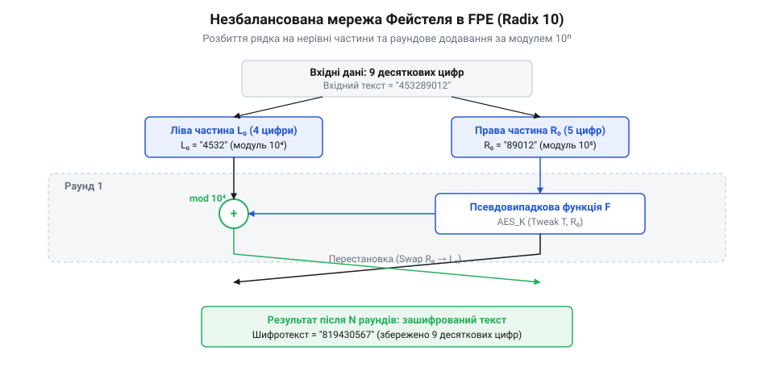
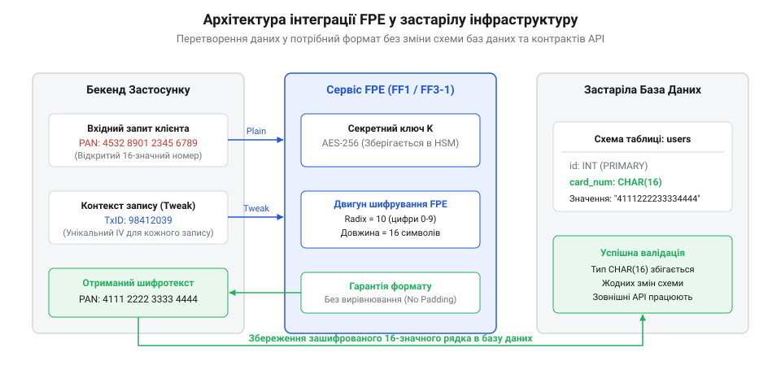

# Шифрування зі збереженням формату (FPE): режими FF1, FF3-1 та токенізація

<preknowlist>
- [Блоковий шифр](root:sf-security/block-cipher) — Принцип розбиття даних на блоки фіксованої довжини, їх шифрування одним ключем та необхідність вирівнювання (padding), що змінює довжину даних.
</preknowlist>

## Обмеження схем застарілих баз даних

Коли компанія ухвалює рішення про підвищення рівня безпеки та захист чутливих даних клієнтів, вона не починає з чистого аркуша. Найчастіше ці дані вже багато років циркулюють у великих, давно спроєктованих системах. Уявімо типову інфраструктуру банку, страхової компанії або медичної установи. В їхній базі даних зберігаються номери платіжних карток, ідентифікаційні коди або номери соціального страхування. Усі ці поля мають чітко визначену, жорстку схему. Наприклад, номер картки — це рівно шістнадцять цифр, і стовпець у базі даних (@@en|legacy database@@) може мати суворий тип `NUMERIC(16)` або `CHAR(16)`. 

Якщо розробники спробують застосувати стандартний [блоковий шифр](root:sf-security/block-cipher), такий як AES у режимі CBC або GCM, вони одразу зіткнуться з проблемою формату. Блокові шифри працюють із бітовими послідовностями і розбивають вхідний текст на блоки фіксованого розміру (наприклад, 128 біт для AES). Шістнадцять десяткових цифр займають значно менше місця, тому до них обов'язково додається вирівнювання (@@en|padding@@). Крім того, для безпечного шифрування потрібен вектор ініціалізації (IV), а для підтвердження цілісності — ще й автентифікаційний тег (MAC). У результаті 16-значний номер перетворюється на довгий бінарний масив розміром 48 байт і більше. 

Застаріла база даних, яка очікує рівно шістнадцять десяткових цифр, просто відкине цей бінарний масив під час спроби збереження, повернувши помилку невідповідності типів. Якщо ж перетворити цей масив у текст за допомогою алгоритму Base64, рядок стане ще довшим і точно не поміститься у відведені ліміти. 

Здавалося б, найпростіше рішення — змінити схему бази даних, розширивши стовпець або змінивши його тип на великий текстовий або бінарний формат. Однак у реальних корпоративних (@@en|enterprise@@) системах це часто виявляється неможливим завданням. Застаріла база може бути ядром, навколо якого збудовано десятки внутрішніх сервісів, систем аналітики, фінансової звітності та зовнішніх партнерських шлюзів. Усі ці споживачі мають власні жорсткі правила перевірки вхідних даних: наприклад, платіжне API партнера автоматично відхилить транзакцію, якщо замість очікуваних шістнадцяти цифр отримає довгий рядок Base64 або бінарний об'єкт. Тому зміна типу одного ключового поля вимагатиме не лише оновлення об'єктно-реляційних моделей (ORM) у внутрішньому коді та переписування тисяч SQL-запитів, а й невідворотного перегляду всіх контрактів даних із зовнішніми сервісами, інакше їхня вбудована валідація формату миттєво зламається. Це колосальні витрати часу й грошей, а також величезний ризик повністю зупинити роботу компанії на період багатомісячної міграції.

Таким чином, інженери постають перед вибором: залишити дані незахищеними, що загрожує витоком і порушенням стандартів безпеки, або знайти спосіб захистити їх так, щоб формат після перетворення залишався абсолютно незмінним. Саме ця потреба привела до появи спеціалізованих підходів, головними з яких стали токенізація та алгоритмічне шифрування зі збереженням формату.

## Токенізація як сховище відповідностей

Перший спосіб зберегти вихідний формат даних полягає в тому, щоб взагалі відмовитися від спроб математично зашифрувати їх "на місці". Цей підхід називається токенізацією. Ідея токенізації проста: замість того, щоб обчислювати криптографічне перетворення з оригіналу, система генерує абсолютно новий, випадковий рядок — токен, який повністю повторює формат вхідних даних, але не несе жодної корисної інформації.

Коли користувач вводить номер платіжної картки (@@en|Primary Account Number@@, PAN), цей номер надходить до єдиного, максимально ізольованого та захищеного сервісу — сховища токенів. Там система генерує випадкові шістнадцять цифр, переконуючись, що такий токен ще не використовувався. Оригінальний номер та згенерований токен записуються парами у високозахищену базу даних. Усі інші внутрішні системи банку (від аналітики до клієнтської підтримки) отримують і зберігають виключно цей токен. Оскільки токен виглядає як звичайний номер картки, жодна застаріла база даних не помічає підміни й продовжує безперебійно працювати зі звичними форматами.

На відміну від шифрування, токенізація не є математичною функцією: ви не можете взяти токен, застосувати до нього якийсь ключ і отримати реальний номер. Зв'язок між ними існує лише у вигляді табличного запису всередині сховища токенів. Коли платіжному шлюзу потрібно відправити реальний номер картки у платіжну систему, він надсилає токен до сховища і просить "детокенізувати" його — знайти відповідний запис і повернути справжній PAN. Детальніше про фундаментальні відмінності та компроміси цих підходів можна прочитати в огляді [Токенізація проти шифрування](root:sf-security/tokenization-vs-encryption).

Проте цей механізм має суттєвий недолік — він вимагає управління станом (@@en|stateful@@). Сховище токенів мусить постійно підтримувати, оновлювати й захищати гігантську таблицю відповідностей для всіх даних компанії. Зі зростанням кількості клієнтів і транзакцій ця таблиця розростається до мільярдів рядків. Сховище перетворюється на найвужче місце всієї інфраструктури: якщо воно вийде з ладу або почне працювати повільно, паралізується вся робота компанії. Більше того, розгортання таких систем у кількох географічно розподілених дата-центрах (@@en|data centers@@) вимагає складної синхронізації стану баз даних, щоб уникнути колізій і гарантувати консистентність (@@en|consistency@@). 

Щоб позбутися необхідності підтримувати гігантські бази стану та витрачати ресурси на їхню синхронізацію, криптографи розробили інший підхід. Вони створили математичний спосіб перетворення даних, який обчислює результат миттєво і незалежно від попередніх станів (@@en|stateless@@), але при цьому гарантовано зберігає формат оригіналу.

## Принцип дії збереження формату

Шифрування зі збереженням формату (@@en|Format-Preserving Encryption@@, FPE) — це сімейство алгоритмів, розроблених для того, щоб зашифрований текст належав до того ж самого домену (алфавіту та довжини), що й відкритий текст. Домен у цьому контексті визначає сукупність усіх можливих значень для конкретного формату. Якщо на вхід подається рядок із дев'яти літер англійського алфавіту, алгоритм FPE видасть рівно дев'ять літер. Якщо на вході шістнадцять десяткових цифр — на виході будуть інші шістнадцять цифр.

Відмінність FPE від токенізації в тому, що він не тримає жодних баз даних для пошуку відповідностей. Це класичний криптографічний алгоритм, який приймає на вхід дані та секретний ключ, а потім детерміновано математично перетворює їх на шифротекст. При дешифруванні з тим самим ключем виконується зворотна математична операція, відновлюючи початкові дані. Оскільки процес не зберігає жодного стану (stateless), його можна легко масштабувати, запускаючи тисячі паралельних обчислень на будь-якій кількості серверів без жодної потреби у синхронізації баз даних.

Щоб досягти збереження довжини без використання вирівнювання (padding), FPE не може працювати за звичайними принципами блокових шифрів. Замість цього алгоритм спирається на спеціальну конструкцію, відому як мережа Фейстеля, але суттєво її модифікує. Традиційна мережа Фейстеля ділить блок даних рівно навпіл і працює з бітами. У реальному житті дані часто мають непарну довжину (наприклад, дев'ять цифр) і використовують системи числення, відмінні від двійкової (наприклад, десяткову систему для цифр, алфавітно-цифрову для ідентифікаторів).

*Незбалансована мережа Фейстеля ділить символьний рядок на дві нерівні частини та пропускає їх через раунди перетворень, зберігаючи загальну кількість символів.*

Алгоритм розбиває вхідний рядок на ліву і праву частини. Якщо кількість символів непарна, одна з частин буде на один символ довшою за іншу — тому така мережа називається незбалансованою (@@en|unbalanced Feistel network@@). Далі частини проходять через серію раундів (наприклад, 10 або 12 раундів). У кожному раунді права частина пропускається через криптографічну псевдовипадкову функцію (якою зазвичай виступає той самий AES), а результат змішується з лівою частиною. 

Наприклад, якщо на вхід надходить ідентифікатор із дев'яти десяткових цифр, алгоритм розбиває його на дві нерівні частини: ліву з чотирьох цифр (значення від 0 до 9999) та праву з п'яти цифр (від 0 до 99999). У першому раунді п'ятизначна права частина передається до псевдовипадкової функції, яка генерує певне число. Це згенероване число додається до значення чотиризначної лівої частини. Щоб сума знову гарантовано помістилася в чотири знаки і не зламала вихідний формат, додавання виконується за модулем 10000, тобто 10⁴, де 10 — це кількість символів в алфавіті. Отриманий чотиризначний результат стає новою правою частиною для наступного кроку, а попередня п'ятизначна права частина без змін переходить наліво, продовжуючи незбалансоване змішування даних раунд за раундом.

Ключова відмінність FPE полягає в способі цього змішування. Замість стандартної побітової операції виключного АБО (XOR), яка працює тільки з нулями та одиницями, FPE використовує модульну арифметику над базою системи числення (@@en|radix@@). Якщо ми шифруємо цифри, використовується додавання за модулем 10. Завдяки цьому сума двох десяткових цифр завжди залишається десятковою цифрою (наприклад, 7 + 5 за модулем 10 дорівнює 2). Після змішування ліва і права частини міняються місцями, і починається наступний раунд.

Ця математична конструкція гарантує три речі. По-перше, жоден символ ніколи не вийде за межі визначеного алфавіту. По-друге, загальна кількість символів ніколи не зміниться, що ідеально підходить для строгих схем баз даних. По-третє, завдяки симетричній природі мережі Фейстеля операція гарантовано оборотна (@@en|reversible@@) незалежно від того, яка функція використовується всередині раунду. Більш детально те, як операції перестановки та підстановки адаптуються для недвійкових баз, пояснено у вставці [Мережа Фейстеля над довільними алфавітами](root:sf-security/format-preserving-encryption/math-feistel-arbitrary-alphabet.md).

## Стандарти FPE: режими FF1 та FF3-1

Коли компанія вирішує використати шифрування зі збереженням формату (FPE), розробникам не доводиться самостійно імплементувати незбалансовану мережу Фейстеля. Замість цього вони використовують готові стандартизовані алгоритми, найпоширенішими з яких є режими FF1 та FF3-1. Обидва алгоритми затверджені Національним інститутом стандартів і технологій США (NIST) і використовують [блоковий шифр](root:sf-security/block-cipher) AES як внутрішню псевдовипадкову функцію, проте відрізняються підходом до безпеки та продуктивності.

Щоб зрозуміти, чому сьогодні існують саме ці два стандарти, варто поглянути на те, як виникла необхідність у їхньому створенні. У 2016 році NIST випустив публікацію SP 800-38G, яка офіційно затвердила два режими: FF1 та FF3. Їхня поява була відповіддю на нагальну потребу індустрії в інструменті для захисту даних у застарілих базах даних, які не могли вмістити стандартні розширені блоки шифротексту. Однак згодом криптоаналітики виявили теоретичні вразливості в структурі FF3, які дозволяли зловмисникам значно швидше відновити вихідний текст за певних умов. Через це NIST відкликав алгоритм FF3 і замінив його оновленою, безпечнішою версією — FF3-1, яка виправила знайдений недолік за рахунок зміни розміру вектора налаштування.

Режим FF1 вважається найбільш консервативним і надійним вибором. Він використовує десять раундів мережі Фейстеля, що забезпечує високий запас криптографічної міцності, але робить алгоритм дещо повільнішим в обчисленнях. Натомість FF3-1 оптимізований для максимальної продуктивності: він працює лише за вісім раундів. Менша кількість раундів пришвидшує обробку мільйонів транзакцій у реальному часі, але вимагає від розробників більшої уважності під час оцінки ризиків. Зазвичай вибір між ними зводиться до архітектурного балансу: якщо пріоритетом є максимальна безпека, архітектори обирають FF1; якщо критичною є швидкість на гігантських обсягах даних — FF3-1.

Програмний інтерфейс виклику цих функцій у типових криптографічних бібліотеках є майже ідентичним. Розробник має передати функції шифрування чотири ключові параметри: секретний ключ, вектор налаштування (@@en|tweak@@), основу алфавіту (@@en|radix@@) та сам вхідний текст. Секретний ключ гарантує стійкість алгоритму; вектор налаштування працює подібно до вектора ініціалізації (IV) і гарантує, що два однакові номери карток будуть зашифровані по-різному; основа алфавіту вказує на кількість можливих символів (наприклад, 10 для цифр). Розуміння цих параметрів дозволяє правильно конфігурувати FPE для будь-якого типу даних, чи то цифри, чи латинські букви.

## Інтеграція та робота з даними

Впровадження FPE або токенізації в реальний проєкт виходить за межі простого виклику криптографічної функції. Щойно архітектори починають замінювати реальні дані на їхні зашифровані аналоги, вони стикаються з викликом маршрутизації та обробки логіки. Застарілі системи тепер отримуватимуть зашифрований текст, і бекенд повинен безпомилково розрізняти, коли перед ним відкриті дані, які треба підготувати до збереження, а коли — вже перетворені.

*Архітектура показує, як дані проходять через захищений сервіс перетворення перед потраплянням до застарілої бази даних, гарантуючи, що база отримує інформацію лише у правильному форматі.*

Найбільша складність інтеграції FPE полягає в управлінні вектором налаштування (@@en|tweak@@). Як і у випадку з [потоковими шифрами](root:sf-security/stream-cipher) чи звичайними блоковими, щоб дешифрувати дані, системі потрібен рівно той самий вектор налаштування, з яким вони були зашифровані. Але оскільки ми використовуємо FPE саме для того, щоб не змінювати схему бази даних, ми не можемо просто додати новий стовпець. Тому на практиці в ролі вектора налаштування використовують інші існуючі метадані запису, які завжди доступні: наприклад, незмінний ідентифікатор транзакції, унікальний ідентифікатор користувача або навіть мітку часу створення запису. Такий підхід дозволяє обчислювати вектор налаштування прямо в коді перед виконанням запиту.

Ще один вагомий практичний аспект — це часткове маскування. Бізнес-процеси часто вимагають залишати частину даних відкритою. Наприклад, щоб оператор кол-центру міг ідентифікувати клієнта, йому потрібні перші шість та останні чотири цифри платіжної картки. FPE дозволяє налаштувати шифрування так, щоб воно перетворювало лише центральні шість цифр, залишаючи краї незмінними. 

При цьому виникає вимога до валідації. Більшість фінансових ідентифікаторів мають вбудовану контрольну суму, яка розраховується математично, найчастіше через [Алгоритм Луна](root:sf-algorithms/luhn-algorithm). Якщо система просто зашифрує всі цифри, фінальний результат не пройде перевірку на стороні бази даних, і транзакцію буде відхилено. Детально про те, як правильно впровадити шифрування без порушення вбудованої валідності, описано у прикладі [Маскування та шифрування платіжних карток з FPE](root:sf-security/format-preserving-encryption/proj-fpe-cc-masking.md). 

Завдяки правильному підбору алгоритму (FF1 чи FF3-1) та продуманій архітектурі обробки вектора налаштування, компанія може виконати жорсткі вимоги безпеки і зберегти повну працездатність своїх застарілих баз даних.