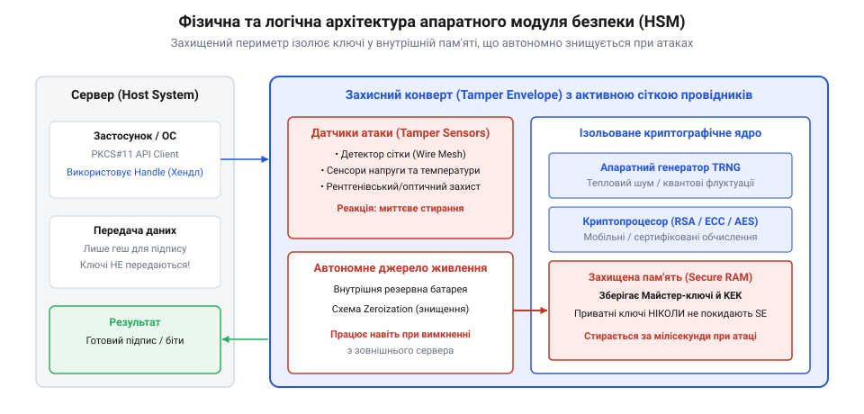
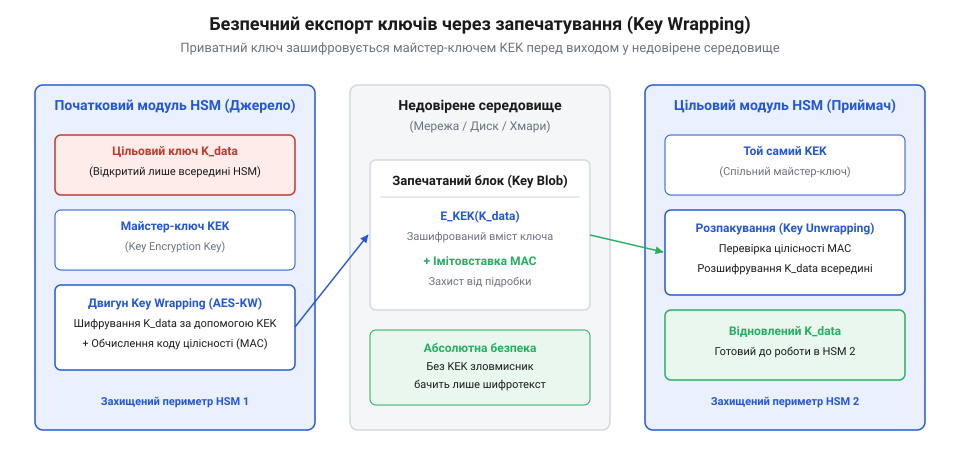

# Апаратні модулі безпеки (HSM): архітектура, запечатування ключів та фізичний конверт

<preknowlist>
- [TPM: апаратний корінь довіри й запечатування ключів](root:sf-security/tpm-root-of-trust) — Поняття апаратного кореня довіри та запечатування, що допоможе зрозуміти різницю масштабів захисту.
- [PKCS#11: стандартний інтерфейс криптографічних модулів Cryptoki](root:sf-security/pkcs-11) — Загальна концепція програмного інтерфейсу для взаємодії з токенами та криптографічними модулями.
</preknowlist>

## Вразливість криптографічних ключів у пам'яті

Коли криптографічний ключ зберігається на звичайному сервері, він неминуче потрапляє в оперативну пам'ять у розшифрованому вигляді під час виконання операцій шифрування чи підпису. Операційна система загального призначення керує цією пам'яттю, постійно виділяючи та звільняючи сторінки, а іноді й скидаючи їх на диск у файл підкачки. Якщо зловмисник отримує доступ до сервера — через експлойт у вебдодатку або шкідливе програмне забезпечення — він може прочитати вміст пам'яті та знайти там відкритий ключ.

Ця вразливість не обмежується лише логічним доступом. Навіть якщо програмна оболонка надійно захищена, залишається ризик фізичного втручання. Під час так званої атаки холодного завантаження (@@en|cold boot attack@@) зловмисник охолоджує мікросхеми оперативної пам'яті сервера, виймає їх та зчитує залишковий заряд, який зберігає інформацію ще кілька хвилин після вимкнення живлення. Усі ключі, паролі та сертифікати, що перебували в пам'яті, стають відомими нападнику. Крім того, ключ у пам'яті може бути викрадений через прямий доступ апаратних пристроїв до оперативної пам'яті (@@en|DMA attack@@).

З цього випливає фундаментальна проблема: програмне середовище не здатне забезпечити абсолютну ізоляцію секретних даних. Щоб справді захистити ключ, потрібен підхід, за якого він ніколи не потрапляє у відкритому вигляді до пам'яті сервера чи операційної системи. Історично потреба в такому надійному захисті виникла ще на зорі електронних платежів, і про цю історію можна дізнатися через [еволюцію апаратних модулів безпеки](root:sf-security/hardware-security-module/hist-hsm-evolution.md).

## Апаратна ізоляція та фізичний конверт

Апаратний модуль безпеки (@@en|Hardware Security Module, HSM@@) вирішує проблему витоку даних завдяки повній ізоляції криптографічних операцій. Це окремий фізичний пристрій або плата розширення, яка має власний процесор, власну пам'ять і власну захищену операційну систему. Коли серверу потрібно підписати документ чи розшифрувати повідомлення, він не завантажує ключ до себе. Натомість сервер відправляє дані всередину HSM, модуль виконує математичну операцію у своїй ізольованій пам'яті й повертає серверу лише готовий результат. Концептуально це схоже на те, як функціонує [апаратний корінь довіри й запечатування ключів](root:sf-security/tpm-root-of-trust) на звичайних комп'ютерах, проте HSM забезпечує значно вищий рівень фізичної стійкості. Закритий ключ при цьому ніколи не перетинає межі модуля.

*Архітектура модуля чітко розмежовує зовнішній інтерфейс і внутрішнє середовище, де всі обчислення відбуваються під захистом сенсорів.*

Логічної ізоляції недостатньо, якщо зловмисник може розібрати пристрій і підключитися до мікросхем. Тому плата HSM поміщається у спеціальний фізичний конверт (@@en|tamper envelope@@), пронизаний густою сіткою провідників, що безперервно проводить струм. Ця сітка утворює активний захист від втручання (@@en|tamper response@@). Будь-яка спроба просвердлити корпус, зняти кришку чи розчинити епоксидну смолу кислотою неминуче розірве або замкне один із провідників.

Фізичний захист неодмінно доповнюється строгим контролем програмного середовища ще до того, як модуль почне обробляти ключі. Кожне включення пристрою починається з процедури [безпечного завантаження](root:sf-security/firmware-secure-boot) (@@en|secure boot@@), яка перевіряє цілісність прошивки самого HSM. Якщо зловмисник спробує непомітно оновити внутрішню операційну систему на модифіковану версію з бекдором, базовий завантажувач виявить недійсний цифровий підпис і повністю заблокує старт. Завдяки цьому апаратна ізоляція гарантує, що всередині конверта працює виключно довірений та сертифікований виробником код.

Крім того, модуль містить набір чутливих датчиків, які контролюють температуру, напругу живлення та рентгенівське випромінювання. Зловмисники часто намагаються заморозити чип для сповільнення стирання пам'яті або подати нестандартну напругу, щоб викликати помилку обчислень (@@en|fault injection@@). Аби захист діяв безперервно, датчики та пам'ять із ключами живляться від спеціальної внутрішньої батареї, що робить їх незалежними від основного джерела струму сервера. Як тільки будь-який датчик фіксує відхилення від норми або пошкодження сітки, апаратний модуль миттєво розриває коло живлення цієї пам'яті (@@en|zeroization@@), і всі ключі безповоротно стираються за долі секунди. Завдяки автономній батареї пристрій здатен виявити атаку та знищити дані навіть будучи повністю витягнутим із сервера, перетворюючись на марний шматок пластику та металу й надійно ховаючи секрети від нападника.

## Абсолютна довіра через внутрішню генерацію

Уявіть ситуацію: ви купуєте наднадійний сейф для зберігання діамантів, але код від нього вам диктує по телефону незнайомець. Навіть якщо сейф витримає ядерний вибух, вся його надійність зводиться до нуля через те, що хтось інший знає код. Те саме відбувається з криптографією: найслабшою ланкою завжди є процес створення ключа та його переміщення. Якщо ключ створено на звичайному комп'ютері або сервері, він з першої ж секунди свого існування є вразливим. У пам'яті сервера його можуть перехопити віруси, зчитати адміністратори або скопіювати шкідливі програми. Цю проблему "первородного гріха" імпортованих ключів вирішує фундаментальна концепція апаратних модулів — @@en|On-Board Key Generation@@ (генерація ключів безпосередньо на борту).

Справжній секрет надійності полягає в тому, що приватний ключ зароджується всередині захищеного чипа і **ніколи**, за жодних обставин, не залишає його меж у відкритому вигляді. 

### Випадковість, яку неможливо передбачити

Щоб створити стійкий криптографічний ключ, потрібна абсолютна випадковість. Звичайні комп'ютери використовують генератори псевдовипадкових чисел (@@en|PRNG@@, Pseudo-Random Number Generators). Вони створюють послідовності на основі математичних алгоритмів і початкового числа (@@en|seed@@). Якщо зловмисник знає алгоритм і це число, він може відтворити всю послідовність і вирахувати ключ.

HSM працюють принципово інакше. Вони оснащені апаратними генераторами справжніх випадкових чисел (@@en|TRNG@@, True Random Number Generators). Ці компоненти збирають ентропію (невизначеність) з непередбачуваних фізичних процесів. Це може бути тепловий шум у напівпровідниках, квантові флуктуації, дрижання тактового генератора (@@en|clock jitter@@) або радіоактивний розпад. Таку випадковість неможливо розрахувати, змоделювати чи відтворити двічі. Коли HSM генерує ключ, він використовує цю сиру, хаотичну фізичну енергію, гарантуючи, що ключ є унікальним у масштабах всього Всесвіту.

### Життя за ґратами: як сервер працює з ключем

Виникає логічне питання: якщо серверу потрібно підписати транзакцію або розшифрувати дані, а ключ не можна діставати з HSM, як вони взаємодіють? 

Тут вступає в дію механізм криптографічних вказівників, або хендлів (@@en|handle@@). Процес виглядає так:
1. Застосунок на сервері відправляє до HSM команду: "Згенеруй нову пару ключів (RSA або ECC)". 2. HSM створює ключі у своєму захищеному середовищі за допомогою TRNG. 3. Відкритий (публічний) ключ HSM віддає серверу, адже він не є секретом. 4. Приватний ключ залишається надійно замкненим у пам'яті HSM. 5. Замість приватного ключа сервер отримує лише **хендл** — унікальний ідентифікатор, який вказує на цей ключ всередині модуля (наприклад, номер "Ключ №42").

Відтепер, коли серверу потрібно створити цифровий підпис, він не бере ключ до себе. Він бере геш документа і відправляє його до HSM з командою: "Підпиши цей геш за допомогою Ключа №42". HSM знаходить цей ключ у своїй пам'яті, виконує складну математичну операцію підпису на своєму власному процесорі і повертає серверу вже готовий результат — цифровий підпис. 

Завдяки такій архітектурі, навіть якщо хакери отримають повний root-доступ до сервера, зроблять дамп пам'яті або фізично винесуть сервер із дата-центру, вони знайдуть там лише документи та "номерки" (хендли), але не самі приватні ключі. Ваші найцінніші секрети залишаються недоторканими в броньованій фортеці.

## Безпечний експорт через запечатування ключів

Ізоляція ключа всередині апаратного модуля створює нову проблему: як відновити роботу системи, якщо пристрій вийде з ладу? Якщо згенерований ключ назавжди замикається в одному криптопроцесорі, його фізична поломка призведе до безповоротної втрати всіх зашифрованих даних. Тому виникає потреба в механізмі безпечного експорту та резервного копіювання секретів. HSM дозволяє мігрувати ключі між кількома довіреними пристроями, але робить це без розкриття їхнього відкритого значення.

Цей процес називається запечатуванням ключів (@@en|Key Wrapping@@). Його суть полягає в тому, що перед експортом цільовий ключ шифрується іншим, спеціально призначеним майстер-ключем (@@en|Key Encryption Key, KEK@@). У результаті утворюється криптографічний контейнер (@@en|Key Blob@@), який можна безпечно передавати через недовірені мережі або зберігати на звичайному жорсткому диску як резервну копію.

*Конфіденційні дані покидають захищений периметр виключно як зашифрований блок, який неможливо прочитати без відповідного ключа розпаковування.*

Щоб відновити ключ на іншому апаратному модулі, туди спершу має бути безпечно доставлений симетричний майстер-ключ. Після цього другий модуль імпортує запечатаний блок, розшифровує його всередині свого ізольованого середовища і відразу переводить у робочий стан. Детальний принцип, за яким алгоритми забезпечують цілісність під час цього процесу, розкриває [математика запечатування ключів](root:sf-security/hardware-security-module/math-key-wrapping.md). 

Оскільки майстер-ключ сам по собі є критичною точкою відмови, його ніколи не довіряють одній людині чи одній системі. Для його захисту застосовують схеми розділення секрету, коли KEK розбивається на кілька частин і записується на смарт-картки. Щоб імпортувати майстер-ключ у новий пристрій, потрібен кворум адміністраторів (наприклад, будь-які троє з п'яти), які одночасно вставлять свої смарт-картки в HSM. Завдяки такому підходу архітектори зберігають необхідний баланс між жорсткою ізоляцією та експлуатаційною відмовостійкістю.

## Сертифікація безпеки та стандартні інтерфейси

Для впровадження апаратних модулів у корпоративну інфраструктуру інженерам необхідно мати чіткі критерії надійності пристрою та стандартні способи взаємодії з ним. Оцінка рівня захищеності HSM спирається на міжнародні [стандарти криптографічної безпеки FIPS 140](root:sf-security/fips-140-standards). Ця серія стандартів (зокрема, FIPS 140-2 та оновлений FIPS 140-3) визначає чотири рівні безпеки. Наприклад, другий рівень вимагає лише індикації втручання, тоді як третій та четвертий рівні обов'язково передбачають наявність фізичного конверта з механізмом миттєвого стирання ключів при виявленні атаки.

Визначившись із рівнем захисту, розробники потребують універсального способу відправляти криптографічні команди до HSM, незалежно від конкретного виробника обладнання. Найбільш поширеним рішенням є програмний інтерфейс PKCS#11, також відомий як @@en|Cryptoki@@. Цей C-подібний API розглядає будь-який криптографічний модуль як логічний токен зі слотами. Програміст використовує базові виклики, такі як `C_Initialize` для запуску бібліотеки, `C_Login` для автентифікації та `C_GenerateKey` для запиту генерації нового ключа на борту. Це дозволяє писати код, який стандартизовано перекладає математичні завдання на плечі апаратного процесора.

Один фізичний HSM зазвичай коштує дуже дорого, тому його ресурси розподіляють між кількома додатками або віртуальними машинами. Завдяки концепції логічних слотів у PKCS#11 або апаратним партиціям (@@en|partitions@@), модуль здатний повністю ізолювати ключі одного клієнта від іншого. Кожен додаток автентифікується у своєму незалежному розділі та отримує доступ лише до власних секретів, ніби він працює з окремим фізичним пристроєм. Для тестування такого коду та відлагодження взаємодії без доступу до фізичного обладнання інженери часто налаштовують [емуляцію HSM за допомогою SoftHSM](root:sf-security/hardware-security-module/proj-softhsm-pkcs11.md).

У масштабних корпоративних середовищах, де кількість ключів і пристроїв вимірюється тисячами, прямих викликів API стає недостатньо. Для централізованого управління життєвим циклом секретів — від генерації до відкликання — розгортають системи на базі [протоколу управління ключами KMIP](root:sf-security/kmip-protocol). У результаті стандартизація інтерфейсів та сувора сертифікація за стандартами FIPS дозволяють будувати надійні, керовані та апаратно захищені інфраструктури відкритого ключа (@@en|PKI@@).