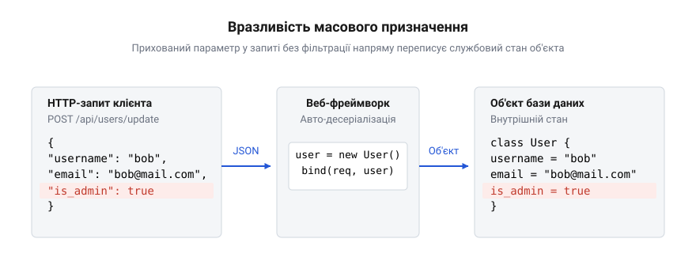
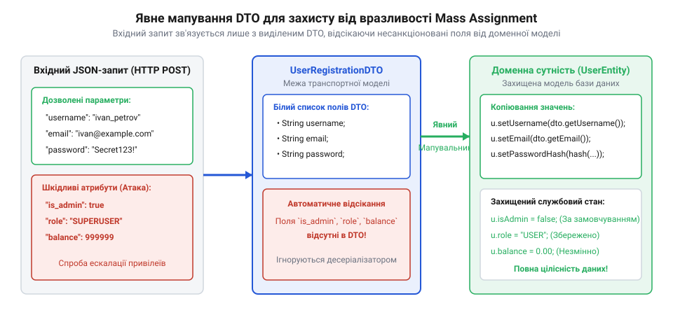

# Вразливість масового призначення

<preknowlist>
- [Вразливість = зламана межа](root:sf-security/web-vulnerability-classes) — Поняття периметра та концепція того, що відсутність ізоляції недовіреного введення призводить до протікання шарів.
</preknowlist>

## Небезпека сліпого збереження даних

Уявімо звичайний процес оновлення профілю користувача у веб-застосунку. Клієнтський застосунок надсилає на сервер JSON-документ із новими значеннями імені та адреси електронної пошти. Сервер приймає цей документ, перетворює його на об'єкт і зберігає в базу даних. Цей потік виглядає цілком природним і безпечним, доки клієнт надсилає лише очікувані дані. Проте зловмисник може перехопити запит і додати до нього непередбачене поле, наприклад `"is_admin": true` або `"role": "superuser"`.

Якщо сервер не перевіряє явно кожен вхідний параметр, він сліпо скопіює це нове поле у свій внутрішній стан. Фізично це відбувається дуже просто: зловмисник перехоплює легітимний запит від власного браузера і вручну редагує його текстове тіло, дописуючи потрібний JSON-ключ перед остаточною відправкою мережею. Об'єкт користувача, який мав би змінити лише ім'я, через таку пряму модифікацію тексту раптом отримує найвищі адміністративні привілеї. Серверна логіка не помічає підміни, оскільки вона просто бере всі передані властивості та переносить їх у модель даних у пам'яті. Усі обмеження, які розробник тримав у голові, не реалізовані в коді, тому система покірно виконує відредаговані інструкції клієнта.

Ця проблема виникає через те, що застосунок довіряє вхідним даним і не контролює межу між зовнішнім запитом та внутрішньою пам'яттю. Відсутність жорсткої ізоляції недовіреного введення призводить до протікання шарів, що є фундаментальною причиною багатьох атак (докладніше про порушення контракту між шарами див. [Вразливість = зламана межа](root:sf-security/web-vulnerability-classes)). Зловмисник отримує можливість перезаписувати службові поля, до яких він не повинен мати доступу з боку публічної мережі. Такий тип атаки називають вразливістю масового призначення (від англ. @@en|mass assignment@@, де *mass* — масове або множинне, а *assignment* — призначення чи присвоєння значень).

Щоб зрозуміти, чому сервери взагалі приймають такі непередбачені поля замість того, щоб їх відхиляти, необхідно поглянути на механізми, якими сучасні веб-фреймворки обробляють HTTP-запити.

## Механізм автоматичного зв'язування

Сучасні веб-фреймворки створюються для того, щоб максимально пришвидшити розробку та зняти з програміста рутинні завдання. Одним із таких завдань є розбір вхідного тексту (зазвичай у форматі JSON або параметрів URL-форми) та перенесення його у строго типізовані змінні застосунку. Замість того, щоб вручну читати кожне поле з HTTP-запиту, перевіряти його наявність і присвоювати відповідній властивості об'єкта, розробники використовують механізм автоматичного зв'язування (від англ. @@en|auto-binding@@ або @@en|model binding@@).

Цей механізм працює дуже просто. Фреймворк аналізує структуру вхідного запиту, знаходить відповідний клас або структуру в коді програми, створює новий екземпляр цього класу і динамічно копіює туди всі значення, імена яких збігаються. Якщо у класі `User` є поля `firstName` та `lastName`, і в JSON прийшли ключі з такими ж іменами, фреймворк автоматично заповнить ці поля. Розробник отримує готовий до використання об'єкт буквально в один рядок коду контролера. Це дозволяє зосередитися на бізнес-логіці, а не на парсингу рядків.

Така автоматизація значно зменшує кількість шаблонного коду. Програмісту більше не потрібно писати десятки рядків для перекладання даних із запиту в пам'ять. Проте саме тут приховується глибока архітектурна пастка. Фреймворк виконує зв'язування механічно і сліпо, керуючись лише збігом імен властивостей. Він не знає контексту застосунку і не розрізняє публічні поля, які користувач має право змінювати, від службових полів, які повинна контролювати лише сама система. Якщо в класі `User` є службове поле `passwordHash` або `isAdmin`, а зловмисник надішле їх у запиті, механізм автоматичного зв'язування слухняно їх заповнить даними ззовні.

Автоматичне зв'язування фактично стирає межу між транспортним шаром, який приймає дані з мережі, та доменним шаром, який інкапсулює бізнес-правила. Коли ці шари зливаються, будь-яка внутрішня властивість моделі стає потенційною мішенню. Корисна автоматизація перетворюється на діру в безпеці, відкриваючи прямий шлях для ін'єкції несанкціонованого стану безпосередньо в ядро застосунку. Цей вектор атаки стає особливо небезпечним, коли модель прийому даних повністю збігається з моделлю збереження в базу даних.

## Ескалація привілеїв через переповнення

Вразливість масового призначення досягає свого критичного масштабу, коли автоматично зв'язаний об'єкт одразу передається до механізму збереження. У багатьох застосунках розробники використовують одну й ту саму сутність бази даних і для представлення таблиці, і для прийому даних від клієнта. Ця практика часто заохочується базовими навчальними матеріалами та прагненням не дублювати код. Розробник створює єдиний клас `User`, який стає універсальним контейнером для даних на всіх рівнях системи. 

Щоб змусити цей клас працювати у різних контекстах, розробник обвішує його різними анотаціями. З одного боку, він додає метадані системи об'єктно-реляційного відображення (ORM), такі як `@Entity` чи `@Table`, які вказують, як зберігати об'єкт у базі. З іншого боку, він додає анотації веб-маршрутизатора або десеріалізатора, наприклад `@JsonProperty`, щоб приймати ці дані безпосередньо з мережі. У результаті одна структура одночасно визначає і контракт мережевого API, і жорстку схему зберігання на диску. Саме це перевантаження ролей остаточно стирає межі та робить об'єкт вразливим. Недовірений HTTP-запит безпосередньо формує стан сутності, яка наступної миті буде записана на жорсткий диск сервера.

Коли зловмисник знаходить таку кінцеву точку API, він починає експериментувати з тілом запиту. Він не завжди діє наосліп. Часто він може отримати інший об'єкт користувача через стандартний GET-запит і побачити повну структуру JSON, яку повертає сервер. Якщо у відповіді є поле `role: "user"`, зловмисник точно розуміє, що це поле існує в моделі. Він надсилає звичайний запит на оновлення профілю, але додає туди нові ключі, намагаючись змінити ці службові колонки. Навіть без підказки ці імена часто є типовими і легко вгадуються: `role`, `permissions`, `is_admin`, `balance` або `account_status`. 

Якщо розробник не передбачив явної фільтрації, фреймворк бачить збіг імен у JSON та класі. Він механічно приймає ці поля через @@en|auto-binding@@ і переносить їх у внутрішню сутність. Після цього настає черга ORM. Сучасні ORM-фреймворки використовують механізм відстеження змін у пам'яті. Коли десеріалізатор присвоює значення `is_admin = true`, ORM фіксує, що ця властивість змінилася порівняно з оригінальним станом. Коли контролер викликає метод збереження, ORM слухняно генерує SQL-запит на оновлення, який автоматично включає всі змінені поля. Службові дані, ін'єктовані клієнтом, назавжди закріплюються в базі.

*HTTP-запит із прихованим полем `is_admin: true` минає логіку контролера і через механізм автоматичного зв'язування безпосередньо перезаписує привілеї користувача у базі даних.*

Наслідки такої експлуатації найчастіше призводять до повної ескалації привілеїв. Звичайний користувач непомітно перетворює свій обліковий запис на адміністративний, після чого отримує доступ до всіх закритих функцій системи. Проте ескалація — не єдиний ризик. Атака дозволяє повністю перехопити контроль над обліковим записом, якщо зловмисник надішле поле `password_reset_token` із відомим йому значенням і потім змінить пароль. В інших випадках вона дозволяє змінити власника чужого ресурсу, перепризначивши ідентифікатор `user_id` у записі бази даних. У фінансових системах так можна штучно збільшити свій грошовий баланс, надіславши поле `credit_amount`. Зловмиснику не потрібно шукати складні помилки в бізнес-логіці чи обходити криптографію — він просто користується тим, що сервер через спільну модель сам пропонує змінити будь-який свій параметр.

Ця проблема не є суто теоретичною і вражала навіть найбільші світові платформи. У 2012 році стався гучний злам платформи GitHub, який яскраво продемонстрував небезпеку масового призначення в популярному тоді фреймворку Ruby on Rails. Зловмисник скористався тим, що функція оновлення профілю приймала будь-які параметри і прямо прив'язувала їх до внутрішньої моделі користувача. Додавши до свого запиту масив із чужим відкритим SSH-ключем, хакер змусив систему зберегти цей ключ в обліковому записі адміністратора організації. Відсутність захисту в механізмах автоматичного мапінгу дозволила йому миттєво отримати повний несанкціонований доступ до внутрішніх репозиторіїв GitHub. Цей інцидент змусив усю індустрію докорінно переглянути підходи до обробки вхідних параметрів.

Експлуатація масового призначення можлива в будь-якому середовищі, яке підтримує автоматичну десеріалізацію вхідних структур. Механізми фреймворків працюють однаково незалежно від мови програмування. Реальний механізм такої атаки, процес переповнення моделі та базові способи її усунення в екосистемі Node.js можна розглянути на прикладі розробки [Експлуатація та виправлення Mass Assignment в Express.js](root:sf-security/mass-assignment-vulnerability/proj-express-mass-assignment.md). Проте, щоб гарантовано закрити цей клас вразливостей на фундаментальному рівні, архітектура застосунку повинна відмовитися від використання зручних спільних моделей для мережі та бази даних, запровадивши жорстку фізичну ізоляцію шарів.

## Ізоляція за допомогою DTO

Фундаментальним способом усунення вразливості масового призначення є встановлення жорсткої архітектурної межі між тим, що система приймає ззовні, і тим, що вона зберігає всередині. Коли застосунок використовує єдину модель для обох задач, зловмисник отримує прямий доступ до внутрішнього стану бази даних. Щоб розірвати цей прямий зв'язок, необхідно запровадити проміжний шар об'єктів. Цей підхід реалізується через [Патерн Data Transfer Object (DTO)](root:sf-apps/dto).

Об'єкт передавання даних (від англ. @@en|Data Transfer Object@@) — це проста структура, яка призначена виключно для транспортування інформації між зовнішньою мережею та внутрішнім контролером. Замість того, щоб десеріалізувати вхідний HTTP-запит безпосередньо у сутність `User`, розробник створює окремий ізольований клас `UserUpdateRequestDto`. Цей клас містить лише ті поля, які клієнту дозволено змінювати, наприклад `firstName` та `email`. Важливі системні поля на кшталт `isAdmin`, `role` або `balance` у цьому DTO просто відсутні.

Коли фреймворк виконує автоматичне зв'язування, він працює лише з визначеним класом `UserUpdateRequestDto`. Якщо зловмисник спробує додати в JSON приховане поле `isAdmin`, механізм мапінгу не знайде відповідної властивості у транспортному об'єкті. Фреймворк просто проігнорує зайвий параметр, не зберігши його в пам'ять. Таким чином, небажані дані фізично відкидаються ще на етапі прийому запиту, до того як вони зможуть вплинути на бізнес-логіку. Після цього контролер бере безпечний об'єкт DTO, знаходить справжню сутність `User` у базі даних і копіює туди лише дозволені значення.

*Зовнішній запит десеріалізується у транспортний об'єкт, який відсікає всі непередбачені поля до того, як дані досягнуть бізнес-логіки.*

Цей процес називається явним мапінгом (від англ. @@en|explicit mapping@@). Він гарантує, що жодна властивість бази даних не зміниться випадково або під впливом зловмисника. Межа між транспортним і доменним шарами стає абсолютно непроникною для несанкціонованих параметрів. Детальний приклад реалізації такого архітектурного розділення можна розглянути у розробці [Безпечний мапінг моделей у ASP.NET](root:sf-security/mass-assignment-vulnerability/proj-dotnet-dto-mapping.md). Запровадження об'єктів передавання даних є найнадійнішим способом захисту, оскільки безпека гарантується самою структурою типів системи, а не ручними перевірками в коді. Проте, у великих або застарілих застосунках перехід на таку архітектуру може вимагати значного рефакторингу, тому існують і альтернативні методи захисту.

## Білі списки та Strong Parameters

У ситуаціях, коли архітектура застосунку вже побудована на прямій передачі параметрів у моделі бази даних, розробники використовують механізми фільтрації безпосередньо на рівні контролерів. Замість того, щоб створювати окремі транспортні класи DTO для кожного запиту, вони встановлюють чіткі правила для того, які саме вхідні ключі дозволено приймати. Цей підхід називається стратегією білого списку (від англ. @@en|whitelisting@@).

Стратегія білого списку полягає в тому, що система відкидає всі вхідні параметри за замовчуванням і пропускає далі лише ті, які явно вказані розробником як безпечні. Протилежний підхід — чорний список (від англ. @@en|blacklisting@@), коли система забороняє лише певні відомі поля на кшталт `isAdmin`, є вкрай ненадійним. Зловмисник завжди може знайти інше критичне поле, про яке розробник забув згадати, або використати нове поле, що з'явилося після оновлення схеми бази даних. Тому безпечною в індустрії вважається лише політика дозволу на основі вичерпного переліку очікуваних ключів.

Однією з найвідоміших реалізацій білого списку є підхід сильних параметрів (від англ. @@en|Strong Parameters@@). Цей механізм змушує програміста прямо в коді контролера вказати, які ключі з HTTP-запиту можна безпечно використовувати для мапінгу моделі. Якщо клієнт надсилає об'єкт `user` із полями `name`, `email` та прихованим службовим полем `role`, функція сильних параметрів витягне з нього лише `name` та `email`. Поле `role` буде повністю проігноровано системою. Тільки після цієї процедури відфільтрований словник значень передається механізму автоматичного зв'язування для оновлення сутності.

Застосування Strong Parameters дозволяє розробникам швидко закрити вразливість масового призначення без глибокого архітектурного рефакторингу всього проекту. Програмісту не потрібно створювати додаткові дзеркальні класи транспортного шару, достатньо лише описати масив дозволених ключів для кожної дії контролера. Це робить такий підхід надзвичайно популярним в екосистемах, що цінують швидкість розробки, зокрема у веб-фреймворках Ruby on Rails та Laravel. Завдяки явному визначенню дозволених полів, застосунок успішно відновлює контроль над межею довіри та надійно блокує будь-які спроби несанкціонованої ескалації привілеїв.