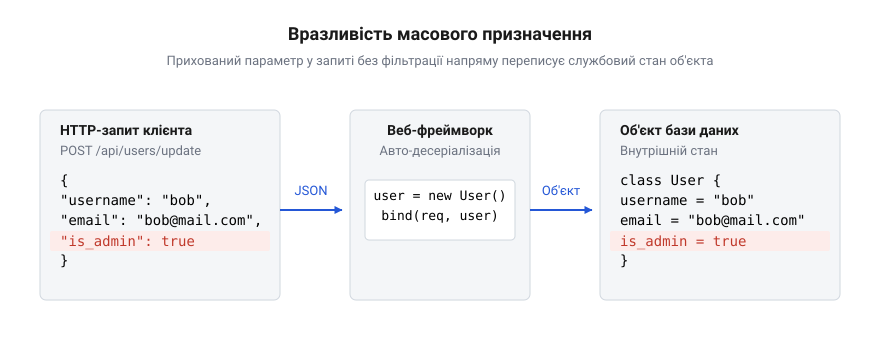

# Вразливість масового призначення

<preknowlist>
- [Вразливість = зламана межа](root:sf-security/web-vulnerability-classes) — Поняття периметра та концепція того, що відсутність ізоляції недовіреного введення призводить до протікання шарів.
</preknowlist>

## Небезпека сліпого збереження

Уявімо звичайний процес оновлення профілю користувача. Клієнтський застосунок надсилає на сервер документ із новими значеннями імені та адреси електронної пошти. Сервер приймає цей документ і зберігає оновлені дані в базу. Цей процес безпечний лише доти, доки клієнт надсилає очікувані дані. Проте зловмисник може перехопити свій власний запит і дописати до нього непередбачене поле, наприклад `"isAdmin": true`. 

Якщо застосунок не перевіряє явно кожен вхідний параметр, він сліпо скопіює це нове поле у свій внутрішній стан. Об'єкт, який мав би змінити лише ім'я, раптом отримує адміністративні привілеї. Серверна логіка не помічає підміни, оскільки просто бере всі передані властивості та переносить їх у пам'ять. 

Ця проблема виникає через те, що застосунок повністю довіряє вхідним даним і не контролює межу між зовнішнім запитом та внутрішнім станом системи (докладніше про порушення ізоляції див. [Вразливість = зламана межа](root:sf-security/web-vulnerability-classes)). Зловмисник отримує можливість перезаписувати службові поля, до яких він не повинен мати доступу. Цей тип атаки називають вразливістю масового призначення (від англ. @@en|mass assignment@@).

## Механізм автоматичного зв'язування

Сучасні веб-фреймворки створені так, щоб зняти з розробника рутинні завдання. Одним із таких завдань є розбір вхідного тексту та перенесення його у змінні програми. Замість ручного читання кожного поля програмісти використовують механізм автоматичного зв'язування (від англ. @@en|auto-binding@@).

Цей механізм працює просто: фреймворк аналізує запит, знаходить відповідний об'єкт у коді і динамічно копіює туди всі значення, імена яких збігаються. Проте тут приховується пастка. Фреймворк виконує зв'язування механічно і сліпо. Він не розрізняє публічні поля, які користувач має право змінювати, від службових полів бази даних. Якщо зловмисник надішле службові поля у запиті, механізм слухняно їх заповнить.

*HTTP-запит із прихованим полем минає логіку контролера і через механізм автоматичного зв'язування безпосередньо перезаписує привілеї у базі.*

Автоматичне зв'язування стирає межу між мережевим шаром та бізнес-правилами. Корисна автоматизація перетворюється на діру в безпеці, особливо коли об'єкт для прийому даних повністю збігається з об'єктом бази даних.

## Захист через жорстку ізоляцію

Єдиний надійний спосіб усунути вразливість масового призначення — встановити жорстку межу між тим, що система приймає ззовні, і тим, що вона зберігає. Щоб розірвати прямий зв'язок, запроваджують проміжний транспортний об'єкт (від англ. @@en|Data Transfer Object@@).

Цей об'єкт містить лише ті поля, які клієнту дозволено змінювати. Важливі системні поля в ньому просто відсутні. Коли фреймворк виконує автоматичне зв'язування, він працює лише з цим транспортним об'язком. Якщо зловмисник додасть приховане поле, фреймворк його проігнорує, оскільки такого поля у проміжному об'єкті немає. Лише після цього контролер копіює дозволені значення у справжню сутність бази даних.

У системах, де важко ввести нові транспортні об'єкти, використовують фільтрацію безпосередньо на рівні контролерів. Цей підхід називається стратегією білого списку (від англ. @@en|whitelisting@@). Система відкидає всі вхідні параметри за замовчуванням і пропускає лише ті, які явно вказані розробником як безпечні. 

Головне правило безпеки: ніколи не зв'язуйте мережеві запити напряму з моделлю бази даних без явної фільтрації дозволених полів.