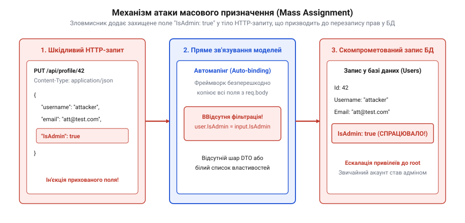

# Безпечний мапінг моделей у ASP.NET

<preknowlist>
- [Вразливість = зламана межа](root:sf-security/web-vulnerability-classes) — Загальне розуміння того, як відсутність фільтрації на межі застосунку дозволяє атакуючому маніпулювати його станом.
</preknowlist>

## Пряме зв'язування та ін'єкція полів

Сучасні веб-фреймворки на кшталт ASP.NET Core надають розробникам зручні механізми автоматичного зв'язування моделей (@@en|Model Binding@@). Під час обробки HTTP-запиту десеріалізатор `System.Text.Json` або `Newtonsoft.Json` послідовно читає ім'я кожної JSON-властивості з вхідного потоку і через рефлексію шукає відповідний public-сеттер у цільовому C#-об'єкті, не співставляючи їх із дозволеними правилами бізнес-логіки. Цей механізм автоматично парсить вхідне корисне навантаження JSON з HTTP-запиту та відображає його властивості на параметри методів контролера. Однак, якщо контролер приймає безпосередньо доменну сутність бази даних, відсутність міжмережевого фільтра призводить до того, що будь-яке передане в JSON поле автоматично присвоюється внутрішньому об'єкту, створюючи критичну вразливість масового призначення (@@en|Mass Assignment@@ чи Auto-binding).

Атакуючий може дослідити структуру даних або відгадати назви службових полів і додати їх до вхідного JSON-документа. Наприклад, передача параметра `"IsAdmin": true` призведе до того, що фреймворк автоматично встановить відповідний прапорець у доменній моделі користувача.

*При прямому зв'язуванні неперевірені зовнішні параметри з HTTP-запиту перезаписують критичні службові поля доменної сутності.*

Нижче наведено приклад вразливої реалізації контролера на мові C#, де метод оновлення профілю приймає доменну модель `UserEntity` безпосередньо у параметрі `[FromBody]`:

:::code proj-dotnet-dto-mapping/cs/VulnerableController.cs

Як видно з коду, будь-яке поле, присутнє в `inputUser`, беззастережно копіюється в об'єкт `User`. Це дозволяє атакуючому миттєво отримати привілеї адміністратора в системі. Аналогічні помилки припустимі в C та C++ при прямому розборі JSON без фільтрації полів:

:::tabs
:::code proj-dotnet-dto-mapping/cpp/vulnerable_handler.cpp
:::code proj-dotnet-dto-mapping/c/main.c 1-30
:::

## Відокремлення транспортної моделі DTO

Для надійного захисту від вразливості масового призначення необхідно провести чітку межу між доменною моделлю бази даних та вхідними даними, які надходять від клієнта. У веб-застосунках на базі Entity Framework (EF Core) доменні сутності відображають табличну структуру бази даних і містять службові поля: первинні й зовнішні ключі, навігаційні властивості, штампи часу та прапорці доступу на кшталт `IsAdmin`. Безпосередня передача таких сутностей у контролер створює ризик автоматичного перезапису цих полів при зміні стану об'єкта в контексті даних `DbContext`. Розв'язком є патерн об'єкта передачі даних (@@en|Data Transfer Object, DTO@@), який явно розділяє контракти API та доменні моделі.

DTO-структура визначає суворий білий список полів, які клієнт має право передавати або змінювати. Усі службові параметри, ідентифікатори системного рівня, прапорці рольового доступу чи технічні штампи часу свідомо виключаються з DTO. Це дозволяє гарантувати, що зміни в структурі баз даних не порушать відкриті специфікації API, а вхідні дані не зможуть випадково пошкодити інваріанти сутності.

:::code proj-dotnet-dto-mapping/cs/UserUpdateDto.cs

Створення окремого DTO-класу гарантує, що навіть якщо зловмисник надішле у запиті непередбачене поле `"IsAdmin": true`, десеріалізатор ASP.NET Core проігнорує його, оскільки у класі `UserUpdateDto` відсутня відповідна властивість. У C++ та C захисна модель DTO виглядає так:

:::tabs
:::code proj-dotnet-dto-mapping/cpp/user_dto.hpp
:::code proj-dotnet-dto-mapping/c/main.c 31-55
:::

## Механізм явного мапінгу даних

Отримавши валідований DTO-об'єкт у контролері, розробник мусить явно перенести дозволені значення у доменну сутність перед її збереженням у базі даних. Явний мапінг (@@en|explicit mapping@@) виключає можливість автоматичного копіювання небажаних властивостей.

Нижче наведено захищений контролер ASP.NET Core, який приймає `UserUpdateDto` та здійснює явну перевірку й копіювання лише дозволених полів:

:::code proj-dotnet-dto-mapping/cs/SecureController.cs

На відміну від небезпечного автоматичного відображення, ручний мапінг або використання суворо налаштованих автоматичних маперів (наприклад, AutoMapper у режимі білого списку) гарантує, що доменна модель отримує лише перевірені дані. Нижче наведено відповідні реалізації захищеного обробника у C++ та C:

:::tabs
:::code proj-dotnet-dto-mapping/cpp/secure_handler.cpp
:::code proj-dotnet-dto-mapping/c/main.c 56-80
:::

Застосування DTO та явного відображення повністю закриває вектор атаки [Вразливість = зламана межа](root:sf-security/web-vulnerability-classes), створюючи ізольовану межу між зовнішнім мережевим середовищем та доменною логікою застосунку.