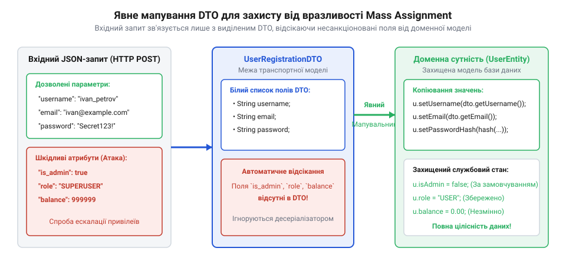

# Експлуатація та виправлення Mass Assignment в Express.js

<preknowlist>
- [Вразливість = зламана межа](root:sf-security/web-vulnerability-classes) — Розуміння того, як відсутність суворих меж між зовнішніми даними та внутрішнім станом породжує вразливості в логіці застосунку.
</preknowlist>

## Уразливий бекенд та копіювання

У веб-розробці на платформі Node.js із використанням фреймворку Express.js розробники часто прагнуть мінімізувати обсяг написаного коду. Проміжне програмне забезпечення `express.json()` або `body-parser` автоматично рекурсивно розпаковує вхідне JSON-навантаження у звичайний об'єкт JavaScript `req.body`, зберігаючи довільні вкладені структури та типи даних. Під час створення маршрутів оновлення профілю або реєстрації користувача виникає спокуса взяти весь цей згенерований об'єкт вхідних даних `req.body` і безпосередньо скопіювати його в об'єкт бази даних за допомогою методів на кшталт `Object.assign()` або інструментів ORM, що відкриває шлях для неконтрольованого запису будь-яких переданих полів.

Такий підхід виглядає лаконічно, але створює вразливість масового призначення (@@en|Mass Assignment@@). Оскільки `req.body` формується на основі довільного JSON-запиту від клієнта, неконтрольоване злиття об'єктів дозволяє зовнішньому користувачеві впливати на будь-які внутрішні властивості доменної моделі.

:::code proj-express-mass-assignment/js/vulnerable_controller.js

У наведеному коді виклик `Object.assign(user, req.body)` сліпо перезаписує всі властивості об'єкта `user` відповідними значеннями з тіла запиту, розмиваючи межі безпеки системи [Вразливість = зламана межа](root:sf-security/web-vulnerability-classes).

## Атака та ін'єкція службових полів

Зловмисник, дослідивши структуру серверних відповідей або REST API, може виявити наявність службових полів у моделі (наприклад, `is_admin`, `role` або `balance`). Для здійснення атаки зловмисник надсилає спеціально сформований HTTP PUT-запит, додаючи приховане поле, яке не передбачалося інтерфейсом користувача:

```json
{
  "username": "alex_hacker",
  "email": "alex@example.com",
  "is_admin": true,
  "role": "admin"
}
```

Коли уразливий контролер виконує `Object.assign()`, ядро Express.js без вагань присвоює властивості `is_admin` значення `true`. У результаті звичайний користувач отримує привілеї адміністратора без проходження процедур автентифікації чи перевірки прав.

Окрім прямої зміни службових полів доменної моделі, неконтрольоване злиття вкладених JSON-об'єктів (наприклад, за допомогою утиліт глибинного копіювання на кшталт `lodash.merge`) створює загрозу прототипного забруднення (@@en|Prototype Pollution@@). Якщо зловмисник передає в JSON метавластивості `__proto__` або `constructor.prototype`, рекурсивний алгоритм мапінгу може перезаписати властивості базового об'єкта `Object.prototype`. Це призводить до зміни поведінки всіх об'єктів у середовищі Node.js, спричиняючи відмову в обслуговуванні (DoS) або виконання довільного коду на сервері.

## Механізм захисту через білий список

Ефективна протидія масовому призначенню полягає у переході від чорних списків (@@en|blacklisting@@), де розробник намагається блокувати конкретні небезпечні поля, до суворих білих списків (@@en|whitelisting@@). Спроби видаляти небезпечні ключі через `delete req.body.is_admin` є хибними, оскільки атакуючий може передати інші непередбачені параметри.


*Формування суворого білого списку на рівні контролера гарантує, що лише дозволені поля копіюються в доменну сутність.*

Стратегія білого списку вимагає явного визначення переліку дозволених властивостей. Усі інші параметри, передані у тілі запиту, повинні повністю ігноруватися бекендом.

## Явна фільтрація та мапінг

Для реалізації захищеного контролера в Express.js застосовується синтаксис деструктуризації JavaScript (@@en|destructuring assignment@@) або спеціалізовані DTO-функції фільтрації. Це дозволяє витягти з `req.body` лише ті змінні, які безпечно модифікувати клієнту.

:::code proj-express-mass-assignment/js/secure_controller.js

Завдяки явній деструктуризації `const { username, email } = req.body`, будь-які спроби ін'єкції `is_admin` чи `role` залишаються нешкідливими, оскільки ці поля навіть не зчитуються з вхідного об'єкта. Це гарантує цілісність даних та стійкість сервісу.