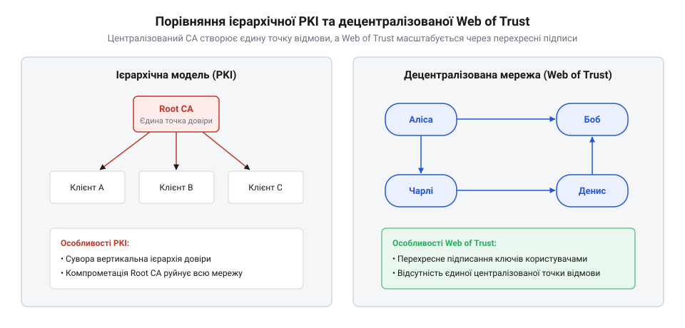

# Створення PGP та еволюція Web of Trust

<preknowlist>
- [Особистість пристрою: серійник, ключ, сертифікат](root:sf-security/osobystist-prystroiu) — концепцію відкритого й приватного ключа та зв'язування ключа з ідентифікатором користувача.
</preknowlist>

## Потреба в приватності без центрів

На зорі інтернету в 1970-х та 1980-х роках мережеві протоколи будувалися на абсолютній довірі між науковими установами. Електронне листування передавалося повністю відкритим текстом, тому кожен адміністратор транзитного вузла міг вільно перехопити та прочитати будь-яке повідомлення. З виходом мережі за межі академічного середовища загроза глобального прослуховування стала реальною. У корпоративному та урядовому секторах цю проблему розв'язували за допомогою класичної [інфраструктури відкритих ключів](root:sf-security/osobystist-prystroiu) (@@en|Public Key Infrastructure, PKI@@). Ця модель вимагала наявності єдиного центру сертифікації (@@en|Certificate Authority, CA@@), який централізовано засвідчував би справжність публічних ключів кожного учасника мережі.

Проте ієрархічна модель мала фундаментальну ваду: вона вимагала підпорядкування центральному авторитету. Якщо уряд або корпорація контролює центр сертифікації, вони отримують єдину точку контролю та збою. Скомпрометований або примушений до співпраці центр міг би непомітно випустити підроблений сертифікат для перехоплення трафіку цільового користувача. Для активістів руху шифропанків, які відстоювали право на приватність у цифровому світі, необхідність просити дозволу в держави на захищений зв'язок була ідеологічно неприйнятною. Суспільству був потрібен інструмент, який гарантував би таємність листування між двома незнайомцями виключно завдяки математиці, без покладання на довіру до централізованих інституцій.

## Створення PGP Філіпом Ціммерманом

У 1991 році американський інженер Філіп Ціммерман випустив програму, що назавжди змінила баланс сил у цифровій приватності. Він назвав її @@en|Pretty Good Privacy@@, або скорочено PGP. Головним досягненням Ціммермана став не винахід нових математичних алгоритмів, а вдале поєднання вже наявних криптографічних підходів у зручний інструмент, яким міг би скористатися будь-хто на звичайному персональному комп'ютері.

Асиметрична криптографія, така як алгоритм RSA, гарантувала безпечний обмін повідомленнями без попередньої передачі секретів, але математично була занадто повільною для шифрування об'ємних текстів. З іншого боку, симетричні шифри працювали надзвичайно швидко, проте вимагали, щоб обидві сторони заздалегідь домовилися про спільний секретний ключ, що неможливо було зробити безпечно через відкриту мережу. PGP реалізувала гібридний підхід. Програма генерувала унікальний випадковий сесійний ключ для кожного листа і швидко шифрувала ним сам текст за допомогою симетричного алгоритму. Після цього сесійний ключ шифрувався вже асиметричним відкритим ключем отримувача. 

Зворотний процес на боці одержувача відбувався у дзеркальному порядку. Спочатку адресат використовував свій секретний приватний ключ, щоб розшифрувати невеликий за обсягом зашифрований сесійний ключ. Відновивши цей симетричний секрет, програма миттєво розшифровувала ним основний масив тексту листа. Такий механізм дозволив об'єднати швидкість роботи симетричних шифрів зі зручністю асиметричного розподілу ключів, повністю приховавши математичну складність від кінцевого користувача.

Перша версія PGP поширювалася безкоштовно через електронні дошки оголошень (@@en|Bulletin Board System, BBS@@). Завдяки ентузіастам вихідний код програми швидко перетнув океан і розійшовся світом. PGP стала першим масовим засобом сильної криптографії, який вивів захист військового рівня з-під монополії спецслужб та передав його в руки звичайних громадян.

## Зародження концепції Web of Trust

Після успішного розв'язання проблеми самого шифрування перед розробниками PGP постала інша фундаментальна задача: як переконатися, що отриманий відкритий ключ справді належить заявленій особі, якщо центрального органу сертифікації не існує. Без надійної перевірки зловмисник міг би підмінити чужий ключ своїм під час його передачі мережею, здійснюючи перехоплення всіх наступних листів. Відповіддю на цей виклик стала концепція децентралізованої павутини довіри (@@en|Web of Trust@@).

Замість того, щоб покладатися на один авторитарний корінь, який підписує сертифікати зверху вниз, Web of Trust будується на горизонтальних зв'язках між самими користувачами. Учасники системи зустрічаються наживо на спеціальних заходах — вечірках підписування ключів (@@en|key signing parties@@), перевіряють паспорти одне одного і криптографічно підписують їхні відкриті ключі своїми власними. Кожен такий підпис стає математичним свідченням того, що власник одного ключа ручається за справжність іншого.

*Зліва показана класична ієрархія PKI із залежністю від центрального вузла, а справа — децентралізована павутина довіри, у якій сертифікація делегується безпосередньо через мережу особистих знайомств, усуваючи єдину точку відмови.*

Цей механізм дозволив створити транзитивні ланцюжки довіри. Якщо Аліса особисто підписала ключ Боба, а Боб підписав ключ Чарлі, то Аліса може довіряти ключу Чарлі через посередництво Боба, навіть якщо ніколи не бачила Чарлі наживо. Що більше підписів збирає ключ від різних незалежних людей, то вищий рівень його автентичності для всієї глобальної мережі. Павутина довіри стала першою практичною реалізацією децентралізованої системи ідентифікації, яка виявилася повністю стійкою до компрометації будь-якого окремого вузла.

Однак відсутність центрального органу породила нову проблему: як своєчасно сповістити всю мережу про компрометацію ключа. Якщо зловмисник викрадав приватний секрет, законний власник не міг просто звернутися до адміністратора для його блокування. Щоб розв'язати це, в архітектуру PGP заклали механізм завчасного [відкликання ключа й сертифіката](root:sf-security/vidklykannia-kliucha-i-sertyfikata-peredbachene). Користувач ще під час створення ключів генерував спеціальний сертифікат відкликання (@@en|revocation certificate@@) і зберігав його в надійному ізольованому місці. У разі втрати контролю над своїм ключем цей сертифікат завантажувався на публічні сервери, звідки швидко розходився всіма вузлами мережі, автоматично позначаючи скомпрометований ключ як недійсний для всіх учасників Web of Trust.

## Криптовоєни та експортні обмеження

Успіх PGP швидко привернув увагу американських спецслужб, що стало початком епохи так званих криптовоєн (@@en|crypto wars@@). У першій половині 1990-х років законодавство США прирівнювало криптографічне програмне забезпечення з ключами понад 40 біт до військового озброєння. Експорт таких програм за кордон без ліцензії був суворо заборонений і карався як контрабанда зброї. Оскільки вихідний код PGP з'явився на дошках оголошень та розійшовся серверами по всьому світу, митниця США розпочала у 1993 році кримінальне розслідування проти Філіпа Ціммермана за підозрою в незаконному експорті.

Перед розробниками постала проблема: як легально поширювати надійне шифрування, не порушуючи закон про експорт зброї. Рішення виявилося несподіваним і базувалося на фундаментальному праві — Першій поправці до Конституції США, яка гарантує свободу слова. У 1995 році видавництво Массачусетського технологічного інституту опублікувало весь вихідний код PGP у вигляді звичайної надрукованої книги. Експорт цифрового коду на дискетах вважався постачанням зброї, проте заборонити експорт друкованої книги уряд не міг без прямого порушення Конституції.

Цей юридичний маневр спрацював. Ентузіасти купували книгу за кордоном, сканували сторінки, розпізнавали текст і знову перетворювали його на робочу програму. Уряд США опинився в юридичному глухому куті. Зрозумівши абсурдність ситуації, федеральні прокурори у 1996 році закрили кримінальну справу проти Ціммермана. Ця перемога стала поворотним моментом, який зрештою змусив владу суттєво послабити експортні обмеження та легалізувати глобальне використання сильної криптографії.

## Від програми до стандарту OpenPGP

Після закриття кримінальної справи інтерес до PGP лише зріс, і програма почала перетворюватися на комерційний продукт. Проте спільнота розробників та криптографів усвідомлювала новий ризик: якщо захист комунікацій залежатиме від однієї приватної компанії, це створить загрозу монополії. Індустрії був потрібен відкритий стандарт, який дозволив би будь-кому створювати сумісні програми для шифрування.

Щоб уникнути залежності від одного виробника, Інженерна рада інтернету (@@en|Internet Engineering Task Force, IETF@@) у 1998 році формалізувала формат повідомлень та ключів PGP у відкритий інтернет-протокол — @@en|OpenPGP@@. Цей стандарт чітко описував, як саме програми мають поєднувати симетричні та асиметричні алгоритми, щоб їхні результати міг розшифрувати будь-який інший клієнт.

Створення відкритого стандарту дало поштовх до появи незалежних альтернатив. Уже в 1999 році німецький розробник Вернер Кох випустив першу версію @@en|GNU Privacy Guard@@ (GnuPG) — повністю безкоштовної реалізації OpenPGP. Завдяки вільному доступу до коду та дотриманню відкритого стандарту, GnuPG швидко став базовим інструментом для операційних систем на базі Linux. Ініціатива переходу до відкритого стандарту дозволила технології вижити попри подальші перепродажі самої компанії PGP, і сьогодні OpenPGP продовжує захищати електронну пошту та гарантувати цілісність репозиторіїв відкритого коду.

## Розвінчання міфів про PGP

Історія створення PGP обросла багатьма міфами, які часто спотворюють реальний внесок інструмента. Найпоширеніше хибне уявлення полягає в тому, що Філіп Ціммерман винайшов саму асиметричну криптографію або алгоритм RSA. Насправді алгоритм RSA створили Рональд Рівест, Аді Шамір та Леонард Адлеман ще у 1977 році, а саму концепцію відкритих ключів роком раніше описали Вітфілд Діффі та Мартін Геллман. Справжній внесок Ціммермана полягав виключно в інженерному поєднанні наявних математичних ідей у робочий масовий продукт.

Другий популярний міф стверджує, що PGP гарантує абсолютну та бездоганну безпеку. Хоча математична основа PGP дійсно виявилася стійкою до зламу, сама програма часто ставала об'єктом критики через надзвичайно складний інтерфейс. У 1999 році дослідження «Чому Джонні не вміє шифрувати» (@@en|Why Johnny Can't Encrypt@@) наочно показало, що більшість звичайних користувачів робили критичні помилки під час налаштування програми, випадково надсилаючи секретні дані відкритим текстом. 

Цей історичний досвід довів, що бездоганна математика не гарантує безпеки, якщо інструмент складний у використанні. Еволюція PGP вчить сучасних розробників: справжня безпека досягається лише тоді, коли криптографія стає непомітною та інтуїтивно зрозумілою для кінцевого користувача, як це сьогодні реалізовано у протоколах наскрізного шифрування.