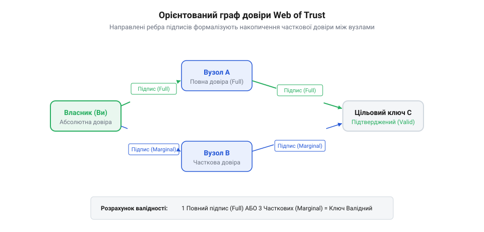
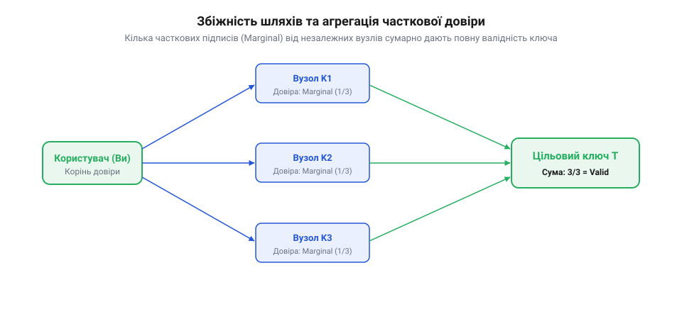

# Алгоритми обчислення довіри в графі Web of Trust

## Проблема масштабування прямої довіри

Щоб безпечно надіслати зашифроване повідомлення, відправник має бути впевненим, що відкритий ключ справді належить потрібному адресату. Найнадійніший спосіб досягти такої впевненості — це особиста зустріч, під час якої люди обмінюються ключами або перевіряють їхні криптографічні відбитки. Але такий підхід фізично не масштабується у великих мережах. Людина здатна особисто зустрітися та перевірити ключі лише обмеженого кола своїх знайомих. Якщо кожен учасник мережі довірятиме тільки тим, кого перевірив сам, то вся система розпадеться на дрібні ізольовані острівці без можливості безпечного зв'язку між ними.

Щоб система могла зростати, потрібен механізм делегування довіри через посередників. Якщо перший користувач довіряє другому, а другий особисто перевірив третього, то перший має отримати можливість автоматично визнати ключ третього користувача дійсним. Проте довіра є суб'єктивною категорією. Пряма транзитивність, коли довіра передається безкінечно від одного до іншого, швидко призведе до того, що єдиний скомпрометований або необачний посередник легалізує підроблені ключі для всієї мережі. Тому постає чітка математична задача: як формалізувати соціальні зв'язки так, щоб автоматично обчислювати достовірність віддалених ключів, суворо контролюючи ризик помилки.

## Орієнтований граф і вага підписів

Математично мережа довіри (@@en|Web of Trust@@) моделюється як зважений орієнтований граф. Вершини цього графа — це відкриті ключі користувачів. Коли один користувач перевіряє особу іншого та ставить криптографічний підпис на його ключі, у графі з'являється орієнтоване ребро. Воно виходить із ключа-підписанта і входить у ключ, який підписують. Напрямок ребра має принципове значення: якщо Аліса перевірила ключ Боба і підписала його, це не означає, що Боб автоматично перевірив ключ Аліси.



Для кількісного аналізу кожному ребру присвоюється вага, яка відображає рівень упевненості підписанта. У парадигмі @@en|PGP@@ вага ребра (рівень довіри) зазвичай набуває трьох дискретних значень: відсутня довіра, часткова довіра та повна довіра. Математично «відсутня довіра» подається або як повна відсутність орієнтованого ребра у матриці суміжності графа, або як ребро з нульовою вагою `0.0`, яке не робить внеску в підсумкову суму валідації. Повна довіра оцінюється вагою `1.0`, що означає ретельну перевірку особи власника (наприклад, перевірку паспортних даних). Часткова довіра має вагу `0.5`, вказуючи на те, що перевірка відбулася за менш суворих умов. Присвоївши ребрам ці числові еквіваленти, ми перетворюємо суб'єктивні людські зв'язки на точну геометричну структуру. Відтепер задача перевірки незнайомого ключа зводиться до задачі пошуку зважених шляхів від власного ключа (вузла старту) до цільової вершини графа.

## Обчислення достовірності цільового ключа

Щоб обчислити рівень достовірності віддаленого ключа, алгоритм шукає всі можливі шляхи від стартового вузла (власного ключа) до цільового. Практичний пошук ланцюгів у графі підписів спирається на алгоритм обходу в ширину (@@en|Breadth-First Search, BFS@@). Алгоритм BFS починає обхід від стартової вершини, переглядаючи сусідні вузли шар за шаром. Це гарантує, що спочатку знаходяться найкоротші ланцюжки підписів із мінімальною кількістю проміжних посередників. Оскільки з кожним наступним кроком імовірність помилки або недбалості посередника зростає, алгоритм запроваджує жорстке обмеження на максимальну глибину обходу BFS. Якщо шлях до цільового ключа перевищує заданий ліміт (зазвичай 5 кроків), цей напрямок обходу припиняється. Це математично відсікає нескінченну транзитивність і локалізує наслідки можливої компрометації.

Для шляхів, що вклалися в ліміт довжини, застосовується кількісна модель агрегації довіри. Замість того, щоб покладатися на один слабкий зв'язок, алгоритм накопичує ваги ребер. Правило сумування вимагає набрати певну порогову суму для визнання цільового ключа дійсним. Наприклад, класична конфігурація PGP вимагає або одного шляху, де кожен посередник має рівень повної довіри, або щонайменше трьох незалежних шляхів, які приносять часткову довіру.



Математично це можна виразити як зважену суму: якщо ми призначимо повній довірі вагу `1.0`, а частковій — `0.5`, то для повної валідації сумарна вага вхідних ребер на останньому кроці має досягти `1.0`. Наявність незалежних шляхів робить систему стійкою: навіть якщо один вузол скомпрометовано і він хибно підписав ключ, двох інших підписів не вистачить для його легалізації. Водночас така вимога незалежності створює структурну проблему ізольованих кластерів. Якщо група користувачів інтенсивно підписує ключі всередині своєї спільноти, але не має достатньої кількості зв'язків із зовнішнім світом, алгоритм пошуку шляхів не зможе подолати бар'єр, і достовірність ключів цієї групи для стороннього спостерігача залишиться нульовою.

## Агрегація часткових підписів

Коли алгоритм обчислює достовірність ключа, він часто стикається із ситуацією, коли жоден окремий знайдений шлях не дає повної впевненості. У таких випадках застосовується математична модель накопичення довіри. Її суть полягає в тому, що кілька незалежних маргінальних (часткових) підписів, які вказують на один і той самий цільовий ключ, здатні в сумі забезпечити необхідний рівень достовірності.

Кожному рівню довіри призначається числова вага, а система встановлює цільовий поріг для визнання ключа дійсним. Наприклад, повна довіра оцінюється як `1.0`, часткова — як `0.5`, а поріг успішної валідації дорівнює `1.0`. Якщо алгоритм знаходить один шлях із повною довірою, ключ валідується одразу. Якщо ж знайдено лише шляхи з частковою довірою, їхні ваги сумуються:

```text
  Достовірність ключа
= Вага шляху A + Вага шляху B              [сумування незалежних шляхів]
= 0.5 + 0.5                                [кожен шлях приносить часткову довіру]
= 1.0                                      [арифметична сума ваг]
≥ 1.0                                      [поріг повної валідності пройдено]
```


Ця арифметика вимагає, щоб шляхи були математично незалежними: вони не повинні спиратися на спільні проміжні вузли, окрім самого стартового та цільового ключів. Якщо два ланцюжки проходять через одного й того самого посередника, система враховує лише один, найсильніший шлях. Це правило запобігає штучному розмноженню довіри через створення фіктивних вузлів навколо одного слабкого посилання.

## Топологічні проблеми децентралізованих графів

Ефективність математичного обчислення довіри прямо залежить від структури графа підписів. Оскільки зв'язки формуються стихійно на основі людських взаємодій, мережа довіри часто набуває нерівномірної, кластеризованої форми. Це породжує структурні слабкості, які роблять алгоритми пошуку шляхів безсилими навіть для легітимних ключів.

Перша фундаментальна проблема — утворення ізольованих кластерів. Якщо локальна група користувачів інтенсивно підписує ключі одне одного, але не має вхідних ребер від решти світу, метрика їхньої внутрішньої щільності буде високою. Проте для будь-якого зовнішнього спостерігача алгоритм обходу графа не знайде жодного шляху до цієї групи, і розрахункова достовірність усіх її ключів залишиться нульовою.

Друга проблема — вузли-мости. Коли два великі кластери з'єднані лише одним або кількома транзитними ребрами, цей єдиний зв'язок стає критичною точкою відмови. Якщо такий міст втрачає довіру або відкликає свій ключ, глобальний граф розпадається на ізольовані компоненти. Крім того, низька загальна зв'язність (щільність) графа означає, що середня довжина найкоротшого шляху між двома випадковими вузлами часто перевищує жорстко заданий ліміт алгоритму (наприклад, п'ять кроків). У результаті математична модель працює надійно лише у щільних, добре переплетених мережах, що вимагає постійних соціальних зусиль для підтримки цілісності графа.