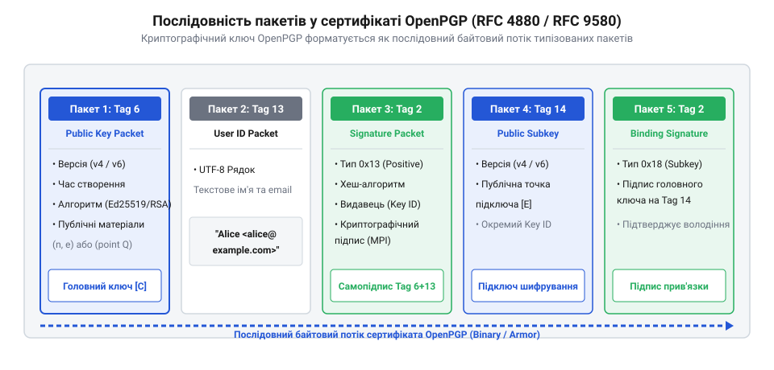
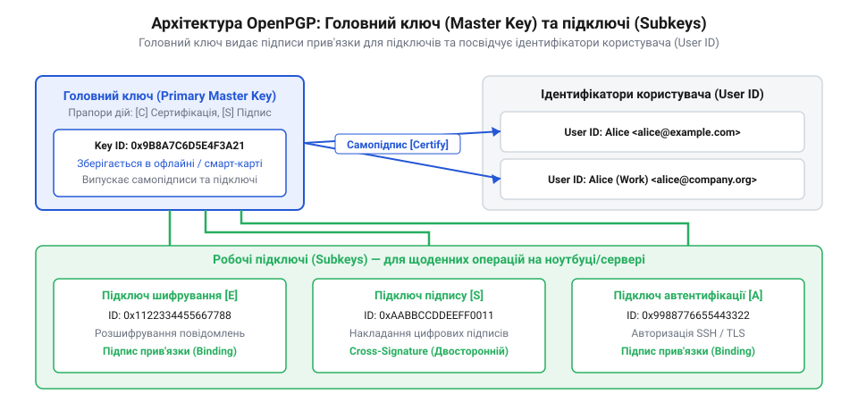
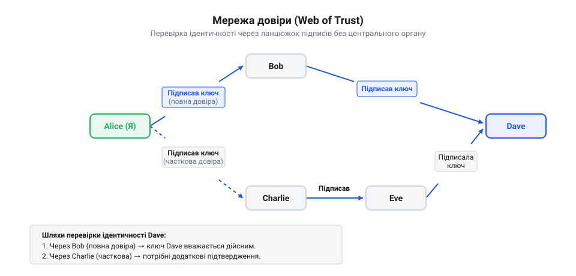

# Формат OpenPGP, підключі й Web of Trust

<preknowlist>
- [Управління ключами та KMS](root:sf-security/key-management) — базове розуміння життєвого циклу ключів (генерація, зберігання, відкликання), щоб розуміти потребу в управлінні підключами.
- [Особистість пристрою: серійник, ключ, сертифікат](root:sf-security/osobystist-prystroiu) — базове розуміння концепції сертифіката та відкритого ключа як засобу підтвердження ідентичності.
</preknowlist>

## Проблема довіри та передачі ключів

Коли користувач хоче надіслати зашифроване повідомлення або перевірити цифровий підпис, йому потрібен відкритий ключ адресата. Сама по собі математика асиметричного шифрування гарантує, що лише власник приватного ключа зможе розшифрувати дані, зашифровані відповідним відкритим ключем. Але математичні алгоритми працюють винятково з великими числами й нічого не знають про імена, електронні адреси чи реальних людей. Якщо Аліса завантажує ключ, на якому написано ім'я «Боб», виникає фундаментальна проблема автентифікації відкритого ключа: як довести, що цей набір байтів справді належить Бобу, а не зловмиснику?

У відкритому середовищі зв'язок між користувачами часто контролюють невидимі посередники — інтернет-провайдери, сервери або перехоплювачі трафіку. Якщо Аліса просто запитає ключ у Боба через мережу, зловмисник може перехопити цей запит. Він генерує власну пару ключів і надсилає Алісі свій відкритий ключ, підписавши його іменем Боба. Це класична атака «людина посередині» (@@en|Man-in-the-Middle@@). Аліса зашифрує своє таємне повідомлення цим підробленим ключем. Зловмисник перехопить повідомлення, розшифрує своїм приватним ключем, прочитає зміст, зашифрує справжнім відкритим ключем Боба і відправить далі. Ні Аліса, ні Боб не помітять жодного втручання.

Щоб запобігти цьому, Аліса повинна перевірити автентичність ключа поза основним каналом зв'язку. Програми шифрування обчислюють для кожного ключа унікальний відбиток (@@en|fingerprint@@) — коротку послідовність символів, отриману шляхом криптографічного хешування самого відкритого ключа. Аліса може зателефонувати Бобу і звірити відбиток, який вона бачить на екрані, з тим, що Боб прочитає їй у слухавку. Якщо відбитки збігаються, підміна виключена, оскільки підробити ключ із таким самим відбитком математично неможливо. Проте особисто телефонувати кожному кореспонденту чи зустрічатися з ним — повільно і не масштабується для глобальної комунікації.

Традиційним рішенням проблеми масштабування є використання цифрового сертифіката для автоматичної перевірки [відкритого ключа](root:sf-security/osobystist-prystroiu). У класичній [інфраструктурі відкритих ключів](root:sf-security/pki-hierarchy) (@@en|Public Key Infrastructure, PKI@@) довіра делегується централізованому центру сертифікації (@@en|Certificate Authority, CA@@). Якщо і Аліса, і Боб довіряють цьому центру, Алісі достатньо перевірити криптографічний підпис центру на ключі Боба. Проте модель PKI делегує абсолютну владу центральним вузлам. Якщо центр сертифікації скомпрометовано, він зможе випускати підроблені ключі від імені будь-кого.

Для захищеного спілкування без залежності від корпорацій чи урядів потрібен механізм, де користувачі самі приймають рішення про довіру і передають її далі. Якщо Аліса особисто зустрілася з Чарлі і звірила його відбиток, вона довіряє його ключу. Якщо Чарлі зустрічався з Бобом, перевірив його відбиток і своїм приватним ключем засвідчив, що відкритий ключ Боба є справжнім, Аліса може покладатися на ключ Боба через цей транзитний ланцюжок. Ця концепція горизонтальної, децентралізованої перевірки ідентичності отримала назву @@en|Web of Trust@@ (мережа довіри). Її історичні витоки та філософію відмови від єдиного центру сертифікації детально пояснює [Створення PGP та еволюція Web of Trust](root:sf-security/openpgp-format-and-web-of-trust/hist-pgp-and-wot.md).

Аби така децентралізована мережа могла функціонувати технічно, недостатньо просто передавати математичний ключ. Інформація повинна містити сам ключ, ідентифікатор власника і, що найважливіше, набір криптографічних підписів від інших людей, які перевірили цей зв'язок. Цей блок даних має бути стійким до модифікацій: будь-яка спроба підмінити ключ або змінити ім'я повинна одразу руйнувати математичну цілісність підписів. Файл ключа перетворюється на самодостатній контейнер, що несе всі докази своєї достовірності. Саме для структуризації таких криптографічних записів в єдиний портативний формат було розроблено стандарт @@en|OpenPGP@@.

Збираючи такі контейнери від своїх співрозмовників, клієнтські програми не тримають їх у вигляді розрізнених файлів на диску. Усі відкриті ключі, ідентифікатори та отримані підписи імпортуються до спеціальної локальної бази даних — зв'язки ключів (@@en|keyring@@). У цьому сховищі програма безперервно аналізує нові надходження: вона перевіряє криптографічні хеші та автоматично «прикріплює» свіжі підписи до вже відомих ключів, розбудовуючи локальний граф довіри. Лише в той момент, коли користувачеві потрібно поділитися своїм актуальним профілем або передати чужий відкритий ключ далі, програма дістає з цієї бази всі пов'язані криптографічні компоненти і збирає їх в єдиний портативний файл для передачі.

## Структура пакетів формату OpenPGP

Формат @@en|OpenPGP@@, визначений у специфікаціях RFC 4880 та його сучасному оновленні RFC 9580, відмовляється від монолітних структур на користь гнучкої пакетної архітектури. Будь-які дані в цьому форматі — чи то відкритий ключ, чи зашифрований архів, чи окремий цифровий підпис — організовані на базовому рівні як послідовність будівельних блоків, що називаються пакетами (@@en|packets@@).

Кожен пакет є самостійною одиницею даних із чітко визначеним призначенням. На бінарному рівні пакет завжди починається із заголовка, який повідомляє програмі-парсеру дві критичні речі: тип пакета та його точну довжину в байтах. Завдяки цьому парсер може безпечно обробляти потік даних без ризику збою. Якщо він зустрічає пакет невідомого або непідтримуваного типу, він відраховує заявлену довжину, перестрибує цей пакет і продовжує читання наступного. Ця властивість гарантує зворотну сумісність: нові версії стандарту можуть додавати нові типи пакетів, не порушуючи роботу старого програмного забезпечення.

*Відкритий ключ OpenPGP складається з базового пакета ключа, пакета ідентифікатора користувача та пакета підпису, що пов'язує їх воєдино.*

Для того щоб передати відкритий ключ разом із його ідентичністю, файл формується з трьох основних типів пакетів, розташованих у строгій логічній послідовності. Першим завжди йде пакет відкритого ключа (@@en|Public-Key Packet@@). Це математичне ядро запису. Пакет містить версію формату, позначку часу створення ключа, ідентифікатор алгоритму (наприклад, алгоритму RSA або криптографії на еліптичних кривих) та власне математичні параметри алгоритму. У цьому пакеті взагалі немає інформації про людину — лише числа.

Одразу за пакетом ключа слідує пакет ідентифікатора користувача (@@en|User ID Packet@@). Він містить звичайний текстовий рядок, що ідентифікує особу, найчастіше у форматі «Ім'я (Коментар) <email@example.com>». Оскільки цей пакет фізично відокремлений від пакета ключа, зловмисник міг би перехопити файл, видалити справжній пакет ідентифікатора і вставити на його місце пакет зі своїм іменем, намагаючись привласнити чужий ключ.

Щоб унеможливити таку підміну, формат вимагає обов'язкової наявності пакета підпису (@@en|Signature Packet@@) безпосередньо після ідентифікатора. Програма бере дані з пакета ключа, конкатенує їх із даними пакета ідентифікатора і обчислює від цієї комбінації криптографічний хеш. Потім цей хеш підписується приватним ключем. Створений підпис упаковується в пакет підпису. Якщо зловмисник змінить хоча б один біт у пакеті ключа або змінить бодай літеру в імені користувача, згенерований хеш повністю зміниться, і підпис стане криптографічно недійсним. 

Першим підписом завжди йде самопідпис (@@en|self-signature@@), зроблений відповідним приватним ключем самого власника. Він доводить, що людина, яка володіє приватним ключем, свідомо асоціює себе з цим іменем. Але гнучкість формату дозволяє нарощувати цю структуру нескінченно. Якщо користувач має кілька електронних адрес (наприклад, особисту та робочу), він просто додає у файл ще один пакет ідентифікатора і ще один самопідпис до нього. Програма побачить один відкритий ключ, до якого надійно прив'язані кілька імен.

Ця ж пакетна логіка лежить в основі самої децентралізованої мережі. Коли інші учасники мережі перевіряють відбиток ключа і засвідчують його справжність, їхні підписи просто дописуються в кінець файлу як нові пакети підписів. Експортований відкритий ключ з часом накопичує десятки підписів довіри. Завдяки цій накопичувальній природі пакетів стає можливою реалізація повноцінної децентралізованої бази для [управління ключами](root:sf-security/key-management). 

Пакет підпису OpenPGP є набагато складнішим, ніж просто зашифрований хеш. Він містить так звані підпакети (@@en|subpackets@@), що розширюють його можливості. Підпакети додають до підпису життєво важливі метадані: час створення підпису, термін дії самого підпису або ключа, який він сертифікує, прапорці використання (чи дозволено ключу шифрувати дані, чи лише підписувати документи), а також вказівники на місцезнаходження інформації для [відкликання ключа](root:sf-security/vidklykannia-kliucha-i-sertyfikata-peredbachene). Саме в підпакетах зберігаються різні рівні сертифікації: від поверхневої перевірки пошти до ретельної перевірки паспорта. Окрім того, кожен підпакет має власний маркер критичності, який гарантує зворотну сумісність при впровадженні нових криптографічних примітивів. Якщо формат розширюється новими алгоритмами через нові типи підпакетів, старі програми легко відраховують їхню довжину і безпечно ігнорують некритичні невідомі блоки, продовжуючи працювати з основним підписом. Ця багатовимірна структура метаданих робить пакет підпису керуючим ядром формату.

Оскільки всі ці пакети є бінарними даними, вони можуть спотворюватися при передачі через системи, призначені лише для тексту (наприклад, класичну електронну пошту). Тому формат OpenPGP передбачає механізм безпечного кодування — ASCII-броню (@@en|ASCII Armor@@). Він бере бінарний потік пакетів, перетворює його на безпечні текстові символи за допомогою алгоритму Base64, додає контрольну суму для виявлення пошкоджень та обгортає в чіткі текстові заголовки (наприклад, `-----BEGIN PGP PUBLIC KEY BLOCK-----`). Це дозволяє вільно публікувати складні ієрархії пакетів у звичайних текстових повідомленнях або на вебсторінках, гарантуючи збереження їхньої внутрішньої структури.

## Архітектура головного ключа і підключів

Якщо користувач генерує єдину пару ключів і використовує її для всього — підписування листів, розшифрування файлів та сертифікації інших людей, — він створює єдину точку відмови. Приватний ключ доводиться тримати на робочому комп'ютері або в пам'яті смартфона. Якщо цей пристрій буде зламано, зловмисник викраде ключ. Користувачу доведеться опублікувати сертифікат про [відкликання ключа](root:sf-security/vidklykannia-kliucha-i-sertyfikata-peredbachene) і згенерувати новий. Але разом із втратою ключа знищуються всі зібрані пакети підписів від інших людей: усю репутацію та довіру в децентралізованій мережі доведеться будувати з нуля.

Щоб розв'язати цю проблему, @@en|OpenPGP@@ використовує принцип розділення повноважень. Замість одного монолітного ключа створюється ієрархія: майстер-ключ (@@en|master key@@), який також називають головним ключем сертифікації, та набір підключів (@@en|subkeys@@) для повсякденних операцій. Майстер-ключ виконує лише одну функцію: він підписує. Але він підписує не звичайні електронні листи чи документи, а лише інші ключі та ідентифікатори користувачів. Саме майстер-ключ збирає підписи довіри від інших людей і формує основу цифрової ідентичності.

*Майстер-ключ не бере участі в щоденному шифруванні. Його єдина роль — криптографічно засвідчувати легітимність робочих підключів та ідентифікаторів.*

Підключі створюються для конкретних задач. Один підключ генерується винятково для шифрування, інший — для створення повсякденних цифрових підписів, третій може використовуватися для автентифікації на серверах. Але як інші користувачі дізнаються, що ці підключі справді належать власнику майстер-ключа? Тут знову працює пакетна архітектура. Майстер-ключ створює спеціальний пакет підпису прив'язки (@@en|binding signature@@), який криптографічно зшиває відкритий підключ із головним ключем. Цей підпис діє як довіреність: майстер-ключ делегує підключу право розшифровувати повідомлення або підписувати файли від свого імені.

Щоб зловмисник не міг взяти чужий підключ і прив'язати його до свого майстер-ключа, сучасні стандарти вимагають перехресного підпису (@@en|cross-signature@@). Підключ для підписування повинен створити зворотний підпис, засвідчуючи майстер-ключ. Цей криптографічний цикл доводить, що обидві пари ключів були згенеровані і контролюються однією особою.

Така архітектура кардинально змінює модель безпеки. Оскільки майстер-ключ потрібен лише зрідка — для сертифікації нових знайомих, додавання нового підключа або продовження терміну дії, — його приватну частину можна повністю видалити з робочого комп'ютера. Власник може перенести її в захищене офлайн-сховище: на зашифровану флешку або апаратний токен. Детальніше про фізичне розділення розповідає тема [Де живе приватний ключ](root:sf-security/de-zhyve-pryvatnyi-kliuch). На повсякденному пристрої залишаються лише приватні підключі. Якщо робочий ноутбук викрадають, користувач дістає свій офлайновий майстер-ключ, генерує пакет відкликання лише для скомпрометованих підключів і випускає нові. При цьому головний ключ, а отже, і вся накопичена мережа довіри, залишається в повній безпеці. Практичні кроки для налаштування такого середовища описані у матеріалі [Створення архітектури підключів у GnuPG](root:sf-security/openpgp-format-and-web-of-trust/proj-gnupg-subkeys.md).

## Децентралізована мережа Web of Trust

Коли проблема управління власними підключами вирішена, постає глобальне завдання: як довіряти ключам інших людей без центрального органу? Якщо Аліса хоче надіслати таємний документ Девіду, якого ніколи не бачила, їй потрібно переконатися, що відкритий ключ справді належить йому. Оскільки в екосистемі OpenPGP немає єдиного центру сертифікації, який міг би завірити ключ Девіда, Алісі доводиться покладатися на соціальні зв'язки.

У моделі @@en|Web of Trust@@ кожен користувач є власним центром сертифікації (@@en|trust anchor@@). Коли Аліса особисто зустрічається з Бобом і звіряє криптографічний відбиток його ключа, вона підписує відкритий ключ Боба своїм майстер-ключем. Цей пакет підпису публікується і стає невіддільною частиною ключа Боба. Якщо Боб так само зустрівся з Чарлі і підписав його ключ, а Чарлі підписав ключ Девіда, утворюється безперервний математичний ланцюжок підписів. Тепер Аліса може завантажити ключ Девіда і побачити, що на ньому є підпис Чарлі, чий ключ має підпис Боба, чий ключ вона підписала власноруч.

*Мережа довіри будується знизу вгору. Відсутність центрального вузла означає, що компрометація одного учасника не руйнує довіру між іншими користувачами системи.*

Проте наявність криптографічного підпису ще не означає безумовної довіри. У Web of Trust чітко розмежовуються два фундаментальні поняття: достовірність ключа (@@en|validity@@) та довіра до власника (@@en|owner trust@@). 

Достовірність ключа — це відповідь на питання «чи справді цей ключ належить цій людині?». Якщо Аліса сама перевірила паспорт Боба і його відбиток ключа, достовірність ключа Боба для неї є абсолютною. Але це не означає, що Аліса готова довіряти судженням Боба щодо інших людей. Боб може бути недбалим: він підписує ключі всім підряд на вечірках, не перевіряючи документи. Тому Аліса встановлює у своєму локальному клієнті значення «довіра до власника» для Боба на мінімальний рівень. Це означає, що хоча ключ Боба є справжнім, його підписи на чужих ключах (наприклад, на ключі Чарлі) не будуть враховуватися програмою Аліси для автоматичного встановлення довіри.

З іншого боку, якщо Аліса знає, що її колега Олена дуже ретельно перевіряє людей, вона може призначити їй рівень довіри «повний» (@@en|full@@). Тоді будь-який ключ, який підписала Олена, автоматично вважатиметься достовірним для Аліси. Щоб система була стійкішою до людських помилок, існує також рівень «часткової довіри» (@@en|marginal@@). Якщо Аліса довіряє кільком людям частково, її клієнт визнає новий ключ дійсним лише тоді, коли на ньому зберуться підписи відразу від кількох частково довірених осіб (зазвичай потрібно три такі підписи). 

Саме ця комбінація жорсткої криптографії у пакетах підписів та гнучкої соціальної метрики довіри формує робочий механізм мережі. Клієнтське програмне забезпечення автоматично обходить цей направлений граф підписів і обчислює підсумкову достовірність для будь-якого завантаженого ключа. Деталі цих математичних зважувань та пошуку шляхів розглядаються у матеріалі [Алгоритми обчислення довіри в графі Web of Trust](root:sf-security/openpgp-format-and-web-of-trust/math-wot-graph-trust.md). Завдяки розмежуванню `validity` та `owner trust`, мережа залишається безпечною навіть тоді, коли окремі її учасники поводяться безвідповідально.

## Розповсюдження через сервери ключів

Коли локальна мережа довіри налаштована, а всі ключі правильно структуровані у вигляді пакетів, постає суто логістична проблема: як користувачам обмінюватися цими даними? Якщо Аліса хоче вперше написати невідомому колезі, їй потрібно десь знайти його відкритий ключ. Більше того, стан мережі постійно змінюється: люди генерують нові підключі, публікують сертифікати відкликання або додають підписи довіри до ключів одне одного. Передавати оновлені ASCII-блоки вручну через електронну пошту чи месенджери щоразу, коли хтось засвідчив чийсь ключ, було б надто повільно і незручно. 

Для автоматизації цього процесу була створена глобальна інфраструктура серверів ключів (@@en|Key Servers@@). Сервер ключів — це загальнодоступний мережевий каталог, який працює як велика дошка оголошень. Будь-який користувач може вільно завантажити на сервер свій відкритий ключ. Відповідно, будь-який інший користувач може звернутися до сервера, здійснити пошук за іменем, електронною адресою або криптографічним відбитком і завантажити знайдений результат у своє локальне сховище. 

Фундаментальна відмінність сервера ключів від центру сертифікації полягає в тому, що сервер не є джерелом довіри. У класичній інфраструктурі PKI сервер засвідчує справжність даних, але в екосистемі OpenPGP сервер — це лише «дурне» сховище пакетів. Сервер не перевіряє паспортні дані власника і, за замовчуванням, не може заборонити зловмиснику завантажити підроблений ключ із чужим іменем. Його завдання полягає винятково в зберіганні та видачі файлів. Обов'язок перевіряти математичні підписи та обчислювати остаточну достовірність ключа на основі власного графа довіри завжди лежить на локальному клієнті користувача.

Для того щоб різні програми могли безперешкодно та стандартизовано взаємодіяти з цими каталогами, було розроблено протокол @@en|HTTP Keyserver Protocol, HKP@@. Це програмний інтерфейс обміну ключами, побудований поверх звичайного HTTP, який використовує стандартні вебзапити. Щоб знайти ключ, програма надсилає GET-запит на адресу `/pks/lookup?search=<ідентифікатор>&op=index`. У відповідь сервер повертає машиночитаний текстовий список збігів: ідентифікатори ключів, алгоритми, розміри, імена та дати створення. Це дозволяє користувачеві обрати правильний запис серед десятків однофамільців. Для безпосереднього завантаження обраного ключа використовується параметр `op=get`, який повертає готовий блок ASCII-броні. Публікація нових даних здійснюється через POST-запит до кінцевої точки `/pks/add`, куди клієнт передає свій оновлений блок пакетів. Завдяки такому простому API поштові клієнти та термінальні утиліти можуть автоматично, без втручання користувача, завантажувати потрібні ключі для шифрування листів «на льоту».

Історично сервери ключів будувалися як глобальна розподілена мережа (пул). Якщо користувач завантажував ключ на один сервер, той автоматично передавав копію всім іншим серверам у мережі через механізм синхронізації. Ця архітектура гарантувала, що ключ ніколи не зникне, забезпечуючи високу доступність. Проте вона породила нову серйозну проблему — неможливість видалення. Оскільки сервери лише зберігають пакети, зловмисник міг згенерувати сміттєві або образливі підписи і прикріпити їх до ключа жертви. Сервер покірно об'єднував ці пакети підписів і розсилав їх по всьому світу. Це призводило до «отруєння» ключа: його розмір розростався до мегабайтів, і локальні клієнти зависали під час спроби його опрацювати.

Щоб вирішити проблему неконтрольованого розростання пакетів та відповідати сучасним вимогам конфіденційності, архітектура каталогів почала еволюціонувати. З'явилися нові покоління серверів, такі як Hagrid (відомий за адресою keys.openpgp.org), які відмовляються від сліпої синхронізації та вимагають обов'язкового підтвердження контролю над електронною поштою перед тим, як публікувати ідентифікатор користувача. Крім того, набуває популярності механізм прив'язки ключів безпосередньо до доменного імені поштового провайдера, що усуває потребу в сторонніх серверах узагалі. Детальніше еволюцію цих систем, проблеми старого пулу та сучасні альтернативи розглядає тема [Сервери ключів і Web Key Directory](root:sf-security/key-servers-and-wkd).

Незважаючи на зміну протоколів під капотом, головна роль каталогів залишається незмінною: вони забезпечують динамічне оновлення мережі довіри. Коли Чарлі зустрічається з Бобом і ставить свій підпис на його ключі, Чарлі відправляє оновлений блок пакетів на сервер ключів. Сервер розбирає цей блок, бачить новий пакет підпису і просто «дописує» його до наявного профілю Боба. Оскільки формат OpenPGP побудований на гнучкій послідовності незалежних пакетів, серверу не потрібно розшифровувати чи перегенерувати сам відкритий ключ — він конкатенує новий пакет підпису до існуючого ланцюжка. Коли локальний клієнт Аліси виконує регулярне фонове оновлення через HKP, він завантажує цей свіжий підпис Чарлі. Програма Аліси додає його до свого локального сховища, автоматично перераховує граф довіри і миттєво підвищує статус ключа Боба до достовірного. Саме ця постійна циркуляція пакетів підписів через сервери ключів дозволяє децентралізованій мережі Web of Trust функціонувати як єдиний живий, глобальний організм.