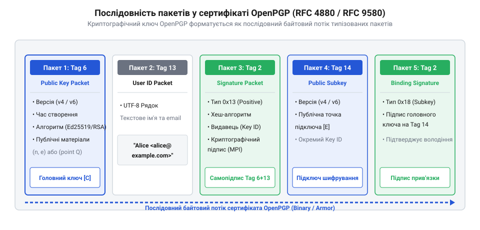
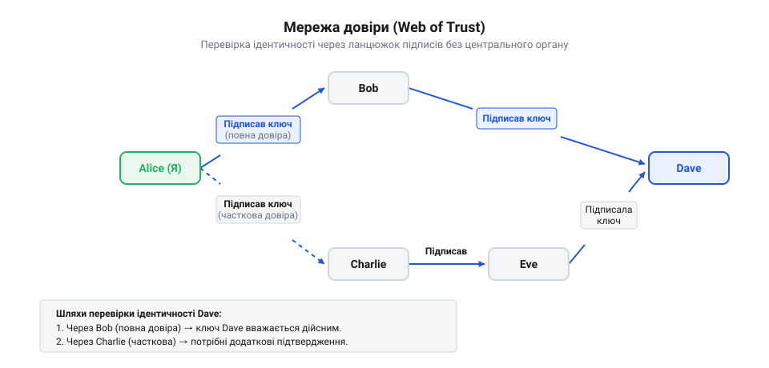

# Формат OpenPGP, підключі й Web of Trust

<preknowlist>
- [Управління ключами та KMS](root:sf-security/key-management) — базове розуміння життєвого циклу ключів, необхідне для розуміння потреби у підключах.
- [Особистість пристрою: серійник, ключ, сертифікат](root:sf-security/osobystist-prystroiu) — концепція відкритого ключа як засобу підтвердження ідентичності.
</preknowlist>

## Проблема автентифікації відкритого ключа

Коли користувач хоче надіслати зашифроване повідомлення, йому потрібен відкритий ключ адресата. Математика асиметричного шифрування гарантує, що розшифрувати текст зможе лише власник відповідного приватного ключа. Проте самі по собі математичні алгоритми нічого не знають про реальних людей, їхні імена чи адреси електронної пошти.

Якщо відправник просто завантажить ключ із мережі, він не матиме гарантії, що цей ключ справді належить потрібній людині. Зловмисник може перехопити запит, згенерувати власну пару ключів і підписати свій відкритий ключ чужим іменем. Відправник зашифрує повідомлення цим підробленим ключем, а зловмисник зможе його перехопити і вільно прочитати. Це класичний приклад атаки «людина посередині» (від англ. @@en|Man-in-the-Middle@@).

Щоб запобігти підміні, користувачі повинні перевіряти автентичність ключа. Традиційно цю проблему вирішують за допомогою централізованих центрів сертифікації, які засвідчують приналежність ключа конкретній особі (докладніше див. [Особистість пристрою: серійник, ключ, сертифікат](root:sf-security/osobystist-prystroiu)). Однак у відкритій екосистемі @@en|OpenPGP@@ користувачі відмовилися від єдиного центру. Замість того, щоб покладатися на корпорацію чи уряд, вони власноруч перевіряють ключі під час зустрічей і залишають на них свої криптографічні підписи. Ця децентралізована концепція отримала назву мережі довіри (від англ. @@en|Web of Trust@@).

## Структура пакетів та розділення ключів

Щоб децентралізована мережа могла функціонувати, математичний ключ, ідентифікатор власника та підписи довіри від інших людей потрібно об'єднати. Стандарт @@en|OpenPGP@@ розв'язує цю задачу, перетворюючи файл ключа на контейнер. 

На базовому рівні цей контейнер складається з незалежних блоків, які називаються пакетами (від англ. @@en|packets@@). Щоб передати ключ разом із його ідентичністю, послідовно об'єднуються три пакети. Спочатку йде пакет відкритого ключа, який містить лише математичні параметри. За ним слідує пакет ідентифікатора користувача зі звичайним текстовим іменем. Третім обов'язково йде пакет підпису, який бере дані з попередніх двох пакетів і криптографічно зшиває їх разом. Будь-яка спроба зловмисника замінити ім'я миттєво зруйнує математичну цілісність цього підпису.

*Відкритий ключ OpenPGP складається з базового пакета ключа, пакета ідентифікатора користувача та пакета підпису, що пов'язує їх воєдино.*

Користувачі рідко використовують єдину пару ключів для всього, оскільки у разі компрометації довелося б починати збирання довіри з нуля. @@en|OpenPGP@@ вирішує це через розділення повноважень. Користувач створює головний майстер-ключ, який потрібен винятково для створення сертифікаційних підписів. Для повсякденного шифрування чи підписування файлів генеруються окремі робочі підключі. Майстер-ключ залишає спеціальний підпис, яким делегує підключам свої повноваження, після чого його можна сховати в безпечне офлайн-сховище (див. [Де живе приватний ключ: токен, HSM, «ноутбук Петра»](root:sf-security/de-zhyve-pryvatnyi-kliuch)).

## Мережа довіри та сервери ключів

Кожен користувач в екосистемі виступає власним центром сертифікації. Коли двоє людей зустрічаються особисто і перевіряють ключі одне одного, вони створюють пакети підписів і додають їх до ключа співрозмовника. Якщо ця інформація передається далі, формується безперервний математичний ланцюжок. Клієнтська програма автоматично аналізує цей граф підписів і обчислює рівень довіри до кожного знайденого ключа.

*Мережа довіри будується знизу вгору. Відсутність центрального вузла означає, що компрометація одного учасника не руйнує довіру між іншими користувачами системи.*

Для зручного обміну цими контейнерами існують глобальні сервери ключів. Це публічні каталоги, які виконують роль дошки оголошень. Сервер не перевіряє паспортні дані та не гарантує справжність — він лише зберігає пакети. Коли з'являється новий підпис, він відправляється на сервер, який просто доєднує цей новий пакет до наявного профілю користувача. Програми-клієнти автоматично завантажують ці оновлення і миттєво перераховують локальні рівні довіри. Завдяки цій безперервній циркуляції пакетів децентралізована мережа функціонує як єдиний глобальний організм (докладніше про обмін див. [Управління ключами та KMS](root:sf-security/key-management)).