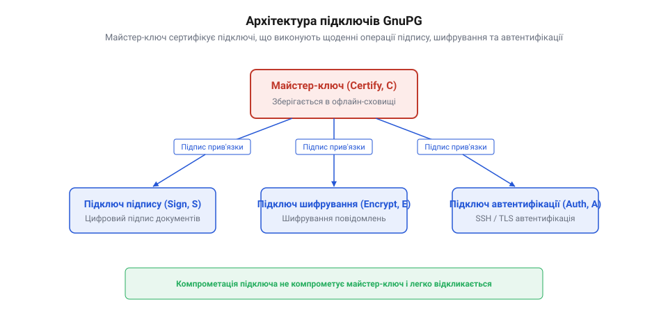

# Створення архітектури підключів у GnuPG

<preknowlist>
- [Де живе приватний ключ: токен, HSM, «ноутбук Петра»](root:sf-security/de-zhyve-pryvatnyi-kliuch) — чому тримати цінні довгострокові ключі на робочому пристрої небезпечно.
- [Відкликання ключа й сертифіката, передбачене заздалегідь](root:sf-security/vidklykannia-kliucha-i-sertyfikata-peredbachene) — чому потрібно генерувати сертифікат відкликання до того, як ключ скомпрометовано.
</preknowlist>

## Чому єдиний ключ — це ризик

Щоденна робота інженера чи аналітика відбувається на комп'ютері, підключеному до мережі. На цьому пристрої виконуються сторонні скрипти, встановлюються пакети залежностей, обробляється пошта та тестується код. За таких умов робоча машина перебуває під постійною загрозою: від шкідливого програмного забезпечення та вразливостей вживаного софту до фізичного викрадення пристрою під час поїздки.

Якщо під час первинного налаштування криптографічного захисту створити стандартну пару ключів @@en|OpenPGP@@, утиліта за замовчуванням генерує єдиний ключ. Цей універсальний ключ володіє всіма можливими функціями: створює цифрові підписи, розшифровує вхідні дані та здійснює автентифікацію на серверах. Оскільки всі ці операції потрібні для повсякденної роботи, секретна частина цього єдиного ключа мусить постійно зберігатися у локальному сховищі файлової системи ноутбука.

Коли ключі зберігаються безпосередньо на файловій системі ноутбука, постає питання про те, [де живе приватний ключ](root:sf-security/de-zhyve-pryvatnyi-kliuch) і як гарантувати його захист під час щоденної роботи. Якщо зловмисник отримує доступ до файлової системи чи оперативної пам'яті робочої машини, він викрадає цей єдиний секретний ключ. Наслідки такого зламу є безповоротними та охоплюють усі аспекти цифрового життя:

1. Втрата автентичності: зловмисник може підписувати електронні листи, документи чи Git-коміти від вашого імені. 2. Втрата конфіденційності: нападник отримує можливість розшифрувати всі приватні повідомлення та файли, зашифровані для вас у минулому чи майбутньому. 3. Втрата контролю доступу: зловмисник може безперешкодно автентифікуватися на віддалених серверах через SSH.

Єдиним способом зупинити використання викраденого ключа є випуск сертифіката відкликання. Проте, оскільки викрадений ключ є вашою єдиною цифровою особистістю, його скасування повністю анулює ваш статус у мережі довіри (англ. @@en|Web of Trust@@, від англ. *web* — павутина + *trust* — довіра). Усі підписи, які ви роками збирали від колег та партнерів для підтвердження особи, втрачають чинність. Вам доведеться створювати новий ключ із нуля та повторно проходити процедуру особистого підтвердження особи перед кожним контактом.

Цей ризик виникає через змішування двох різних за своєю природою задач: довгострокового управління цифровою ідентичністю та виконання щоденних криптографічних операцій. Щоб усунути точку відмови, необхідно відокремити корінний майстер-ключ (англ. @@en|Master Key@@, від лат. *magister* — головний, наставник) від робочих підключів (англ. @@en|Subkey@@, від лат. *sub* — під + англ. *key* — ключ).

## Створення майстер-ключа сертифікації

Для безпечного розподілу повноважень у протоколі @@en|OpenPGP@@ визначено чотири базові функції ключів, кожна з яких позначається відповідним прапорцем:

- Сертифікація (англ. @@en|Certify@@, від лат. *certus* — певний + *facere* — робити; прапорець `C`): підписання інших ключів, додавання нових ідентифікаторів та керування підключами. - Підпис (англ. @@en|Sign@@, від лат. *signum* — знак; прапорець `S`): створення цифрових підписів для файлів, повідомлень і комітів. - Шифрування (англ. @@en|Encrypt@@, від грец. *kryptos* — прихований; прапорець `E`): розшифрування адресованих вам даних. - Автентифікація (англ. @@en|Authenticate@@, від грец. *authentikos* — справжній; прапорець `A`): підтвердження особи у мережевих протоколах, таких як SSH чи TLS.

Основою стійкої криптографічної архітектури є первинний майстер-ключ. Фундаментальне правило безпеки полягає в тому, що майстер-ключ повинен мати лише функцію сертифікації (`C`). Він виступає як ваш особистий центр сертифікації: створює підключі, продовжує термін їхньої дії та підписує ключі інших людей у мережі довіри. Майстер-ключ ніколи не використовується для шифрування робочого листування або підпису щоденних файлів.

Оскільки майстер-ключ потрібен лише для рідкісних адміністративних дій, йому не місце на робочому ноутбуці. Обмеження його прав функцією сертифікації дозволяє в майбутньому безпечно вилучити його з операційної системи, не порушуючи повсякденну роботу.

У програмі @@en|GnuPG@@ створення майстер-ключа можна автоматизувати за допомогою специфікації неінтерактивної генерації. Для забезпечення найвищого рівня криптографічної стійкості та швидкодії застосовують алгоритм на еліптичних кривих @@en|Ed25519@@.

:::code proj-gnupg-subkeys/sh/script.sh 1-21

У результаті виконання цієї процедури створюється майстер-ключ, який отримує свій унікальний ідентифікатор (англ. @@en|Key ID@@). Згенерована пара ключів асоціюється з ідентифікатором користувача (англ. @@en|User ID@@), що містить ім'я та електронну адресу. Цей майстер-ключ стає незмінним корінним якорем вашої цифрової особистості, на якому триматиметься вся подальша ієрархія підключів.

## Генерація підключів для щоденної роботи

Маючи майстер-ключ із функцією сертифікації, необхідно створити набір підключів для виконання щоденних задач. Для кожної операції випускається окремий підключ із відповідним прапорцем:

1. Підключ підпису (прапорець `S`): базується на алгоритмі @@en|Ed25519@@ і застосовується для підписання код-бази у Git, релізних артефактів та електронної пошти. 2. Підключ шифрування (прапорець `E`): використовує еліптичну криву @@en|Cv25519@@ для розшифрування вхідних листів та зашифрованих файлів конфігурації. 3. Підключ автентифікації (прапорець `A`): генерується для автентифікації у сесіях SSH або при використанні TLS-сертифікатів клієнта.

Щоб інші учасники мережі довіри знали, що певний підключ дійсно належить вашому майстер-ключу, застосовується механізм підпису зв'язування підключа (англ. @@en|Subkey Binding Signature@@). Під час генерації підключа майстер-ключ створює криптографічний підпис над публічним підключем своїм прапорцем `C`. Цей підпис гарантує цілісність зв'язку підключа з вашою цифровою особистістю.

Для підключів підпису (`S`) вимоги безпеки є ще суворішими: вони містять також зворотний підпис первинного ключа (англ. @@en|Primary Key Binding Signature@@). Підключ підписує публічну частину майстер-ключа. Це унеможливлює атаку, при якій зловмисник, викравши лише ваш підключ підпису, міг би відрізати його від вашої особистості та прикріпити до власного майстер-ключа.

Для підключів доцільно встановлювати обмежений термін дії — наприклад, один рік. Навіть якщо підключ буде непомітно викрадено, після закінчення цього терміну він автоматично стане недійсним для інших користувачів.

У @@en|GnuPG@@ додавання підключів здійснюється командою `gpg --quick-add-key`, де вказуються ідентифікатор майстер-ключа, криптографічна крива, цільове призначення та термін дії.

:::code proj-gnupg-subkeys/sh/script.sh 23-29

Створена криптографічна структура утворює ієрархічне дерево, у якому кожен елемент виконує чітко розмежовану роль.

*Майстер-ключ слугує корінним центром довіри, а окремі підключі ізолюють щоденні операції підпису, шифрування та автентифікації.*

Після генерації підключів у вашому локальному сховищі присутні як секретний майстер-ключ, так і секретні підключі. Проте залишати секретний майстер-ключ на робочому пристрої небезпечно — його необхідно вилучити.

## Перенесення майстер-ключа в офлайн

Залишати секретний майстер-ключ на пристрої, який щодня підключається до інтернету, означає знівелювати суть створеної архітектури. Якщо ноутбук буде втрачено або інфіковано шкідливим кодом, нападник отримає доступ до майстер-ключа і зможе згенерувати нові підключі від вашого імені. Тому майстер-ключ повинен зберігатися виключно на офлайн-носії у фізично захищеному місці (наприклад, зашифрована флеш-карта у сейфі).

Процес ізоляції майстер-ключа та залишення на пристрої тільки робочих підключів складається з п'яти кроків:

1. Експорт публічного ключа: зберігається повна публічна связка, що містить публічні частини майстер-ключа та всіх підключів (`gpg --export`). 2. Експорт повного архіву секретних ключів: створюється резервна копія, яка містить секретний майстер-ключ і всі секретні підключі (`gpg --export-secret-keys`). Цей файл переноситься на офлайн-носій і надійно ховається. 3. Експорт архіву лише секретних підключів: вигружається спеціальний формат секретних ключів (`gpg --export-secret-subkeys`), де замість приватного майстер-ключа зберігається лише порожня заглушка (англ. @@en|Stub Key@@, від англ. *stub* — обрізок, заглушка). 4. Очищення локального сховища: з бази ключів @@en|GnuPG@@ на робочому пристрої повністю видаляються всі секретні ключі (`gpg --delete-secret-keys`). 5. Імпорт підключів: у порожнє секретне сховище імпортується архів, що містить лише підключі (`gpg --import subkeys_only.gpg.backup`).

Для перевірки успішності процедури виконують перегляд секретних ключів у підсімействі @@en|GnuPG@@.

:::code proj-gnupg-subkeys/sh/script.sh 30-48

При виведенні списку секретних ключів у першому рядку замість позначки `sec` відображається `sec#`. Символ решітки `#` інформує про те, що секретний майстер-ключ відсутній у локальному сховищі пристрою. У той же час підключі позначаються як `ssb` (англ. @@en|Secret Subkey@@), що підтверджує наявність їхніх приватних ключів. Для додаткового рівня захисту підключі можна перенести на [апаратні токени YubiKey](root:sf-security/yubikey-smartcards), що унеможливлює викрадення секретів із пам'яті.

Тепер ваш робочий ноутбук містить лише інструменти для щоденної роботи. У разі фізичної крадіжки пристрою нападник отримає лише обмежені підключі, але не зможе скомпрометувати вашу цифрову особистість.

## Відкликання та заміна підключів

Розділена архітектура підключів демонструє свою ефективність у кризових ситуаціях — коли робочий ноутбук викрадено, втрачено або є підозра щодо витоку приватного ключа з оперативної пам'яті.

За наявності єдиного універсального ключа компрометація пристрою означає катастрофу та повну втрату цифрового імені. У нашій же конфігурації первинний майстер-ключ залишається неушкодженим в офлайн-сейфі, що дозволяє легко ліквідувати наслідки інциденту без втрати довіри у мережі @@en|Web of Trust@@.

Процедура реагування на компрометацію підключа здійснюється у кілька кроків:

1. Власник підключає офлайн-носій із повним секретним майстер-ключем до захищеного комп'ютера, не підключеного до мережі інтернет. 2. За допомогою майстер-ключа генерується сертифікат відкликання (англ. @@en|Revocation Certificate@@, від лат. *revocare* — відкликати, повертати) конкретного скомпрометованого підключа (`S` або `E`). 3. Майстер-ключ підписує відкликання підключа, вказуючи причину скасування (наприклад, компрометація ключа). 4. Майстер-ключ генерує новий підключ підпису чи шифрування взамін скасованого. 5. Оновлений публічний ключ, який тепер містить інформацію про скасований підключ та новий дійсний підключ, експортується та публікується на серверах ключів або розсилається колегам. 6. Нові секретні підключі імпортуються на новий робочий пристрій.

Оскільки публічна частина майстер-ключа та його ідентифікатор залишаються незмінними, усі зв'язки довіри з колегами зберігаються. Системи перевірки підписів та інші користувачі автоматично дізнаються про скасування викраденого підключа при отриманні оновленого публічного ключа. Для успішного виконання цієї операції критично важливо, щоб [відкликання ключа й сертифіката](root:sf-security/vidklykannia-kliucha-i-sertyfikata-peredbachene) було сплановане та підготовлене заздалегідь.

Завдяки відокремленню майстер-ключа компрометація ноутбука перетворюється з катастрофи на штатно керовану процедуру ротації ключів, залишаючи вашу цифрову особистість повністю захищеною.