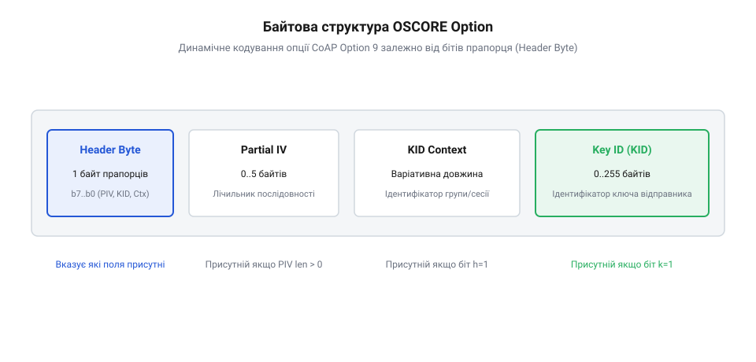

# Структура опції OSCORE (Option 9) та формат кадру

<preknowlist>
- [Наскрізне шифрування](root:sf-security/end-to-end-encryption) — концепція захисту від кінця до кінця, щоб розуміти потребу в інкапсуляції корисного навантаження.
- [Захист від повтору (replay)](root:sf-security/replay-protection) — концепція використання одноразових номерів (нонсів), щоб розуміти призначення поля Partial IV.
</preknowlist>

## Інкапсуляція кадру через опцію 9

Коли пристрої Інтернету речей спілкуються за допомогою протоколу CoAP у відкритій мережі, їхній трафік є вразливим. Якщо пристрій надсилає команду розблокувати двері, будь-який вузол на шляху може прочитати, змінити або перехопити це повідомлення. Щоб гарантувати безпеку даних від відправника до кінцевого отримувача (концепцію цього підходу детально пояснює [Наскрізне шифрування](root:sf-security/end-to-end-encryption)), було створено протокол OSCORE.

Замість того, щоб загортати весь мережевий трафік у важкий захищений тунель, OSCORE діє безпосередньо на рівні самого повідомлення CoAP. Він бере оригінальне повідомлення і ховає його вміст усередині нового кадру. Для цього протокол сортує всі опції CoAP на дві категорії: внутрішні (зашифровані) та зовнішні (незашифровані). Внутрішні опції, такі як шлях до ресурсу або формат корисного навантаження, шифруються разом із самими даними. Зовнішні опції, які потрібні маршрутизаторам для доставки пакета, залишаються відкритими. 

Зашифрований блок форматується як стандартизований [об'єкт COSE](root:new/cose-object) і стає корисним навантаженням нового, зовнішнього повідомлення. Щоб отримувач зрозумів, що це не звичайний текст, а підготовлена криптограма, до зовнішнього повідомлення додається спеціальна опція CoAP — опція 9 (OSCORE). Вона слугує маркером і єдиною точкою входу для парсера. Побачивши опцію 9, парсер розуміє, що перед ним захищений кадр, який потрібно спочатку розшифрувати, використовуючи параметри з цієї ж опції.

## Байтова структура та прапорці

Для успішного розшифрування повідомлення парсеру потрібні метадані: який саме ключ використати та яке унікальне значення (нонс) було застосовано для захисту від повторних атак (роль нонсів описана в темі [Захист від повтору (replay)](root:sf-security/replay-protection)). Оскільки повідомлення IoT мають бути максимально короткими, опція OSCORE пакує ці метадані у дуже щільний бінарний формат.

Значення опції 9 є послідовністю байтів. Найперший байт завжди є байтом прапорців. Його окремі біти вказують, які саме поля йдуть далі в потоці:
* Біти від 0 до 2: визначають точну довжину поля Partial IV (нонсу). * Біт 3: вказує, чи присутній ідентифікатор ключа (KID). * Біт 4: вказує, чи присутній контекст ідентифікатора ключа (KID Context). * Біти від 5 до 7: зарезервовані й повинні дорівнювати нулю.

Прочитавши лише цей перший байт, програма миттєво розуміє структуру всього подальшого блоку. Якщо біт KID встановлений, парсер знатиме, що потрібно витягувати ідентифікатор. Якщо біти Partial IV показують довжину 3, парсер очікуватиме рівно три байти нонсу. 

Розглянемо практичний приклад значення байта прапорців `0b00001011` (або `0x0B` у шістнадцятковому форматі). Молодші три біти `011₂` (число 3) вказують на те, що значення часткового вектора ініціалізації (Partial IV) має довжину рівно в 3 байти. Біт 3 встановлено в `1`, що свідчить про наявність поля ідентифікатора ключа (KID), тоді як біт 4 дорівнює `0`, означаючи відсутність поля KID Context. Отже, розпарсивши байт `0x0B`, парсер точно знає, що одразу за цим байтом слідують 3 байти Partial IV, після яких негайно йде байтовий масив KID, а всього у заголовку передано комбіновані метадані без жодних зайвих вирівнювальних байтів.

*Опція OSCORE починається з байта прапорців, за яким послідовно розташовуються опціональні поля Partial IV, довжина KID Context, сам KID Context та KID.*

## Парсинг ідентифікаторів і нонсів

Під час написання низькорівневого коду для розбору опції парсер повинен акуратно зчитувати поля одне за одним, оскільки їхнє розташування є динамічним. Одразу після байта прапорців іде поле Partial IV. Парсер зчитує з молодших трьох бітів прапорця число від 0 до 5 — це і є розмір Partial IV у байтах. Програма відраховує цю кількість байтів і зберігає їх для подальшого конструювання криптографічного нонсу.

Якщо четвертий біт прапорців встановлено, наступним у потоці йде поле KID Context. Оскільки контекст може мати різну довжину, перед ним завжди стоїть один додатковий байт, який прямо вказує розмір цього контексту. Парсер читає цей байт довжини, а потім зчитує відповідну кількість байтів самого контексту. Цей контекст зазвичай використовується, щоб розрізняти однакові ідентифікатори ключів у різних групах пристроїв.

Нарешті, якщо встановлено третій біт прапорців, програма має прочитати поле KID (ідентифікатор ключа). На відміну від контексту, KID не має окремого байта довжини. Його розмір визначається за залишковим принципом. Парсер бере загальну довжину всієї опції 9 і віднімає від неї 1 (байт прапорців), довжину Partial IV та довжину KID Context (разом із його байтом розміру), якщо вони були присутні. Усі байти, що залишилися до кінця опції, утворюють KID. Цей ідентифікатор вкаже пристрою, який саме криптографічний ключ зі сховища слід застосувати для розшифрування корисного навантаження.