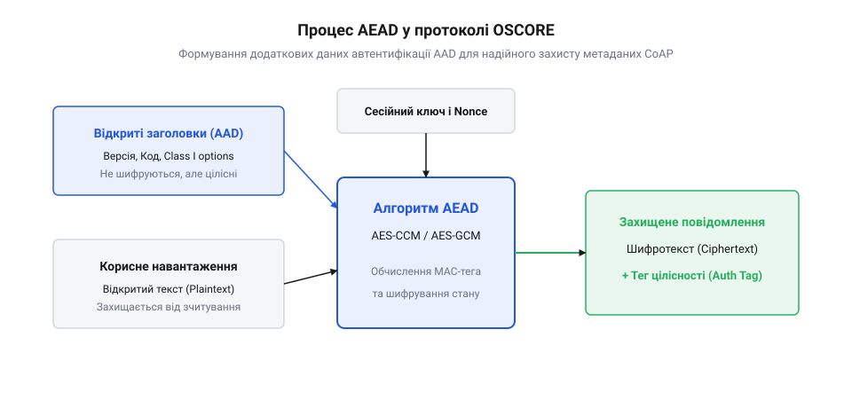
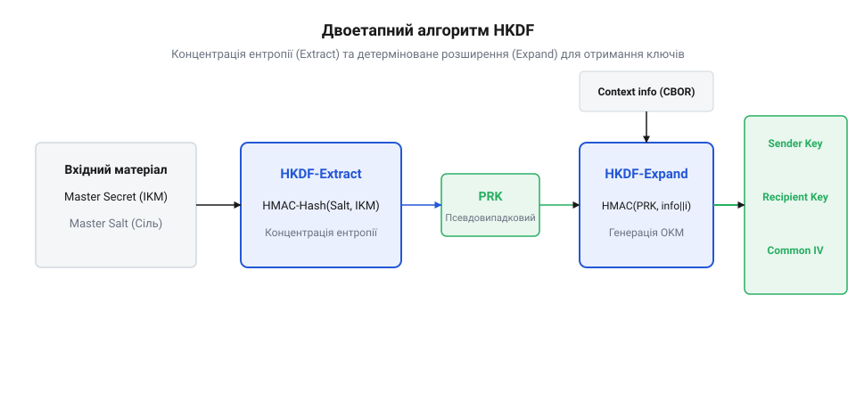

# Криптографічний фундамент OSCORE: HKDF та AEAD

<preknowlist>
- [Наскрізне шифрування](root:sf-security/end-to-end-encryption) — концепція того, що транзитні вузли не мають доступу до криптографічних ключів і можуть бачити лише відкриті маршрутні метадані.
- [TLS Handshake: рукостискання й узгодження ключів](root:sf-security/tls-handshake) — розуміння результату узгодження ключів, з якого утворюється початковий спільний майстер-секрет для подальшого розгортання.
</preknowlist>

## Загрози підміни маршрутних заголовків CoAP

Протокол CoAP розроблено для передачі даних у ресурсообмежених мережах IoT, де повідомлення часто проходять через проміжні проксі-сервери та мережеві шлюзи. На відміну від транспортного шифрування [TLS](root:sf-security/tls), яке захищає канал лише між сусідніми вузлами, наскрізне об'єктне шифрування OSCORE має захищати корисне навантаження на всьому шляху від відправника до кінцевого отримувача.

При цьому транзитні шлюзи мусять бачити базові заголовки CoAP (наприклад, URI-шлях або код методу) для правильної маршрутизації пакетів. Якщо шифрувати лише тіло повідомлення (@@en|payload@@), зловмисник або скомпрометований проксі-сервер може підмінити незахищені заголовки запиту — змінити метод GET на DELETE або перенаправити запит на інший ресурс. Звідси виникає математична задача: як забезпечити криптографічну цілісність відкритих метаданих без їхнього шифрування.

## Автентифіковане шифрування AEAD та AAD

Для одночасного забезпечення конфіденційності даних та цілісності відкритих заголовків у протоколі OSCORE застосовується апарат автентифікованого шифрування з додатковими даними (@@en|Authenticated Encryption with Associated Data, AEAD@@). Алгоритм AEAD приймає на вхід симетричний ключ `K`, одноразовий вектор ініціалізації (@@en|nonce@@) `N`, відкритий текст `P` та масив додаткових автентифікованих даних (@@en|Additional Authenticated Data, AAD@@) `A`. При використанні режиму AES-CCM (Counter with CBC-MAC) одноразовий вектор ініціалізації укладається у спеціальний 15-байтовий блок `B₀`, де перші 8 бітів кодують прапорці довжини тегу та розміру корисного навантаження, перші 7–13 байтів займає сам `N`, а решта байтів відводиться під лічильник блоків, що гарантує сувору атомарність криптографічних перетворень для кожного кадру.


*Відкриті маршрутні заголовки CoAP пакуються у блок AAD та підписуються алгоритмом AEAD разом із зашифрованим корисним навантаженням.*

Математично операція AEAD шифрування генерує шифротекст `C` та імплантований тег автентичності (@@en|authentication tag@@) `T`:

        (C, T) = Encrypt(K, N, P, A)

Блок `A` (AAD) містить серіалізовані критичні заголовки CoAP, ідентифікатори ключів та параметри алгоритму. Під час дешифрування отримувач обчислює:

        P = Decrypt(K, N, C, T, A)

Якщо зловмисник на каналі зв'язку змінить хоча б один біт у відкритих заголовках `A`, перевірка тегу `T` на боці отримувача зазнає збою, і весь пакет буде відхилено як підроблений. Захист від повторних атак забезпечується використанням унікальних нонсів [Захист від повтору (replay)](root:sf-security/replay-protection).

## Потреба у виведенні незалежних ключів

Використання єдиного симетричного ключа для відправлення запитів та відповідей у двох напрямках є небезпечним. Зловмисник може перехопити зашифрований пакет запиту від клієнта і миттєво повернути його назад клієнту як відповідь (@@en|reflection attack@@). Оскільки ключ і алгоритм збігаються, клієнт може прийняти власне повідомлення за валідну відповідь сервера.

Для запобігання цим атакам протокол OSCORE вимагає суворого розділення криптографічного матеріалу: відправник і отримувач повинні використовувати окремі незалежні keys та vectors ініціалізації для кожного напрямку обміну.


*Алгоритм HKDF перетворює спільний майстер-секрет у незалежні сесійні ключі відправника та отримувача.*

Для розгортання єдиного спільного майстер-секрету (@@en|Master Secret@@), узгодженого, наприклад, через [TLS Handshake: рукостискання й узгодження ключів](root:sf-security/tls-handshake), у криптографічний матеріал OSCORE застосовується функція деривації ключів на основі HMAC (@@en|HMAC-based Key Derivation Function, HKDF@@). Алгоритм HKDF складається з двох етапів:

1. **Extract**: `PRK = HMAC-Hash(Salt, IKM)` — концентрує ентропію з початкового матеріалу ключів `IKM`. 2. **Expand**: `OKM = HKDF-Expand(PRK, info, L)` — генерує вихідний криптографічний матеріал заданої довжини `L` з урахуванням текстового контексту `info`.

Шляхом підстави у параметр `info` унікальних контекстних міток (Sender Key, Recipient Key, Common IV) HKDF гарантовано виводить ортогональні ключі, унеможливлюючи атаки віддзеркалення.

## Математика алгоритму виведення HKDF

Двохфазна схема розгортання ключів @@en|HMAC-based Key Derivation Function, HKDF@@ побудована на криптографічній псевдовипадковій функції HMAC. Вона розв'язує задачу перетворення вхідного криптографічного матеріалу (@@en|Input Keying Material, IKM@@), який може мати нерівномірний розподіл ентропії або нестандартний розмір, у набір криптографічно міцних і статистично незалежних ключів. Алгоритм складається з двох послідовних математичних фаз: вилучення ентропії (@@en|Extract@@) та розширення ключового матеріалу (@@en|Expand@@).

Перша фаза Extract стискає вхідний матеріал IKM і сіль (@@en|salt@@) у псевдовипадковий ключ (@@en|Pseudorandom Key, PRK@@) фіксованої довжини. Сіль виконує роль підсилювача ентропії та забезпечує незалежність виведених ключів у різних сесіях. Математично обчислення PRK описується виразом:

```
PRK = HMAC-Hash(salt, IKM)
```

де `HMAC-Hash` позначує функцію HMAC на базі криптографічного гешу (наприклад, SHA-256 із довжиною виходу L = 32 байти). Якщо сіль не передається, застосовується рядок із нульових байтів довжиною L. Значення PRK володіє властивістю нерозрізнюваності від рівномірно випадкового байтового масиву.

Друга фаза Expand приймає обчислений PRK, контекстний рядок інформації `info` та бажану довжину вихідного ключа `N` у байтах. Вона генерує послідовність блоків `T(1), T(2), ..., T(t)`, де `t = ⌈N / L⌉`. Оскільки лічильник блоків передається у вигляді одного байта `0x01..0xFF`, максимальна кількість блоків `t` обмежена значенням 255. Це встановлює жорстку верхню межу на довжину вихідного ключового матеріалу `OKM` (@@en|Output Keying Material@@): `N <= 255 × L`. Для HMAC-SHA-256 це значення становить `255 × 32 = 8160` байтів, що з запасом перекриває потреби будь-яких криптографічних протоколів.

Кожен крок обчислення блоку `T(i)` описується рекурентною формулою:

```
T(0) = порожній рядок (довжина 0)
T(1) = HMAC-Hash(PRK, T(0) || info || 0x01)
T(2) = HMAC-Hash(PRK, T(1) || info || 0x02)
T(i) = HMAC-Hash(PRK, T(i-1) || info || byte(i))
```

Потім вихідний ключ утворюється першими `N` байтами об'єднаного масиву:

```
OKM = T(1) || T(2) || ... || T(t)   [взяття перших N байтів]
```

Для протоколу OSCORE значення `info` представляє собою чітко структуровану бінарну послідовність CBOR (@@en|Concise Binary Object Representation@@), яка містить псевдонім ключа, ідентифікатор контексту, довжину ключа та маркер призначеного алгоритму (наприклад, AES-CCM-16-64-128). Це унеможливлює перехресні атаки, коли один і той самий PRK міг би дати однакові значення для різних за призначенням ключів.

Проілюструємо обчислення блоку `T(1)` при використанні HMAC-SHA-256 для отримання 16-байтового ключа шифрування відправника (Sender Key). Нехай PRK є 32-байтовим вектором `0x4a...8f`, а контекст `info` заданий послідовністю байтів OSCORE Info Structure `0x84...01`.

```
T(1) = HMAC-SHA256(PRK, info || 0x01)
     = HMAC-SHA256(0x4a...8f, 0x84...01 || 0x01)       [підстановка значення PRK та прапорця кроку]
     = 0xa3f890b212c45e89d1029384756102938471b0a982c...  [обчислення 256-бітного гешу]
Sender Key = T(1)[0..15]                               [вибір перших 16 байтів ОКМ]
```

При послідовній генерації багатьох блоків `T(i)` теоретично існує ризик витоку ентропії через зв'язування попереднього блоку `T(i-1)` у наступній ітерації. Проте псевдовипадкова природа HMAC гарантує, що без знання значення PRK кожен новий блок `T(i)` залишається обчислювально нерозрізнюваним від випадкової послідовності.

Оскільки для виведення Sender Key, Recipient Key та Common IV використовуються унікальні значення `info` (зі значеннями типів `"Key"` та `"IV"` відповідно), згенеровані ключові послідовності є строго ортогональними. Навіть якщо зловмисник повністю скомпрометує один із похідних ключів (наприклад, Sender Key), це не дасть йому жодної інформації для визначення Recipient Key або початкового майстер-секрету IKM.

## Криптографічна міцність формату COSE

Отримані в результаті роботи HKDF сесійні ключі та вектори ініціалізації безпосередньо використовуються в криптографічному контейнері @@en|CBOR Object Signing and Encryption, COSE@@. Для захисту CoAP-повідомлень в OSCORE застосовується компактна структура `COSE_Encrypt0`, визначена стандартами RFC 8152 та RFC 9052. Вона призначена для ситуацій, коли криптографічний ключ уже відомий обом сторонам і відсутня потреба передавати явні параметри узгодження ключів у кожному кадрі.

Математична надійність `COSE_Encrypt0` спирається на комбінацію шифрування та автентифікації AEAD. Корисне навантаження кадру піддається шифруванню шифром AES-CCM або AES-GCM, де кожна операція гарантує не лише конфіденційність даних, але й цілісність додаткових незашифрованих даних AAD (@@en|Additional Authenticated Data@@). Якщо транзитний вузол модифікує хоча б один біт у відкритих опціях CoAP, включених до AAD, перевірка тегу автентифікації на боці отримувача завершиться помилкою, і пакет буде відкинуто без розшифрування.

Для мінімізації накладних витрат у пристроях Інтернету речей структура `COSE_Encrypt0` оптимізована до межі. Вона не містить дубльованих полів і передає лише частковий вектор ініціалізації (Partial IV) та ідентифікатор ключа (KID). Захищений кадр CoAP складається з трьох елементів: зовнішнього заголовка з опцією 9 (OSCORE), незашифрованих відкритих опцій та зашифрованого блоку, який об'єднує шифротекст і тег автентифікації (@@en|Authentication Tag, MAC@@).

Оцінимо стійкість такої схеми до атак повторного використання нонсу. Унікальний вектор ініціалізації IV для кожного кадру обчислюється шляхом побітового виключного АБО (XOR) між базовим вектором `Common IV` (отриманим через HKDF) та лічильником `Sequence Number` (переданим у Partial IV):

```
Nonce = Common IV ⊕ Partial IV   [побітове XOR вирівняне по правому краю]
```

Оскільки лічильник `Sequence Number` строго монотонно зростає при кожній відправці кадру, повторне застосування однакової пари `(Key, Nonce)` є математично неможливим. Захист від атак повтору [Захист від повтору (replay)](root:sf-security/replay-protection) додатково підкріплюється збереженням ковзного вікна прийнятих лічильників на боці сервера.

Таким чином, поєднання детермінованого виведення ключів HKDF, суворого формування AAD та компактного пакування `COSE_Encrypt0` забезпечує повний криптографічний захист інформації на рівні окремих CoAP-повідомлень. Модель гарантує захист від прослуховування, модифікації, фальсифікації джерела та повторного відтворення даних навіть у неналагоджених незахищених IP-мережах.