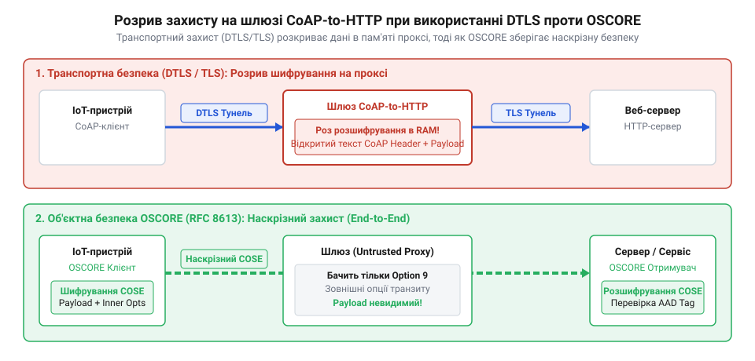
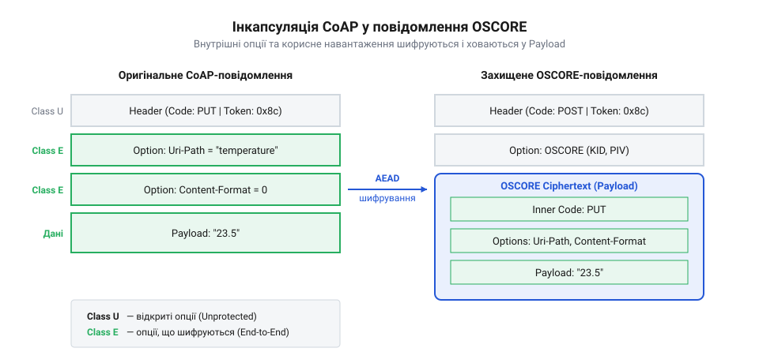
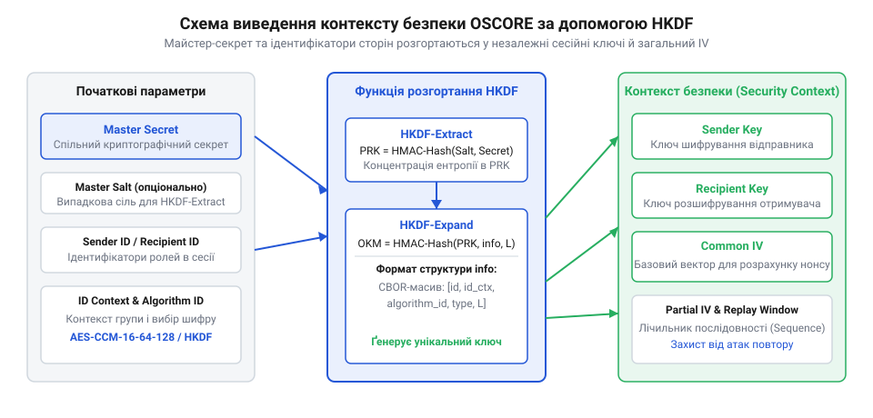

# OSCORE: об'єктна безпека для обмежених веб-середовищ (RFC 8613)

<preknowlist>
- [Наскрізне шифрування](root:sf-security/end-to-end-encryption) — розуміння концепції E2EE, за якої проміжні вузли не можуть прочитати дані.
- [DTLS: захищений транспорт для датаграмних протоколів](root:sf-security/dtls) — базові знання про традиційний захист IoT-трафіку для розуміння недоліків, які вирішує OSCORE.
- [TLS Handshake: рукостискання й узгодження ключів](root:sf-security/tls-handshake) — загальне уявлення про процес встановлення криптографічного контексту між двома сторонами.
</preknowlist>

## Проблема проміжних вузлів у IoT

Мережі Інтернету речей часто будуються зі складними топологіями, де датчик не спілкується з хмарним сервером напряму. Замість цього пристрої відправляють телеметрію за протоколом CoAP до локального шлюзу. Шлюз виступає транзитним проксі-сервером: він приймає CoAP-пакети, розбирає їх, перетворює на звичні HTTP-запити та відправляє у хмару. Така трансляція протоколів є зручною для розробників бекенду, але створює фундаментальну проблему для безпеки даних.

У класичній мережі трафік захищають на транспортному рівні за допомогою протоколу [DTLS](root:sf-security/dtls) (Datagram Transport Layer Security). DTLS створює зашифрований тунель між двома IP-адресами — у нашому випадку між датчиком і шлюзом. Оскільки шлюзу потрібно перетворити CoAP на HTTP, він змушений розшифрувати пакет, прочитати його вміст, сформувати новий запит і зашифрувати його вже за допомогою [TLS](root:sf-security/tls).

*Шлюз діє як посередник, розриваючи транспортне шифрування, через що корисне навантаження стає доступним у відкритому вигляді всередині самого пристрою.*

Цей процес перериває криптографічний захист. У момент трансляції на проміжному вузлі всі дані перебувають у відкритому вигляді: не лише корисне навантаження (показники датчиків чи команди керування), а й специфічні метадані протоколу CoAP. До них належать цільові шляхи (@@en|URI-Path@@), параметри запиту (@@en|URI-Query@@) та формат контенту (@@en|Content-Format@@). Якщо транзитний шлюз належить сторонньому провайдеру або його скомпрометують, зловмисники отримають не тільки повний доступ до інформації, а й зможуть непомітно маніпулювати логікою звернень чи підробляти запити. У такій архітектурі справжнє [наскрізне шифрування](root:sf-security/end-to-end-encryption) стає неможливим, адже транспортний захист завжди закінчується там, де закінчується IP-з'єднання.

Еволюція захисту IoT продемонструвала слабкість підходу від кінця до кінця виключно на рівні транспорту. У складних мережевих топологіях із транзитними проксі-серверами та CoAP-to-HTTP шлюзами суто транспортного шифрування виявилося недостатньо. Індустрія зрозуміла потребу в наскрізному об'єктному захисті на рівні прикладного повідомлення, незалежному від мережевого каналу, що й пояснює, чому IETF створила специфікацію RFC 8613 під назвою OSCORE.

## Об'єктна безпека на рівні повідомлення

Протокол OSCORE розв'язує проблему посередників, переносячи шифрування з транспортного рівня безпосередньо на прикладний. Замість того, щоб шифрувати весь UDP-пакет цілком (як це робить транспортний захист), пристрій модифікує саме повідомлення CoAP. Він бере оригінальне корисне навантаження (@@en|payload@@) та критично важливі заголовки, після чого надійно запаковує їх у криптографічний об'єкт. Цей об'єкт серіалізується та форматується за відкритим стандартом [COSE](root:sf-security/cose-and-cwt-iot-security) (CBOR Object Signing and Encryption), який спеціально розроблений для економії байтів у мережах Інтернету речей.

*Оригінальне повідомлення розрізається: маршрутні дані залишаються зовні для проксі, а таємні опції й тіло ховаються в зашифрований об'єкт.*

Ключовий механізм OSCORE полягає в архітектурному розділенні опцій CoAP на два класи: внутрішні (зашифровані) та зовнішні (відкриті). Коли сенсор формує звичайне повідомлення, воно містить метод (наприклад, `GET` або `POST`), цільовий шлях до ресурсу, формат даних та саме тіло повідомлення. Під час перетворення в OSCORE-пакет алгоритм аналізує ці складові. 

Внутрішні опції — це ті дані, які стосуються безпосередньо логіки застосунку і не повинні бути розкриті. До них належать конкретний шлях до ресурсу на кінцевому сервері (@@en|Uri-Path@@), параметри запиту (@@en|Uri-Query@@) та формат контенту (@@en|Content-Format@@). Разом із початковим кодом методу (наприклад, кодом `0.01 GET`) та корисним навантаженням ці опції шифруються алгоритмом AEAD і стають абсолютно невидимими для проксі-серверів або сторонніх спостерігачів.

Зовнішні опції необхідні мережевому обладнанню для того, щоб пакет фізично дійшов до адресата. Проксі-серверам не потрібно знати, яку саме температуру відправив датчик або який конкретно скрипт він викликає на бекенді, але їм потрібно знати доменне ім'я кінцевої точки (@@en|Uri-Host@@) та порт (@@en|Uri-Port@@). Тож ці опції, разом із маркерами транзакцій, які відповідають за збіг запитів і відповідей (@@en|Token@@), залишаються у відкритій частині нового повідомлення. Сам зовнішній пакет зазвичай набуває нейтрального коду методу `0.02 POST`, повністю приховуючи оригінальний метод від мережевих аналізаторів.

Для кращого розуміння розглянемо приклад. Нехай розумний термостат відправляє запит на зміну температурного режиму: метод `PUT`, шлях `Uri-Path: /config/temperature`, тіло запиту `22.5`. Без OSCORE проміжний HTTP-шлюз прочитає цей запит і дізнається структуру логіки бекенду та значення показників. З OSCORE термостат згенерує зовнішнє повідомлення з методом `POST`, у якому тілом виступатиме лише непрозора бінарна послідовність — зашифрований об'єкт COSE. У відкритому вигляді залишиться тільки адреса сервера. Проксі-сервер побачить просто абстрактний `POST`-запит із бінарним тілом і перешле його за адресою, не маючи жодної змоги прочитати або змінити дані.

Щоб кінцевий сервер і транзитні вузли могли відрізнити таку зашифровану капсулу від звичайного корисного навантаження, протокол додає до відкритого заголовка спеціальну маркерну опцію OSCORE (Option 9). Ця опція відіграє роль відкритої інструкції для криптографічного рушія: вона несе в собі публічний ідентифікатор відправника та частковий вектор ініціалізації, які необхідні для розшифрування об'єкта на кінцевій стороні. Отримавши такий пакет, кінцевий сервер розпізнає опцію 9, витягує об'єкт COSE, перевіряє його цілісність, розшифровує та повністю відновлює оригінальний запит (повертаючи йому метод `PUT` і шлях `/config/temperature`). Для інженерів, які самостійно реалізують стек протоколу, опубліковано технічний довідник, де детально розписано [структуру цієї опції](root:sf-security/oscore/api-oscore-option.md).

## Загальний контекст безпеки та ключі

Щоб відправник зміг зашифрувати повідомлення, а отримувач — розшифрувати його, обидві сторони повинні володіти спільними знаннями. В екосистемі OSCORE цей набір спільних знань називається контекстом безпеки (@@en|Security Context@@). Він складається з майстер-секрету (@@en|Master Secret@@), спільної солі (@@en|Master Salt@@) та унікальних ідентифікаторів сторін — ідентифікатора відправника (@@en|Sender ID@@) та ідентифікатора отримувача (@@en|Recipient ID@@).

OSCORE не використовує майстер-секрет напряму для шифрування повідомлень. Замість цього протокол математично виводить з нього робочі ключі за допомогою функції HKDF (Hash-based Key Derivation Function).

*Функція HKDF поєднує спільний майстер-секрет з ідентифікаторами сторін, щоб утворити незалежні ключі для відправника та отримувача.*

Завдяки алгоритмам виведення ключів, кожна сторона отримує свій унікальний ключ для шифрування вихідних повідомлень (@@en|Sender Key@@) і ключ для розшифрування вхідних (@@en|Recipient Key@@). Оскільки ролі сторін асиметричні, ключ відправника в одного вузла математично збігається з ключем отримувача в іншого вузла. Додатково виводиться спільний вектор ініціалізації (@@en|Common IV@@), який гарантує безпеку під час роботи блокових шифрів. Усі ці математичні перетворення забезпечують криптографічний фундамент через симетричний [процес виведення ключів](root:sf-security/oscore/math-oscore-aead-hkdf.md).

Оскільки контекст безпеки зберігає свій стан і ключі виводяться симетрично, сторонам не потрібно виконувати важке [рукостискання й узгодження ключів](root:sf-security/tls-handshake) перед кожною відправкою даних. Цей базовий контекст можна прошити на пристрої ще на заводі, передати захищеним каналом або динамічно узгодити за допомогою дуже легкого протоколу [EDHOC](root:sf-security/edhoc-protocol). Після того, як контекст встановлено, пристрій може миттєво відправляти пакети. Розробники можуть переглянути приклад програмного [налаштування клієнт-серверного обміну](root:sf-security/oscore/proj-liboscore-coap-exchange.md) для глибшого розуміння процесу.

## Захист від повтору повідомлень
Навіть якщо дані надійно зашифровані, зловмисник може перехопити коректний пакет (наприклад, команду «відчинити замок») і надіслати його знову через певний час. Щоб унеможливити такі маніпуляції, криптографічний протокол повинен забезпечувати [захист від повтору (replay)](root:sf-security/replay-protection). У протоколі OSCORE ця проблема вирішується за допомогою унікальних порядкових номерів для кожного повідомлення.

Кожен пристрій-відправник веде власний лічильник повідомлень, значення якого називається частковим вектором ініціалізації (@@en|Partial IV@@). Перед відправкою нового пакета пристрій збільшує цей лічильник. Далі протокол бере спільний вектор ініціалізації з контексту безпеки (@@en|Common IV@@) і за допомогою побітової операції виключного АБО поєднує його з ідентифікатором відправника та поточним значенням лічильника. У результаті утворюється криптографічне одноразове число — нонс (@@en|Nonce@@).

Цей унікальний нонс подається на вхід алгоритму шифрування разом із даними. Оскільки лічильник постійно зростає, нонс ніколи не повторюється. Це гарантує, що навіть два абсолютно однакові запити перетворяться на різний зашифрований текст.

На стороні отримувача працює механізм ковзного вікна (@@en|Sliding Window@@). Отримувач запам'ятовує номери повідомлень, які він нещодавно успішно розшифрував. Якщо надходить пакет із номером, який уже є в пам'яті, або з номером, що занадто сильно відстав від поточного вікна, система негайно його відкидає як дублікат. Такий підхід надійно блокує атаки повтору, але водночас дозволяє обробляти пакети, які змінили порядок доставки під час маршрутизації в нестабільних бездротових мережах.

## Порівняння OSCORE та DTLS
Вибір між OSCORE та класичним [DTLS](root:sf-security/dtls) залежить від архітектури мережі та наявних ресурсів. Головна відмінність полягає в рівні роботи: DTLS захищає транспортний канал між двома вузлами, тоді як OSCORE захищає сам об'єкт даних на прикладному рівні.

Якщо мережа містить транзитні вузли, наприклад, проксі-сервери або шлюзи, які перетворюють CoAP на HTTP, DTLS розірве з'єднання на цьому посереднику. Проксі отримає доступ до відкритих даних, що порушить [наскрізне шифрування](root:sf-security/end-to-end-encryption). Натомість OSCORE зберігає дані зашифрованими незалежно від того, скільки разів повідомлення змінювало транспортний протокол або через скільки шлюзів воно пройшло.

Другий важливий критерій — ресурсоємність і збереження енергії. Протокол DTLS зберігає стан з'єднання (@@en|stateful@@). Щоб почати обмін, пристрою потрібно виконати багатоетапне [рукостискання й узгодження ключів](root:sf-security/tls-handshake), що вимагає процесорних обчислень та кількох пересилань пакетів туди й назад. Для сенсорів, які прокидаються від батареї лише щоб відправити кілька байтів температури, такі витрати є надмірними. OSCORE після одноразового встановлення контексту працює без збереження стану (@@en|stateless@@): пристрій просто прокидається, формує зашифрований пакет, відправляє його і знову засинає.

Третя перевага OSCORE полягає в підтримці групових розсилок (@@en|Multicast@@). Оскільки DTLS прив'язаний до двостороннього транспортного з'єднання, він дуже погано масштабується для розсилки команд відразу групі пристроїв. OSCORE від самого початку підтримує спільний груповий контекст безпеки, дозволяючи одному повідомленню бути безпечно доставленим і перевіреним усіма авторизованими отримувачами одночасно. Загалом DTLS залишається добрим вибором для простих з'єднань точка-точка, але для складних, ресурсообмежених і масштабованих мереж стандартом де-факто стає OSCORE.