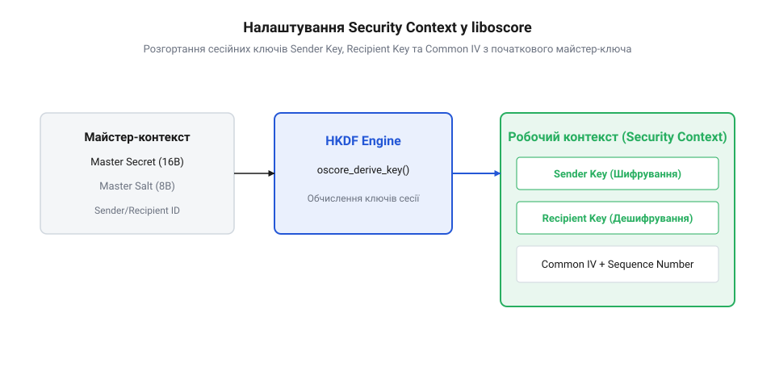

# Налаштування захищеного обміну за допомогою liboscore

<preknowlist>
- [Наскрізне шифрування](root:sf-security/end-to-end-encryption) — концепція об'єктного захисту даних
</preknowlist>

## Ініціалізація та розгортання контексту liboscore

Протокол @@en|CoAP@@ (з англійської @@en|Constrained Application Protocol@@ — «протокол для обсягово-обмежених застосунків») передає дані через недовірені або відкриті бездротові мережі. Стандартні засоби захисту транспортного рівня, як-от [DTLS: захищений транспорт для датаграмних протоколів](root:sf-security/dtls) чи класичний [TLS](root:sf-security/tls), вимагають важкого [рукостискання й узгодження ключів](root:sf-security/tls-handshake), що не завжди підходить для систем з акумуляторним живленням. Крім того, шифрування канального або транспортного рівня втрачає захист, коли пакет проходить через intermediate @@en|CoAP Proxy@@ шлюзи. Для розв'язання цієї проблеми розроблено протокол @@en|OSCORE@@ (з англійської @@en|Object Security for Constrained RESTful Environments@@, RFC 8613), який реалізує [наскрізне шифрування](root:sf-security/end-to-end-encryption) безпосередньо на рівні додатку. Бібліотека @@en|liboscore@@ пропонує компактну реалізацію даного стандарту мовою C.

Фундаментом захисту у бібліотеці @@en|liboscore@@ є криптографічний контекст безпеки (@@en|Security Context@@). Він зберігає параметри, необхідні для шифрування та перевірки автентичності повідомлень між двома вузлами. Перед початком передачі обидві сторони повинні мати узгоджений майстер-секрет (@@en|Master Secret@@) та сіль (@@en|Master Salt@@), а також унікальні ідентифікатори відправника (@@en|Sender ID@@) та отримувача (@@en|Recipient ID@@).

*Процес виведення сесійних ключів та векторів ініціалізації з майстер-секрету та солі у бібліотеці liboscore.*

Під час ініціалізації контексту функція деривації ключів @@en|HKDF@@ (з англійської @@en|HMAC-based Extract-and-Expand Key Derivation Function@@) розгортає майстер-параметри у три робочі сесійні елементи: сесійний ключ відправника (@@en|Sender Key@@), сесійний ключ отримувача (@@en|Recipient Key@@) та спільний вектор ініціалізації (@@en|Common IV@@). В архітектурі вбудованих систем вихідний @@en|Master Secret@@ повинен надійно зберігатися в нелеткій пам'яті (англ. @@en|Non-Volatile Memory / NVM Flash@@) у захищеному криптографічному контейнері чи апаратному сховищі на кшталт @@en|Secure Element@@, щоб запобігти компрометації ключів при раптовому вимкненні живлення мікроконтролера.

Розглянемо реалізацію ініціалізації контексту мовою C у файлі `oscore_context.c`:
:::code proj-liboscore-coap-exchange/c/oscore_context.c 1-45

Для зручності у C++ застосунках створюють обгортку @@en|RAII@@ (з англійської @@en|Resource Acquisition Is Initialization@@), яка забезпечує автоматичне вилучення та обнулення секретних ключів із пам'яті під час знищення об'єкта:
:::code proj-liboscore-coap-exchange/cpp/oscore_context.hpp 1-62

## Захист CoAP-пакетів та опція OSCORE

Після успішної ініціалізації та виведення сесійних ключів бібліотека @@en|liboscore@@ переходить до процедури формування захищеного CoAP-кадру. Протокол OSCORE розділяє опції CoAP-запиту на два класи залежно від того, чи повинні вони бути захищені від сторонніх спостерігачів: внутрішні опції (@@en|Class E options@@, від @@en|Encrypted@@ — зашифровані), які запекаються у захищене корисне навантаження, та зовнішні опції (@@en|Class U options@@, від @@en|Unprotected@@ — незахищені), як-от @@en|Uri-Host@@ чи @@en|Proxy-Uri@@, що залишаються відкритими для маршрутизації проміжними проксі-серверами.

Головним сигнальним та службовим елементом захищеного кадру є спец-опція OSCORE (@@en|Option 9@@). Ця опція містить прапорці конфігурації (глобальний байт прапорців), частковий вектор ініціалізації (@@en|Partial IV@@, який збігається зі зростаючим лічильником послідовності @@en|Sequence Number@@) та ідентифікатор ключа відправника (@@en|Key ID / KID@@). Завдяки використанню монотонно зростаючого @@en|Partial IV@@ забезпечується унікальність кожного вектора для @@en|AEAD@@-шифрування та гарантується надійний [захист від повтору (replay)](root:sf-security/replay-protection).

Для автентифікації незашифрованого заголовка CoAP та відкритих опцій створюється блок додаткових даних автентифікації @@en|AAD@@ (з англійської @@en|Additional Authenticated Data@@). У специфікації RFC 8613 блок AAD конструюється як канонічний масив у форматі кодування @@en|CBOR@@ (з англійської @@en|Concise Binary Object Representation@@). Він складається з чотирьох елементів:
1. Версія протоколу OSCORE (ціле число 1). 2. Ідентифікатори контексту та алгоритму шифрування. 3. Опції Class U, що вимагають перевірки цілісності без приховування змісту. 4. Початкові параметри заголовка CoAP (версія, тип повідомлення, код запиту/відповіді).

Формування блоку AAD та упаковку опції OSCORE реалізовано у модулі `oscore_pkt.c`:
:::code proj-liboscore-coap-exchange/c/oscore_pkt.c 1-32

Аналогічна C++ реалізація з використанням типів `std::span` та `std::vector` у файлі `oscore_packet.hpp`:
:::code proj-liboscore-coap-exchange/cpp/oscore_packet.hpp 1-34

## Дешифрування та перевірка цілісності на сервері

Отримавши CoAP-пакет із наявною @@en|Option 9@@, серверний вузол витягує з неї значення @@en|Key ID (KID)@@ для пошуку відповідного запису в базі відомих безпекових контекстів (@@en|Security Context Table@@). Визначивши відповідний контекст, сервер дістає сесійний ключ отримувача та формує повний 13-байтний вектор ініціалізації (@@en|Nonce@@) шляхом XOR-поєднання @@en|Common IV@@ із отриманим у пакеті @@en|Partial IV@@.

Після відновлення вектора ініціалізації сервер збирає симетричний блок додаткових даних @@en|AAD@@ на основі отриманого заголовка та запускає алгоритм дешифрування @@en|AEAD@@ (зазвичай @@en|AES-CCM-16-64-128@@). Якщо криптографічний тег автентичності (@@en|Auth Tag@@) не збігається, пакет мовчки відкидається без повернення деталей помилки клієнту. Якщо тег дійсний, сервер звіряє отриманий @@en|Partial IV@@ із вікном анти-повтору (@@en|Replay Window@@) для запобігання повторного програвання перехопленого кадру.

Головний цикл клієнтської програми на C подано у файлі `main.c`:
:::code proj-liboscore-coap-exchange/c/main.c 1-41

C++20 інтеграційний сценарій у файлі `main.cpp`:
:::code proj-liboscore-coap-exchange/cpp/main.cpp 1-25

Таким чином, бібліотека @@en|liboscore@@ забезпечує компактний та стійкий механізм об'єктного захисту CoAP-повідомлень, дозволяючи будувати безпечні мережі IoT поверх незахищених каналів зв'язку.