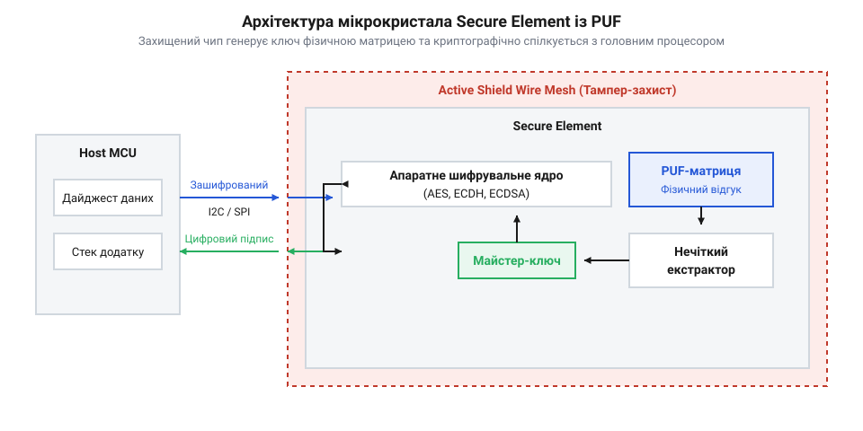

# Апаратний модуль безпеки (Secure Element) з PUF

## Призначення та будова Secure Element з PUF

У сучасній розробці вбудованих систем і пристроїв @@en|Internet of Things (IoT)@@ традиційні методи збереження криптографічних ключів у внутрішній енергонезалежній пам'яті (@@en|Non-Volatile Memory, NVM@@) — такій як @@en|Flash@@ чи @@en|EEPROM@@ — створюють критичну точку відмови. Зловмисник із фізичним доступом до пристрою може зчитати вміст пам'яті за допомогою шинних аналізаторів, подачі некоректних напруг або дампа через інтерфейси налагодження @@en|JTAG@@. Навіть виключення прямого зчитування залишає ризик атак типу [Атака холодного перезавантаження (Cold Boot Attack) та криптографічний захист RAM](root:sf-security/cold-boot-attack). Для створення безкомпромісного кореня довіри (@@en|Root of Trust, RoT@@) застосовують спеціалізовані мікросхеми — криптографічні сепшипи або апаратні модулі безпеки (@@en|Secure Element, SE@@), доповнені матрицею фізично неоднозначних функцій (@@en|Physically Unclonable Function, PUF@@).

Захищений елемент являє собою ізольований мікроконтролер із власним криптографічним ядром, генератором випадкових чисел та захищеною внутрішньою архітектурою. Впровадження технології @@en|PUF@@ кардинально змінює парадигму: замість запису готового секретного ключа на фабриці, ключ відсутній у пам'яті пристрою у знеструмленому стані. Натомість використовується напівпровідникова матриця, де унікальний криптографічний відбиток формується з наноскопічних варіацій технологічного процесу виготовлення кремнієвого кристала — таких як порогові напруги транзисторів, товщина оксидного шару чи паразитарні ємності міжз'єднань. При подачі живлення нечіткий екстрактор (@@en|Fuzzy Extractor@@) перетворює шумові сирі дані PUF на стабільний ключовий матеріал із нульовою ймовірністю помилки.

*Архітектура оборонного мікрокристала Secure Element із матрицею PUF, нечітким екстрактором та апаратним шифрувальним ядром.*

Після генерації майстер-ключ використовується виключно всередині захищеного контуру @@en|Secure Element@@ для локального шифрування робочих даних або підпису повідомлень. Він ніколи не покидає межі кристала і не з'являється у відкритому вигляді навіть у системній оперативній пам'яті @@en|RAM@@. Це дозволяє гарантувати унікальність кожного виготовленого чипа та забезпечує неспростовну ідентифікацію обладнання в гетерогенних мережах.

## Безпечна взаємодія та криптографічні шини

Підключення @@en|Secure Element@@ до головного системного процесора (@@en|Host MCU@@) зазвичай виконується через послідовні периферійні шини, такі як @@en|I2C@@ або @@en|SPI@@. Проте передача криптографічних команд та відкритих даних по відкритим доріжкам друкованої плати створює поверхню атаки: зловмисник може підключити осцилограф чи пасивний логічний аналізатор для підслуховування трафіку або здійснення ін'єкцій фальшивих команд. Тому організація зв'язку вимагає побудови зашифрованого та автентифікованого міжмікросхемного каналу.

Для захисту периферійного обміну застосовується протокол взаємної автентифікації на основі ефемерного протоколу Діффі-Геллмана на еліптичних кривих (@@en|ECDH@@). Під час кожної ініціалізації системи головний процесор та @@en|Secure Element@@ обмінюються одноразовими відкритими ключами, обчислюють спільний сесійний секрет і генерують ключі симетричного шифрування (@@en|AES-GCM@@ або @@en|ChaCha20-Poly1305@@). Після цього всі структури команд і відповідей (наприклад, @@en|APDU-пакети@@) передаються виключно в зашифрованому вигляді з додаванням коду автентифікації повідомлень (@@en|MAC@@).

Такий підхід унеможливлює повторне відтворення команд (@@en|Replay Attack@@) завдяки використанню монотонно зростаючих лічильників повідомлень і випадкових нонсів. Головний процесор делегує підписання та перевірку хешів чипу безпеки: замість надсилання приватного ключа на хост, хост надсилає дайджест документа в @@en|Secure Element@@, а той повертає готовий цифровий підпис. В результаті компрометація софтверного стека на головному мікроконтролері не призводить до втрати кореневих криптографічних секретів.

## Захист від физичного розкриття кристала

Звичайні мікросхеми чутливі до широкого спектра інвазивних та напівінвазивних фізичних атак. Докладніше про те, як здійснюються [Збійні атаки, глітчинг, декапсуляція — і чому обфускація майже нічого не варта](root:sf-security/zbiini-ataky-hlitchynh-dekapsuliatsiia-i-chomu), розглядається в спеціалізованих матеріалах. Зловмисники здатні зняти корпус чипа за допомогою концентрованих кислот (декапсуляція), після чого застосувати мікрозонди чи сфокусований іонний промінь (@@en|Focused Ion Beam, FIB@@) для прямого зчитування стану комірок пам'яті або локальних шин даних.

У [Атаки на кристал: збої й побічні канали](root:sf-security/ataky-na-krystal) описано методології фізичного злому. Проте інтеграція @@en|PUF@@ надає фізично нездоланний захист від таких дій. Оскільки ключовий матеріал не записаний у вигляді статичного заряду у флеш-комірках, а є результатом динамічного відгуку всієї фізичної структури напівпровідникових шарів, будь-яке фізичне втручання руйнує сам секрет. При спробі зшліфувати захисний шар пасивації, протравити силікон чи підвести електричний зонд до внутрішніх провідників, внутрішні напруження та паразитарні параметри кристала миттєво змінюються.

Додатково застосовується активне захисне покриття (@@en|Active Shield Wire Mesh@@) — верхній шар металізації чипа, який являє собою безперервну сітку з струмоведучих доріжок, якими пропускається контрольний сигнал. Якщо атакуючий намагається просвердлити кристал або підключити зонд, сітка обривається чи закорочується. Це викликає негайне спрацювання схем виявлення втручання; як працює [Тампер: як пристрій помічає, що його розкрили](root:sf-security/tamper-iak-prystrii-pomichaie-shcho-ioho-rozkryly), деталізовано в описі апаратних датчиків. Для чипів із @@en|PUF@@ це призводить до зміщення параметрів відгуку матриці, перетворюючи згенерований ключ на випадкове сміття і унеможливлюючи відновлення оригінального майстер-секрету.