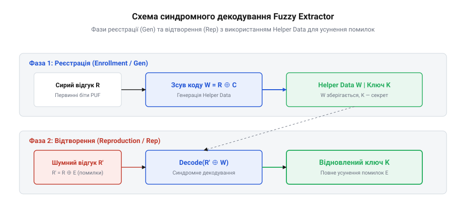

# Математика нечіткого екстрактора: синдроми та хешування

<preknowlist>
- [Атаки на кристал: збої й побічні канали](root:sf-security/ataky-na-krystal) — Розуміння фізичної природи шумів у сипких напівпровідникових структурах.
</preknowlist>

## Проблема аналогового шуму PUF

Фізично неклоновані функції (@@en|Physically Unclonable Functions, PUF@@) використовують мікроскопічні варіації кремнієвого виготовлення для формування унікального "цифрового відбитка" чипа. Однак фізична матриця напівпровідника є аналоговою системою. При повторному зчитуванні початкового стану комірок статичної оперативної пам'яті (SRAM) або затримок генераторів кільця (Ring Oscillator) вихідний бітовий вектор `R'` не є абсолютно ідентичним первинно зчитаному вектору `R`. Основними фізичними чинниками цього дрейфу є негативна температурна нестабільність порогу затвора (@@en|Negative Bias Temperature Instability, NBTI@@), ін'єкція гарячих носіїв (@@en|Hot Carrier Injection, HCI@@), локальні коливання температури й напруги живлення, а також старіння кристал-матриці внаслідок електроміграції, що призводить до варіації відстані Геммінга `HD(R, R')` у межах від 1% до 15%.

Причиною цього є температурний шум, деградація напівпровідника та коливання напруги живлення. Для двох вимірювань однієї і тієї самої PUF-матриці відстань Геммінга (@@en|Hamming distance@@) `HD(R, R')` між вихідними векторами зазвичай становить від 1% до 15% від загальної кількості бітів. У криптографії класичні симетричні шифри вимагають абсолютної детермінованості: зміна хоча б одного біта у 256-бітному ключі робить дешифрування неможливим через ефект лавини (@@en|avalanche effect@@). Якщо спробувати використати сирий відбиток PUF безпосередньо як ключ, будь-яка збойна атака чи зміна температури навколишнього середовища призведе до втрати доступу до даних [Атаки на кристал: збої й побічні канали](root:sf-security/ataky-na-krystal).

Отже, виникає фундаментальна криптографічна суперечність: фізичне джерело дає унікальні, але нечіткі та шумні дані, а криптопроцесору потрібен строго стабільний і відтворюваний ключ. Математичним розв'язком цієї проблеми є алгоритмічна конструкція нечіткого екстрактора (@@en|Fuzzy Extractor@@), яка складається з двох етапів: реєстрації (@@en|Enrollment / Gen@@) та відтворення (@@en|Reproduction / Rep@@).

## Схема відтворення та коди корекції

Конструкція Fuzzy Extractor перетворює шумний відгук `R'` на стабільний секретний ключ `K` за допомогою алгебраїчних кодів корекції помилок (@@en|Error-Correcting Codes, ECC@@). На етапі реєстрації Gen алгоритм отримує первинний сирий відгук `R` та обчислює пару `(K, W)`, де `K` є згенерованим криптографічним ключем, а `W` — масивом допоміжних даних (@@en|Helper Data@@). 

Для обчислення Helper Data `W` застосовується схема зсуву коду (@@en|Code-Offset Construction@@) на базі лінійного коду `[n, k, d]`. Випадкове кодове слово `C` вибирається з коду корекції помилок, після чого вектор Helper Data обчислюється побітовим додаванням по модулю 2 (XOR):

```
W = R ⊕ C   [додавання по модулю 2 у полі GF(2)]
```

Під час подальшої експлуатації на етапі відтворення Rep пристрій зчитує шумний відгук `R' = R ⊕ E`, де `E` позначує вектор бітових помилок. Пристрій використовує збережений у відкритому сховищі масив `W` для отримання спотвореного кодового слова `C'`:

```
C' = R' ⊕ W
   = (R ⊕ E) ⊕ (R ⊕ C)   [підстановка зчитаних значень]
   = C ⊕ E               [комутативність та властивість R ⊕ R = 0]
```

Отриманий вектор `C'` подається на вхід декодера коду корекції помилок. Якщо вага Геммінга вектора помилок `wt(E)` не перевищує коригувальну здатність коду `t = ⌊(d - 1) / 2⌋`, алгоритм декодування відновлює точне значення кодового слова `C = Decode(C')`.


*Процедура реєстрації та відтворення нечіткого екстрактора з формуванням вектору синдрому.*

Проілюструємо обчислення відновлення кодового слова на спрощеному 8-бітному прикладі з використанням коду з повторенням. Нехай первинний відгук `R = 0b11010011`, а вибране кодове слово `C = 0b10101010`.

```
W = R ⊕ C
  = 0b11010011 ⊕ 0b10101010    [обчислення Helper Data]
  = 0b01111001                 [значення Helper Data W]

R' = 0b11010001                [зчитано шумний відгук з помилкою у 1 біті]

C' = R' ⊕ W
   = 0b11010001 ⊕ 0b01111001   [вилучення спотвореного кодового слова]
   = 0b10101008                [результат C' = C ⊕ E]
```

Вибір сімейства коду залежить від топології помилок у PUF-матриці. Двоїчні класичні коди Боуза-Чоудхурі-Хоквінгема (BCH) ідеально підходять для незалежних побітових помилок (@@en|bit-flip errors@@), характерних для SRAM PUF, оскільки вони працюють прямо в полі Galois `GF(2ᵐ)`. Натомість недвоїчні коди Ріда-Соломона (RS) ефективні при пакетних збоях (@@en|burst errors@@), групуючи біти у символи по `m` бітів. Порівняльний розрахунок коригувальної здатності показує, що при однаковій надмірності `n - k` двопозиційний BCH-код дає нижчу ймовірність невідновлення ключа для SRAM PUF, ніж коди Ріда-Соломона.

Після виконання декодування `Decode(C')` відновлюється початковий вектор `C`, що гарантує повне усунення бітових помилок.

## Посилення конфіденційності та хешування

Збереження вектору Helper Data `W` у відкритій пам'яті створює витік інформації про первинний відгук `R`. Законами теорії інформації витік мінімальної ентропії (@@en|min-entropy@@) вимірюється довжиною вектору `W`. Якщо вихідна ентропія `H_∞(R)` вимірюється в бітах, то після публікації `W` довжиною `m` бітів залишкова ентропія дорівнює `H_∞(R | W) ≥ H_∞(R) - m`.

Щоб отримати ідеально рівномірно розподілений криптографічний ключ `K` з залишкової ентропії, застосовується процедура посилення конфіденційності (@@en|Privacy Amplification@@). Вона спирається на застосування 2-універсальних сімейств геш-функцій (@@en|Universal Hashing@@) та Лему про залишкову ентропію (@@en|Leftover Hash Lemma, LHL@@).

Алгоритм вибирає випадкову геш-функцію `h` із 2-універсального сімейства `H` та обчислює підсумковий ключ:

```
K = h(C)   [стиснення кодового слова до довжини l бітів]
```

За Лемою про залишкову ентропію, якщо довжина вихідного ключа `l` задовольняє нерівності:

```
l ≤ H_∞(C) - 2 · log₂(1 / ε)   [формула межі безпеки LHL]
```

де `ε` позначує статистичну відстань від рівномірного розподілу, то отриманий ключ `K` є математично нерозрізнюваним від ідеально випадкового ключа. Це гарантує, що навіть якщо зловмисник повністю прочитає вміст пам'яті з Helper Data `W`, він не дістане жодної переваги при спробі підбору чи атаки на згенерований криптографічний ключ `K`.