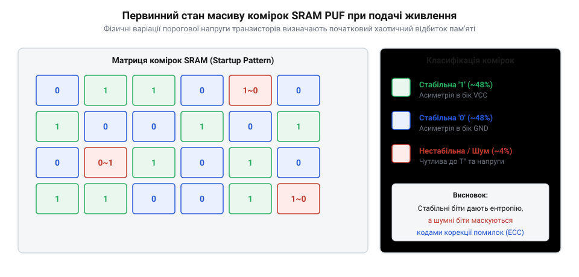
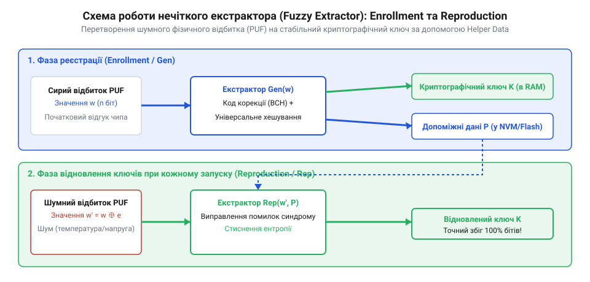

# Фізично неклоновані функції (PUF) та Fuzzy Extractor

<preknowlist>
- [Збійні атаки, глітчинг, декапсуляція — і чому обфускація майже нічого не варта](root:sf-security/zbiini-ataky-hlitchynh-dekapsuliatsiia-i-chomu) — Розуміння того, що будь-який збережений у флеш-пам'яті (NVM) секрет може бути вилучений зловмисником із фізичним доступом до кристала.
</preknowlist>

## Проблема збереження секретних ключів

Будь-яка криптографічна система, від звичайного мікроконтролера в датчику до банківського термінала, покладається на секретний ключ. Якщо ключ залишається таємним, математика гарантує безпеку даних; якщо його викрадено — система зламана. Традиційно ключі зберігають в енергонезалежній пам'яті (@@en|Non-Volatile Memory@@, NVM), такій як флеш-пам'ять або EEPROM. Це означає, що ключ фізично записаний на кристалі та лежить там навіть тоді, коли пристрій вимкнений. І саме в цьому криється фундаментальна слабкість.

Збережений у пам'яті секрет є статичним, оскільки фізично він являє собою крихітні порції електричного заряду, надійно захоплені в ізольованих плаваючих затворах транзисторів NVM. Цей заряд залишається там роками, формуючи незмінний рельєф одиниць та нулів на поверхні кристала. Коли зловмисник отримує фізичний доступ до мікросхеми, він отримує і достатньо часу, щоб цей секрет витягнути. Сучасне обладнання дозволяє обійти логічні захисти: використовуючи [збійні атаки, глітчинг, декапсуляцію](root:sf-security/zbiini-ataky-hlitchynh-dekapsuliatsiia-i-chomu) кристала, можна просканувати поверхню електронним мікроскопом і буквально побачити наявність заряду в комірках пам'яті, або ж змусити процесор видати ключ назовні під час виконання коду. Будь-які спроби програмно сховати ключ є тимчасовою перешкодою — зрештою, процесору потрібно прочитати справжній ключ для шифрування, і в цей момент він стає вразливим.

Отже, проблема полягає не в математиці шифрування, а у фізичному зберіганні ключа. Щоб зробити пристрій по-справжньому стійким до фізичних атак, нам потрібен парадоксальний механізм: пристрій повинен мати унікальний криптографічний ключ, але цей ключ не повинен ніде зберігатися у вимкненому стані. Відповіддю на цей виклик стало використання самого матеріалу, з якого зроблений чип.

## Апаратний відбиток із кремнієвого хаосу

Під час виробництва напівпровідникових мікросхем на заводі мільярди транзисторів формуються на кремнієвій пластині. Незважаючи на неймовірну точність сучасного літографічного процесу, ідеально однакових транзисторів не існує. Завжди є мікроскопічні варіації в товщині оксидного шару, концентрації домішок чи ширині провідників. Для звичайної цифрової логіки ці відхилення — це просто шум, який намагаються згладити, щоб він не заважав чипу працювати як нуль або одиниця. Але виявилося, що ці виробничі варіації можна використати з користю. Вони формують унікальний для кожного окремого кристала фізичний профіль, який неможливо передбачити, змінити або скопіювати — навіть якщо спробувати зробити це на тому ж самому заводському обладнанні.

Цей унікальний профіль став основою для @@en|Physically Unclonable Functions@@ (PUF, фізично неклонованих функцій). Принцип дії PUF полягає в тому, що замість читання записаного в пам'ять ключа, пристрій подає певний сигнал на власні внутрішні структури і "вимірює" їхню реакцію. Оскільки фізичні властивості кожного чипа унікальні, ця реакція також буде унікальною. PUF працює як відбиток пальця кремнію: він завжди присутній у матеріалі, генерується "на льоту" лише тоді, коли подається живлення, і миттєво зникає після вимкнення пристрою, не залишаючи жодних слідів в енергонезалежній пам'яті.

Концепція використання фізичного хаосу з'явилася не відразу. Початково ідея зародилася в роботах Раві Паппу, який створював оптичні токени: шматочки прозорого пластику з хаотично вкрапленими бульбашками повітря. Коли на такий токен світили лазером, бульбашки відбивали світло, створюючи унікальний і непередбачуваний візерунок відблисків. Це була оптична PUF, і вона довела, що неконтрольований фізичний хаос можна використовувати як надійний ідентифікатор замість математичної криптографії та збережених секретів. Еволюція цієї ідеї призвела до перенесення концепції в мікроелектроніку, де замість лазерів і пластику почали шукати джерела хаосу безпосередньо в кремнієвих структурах звичайних мікросхем.

## Механіка роботи SRAM PUF

Одним із найзручніших і найпопулярніших джерел такої кремнієвої ентропії стала звичайна статична оперативна пам'ять — @@en|Static Random-Access Memory@@ (SRAM). Її головна перевага полягає в тому, що для створення PUF не потрібно додавати нові специфічні блоки на кристал — достатньо використати наявну неініціалізовану пам'ять мікроконтролера. На фізичному рівні типова комірка SRAM складається з шести транзисторів, чотири з яких утворюють два зустрічно з'єднані інвертори. Ця симетрична схема розроблена так, щоб мати два стабільних стани, які відповідають логічному нулю та одиниці.

Коли пристрій вимкнено, комірка не має заряду. У момент холодного старту, коли напруга живлення лише починає зростати, обидва інвертори намагаються відкритися одночасно. Відбувається своєрідна електрична гонка. В ідеально симетричній комірці результат цієї гонки був би абсолютно випадковим при кожному запуску. Але оскільки ідеальних кристалів не існує, мікроскопічні варіації при виробництві (наприклад, незначні відмінності в пороговій напрузі або геометричних розмірах затворів) порушують цю симетрію.

*Схема початкового стану блоку пам'яті, який формує унікальний сирий відбиток чипа зі стабільних і нестабільних комірок.*

Якщо один інвертор у комірці має хоча б на кілька мілівольт нижчу порогову напругу через варіацію домішок, він відкриється швидше за свого конкурента. Цей перший мікрострум миттєво "придушить" інший інвертор, і комірка надійно зафіксується в стані одиниці. Якщо "швидшим" виявився інший транзистор — комірка завжди падатиме в нуль. Оскільки ці мікроскопічні відхилення зафіксовані в кремнії назавжди, більшість комірок пам'яті під час кожного увімкнення прийматимуть один і той самий стан. Таким чином, великий блок неініціалізованої пам'яті під час старту заповнюється випадковим, але постійним для цього конкретного чипа візерунком із нулів та одиниць ([програмне зчитування SRAM PUF на мікроконтролері](root:sf-security/physically-unclonable-functions/proj-sram-puf-extraction.md)). 

Проте цей механізм працює не для всіх комірок. У будь-якому масиві пам'яті завжди знайдеться певна частка комірок, де варіації транзисторів виявилися настільки мінімальними, що електрична симетрія майже збережена. Для таких комірок результат стартової гонки визначається не властивостями кремнію, а динамічними чинниками: звичайним тепловим шумом електронів або мікроскопічними пульсаціями напруги живлення в момент старту. Такі комірки називають нестабільними. Під час одного ввімкнення вони можуть видати нуль, а під час наступного — одиницю. 

На практиці в типовому мікроконтролері за нормальних кімнатних умов нестабільними виявляються близько 3-5% комірок SRAM. Цей відсоток може різко зростати (до 10-15%), якщо пристрій вмикається за екстремальних температур (наприклад, на морозі -40°C або нагрітим до +85°C) чи при зниженій напрузі живлення, що змінює швидкість реакції транзисторів. Через це сирий відбиток, зчитаний з пам'яті, ніколи не буває на 100% однаковим і не може напряму використовуватися як криптографічний ключ. Для симетричного шифрування зміна навіть одного біта у ключі є фатальною. Щоб розв'язати цю проблему та перетворити такий "шумний" відбиток на абсолютно стабільний і безпечний секрет за будь-яких умов, застосовується спеціальна [математика нечіткого екстрактора](root:sf-security/physically-unclonable-functions/math-fuzzy-extractor.md).

## Нечіткий екстрактор і стабільний ключ

Сирий відбиток SRAM, який отримує мікроконтролер після подачі живлення, є унікальним, але містить тепловий шум. Криптографія не терпить шуму: зміна навіть одного біта у вхідних даних призводить до отримання абсолютно іншого ключа алгоритмами шифрування. Щоб перетворити цей зашумлений фізичний масив на стабільний ключ, використовується система, яку називають нечітким екстрактором (@@en|Fuzzy Extractor@@). 

Робота нечіткого екстрактора поділяється на дві фази. Перша — це фаза реєстрації (@@en|Enrollment@@), яка відбувається один раз на заводі або під час першого безпечного запуску пристрою. Пристрій зчитує свій сирий відбиток і пропускає його через алгоритми [кодів виправлення помилок (ECC)](root:math-information/error-correction-codes). Мета цього кроку — не змінити сам відбиток, а обчислити для нього спеціальні допоміжні дані, які називаються @@en|Helper Data@@. Ці дані записуються у звичайну постійну пам'ять (NVM). Важливо розуміти, що Helper Data не містять секретного ключа і не дозволяють його відновити без наявності самого кристала — це просто математична "карта" того, де саме у відбитку цього конкретного чипа найімовірніше виникатимуть помилки.

*Схема роботи нечіткого екстрактора: фаза реєстрації генерує Helper Data, а фаза відновлення використовує їх для виправлення шуму.*

Друга фаза — це фаза відновлення (@@en|Reconstruction@@), яка відбувається кожного разу під час увімкнення пристрою в полі. Мікроконтролер знову зчитує свій зашумлений SRAM-відбиток. Далі він бере збережені Helper Data і застосовує їх до цього відбитка. Алгоритм корекції помилок згладжує всі відхилення, спричинені тепловим шумом, і на виході пристрій отримує ідеально стабільний рядок бітів, повністю ідентичний тому, що був зчитаний під час реєстрації. Цей очищений відбиток пропускається через хеш-функцію, формуючи надійний криптографічний ключ ([математика нечіткого екстрактора: синдроми та хешування](root:sf-security/physically-unclonable-functions/math-fuzzy-extractor.md)). Відтепер ключ готовий до використання, а в енергонезалежній пам'яті лежать лише безпечні допоміжні дані.

## Автентифікація через виклик і відповідь

Окрім створення ключів шифрування на самому пристрої, PUF дозволяє розв'язати проблему віддаленої автентифікації без передачі секретів. Традиційно, щоб сервер міг переконатися, що до нього підключається справжній пристрій інтернету речей (IoT), вони повинні мати спільний симетричний ключ. Але якщо ключ можна витягнути з пристрою, зловмисник зможе клонувати його і видавати свій фальшивий вузол за справжній. PUF пропонує інший підхід — використання пар "виклик-відповідь" (@@en|Challenge-Response Pair@@, CRP).

Замість того, щоб зберігати статичний пароль, чип використовує свою фізичну структуру як складну функцію. Сервер надсилає пристрою унікальний математичний запит — виклик (@@en|Challenge@@). Цей виклик слугує вхідним параметром для схеми PUF. Завдяки унікальній варіації транзисторів пристрій опрацьовує цей сигнал і повертає специфічну відповідь (@@en|Response@@). Оскільки відбиток кожного кристала унікальний, два різні пристрої на один і той самий виклик видадуть дві абсолютно різні відповіді.

Типовий програмний інтерфейс ініціалізації та використання PUF ховає всю цю складність від прикладного програміста. На практиці розробник взаємодіє з бібліотекою або апаратним інтерфейсом (HAL), куди передає блок допоміжних даних (Activation Code), необхідних для корекції помилок, та спеціальні мітки (labels). Мітки діють як логічні розгалужувачі: подаючи різні мітки до єдиного фізичного кореня, можна генерувати безліч незалежних ключів для різних криптографічних завдань — наприклад, один ключ для автентифікації, а інший — для шифрування диска. Це дозволяє [апаратному модулю безпеки (Secure Element) з PUF](root:sf-security/physically-unclonable-functions/comp-secure-element-with-puf.md) гнучко обслуговувати потреби системи.

Під час реєстрації пристрою на безпечному сервері виробник надсилає йому тисячі різних викликів і записує відповідні їм відповіді, формуючи базу пар CRP. Коли пристрій працює в полі, сервер обирає випадковий виклик зі своєї бази, надсилає його пристрою і перевіряє, чи збігається отримана відповідь із очікуваною. Після використання ця пара CRP викреслюється і ніколи не застосовується знову, що робить перехоплення марним. Таким чином, сервер надійно автентифікує конкретний кристал, а зловмисник не може передбачити відповідь на новий виклик, навіть якщо має повний доступ до мережевого трафіку.