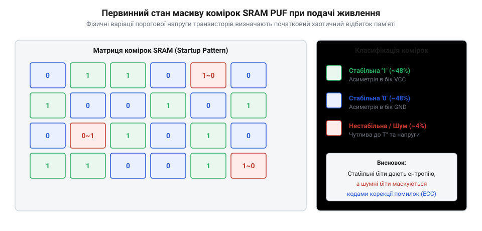

# Програмне зчитування SRAM PUF на мікроконтролері

<preknowlist>
- [Атаки на кристал: збої й побічні канали](root:sf-security/ataky-na-krystal) — Фізичні властивості комірок SRAM при подачі живлення.
</preknowlist>

## Проблема занулення RAM стартапом

Статична оперативна пам'ять з довільним доступом (англ. @@en|Static Random-Access Memory / SRAM@@) у ресурсообмежених мікроконтролерах складається з матриці шеститранзисторних осередків (англ. @@en|6T SRAM cell@@). Під час подачі живлення кожен такий осередок є симетричним тригером із двома інверторами, охопленими перехресним зворотним зв'язком. Коли напруга живлення зростає від нуля до порогу спрацьовування схем скидання за низькою напругою (англ. @@en|Power-On Reset / POR@@), усередині кожного осередку виникає конкуренція між вихідними плечима тригера. Через мікроскопічні кремнієві відхилення у товщині оксидного шару та легуванні напівпровідників один із транзисторів відчиняється трохи швидше за інший. Як наслідок, під час холодного старту (англ. @@en|Power-On State@@) осередок переходить у стабільний для нього стан логічного нуля `0` або одиниці `1`. Сукупність цих бітів формує унікальний фізичний відбиток кристала — апаратну функцію, яку неможливо відтворити на іншому екземплярі чипу (англ. @@en|Physically Unclonable Function / PUF@@).

Однак у стандартній архітектурі вбудованого програмного забезпечення після подачі живлення процесор виконує апаратну процедуру зчитування таблиці векторів переривань (англ. @@en|Vector Table Offset Register / VTOR@@). Перше слово таблиці завантажується у покажчик стека (англ. @@en|Stack Pointer / SP@@), а друге слово — адреса обробника скидання (англ. @@en|Reset_Handler@@) — у лічильник команд (англ. @@en|Program Counter / PC@@). У цей момент процесор передає керування низці ассемблерних або C-інструкцій процедури ініціалізації середовища виконання C (англ. @@en|C Run-Time Initialization / C-CRT@@). 

Функція `Reset_Handler` ще до виклику головного циклу `main()` виконує два обов'язкових цикли обробки оперативної пам'яті:
1. Копіювання початкових значень глобальних змінних із системної Flash-пам'яті у секцію ініціалізованих даних (англ. @@en|DATA section@@), обмежену символами лінковщика `_sdata` та `_edata`. 2. Занулення секції неініціалізованих змінних (англ. @@en|BSS section@@, від @@en|Block Started by Symbol@@), яка розміщується між адресами `_sbss` та `_ebss`. Обробник ініціалізації у циклі послідовно записує байт або слово `0x00` в усі комірки цього діапазону.

Якщо блок SRAM, що містить первинну ентропію, потрапляє під стандартне розміщення у `.bss` або виділяється як звичайна глобальна змінна, процедура C-CRT занулює його за кілька мікросекунд після включення. У результаті залишкові бітові стани повністю знищуються до моменту передачі керування у функцію `main()`.

Така стандартна поведінка розроблялася задля забезпечення детермінованого стану системних змінних, проте для завдань криптографічного захисту вона стає фатальною перешкодою. Без спеціального втручання у процес стартапу унікальні відбитки кристала повністю стираються. Проведені дослідження [атак на кристал та побічні канали](root:sf-security/ataky-na-krystal) свідчать, що збереження унікального стану пам'яті вимагає ізоляції відповідних осередків SRAM від операцій очищення C-CRT та коригування сценарію лінковщика (англ. @@en|Linker Script@@). Крім того, під час аналізу стійкості необхідно враховувати ризики, пов'язані з [атаками холодного перезавантаження (Cold Boot Attack)](root:sf-security/cold-boot-attack), коли залишковий заряд у комірках пам'яті може витікати або викривлятися при раптовому збуренні напруги живлення чи пристрою під дією [збійних атак та глітчингу](root:sf-security/zbiini-ataky-hlitchynh-dekapsuliatsiia-i-chomu).

## Налаштування лінковщика та секцій

Для запобігання автоматичному зануленню ентропійного блоку необхідно відкоригувати сценарій лінкування (англ. @@en|Linker Script@@) та застосувати спеціальні атрибути компілятора GCC чи Clang. У конфігураційному файлі лінковщика `.ld` виділяється окрема секція з прапорцем `NOLOAD`, яка наказує компонувальнику не включати вміст секції до бінарного образу та пропустити її під час ініціалізації RAM.


*Послідовність виконання стартап-коду з ізоляцією неініціалізованого буфера .noinit від стандартного циклу занулення BSS.*

У вихідному коді мовою C або C++ буфер для зберігання сирого відбитка маркується атрибутом `__attribute__((section(".noinit")))`. Це гарантує, що компонувальник розмістить масив у спеціально відведеній області пам'яті, яку стартап-код `Reset_Handler` залишить недоторканою:

```c
__attribute__((section(".noinit"))) uint8_t sram_puf_raw_buffer[64];
```

Завдяки цьому під час подачі живлення на мікроконтролер первинний стан осередків пам'яті зберігається без спотворень. Контролер може прочитати бітовий масив одразу на початку роботи програми та передати його до алгоритмів обробки шумів та підсилення ентропії.

## Зчитування відбитка та розрахунок шуму

Хоча первинний стан осередків є стійким, на реальному залізі фізичний відбиток піддається впливу температурного шуму, флуктуацій напруги та віку напівпровідника. Відхилення між вибірками, отриманими на одному й тому ж чіпі при різних перезапусках, називається внутрішнім шумом чи міжсесійною відстанню (англ. @@en|Intra-distance / Intra-BER@@). Зазвичай рівень помилок @@en|Bit Error Rate (BER)@@ становить від 3% до 8%. Натомість міжапаратна відстань (англ. @@en|Inter-distance@@) між різними екземплярами чипів повинна дорівнювати близько 50% (ідеальна біноміальна незалежність бітів).

Для компенсації внутрішнього шуму застосовують метод мажоритарного голосування (англ. @@en|Majority Voting@@). Програма збирає кілька вибірок (наприклад, `N = 5` або `N = 9`) після послідовних перезапусків живлення і для кожного біта вибирає значення, яке зустрічається найчастіше. Очищена таким чином послідовність подається на вхід нечіткого екстрактора (англ. @@en|Fuzzy Extractor@@) для генерації стабільного криптографічного ключа.

Розглянемо практичну реалізацію зчитування та мажоритарного фільтрування мовою C:

:::code proj-sram-puf-extraction/c/sram_puf.c

Головний сценарій мовою C, що демонструє вибірку та обчислення відстані Геммінга (англ. @@en|Hamming Distance@@):

:::code proj-sram-puf-extraction/c/main.c

У C++ застосунках статистичний аналізатор вибірок реалізують із використанням безпечних типів `std::span` та `std::bitset`, що дозволяє зручно рахувати вагу Геммінга через метод `count()`:

:::code proj-sram-puf-extraction/cpp/sram_puf_analyzer.hpp

Головна програма на C++20 для оцінки Intra-BER та формування маски стабільних бітів:

:::code proj-sram-puf-extraction/cpp/main.cpp

Таким чином, комбінація правильно налаштованого скрипта лінковщика та мажоритарної фільтрації дозволяє надійно видобувати фізичні відбитки кристала без залучення спеціалізованих апаратних засобів.