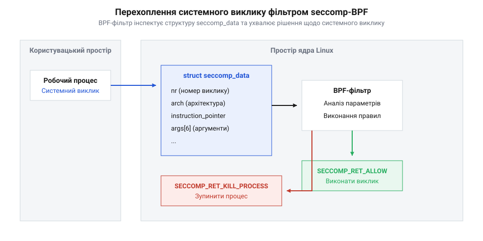

# Довідка з системного виклику seccomp та BPF-фільтрів

## Режими ізоляції seccomp та модель системних викликів

Механізм обмежувача системних викликів (@@en|Secure Computing Mode, seccomp@@) у системному ядрі @@en|Linux@@ створено для мінімізації поверхні атак на випадок компрометації робочого процесу. Монолітна архітектура ядра надає користувацьким програмам понад три сотні системних викликів. Якщо зловмисник отримує можливість виконання довільного коду всередині непривілейованого демона (наприклад, через переповнення буфера), він може використати будь-який з цих викликів для ескалації привілеїв чи створення нових процесів.

Класичний режим суворої ізоляції (@@en|strict seccomp@@) дозволяє процесу виконувати лише чотири системні виклики: `read()`, `write()`, `_exit()` та `sigreturn()`. Будь-яка спроба виконати інший системний виклик миттєво завершує процес сигналом `SIGKILL`. Така поведінка є занадто жорсткою для більшості реальних застосунків, яким потрібні сокети чи виділення пам'яті. Розширений режим @@en|seccomp-BPF@@ вирішує цю проблему, дозволяючи розробнику завантажувати в ядро гнучкий пробіг правил на мові мікрофільтрів (@@en|Berkeley Packet Filter, BPF@@).

*Перехоплення системного виклику BPF-фільтром ядра Linux перед передачею керування відповідній системній функції.*

При кожному системному виклику ядро Linux формує в системній пам'яті структуру даних `seccomp_data`, яка містить номер системного виклику у полі `nr`, ідентифікатор архітектури процесора у полі `arch` (наприклад, `AUDIT_ARCH_X86_64`), вказівник на інструкцію `instruction_pointer` та масив із шести 64-бітних аргументів `args[6]`. Перевірка значення поля `arch` є критичною умовою безпеки: на 64-бітних системах зловмисник може використати сумісність із 32-бітним ABI (наприклад, виклики `int 0x80`), де ті самі номери системних викликів відповідають зовсім іншим операціям. Фільтр BPF аналізує ці параметри в режимі реального часу і повертає дію: дозволити виконання (`SECCOMP_RET_ALLOW`), перервати процес (`SECCOMP_RET_KILL_PROCESS`), повернути помилку (`SECCOMP_RET_ERRNO`) або згенерувати сигнал.

## Складання BPF-фільтрів та макроси sock_filter

Фільтр @@en|seccomp-BPF@@ виражається у вигляді масиву байт-коду з інструкцій структури `sock_filter`. Для зручного створення цих інструкцій системні заголовочні файли Linux надають спеціалізовані макроси `BPF_STMT` (прості інструкції) та `BPF_JUMP` (інструкції умовного або безумовного переходу).

Програма BPF працює як віртуальна машина з двома регістрами: акумулятором `A` та індексним регістром `X`. Типовий алгоритм перевірки починається з завантаження номера системного виклику зі зміщенням `offsetof(struct seccomp_data, nr)` в акумулятор `A`. Після цього за допомогою порівнянь здійснюється перехід на відповідні гілки дозволу або блокування:

:::code api-linux-seccomp-bpf/c/sock-filter.c

Використання `BPF_JUMP` вимагає точного розрахунку відносних зміщень у разі істинності (`jt`) або хибності (`jf`) умови. Це дозволяє формувати складні дерева правил, які перевіряють не лише номери викликів, а й конкретні значення аргументів (наприклад, заборона відкриття файлів з прапорцем `O_CREAT`).

Для інспектування аргументів системного виклику BPF-програма завантажує 64-бітні значення з масиву `args` структури `seccomp_data`. Оскільки акумулятор `A` є 32-бітним регістром, розбір аргументів на 64-бітних архітектурах виконується у два кроки: окремо для молодшого (@@en|lower 32 bits@@) та старшого (@@en|upper 32 bits@@) слів аргументу. Наприклад, зміщення `offsetof(struct seccomp_data, args[0])` відповідає першому аргументу виклику (такому як файловий дескриптор чи прапорці відкриття). Перевірка аргументів дозволяє реалізувати тонконалаштовані правила безпеки, обмежуючи, наприклад, системний виклик `mmap()` лише дозволеними комбінаціями прапорців захисту пам'яті (`PROT_READ | PROT_WRITE`) та запобігаючи виконанню викликів із небезпечними прапорцями виконання `PROT_EXEC`.

## Завантаження профілю через prctl та seccomp

Перед тим як завантажити згенерований BPF-фільтр у контекст ядра, розробник має виконати важливу вимогу безпеки: встановити атрибут `PR_SET_NO_NEW_PRIVS` за допомогою системного виклику `prctl()`. Це гарантує, що процес (і всі його майбутні нащадки) не зможе підвищити свої привілеї через запуск `setuid`-програм. Без цього прапорця ядро забороняє завантаження BPF-фільтрів непривілейованими користувачами.

Після встановлення захисного атрибута програма завантажує масив фільтрів за допомогою виклику `prctl(PR_SET_SECCOMP, SECCOMP_MODE_FILTER, &prog)` або спеціалізованого системного виклику `seccomp()`. Нижче наведено завершений C-шаблон ініціалізації песочниці:

:::code api-linux-seccomp-bpf/c/sock-filter-2.c

Після успішного завантаження профілю будь-який виклик незатвердженої системної функції призведе до негайної зупинки процесу. Це робить seccomp-BPF надійним рубежем захисту в сервісах із розділенням привілеїв.