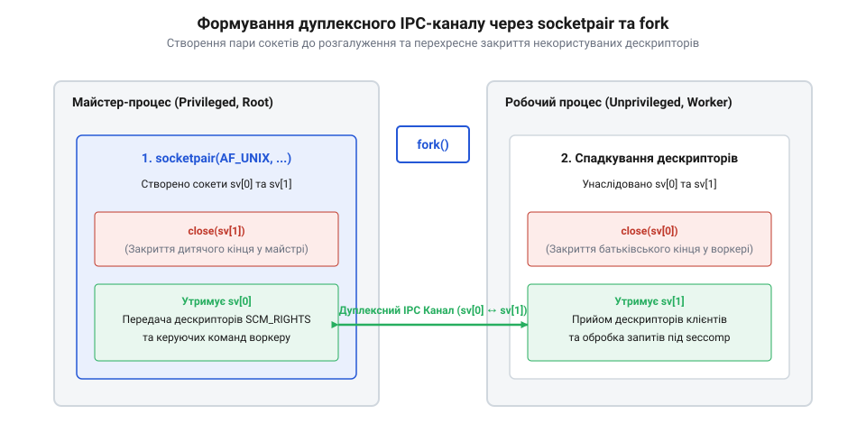
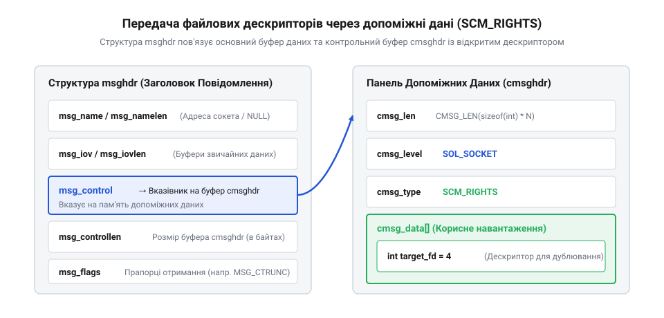

# Довідка з socketpair() та sendmsg() для передачі дескрипторів

## Створення каналу socketpair та успадкування

Для організації двостороннього міжпроцесного зв'язку (@@en|Inter-Process Communication, IPC@@) у межах одного вузла застосовується системний виклик `socketpair()`. На відміну від звичайних сокетів `AF_INET`, які вимагають прив'язки до мережевих адрес та проходження сокетного стека мережі, `socketpair()` створює пару неіменованих пов'язаних сокетів домену `AF_UNIX` прямо у пам'яті ядра. Це гарантує максимальну продуктивність та високий рівень ізоляції, оскільки створений канал доступний лише батьківському та дитячим процесам.

Системний виклик приймає чотири параметри: домен домену (завжди `AF_UNIX`), тип сокета (типово `SOCK_STREAM` для надійного потокового обміну), протокол (значення `0`) та масив із двох цілих чисел, куди ядро записує файлові дескриптори утвореної пари сокетів:

```c
#include <sys/types.h>
#include <sys/socket.h>
#include <stdio.h>
#include <unistd.h>

int sv[2];
if (socketpair(AF_UNIX, SOCK_STREAM, 0, sv) < 0) {
    perror("socketpair");
    return -1;
}
```

Правильна послідовність дій вимагає створення сокетної пари **до** розгалуження процесу за допомогою `fork()`. Після виконання `fork()` дитячий процес успадковує повні копії обох файлових дескрипторів `sv[0]` та `sv[1]`. Щоб сформувати ізольований дуплексний канал і запобігти витоку дескрипторів, кожен із процесів повинен негайно закрити той кінець сокета, який ним не використовується.


*Формування ізольованого двостороннього міжпроцесного каналу між майстром та воркером за допомогою закриття некористуваних дескрипторів.*

У наведеній схемі привілейований майстер залишає за собою дескриптор `sv[0]` і закриває `sv[1]`. Натомість непривілейований воркер закриває `sv[0]` і використовує дескриптор `sv[1]`. Якщо будь-який процес згодом спробує прочитати з закритого сокета або записати в нього, ядро поверне помилку `EBADF`. Додатково під час створення `socketpair()` рекомендується використовувати прапорець `SOCK_CLOEXEC` у типі сокета або встановлювати його через `fcntl(FD_CLOEXEC)`. Це гарантує, що якщо воркер надалі виконає системний виклик `execve()` для запуску іншої бінарної програми, відкриті файлові дескриптори сокетного каналу будуть автоматично закриті ядром, унеможливлюючи витік внутрішніх каналів зв'язку до стороннього коду. Закриття некористуваних кінців є критичною умовою безпеки: це гарантує, що у разі компрометації воркер не зможе перехопити трафік сусідніх робочих процесів.

## Передача дескрипторів через sendmsg і recvmsg

Головною перевагою домену сокетів `AF_UNIX` є можливість передачі відкритих файлових дескрипторів між незалежними процесами операційної системи. Це дозволяє привілейованому майстру самостійно виконувати потенційно небезпечні дії (наприклад, відкриття захищених файлів або зв'язування з мережевим портом `80`), після чого передавати згенерований дескриптор непривілейованому воркеру без надання останньому системних привілеїв `root`.

Передача дескрипторів здійснюється за допомогою викликов `sendmsg()` та `recvmsg()`, які оперують структурою `msghdr`. Основний вміст передається як звичайні буфери `iovec`, а файлові дескриптори пакуються в панель допоміжних даних (@@en|ancillary data@@ чи контрольні повідомлення) структури `cmsghdr` із типом `SCM_RIGHTS`.


*Упаковка файлового дескриптора в контрольний блок cmsghdr структури msghdr для передачі через виклик sendmsg.*

Для безпечної та коректної роботи з буфером контрольних даних застосовуються системні макроси `CMSG_FIRSTHDR`, `CMSG_DATA`, `CMSG_LEN` та `CMSG_SPACE`. Нижче наведено ідіоматичний C-код для відправлення файлового дескриптора через сокет:

:::code api-unix-ipc-socketpair/c/msghdr.c

При виконанні системного виклику `sendmsg()` ядро Linux не просто пересилає числове значення цілого числа (@@en|integer descriptor index@@), а знаходить у таблиці дескрипторів відправника відповідний системний об'єкт відкритого файла (структуру `struct file`). Ядро збільшує лічильник посилань цього об'єкта (@@en|reference count@@) і розміщує вказівник на нього у внутрішній черзі сокета `AF_UNIX`.

При отриманні повідомлення викликом `recvmsg()` ядро виділяє найменший вільний номер дескриптора в таблиці процесів отримувача й прив'язує його до отриманого системного об'єкта `struct file`. Отримувач витягує новий дескриптор через макрос `CMSG_DATA` та використовує його для читання чи запису:

:::code api-unix-ipc-socketpair/c/msghdr-2.c

Такий механізм дублювання посилань у ядрі гарантує, що навіть якщо відправник закриє свій дескриптор через `close()`, відкритий файл або сокет продовжуватиме існувати та залишатиметься доступним для отримувача до моменту закриття його власного дескриптора.

## Крайові випадки та обробка помилок IPC

Будівництво виробничих каналів міжпроцесного зв'язку на основі `socketpair()` вимагає ретельної обробки виняткових ситуацій та крайніх випадків. Найбільш поширеною проблемою є спроба запису в сокет, протилежний кінець якого був закритий (наприклад, через аварійне завершення воркера). За замовчуванням така операція генерує системний сигнал `SIGPIPE`, який негайно зупиняє процес майстра. Щоб запобігти збою майстра, сигнал `SIGPIPE` необхідно ігнорувати або блокувати прапорцем `MSG_NOSIGNAL`:

```c
#include <signal.h>

// Ігнорування SIGPIPE на рівні всього процесу
signal(SIGPIPE, SIG_IGN);
```

Другим важливим аспектом є переведення сокетного каналу в неблокуючий режим (@@en|non-blocking mode@@). Якщо воркер перестає читати дані з сокета через зависання, буфер запису сокета ядра швидко заповнюється. Синхронний виклик `sendmsg()` або `write()` у майстрі при цьому заблокує процес майстра наневизначений термін, зупинивши обслуговування інших воркерів. Для вирішення цієї проблеми на сокет накладається прапорець `O_NONBLOCK` за допомогою системного виклику `fcntl()`:

```c
#include <fcntl.h>

int flags = fcntl(sv[0], F_GETFL, 0);
fcntl(sv[0], F_SETFL, flags | O_NONBLOCK);
```

В неблокуючому режимі при переповненні буфера сокета виклики `sendmsg()` повертають помилку з кодом `EAGAIN` або `EWOULDBLOCK`. Майстер повинен обробити цю ситуацію за допомогою механізму мультиплексування вводу-виводу (наприклад, `epoll` або `poll`), відклавши відправлення до моменту, коли буфер сокета знову звільниться. Дотримання цих правил гарантує високу стійкість та надійність сервісу під високим навантаженням.